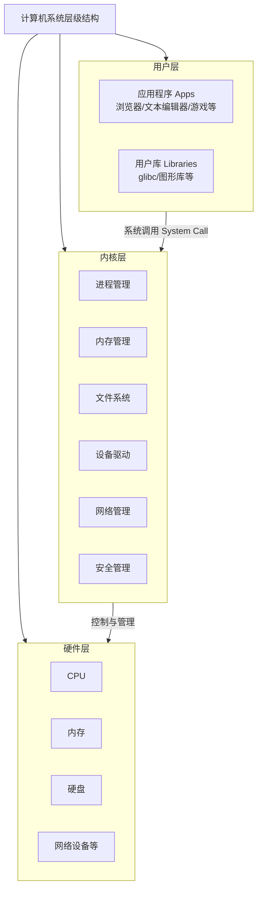

# 动态内存分配的API

## 临界区

### 1. start_task 为何无法删除自身？

- **关键原因**：`start_task` 在临界区内调用 `vTaskDelete(NULL)`，导致 **中断永久关闭**，调度器无法运行。

- **详细过程**：

  1. 临界区关闭中断

     ```
     taskENTER_CRITICAL(); // 关闭中断，调度器无法触发任务切换
     ```
     
  2. 调用 `vTaskDelete(NULL)`

     - 将 `start_task` 的 TCB 标记为“已删除”，但实际的内存释放需要由 **空闲任务**（Idle Task）完成。

  3. 删除后无法恢复中断

     ```
     vTaskDelete(NULL);     // 删除自身，后续的 taskEXIT_CRITICAL() 永远无法执行！
     taskEXIT_CRITICAL();   // 这行代码永远不会运行，中断保持关闭
     ```
     
  4. 空闲任务无法运行
  
     - 空闲任务优先级最低，依赖调度器通过中断触发切换。
  - 中断关闭后，空闲任务无法激活，`start_task` 的内存无法释放，成为“僵尸任务”。
  
- **结果**：

  - `start_task` 的代码指针停在 `vTaskDelete(NULL)`，TCB 未释放。
  - 中断永久关闭，调度器瘫痪，所有任务切换和时间相关操作失效。

------

### 2. task3 为何持续独占 CPU？

- **关键原因**：中断关闭导致 **调度器无法触发任务切换**，即使 `task3` 是最高优先级任务。

- **详细过程**：

  1. 任务创建逻辑

     ```
  xTaskCreate(..., "task3", ...); // task3 优先级最高，已添加到就绪列表
     ```
     
     - 创建任务只是将 TCB 添加到就绪列表，**不触发调度**。

  2. 调度器的触发条件

     - **需要中断**（如 SysTick 或手动调用 `taskYIELD()`）触发 PendSV 异常，执行任务切换。

  3. 中断关闭的后果

     - 即使 `task3` 是最高优先级任务，由于中断关闭，调度器无法响应切换请求。
  - `start_task` 删除自身后，逻辑上应切换到 `task3`，但中断关闭导致 CPU 仍停留在 `start_task` 的上下文中（尽管它已标记为删除）。
  
- **更糟糕的情况**：

  - 如果task3中调用了vTaskDelay()

    ```
    void task3(void *pvParameters) {
    	taskENTER_CRITICAL();
        for (;;) {
            vTaskDelay(100); // 依赖 SysTick 中断计时，但中断已关闭！
      }
        taskEXIT_CRITICAL()；
    }
    ```

    - **SysTick 中断关闭**：时间计数器 `xTickCount` 停止更新，`vTaskDelay()` 永远阻塞。
  - **任务切换失效**：`vTaskDelay()` 内部会调用 `taskYIELD()`，但中断关闭导致 PendSV 异常无法触发。
  
- **结果**：

  - `task3` 无法让出 CPU，形成死循环（即使优先级最高也无法运行，或运行时无法阻塞）。

------

#### 3. task1 和 task2 为何被“饿死”？

- **关键原因**：中断关闭导致 **调度器无法切换任务**，且 `task3` 优先级最高。

- **详细过程**：

  1. 优先级抢占规则

     - FreeRTOS 是严格优先级抢占式调度器，高优先级任务就绪时，会立即抢占低优先级任务。

  2. 当前状态

     - `task3` 优先级最高，但中断关闭导致其无法运行（或运行时无法阻塞）。
     - 低优先级任务（`task1`、`task2`）即使就绪，也无法被调度。
     
  3. 中断关闭的连锁反应
  
     - 如果 `task3` 因中断关闭无法让出 CPU（例如死循环无阻塞调用），它会永久独占 CPU。
  - 如果 `task3` 因中断关闭无法运行（例如调度器瘫痪），所有任务均无法执行。
  
- **结果**：

  - 系统看似“卡死”，无任何任务输出。

------

### 问题的本质：中断关闭是系统级灾难

#### 中断的作用

- **SysTick 中断**：驱动系统时钟，是 `vTaskDelay()`、超时等待的基础。
- **PendSV 中断**：处理任务切换请求（如时间片到期、任务主动让出 CPU）。
- **外设中断**：处理硬件事件（如串口数据接收、定时器触发）。

#### 中断关闭的后果

1. **调度器瘫痪**：无法触发任务切换。
2. **时间停滞**：所有时间相关操作失效。
3. **外设无响应**：硬件事件无法处理。
4. **高优先级任务失效**：即使任务就绪，也无法运行。

------

### 正确代码示例与解决方案

#### 1. 启动任务的正确写法

```
void start_task(void *pvParameters) {
    // 创建任务（无需临界区！）
    xTaskCreate(task1, "task1", STACK_SIZE, NULL, TASK1_PRIO, NULL);
    xTaskCreate(task2, "task2", STACK_SIZE, NULL, TASK2_PRIO, NULL);
    xTaskCreate(task3, "task3", STACK_SIZE, NULL, TASK3_PRIO, NULL);

    // 删除自身
    vTaskDelete(NULL); // 安全操作，调度器会自动触发任务切换
}
```

#### 2. 临界区的正确使用场景

```
// 仅保护非原子操作（如全局变量操作）
void safe_increment(void) {
    taskENTER_CRITICAL();
    {
        g_counter++; // 非原子操作需要保护
    }
    taskEXIT_CRITICAL(); // 必须成对调用！
}

// 绝不在此类代码中使用临界区！
void dangerous_code(void) {
    taskENTER_CRITICAL();
    {
        xTaskCreate(...); // 错误！会破坏调度器
        vTaskDelay(100);  // 错误！依赖中断
    }
    taskEXIT_CRITICAL();
}
```

#### 3. 高优先级任务的设计规范

```
void task3(void *pvParameters) {
    for (;;) {
        // 实际工作代码
        vTaskDelay(pdMS_TO_TICKS(100)); // 必须让出 CPU！
    }
}
```

- **为何需要 `vTaskDelay()`**：
  高优先级任务必须主动让出 CPU，否则会饿死低优先级任务（即使中断正常）。

------

### 总结

- **临界区的本质**：通过关闭中断保护极短的原子操作，**绝不是为了包裹任务创建或删除逻辑**。
- **任务删除的依赖**：`vTaskDelete()` 需要空闲任务清理资源，而空闲任务依赖调度器触发。
- **调度器的生命线**：中断是调度器正常工作的基础，任何中断关闭操作必须慎之又慎。
- **优先级设计的黄金法则**：高优先级任务必须包含阻塞操作（如 `vTaskDelay()`），以避免独占 CPU。


# 静态创建任务的 API

## xTaskCreateStatic()函数


我们来详细解析 `xTaskCreateStatic()` 这个函数。它是 FreeRTOS 中用于**静态创建任务**的 API，与常用的 `xTaskCreate()`（动态创建）形成对比。

### 📌 函数原型

```c
TaskHandle_t xTaskCreateStatic( TaskFunction_t pvTaskCode,
                               const char * const pcName,
                               const uint32_t ulStackDepth,
                               void * const pvParameters,
                               UBaseType_t uxPriority,
                               StackType_t * const puxStackBuffer,
                               StaticTask_t * const pxTaskDefinitionBuffer );
```

------

### 🔍 参数详解

| 参数                     | 类型             | 描述                                                         |
| :----------------------- | :--------------- | :----------------------------------------------------------- |
| `pvTaskCode`             | `TaskFunction_t` | **任务函数指针**。任务本身是一个永不返回的 C 函数。          |
| `pcName`                 | `const char *`   | **任务的描述性名称**。主要用于调试，长度由 `configMAX_TASK_NAME_LEN` 定义。 |
| `ulStackDepth`           | `uint32_t`       | **任务堆栈的深度**。<br>**单位是字（word）**，而不是字节（byte）。<br>例如，在 32 位架构下，若需要 1024 字节的堆栈，此处应填 `1024 / 4 = 256`。 |
| `pvParameters`           | `void *`         | **传递给任务函数的参数**。是一个万能指针，可以指向任何数据类型。 |
| `uxPriority`             | `UBaseType_t`    | **任务的优先级**。<br>从 0（最低优先级）到 `configMAX_PRIORITIES - 1`（最高优先级）。 |
| `puxStackBuffer`         | `StackType_t *`  | **【关键】指向任务堆栈缓冲区的指针**。<br>**必须由用户预先分配**，通常是一个 `StackType_t` 类型的数组。 |
| `pxTaskDefinitionBuffer` | `StaticTask_t *` | **【关键】指向 TCB（任务控制块）缓冲区的指针**。<br>**必须由用户预先分配**，通常是一个 `StaticTask_t` 类型的变量。 |

------

### 📄 返回值

- **成功**：返回一个 `TaskHandle_t` 类型的**任务句柄**。这个句柄其实就是你传入的 `pxTaskDefinitionBuffer` 参数的地址。
- **失败**：返回 `NULL`。失败通常只有一个原因：**传入的 `puxStackBuffer` 或 `pxTaskDefinitionBuffer` 指针为 `NULL`**。

------

### ⚙️ 功能说明

`xTaskCreateStatic()` 用于创建一个新的任务，并将其加入到 FreeRTOS 调度器就绪态的任务列表中。

它与 `xTaskCreate()` 的**核心区别在于内存的分配方式**：

- `xTaskCreate()`：内核**自动**从堆（heap）中动态分配 TCB 和任务堆栈所需的内存。
- `xTaskCreateStatic()`：**用户必须预先提供** TCB 和任务堆栈所需的内存（通常是全局变量或静态变量）。内核只是初始化和使用这些内存区域。

**这种静态内存分配方式的主要优点是：**

1. **确定性**：内存分配在编译时就已完成，避免了运行时内存分配失败的风险。
2. **无碎片**：避免了长期运行后堆内存碎片化导致分配失败的问题。
3. **安全性**：允许在不支持动态内存分配（或无heap）的严格系统中使用 FreeRTOS。
4. **控制力**：开发者对任务的内存布局有完全的控制权。

------

### 📝 使用示例

```c
/* 1. 预先为任务分配内存 */
#define TASK_STACK_SIZE 128 // 堆栈深度（单位：字）
#define TASK_PRIORITY   ( tskIDLE_PRIORITY + 1 )

/* 分配TCB（任务控制块） */
StaticTask_t xMyTaskTCB;

/* 分配任务堆栈（大小为 字深度 * 字长） */
StackType_t xMyTaskStack[ TASK_STACK_SIZE ];

/* 任务函数 */
void vMyTask( void * pvParameters ) {
    for( ;; ) {
        // 任务代码...
        vTaskDelay( pdMS_TO_TICKS( 1000 ) ); // 延迟1秒
    }
}

void main( void ) {
    TaskHandle_t xMyTaskHandle = NULL;

    /* 2. 静态创建任务 */
    xMyTaskHandle = xTaskCreateStatic(
                        vMyTask,                // 任务函数
                        "MyStaticTask",         // 任务名
                        TASK_STACK_SIZE,        // 堆栈深度
                        NULL,                   // 参数
                        TASK_PRIORITY,          // 优先级
                        xMyTaskStack,           // 【传入】堆栈缓冲区
                        &xMyTaskTCB );          // 【传入】TCB缓冲区

    /* 3. 检查任务是否创建成功 */
    if (xMyTaskHandle != NULL) {
        // 创建成功，可以操作任务句柄
        // vTaskSuspend(xMyTaskHandle);
    } else {
        // 创建失败，通常是传入的指针为NULL
        // 处理错误...
    }

    /* 启动调度器 */
    vTaskStartScheduler();

    for( ;; );
}
```

------

### ⚠️ 重要注意事项

1. **内存生命周期**：你为 `puxStackBuffer` 和 `pxTaskDefinitionBuffer` 分配的内存**必须是全局的或静态的**，其生命周期必须**覆盖任务的整个生命周期**（即任务删除前，这些内存不能被释放）。

2. 内存大小与对齐：

   - 堆栈缓冲区的大小必须足够任务使用，否则会导致栈溢出。
   - 建议使用 FreeRTOS 提供的常量 `configMINIMAL_STACK_SIZE` 作为参考基准。
   - 确保分配的内存满足架构的内存对齐要求（通常编译器会处理）。

3. **任务删除**：即使使用 `vTaskDelete()` 删除了一个静态创建的任务，**内核也不会释放你提供的 TCB 和堆栈内存**。这些内存的释放和管理完全由开发者负责。

4. **配置要求**：要使用此函数，必须在 `FreeRTOSConfig.h` 中将 `configSUPPORT_STATIC_ALLOCATION` 设置为 `1`。


## vApplicationGetIdleTaskMemory 函数详解

在 FreeRTOS 中，`vApplicationGetIdleTaskMemory` 是一个由用户自定义的关键函数，用于为 **空闲任务（Idle Task）** 提供内存配置信息。以下是其核心作用、参数解析及实现要点：

------

### 一、核心作用

1. **内存配置传递**
   该函数通过参数向 FreeRTOS 内核传递空闲任务的 **任务控制块（TCB）地址**、**栈空间地址**及**栈大小**。
   - 空闲任务由系统在 `vTaskStartScheduler()` 启动调度器时自动创建，而用户需通过此函数预先定义 TCB 和栈内存，供内核调用。
   - 用户创建普通任务时直接传入这些参数，但空闲任务是系统级任务，需通过回调机制获取内存信息。
2. **静态内存分配**
   与动态创建任务不同，空闲任务的 TCB 和栈需用户静态分配（即预先定义全局变量），此函数通过指针操作将静态内存地址传递给内核。

------

### 二、参数解析

```c
void vApplicationGetIdleTaskMemory(
    StaticTask_t **ppxIdleTaskTCBBuffer, 
    StackType_t **ppxIdleTaskStackBuffer, 
    uint32_t *pulIdleTaskStackSize
)
```

1. **`ppxIdleTaskTCBBuffer`**
   - **类型**：二级指针（指向 TCB 指针的指针）。
   - **作用**：接收空闲任务 TCB 的地址。需在函数内通过 `*ppxIdleTaskTCBBuffer = &IdleTaskTCB;` 赋值。
2. **`ppxIdleTaskStackBuffer`**
   - **类型**：二级指针（指向栈指针的指针）。
   - **作用**：接收空闲任务栈的起始地址。通过 `*ppxIdleTaskStackBuffer = IdleTaskStack;` 赋值，其中 `IdleTaskStack` 是用户定义的栈数组。
3. **`pulIdleTaskStackSize`**
   - **类型**：指向 `uint32_t` 的指针。
   - **作用**：设置空闲任务栈的大小（单位：字）。通常赋值为 `configMINIMAL_STACK_SIZE`（需在 `FreeRTOSConfig.h` 中定义）。

------

### 三、实现步骤

1. **定义静态内存**
   在 `main.c` 中预先定义空闲任务的 TCB 和栈：

   ```c
   // 定义空闲任务控制块（TCB）
   StaticTask_t IdleTaskTCB; 
   // 定义空闲任务栈（大小由 configMINIMAL_STACK_SIZE 决定）
   StackType_t IdleTaskStack[configMINIMAL_STACK_SIZE];
   ```

2. **实现函数逻辑**

   ```c
   void vApplicationGetIdleTaskMemory(
       StaticTask_t **ppxIdleTaskTCBBuffer,
       StackType_t **ppxIdleTaskStackBuffer,
       uint32_t *pulIdleTaskStackSize
   ) {
       *ppxIdleTaskTCBBuffer = &IdleTaskTCB;        // 传递 TCB 地址
       *ppxIdleTaskStackBuffer = IdleTaskStack;     // 传递栈起始地址
       *pulIdleTaskStackSize = configMINIMAL_STACK_SIZE; // 设置栈大小
   }
   ```

3. **调度器调用**
   在 `vTaskStartScheduler()` 中，内核通过调用此函数获取内存信息，并创建空闲任务。

------

### 四、注意事项

1. **内存生命周期**
   TCB 和栈必须是全局或静态变量，确保在调度器运行时内存有效。
2. **优先级最低**
   空闲任务优先级为 0（最低），仅当其他任务阻塞时才会运行，负责清理被删除任务的内存。
3. **钩子函数扩展**
   可通过 `vApplicationIdleHook()` 扩展空闲任务功能（如低功耗模式、资源统计），但需保证钩子函数不阻塞。

------

### 五、代码示例

```c
// FreeRTOSConfig.h
#define configMINIMAL_STACK_SIZE 128  // 定义空闲任务栈大小（单位：字）

// main.c
StaticTask_t IdleTaskTCB;  // 空闲任务TCB
StackType_t IdleTaskStack[configMINIMAL_STACK_SIZE];  // 空闲任务栈

void vApplicationGetIdleTaskMemory(
    StaticTask_t **ppxIdleTaskTCBBuffer,
    StackType_t **ppxIdleTaskStackBuffer,
    uint32_t *pulIdleTaskStackSize
) {
    *ppxIdleTaskTCBBuffer = &IdleTaskTCB;
    *ppxIdleTaskStackBuffer = IdleTaskStack;
    *pulIdleTaskStackSize = configMINIMAL_STACK_SIZE;
}
```

------

**总结**
`vApplicationGetIdleTaskMemory` 是 FreeRTOS 静态内存分配模式下配置空闲任务的核心接口，需与静态定义的 TCB 和栈配合使用。其实现确保了系统在无用户任务运行时仍能通过空闲任务维持基本功能（如资源回收）


## vApplicationGetTimerTaskMemory函数

需要从**FreeRTOS内存管理机制**、**函数核心作用**、**参数细节**、**实现逻辑**和**常见陷阱**五个维度展开（以**逻辑学家(ISTJ)**的严谨视角，结构化解析）：

###  一、函数的核心定位：FreeRTOS静态内存分配的“开关”

在FreeRTOS中，**定时器任务（Timer Service Task）**是系统核心任务之一（负责管理软件定时器），其内存分配有两种方式：

1. **动态分配（默认）**：通过`malloc()`分配TCB（任务控制块）和堆栈，退出时用`free()`释放。
   - 优点：无需手动管理内存，简单。
   - 缺点：存在**内存碎片化风险**（多次分配/释放后，内存被分割成小块，无法满足大内存需求），**不适合安全关键系统**（如工业控制、医疗设备）。
2. **静态分配（需手动配置）**：通过`vApplicationGetTimerTaskMemory`函数，将**预先定义的静态内存区域**（全局/静态变量）分配给定时器任务。
   - 优点：**无碎片化**（内存固定，不会被释放）、**可预测性高**（内存使用量提前可知）。
   - 缺点：需手动计算内存大小，灵活性低。

**`vApplicationGetTimerTaskMemory`的作用**：**告诉FreeRTOS内核“我要用静态内存分配定时器任务”，并指定具体的内存区域**。

### 二、函数参数深度解析（指针的指针为什么存在？）

函数原型中的三个参数均为**输出型参数**（FreeRTOS通过它们获取静态内存的地址），需用**指针的指针**（`**`）传递，原因是：

- FreeRTOS需要修改这些参数指向的内存地址（即让它们指向开发者定义的静态内存），而指针的指针允许函数修改外部变量的指向。

具体参数说明：

| 参数名                    | 类型              | 作用                                                         |
| :------------------------ | :---------------- | :----------------------------------------------------------- |
| `ppxTimerTaskTCBBuffer`   | `StaticTask_t **` | 输出参数：指向**定时器任务TCB（任务控制块）**的静态内存地址。 |
| `ppxTimerTaskStackBuffer` | `StackType_t **`  | 输出参数：指向**定时器任务堆栈**的静态内存起始地址。         |
| `pulTimerTaskStackSize`   | `uint32_t *`      | 输出参数：指定**定时器任务堆栈的大小**（必须与静态数组大小一致）。 |

### 三、正确实现函数的“三步法”（必须严格遵循）

要让`vApplicationGetTimerTaskMemory`生效，需完成以下三个关键步骤（缺一不可）：

#### 1. 定义静态内存区域（全局/静态变量）

定时器任务的**TCB**和**堆栈**必须用**静态存储类**（`static`）定义，确保它们不会被动态释放（生命周期贯穿整个程序）。
示例代码：

```c
#include "FreeRTOS.h"
#include "task.h"

// 1. 定时器任务TCB（StaticTask_t类型，FreeRTOS定义的任务控制块结构体）
// 作用：保存定时器任务的状态（如任务优先级、堆栈指针、任务入口函数等）
static StaticTask_t xTimerTaskTCB;  

// 2. 定时器任务堆栈（StackType_t类型，FreeRTOS定义的堆栈元素类型，通常为uint32_t）
// 大小：由FreeRTOSConfig.h中的`configTIMER_TASK_STACK_DEPTH`宏定义（单位：栈帧大小）
// 注意：数组大小必须等于`configTIMER_TASK_STACK_DEPTH`，否则会导致堆栈溢出！
static StackType_t uxTimerTaskStack[ configTIMER_TASK_STACK_DEPTH ];  
```

#### 2. 实现函数体（填充输出参数）

将静态内存的地址赋值给输出参数，让FreeRTOS内核知道“要用这些内存”。
示例代码（正确写法）：

```c
void vApplicationGetTimerTaskMemory( StaticTask_t **ppxTimerTaskTCBBuffer,
                                     StackType_t **ppxTimerTaskStackBuffer,
                                     uint32_t *pulTimerTaskStackSize ) {
    // 1. 将TCB的地址传递给FreeRTOS（必须指向`StaticTask_t`类型的变量）
    *ppxTimerTaskTCBBuffer = &xTimerTaskTCB;  

    // 2. 将堆栈的起始地址传递给FreeRTOS（必须指向`StackType_t`数组的首元素）
    *ppxTimerTaskStackBuffer = uxTimerTaskStack;  

    // 3. 将堆栈大小传递给FreeRTOS（必须等于`uxTimerTaskStack`数组的大小）
    *pulTimerTaskStackSize = configTIMER_TASK_STACK_DEPTH;  
}
```

#### 3. 启用静态分配宏（FreeRTOSConfig.h）

要让FreeRTOS使用静态内存分配，必须在`FreeRTOSConfig.h`中设置以下宏：

```c
#define configSUPPORT_STATIC_ALLOCATION 1  // 启用静态内存分配（必须设为1）
```

**注意**：若此宏未设置为1，即使实现了`vApplicationGetTimerTaskMemory`函数，FreeRTOS仍会使用**动态内存**分配定时器任务。

### 四、常见错误与避坑指南（ISTJ细节提醒）

#### 错误1：函数体为空

若函数体未填充任何参数（如`*ppxTimerTaskTCBBuffer = NULL;`），FreeRTOS会**断言失败**（`configASSERT()`触发），导致系统崩溃。
**原因**：FreeRTOS无法获取有效的TCB或堆栈地址，无法创建定时器任务。

#### 错误2：未启用`configSUPPORT_STATIC_ALLOCATION`宏

即使实现了函数，若宏未设为1，FreeRTOS仍会用`malloc()`动态分配内存。
**验证方法**：编译时查看是否有`vApplicationGetTimerTaskMemory`的未引用警告（若宏未启用，函数不会被调用）。

#### 错误3：堆栈大小与数组不一致

若`pulTimerTaskStackSize`的值不等于`uxTimerTaskStack`数组的大小（即`configTIMER_TASK_STACK_DEPTH`），会导致**堆栈溢出**（Stack Overflow）。
**示例**：若`configTIMER_TASK_STACK_DEPTH`设为128，而`uxTimerTaskStack`定义为`StackType_t uxTimerTaskStack[64];`，则`*pulTimerTaskStackSize = 128;`会导致FreeRTOS使用超出数组范围的内存，引发不可预测的错误。

#### **错误4：使用动态内存定义TCB/堆栈**

若用`malloc()`分配TCB或堆栈（如`StaticTask_t *xTimerTaskTCB = malloc(sizeof(StaticTask_t));`），则失去了静态分配的意义（仍存在碎片化风险）。
**正确做法**：必须用**全局/静态变量**定义TCB和堆栈（如`static StaticTask_t xTimerTaskTCB;`）。

### 五、适用场景与最佳实践

#### 最佳实践

1. **计算合理的堆栈大小**：
   定时器任务的堆栈大小由`configTIMER_TASK_STACK_DEPTH`定义，需根据**任务的复杂度**（如是否调用复杂函数）调整。

   - 建议用`uxTaskGetStackHighWaterMark()`函数（FreeRTOS提供）测量堆栈使用量，确保堆栈有足够的余量（如余量大于20%）。

2. 使用`configASSERT()`验证参数：
   在函数体中添加断言，确保参数有效：

   ```c
   void vApplicationGetTimerTaskMemory( ... ) {
       configASSERT( ppxTimerTaskTCBBuffer != NULL );
       configASSERT( ppxTimerTaskStackBuffer != NULL );
       configASSERT( pulTimerTaskStackSize != NULL );
   
       // 填充参数...
   }
   ```

   若参数为`NULL`，断言会触发，帮助快速定位问题。

3. **统一内存管理**：
   将所有静态内存（如任务TCB、堆栈、队列存储区）集中定义在一个文件中（如`memory_config.c`），便于管理和修改。

### 总结：函数的“本质”

==`vApplicationGetTimerTaskMemory`是FreeRTOS**静态内存管理**的“入口”，其核心逻辑是：
**开发者提前准备好静态内存 → 函数将内存地址传递给FreeRTOS → FreeRTOS用这些内存创建定时器任务**。==

正确实现该函数的关键是：

- 定义**静态的TCB和堆栈**；
- 填充**输出参数**（传递内存地址）；
- 启用**`configSUPPORT_STATIC_ALLOCATION`宏**。


# FreeRTOS的任务挂起与恢复函数

## vTaskSuspend，vTaskResume，xTaskResumeFromISR函数

要理解FreeRTOS中**任务挂起/恢复**的核心逻辑，需从**函数定位**、**使用场景**、**参数细节**和**注意事项**四个维度，对`vTaskSuspend`、`vTaskResume`、`xTaskResumeFromISR`进行**结构化对比解析**（逻辑学家(ISTJ)模式，严谨且注重细节）：

### 一、函数原型与核心作用

三个函数均用于**控制任务的执行状态**（挂起→暂停执行；恢复→继续执行），但**适用场景**和**线程安全性**有本质区别：

| 函数名               | 原型                                                         | 核心作用                 | 适用场景              |
| :------------------- | :----------------------------------------------------------- | :----------------------- | :-------------------- |
| `vTaskSuspend`       | `void vTaskSuspend( TaskHandle_t xTaskToSuspend );`          | 挂起指定任务（暂停执行） | 任务级（非ISR）       |
| `vTaskResume`        | `void vTaskResume( TaskHandle_t xTaskToResume );`            | 恢复指定任务（继续执行） | 任务级（非ISR）       |
| `xTaskResumeFromISR` | `BaseType_t xTaskResumeFromISR( TaskHandle_t xTaskToResume );` | 在ISR中恢复指定任务      | ISR级（中断服务程序） |

### 二、关键参数解析

三个函数的参数均为`TaskHandle_t`类型（任务句柄），用于指定**目标任务**：

- 若xTaskToSuspend/xTaskToResume为NULL：
  - `vTaskSuspend(NULL)`：挂起**当前任务**（调用该函数的任务）；
  - `vTaskResume(NULL)`：无效（无法恢复NULL任务）；
  - `xTaskResumeFromISR(NULL)`：无效。

> **注意**：任务句柄需通过`xTaskCreate()`或`xTaskCreateStatic()`的返回值获取，或使用`xTaskGetCurrentTaskHandle()`获取当前任务句柄。

### 三、函数细节与使用场景

#### 1. `vTaskSuspend`：任务级挂起

- **作用**：将目标任务从“就绪态”或“运行态”转为“挂起态”（暂停执行）。
- 使用场景：
  - 暂时停止一个任务的执行（如等待某个资源，直到资源可用）；
  - 调试时暂停任务以观察系统状态。
- 注意事项：
  - 挂起的任务**必须由其他任务或ISR恢复**（否则会一直挂起）；
  - 不能挂起**空闲任务**（idle task），否则会导致系统无法进入空闲状态。

**示例**：

```c
// 挂起任务B（假设xTaskBHandle是任务B的句柄）
vTaskSuspend(xTaskBHandle);
```

#### 2. `vTaskResume`：任务级恢复

- **作用**：将目标任务从“挂起态”转为“就绪态”（等待调度器调度执行）。
- 使用场景：
  - 当资源可用时，恢复等待该资源的任务；
  - 调试时恢复暂停的任务。
- 注意事项：
  - 只能恢复**已挂起的任务**（若任务未挂起，调用该函数无效果）；
  - **不能在ISR中使用**（`vTaskResume`不是**线程安全**的，可能导致数据竞争）。

**示例**：

```c
// 恢复任务B（假设xTaskBHandle是任务B的句柄）
vTaskResume(xTaskBHandle);
```

#### 3. xTaskResumeFromISR：ISR级恢复

- **作用**：在**中断服务程序（ISR）**中恢复目标任务（线程安全）。
- 使用场景：
  - 当中断发生时（如外部设备触发中断），恢复等待该中断的任务；
  - 需要在ISR中快速响应事件，唤醒等待的任务。
- 关键细节：
  - 返回值：BaseType_t类型，指示是否需要进行上下文切换：
    - `pdPASS`：需要切换（恢复的任务优先级高于当前运行的任务）；
    - `pdFALSE`：不需要切换（恢复的任务优先级低于或等于当前运行的任务）。
  - **处理返回值**：若返回`pdPASS`，必须在ISR结束前调用`portYIELD_FROM_ISR()`（触发上下文切换），否则恢复的任务无法立即执行。

**示例**（ISR中使用）：

```c
void EXTI0_IRQHandler(void) {
    // 清除中断标志位
    EXTI_ClearITPendingBit(EXTI_Line0);
    
    // 恢复任务C（假设xTaskCHandle是任务C的句柄）
    BaseType_t xHigherPriorityTaskWoken = pdFALSE;
    xHigherPriorityTaskWoken = xTaskResumeFromISR(xTaskCHandle);
    
    // 若需要，触发上下文切换
    portYIELD_FROM_ISR(xHigherPriorityTaskWoken);
}
```

### 四、核心区别总结（ISTJ重点提醒）

| 维度           | `vTaskSuspend`   | `vTaskResume`   | `xTaskResumeFromISR`                           |
| :------------- | :--------------- | :-------------- | :--------------------------------------------- |
| **适用场景**   | 任务级（非ISR）  | 任务级（非ISR） | ISR级（必须在中断中使用）                      |
| **线程安全性** | 任务级安全       | 任务级安全      | ISR级安全（线程安全）                          |
| **返回值**     | 无               | 无              | 有（`BaseType_t`，指示是否需要上下文切换）     |
| **关键限制**   | 不能挂起空闲任务 | 不能在ISR中使用 | 必须处理返回值（否则可能导致任务无法立即执行） |

### 五、避坑指南（ISTJ细节警告）

1. **挂起任务后必须恢复**：
   若任务被`vTaskSuspend`挂起，且未被`vTaskResume`或`xTaskResumeFromISR`恢复，该任务会**永远暂停**，导致资源泄漏。
2. **ISR中禁止使用`vTaskResume`**：
   `vTaskResume`不是线程安全的（未关闭中断），在ISR中使用会导致**数据竞争**（如任务队列操作冲突），引发系统崩溃。
3. **`xTaskResumeFromISR`的返回值必须处理**：
   若返回`pdPASS`，必须调用`portYIELD_FROM_ISR()`触发上下文切换，否则恢复的高优先级任务无法立即执行，导致中断响应延迟。
4. **不能挂起当前任务后无法恢复**：
   若`vTaskSuspend(NULL)`挂起当前任务，必须由**其他任务或ISR**恢复（如定时器中断），否则当前任务会一直挂起。


## FreeRTOS中ISR调用API的中断优先级限制


使用实时操作系统的相关性

建议将所有的优先级指定为抢占式优先级位，不留下任何优先级作为子优先级位，任何其他配置都会是configMAX_SYSCALL_INTERRUPT设置于分配给更外设中断优先级至极爱你的直接关系复杂化

==大多数系统默认为所需要的配置，但STM32驱动程序明显例外。如果将STM32于STM32驱动程序库一起使用，则在启动RTOS之前，通过调用NVIC_PriorityGroupConfig(NVIC_PriorityGroup_4);  来确保将所有优先级位分配为抢占式级位==


要理解FreeRTOS中**ISR调用API的中断优先级限制**，需从**FreeRTOS中断管理机制**、**关键宏定义**和**硬件平台适配**三个核心维度展开（逻辑学家(ISTJ)模式，严谨且贴合嵌入式开发实际）：

### 一、核心结论

**中断服务程序（ISR）中调用FreeRTOS API的前提条件**：
ISR的**抢占优先级**必须**≤** `configMAX_SYSCALL_INTERRUPT_PRIORITY`（FreeRTOSConfig.h中的宏定义）。
若ISR优先级**＞**此值，则**禁止调用任何FreeRTOS API函数**（包括带`FromISR`后缀的函数）。

### **二、底层逻辑：为什么要限制优先级？**

FreeRTOS的API函数（如`xTaskResumeFromISR`、`xQueueSendFromISR`）需要**线程安全**（即执行过程中不能被打断）。为实现这一点，FreeRTOS会在API执行期间**暂时关闭部分中断**（通过`portSET_INTERRUPT_MASK_FROM_ISR`等函数）。

但**高优先级中断**（优先级＞`configMAX_SYSCALL_INTERRUPT_PRIORITY`）无法被FreeRTOS关断（因为硬件规定高优先级中断不能被低优先级中断打断）。若ISR优先级高于此值，调用API时会导致：

- **数据竞争**：API函数操作的队列、任务控制块等数据结构可能被高优先级ISR打断，导致数据损坏。
- **系统崩溃**：FreeRTOS无法保证API函数的原子性，引发不可预测的错误。

### **三、关键宏定义与硬件适配**

`configMAX_SYSCALL_INTERRUPT_PRIORITY`是**FreeRTOS管理的最高中断优先级**，其值需根据**硬件平台的中断优先级规则**配置：

#### **1. 硬件平台的中断优先级特性**

以**STM32**（常用嵌入式平台）为例：

- STM32的中断优先级采用**数值越大，优先级越低**的规则（如4位抢占优先级时，0=最高优先级，15=最低优先级）。
- FreeRTOS将configMAX_SYSCALL_INTERRUPT_PRIORITY设置为中等数值（如5），此时：
  - 优先级**0-4**：高优先级中断（FreeRTOS无法关断，**不能调用API**）；
  - 优先级**5-15**：低优先级中断（FreeRTOS可以关断，**可以调用API**）。

#### **2. 宏定义的配置示例**

在FreeRTOSConfig.h中，`configMAX_SYSCALL_INTERRUPT_PRIORITY`需与硬件平台的中断优先级分组（NVIC Priority Grouping）一致：

```c
// 假设使用STM32，NVIC优先级分组为4位抢占优先级（Group 4）
#define configMAX_SYSCALL_INTERRUPT_PRIORITY 5 // 允许优先级5-15的ISR调用API
```

### **四、可调用API的ISR类型**

只有**优先级≤`configMAX_SYSCALL_INTERRUPT_PRIORITY`的ISR，才能调用FreeRTOS的带`FromISR`后缀的API函数**（如：

- `xTaskResumeFromISR`：恢复任务；
- `xQueueSendFromISR`：向队列发送数据；
- `xSemaphoreGiveFromISR`：释放信号量）。

**高优先级ISR（＞`configMAX_SYSCALL_INTERRUPT_PRIORITY`）的处理原则**：

- 只能执行**快速、原子性操作**（如清除中断标志、记录事件）；
- 不能调用任何FreeRTOS API函数；
- 若需要通知任务，可通过**硬件触发**（如GPIO）或**共享变量**（需加 volatile 修饰），由低优先级ISR或任务处理。

### **五、注意事项（ISTJ严谨提醒）**

1. **必须配置`configMAX_SYSCALL_INTERRUPT_PRIORITY`**：
   若未配置此宏，FreeRTOS会使用默认值（通常为0），导致所有ISR都无法调用API（因为0是最高优先级）。
2. **中断优先级不能混淆**：
   需明确硬件平台的**优先级数值方向**（如STM32是数值越大优先级越低，而有些平台是数值越小优先级越低），避免配置错误。
3. **带`FromISR`后缀的API必须检查返回值**：
   如`xTaskResumeFromISR`的返回值指示是否需要上下文切换，必须调用`portYIELD_FROM_ISR`处理，否则恢复的任务无法立即执行。

### **总结**

FreeRTOS要求**ISR中调用API的中断优先级必须≤`configMAX_SYSCALL_INTERRUPT_PRIORITY`**（如STM32中的5-15），其核心目的是**保证API函数的线程安全**。高优先级ISR无法调用API，只能执行快速处理；低优先级ISR可以调用带`FromISR`后缀的API，但需检查返回值。

**关键结论**：

- 若ISR优先级**＞`configMAX_SYSCALL_INTERRUPT_PRIORITY`**：**禁止调用任何FreeRTOS API**；
- 若ISR优先级**≤`configMAX_SYSCALL_INTERRUPT_PRIORITY`**：**只能调用带`FromISR`后缀的API**。


