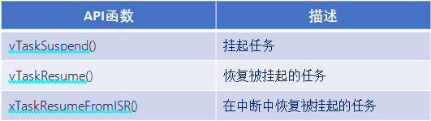
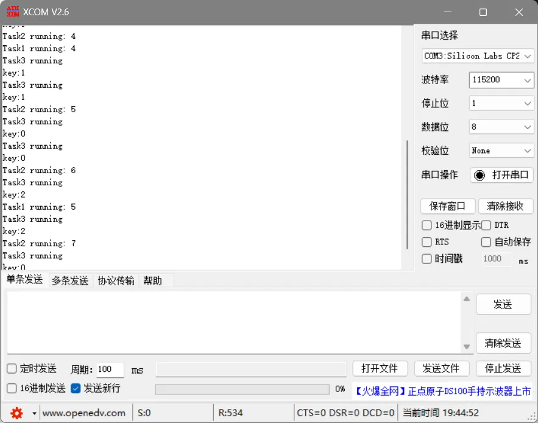
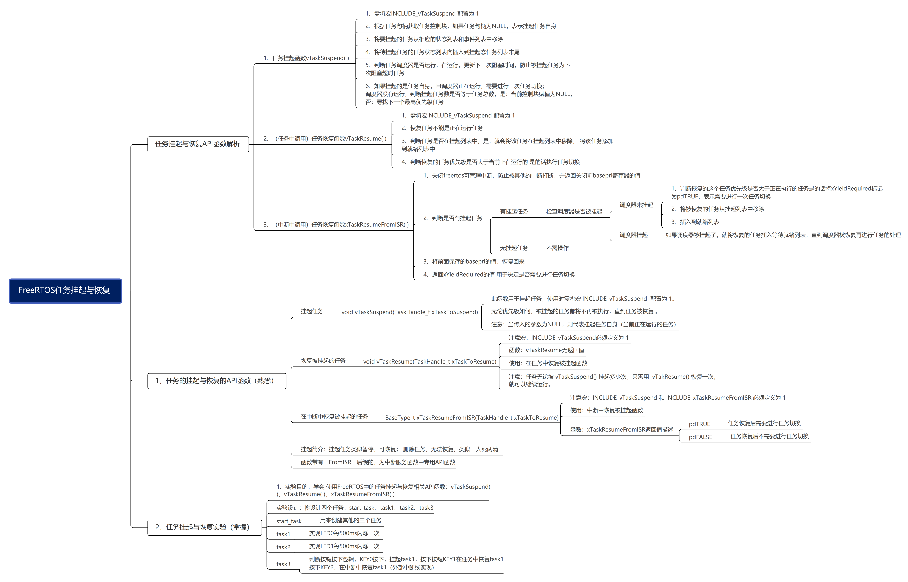

# FreeRTOS的任务挂起与恢复函数介绍

------


## 一、任务挂起和任务恢复介绍(熟悉)

### 1、任务的挂起与恢复的API函数

答：



- **挂起**：挂起任务类似暂停，可恢复； 删除任务，无法恢复，类似“人死两清”。
- **恢复**：恢复被挂起的任务。
- **“FromISR”**：带有FromISR后缀是在中断函数中专用的API函数。

------


## 二、任务挂起(熟悉)

### 1、任务挂起函数介绍

答：


1. 任务挂起函数用于挂起任务，使用时需要将将FreeRTOSConfig.h文件中宏INCLUDE_vTaskSuspend配置为1。

2. 无论优先级如何，被挂起的任务都将不再被执行，直到任务被恢复。

> 注意：当传入的参数是NULL，则代表挂起任务自身(当前正在运行的任务)。


### 2、任务挂起函数内部实现

答：

1. 获取所要挂起任务的控制块。（根据任务句柄获取任务控制块，如果任务句柄为NULL，表示挂起任务本身。）
2. 移除所在列表。（将要挂起的任务从相应的状态列表和事件列表中移除。）
3. 插入挂起任务列表。（将待挂起任务的任务状态列表项插入到挂起状态列表末尾。）
4. 判断任务调度器是否运行。（判断任务调度器是否运行，在运行，更新下一次阻塞时间，防止被挂起任务为下一个阻塞超时任务。）
5. 判断待挂起任务是否为当前任务。（如果挂起的是任务自身，且调度器正在运行，需要进行一次任务切换；调度器没有运行，判断挂起任务数是否等于任务总数，是：当前控制块赋值为NULL，否：寻找下一个最高优先级任务。）

------


## 三、任务恢复(熟悉)

### 1、任务恢复函数介绍(任务中恢复)

答：

-1762856316134-22.png)

使用该函数时需要将FreeRTOSConfig.h文件中宏INCLUDE_vTaskSuspend配置为1。

> 注意：任务无论被vTaskSuspend()挂起多少次，只需在任务中调用vTaskResume()恢复一次就能继续运行，且被恢复的任务会进入就绪态。


### 2、任务恢复函数(任务中恢复)内部实现

答：

1. 恢复任务不能是正在运行任务。
2. 判断任务是否在挂起列表中。（是：就会将该任务在挂起列表中移除，将该任务添加到就绪列表中。）
3. 判断恢复任务优先级。（判断恢复的任务优先级是否大于当前正在运行的任务，是的话，执行任务切换。）


### 3、任务恢复函数介绍(中断中恢复)

答：
-1762856392014-24.png)

1. 使用该函数注意要将FreeRTOSConfig.h文件中宏INCLUDE_vTaskSuspend和INCLUDE_xTaskResumeFromISR配置为1。

2. 该函数专用于中断服务函数中，用于解挂被挂起任务。

> 注意：中断服务程序中要调用freeRTOS的API函数则中断优先级不能高于FreeRTOS所管理的最高优先级（中断优先级需要在5-15这个范围内）。
>
> ​	在函数+解析中解释


### 4、任务恢复函数(中断中恢复)内部实现

答：

1. 关闭freertos可管理中断，防止被其他的中断打断，并返回关闭前basepri寄存器的值。
2. 判断是否有挂起任务。
3. 将前面保存的basepri的值，恢复回来。
4. 返回xYieldRequired的值 用于决定是否需要进行任务切换。


### 5、挂起与恢复调度器

1. vTaskSuspendAll()：挂起任务调度器，调度器不会进行任务切换，当前任务一直运行。

2.  xTaskResumeAll()：恢复任务调度器，调度器继续任务切换。


------


# FreeRTOS的任务挂起与恢复函数实验

1. 目标：学会使用FreeRTOS中的任务挂起和恢复相关API函数，vTaskSuspend()、vTaskResume()、xTaskResumeFromISR()

2. 实验设计：
   - start_task：创建其他3个任务
   - task1：打印Task1 running，同时实现LED每500ms闪烁一次
   - task2：打印Task2 running
   - task3：判断按键按下，PA0的KEY0按下，挂起task1，按下PA1的KEY1，恢复task1;
   -  按下PA15的Key2，在中断中恢复task1(外部中断实现)。


源码：

```c
#include "stm32f4xx.h"                  // STM32F4系列微控制器头文件
#include "freertos.h"                   // FreeRTOS实时操作系统头文件
#include "task.h"                       // FreeRTOS任务管理头文件
#include "queue.h"                      // FreeRTOS队列管理头文件
#include "usart.h"                      // 串口通信头文件

// 任务配置宏定义
#define START_TASK_STACK_SIZE 128       // 启动任务栈大小（字）
#define START_TASK_PRIORITY 2           // 启动任务优先级


void DWT_Init(void);
void Delay_us(uint32_t us);
void Delay_ms(uint32_t ms);

/**
 * @brief LED初始化函数
 * 配置GPIOC的Pin13作为LED控制引脚
 */
void LED_Init(void)
{		
    // 使能GPIOC时钟（AHB1总线）
    RCC_AHB1PeriphClockCmd(RCC_AHB1Periph_GPIOC, ENABLE);

    // 配置GPIO初始化结构体
    GPIO_InitTypeDef GPIO_InitStructure;
	GPIO_StructInit(&GPIO_InitStructure);
    GPIO_InitStructure.GPIO_Pin = GPIO_Pin_13;        // 选择引脚13
    GPIO_InitStructure.GPIO_Mode = GPIO_Mode_OUT;     // 输出模式
    GPIO_InitStructure.GPIO_OType = GPIO_OType_PP;    // 推挽输出
    GPIO_InitStructure.GPIO_Speed = GPIO_Speed_50MHz; // 输出速度50MHz
    GPIO_InitStructure.GPIO_PuPd = GPIO_PuPd_NOPULL;  // 无上拉下拉电阻
    GPIO_Init(GPIOC, &GPIO_InitStructure);            // 初始化GPIOC
}

void Key_Init(void){
	RCC_AHB1PeriphClockCmd(RCC_AHB1Periph_GPIOA, ENABLE);
	GPIO_InitTypeDef GPIO_InitStructure;
	GPIO_StructInit(&GPIO_InitStructure);
	GPIO_InitStructure.GPIO_Pin = GPIO_Pin_15 |  GPIO_Pin_0 | GPIO_Pin_1;
	GPIO_InitStructure.GPIO_Mode = GPIO_Mode_IN;
	GPIO_InitStructure.GPIO_Speed = GPIO_Speed_50MHz;
	GPIO_InitStructure.GPIO_PuPd = GPIO_PuPd_UP;
	GPIO_Init(GPIOA, &GPIO_InitStructure);  
}

uint8_t Key_GetNum(void)
{
	
	if (GPIO_ReadInputDataBit(GPIOA, GPIO_Pin_0) == 0)
	{
		vTaskDelay(20);
		if(GPIO_ReadInputDataBit(GPIOA, GPIO_Pin_0) == 0){
			return 1;
		}
	}
	else if (GPIO_ReadInputDataBit(GPIOA, GPIO_Pin_1) == 0)
	{
		vTaskDelay(20);
		if(GPIO_ReadInputDataBit(GPIOA, GPIO_Pin_1) == 0){
			return 2;
		}
	}
	else return 0;
}

void EXTILine15_Init(void){
	EXTI_InitTypeDef EXTI_InitStructure;
	RCC_APB2PeriphClockCmd(RCC_APB2Periph_SYSCFG, ENABLE);
	SYSCFG_EXTILineConfig(EXTI_PortSourceGPIOA, EXTI_PinSource15);
	
	EXTI_InitStructure.EXTI_Line = EXTI_Line15;
	EXTI_InitStructure.EXTI_Mode = EXTI_Mode_Interrupt;
	EXTI_InitStructure.EXTI_Trigger = EXTI_Trigger_Falling;
	EXTI_InitStructure.EXTI_LineCmd = ENABLE;
	EXTI_Init(&EXTI_InitStructure);
	
	NVIC_SetPriority(EXTI15_10_IRQn, 6);
	NVIC_EnableIRQ(EXTI15_10_IRQn);	
}


// 任务句柄声明（用于引用和管理任务）
TaskHandle_t MytaskHandler1;    // 任务1句柄
TaskHandle_t MytaskHandler2;    // 任务2句柄
TaskHandle_t MytaskHandler3;    // 任务3句柄
TaskHandle_t StarttaskHandler;  // 启动任务句柄


/**
 * @brief 任务1函数
 * 功能：每500个时钟节拍打印"Task1 running"
 * @param arg 任务参数（未使用）
 */
void Task1(void * arg){
	uint32_t task1_num = 0;
    while(1){
        taskENTER_CRITICAL();    // 进入临界区（禁用中断），保护串口输出
        printf("Task1 running: %d\r\n", ++task1_num);
        taskEXIT_CRITICAL();     // 退出临界区（启用中断）
		GPIO_ResetBits(GPIOC, GPIO_Pin_13);
        vTaskDelay(500);         // 延迟500个时钟节拍（约500ms，取决于系统时钟配置）
		GPIO_SetBits(GPIOC, GPIO_Pin_13);
        vTaskDelay(500);         // 延迟500个时钟节拍（约500ms，取决于系统时钟配置）
    }	
}

/**
 * @brief 任务2函数
 * 功能：每500个时钟节拍打印"Task2 running"
 * @param arg 任务参数（未使用）
 */
void Task2(void * arg){
	uint32_t task2_num = 0;
    while(1){
        taskENTER_CRITICAL();    // 进入临界区
        printf("Task2 running: %d\r\n", ++task2_num);
        taskEXIT_CRITICAL();     // 退出临界区
        vTaskDelay(1000);         // 延迟500个时钟节拍
    }
}

/**
 * @brief 任务3函数
 * 功能：控制GPIOC Pin13上的LED闪烁（500ms亮，500ms灭）
 * @param arg 任务参数（未使用）
 */
void Task3(void * arg){
    while(1){
		uint8_t key = 0;
		key = Key_GetNum();
		printf("key:%d\r\n", key);
		if(key == 1){
			vTaskSuspend(MytaskHandler1);
		}else if(key == 2){
			printf("在任务中恢复task1\r\n");
			vTaskResume(MytaskHandler1);
		}
		vTaskDelay(500);
    }
}

/**
 * @brief 启动任务函数
 * 功能：创建其他三个任务后自行删除
 * @param arg 任务参数（未使用）
 */
void Starttask(void * arg){
    // 进入临界区保护串口输出
    taskENTER_CRITICAL();
    printf("Starttask running\r\n");  // 打印启动任务运行信息
    taskEXIT_CRITICAL();
    
    // 使用动态内存分配方式创建任务1
    xTaskCreate(Task1,                        // 任务函数指针
               "MyFirstTask",                 // 任务名称（用于调试）
               START_TASK_STACK_SIZE,         // 栈大小（字）
               NULL,                          // 传递给任务的参数
               START_TASK_PRIORITY,           // 任务优先级
               &MytaskHandler1);              // 任务句柄指针
    
    // 使用动态内存分配方式创建任务2
    xTaskCreate(Task2, 
               "MySecondTask", 
               START_TASK_STACK_SIZE, 
               NULL, 
               START_TASK_PRIORITY, 
               &MytaskHandler2);
    
    // 使用动态内存分配方式创建任务3
    xTaskCreate(Task3, 
               "MyThirdTask", 
               START_TASK_STACK_SIZE, 
               NULL, 
               START_TASK_PRIORITY, 
               &MytaskHandler3);
    
    // 删除当前任务（启动任务），释放其占用的资源
    vTaskDelete(NULL);
}

/**
 * @brief 主函数
 * 程序入口点，初始化硬件并启动RTOS调度器
 */
int main(void)
{
	NVIC_PriorityGroupConfig(NVIC_PriorityGroup_4);
    LED_Init();                     // 初始化LED GPIO引脚
	Key_Init();
    Usart1_Init(115200);            // 初始化串口1，波特率115200
	EXTILine15_Init();
    
    // 创建启动任务（使用动态内存分配）
    xTaskCreate(Starttask,                  // 任务函数指针
               "StartTask",                 // 任务名称
               START_TASK_STACK_SIZE,       // 栈大小
               NULL,                        // 任务参数
               START_TASK_PRIORITY,         // 任务优先级
               &StarttaskHandler);          // 任务句柄
    
    // 启动FreeRTOS调度器（程序将在此处开始运行任务）
    vTaskStartScheduler();
    
    // 正常情况下，调度器启动后不会执行到这里
    // 如果调度器启动失败，程序将在此处循环
    while (1)
    {		
        // 空循环，用于处理调度器启动失败的情况
    }	
}

void EXTI15_10_IRQHandler(void) {
	if(EXTI_GetITStatus(EXTI_Line15) != RESET){
		BaseType_t xYieldRequired;
		xYieldRequired = xTaskResumeFromISR(MytaskHandler1);
		printf("在中断中恢复task1\r\n");
		if(xYieldRequired == pdTRUE){
			portYIELD_FROM_ISR(xYieldRequired);
		}
		EXTI_ClearITPendingBit(EXTI_Line15);
	}
	
}


```


> 总结：在外部中断中恢复任务时，要保证外部中断的抢占优先级在5-15的范围内，否则会触发断言： configASSERT( ucCurrentPriority >= ucMaxSysCallPriority );

- 运行结果：

1. 初始状态：

.png)

2. 按下KEY0：



3. 按下KEY1：

.png)

4. 按下KEY2：

.png)





