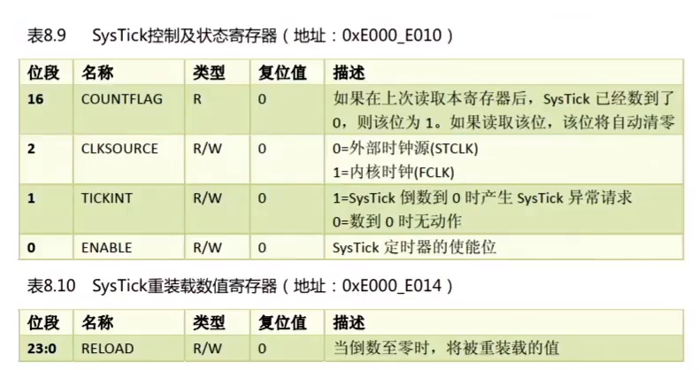
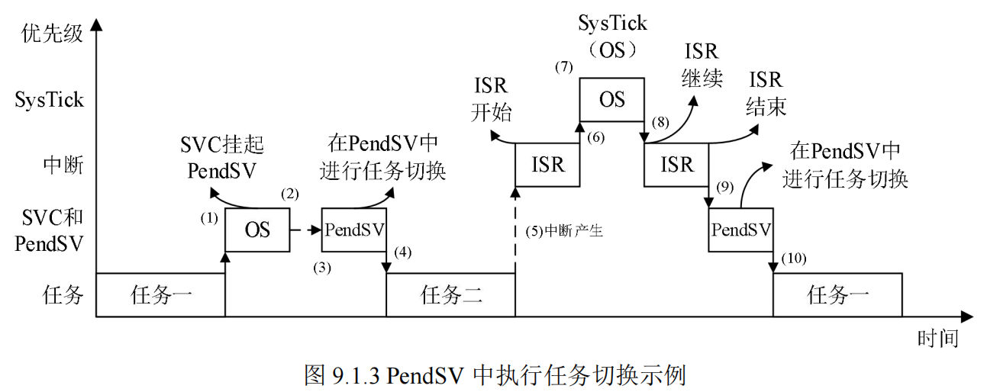
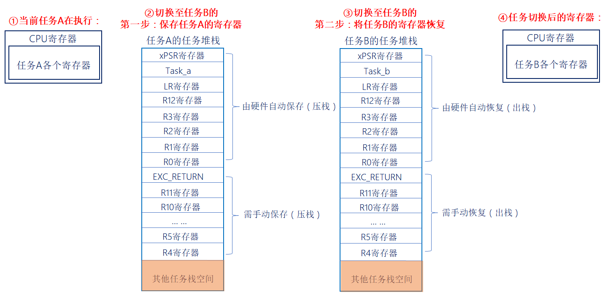
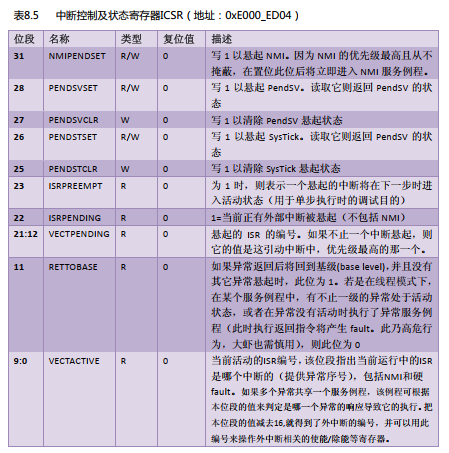
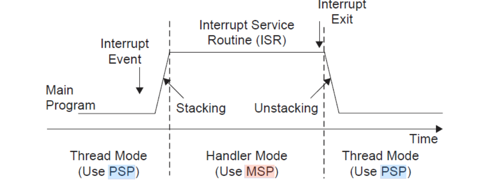
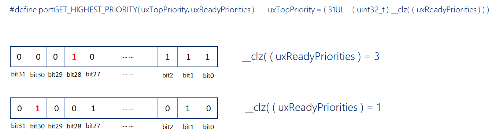
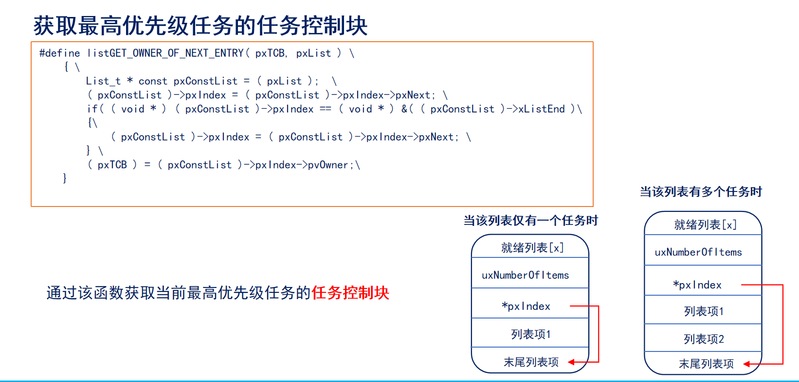

# FreeRTOS任务调度

------


## 一、开启任务调度器(熟悉)

### 1、开启任务调度器函数vTaskStartScheduler()

答：作用：启动任务调度器，任务调度器启动后，FreeRTOS便会开始进行任务调度。

该函数内部实现，如下：

1. 创建空闲任务。
2. 如果使能软件定时器，则创建定时器任务。
3. 关闭中断，防止调度器开启之前或过程中，受到中断干扰，会在运行第一个任务时打开中断。
4. 初始化全局变量，并将任务调度器的运行标志设置为已运行。
5. 初始化任务运行时间统计功能的时基定时器。
6. 调用函数xPortStartScheduler()。

创建空闲任务，创建定时器任务，关闭中断，初始化全局变量


### 2、配置硬件架构及启动第一个任务函数xPortStartScheduler()

答：作用：该函数用于完成启动任务调度器中与硬件架构相关配置部分，以及启动第一个任务。

该函数内部实现，如下：

1. 检测用户在FreeRTOSConfig.h文件中对中断的配置是否有误。
2. 配置PendSV和SysTick的中断优先为最低优先级。
3. 调用函数vPortSetupTimerInterrupt()配置SysTick。
4. 初始化临界区嵌套计数器为0。
5. 调用函数prvEnableVFP()使能FPU。
6. 调用函数prvStartFirstTask()启动第一个任务。


### 3、SysTick滴答定时器

答：




### 4、堆和栈的地址生长方向

答：

**堆**  的生长方向向上，内存地址由低到高；

**栈**  的生长方向向下，内存地址由高到低。


### 5、压栈和出栈的地址增长方向

答：堆栈的生长方向从最本质的理解是堆栈入栈方向是从高地址向地址还是低地址向高地址。

从高地址向低地址生长一般叫做向下生长，也叫作逆向生长。

从低地址向高地址生长一般叫做向上生长，也叫作正向生长。

一般来说堆栈是逆向生长的。

- 51单片机的堆栈生长方向为正向生长，因为执行PUSH指令时先将SP的值加1再将指定的8位数据单元的内容入栈。

- 80x86微机的堆栈生长方向为逆向生长，因为执行PUSH指令时先将SP的值减2再将指定的16位数据单元内容入栈。高字节放高地址，低字节放低地址（小端模式）。

- STM32的堆栈生长方向是逆向生长。

注意：C语言中传递参数，一般是从右向左入栈的，所以最左边的参数是最先出栈的。


### 5、知识补充

$1s =  1000ms$

$1ms = 1000us$

$1us = 1000ns$

$1Mhz = 1000 000hz$

$hz转换为s公式：1s =  1/(1hz)$

$例如：10hz等于0.1s (0.1s = 1 / 10hz)$


 **FreeRTOS中的FPU：定义与作用**

FPU（Floating-Point Unit，浮点运算单元）是**MCU（微控制器）内部专门用于处理浮点运算的硬件组件**，其核心功能是加速浮点数（如`float`、`double`类型）的加减乘除、开方等运算。在FreeRTOS实时系统中，FPU的作用主要体现在**提升浮点密集型任务的性能**（如信号处理、PID控制、图形渲染等），避免软件模拟浮点运算带来的巨大开销（如代码体积增大、运算速度慢）。

 **FreeRTOS对FPU的支持与配置**

FreeRTOS通过**宏定义**和**编译器选项**实现对FPU的支持，具体如下：

1. **启用FPU支持**：
   在`FreeRTOSConfig.h`中设置`#define configUSE_FLOATING_POINT 1`，告知FreeRTOS当前MCU具备硬件FPU，需启用浮点上下文管理。
2. **编译器配置**：
   需为编译器添加FPU相关编译选项（如GCC的`-mfpu=fpv4-sp-d16`、`-mfloat-abi=hard`），确保编译器生成针对硬件FPU的指令，而非软件模拟代码。
3. **上下文切换处理**：
   当任务涉及浮点运算时，FreeRTOS会自动保存/恢复FPU寄存器（如Cortex-M4F的S0-S31浮点寄存器），确保任务切换时浮点状态的正确性（此过程由FreeRTOS的端口层实现，无需用户手动处理）。

 **FreeRTOS中使用FPU的优势**

- **速度提升**：硬件FPU的浮点运算速度比软件模拟快**数十倍甚至上百倍**（如单精度乘法可在1-3个CPU周期内完成），适合实时系统对低延迟的要求。
- **代码优化**：避免链接庞大的软件浮点库（可节省数千至数万字节的Flash空间），尤其适合Flash容量有限的中高端MCU（如STM32F4、GD32F4系列）。
- **功耗降低**：因运算时间缩短，CPU空闲时间增加，总体功耗反而下降，适合电池供电的IoT设备。

 **注意事项**

- **硬件要求**：需使用支持硬件FPU的MCU（如Cortex-M4F、Cortex-M7F架构），无FPU的MCU（如Cortex-M0、Cortex-M3）无法启用此功能。
- **任务优先级**：浮点任务的优先级应合理设置，避免长时间占用CPU导致其他高优先级任务延迟。
- **兼容性**：若需移植到无FPU的平台，需将`configUSE_FLOATING_POINT`改为0，此时FreeRTOS会自动切换至软件浮点模拟（需确保编译器支持）。

**总结**：FreeRTOS中的FPU支持是针对**浮点密集型实时任务**的性能优化方案，通过硬件加速提升运算效率，是实现高精度控制、复杂信号处理等应用的关键支撑。

------


## 二、启动第一个任务(熟悉)

### 1、启动第一个任务涉及的关键函数

答：

prvStartFirstTask()      /* 启动第一个任务 */

vPortSVCHandle()     /* SVC中断服务函数 */


### 2、想象一下应该如何启动第一个任务 

答：假设我们要启动的第一个任务是任务A，那么就需要将任务A的寄存器值恢复到CPU寄存器中。任务A的寄存器值，在一开始创建任务时就已经保存在任务堆栈里边了！

注意：

1. 中断产生时，硬件自动将xPSR、PC(R15)、LR(R14)、R12、R3\~R0保存和恢复，而R4\~R11需要手动保存和恢复。
2. 进入中断后，硬件会强制使用MSP指针，此时LR(R14)的值将会被自动更新为特殊的EXC_RETURN。


### 3、prvStartFirstTask() 介绍

答：用于初始化启动第一个任务前的环境，主要是重新设置MSP指针，并使能全局中断，最后触发SVC中断。


### 4、什么是MSP指针

答：程序在运行过程中需要一定的栈空间来保存局部变量等信息。当有信息保存到栈中时，MCU会自动更新SP指针，ARM Cortex-M内核提供了两个栈空间：

- **主堆栈指针(MSP)**：它是给OS内核、异常服务程序以及所有需要特权访问的应用程序代码来使用的。
- **进程堆栈指针(PSP)**：用于常规的应用程序代码(不处于异常服务程序中时使用)。

==在FreeRTOS中，中断使用MSP(主堆栈)，中断以为使用PSP(进程堆栈)==。

注意：在RTOS中是使用双堆栈指针(即使用MSP和PSP)，但在裸机中是只使用MSP(主堆栈)。


### 5、为什么汇编代码要PRESERVE8(八字节对齐)

答：因为栈在任何时候都是需要4字节对齐的，而在调用入口得8字节对齐，在C编程的时候，编译器会自动帮我们完成对齐操作，而汇编则需要手动对齐。


### 6、prvStartFirstTask()为什么要操作0XE00ED08

答：因为需要从0XE000ED08获取向量表的偏移，为啥要获取向量表呢？因为向量表的第一个是MSP指针！获取MSP的初始值的思路是先根据向量表的位置寄存器VTOR(0XE000ED08)来获取向量表存储的地址，再根据向量表存储的地址，来访问第一个元素，也就是初始的MSP。

寄存器地址>向量表地址>MSP指针的初始值


为什么要把MSP重新赋值？：

上电的时候默认使用的是MSP来作为主堆栈指针，上电跑到这里，经过了一系列函数的调用（出栈，入栈...）MSP早已经不在刚开始的位置，所以这里重新进行初始化，MSP回到了原点，前面的那一些寄存器，不需要保存，丢弃；因为现在不需要回去了，只要启动了第一个任务之后，后面的执行都是在任务与任务之间进行，是一条不归路

更多详细的解析在“函数+解析.md”🀄


### 7、vPortSVCHandle()介绍

答：当使能了全局中断，并且手动触发SVC中断后，就会进到SVC的中断服务函数中。

1. 通过pxCurrentTCB获取优先级最高的就绪态任务的任务栈地址，优先级最高的就绪态任务是系统将要运行的任务。
2. 通过任务的栈顶指针，将任务栈中的内容出栈到CPU寄存器中，任务栈中的内容在调用任务创建函数的时候，已初始化，然后设置PSP指针。
3. 通过往BASEPRI寄存器中写0，允许中断。
4. R14是链接寄存器LR，在ISR中(此刻我们在SVC的ISR中)，它记录了异常返回值EXC_RETURN，而EXC_RETURN只有6个合法的值(M4、M7)，如下表所示：.png)

注意：

1. ==SVC中断只在启动第一次任务时会调用一次，以后均不调用==。
2. R14(LR链接寄存器)，在异常处理期间(就是中断函数中)，LR存的是特殊的EXC_RETURN(异常返回)数值，该数值会在异常处理结束时触发异常返回；在普通函数中，LR用于函数或者子程序调用时返回地址的保存。


### 8、出栈/压栈汇编指令详解

答：

1. **出栈（恢复现场）**，方向：从下往上（低地址往高地址）：假设r0地址为0x04汇编指令示例：

    ldmia r0!, {r4-r6}  /* 任务栈r0地址由低到高，将r0存储地址里面的内容手动加载到 CPU寄存器r4、r5、r6 */

    r0地址(0x04)内容加载到r4，此时地址r0 = r0+4 = 0x08

    r0地址(0x08)内容加载到r5，此时地址r0 = r0+4 = 0x0C

    r0地址(0x0C)内容加载到r6，此时地址r0 = r0+4 = 0x10

2. **压栈（保存现场）**，方向：从上往下（高地址往低地址）：假设r0地址为0x10汇编指令示例：

    stmdb r0!, {r4-r6} }  /* r0的存储地址由高到低递减，将r4、r5、r6里的内容存储到r0的任务栈里面。 */

    地址：r0 = r0-4 = 0x0C，将r6的内容（寄存器值）存放到r0所指向地址(0x0C)

    地址：r0 = r0-4 = 0x08，将r5的内容（寄存器值）存放到r0所指向地址(0x08)

    地址：r0 = r0-4 = 0x04，将r4的内容（寄存器值）存放到r0所指向地址(0x04)

------


## 三、任务切换(掌握)

### 1、任务切换的本质

答：==任务切换的本质就是CPU寄存器内容的切换==。

假设当由任务A切换到任务B时，主要分为两步：

**第一步**：需暂停任务A的执行，并且将此时任务A寄存器保存到任务堆栈中，这个过程叫做保存现场；

**第二步**：将任务B的各个寄存器值(被存于任务堆栈中)恢复到CPU寄存器中，这个过程叫做恢复现场。

对任务A保存现场，对任务B恢复现场，这个过程称为：**上下文切换**。


> 注意：任务的堆栈是存储器，让CPU跑任务的是寄存器
>
> ​	AI:SVC是启动第一个任务调用，立即执行（还有其他的作用）；PendSV是任务切换，中断会异步执行


**PendSV流程解释**

 **PendSV任务切换全流程（精简版）**

 **1. 挂起任务切换请求**

- **场景**：SysTick中断（时间片到期）或任务主动让步（`taskYIELD()`）
- 动作：
  - 在中断服务程序（ISR）中设置 **`xYieldPending = pdTRUE`**（标记需切换任务）
  - **触发PendSV异常**（写寄存器 `SCB->ICSR |= 0x10000000`）
- **关键逻辑**：
  **不立即切换**，而是快速退出当前中断，允许其他高优先级中断抢占。


 **2. 延迟执行：处理所有中断**

- **硬件行为**：
  CPU优先处理**所有优先级高于PendSV的中断**（如USB、UART、定时器等），确保实时性要求高的中断不被阻塞。
- **PendSV特性**：
  其优先级被设为**最低**（如FreeRTOS中配置为 `0xFF`），因此仅在**无更高优先级中断时**被响应。


 **3. 响应PendSV：安全切换任务**

当**中断嵌套层级归零**（所有中断处理完毕）后，CPU执行 `PendSV_Handler()`：

```
void PendSV_Handler(void) {
    // 保存旧任务上下文（R4-R11）到其私有栈
    __asm("MRS R0, PSP");
    __asm("STMDB R0!, {R4-R11}");  // 手动保存寄存器
    __asm("LDR R1, =pxCurrentTCB");
    __asm("LDR R1, [R1]");
    __asm("STR R0, [R1]");         // 更新TCB中的栈顶指针

    vTaskSwitchContext();          // 调度器选择新任务

    // 恢复新任务上下文
    __asm("LDR R1, =pxCurrentTCB");
    __asm("LDR R1, [R1]");
    __asm("LDR R0, [R1]");         // 从TCB获取新任务栈顶
    __asm("LDMIA R0!, {R4-R11}");  // 恢复寄存器
    __asm("MSR PSP, R0");          // 更新PSP指向新任务栈
}
```


 **4. 退出PendSV：无缝跳转新任务**

- **硬件自动行为**：
  退出PendSV时，CPU将**新任务的PC/LR等寄存器**从栈中恢复，直接跳转到新任务代码入口。
- **结果**：
  任务切换完成，系统开始执行新任务。



1. 任务一触发 SVC 中断以进行任务切换（例如，任务一正等待某个事件发生）。
2. 系统内核接收到任务切换请求，开始准备任务切换，并挂起 PendSV 异常。
3. 当退出 SVC 中断的时候，立刻进入 PendSV 异常处理，完成任务切换。

4. 当 PendSV 异常处理完成，返回线程模式，开始执行任务二。
5. 中断产生，并进入中断处理函数。
6. 当运行中断处理函数的时候，SysTick 异常（用于内核时钟节拍）产生。
7. 操作系统执行必要的操作，然后挂起 PendSV 异常，准备进行任务切换。
8. 当 SysTick 中断处理完成，返回继续处理中断。
9. 当中断处理完成，立马进入 PendSV 异常处理，完成任务切换。
10. 当 PendSV 异常处理完成，返回线程模式，继续执行任务一。

PendSV在RTOS的任务切换中，起着至关重要的作用，FreeRTOS的任务切换就是在PendSV中完成的。


### 2、任务切换过程

答：

注意：==任务切换的过程在PendSV中断服务函数里边完成==。


### 3、PendSV中断是如何触发的

答：

1. 滴答定时器中断调用
2. 执行FreeRTOS提供的相关API函数：portYIELD()。

本质是通过中断控制和状态寄存器ICSR的bit28写入1挂起PendSV来启动PendSV中的。



上表摘取于《Cortex M3权威指南(中文)》第135页。


> SysTick定时器，一个延时，解挂调度器 
>
> 都是要使ICSR的bit28写入1挂起PendSV来启动PendSV中


### 4、在PendSV中断中PSP和MSP

答：在进入PendSV异常前的自动压栈使用的是进程堆栈(PSP)，正式进入到PendSV异常Handle后才自动改为主堆栈(MSP)，退出异常时切回PSP，并且从进程堆栈(PSP)上弹出数据(出栈)。



注意：在PendSV中断中时，CPU使用的是MSP，但我们要处理的是PSP的数据存取。

>在进入PendSV异常前的自动压栈使用的是进程堆栈(PSP)，正式进入到PendSV异常Handle后才自动改为主堆栈(MSP)，退出异常时切回PSP，并且从进程堆栈(PSP)上弹出数据(出栈)。

### 5、查找最高优先级任务

答：

vTaskSwitchContext( )                                         /* 查找最高优先级任务 */

taskSELECT_HIGHEST_PRIORITY_TASK( )    /* 通过这个函数完成 */


### 6、前导置零指令

答：



所谓的前导置零指令，大家可以简单理解为计算一个 32位数，出现第一个1前头部 0 的个数。

------



