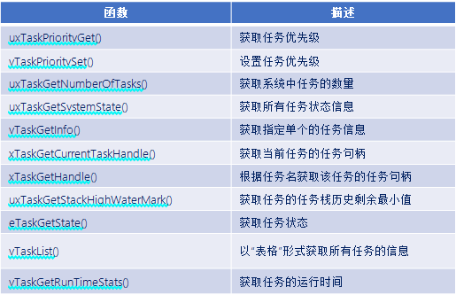
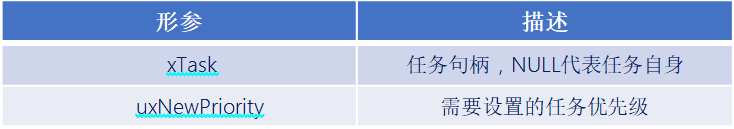
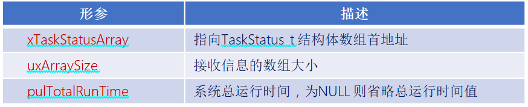
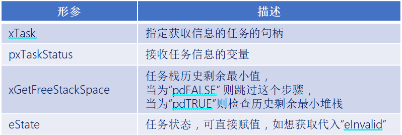
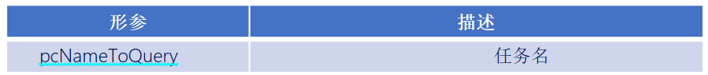
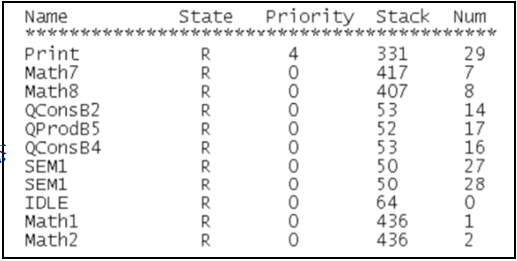
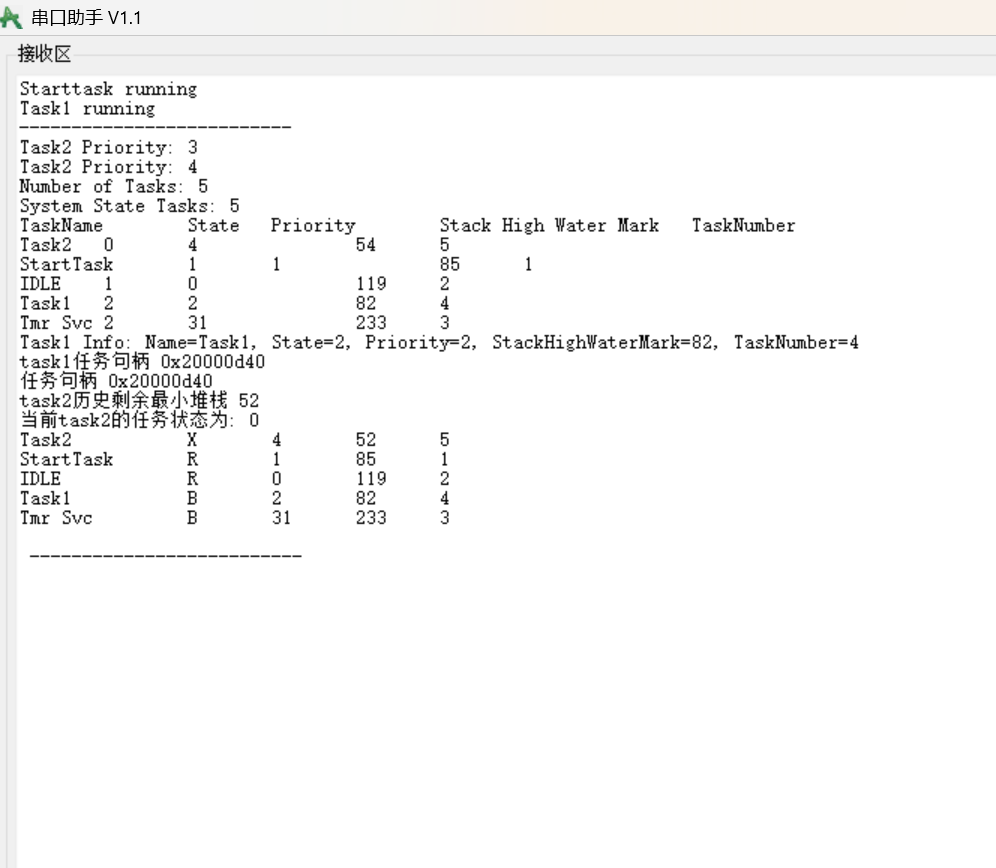
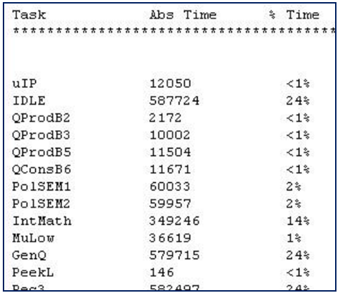
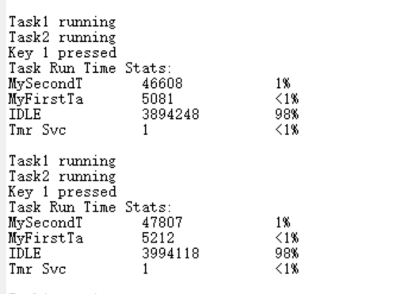

# FreeRTOS任务相关的其他API函数

------


## 一、FreeRTOS任务相关的其他API函数介绍

### 1、FreeRTOS任务相关API函数介绍(部分常用的)

答：




------


## 二、任务状态查询API函数

### 1、获取任务优先级函数

答：

```c
UBaseType_t  uxTaskPriorityGet(  const TaskHandle_t xTask  )
```

此函数用于获取指定任务的任务优先级，使用该函数需要将宏 INCLUDE_uxTaskPriorityGet 置1。

函数参数：


函数返回值：


### 2、修改任务优先级函数

答：

```c
void vTaskPrioritySet( TaskHandle_t xTask , UBaseType_t uxNewPriority )
```

此函数用于改变某个任务的任务优先级，使用该函数需将宏 INCLUDE_vTaskPrioritySet 为 1 。

函数参数：




### 3、获取系统任务数量函数

答：

```c
UBaseType_t   uxTaskGetNumberOfTasks( void )
```

此函数用于获取系统中任务的任务数量。

函数返回值：


### 4、获取系统中所有任务状态信息函数

答：

```c
UBaseType_t   uxTaskGetSystemState(   TaskStatus_t * const pxTaskStatusArray,
                                      const UBaseType_t uxArraySize,
                                      configRUN_TIME_COUNTER_TYPE * const pulTotalRunTime   )
```

此函数用于获取系统中所有任务的任务状态信息，使用该函数需将宏 configUSE_TRACE_FACILITY 置 1。

函数参数：



函数返回值：


参数成员pxTaskStatusArray的结构体：

```c
typedef struct xTASK_STATUS
{
    TaskHandle_t                   xHandle;                     /* 任务句柄 */ 
    const char *                   pcTaskName;                  /* 任务名 */
    UBaseType_t                    xTaskNumber;                 /* 任务编号 */
    eTaskStatee                    CurrentState;                /* 任务状态 */
    UBaseType_t                    uxCurrentPriority;           /* 任务优先级 */
    UBaseType_t                    uxBasePriority;              /* 任务原始优先级*/
    configRUN_TIME_COUNTER_TYPE    ulRunTimeCounter;            /* 任务运行时间*/
    StackType_t *                  pxStackBase;                 /* 任务栈基地址 */
    configSTACK_DEPTH_TYPE         usStackHighWaterMark;        /* 任务栈历史剩余最小值 */
} TaskStatus_t;
```


### 5、获取系统中单个任务状态信息函数

答：

```c
void vTaskGetInfo(  TaskHandle_t     xTask,
                    TaskStatus_t *   pxTaskStatus,
                    BaseType_t       xGetFreeStackSpace,
                    eTaskState       eState  )  
```

此函数用于获取指定的单个任务的状态信息，使用该函数需将宏 configUSE_TRACE_FACILITY 置 1 

函数参数：



参数成员eState的结构体：

```c
typedef enum
{
    eRunning = 0,       /* 运行态 */
    eReady,             /* 就绪态 */
    eBlocked,           /* 阻塞态 */
    eSuspended,         /* 挂起态 */
    eDeleted,           /* 任务被删除 */
    eInvalid            /* 无效 */ 
} eTaskState;
```


### 6、获取当前任务的任务句柄函数

答：

```c
TaskHandle_t    xTaskGetCurrentTaskHandle( void )
```

此函数用于获取当前任务的任务句柄， 使用该函数需将宏 INCLUDE_xTaskGetCurrentTaskHandle 置 1。

函数返回值：


### 7、通过任务名获取任务句柄函数

答：

```c
TaskHandle_t xTaskGetHandle(const char * pcNameToQuery); 
```

此函数用于通过任务名获取任务句柄 ， 使用该函数需将宏 INCLUDE_xTaskGetHandle 置 1。

函数参数：



函数返回值：


### 8、获取指定任务的任务堆栈历史最小剩余函数

```c
UBaseType_t    uxTaskGetStackHighWaterMark( TaskHandle_t  xTask )
```

此函数用于获取指定任务的任务栈历史最小剩余堆栈；使用该函数需将宏 INCLUDE_uxTaskGetStackHighWaterMark 置 1。

函数参数：


函数返回值：


### 9、查询指定任务运行状态函数

答：

```c
eTaskState    eTaskGetState(TaskHandle_t xTask)
```

此函数用于查询某个任务的运行状态，使用此函数需将宏 INCLUDE_eTaskGetState 置1 

函数参数：


函数返回值：


参数成员xTask的结构体：

```c
typedef enum
{
    eRunning = 0,	/* 运行态 */
    eReady,         /* 就绪态 */
    eBlocked,       /* 阻塞态 */
    eSuspended,     /* 挂起态 */
    eDeleted,       /* 任务被删除 */
    eInvalid        /* 无效 */ 
} eTaskState;


```


### 10、以“表格”的形式获取系统中任务信息函数

答：

```c
void   vTaskList(char * pcWriteBuffer)
```

此函数用于以“表格”的形式获取系统中任务的信息 ；

使用此函数需将宏 configUSE_TRACE_FACILITY 和configUSE_STATS_FORMATTING_FUNCTIONS 置1 。

函数参数：


表格内容：



- Name：创建任务的时候给任务分配的名字。
- State：任务的壮态信息， B 是阻塞态， R 是就绪态， S 是挂起态， D 是删除态。
- Priority：任务优先级。
- Stack： 任务堆栈的“高水位线”，就是堆栈历史最小剩余大小。
- Num：任务编号，这个编号是唯一的，当多个任务使用同一个任务名的时候可以通过此编号来做区分。

------

### 11、代码

==1-6vscode==


```c
#include "stm32f4xx.h"                  // STM32F4系列微控制器头文件
#include "freertos.h"                   // FreeRTOS实时操作系统头文件
#include "task.h"                       // FreeRTOS任务管理头文件
#include "queue.h"                      // FreeRTOS队列管理头文件
#include "usart.h"                      // 串口通信头文件
#include "malloc.h"                     // 内存管理头文件


void DWT_Init(void);
void Delay_us(uint32_t us);
void Delay_ms(uint32_t ms);

/**
 * @brief LED初始化函数
 * 配置GPIOC的Pin13作为LED控制引脚
 */
void LED_Init(void)
{		
    // 使能GPIOC时钟（AHB1总线）
    RCC_AHB1PeriphClockCmd(RCC_AHB1Periph_GPIOC, ENABLE);

    // 配置GPIO初始化结构体
    GPIO_InitTypeDef GPIO_InitStructure;
	GPIO_StructInit(&GPIO_InitStructure);
    GPIO_InitStructure.GPIO_Pin = GPIO_Pin_13;        // 选择引脚13
    GPIO_InitStructure.GPIO_Mode = GPIO_Mode_OUT;     // 输出模式
    GPIO_InitStructure.GPIO_OType = GPIO_OType_PP;    // 推挽输出
    GPIO_InitStructure.GPIO_Speed = GPIO_Speed_50MHz; // 输出速度50MHz
    GPIO_InitStructure.GPIO_PuPd = GPIO_PuPd_NOPULL;  // 无上拉下拉电阻
    GPIO_Init(GPIOC, &GPIO_InitStructure);            // 初始化GPIOC
}

// 任务配置宏定义
#define START_TASK_STACK_SIZE 128       // 启动任务栈大小（字）
//中断优先级0-15，数值越小优先级越高
//任务优先级0-31，数值越大优先级越高
#define TASK1_PRIORITY 2           // 任务1优先级
#define TASK2_PRIORITY 3          // 任务2优先级
#define START_TASK_PRIORITY 1         // 启动任务优先级（高于其他任务）

// 任务句柄声明（用于引用和管理任务）
TaskHandle_t MytaskHandler1;    // 任务1句柄
TaskHandle_t MytaskHandler2;    // 任务2句柄
TaskHandle_t MytaskHandler3;    // 任务3句柄
TaskHandle_t StarttaskHandler;  // 启动任务句柄

/**
 * @brief 任务1函数
 * 功能：
 * @param arg 任务参数（未使用）
 */
void Task1(void * arg){
	printf("Task1 running\r\n");  // 打印任务1运行信息
    printf("--------------------------\r\n");
    while(1){
        vTaskDelay(1000);  // 延时1000毫秒
    }
}


/**
 * @brief 任务2函数
 * 功能：
 * @param arg 任务参数（未使用）
 */
void Task2(void * arg){

    // 获取任务2的优先级
    UBaseType_t priority1 = 0;
	priority1 = uxTaskPriorityGet(MytaskHandler2);
    // 进入临界区保护串口输出
    taskENTER_CRITICAL();
    printf("Task2 Priority: %d\r\n", priority1);  // 打印任务2的优先级
    taskEXIT_CRITICAL();


    vTaskPrioritySet(MytaskHandler2, TASK2_PRIORITY + 1); // 提高任务2的优先级


    UBaseType_t priority2 = 0;
    priority2 = uxTaskPriorityGet(MytaskHandler2);
    // 进入临界区保护串口输出
    taskENTER_CRITICAL();   
    printf("Task2 Priority: %d\r\n", priority2);  // 打印任务2的优先级
    taskEXIT_CRITICAL();
    

    UBaseType_t taskCount = 0;
    taskCount = uxTaskGetNumberOfTasks(); // 获取当前系统中的任务数量
    // 进入临界区保护串口输出
    taskENTER_CRITICAL();
    printf("Number of Tasks: %d\r\n", taskCount);  // 打印当前系统中的任务数量
    taskEXIT_CRITICAL();
    //有5个任务：Idle(空闲任务),TimerService(软件定时器任务),Starttask,Task1,Task2


    //TaskStatus_t结构体数组用于存储系统中每个任务的状态信息
    TaskStatus_t * taskStatusArray;
    taskStatusArray = (TaskStatus_t *)mymalloc(SRAMIN, sizeof(TaskStatus_t) * taskCount);
    if(taskStatusArray == NULL){
        // 进入临界区保护串口输出
        taskENTER_CRITICAL();
        printf("Memory allocation failed for taskStatusArray\r\n");
        taskEXIT_CRITICAL();
        vTaskDelete(NULL); // 删除当前任务以释放资源
    }
    UBaseType_t systemState = 0;
    systemState = uxTaskGetSystemState(taskStatusArray, taskCount, NULL); // 获取系统状态信息
    printf("System State Tasks: %d\r\n", systemState);  // 打印系统状态信息中的任务数量
    printf("TaskName\tState\tPriority\tStack High Water Mark\tTaskNumber\r\n");

    for(UBaseType_t i = 0; i < systemState; i++){
        // 进入临界区保护串口输出
        taskENTER_CRITICAL();
        printf("%s\t%d\t%d\t\t%d\t%d\r\n", 
               taskStatusArray[i].pcTaskName, 
               taskStatusArray[i].eCurrentState, 
               taskStatusArray[i].uxCurrentPriority, 
               taskStatusArray[i].usStackHighWaterMark,
               taskStatusArray[i].xTaskNumber);
        taskEXIT_CRITICAL();
    }
    myfree(SRAMIN, taskStatusArray); // 释放分配的内存


    TaskStatus_t *taskInfo;
    taskInfo = (TaskStatus_t *)mymalloc(SRAMIN, sizeof(TaskStatus_t));
    if(taskInfo == NULL){
        // 进入临界区保护串口输出
        taskENTER_CRITICAL();
        printf("Memory allocation failed for taskInfo\r\n");
        taskEXIT_CRITICAL();
        vTaskDelete(NULL); // 删除当前任务以释放资源
    }
    vTaskGetInfo(MytaskHandler1, taskInfo, pdTRUE, eInvalid); // 获取任务1的详细信息
    // 进入临界区保护串口输出
    taskENTER_CRITICAL();
    printf("Task1 Info: Name=%s, State=%d, Priority=%d, StackHighWaterMark=%d, TaskNumber=%d\r\n",
           taskInfo->pcTaskName,
           taskInfo->eCurrentState,
           taskInfo->uxCurrentPriority,
           taskInfo->usStackHighWaterMark,
           taskInfo->xTaskNumber);
    taskEXIT_CRITICAL();
    myfree(SRAMIN, taskInfo); // 释放分配的内存

    
    TaskHandle_t taskHandle;
    taskHandle = xTaskGetHandle("Task1"); // 通过任务名称获取任务句柄
    printf("task1任务句柄 %#x\r\n", (int)taskHandle);
    printf("任务句柄 %#x\r\n", (int)MytaskHandler1);


    UBaseType_t task_HighWaterMark;
    task_HighWaterMark = uxTaskGetStackHighWaterMark(MytaskHandler2);
    printf("task2历史剩余最小堆栈 %d\r\n", task_HighWaterMark);

    
    eTaskState task_state = eTaskGetState(MytaskHandler2);
    printf("当前task2的任务状态为: %d\r\n", task_state);
    
    //这个要合理设置，不然很大就会导致栈溢出,串口输出就只能输出很少
    char task_buff[100];
    vTaskList(task_buff);
    printf("%s\r\n ", task_buff);
    printf("--------------------------\r\n");

    while(1){

        vTaskDelay(500);  // 延时500毫秒
    }

}


/**
 * @brief 启动任务函数
 * 功能：创建其他三个任务后自行删除
 * @param arg 任务参数（未使用）
 */
void Starttask(void * arg){
    // 进入临界区保护串口输出
    taskENTER_CRITICAL();
    printf("Starttask running\r\n");  // 打印启动任务运行信息
    taskEXIT_CRITICAL();
    
    // 使用动态内存分配方式创建任务1
    xTaskCreate(Task1,                        // 任务函数指针
               "Task1",                 // 任务名称（用于调试）
               START_TASK_STACK_SIZE,         // 栈大小（字）
               NULL,                          // 传递给任务的参数
               TASK1_PRIORITY,           // 任务优先级
               &MytaskHandler1);              // 任务句柄指针
    
    // 使用动态内存分配方式创建任务2
    xTaskCreate(Task2, 
               "Task2", 
               START_TASK_STACK_SIZE, 
               NULL, 
               TASK2_PRIORITY, 
               &MytaskHandler2);
    
    // 删除当前任务（启动任务），释放其占用的资源
    vTaskDelete(NULL);
}

/**
 * @brief 主函数
 * 程序入口点，初始化硬件并启动RTOS调度器
 */
int main(void)
{
	NVIC_PriorityGroupConfig(NVIC_PriorityGroup_4);
    LED_Init();                     // 初始化LED GPIO引脚
    Usart1_Init(115200);            // 初始化串口1，波特率115200
    
    // 创建启动任务（使用动态内存分配）
    xTaskCreate(Starttask,                  // 任务函数指针
               "StartTask",                 // 任务名称
               START_TASK_STACK_SIZE,       // 栈大小
               NULL,                        // 任务参数
               START_TASK_PRIORITY,         // 任务优先级
               &StarttaskHandler);          // 任务句柄
    
    // 启动FreeRTOS调度器（程序将在此处开始运行任务）
    vTaskStartScheduler();
    
    // 正常情况下，调度器启动后不会执行到这里
    // 如果调度器启动失败，程序将在此处循环
    while (1)
    {		
        // 空循环，用于处理调度器启动失败的情况
    }	
}

```




## 三、任务时间统计API函数

### 1、任务时间统计函数

答：

```c
void    vTaskGetRunTimeStats( char * pcWriteBuffer ) 
```

此函数用于统计任务的运行时间信息，使用此函数需将宏 configGENERATE_RUN_TIME_STATS 、configUSE_STATS_FORMATTING_FUNCTIONS 置1。

函数参数：


时间统计表格：



- Task：任务名称。
- Abs Time：任务实际运行的总时间(绝对时间)。
- %Time：占总处理时间的百分比。


### 2、时间统计API函数使用流程

答：

1.将宏 configGENERATE_RUN_TIME_STATS 置1 。

2.将宏 configUSE_STATS_FORMATTING_FUNCTIONS 置1 。

3.当将此宏 configGENERATE_RUN_TIME_STAT 置1之后，==还需要实现2个宏定义==：

1）portCONFIGURE_TIMER_FOR_RUNTIME_STATE() ：用于初始化用于配置任务运行时间统计的时基定时器；

> 注意：这个时基定时器的计时精度需高于系统时钟节拍精度的10至100倍！

2）portGET_RUN_TIME_COUNTER_VALUE()：用于获取该功能时基硬件定时器计数的计数值 。

------


### 代码

```c
#include "stm32f4xx.h"                  // STM32F4系列微控制器头文件
#include "freertos.h"                   // FreeRTOS实时操作系统头文件
#include "task.h"                       // FreeRTOS任务管理头文件
#include "queue.h"                      // FreeRTOS队列管理头文件
#include "usart.h"                      // 串口通信头文件
#include "timer.h"                      // 定时器头文件


/**
 * @brief LED初始化函数
 * 配置GPIOC的Pin13作为LED控制引脚
 */
void LED_Init(void)
{		
    // 使能GPIOC时钟（AHB1总线）
    RCC_AHB1PeriphClockCmd(RCC_AHB1Periph_GPIOC, ENABLE);

    // 配置GPIO初始化结构体
    GPIO_InitTypeDef GPIO_InitStructure;
	GPIO_StructInit(&GPIO_InitStructure);
    GPIO_InitStructure.GPIO_Pin = GPIO_Pin_13;        // 选择引脚13
    GPIO_InitStructure.GPIO_Mode = GPIO_Mode_OUT;     // 输出模式
    GPIO_InitStructure.GPIO_OType = GPIO_OType_PP;    // 推挽输出
    GPIO_InitStructure.GPIO_Speed = GPIO_Speed_50MHz; // 输出速度50MHz
    GPIO_InitStructure.GPIO_PuPd = GPIO_PuPd_NOPULL;  // 无上拉下拉电阻
    GPIO_Init(GPIOC, &GPIO_InitStructure);            // 初始化GPIOC
}

/**
 * @brief 按键初始化函数
 * 配置GPIOA的Pin0和Pin1作为按键输入引脚
 */
void Key_Init(void)
{
	RCC_AHB1PeriphClockCmd(RCC_AHB1Periph_GPIOA, ENABLE);
	GPIO_InitTypeDef GPIO_InitStructure;
	GPIO_StructInit(&GPIO_InitStructure);
	GPIO_InitStructure.GPIO_Pin = GPIO_Pin_15 |  GPIO_Pin_0 | GPIO_Pin_1;
	GPIO_InitStructure.GPIO_Mode = GPIO_Mode_IN;
	GPIO_InitStructure.GPIO_Speed = GPIO_Speed_50MHz;
	GPIO_InitStructure.GPIO_PuPd = GPIO_PuPd_UP;
	GPIO_Init(GPIOA, &GPIO_InitStructure);  
}

/**
 * @brief 获取按键编号
 * 功能：根据按键状态返回按键编号
 * @return uint8_t 按键编号（1或2），如果没有按键按下则返回0
 */
uint8_t Key_GetNum(void)
{
	if (GPIO_ReadInputDataBit(GPIOA, GPIO_Pin_0) == 0)
	{
		vTaskDelay(20);
		if(GPIO_ReadInputDataBit(GPIOA, GPIO_Pin_0) == 0){
			return 1;
		}
	}
	else if (GPIO_ReadInputDataBit(GPIOA, GPIO_Pin_1) == 0)
	{
		vTaskDelay(20);
		if(GPIO_ReadInputDataBit(GPIOA, GPIO_Pin_1) == 0){
			return 2;
		}
	} 
	else if (GPIO_ReadInputDataBit(GPIOA, GPIO_Pin_15) == 0)
	{
		vTaskDelay(20);
		if(GPIO_ReadInputDataBit(GPIOA, GPIO_Pin_15) == 0){
			return 3;
		}
	} 
	else return 0;
}

// 任务配置宏定义
#define START_TASK_STACK_SIZE 128       // 启动任务栈大小（字）
#define START_TASK_PRIORITY 2           // 启动任务优先级（数值越小优先级越高）
#define TASK1_STACK_SIZE 128           // 任务1栈大小（字）
#define TASK1_PRIORITY 2               // 任务1优先级（数值越小优先级越高）
#define TASK2_STACK_SIZE 128           // 任务2栈大小（字）
#define TASK2_PRIORITY 3               // 任务2优先级（数值越小优先级越高）
// 任务句柄声明（用于引用和管理任务）
TaskHandle_t MytaskHandler1;    // 任务1句柄
TaskHandle_t MytaskHandler2;    // 任务2句柄
TaskHandle_t StarttaskHandler;  // 启动任务句柄


/**
 * @brief 任务1函数
 * 功能：
 * @param arg 任务参数（未使用）
 */
void Task1(void * arg){
    while(1){
        taskENTER_CRITICAL();    // 进入临界区（禁用中断），保护串口输出
        printf("Task1 running\r\n");
        taskEXIT_CRITICAL();     // 退出临界区（启用中断）
        vTaskDelay(1000);         // 延迟500个时钟节拍（约500ms，取决于系统时钟配置）
    }	
}

char buffer[512];
void Task2(void * arg){
    while(1){
        taskENTER_CRITICAL();    // 进入临界区
        printf("Task2 running\r\n");
        taskEXIT_CRITICAL();     // 退出临界区
        printf("Key 1 pressed\r\n");
        
        taskENTER_CRITICAL(); 
        vTaskGetRunTimeStats(buffer);
        taskEXIT_CRITICAL(); 
        // 通过串口输出示例
        printf("Task Run Time Stats:\r\n");
        printf("%s\r\n", buffer);
        
        vTaskDelay(1000); 
    }
}


/**
 * @brief 启动任务函数
 * 功能：创建其他三个任务后自行删除
 * @param arg 任务参数（未使用）
 */
void Starttask(void * arg){
    // 进入临界区保护串口输出
    taskENTER_CRITICAL();
    printf("Starttask running\r\n");  // 打印启动任务运行信息
    taskEXIT_CRITICAL();
    
    // 使用动态内存分配方式创建任务1
    xTaskCreate(Task1,                        // 任务函数指针
               "MyFirstTask",                 // 任务名称（用于调试）
               TASK1_STACK_SIZE,         // 栈大小（字）
               NULL,                          // 传递给任务的参数
               TASK1_PRIORITY,           // 任务优先级
               &MytaskHandler1);              // 任务句柄指针
    
    // 使用动态内存分配方式创建任务2
    xTaskCreate(Task2, 
               "MySecondTask", 
               TASK2_STACK_SIZE, 
               NULL, 
               TASK2_PRIORITY, 
               &MytaskHandler2);
    
    
    // 删除当前任务（启动任务），释放其占用的资源
    vTaskDelete(NULL);
}

/**
 * @brief 主函数
 * 程序入口点，初始化硬件并启动RTOS调度器
 */
int main(void)
{
	NVIC_PriorityGroupConfig(NVIC_PriorityGroup_4);
    LED_Init();                     // 初始化LED GPIO引脚
    Usart1_Init(115200);            // 初始化串口1，波特率115200
    Key_Init();                     // 初始化按键 GPIO引脚
    
    // 创建启动任务（使用动态内存分配）
    xTaskCreate(Starttask,                  // 任务函数指针
               "StartTask",                 // 任务名称
               START_TASK_STACK_SIZE,       // 栈大小
               NULL,                        // 任务参数
               START_TASK_PRIORITY,         // 任务优先级
               &StarttaskHandler);          // 任务句柄
    
    // 启动FreeRTOS调度器（程序将在此处开始运行任务）
    vTaskStartScheduler();
    
    // 正常情况下，调度器启动后不会执行到这里
    // 如果调度器启动失败，程序将在此处循环
    while (1)
    {		
        // 空循环，用于处理调度器启动失败的情况
    }	
}

```




