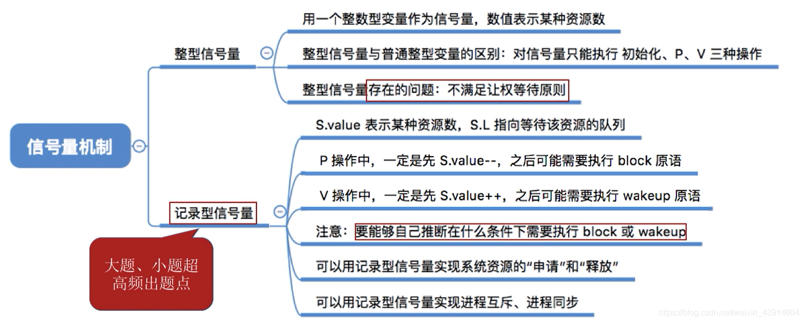
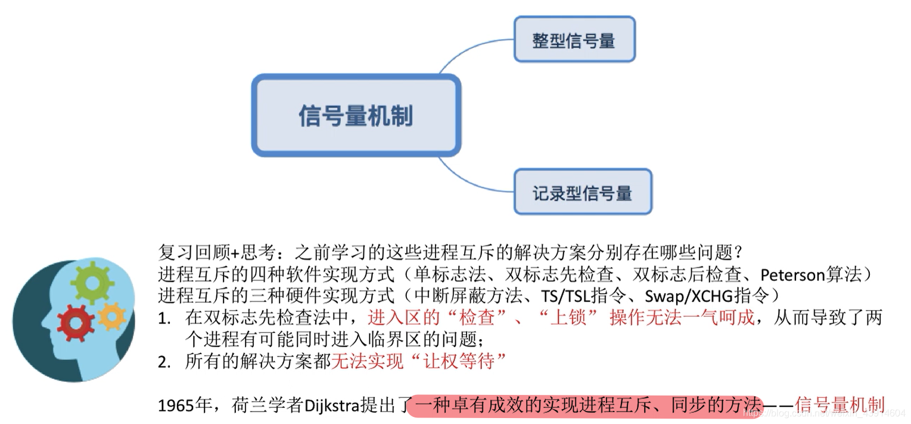
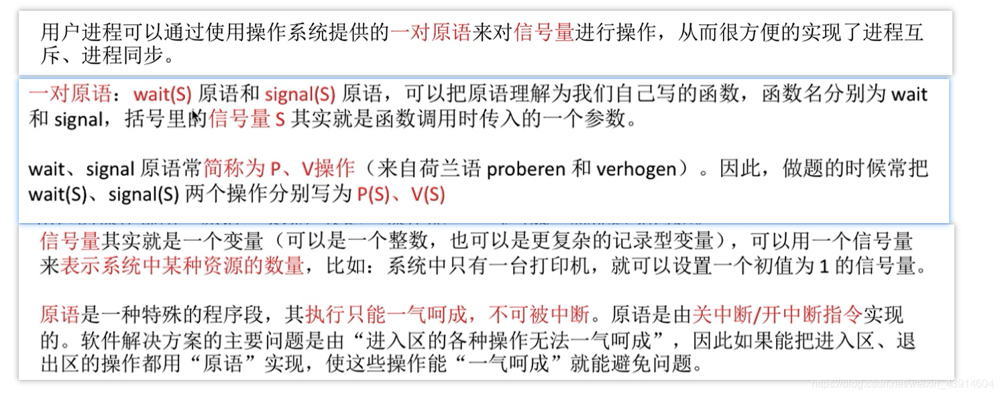
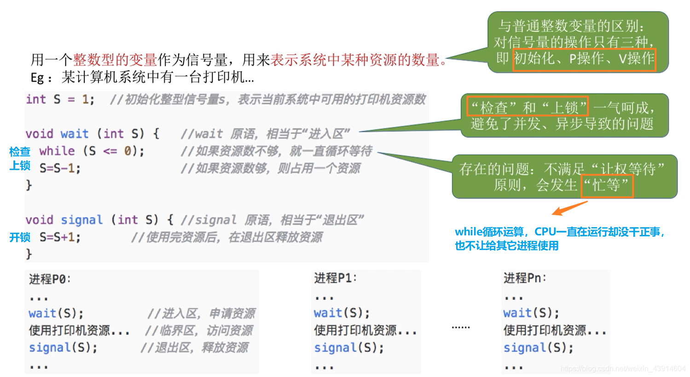
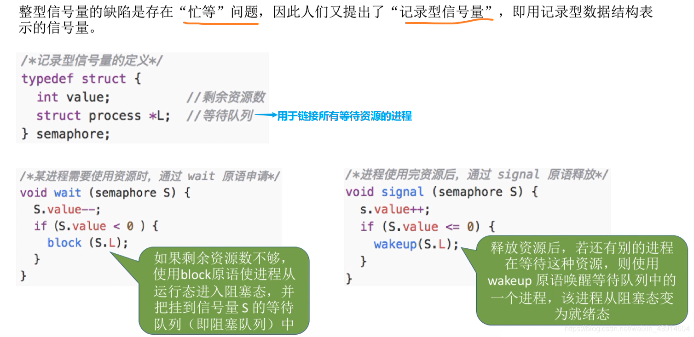
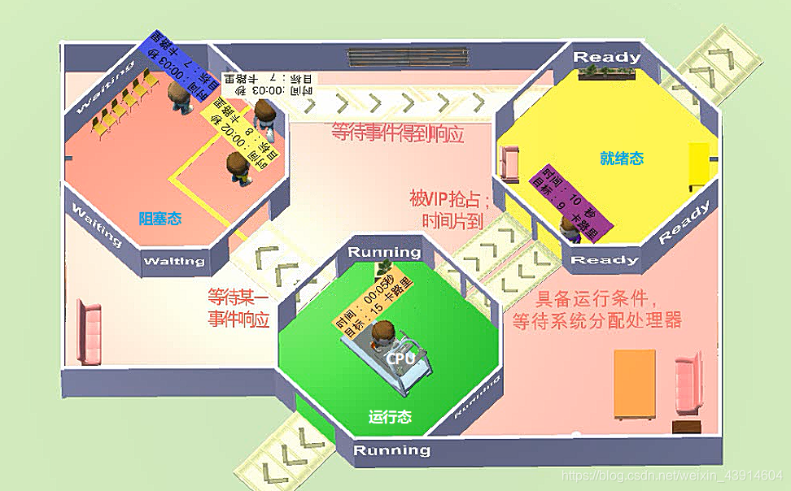
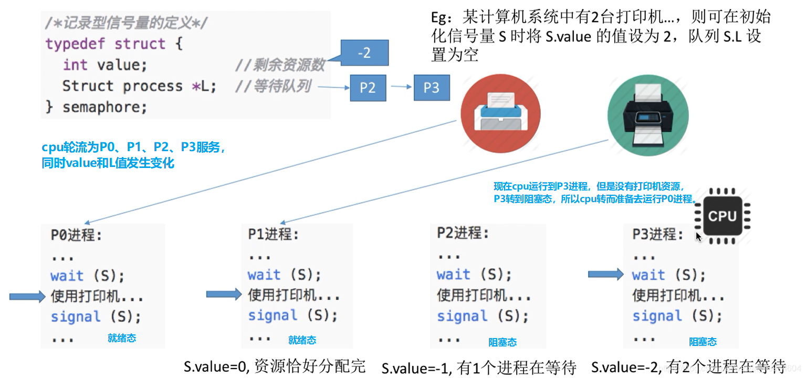
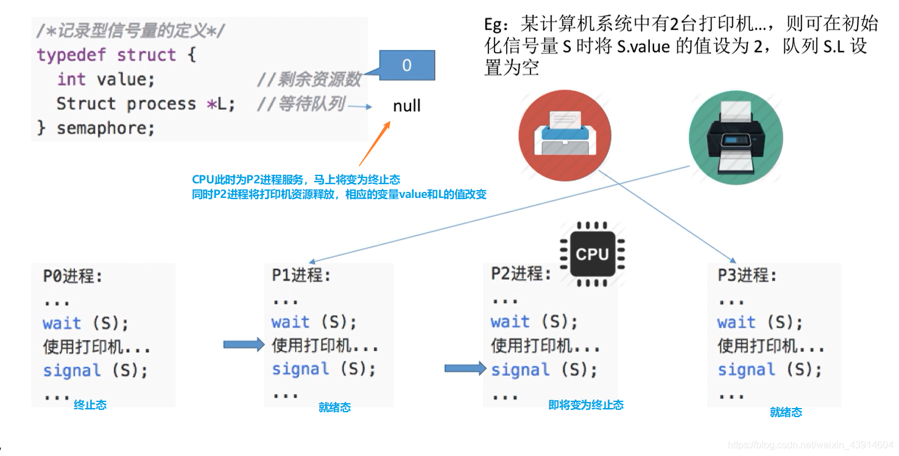
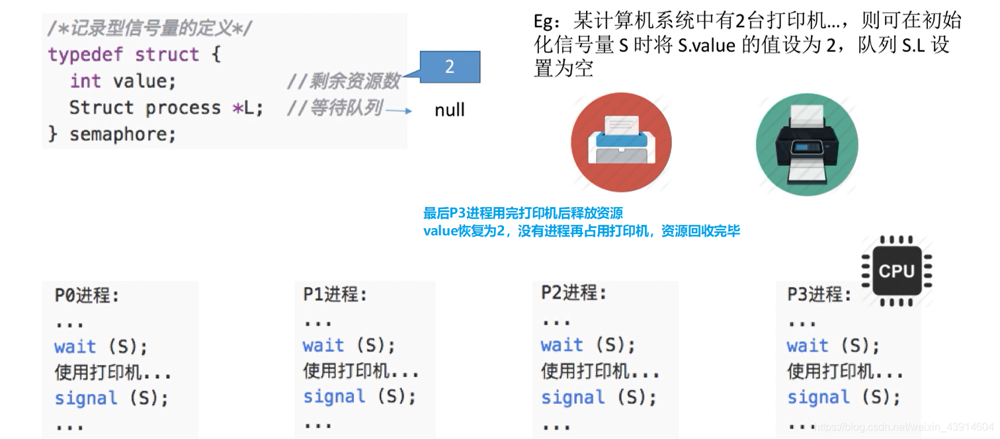
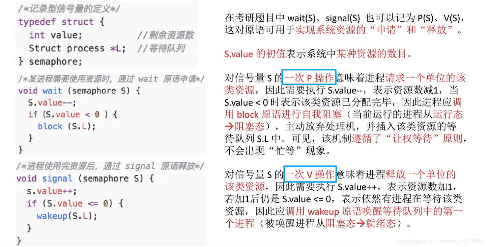

---

##### 0.思维导图

##### 1.为什么引入信号量机制？

- 为了更好的解决进程互斥与同步的问题  
	

##### 2.什么是信号量机制？

##### 3.整型信号量

##### 4.记录型信号量

###### （1）举一个生动形象的例子了解记录型信号量

- 一张图咱们回忆一下进程的状态  
	
- 一个例子  
	

  
  

###### （2）梳理一下记录型信号量的知识点（P、V）

  
参考： [https://www.bilibili.com/video/av70156862?p=20](https://www.bilibili.com/video/av70156862?p=20)