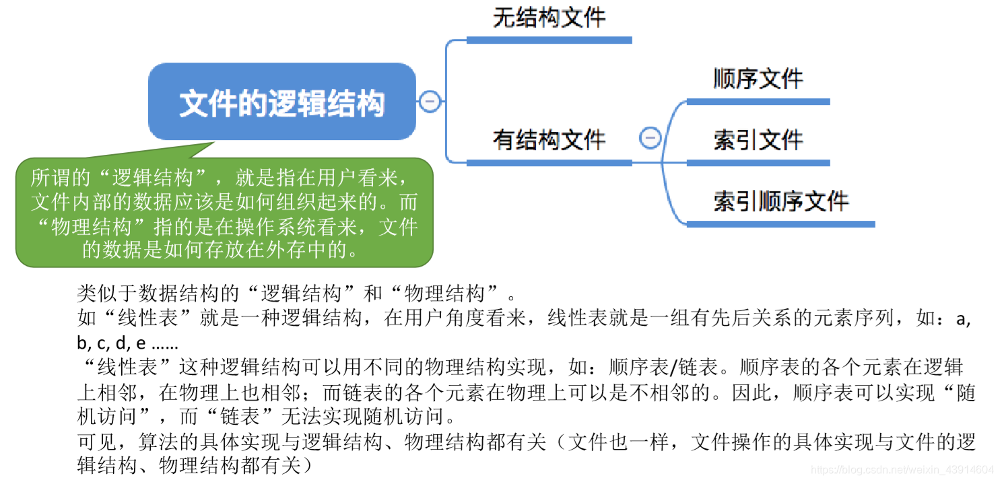
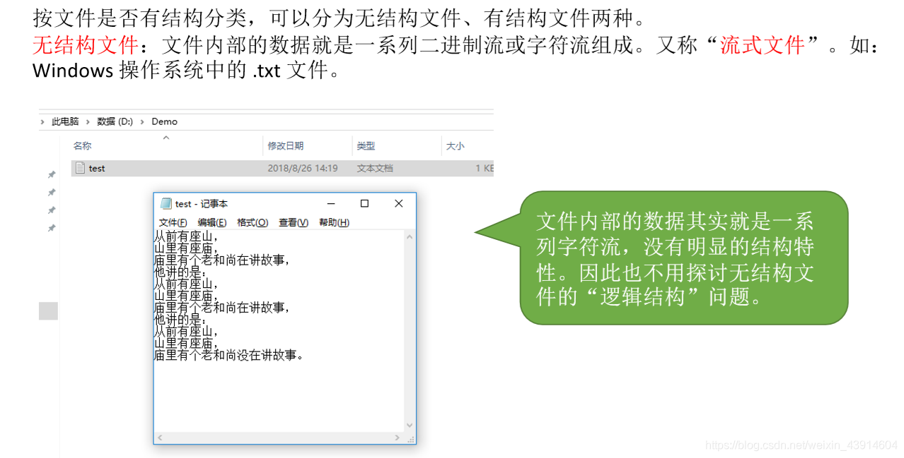
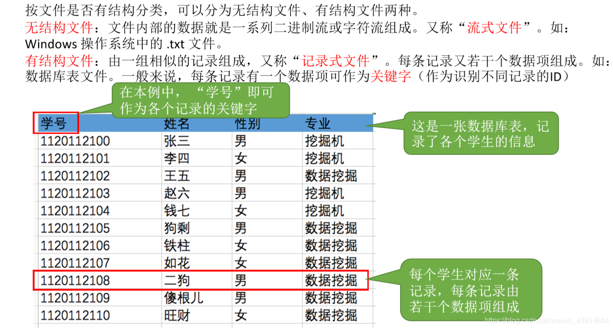
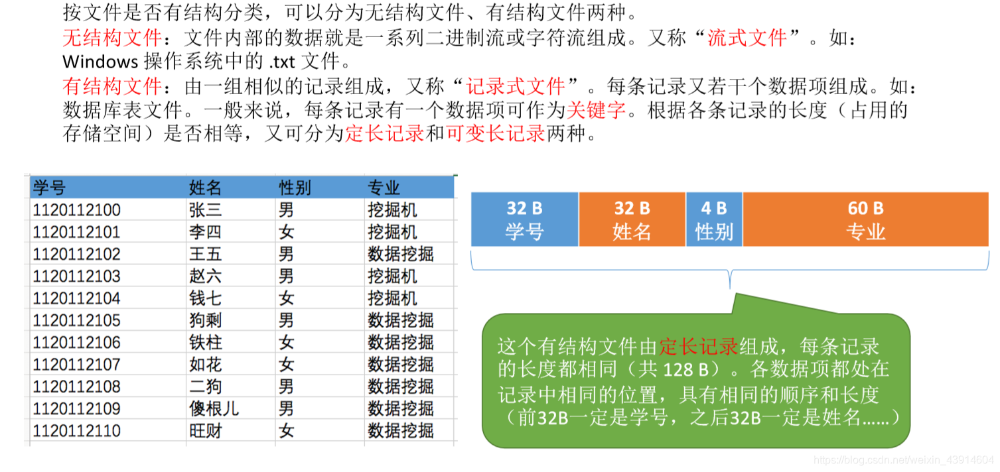
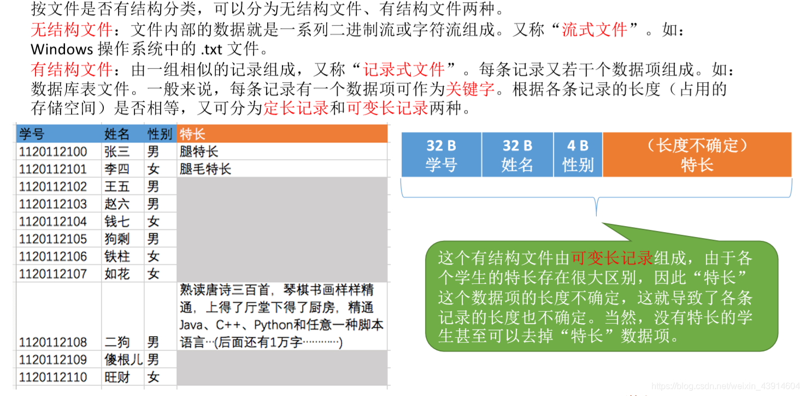
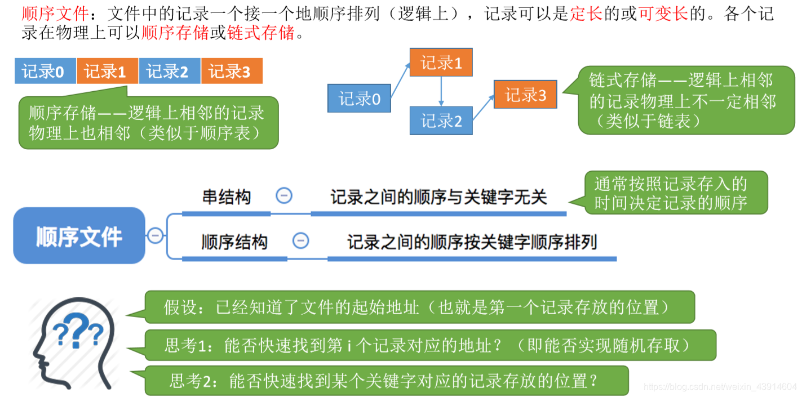
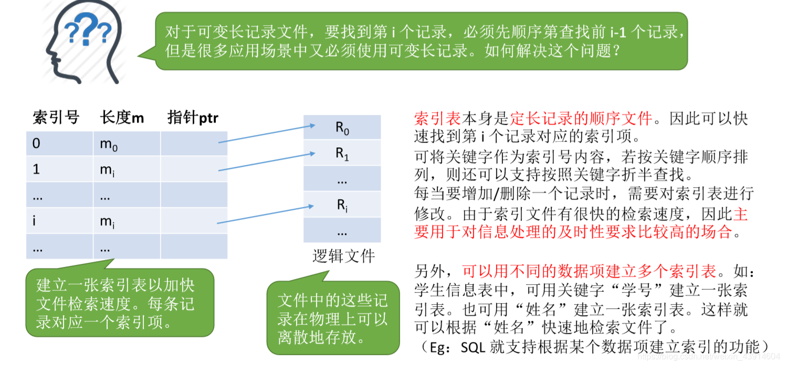
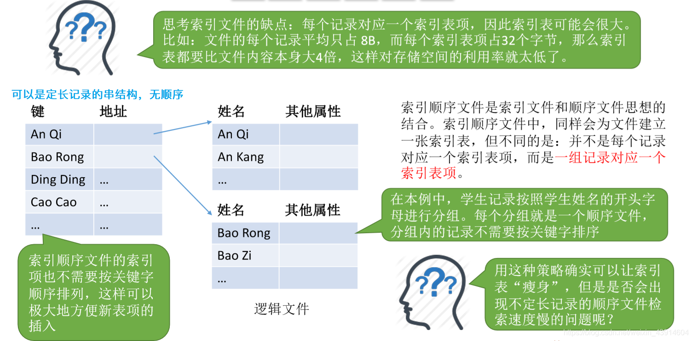
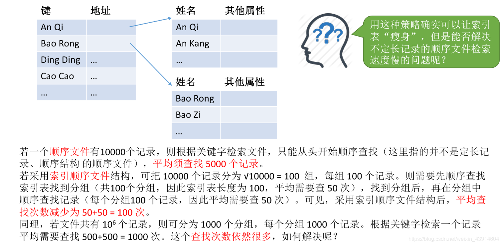
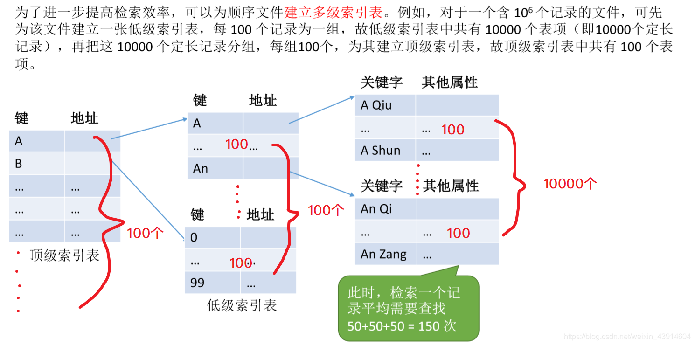

---

## 0.思维导图

  

## 1.无结构文件

## 2.有结构文件

  
**定长记录：**  
  
**不定长记录：**  

### 有结构文件的逻辑结构

### 顺序文件

  

### 索引文件

- 不经意间让我想起了数据库的索引，聚簇索引和唯一索引等，有了更进一步的理解，而且知道了它的时间空间效率。  
	

### 索引顺序文件

  
**索引顺序文件的效率分析：**  

### 多级索引顺序文件

参考：《王道操作系统》