## 0.思维导图

  
  
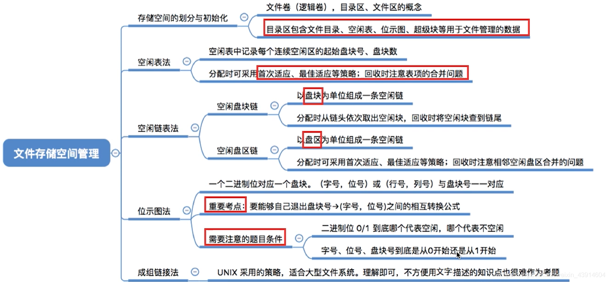

## 1.存储空间的划分与初始化

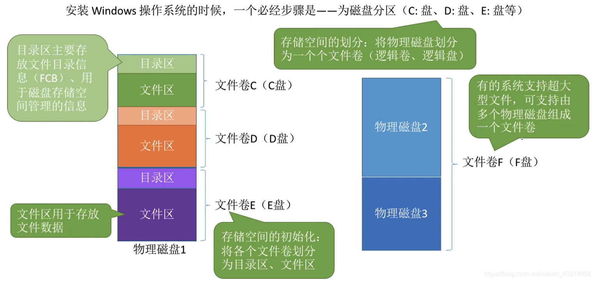

## 2.空闲表法

**如何分配？**  
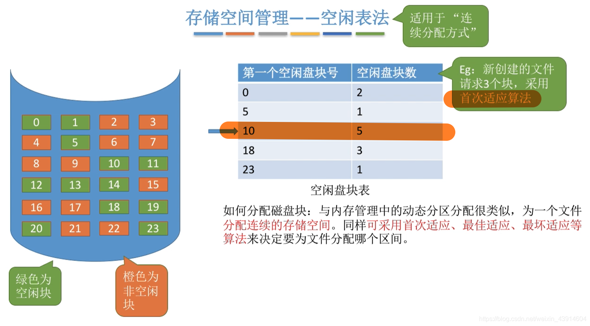

  
**如何回收？**  
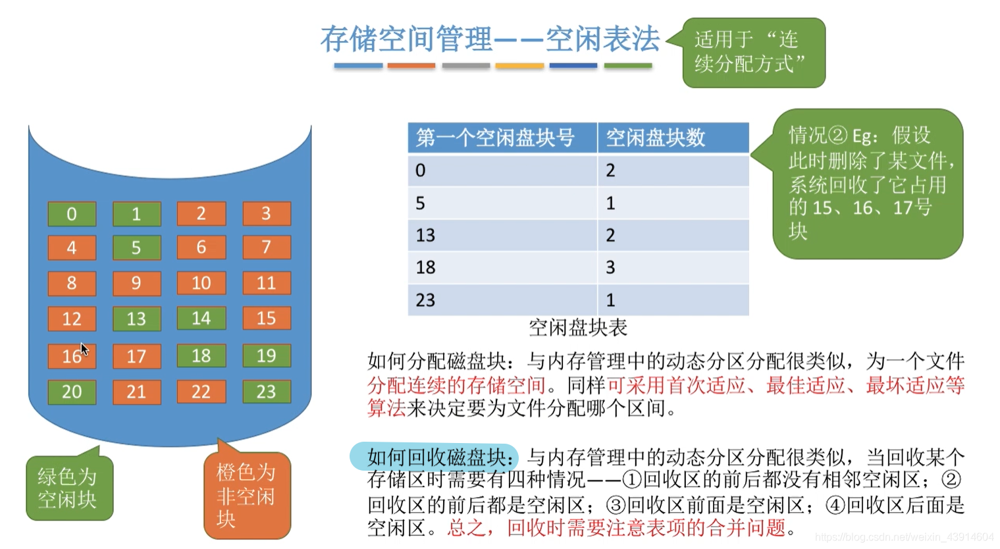  

## 3.空闲链表法

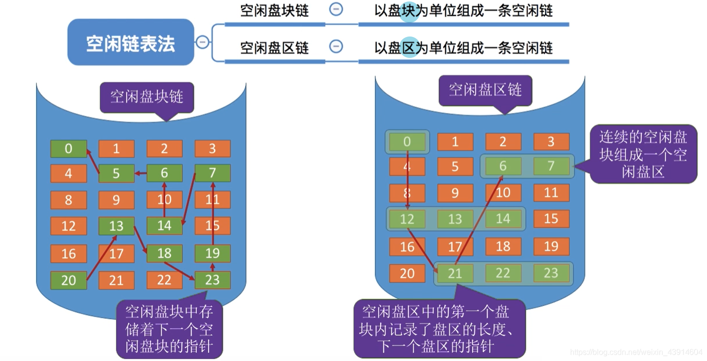

### 空闲盘块链

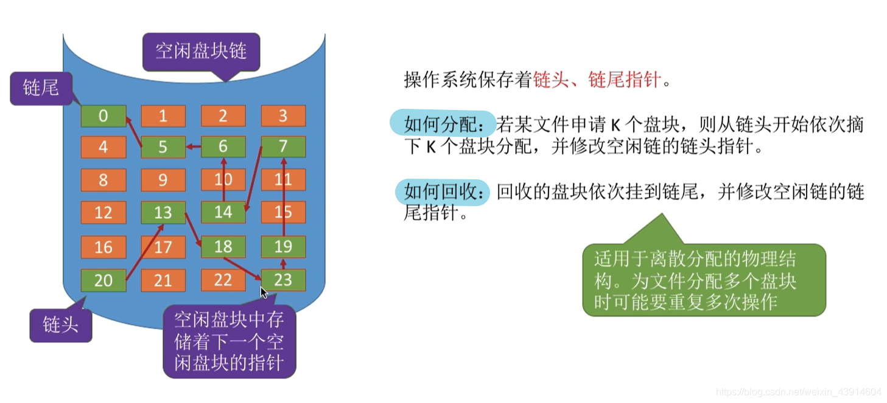

### 空闲盘区链

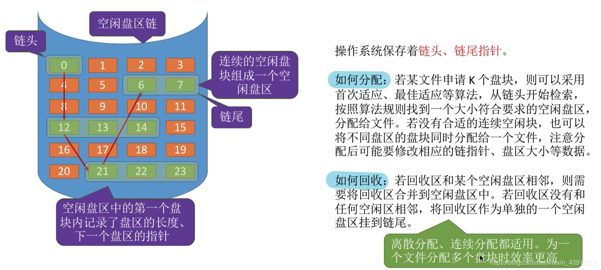

## 4.位示图法

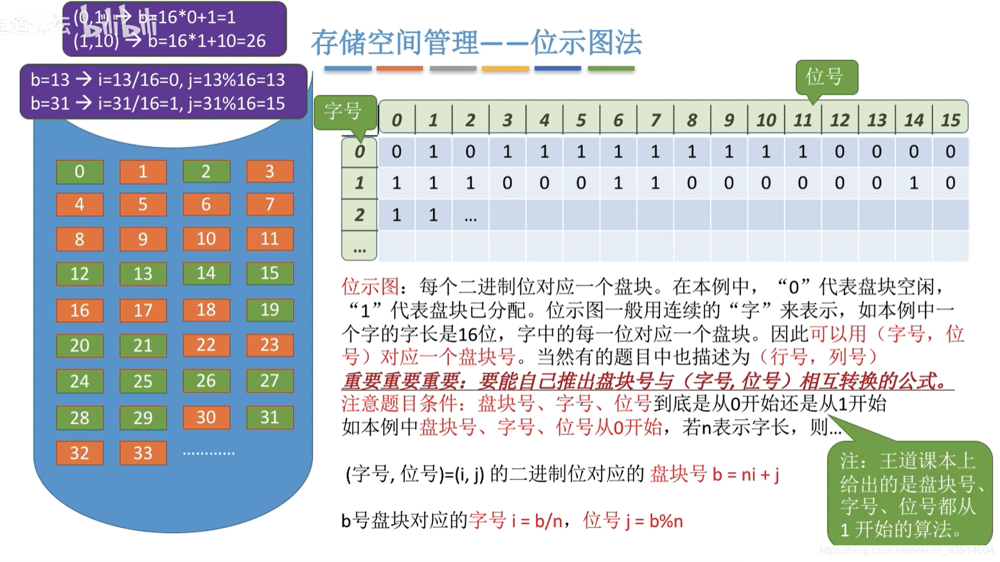  
**如何分配与回收？**

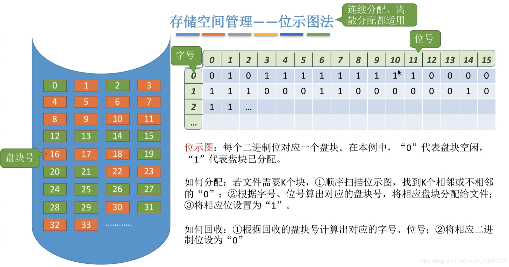

## 5.成组链接法

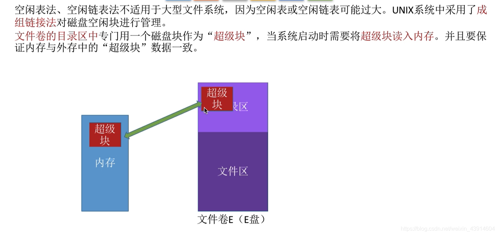  
**超级块的作用**  
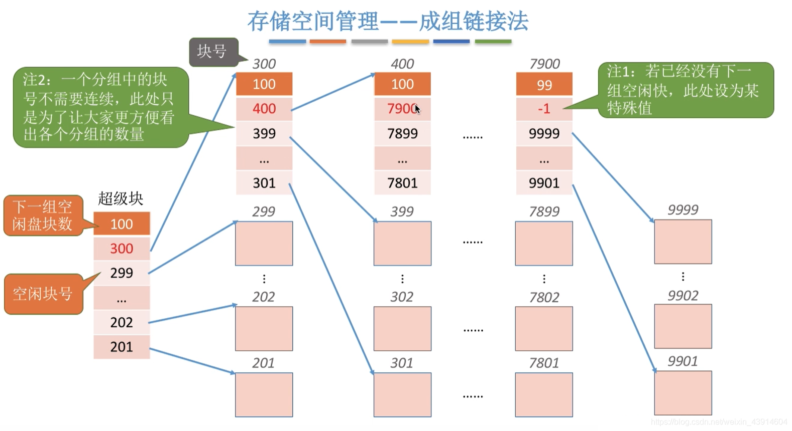  
**如何分配？**  
**需要1个空闲磁盘块**  
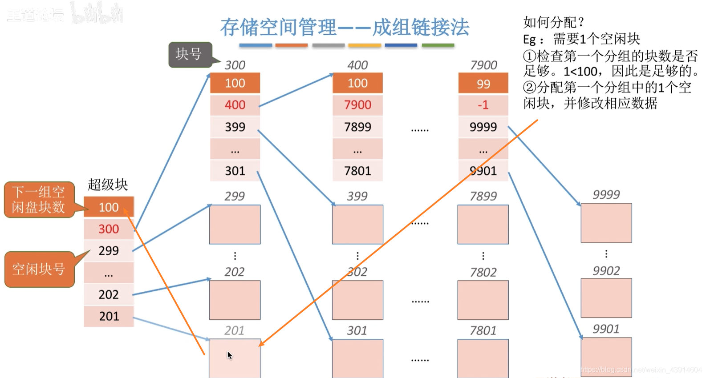  
  
**需要100个空心啊磁盘块**  
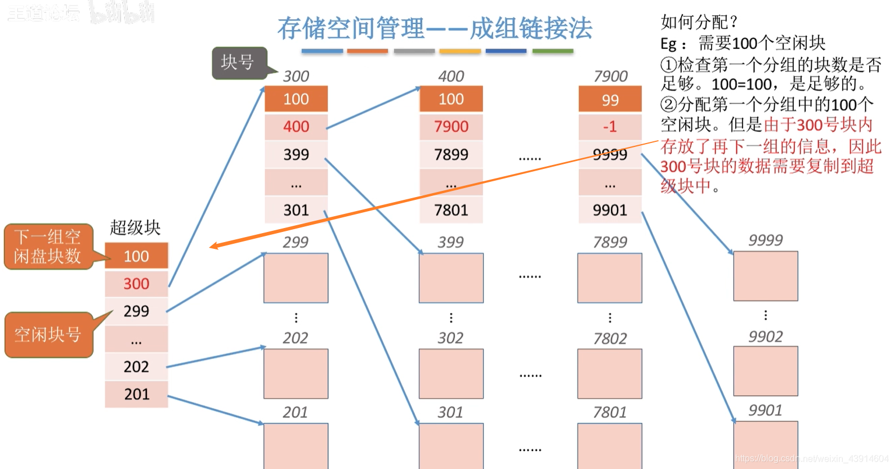  
  
**如何回收？**  
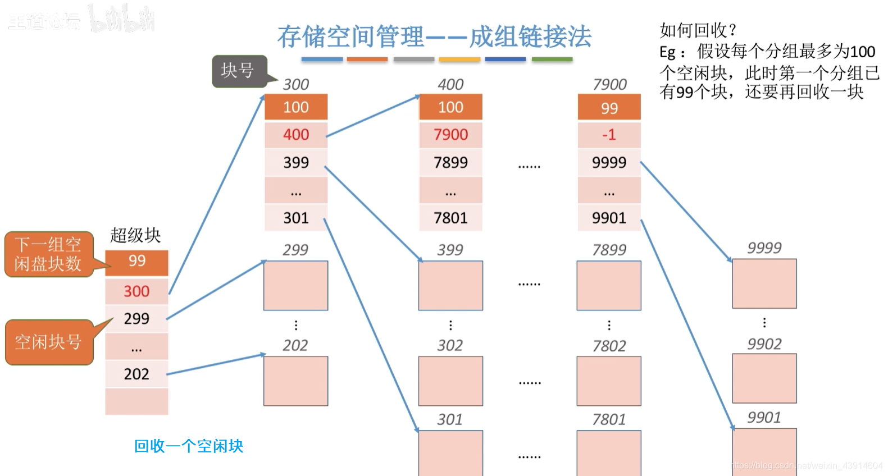  
  
**第二种情况，第一组已满**  
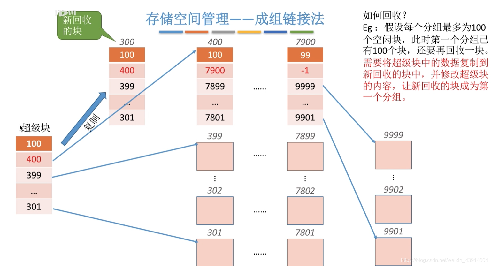  
  
**参考：《王道操作系统》**