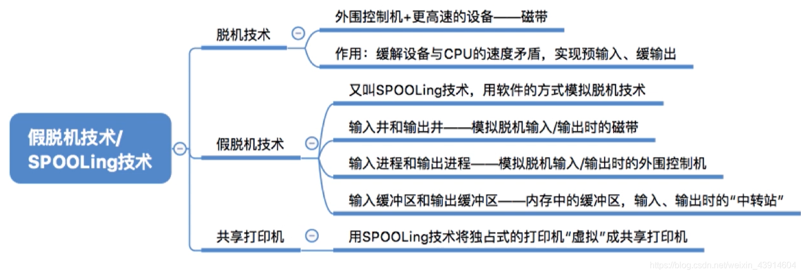
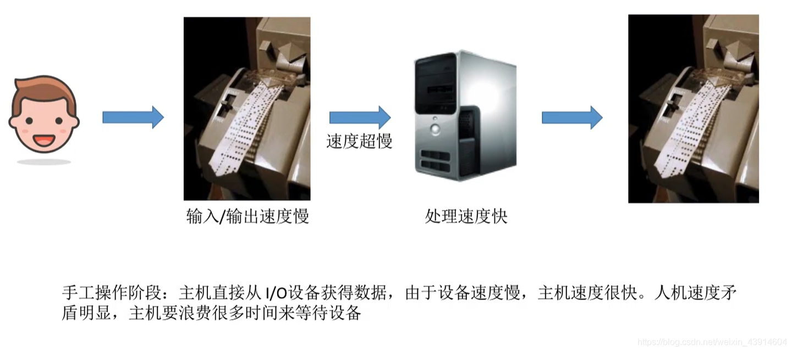
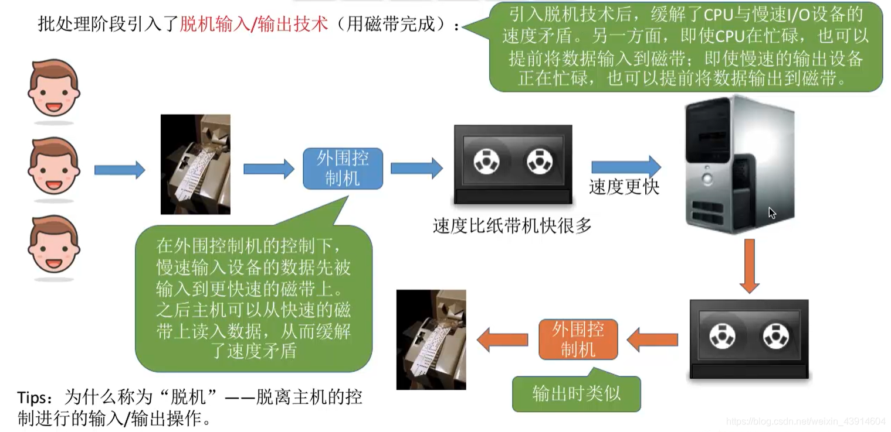
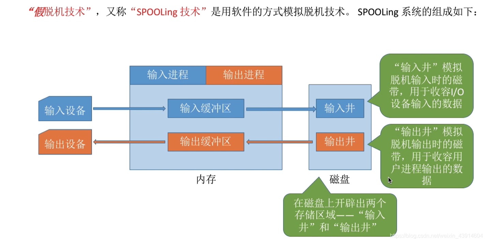
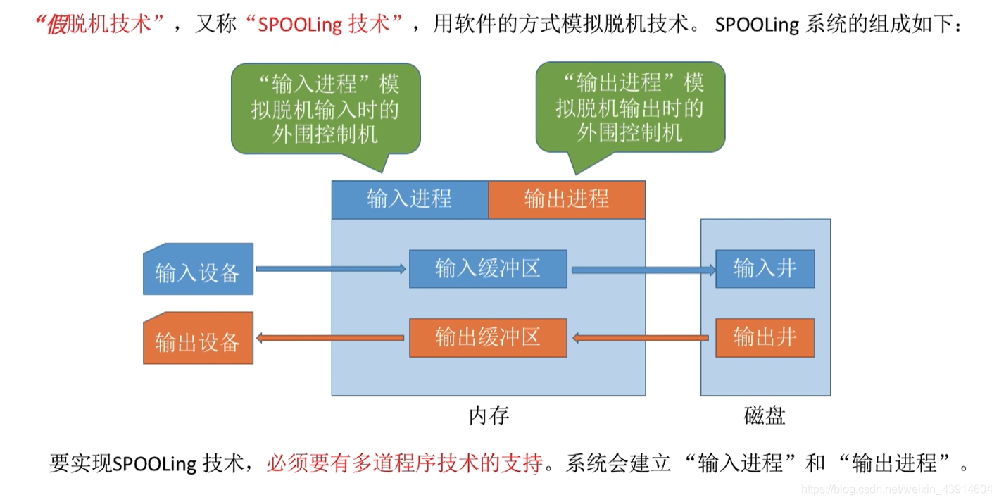
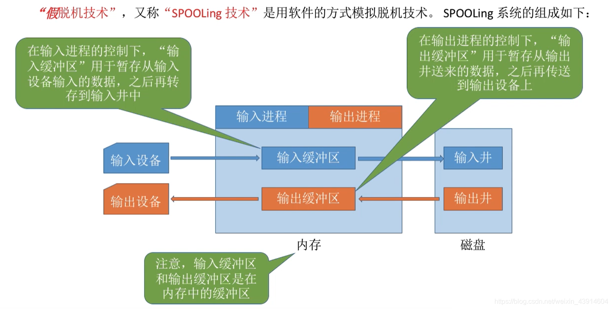
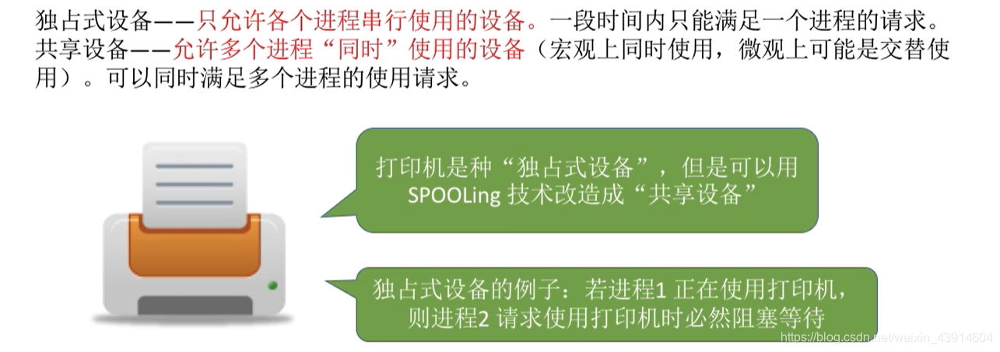
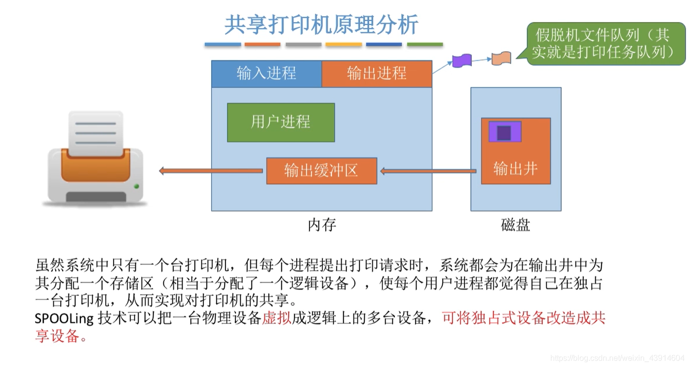

---

## 0.思维导图

## 1.什么是脱机技术？

**这里温习一下手工操作阶段：**  

- 因为手工阶段的速度慢问题，引入了脱机技术  
	

## 2.假脱机技术

- 在脱机技术的基础上人们发明了更好的假脱机技术

### 输入井和输出井

  

### 输入进程与输出进程

  

### 输入输出缓冲区

### 共享打印机 原理分析—假脱机技术的一种应用

**先了解一下独占和共享设备，以此引出假脱机技术如何实现对独占设备的共享：**  
  

- 打印请求完成后，请求表从打印队列删除，执行后续队列的打印任务

参考：《王道操作系统》