# FreeRTOS 入门

## RTOS 入门知识

### 裸机与 RTOS 特点

- 裸机：裸机又称为前后台系统，前台系统指中断服务函数，后台系统指的是无限大循环，即应用程序。
  - 实时性差：应用程序轮流执行
  - delay 空等待：CPU 不执行其他应用程序代码
  - 结构臃肿：实现功能都放在无限循环中，项目大了结构会及其臃肿


- RTOS：RTOS 全程 Real Time OS，实时操作系统，强调的是：实时性

  - 分而治之：实现功能划分为多个任务

  - 系统延时函数：实现任务调度

  - 抢占式响应：高优先级任务抢占低优先级任务

  - 任务堆栈：每个任务都有自己的栈空间
  

注：**RTOS 的中断可以打断任何任务，属于内核部分**


# FreeRTOS 基础知识

---

## 一、任务调度简介(熟悉)

### 什么是任务调度器

任务调度器就是使用相关的调度算法来决定当前需要执行的哪个任务。


### FreeRTOS 的任务调度方式

FreeRTOS 一共支持三种任务调度方式：

- **抢占式调度** ：主要是针对优先级不同的任务，每一个任务都有一个任务优先级，优先级高的任务可以抢占低优先级的任务的 CPU 使用权。
- **时间片调度** ：主要针对相同优先级的任务，当多个任务的优先级相同时，任务调度器会在每个时钟节拍到来的时候切换任务。
- **协程式调度** ：其实就是轮询，当前执行任务将会一直运行，同时高优先级的任务不会抢占低优先级任务。FreeRTOS 现在虽然还在支持，但官方已经明确表示不再更新协程式调度。


### 抢占式调度过程

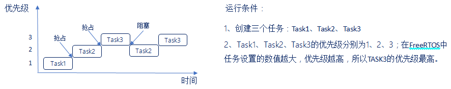

运行过程如下：

1. 首先 Task1 在运行中，在这个过程中 Task2 就绪了，在抢占式调度器的作用下，Task2 会抢占 Task1 的运行。
2. Task2 运行过程中，Task3 就绪了，在抢占式调度器的作用下 Task3 会抢占 Task2 的运行。
3. Task3 运行过程中，Task3 阻塞了(系统延时或者等待信号等)，此时就绪中，优先级最高的任务 Task2 执行。
4. Task3 阻塞解除了(延时到了或者接收到信号量)，此时 Task3 恢复到就绪态中，抢占 Task2 的运行。

总结：

1. 高优先级任务，优先执行。
2. 高优先级任务不停止，低优先级任务无法执行。
3. 被抢占的任务将会进去就绪态。


### 什么是时间片

同等优先级任务轮流享有相同的 CPU 时间(可设置)，叫做时间片，在 FreeRTOS 中，一个时间片等于 SysTick 中断周期。


### 时间片调度过程

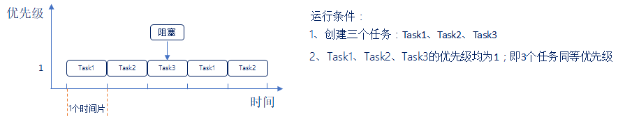

运行过程如下：

1. 首先 Task1 运行完一个时间片后，切换至 Task2 运行。
2. Task2 运行完一个时间片后，切换至 Task3 运行。
3. Task3 运行过程中(还不到一个时间片)，Task3 阻塞了(系统延时或者等待信号量等)，此时直接切换到下一个任务 Task1 执行。
4. Task1 运行完一个时间片后，切换至 Task2 运行。

总结：

1. 同等优先级任务，轮流执行。
2. 一个时间片大小，取决滴答定时器中断周期。
3. 没有用完的时间片不会再使用，任务 Task3 下次得到执行时间还是按照一个时间片的时钟节拍运行。

------


## 二、任务状态( 熟悉)

### FreeRTOS 的任务状态

FreeRTOS 中任务存在 4 种状态：

- **运行态** ：正在执行的任务，该任务就处于运行状态(注意：在 STM32 中，同一时间仅一个任务处于运行态)。
- **就绪态** ：如果该任务已经能够被执行，但当前还未被执行，那么该任务处于就绪态。
- **阻塞态** ：如果一个任务因为延时或者等待外部事件发生，那么这个任务就处于阻塞态。
- **挂起态** ：类似于暂停，调用函数 vTaskSuspend()进入挂起态，需要调用解挂函数 vTaskResume()才可以进入就绪态。


### 四种任务状态之间的转换关系


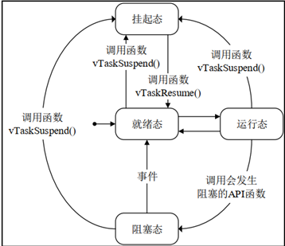

总结：

1. 仅就绪态可以转换成运行态。
2. 其他状态的任务想要运行，必须先转换成就绪态。


### 任务状态列表

答：任务的四种状态中，除了运行态，其他三种任务状态的任务都有其对应的任务状态列表。

- **就绪列表** ： pxReadyTasksLists [x]，其中 x 代表任务优先级数值。
- **阻塞列表** ：pxDelayedTaskList
- **挂起列表** ：xSuspendedTaskList

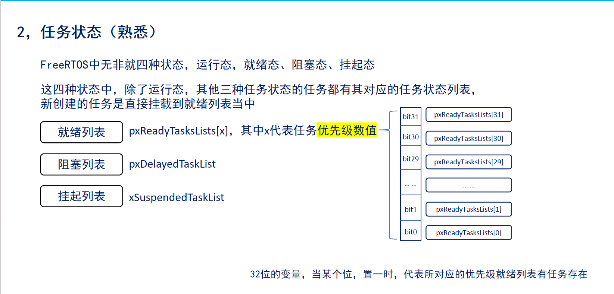

注意：**32 位的变量，当某个位，置 1 时，代表所对应的优先级就绪列表有任务存在**

#### 例子

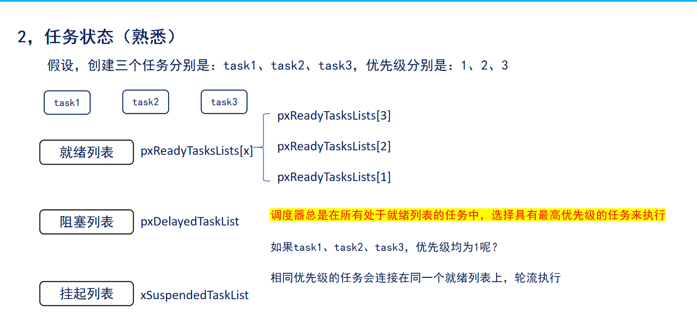


## 三、 FreeRTOS 的滴答

- 休眠时，RTOS 任务将指定需要“唤醒”的时间。 阻塞时，RTOS 任务可以指定希望等待的最长时间。

- FreeRTOS 实时内核通过 **滴答计数变量** 测量时间。定时器中断（RTOS 滴答中断）以严格的时间精度增加滴答数——允许实时内核以所选择的定时器 **中断频率** 的分辨率来测量时间

- 每次滴答数增加时，实时内核必须检查是否现在是解除阻塞或唤醒任务的时间。在滴答 ISR 期间唤醒或解除阻塞的任务的优先级可能高于被中断任务的优先级


首先，通过下面这张时序图，你可以直观地看到一次滴答中断（Tick Interrupt）内发生的完整活动流程：


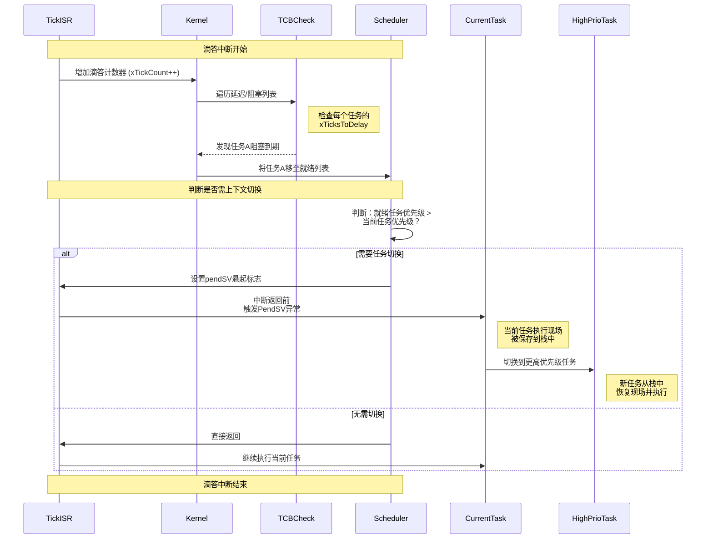

上图展示了一次滴答中断内核的决策过程，而下面的流程图则从更高视角展示了两个任务在阻塞、唤醒和调度之间的状态迁移，以及滴答计数器如何驱动这一过程：

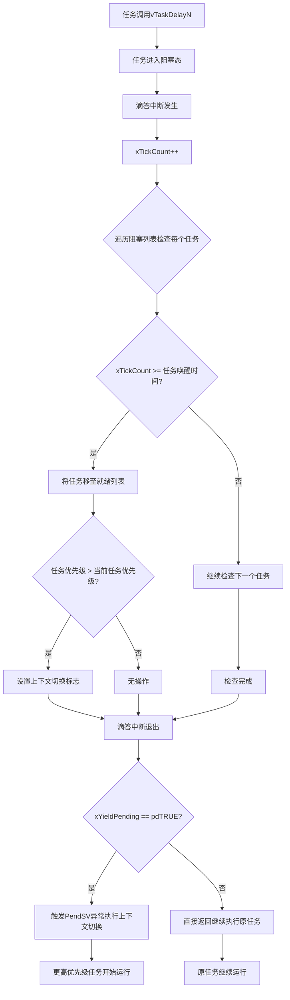


### 核心组件详解

#### 1. 滴答计数器 (xTickCount)

- **作用**：系统的“心跳”，是 FreeRTOS 测量所有时间间隔的基准。
- **行为**：由一个硬件定时器（通常是 SysTick）以固定的、精确的时间间隔触发中断，每次中断 `xTickCount` 加 1
- **频率**：通常配置为 100Hz（10ms 一次）或 1000Hz（1ms 一次），取决于 `configTICK_RATE_HZ`


#### 2. 任务控制块 (TCB - Task Control Block)

每个任务都有一个 TCB，其中与时间相关的关键字段包括：

- `xTicksToDelay`：任务还需阻塞的滴答数
- `xBlockTime`：任务请求阻塞的总滴答数（例如 `vTaskDelay(100)` 中的 100）
- `xWakeTime`：任务应该被唤醒的绝对滴答时间点（计算为 `xTickCount + xBlockTime`）


###  阻塞与唤醒的完整流程

1. **任务主动阻塞**：

   ```
   // 任务调用 vTaskDelay(100);
   // 内核会：
   // 1. 计算唤醒时间: xWakeTime = xTickCount + 100
   // 2. 将任务从就绪列表移至延迟列表
   // 3. 触发调度器，切换到下一个最高优先级的就绪任务
   ```

2. **滴答中断服务程序 (Tick ISR)**：
   每次滴答中断发生时，内核会：

   - 增加 `xTickCount`

   - 遍历延迟列表，检查每个阻塞任务：

     ```
     if (xTickCount >= pxTCB->xWakeTime) {
         // 将任务从延迟列表移回就绪列表
     }
     ```
     
   - 如果发现有更高优先级的任务就绪了，则设置一个 **上下文切换请求标志**（`xYieldPending = pdTRUE`）

3. **中断退出时的调度决策**：

   - 滴答 ISR 结束时，会检查 `xYieldPending` 标志
   - 如果设置为 `pdTRUE`，则 **触发 PendSV 异常**，在 PendSV handler 中进行实际的上下文切换（这是一个惰性切换，为了减少中断关闭时间）
   - 这确保了被唤醒的高优先级任务能立即抢占当前低优先级任务
   
   

#### 你提到的关键点解释

> **"在滴答 ISR 期间唤醒或解除阻塞的任务的优先级可能高于被中断任务的优先级"**

这句话描述的就是上述流程的最终结果。因为滴答 ISR 在检查阻塞列表时，可能会让一个 **更高优先级** 的任务进入就绪态。在 ISR 退出前，内核通过触发 PendSV 异常，使得 CPU 最终会切换到那个更高优先级的任务，从而 **抢占** 了原来被中断的（较低优先级）任务


## 四、 上下文切换

[【FreeRTOS】动画搞懂任务切换到底是怎么回事！_哔哩哔哩_bilibili](https://www.bilibili.com/video/BV1ErWyziEtw/?spm_id_from=333.337.search-card.all.click&vd_source=cae5e5e53a7fcdf3a7ac534a5a5e2344)

> mcu是包含cpu、内存及定时器、i2c控制器等外设的一个整体，是一台完整的计算机，此处特指mcu中的cpu(cortex m0)


### 什么上下文切换

1. 当一个任务执行时，它会利用处理器/微控制器寄存器，并像其他程序一样访问 RAM 和 ROM。这些资源 ==（处理器寄存器，堆栈等）== 一起组成了任务执行 **上下文**

2. 一个任务是一段有顺序的代码——它不知道什么时候会被内核挂起（换出或换入）或恢复（换入或换入）， 甚至不知道什么时候自己被挂起或恢复

3. 一个任务在即将执行将两个处理器寄存器内包含的数值相加之前被挂起。 当该任务被挂起时，其他任务会执行，还 ==可能会修改处理器寄存器的数值==。==恢复时， 该任务不会知道处理器寄存器已经被修改过了——如果它使用经修改过的数值， 那么求和会得到一个错误的数值==

4. 为了防止这种类型的错误，**任务** 在 **恢复时** 必须有一个与 **挂起之前相同的上下文** 。==通过在任务挂起时保存任务的上下文==，操作系统内核负责确保上下文保持不变。任务恢复时，其保存的上下文在执行之前由操作系统内核恢复

保存被挂起的任务的上下文和恢复被恢复的任务的上下文的过程被称为 **上下文切换**


### 上下文切换切换的保存

==**堆栈的栈是数据结构，堆是用的堆空间**==

1. 将 TaskA 在相应的处理器寄存器中的上下文保存到其任务堆栈中

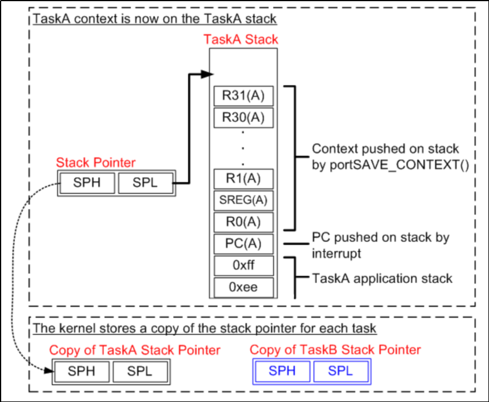

2. 将 TaskB 的上下文从其任务堆栈中恢复到相应的处理器寄存器中

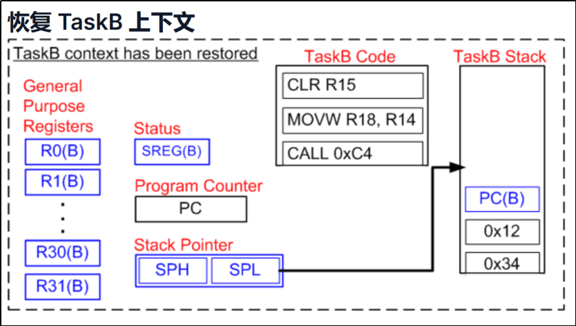


>  堆栈是在内存中进行存储的

1. **任务获得CPU使用权时（从就绪态 -> 运行态）**：
   - **动作**：将**该任务自己堆栈里**之前保存的寄存器值（即上下文）“**恢复**”到**CPU的实际寄存器组**中
   - **结果**：CPU的“现场”被完全还原成这个任务上次被切换出去时的样子，程序计数器（PC）也指向当时的下一条指令，于是任务就能**无缝衔接地继续运行**
2. **任务失去CPU使用权时（从运行态 -> 就绪/阻塞态）**：
   - **动作**：将**当前CPU寄存器组**的值（即当前“现场”）“**保存**”到**该任务自己的堆栈**里
   - **结果**：任务当前的运行状态被完美“存档”，等待下次被调度时再“读档”继续


**程序运行的本质就是CPU对内存，外设寄存器等存储元件的读写与计算；**

**实际上是不能直接对内存里面的数据进行运算，而是要根据寄存器（通用寄存器R0 - R12，特殊寄存器R13-SP寄存器（栈指针寄存器），R14-LR寄存器（链接寄存器），R15-PC寄存器（程序计数寄存器））；**

**CPU要对内存区中的数据进行运算时，就要先将数据取到寄存器当中，运算完成后再从寄存器写回**

>小tops：
>
>​	所谓STM32是32位单片机，STC51是8位单片机，就是看通用寄存器的位数
>
>​	所谓的任务的切换，就是对寄存器进行偷梁换柱

==下面就是任务分配的堆栈，也就是任务栈==

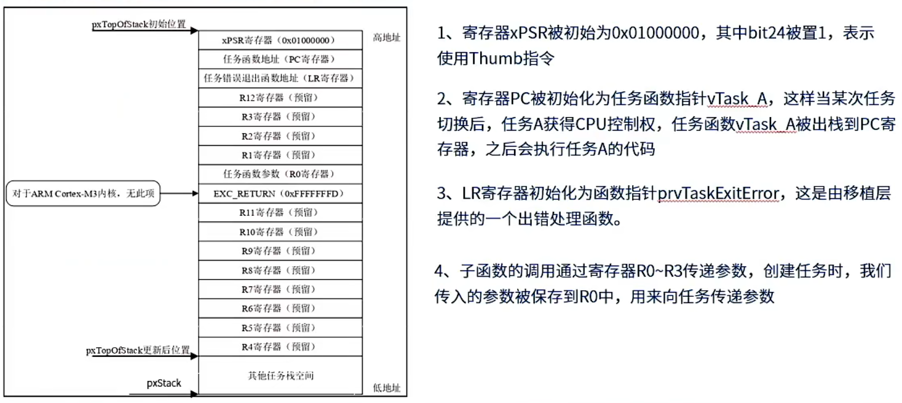

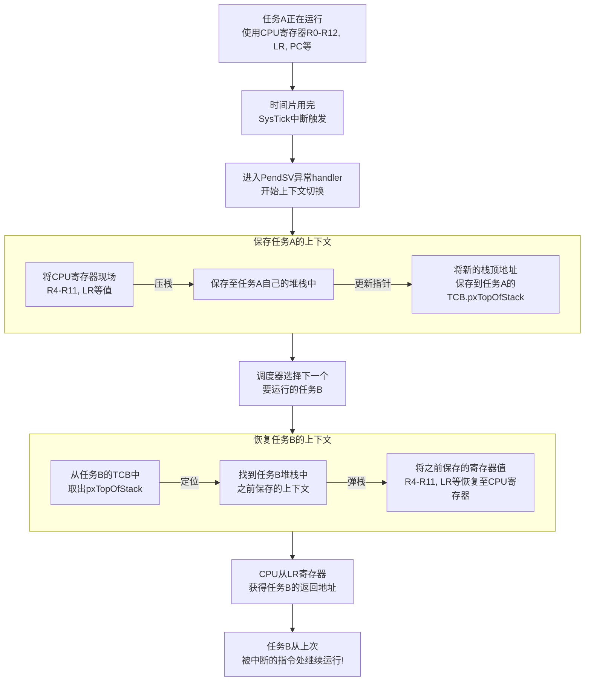

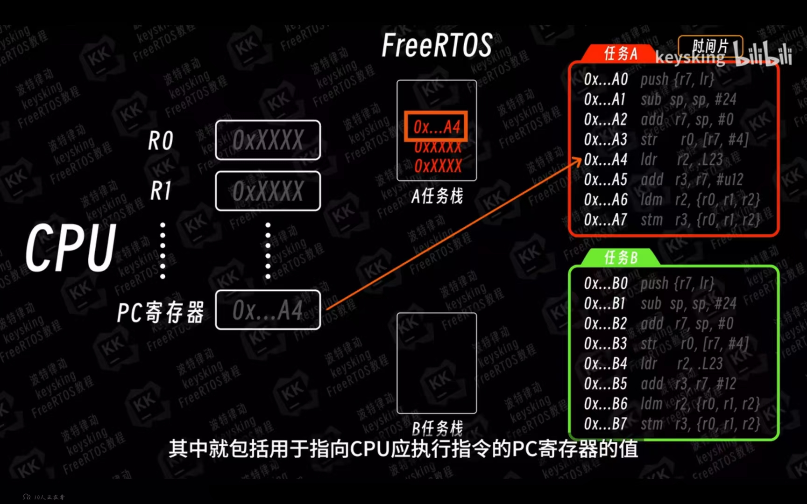

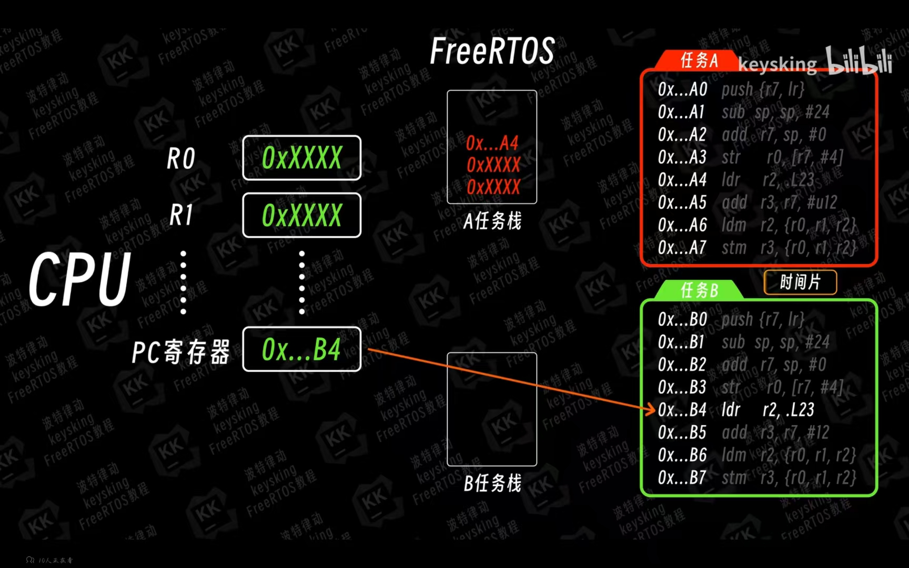

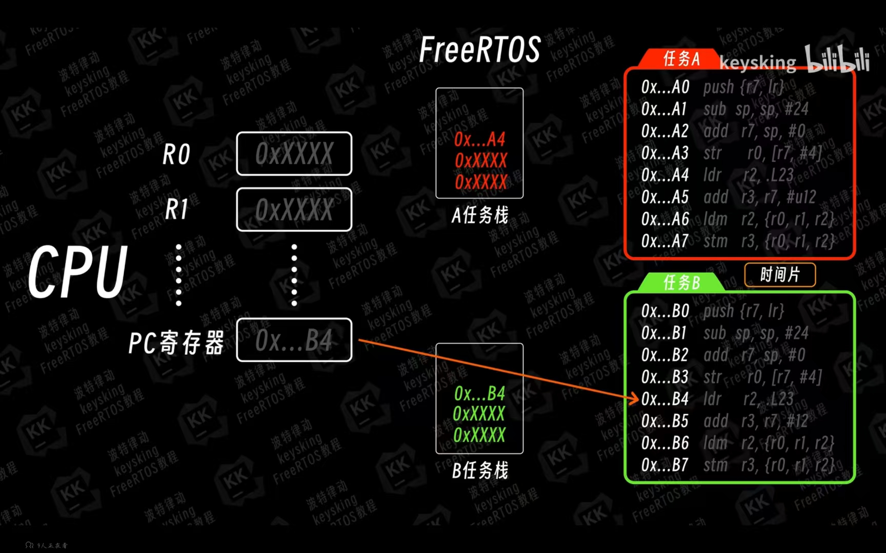


### 任务切换时TCB，和堆栈的关系

1. 从属关系 (Ownership)

- **一个任务必然拥有一个TCB和一块堆栈空间**。它们是一个任务不可分割的两部分。
- 在创建任务时（`xTaskCreate`或`xTaskCreateStatic`），你需要同时提供TCB和堆栈所需的内存（静态或动态分配）。

2. 指针关联 (Pointer Association)

这是最直接的关系！TCB通过内部的**指针成员**来管理对应的堆栈：

- `pxStack`：这是一个指针，**永远指向任务堆栈的起始地址（栈底）**。它明确了“这个任务的工作台从哪里开始”。
- `pxTopOfStack`：这是一个**非常关键**的指针，它**永远指向任务堆栈的当前栈顶位置**。在任务切换时，它就是用来保存和恢复**任务上下文（Context）** 的基准点。

3. 功能协作 (Functional Collaboration)

TCB和堆栈各司其职，协同工作：

| **任务控制块 (TCB) - “管理员”**                              | **任务堆栈 (Stack) - “工作台”**                              |
| :----------------------------------------------------------- | :----------------------------------------------------------- |
| **存储任务的元数据（属性）**：<br>- 任务状态（运行、就绪、阻塞等）<br>- 任务优先级<br>- 任务名称<br>- 事件列表项 | **存储任务的运行时数据（内容）**：<br>- **函数调用地址**（LR）、**局部变量**<br>- **任务上下文**（CPU寄存器值R0-R15等） |
| **通过指针管理堆栈**：<br>- 知道堆栈从哪里开始(`pxStack`)<br>- 知道当前用到了哪里(`pxTopOfStack`) | **为TCB提供存储空间**：<br>- 实际承载TCB所管理的所有运行时数据 |
| **是内核调度和管理的依据**：<br>- 调度器通过查询TCB链表来决定运行哪个任务 | **是任务能够独立运行的基石**：<br>- 确保每个任务的运行时数据互不干扰，实现内存隔离 |


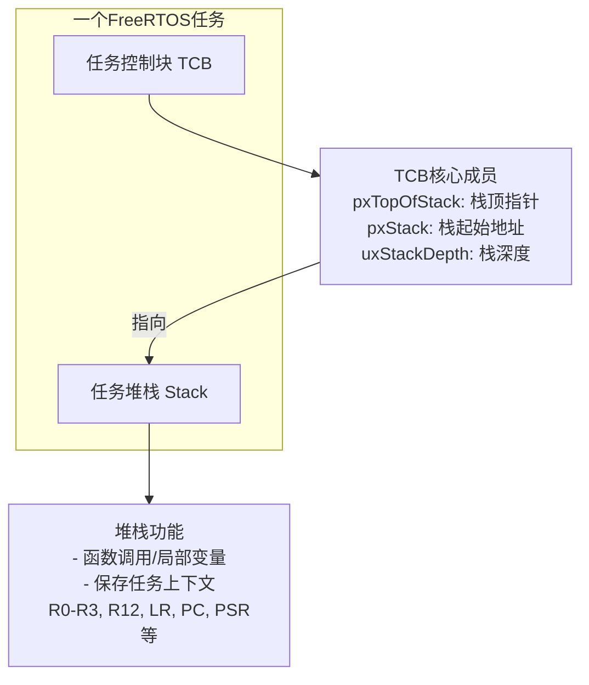


### 为什么要使用PendSV进行上下文切换

在需要切换任务的时候进行上下文切换，==真正执行上下文切换是在 PendSV 的 ISR（中断） 中处理的==。使用 PendSV 是因为其可以手动触发，并且可以在其他更高中断优先级的 ISR 中来进行设置，比较灵活。具体触发操作是将中断控制和状态寄存器 ICSR 的 bit28，也就是 PendSV 的挂起位置 1 来触发 PendSV 中断。FreeRTOS 会将 PendSV 设置为最低中断优先级，避免任务切换影响到其他正常的 ISR

在 FreeRTOS 中有以下几个情况会触发 PendSV 异常产生切换：

（1）**RTOS 滴答中断**：会处理就绪列表，判断是否要切换任务（包括抢占式、时间片轮转）。

（2）**任务执行完毕**：主动调用任务切换函数进行强制切换。


==在切换任务时，有比 PendSV更高级的中断出现，挂起 PendSV，在 SysTick 中断中把比 PendSV 更高级的中断执行完之后，再进行切换任务==

任务执行结束了，但是没有到一个时间片，那就会执行挂起 PendSV 操作（特殊结束）


#### 1.什么是 PendSV？

**PendSV（Pendable Service Call，可挂起的服务请求）是 ARM Cortex-M 处理器的一个特殊异常，被操作系统用作在安全时机执行“任务切换”的专用工具。**

为了让这个概念变得极其直观，我们来看一下 PendSV 在 FreeRTOS 中是如何被触发和执行的：

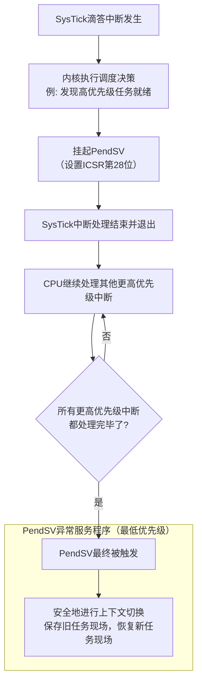


> 上图展示了 PendSV 的核心价值：**延迟执行**。它确保耗时的上下文切换不会阻塞更紧急的中断。


==这是中断：数字越小，优先级越高==

1. **问题**：SysTick 中断优先级假设为 5。
2. **场景**：SysTick 中断发生，开始执行其 ISR。在 ISR 中，内核发现需要切换任务，于是开始执行非常耗时的上下文切换（保存/恢复所有寄存器）。
3. **灾难**：此时，一个优先级为 4（更高）的 **USB 中断** 或 **按键中断** 到来，但它 **无法立即抢占** 正在执行上下文切换的 SysTick 中断，因为 CPU 还在处理中断流程中。
4. **后果**：高优先级中断的响应被延迟，实时性被破坏！这是实时系统的大忌。


“==**使用 PendSV 是因为其可以手动触发，并且可以在其他更高中断优先级的 ISR 中来进行设置，比较灵活**==”。这背后是 ARM Cortex-M 内核一个精妙的设计

- **问题**：假设在 **SysTick 中断（滴答中断）** 中直接进行上下文切换。如果此时有一个更高优先级的中断（比如一个重要的 USB 中断）到来，会发生什么？
  - 高优先级中断会抢占 SysTick 中断。
  - 在高优先级中断服务程序执行过程中，如果又发生了任务切换，中断栈可能会被破坏，导致系统崩溃。
- **解决方案**：**延迟上下文切换**。这就是 PendSV 的作用。
  - **PendSV（可挂起的系统调用）** 是一个可以 **手动触发（挂起）** 的异常。
  - 在 SysTick 等 ISR 中，我们 **只做决策**（比如发现更高优先级任务就绪了），然后简单地 **设置一个标志并挂起 PendSV**。
  - **等到所有更高优先级的中断都处理完毕后**，PendSV 作为 **最低优先级的异常** 才会被执行。此时，中断环境是安全的，可以安心地进行复杂的上下文切换。

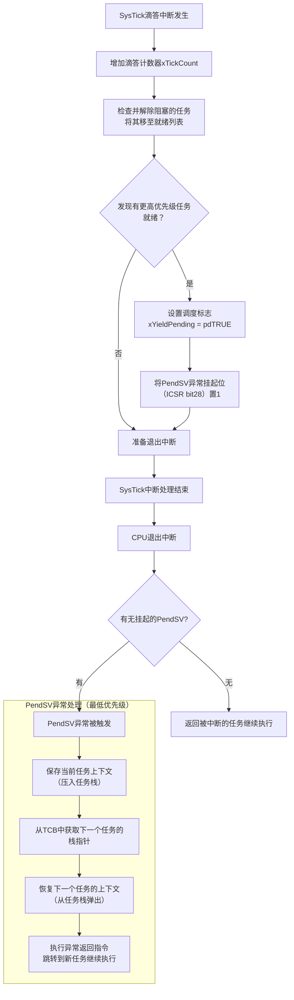


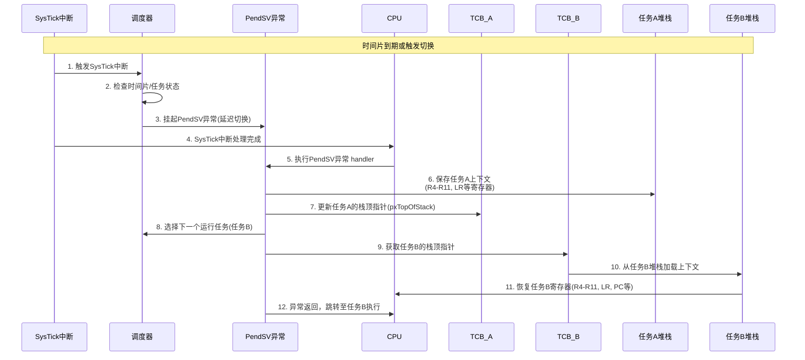


#### 3. 触发 PendSV 的时机（上下文切换的时机）

你提到的两个时机非常准确，以下是更详细的分解：

| 触发场景                    | 具体原因                                                     | 内核动作                                                     |
| :-------------------------- | :----------------------------------------------------------- | :----------------------------------------------------------- |
| **RTOS 滴答中断 (SysTick)** | **时间片到期**：同优先级任务的时间片轮转。                   | 检查时间片计数器，挂起 PendSV。                               |
|                             | **任务阻塞到期**：`vTaskDelay()` 延时结束，任务重新就绪。    | 将任务从延迟列表移回就绪列表。如果该任务优先级最高，则挂起 PendSV。 |
|                             | **高优先级任务就绪**：一个更高优先级的任务因信号量、队列等事件而解除阻塞。 | 挂起 PendSV 以立即进行抢占。                                   |
| **任务主动请求**            | **任务阻塞**：任务调用 `vTaskDelay()`, `xQueueReceive()` 等函数主动放弃 CPU。 | 函数内部会直接或间接地调用 `portYIELD()` 来挂起 PendSV。      |
|                             | **任务删除**：任务调用 `vTaskDelete()` 删除自己或其它任务。  | 内核需要立即调度以选择下一个运行的任务。                     |
|                             | **主动让出**：任务调用 `taskYIELD()`。                       | 直接挂起 PendSV，强制进行一轮调度。                           |


> 所以，上下文切换是 FreeRTOS 这类 RTOS 能够实现 **多任务“同时”运行** 而又 **互不干扰** 的魔法所在。它通过精细地保存和恢复现场，完美地欺骗了每一个任务。


###  上下文切换详解（本质上解释）

#### 1. 什么是“上下文”（Context）？

一个任务在运行时，其“现场”由以下几部分组成：

- **处理器寄存器**：如程序计数器（PC）、堆栈指针（SP）、通用寄存器（R0-R12 等）、状态寄存器（如 xPSR）。这是上下文的 **核心**
- **堆栈（Stack）**：用于存储局部变量、函数调用返回地址、中断现场等。每个任务都有自己独立的堆栈空间
- **内存中的代码和数据**：虽然代码段（ROM）通常是只读且共享的，但任务的数据（全局变量、静态变量等）在 RAM 中的布局也是其运行环境的一部分

**简单来说，上下文就是任务在某一个精确时刻的“运行快照”**

#### 2. 为什么需要上下文切换？

- **对任务透明**：任务只管执行自己的逻辑流，它 **不知道** 自己何时会被操作系统挂起或恢复。它认为自己独占 CPU
- **资源冲突**：CPU 的寄存器是所有任务共享的硬件资源。如果一个任务（Task A）正在使用寄存器，被挂起后另一个任务（Task B）运行并修改了这些寄存器，那么当 Task A 恢复时，它期望的原始寄存器值已被破坏，导致运行错误（就像你举的加法例子）

#### 3. 如何实现上下文切换？

上下文切换的过程就是 **保存与恢复** 这一“运行快照”的过程，其目的是为了给任务制造一种“从未被打断过”的假象。

整个过程可以分为以下几个阶段：

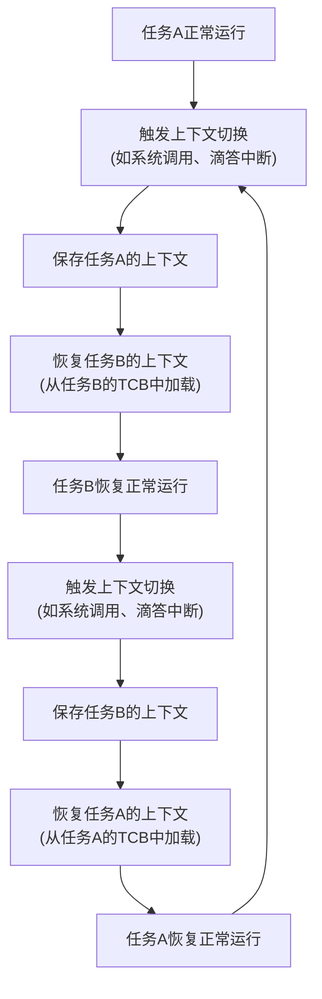

具体来说，在 FreeRTOS 中：

- **保存上下文**：在任务被挂起时，内核会 **自动将当前 CPU 的所有寄存器值压入该任务的私有堆栈中**
- **存储指针**：然后将该任务堆栈的当前栈顶指针（SP）保存到它的 **任务控制块（TCB）** 中
- **恢复上下文**：当需要恢复该任务时，内核从它的 TCB 中读出保存的栈顶指针，**从该任务的堆栈中将所有的寄存器值弹出（Pop）到 CPU 的对应寄存器中**
- **执行返回**：最后一条出栈的指令通常是程序计数器（PC）或返回地址，CPU 直接跳转到那里继续执行

#### 4. 触发上下文切换的时机

- **主动让出**：任务调用 `taskYIELD()`
- **系统调用**：任务调用了会引起阻塞的 API，如 `vTaskDelay()`, `xQueueReceive()`
- **定时器中断**：滴答定时器中断（SysTick）中发现有更高优先级任务就绪（**最常见的情况**）
- **外部中断**：中断服务例程（ISR）中发送信号量、消息等，释放了更高优先级任务


## 五、空闲任务

1. RTOS 调度器启动时，==**自动创建空闲任务**==，以确保始终存在一个能够运行的任务

2. 空闲以最低优先级创建，以确保如果有更高的优先级应用程序任务处于准备就绪状态，空闲任务则不使用任何 CPU 时间

3. 空闲任务负责释放被删除的任务的内存


###  空闲任务详解

####  创建与优先级

- **自动创建**：在 `vTaskStartScheduler()` 被调用时，FreeRTOS 内核 **自动** 创建空闲任务。用户无需手动创建。
- **最低优先级**：它的优先级被固定为 `0`（`configMAX_PRIORITIES - 1`），这是整个系统中 **最低的优先级**。这确保了只要有任何用户任务（优先级 >= 1）处于就绪态（Ready），调度器就会优先运行用户任务，空闲任务根本无法获得 CPU 时间。它的存在只是为了“填补空闲时间”

#### 2. 核心职责：内存释放（你提到的关键点）

这是空闲任务 **最重要的工作**。当用户任务调用 `vTaskDelete(NULL)` 或 `vTaskDelete(xTaskHandle)` 删除一个任务时，该任务并不会立即释放其占用的内存（栈空间和 TCB 结构体）。

- **延迟释放**：删除任务时，内核只是将该任务的 TCB 和栈空间 **添加到一个待删除的链表** 中
- **空闲任务处理**：空闲任务在循环中，会检查这个链表。如果链表不为空，它就 **逐一释放这些内存**，将其还给堆（heap），避免内存泄漏

这个过程可以通过以下流程图来清晰展示：

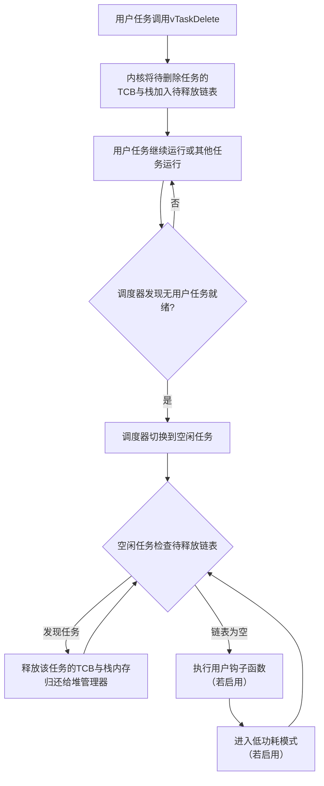

#### 3. 其他重要功能（扩展能力）

除了内存回收，空闲任务还提供了两个非常重要的扩展接口，通过配置 `FreeRTOSConfig.h` 中的宏定义来启用：

1. **空闲任务钩子函数 (Idle Task Hook)**
   - **作用**：允许用户定义一个函数（`vApplicationIdleHook()`），该函数会在空闲任务循环中 **被自动调用**。
   - 用途
     - **执行低优先级后台功能**，如内存整理、状态监控、低功耗心跳等。
     - **重要提示**：钩子函数内 **不能调用任何会引任务阻塞的 API**（如 `vTaskDelay()`, `xQueueReceive()`），因为这会迫使空闲任务进入阻塞态，导致内存无法及时释放！
2. **低功耗管理 (Tickless Idle)**
   - **作用**：当系统启用 `configUSE_TICKLESS_IDLE` 后，如果空闲任务发现没有任务需要释放，且下一个唤醒事件尚远，它会 **暂停 SysTick 滴答中断**，并 **将微控制器置于低功耗睡眠模式**（如 WFI）。
   - **原理**：计算出可以睡眠的时间，然后设置一个定时器在需要唤醒时（如下一个任务阻塞到期时）产生中断来唤醒 CPU。
   - **好处**：在系统空闲时 **大幅降低功耗**，对电池供电设备至关重要。

### 总结与比喻

| 特性                     | 解释                                 | 类比                                                         |
| :----------------------- | :----------------------------------- | :----------------------------------------------------------- |
| **自动创建，最低优先级** | 系统的“备胎”，确保 CPU 永远有事可做    | like **工厂的清洁工**，只在所有生产线工人（用户任务）都休息时，才出来打扫。 |
| **负责回收资源**         | 释放被删除任务的内存，防止泄漏       | like **系统的“垃圾回收员”**，专门处理其他任务产生的“工业垃圾”。 |
| **提供钩子函数**         | 允许用户插入自定义的低优先级后台逻辑 | like 给清洁工一份 **额外的检查清单**，让他打扫的同时也检查一下门窗水电。 |
| **实现低功耗**           | 在空闲时让 MCU 休眠，省电              | like 清洁工完成工作后，**把整个厂的灯和机器都关了**，只留一个警报器。 |

因此，空闲任务是 FreeRTOS 生态系统中的一个 **基础且关键的服务性任务**，它默默无闻地负责着资源管理和节能降耗的重任，是系统长期稳定运行的重要保障。


# FreeRTOS 系统配置文件详解

------


## FreeRTOSConfig.h 配置文件作用

答：对 FreeRTOS 进行功能配置和裁剪，以及 API 函数的使能。


## 学习途径

1. 官方的在线文档中有详细说的说明：https://www.freertos.org/a00110.html 。
2. 正点原子《FreeRTOS 开发指南》第三章的内容 --- FreeRTOS 系统配置。


## 配置文件中相关宏的分类

答：相关宏大致可以分为三类。

- **‘INCLUDE’开头**  ---  配置 FreeRTOS 中可选的 API 函数
- **‘config’开头**  ---  完成 FreeRTOS 的功能配置和裁剪(如调度方式、使能信号量功能等)
- ​    **其他配置**  ---  PendSV 宏定义、SVC 宏定义

注：对于初学者来说，这些配置内容，目前有个感性的认识即可


## 对应的资料和代码

```C
/*
 * FreeRTOS V202212.01
 * https://www.FreeRTOS.org
 * https://github.com/FreeRTOS
#ifndef FREERTOS_CONFIG_H
#define FREERTOS_CONFIG_H
/*-----------------------------------------------------------
 * Application specific definitions.
 *
 * These definitions should be adjusted for your particular hardware and
 * application requirements.
 *
 * THESE PARAMETERS ARE DESCRIBED WITHIN THE 'CONFIGURATION' SECTION OF THE
 * FreeRTOS API DOCUMENTATION AVAILABLE ON THE FreeRTOS.org WEB SITE.
 *
 * See http://www.freertos.org/a00110.html
 *----------------------------------------------------------*/
/* Ensure stdint is only used by the compiler, and not the assembler. */
//#ifdef __ICCARM__
#if defined(__ICCARM__) || defined(__CC_ARM) || defined(__GNUC__)
	#include <stdint.h>
	extern uint32_t SystemCoreClock;  /* 声明外部系统时钟变量，用于配置CPU频率 */
#endif
/* 内核行为配置 */
#define configUSE_PREEMPTION			1   /* 1:使用抢占式调度; 0:使用协作式调度 */
#define configUSE_TIME_SLICING		     1   /* 1:启用时间片轮转调度; 0:禁用 */
#define configUSE_IDLE_HOOK				0   /* 1:启用空闲任务钩子函数; 0:禁用 */
#define configUSE_TICK_HOOK				0   /* 1:启用时钟节拍钩子函数; 0:禁用 */
/* 时钟和频率配置 */
#define configCPU_CLOCK_HZ				( SystemCoreClock )              /* CPU时钟频率，通常等于SystemCoreClock */
#define configTICK_RATE_HZ				( ( TickType_t ) 1000 )          /* 系统节拍频率，1000Hz = 1ms一个节拍 */
/* 任务和内存配置 */
#define configMAX_PRIORITIES			( 5 )                           /* 最大任务优先级数量（0到configMAX_PRIORITIES-1） */
#define configMINIMAL_STACK_SIZE		( ( unsigned short ) 130 )      /* 空闲任务的最小堆栈大小（以字为单位） */
#define configTOTAL_HEAP_SIZE			( ( size_t ) ( 75 * 1024 ) )    /* 堆总大小（字节），用于动态内存分配 */
#define configMAX_TASK_NAME_LEN			( 10 )                          /* 任务名称最大长度 */
/* 系统功能配置 */
#define configUSE_TRACE_FACILITY		1   /* 1:启用可视化跟踪和调试功能; 0:禁用 */
#define configUSE_16_BIT_TICKS			0   /* 1:使用16位TickType_t; 0:使用32位TickType_t */
#define configIDLE_SHOULD_YIELD			1   /* 1:空闲任务在有同等优先级任务就绪时让出CPU; 0:不让出 */
/* 同步原语配置 */
#define configUSE_MUTEXES				1   /* 1:启用互斥量; 0:禁用 */
#define configQUEUE_REGISTRY_SIZE		8   /* 队列注册表大小，用于内核感知调试 */
#define configCHECK_FOR_STACK_OVERFLOW	0   /* 堆栈溢出检测级别(0:禁用,1:方法1,2:方法2) */
#define configUSE_RECURSIVE_MUTEXES		1   /* 1:启用递归互斥量; 0:禁用 */
/* 内存分配和调试配置 */
#define configUSE_MALLOC_FAILED_HOOK	0   /* 1:启用内存分配失败钩子函数; 0:禁用 */
#define configUSE_APPLICATION_TASK_TAG	0   /* 1:启用任务标签功能; 0:禁用 */
#define configUSE_COUNTING_SEMAPHORES	1   /* 1:启用计数信号量; 0:禁用 */
#define configGENERATE_RUN_TIME_STATS	0   /* 1:启用运行时统计; 0:禁用 */
//#define configSUPPORT_STATIC_ALLOCATION 1  /* 注释掉:禁用静态内存分配; 取消注释:启用 */
/* 软件定时器定义 */
#define configUSE_TIMERS				1                                   /* 1:启用软件定时器; 0:禁用 */
#define configTIMER_TASK_PRIORITY		( 2 )                               /* 定时器服务任务的优先级 */
#define configTIMER_QUEUE_LENGTH		10                                  /* 定时器命令队列长度 */
#define configTIMER_TASK_STACK_DEPTH	( configMINIMAL_STACK_SIZE * 2 )   /* 定时器服务任务的堆栈深度 */
/* 设置以下定义为1以包含API函数，为0以排除API函数 */
#define INCLUDE_vTaskPrioritySet		1   /* 包含vTaskPrioritySet()函数 */
#define INCLUDE_uxTaskPriorityGet		1   /* 包含uxTaskPriorityGet()函数 */
#define INCLUDE_vTaskDelete				1   /* 包含vTaskDelete()函数 */
#define INCLUDE_vTaskCleanUpResources	1   /* 包含vTaskCleanUpResources()函数 */
#define INCLUDE_vTaskSuspend			1   /* 包含vTaskSuspend()和vTaskResume()函数 */
#define INCLUDE_vTaskDelayUntil			1   /* 包含vTaskDelayUntil()函数 */
#define INCLUDE_vTaskDelay				1   /* 包含vTaskDelay()函数 */
/* Cortex-M特定定义 */
#ifdef __NVIC_PRIO_BITS
	/* __BVIC_PRIO_BITS将在使用CMSIS时指定 */
	#define configPRIO_BITS       		__NVIC_PRIO_BITS  /* 使用CMSIS定义的优先级位数 */
#else
	#define configPRIO_BITS       		4        /* 15个优先级级别（4位=2^4=16级，0-15） */
#endif
/* 可以在"设置优先级"函数中使用的最低中断优先级（数值越大优先级越低） */
#define configLIBRARY_LOWEST_INTERRUPT_PRIORITY			0xf    /* 最低优先级：15 */
/* 任何可以调用中断安全FreeRTOS API函数的中断服务程序可以使用的最高中断优先级。
 * 不要从任何优先级高于此值的中断调用中断安全FreeRTOS API函数！
 * （较高的优先级是较低的数值） */
#define configLIBRARY_MAX_SYSCALL_INTERRUPT_PRIORITY	5     /* 受FreeRTOS管理的中断最高优先级：5 */
/* 内核端口层本身使用的中断优先级。这些对所有Cortex-M端口都是通用的，
 * 不依赖于任何特定的库函数。 */
#define configKERNEL_INTERRUPT_PRIORITY 		( configLIBRARY_LOWEST_INTERRUPT_PRIORITY << (8 - configPRIO_BITS) )
/* !!!! configMAX_SYSCALL_INTERRUPT_PRIORITY不能设置为零 !!!!
   参见http://www.FreeRTOS.org/RTOS-Cortex-M3-M4.html */
#define configMAX_SYSCALL_INTERRUPT_PRIORITY 	( configLIBRARY_MAX_SYSCALL_INTERRUPT_PRIORITY << (8 - configPRIO_BITS) )
/* 正常的assert()语义，不依赖于提供assert.h头文件 */
#define configASSERT( x ) if( ( x ) == 0 ) { taskDISABLE_INTERRUPTS(); for( ;; ); }  /* 断言失败时禁用中断并死循环 */
/* 将FreeRTOS端口中断处理程序映射到其CMSIS标准名称的定义 */
#define vPortSVCHandler SVC_Handler           /* SVC系统调用中断映射 */
#define xPortPendSVHandler PendSV_Handler     /* PendSV可挂起系统调用中断映射 */
#define xPortSysTickHandler SysTick_Handler   /* SysTick系统节拍定时器中断映射 */
#endif /* FREERTOS_CONFIG_H */

```

## FreeRTOS 数据类型
- 针对每个移植定义四种类型

### TickType_t

1. 如果 configUSE_16_BIT_TICKS 设置为非零 (true) ，则将 TickType_t 定义为无符号的 16 位类型。如果 configUSE_16_BIT_TICKS 设置为零（假），则将 TickType_t 定义为无符号的 32 位类型

2. 这个类型的变量, 通常用来表示系统节拍计数器的值。FreeRTOS 系统中，每隔一段时间会进行一次滴答定时器中断处理，这个时间间隔就是系统的节拍周期 。TickType_t 类型的变量记录了系统过去的节拍次数

### BaseType_t
- 架构中最有效、最自然的类型。例如，在 32 位架构上，BaseType_t 会被定义为 32 位类型。在 16 位架构上，BaseType_t 会被定义为 16 位类型。是有符号的.

### UBaseType_t
- 是无符号的 BaseType_t

### StackType_t

- 意指架构用于 ==存储堆栈项目的 类型==。通常是 16 位架构上的 16 位类型和 32 位架构上的 32 位类型，但也有例外情况。供 FreeRTOS 内部使用


## FreeROS 的命名规范
了解 FreeRTOS 的编码规范, 有助于我们理解和学习 FreeRTOS 的使用.

### 变量

1. 变量名称使用驼峰式大小写，具有明确的描述性，并使用完整的单词（没有缩写，但普遍接受的缩写除外）。
2. uint32_t 类型变量以 ul 为前缀，其中“u”表示“unsigned” ，“l”表示“long”。
3. uint16_t 类型变量以 us 为前缀，其中“u”表示“unsigned” ， “s”表示“short”。
4. uint8_t 类型变量以 uc 为前缀，其中“u”表示“unsigned” ， “c”表示“char ”。
5. 非 stdint 类型的变量以 x 为前缀。例如，BaseType_t 和 TickType_t，二者分别是可移植层定义的定义类型，主要架构的自然类型或最有效类型，以及用于保存 RTOS ticks 计数的类型。
6. 非 stdint 类型的未签名变量存在附加前缀 u。例如，UBaseType_t（无符号的 BaseType_t）类型变量以 ux 为前缀。
7. size_t 类型变量也带有 x 前缀。
8. 枚举变量以 e 为前缀
9. 指针以附加 p 为前缀，例如，指向 uint16_t 的指针将以 pus 为前缀。
10. 根据 MISRA 指南，无符号 char 类型仅可包含 ASCII 字符，并以 c 为前缀。
11. 根据 MISRA 指南，char * 类型变量仅可包含指向 ASCII 字符串的指针，并以 pc 为前缀。

### 函数
1. 函数名称使用驼峰式大小写，具有明确的描述性，并使用完整的单词（无缩写，但普遍接受的缩写除外）
2. 文件作用域静态（私有）函数以 prv 为前缀。
3. 根据变量定义的相关规定，API 函数以其返回类型为前缀，并为 void 添加前缀 v。
4. API 函数名称以定义 API 函数文件的名称开头。
   - 比如一个函数 vTaskDelay , 从函数名可以得到如下信息: v 表示这个函数的返回值是 void, Task 表示这个函数定义在 Task.c 文件中, Delay 表示函数的功能


### 宏
1. 宏具有明确的描述性，并使用完整的单词（无缩写，但普遍接受的缩写除外）
2. 宏以定义宏的文件为前缀。前缀为小写。例如，在 FreeRTOSConfig.h 中定义 configUSE_PREEMPTION
3. 除前缀外，所有宏均使用大写字母书写，并使用下划线来分隔单词

------
