# FreeRTOS 任务创建和删除

------


## 一、任务创建和删除 API 函数(熟悉)

### 任务创建和删除的本质

任务创建和删除的本质就是调用 FreeRTOS 的 API 函数。

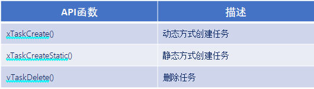


### 任务动态创建和静态创建的区别

- **动态创建任务** ：任务的任务控制块以及任务的栈空间所需的内存，**均由 FreeRTOS 从 FreeRTOS 管理的堆中分配**

- **静态创建任务** ：任务的任务控制块以及任务的栈空间所需的内存，**需要用户分配提供**

  

### 任务控制块结构体成员介绍

答：

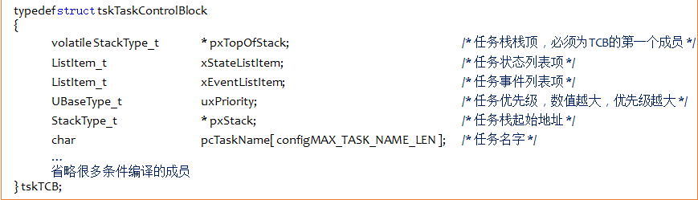

总结：

1. 任务栈栈顶，在任务切换时的任务上下文保存、任务恢复息息相关。
2. 每个任务都有属于自己的任务控制块，类似身份证。


结构体变量：

- <mark>pxTopOfStack，任务栈栈顶，TCB 的第一个成员，跟任务切换时的任务上下文保存、任务恢复息息相关，十分重要</mark>
- xStateListItem，任务状态列表项，存储当前任务的状态

- xEventListItem，任务事件列表项，存储当前任务等待的事件

- uxPriority，任务优先级，数值越大，优先级越大，最大为 31，最小为 0

- pxStack，任务栈起始地址

- pcTaskName []，任务名字，最大 16 个字符

- **任务控制块（TCB）就是任务的身份证，保留每个任务的特征，每个任务都有自己的任务控制块（TCB）**

   

### 什么是临界区保护

- 临界区保护，保护那些不想被打断的程序段，关闭 freertos 所管理的中断，中断无法打断，滴答中断和 PendSV 中断无法进行不能实现任务调度 


### 动态创建优点

- 动态创建使用起来相对简单。在实际的应用中，动态方式创建任务是比较常用的，除非有特殊的需求，一般都会使用动态方式创建任务 。


### 静态创建优点

- 静态创建可将任务堆栈放置在特定的内存位置，并且无需关心对内存分配失败的处理 。


### 创建任务时任务堆栈所存内容


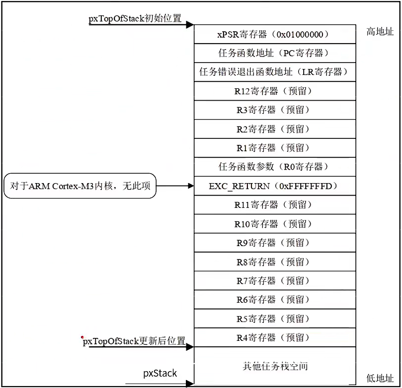

1. 寄存器下 PSR 被初始为 0x01000000，其中 bit24 被置 1，表示使用 Thumb 指令。
2. 寄存器 PC 被初始化为任务函数指针(任务 A，即我们写的任务函数的地址)，这样当某次任务切换后，任务 A 获得 CPU 控制权，任务函数(任务 A)被出栈到 PC 寄存器，之后会执行任务 A 的代码。
3. LR 寄存器初始化为函数指针 prvTaskExitError，这个函数是 FreeRTOS 提供的，是一个出错处理函数。
4. 子函数的调用通过寄存器 R0~R3 传递参数，创建任务时，我们传入的参数被保存到 R0 中，用来向任务传递参数。

------


## 二、任务创建---动态方法(掌握)

### 动态任务创建函数

函数参数：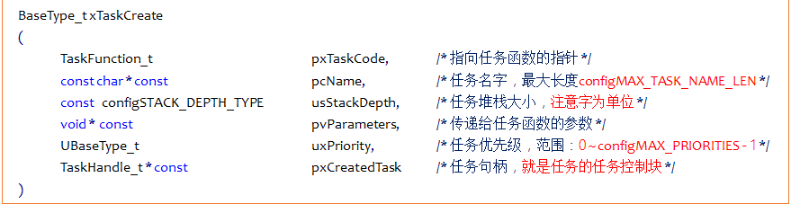

函数返回值：


- <mark>**任务句柄是指向任务控制块（TCB）的指针，并不是任务控制块**</mark>

- 在这个函数就创建了TCB和堆栈空间

  


### 实现动态创建任务流程

用起来只需三步

1. 将 ``FreeRTOSConfig.h`` 文件中宏 ``configSUPPORT_DYNAMIC_ALLOCATION`` 配置为 1
2. 定义函数入口参数
3. 编写任务函数

动态任务创建函数创建的任务会立刻进入就绪态，由任务调度器调度运行


小tips:

- 如果在`FreeRTOSConfig.h`中没有找到宏定义（`define configSUPPORT_DYNAMIC_ALLOCATION`）可以ctrl+f，进行全局查找

  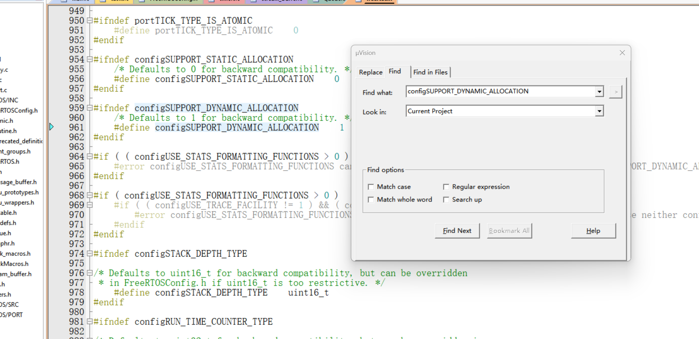


### 动态任务创建函数内部实现简述

1. 申请堆栈内存&任务控制块内存
2. TCB 结构体(**任务控制块**)成员赋值
3. 添加新任务到就绪列表中


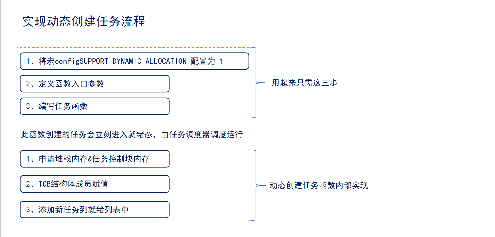

------


## 三、任务创建---静态方法(掌握)

### 静态任务创建函数


函数参数：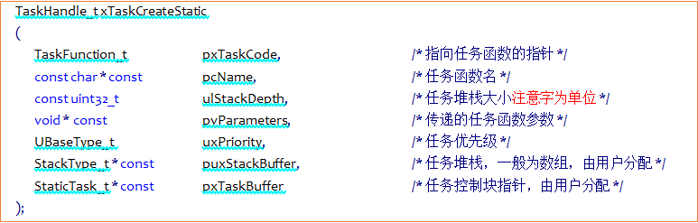

函数返回值：


- **跟动态创建任务函数比，多了一个指定任务堆栈的参数和没有任务句柄**


### 实现静态创建任务流程

用起来只需五步。

1. 将 ``FreeRTOSConfig.h`` 文件中宏 ``configSUPPORT_STATIC_ALLOCATION`` 配置为 1
2. 定义空闲任务&定时器任务的任务堆栈以及 TCB
   - 软件定时器任务是可选的
3. 实现两个接口函数(``vAppLicationGetldleTaskMemory()`` 空闲任务接口函数 和 ``vApplicationGetTimerTaskMemory()`` 定时器任务接口函数)
   - ``vApplicationGetTimerTaskMemory()`` 定时器任务接口函数) 可选的
4. 定义函数入口参数
5. 编写任务函数

静态任务创建函数创建的任务会立刻进入就绪态，由任务调度器调度运行


### 静态任务创建函数内部实现简述


1. TCB 结构体成员赋值
2. 添加新任务到就绪列表中


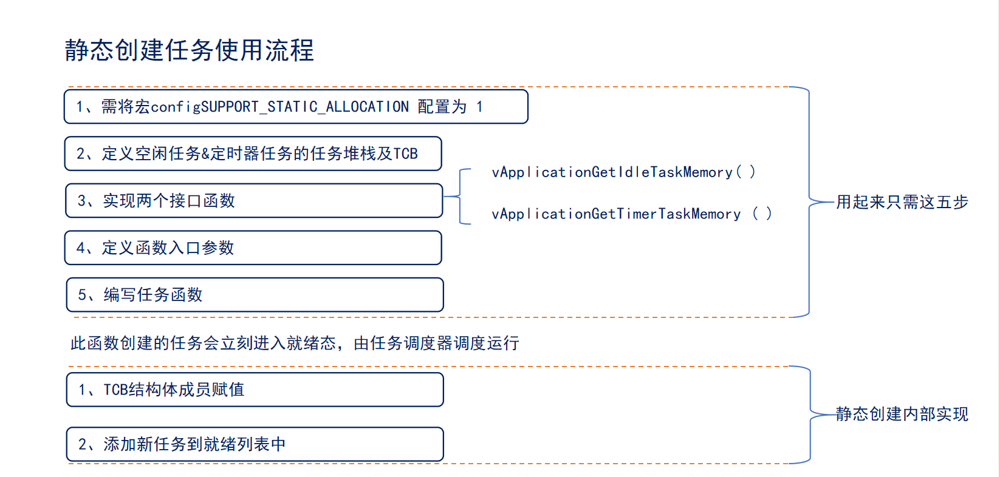

------


## 四、任务删除

### 任务删除函数

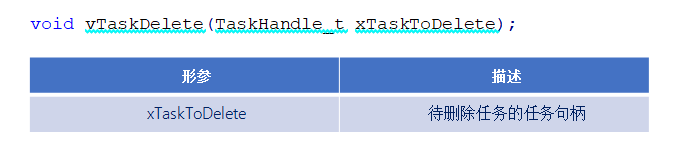

1. <mark>**任务删除函数用于删除已经被创建的任务**</mark>

2. <mark>**被删除的任务将从就绪任务列表、阻塞任务列表、挂起任务列表和事件列表中移除**</mark>


注意：

1. 当传入的参数为 NULL，则代表 <mark>删除任务自身(当前正在运行的任务)</mark>


解释：

- 有 t1, t2 两个任务，如果 t1 调用任务删除函数
  - 参数是 t2，那就删除 t2 任务
  - 参数是 NULL，那就是删除本身 t1 任务


2. 空闲任务会负责释放 <mark>被删除任务中由系统分配的内存（动态）</mark>；但是 <mark>由用户在任务删除前申请的内存空间</mark>，<mark>必须用户在任务被删除前提前释放</mark>，否则将会导致内存泄漏（静态）

解释：

- 这个是有条件的：参数是 NULL 的时候才执行这个条件
- 有 t1, t2 两个任务，如果 t1 调用任务删除函数
  - 参数是 t2，那么 t2 任务中由系统分配的内存，有 t1 进行释放
  - 参数是 t1，此时才是成立的；空闲任务会负责释放 <mark>被删除任务中由系统分配的内存</mark>

**在 task1 任务中调用任务删除函数，参数传入 task2 的任务句柄，则会由 task1 的任务删除函数负责释放 task2 任务堆栈的内存和任务控制块的内存**

**在 task1 任务中调用任务删除函数，参数传入 NULL，则会由空闲函数负责释放 task1 任务的任务堆栈内存和任务控制块内存**


### 删除任务流程

用起来只需两步。

1. 使用删除任务函数，将 FreeRTOSConfig.h 文件中宏 INCLUDE_vTaskDelete 配置为 1。
2. 入口参数输入需要删除的任务句柄(NULL 代表删除本身)


### 删除任务函数内部实现简述


1. 获取所要删除的任务控制块 --- 通过传入的任务句柄，判断所需要删除哪个任务，NULL 代表删除自身
2. 将被删除任务移除所在列表 --- 将该任务所在列表中移除，包括：就绪、阻塞、挂起、事件等列表
3. 判断所需要删除的任务

    - 删除任务自身，需要先添加到等待删除列表，内存释放将在空闲任务执行。

    - 删除其他任务，释放内存，任务数量
4. 更新下个任务的阻塞时间 --- 更新下一个任务的阻塞超时时间，以防止被删除的任务就是下一个阻塞超时的任务
    - 有 t1，t2，t3 三个任务，此时 t2 阻塞了 20ms，t2 阻塞 50ms，都在阻塞列表中（阻塞时间短的挂前面）此时参数传入 task2 的任务句柄，那么 task2 就从阻塞列表中移出了，但是阻塞的时间还是 20ms，因此要进行更新


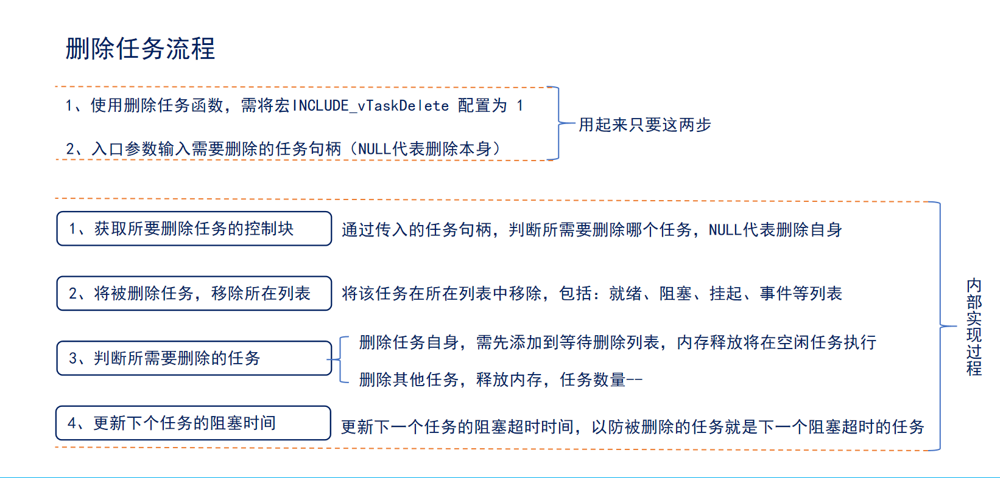


# 实战

## 任务创建和删除（动态方法）（掌握）

### 简介

1. 实验目的：学会 xTaskCreate()和 vTaskDelete()的使用

2. 实验设计：将设计四个任务：start_task、task1、task2、task3
   - 四个任务的功能如下：
     1. start_task：创建其他 3 个任务
     2. task1：打印 Task1 running
     3. task2：打印 Task2 running
     4. task3：控制 GPIOC_13 的 LED 亮灭翻转

### 代码

```c
#include "stm32f4xx.h"                  // STM32F4系列微控制器头文件
#include "freertos.h"                   // FreeRTOS实时操作系统头文件
#include "task.h"                       // FreeRTOS任务管理头文件
#include "queue.h"                      // FreeRTOS队列管理头文件
#include "usart.h"                      // 串口通信头文件

// 任务配置宏定义
#define START_TASK_STACK_SIZE 128       // 启动任务栈大小（字）
/*uxTaskGetStackHighWaterMark()获取指定任务的任务栈的历史剩余最小值，根据这个结果适当调整启动任务的大小*/

#define START_TASK_PRIORITY 2           // 启动任务优先级

/**
 * @brief LED初始化函数
 * 配置GPIOC的Pin13作为LED控制引脚
 */
void LED_Init(void)
{		
    // 使能GPIOC时钟（AHB1总线）
    RCC_AHB1PeriphClockCmd(RCC_AHB1Periph_GPIOC, ENABLE);

    // 配置GPIO初始化结构体
    GPIO_InitTypeDef GPIO_InitStructure;
    GPIO_InitStructure.GPIO_Pin = GPIO_Pin_13;        // 选择引脚13
    GPIO_InitStructure.GPIO_Mode = GPIO_Mode_OUT;     // 输出模式
    GPIO_InitStructure.GPIO_OType = GPIO_OType_PP;    // 推挽输出
    GPIO_InitStructure.GPIO_Speed = GPIO_Speed_50MHz; // 输出速度50MHz
    GPIO_InitStructure.GPIO_PuPd = GPIO_PuPd_NOPULL;  // 无上拉下拉电阻
    GPIO_Init(GPIOC, &GPIO_InitStructure);            // 初始化GPIOC
}

// 任务句柄声明（用于引用和管理任务）
TaskHandle_t MytaskHandler1;    // 任务1句柄
TaskHandle_t MytaskHandler2;    // 任务2句柄
TaskHandle_t MytaskHandler3;    // 任务3句柄
TaskHandle_t StarttaskHandler;  // 启动任务句柄

/**
 * @brief 任务1函数
 * 功能：每500个时钟节拍打印"Task1 running"
 * @param arg 任务参数（未使用）
 */
void Task1(void * arg){
    while(1){
        taskENTER_CRITICAL();    // 进入临界区（禁用中断），保护串口输出
        printf("Task1 running\r\n");
        taskEXIT_CRITICAL();     // 退出临界区（启用中断）
        vTaskDelay(500);         // 延迟500个时钟节拍（约500ms，取决于系统时钟配置）
    }	
}

/**
 * @brief 任务2函数
 * 功能：每500个时钟节拍打印"Task2 running"
 * @param arg 任务参数（未使用）
 */
void Task2(void * arg){
    while(1){
        taskENTER_CRITICAL();    // 进入临界区
        printf("Task2 running\r\n");
        taskEXIT_CRITICAL();     // 退出临界区
        vTaskDelay(500);         // 延迟500个时钟节拍
    }
}

/**
 * @brief 任务3函数
 * 功能：控制GPIOC Pin13上的LED闪烁（500ms亮，500ms灭）
 * @param arg 任务参数（未使用）
 */
void Task3(void * arg){
    while(1){
        GPIO_SetBits(GPIOC, GPIO_Pin_13);   // 设置Pin13为高电平（LED亮）
        vTaskDelay(500);                    // 保持亮状态500个时钟节拍
        GPIO_ResetBits(GPIOC, GPIO_Pin_13); // 设置Pin13为低电平（LED灭）
        vTaskDelay(500);                    // 保持灭状态500个时钟节拍
    }
}

/**
 * @brief 启动任务函数
 * 功能：创建其他三个任务后自行删除
 * @param arg 任务参数（未使用）
 */
void Starttask(void * arg){
    // 进入临界区保护串口输出
    taskENTER_CRITICAL();
    printf("Starttask running\r\n");  // 打印启动任务运行信息
    taskEXIT_CRITICAL();
    
    // 使用动态内存分配方式创建任务1
    xTaskCreate(Task1,                        // 任务函数指针
               "MyFirstTask",                 // 任务名称（用于调试）
               START_TASK_STACK_SIZE,         // 栈大小（字）
               NULL,                          // 传递给任务的参数
               START_TASK_PRIORITY,           // 任务优先级
               &MytaskHandler1);              // 任务句柄指针
    
    // 使用动态内存分配方式创建任务2
    xTaskCreate(Task2, 
               "MySecondTask", 
               START_TASK_STACK_SIZE, 
               NULL, 
               START_TASK_PRIORITY, 
               &MytaskHandler2);
    
    // 使用动态内存分配方式创建任务3
    xTaskCreate(Task3, 
               "MyThirdTask", 
               START_TASK_STACK_SIZE, 
               NULL, 
               START_TASK_PRIORITY, 
               &MytaskHandler3);
    
    // 删除当前任务（启动任务），释放其占用的资源
    vTaskDelete(NULL);
}

/**
 * @brief 主函数
 * 程序入口点，初始化硬件并启动RTOS调度器
 */
int main(void)
{
    LED_Init();                     // 初始化LED GPIO引脚
    Usart1_Init(115200);            // 初始化串口1，波特率115200
    
    // 创建启动任务（使用动态内存分配）
    xTaskCreate(Starttask,                  // 任务函数指针
               "StartTask",                 // 任务名称
               START_TASK_STACK_SIZE,       // 栈大小
               NULL,                        // 任务参数
               START_TASK_PRIORITY,         // 任务优先级
               &StarttaskHandler);          // 任务句柄
    
    // 启动FreeRTOS调度器（程序将在此处开始运行任务）
    vTaskStartScheduler();
    
    // 正常情况下，调度器启动后不会执行到这里
    // 如果调度器启动失败，程序将在此处循环
    while (1)
    {		
        // 空循环，用于处理调度器启动失败的情况
    }	
}

/*
没有临界区
如果优先级是不同的在task1，task2，task3函数中有相对应的延时，task1延时最多，task2次之，task1最少
#define START_TASK_PRIORITY 1
#define TASK1_PRIORITY 	    2 
#define TASK2_PRIORITY 	    3 
#define	TASK3_PRIORITY 	    4

1.创建task1（优先级2）后，由于task1优先级高于start_task，立即抢占CPU开始执行
2.task1执行到延时函数（如vTaskDelay()），主动进入阻塞态，CPU回到start_task
3.同理，start_task继续创建task2（优先级3），task2优先级更高，抢占执行→延时阻塞→回到start_task
4.最后创建task3（优先级4），抢占执行→延时阻塞→start_task完成所有创建后删除自身（或进入阻塞）

此时输出是：
task1
task2
task3
task3
task3
...
-----------------------------------------------------------------------------------------------------------------------------------------
有临界区
FreeRTOS中vTaskDelete(NULL)在临界区无法删除任务的原因

在FreeRTOS中，vTaskDelete(NULL)用于删除当前任务，但在临界区（taskENTER_CRITICAL()与taskEXIT_CRITICAL()之间）调用时，会导致任务无法正常删除，且后续代码（如taskEXIT_CRITICAL()）永远无法执行。其核心原因与临界区机制、任务删除流程及内存管理密切相关，具体如下：

一、临界区的核心特性：禁止任务切换与中断
taskENTER_CRITICAL()会关闭中断（通过portENTER_CRITICAL()实现），并禁止任务调度器运行。此时，系统处于“原子操作”状态，任何任务切换（包括空闲任务）都无法发生。

二、vTaskDelete(NULL)的任务删除流程
当调用vTaskDelete(NULL)删除当前任务时，FreeRTOS会执行以下步骤：

标记任务为待删除：将当前任务从就绪列表、阻塞列表等所有系统列表中移除，标记为eDeleted状态。
内存释放（动态分配场景）：若任务通过xTaskCreate()（动态分配）创建，其任务控制块（TCB）和栈空间会被标记为“待释放”，需由**空闲任务（Idle Task）**后续清理。

三、临界区内调用vTaskDelete(NULL)的致命问题
1. 栈空间失效导致程序崩溃（动态分配场景）
若start_task通过xTaskCreate()创建（栈动态分配），vTaskDelete(NULL)会立即标记栈空间为待释放。
此时，start_task仍在使用该栈执行后续代码（如taskEXIT_CRITICAL()），但栈已被标记为无效，访问无效内存会直接导致程序崩溃。
因此，taskEXIT_CRITICAL()永远无法执行，临界区无法退出，系统陷入死锁（中断永远关闭，调度器无法运行）。
2. 空闲任务无法运行，内存无法清理
即使栈未失效（如静态分配场景），临界区内中断被关闭，空闲任务无法运行，无法清理待删除任务的内存（动态分配场景）。
此时，start_task会被标记为待删除，但内存未释放，导致内存泄漏。
3. 临界区无法退出，系统死锁
若start_task未崩溃（静态分配场景），其会继续执行taskEXIT_CRITICAL()，开启中断并允许调度器运行。
但动态分配场景下，栈失效导致程序崩溃，taskEXIT_CRITICAL()无法执行，中断永远关闭，调度器无法运行，其他任务（如task3）无法执行，系统完全死锁。

四、正确的做法：退出临界区后再删除任务
错误代码（临界区内删除任务）：

void start_task(void *pvParameters) {
    taskENTER_CRITICAL(); // 进入临界区（关闭中断）
    xTaskCreate(...); // 创建其他任务
    vTaskDelete(NULL); // 错误：临界区内删除当前任务
    taskEXIT_CRITICAL(); // 永远无法执行
}

正确代码（退出临界区后删除任务）：

void start_task(void *pvParameters) {
    taskENTER_CRITICAL(); // 进入临界区
    xTaskCreate(...); // 创建其他任务
    taskEXIT_CRITICAL(); // 退出临界区（开启中断）
    vTaskDelete(NULL); // 安全删除当前任务
}

-----------------------------------------------------------------------------------------------------------------------------------------

输出的就是
优先级:task3 > task2 > task1
延时时间：task3 < task2 < task1
task3
task2
task1
task3
task2
task1
...
所对应的输出流程在最后面的mermaid流程图

退出临界区之前start_task任务是不会删除的，因为任务自己删除自己是在空闲任务进行的，这里的关闭中断无法切换空闲状态
*/
```

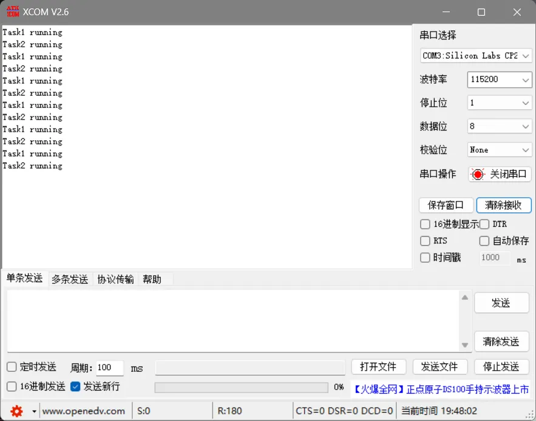


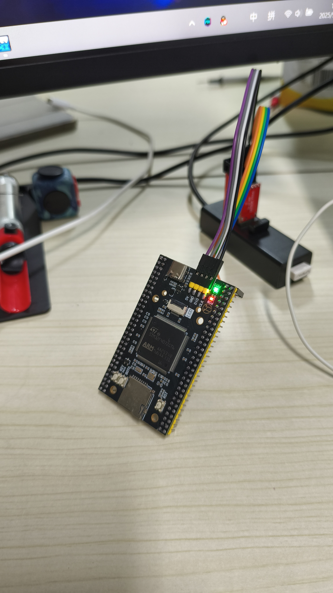


### 解释为什么 start_task 必须删除

#### 解释为什么要删除

`start_task` 的主要使命是在系统启动后，完成一些 **初始化工作**，比如创建其他应用任务、初始化硬件设备、创建内核对象（如队列、信号量）等。当这些工作都完成后，这个任务的使命其实就结束了（只执行一次，不是多次执行）

为了更直观，我用一个表格来对比一下删除与不删除 `start_task` 的主要考虑：

| 方面           | 删除 `start_task`                      | 不删除 `start_task`                                  |
| :------------- | :------------------------------------- | :--------------------------------------------------- |
| **内存占用**   | 释放任务栈和 TCB 内存（动态创建时）      | 持续占用内存                                         |
| **CPU 调度**    | 避免无意义的调度，节省 CPU 资源          | 仍会参与调度，占用 CPU 时间片                          |
| **系统简洁性** | 系统只保留必要的应用任务，结构清晰     | 系统任务列表中存在一个“闲置”任务                     |
| **适用场景**   | **一次性初始化** 任务，完成后无其他用途 | 任务后续可能需要 **再次使用**（如系统复位、状态监控） |


#### 何时删除 start_task

删除 `start_task` 的 **最佳时机**，是在它 **完成了所有初始化工作之后**，也就是在它的任务函数中，**紧接着创建完所有其他应用任务的那句代码之后**。

通常，我们会让 `start_task` 在 **临界区** 中完成其他任务的创建和自身的删除。这样做主要有两个好处：

1. **保证原子性**：防止创建任务的过程被中断或更高优先级的任务抢占，确保初始化过程完整且数据安全
2. **避免无效调度**：防止在删除自身之前，因为创建了更高优先级的任务而导致自身被挂起，无法执行删除操作


一个典型的代码结构如下：

```c
void start_task(void *pvParameters)
{
    taskENTER_CRITICAL(); // 进入临界区

    // 创建任务1
    xTaskCreate( (TaskFunction_t) task1, "task1", STACK_SIZE, NULL, PRIO, &task1_handle );
    // 创建任务2
    xTaskCreate( (TaskFunction_t) task2, "task2", STACK_SIZE, NULL, PRIO, &task2_handle );
    // ... 创建其他任务或内核对象

    vTaskDelete(NULL); // 删除自身，参数NULL表示删除自己

    taskEXIT_CRITICAL(); // 退出临界区（注意：此句实际不会被执行到）
}
```

**注意**：由于 `vTaskDelete(NULL)` 会立即将任务自身置于删除状态，其后的 `taskEXIT_CRITICAL()` **实际上不会被执行**。临界区的退出是在任务被真正清理时由内核处理的


#### 删除任务的注意事项

删除任务（包括 `start_task` 自己或其他任务）时，需要留心以下几点：

1. **资源清理**：确保任务在删除前已经释放了其持有的所有资源，如动态分配的内存、互斥锁、信号量等，以避免 **资源泄漏** 或 **死锁**
2. **内存释放时机**：对于通过 `xTaskCreate()` 动态创建的任务，其占用的内存（任务栈和 TCB）**并非立即释放**，而是由 **空闲任务（Idle Task）** 在后续进行回收。静态创建的任务（`xTaskCreateStatic`）则需用户自行管理内存
3. **切勿删除系统任务**：**绝对不要删除 FreeRTOS 的系统任务**，特别是 **空闲任务（Idle Task）**，否则系统将无法正常工作。
4. **中断中不能删除任务**：`vTaskDelete()` **不能在中断服务程序（ISR）中调用**。在 ISR 中需要删除任务时，通常通过发送消息或设置标志位，由一个高优先级的 **清理任务（Reaper Task）** 在任务上下文中执行实际的删除操作


#### 总结

是否删除 `start_task`，取决于你的系统设计需求：

- 如果它只是 **一次性** 的“奠基者”，完成后便无事可做，那么 **在初始化完成后删除它** 是个不错的选择，有利于节省资源
- 如果它后期还需要承担其他职责（如监控系统状态、响应特定事件等），那么 **保留它** 更为合适


#### 如果“初始化后就立刻删除”，那些刚创建的任务会怎样？

答案是：**完全不受影响，并且会按照 FreeRTOS 的调度规则正常执行**

当你<mark>调用 `xTaskCreate()` 时，新任务会被创建并立即置于 **就绪态**</mark>。此时，系统的任务调度情况如下：

1. **优先级最高者运行**：如果新创建的任务优先级 **高于** `start_task`，那么新任务会 **立即抢占** CPU，开始执行。`start_task` 则会被挂起，直到高优先级任务阻塞或挂起
2. **`start_task` 继续运行**：如果新创建的任务优先级 **低于或等于** `start_task`，那么 `start_task` 会继续执行，直到它调用 `vTaskDelete(NULL)` 删除自己
3. **调度器接管**：无论哪种情况，一旦 `start_task` 删除自己，它就从任务列表中彻底消失了。之后，**FreeRTOS 调度器会完全接管 CPU**，并根据任务的优先级和状态（就绪、阻塞、挂起）来调度执行那些被创建的任务

所以，删除 `start_task` **并不会影响** 它刚刚创建的那些任务。这些任务的生命周期是独立的


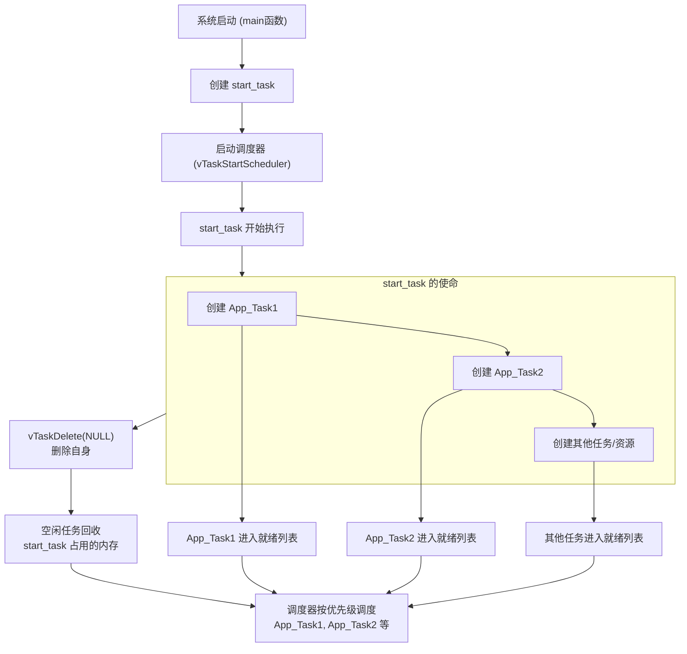


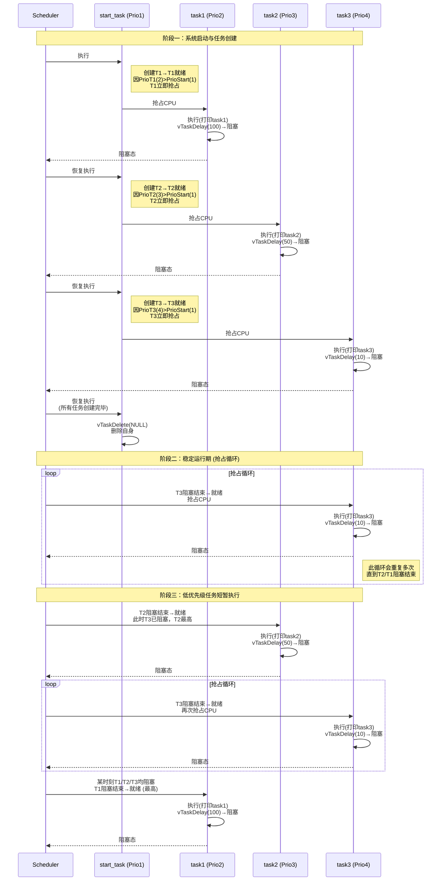


### 解释动态创建任务的TCB和句柄

**在动态创建任务时，TCB和任务堆栈的内存分配、以及任务句柄的生成，完全是由FreeRTOS内核自动完成的。** 这是动态创建与静态创建最核心的区别。

整个过程对开发者来说是“黑盒”的，你只需要关心任务的逻辑功能，而无需管理任何内存细节。

------

 🔄 动态创建任务的内部流程

当你调用 `xTaskCreate()` 时，内核在背后为你自动执行了以下步骤：

1. **内核分配TCB内存**：
   - 内核首先会调用 `pvPortMalloc(sizeof(tskTCB))`，从FreeRTOS的堆（heap）中**自动分配一块足够大的内存**，用于存放一个完整的TCB结构体。
   - 如果分配失败（内存不足），函数会直接返回 `errCOULD_NOT_ALLOCATE_REQUIRED_MEMORY`，任务创建失败。
2. **内核分配任务堆栈内存**：
   - 紧接着，内核会再次调用 `pvPortMalloc((size_t) usStackDepth * sizeof(StackType_t))`，**自动分配任务堆栈所需的内存**。大小由你传入的 `usStackDepth` 参数决定。
   - 如果此步分配失败，内核会**自动释放**刚才为TCB分配的内存，然后返回错误。
3. **初始化TCB和堆栈**：
   - 内核拿到TCB和堆栈的内存后，会**自动初始化TCB结构体**的所有成员：将任务名、优先级、状态等写入TCB，并将堆栈指针指向刚分配的那块堆栈内存的起始地址。
4. **生成并返回任务句柄**：
   - 任务句柄 (`TaskHandle_t`) 的本质就是**指向这个刚分配并初始化好的TCB结构体的指针**。
   - 内核会将这个指针值赋值给你传入的那个 `pxCreatedTask` 参数（即 `&xMyTaskHandle`）。
   - 从此，这个句柄就成了你操作这个任务的唯一凭证。
5. **将任务加入就绪列表**：
   - 最后，内核会将这个新创建的任务（通过其TCB）添加到就绪列表（Ready List）中，等待调度器调度。

 📝 动态创建示例（与静态创建对比）

```c
// 动态创建 (内核自动分配内存)
TaskHandle_t xDynamicTaskHandle = NULL; // 你只需要声明一个句柄变量

// 调用一个函数，内核完成所有工作
xReturn = xTaskCreate(
    vTaskFunction,       // 任务函数
    "DynamicTask",       // 任务名
    1024,                // 堆栈深度（单位：字）
    NULL,                // 任务参数
    1,                   // 优先级
    &xDynamicTaskHandle  // 【输出】内核将分配好的TCB地址赋给这个句柄
);

// 创建成功后，xDynamicTaskHandle 就不再是NULL。
// 它现在指向一块由内核管理的内核空间中的TCB。
if (xReturn == pdPASS) {
    // 你可以用这个句柄操作任务，但完全不知道TCB和堆栈的具体内存地址
    vTaskSuspend(xDynamicTaskHandle);
}
```

**与静态创建对比：**

```c
// 静态创建 (开发者手动分配内存)
StackType_t xTaskStack[ 1024 ]; // 你手动分配堆栈
StaticTask_t xTaskTCB;          // 你手动分配TCB
TaskHandle_t xStaticTaskHandle = NULL;

// 调用另一个函数，并把你分配好的内存地址传给内核
xStaticTaskHandle = xTaskCreateStatic( ..., xTaskStack, &xTaskTCB );
// 返回的句柄 xStaticTaskHandle 就等于你传入的 &xTaskTCB
```

------

 💎 核心总结

| 特性                 | **动态创建 (`xTaskCreate`)**    | **静态创建 (`xTaskCreateStatic`)**       |
| :------------------- | :------------------------------ | :--------------------------------------- |
| **TCB/堆栈内存来源** | **内核自动从堆(heap)分配**      | **开发者预先定义（如全局数组）**         |
| **内存管理责任方**   | **内核**负责分配和释放          | **开发者**负责内存生命周期               |
| **任务句柄的本质**   | 指向**内核自动分配的TCB**的指针 | 指向**开发者提供的TCB**的指针            |
| **优点**             | 简单易用，不关心内存            | 无内存碎片，确定性高，适用于无heap的系统 |
| **缺点**             | 可能产生内存碎片                | 需要开发者管理更多细节                   |

所以，你的理解完全正确。**动态创建就是“一键搞定”，内核是你的后勤部长，自动为你准备好任务运行所需的一切资源（TCB和堆栈），并给你一个资源库的钥匙（任务句柄）。** 而你只需要关心任务要做什么就行了


## 任务创建和删除（静态方法）（掌握）

### 简介

- 实验目的：学会 xTaskCreate()和 vTaskDelete()的使用
- 实验设计：将设计四个任务：start_task、task1、task2、task3
  - 四个任务的功能如下：
    1. start_task：创建其他 3 个任务
    2. task1：打印 Task1 running
    3. task2：打印 Task2 running
    4. task3：控制 GPIOC_13 的 LED 亮灭翻转


- **TCB（Task Control Block）**：它是一个`struct`（结构体），在FreeRTOS中定义为`tskTCB`。它包含了管理一个任务所需的**所有内部数据**（状态、优先级、堆栈指针、事件列表、任务名等）。TCB是内核的“内脏”，用户通常不会直接操作它。
- **任务句柄（Task Handle）**：它的类型是`TaskHandle_t`，本质上就是一个指向`tskTCB`结构体的指针（即 `tskTCB*`）。它就像是TCB的**“身份证”或“访问凭据”**。


### 代码

```c
#include "stm32f4xx.h"                  // STM32F4系列微控制器头文件
#include "freertos.h"                   // FreeRTOS实时操作系统头文件
#include "task.h"                       // FreeRTOS任务管理头文件
#include "queue.h"                      // FreeRTOS队列管理头文件
#include "usart.h"                      // 串口通信头文件

/**
 * @brief LED初始化函数
 * 配置GPIOC的Pin13作为LED控制引脚
 */
void LED_Init(void)
{		
    // 使能GPIOC时钟
    RCC_AHB1PeriphClockCmd(RCC_AHB1Periph_GPIOC, ENABLE);

    // 配置Pin13为推挽输出
    GPIO_InitTypeDef GPIO_InitStructure;
    GPIO_InitStructure.GPIO_Pin = GPIO_Pin_13;        // 选择引脚13
    GPIO_InitStructure.GPIO_Mode = GPIO_Mode_OUT;     // 输出模式
    GPIO_InitStructure.GPIO_OType = GPIO_OType_PP;    // 推挽输出
    GPIO_InitStructure.GPIO_Speed = GPIO_Speed_50MHz; // 输出速度50MHz
    GPIO_InitStructure.GPIO_PuPd = GPIO_PuPd_NOPULL;  // 无上拉下拉电阻
    GPIO_Init(GPIOC, &GPIO_InitStructure);            // 初始化GPIOC
}

// 任务句柄声明（用于引用任务）
TaskHandle_t MytaskHandler1;
TaskHandle_t MytaskHandler2;
TaskHandle_t MytaskHandler3;
TaskHandle_t StarttaskHandler;

// 为每个任务分配静态栈空间（128个字，每个字4字节）
StackType_t Startstack[128];  // 启动任务栈
StackType_t Task1stack[128];  // 任务1栈
StackType_t Task2stack[128];  // 任务2栈
StackType_t Task3stack[128];  // 任务3栈

// 静态任务控制块（TCB）声明
StaticTask_t StarttaskTCB;    // 启动任务TCB
StaticTask_t Task1taskTCB;    // 任务1 TCB
StaticTask_t Task2taskTCB;    // 任务2 TCB
StaticTask_t Task3taskTCB;    // 任务3 TCB

/**
 * @brief 任务1函数
 * 功能：每500个时钟节拍打印"Task1 running"
 * @param arg 任务参数（未使用）
 */
void Task1(void * arg){
    while(1){
        taskENTER_CRITICAL();    // 进入临界区（禁用中断）
        printf("Task1 running\r\n");
        taskEXIT_CRITICAL();     // 退出临界区（启用中断）
        vTaskDelay(500);         // 延迟500个时钟节拍
    }	
}

/**
 * @brief 任务2函数
 * 功能：每500个时钟节拍打印"Task2 running"
 * @param arg 任务参数（未使用）
 */
void Task2(void * arg){
    while(1){
        taskENTER_CRITICAL();    // 进入临界区
        printf("Task2 running\r\n");
        taskEXIT_CRITICAL();     // 退出临界区
        vTaskDelay(500);         // 延迟500个时钟节拍
    }
}

/**
 * @brief 任务3函数
 * 功能：控制GPIOC Pin13上的LED闪烁（500ms亮，500ms灭）
 * @param arg 任务参数（未使用）
 */
void Task3(void * arg){
    while(1){
        GPIO_SetBits(GPIOC, GPIO_Pin_13);   // 设置Pin13为高电平（LED亮）
        vTaskDelay(500);                    // 延迟500个时钟节拍
        GPIO_ResetBits(GPIOC, GPIO_Pin_13); // 设置Pin13为低电平（LED灭）
        vTaskDelay(500);                    // 延迟500个时钟节拍
    }
}

/**
 * @brief 启动任务函数
 * 功能：创建其他三个任务后自行删除
 * @param arg 任务参数（未使用）
 */
void Starttask(void * arg){
    taskENTER_CRITICAL();
    printf("Starttask running\r\n");


    // 使用静态方式创建任务1
    MytaskHandler1 = xTaskCreateStatic(Task1,              // 任务函数指针
                                       "MyFirstTask",       // 任务名称
                                       128,                 // 栈深度（字）
                                       NULL,                // 任务参数
                                       2,                   // 任务优先级
                                       Task1stack,          // 栈空间数组
                                       &Task1taskTCB);      // 任务控制块指针

    // 使用静态方式创建任务2
    MytaskHandler2 = xTaskCreateStatic(Task2, 
                                       "MySecondTask", 
                                       128, 
                                       NULL, 
                                       2, 
                                       Task2stack, 
                                       &Task2taskTCB);

    // 使用静态方式创建任务3
    MytaskHandler3 = xTaskCreateStatic(Task3, 
                                       "MyThirdTask", 
                                       128, 
                                       NULL, 
                                       2, 
                                       Task3stack, 
                                       &Task3taskTCB);

    taskEXIT_CRITICAL();
    vTaskDelete(StarttaskHandler);  // 删除当前任务（启动任务）
}

/**
 * @brief 主函数
 * 程序入口点，初始化硬件并启动RTOS调度器
 */
int main(void)
{
    LED_Init();			// 初始化LED GPIO
    Usart1_Init(115200);	// 初始化串口1，波特率115200

    // 创建启动任务（静态方式）
    StarttaskHandler =xTaskCreateStatic(Starttask,        // 任务函数指针
                                        "MyFirstTask",     // 任务名称
                                        128,               // 栈深度
                                        NULL,              // 任务参数
                                        2,                 // 任务优先级
                                        Startstack,        // 栈空间
                                        &StarttaskTCB);    // 任务控制块

    // 启动RTOS调度器（程序将在此处开始运行任务）
    vTaskStartScheduler();

    // 调度器启动后通常不会执行到这里
    while (1)
    {		
        // 如果调度器意外停止，将在此处循环
    }	
}

// 空闲任务和定时器任务的内存分配（FreeRTOS要求）

StaticTask_t IdleTaskTCB;  // 空闲任务控制块
StackType_t  IdleTaskStack[configMINIMAL_STACK_SIZE];  // 空闲任务栈

StaticTask_t TimerTaskTCB;  // 定时器服务任务控制块
StackType_t  TimerTaskStack[configTIMER_TASK_STACK_DEPTH];  // 定时器任务栈

/**
 * @brief 空闲任务内存分配函数
 * FreeRTOS在静态分配模式下需要此函数来分配空闲任务的内存
 */
void vApplicationGetIdleTaskMemory( StaticTask_t ** ppxIdleTaskTCBBuffer, 
                                   StackType_t ** ppxIdleTaskStackBuffer, 
                                   uint32_t * pulIdleTaskStackSize )
{
    *ppxIdleTaskTCBBuffer = &IdleTaskTCB;              // 返回空闲任务TCB指针
    *ppxIdleTaskStackBuffer = IdleTaskStack;           // 返回空闲任务栈指针
    *pulIdleTaskStackSize = configMINIMAL_STACK_SIZE;  // 返回空闲任务栈大小
}

/**
 * @brief 软件定时器任务内存分配函数
 * 当启用FreeRTOS定时器功能时需要此函数
 */
void vApplicationGetTimerTaskMemory( StaticTask_t ** ppxTimerTaskTCBBuffer, 
                                    StackType_t ** ppxTimerTaskStackBuffer, 
                                    uint32_t * pulTimerTaskStackSize )
{
    *ppxTimerTaskTCBBuffer = &TimerTaskTCB;                    // 返回定时器任务TCB指针
    *ppxTimerTaskStackBuffer = TimerTaskStack;                 // 返回定时器任务栈指针
    *pulTimerTaskStackSize = configTIMER_TASK_STACK_DEPTH;     // 返回定时器任务栈大小
}
```

使用静态任务创建函数时，要在FreeRTOS中将宏
\#define configSUPPORT_STATIC_ALLOCATION置为1，同时需要实现vApplicationGetIdleTaskMemory和vApplicationGetTimerTaskMemory两个函数                  

**代码结构总结：**

1. 硬件初始化：配置LED引脚和串口通信
2. 任务定义：包含4个任务（启动任务 + 3个功能任务）
3. 静态内存分配：为每个任务预先分配栈空间和控制块
4. RTOS启动：创建启动任务并开启调度器
5. FreeRTOS钩子函数：提供空闲任务和定时器任务的内存分配


**关键特点：**

1. 使用静态内存分配，适合内存受限的嵌入式系统
2. 任务优先级均为2，采用时间片轮转调度
3. 串口输出使用临界区保护，避免多任务同时访问造成数据混乱
4. 启动任务完成创建其他任务后自行删除，节省系统资源


运行结果：跟动态方法一样


### 解释静态创建为什么需要任务句柄和TCB

**静态创建任务时，你（开发者）需要<mark>手动提供TCB和堆栈的内存</mark>，而<mark>任务句柄是FreeRTOS API用来操作你提供的这块TCB内存的“钥匙”或“指针”。</mark>**

即使内存是你自己分配的，内核仍然需要通过一个统一的“句柄”来管理和操作它。下面我们来详细拆解一下。

------

 📌 核心原因：两种创建方式的根本区别

要理解“为什么需要”，首先要明白静态创建和动态创建的根本不同：

| 特性             | **动态创建 (`xTaskCreate`)**        | **静态创建 (`xTaskCreateStatic`)** |
| :--------------- | :---------------------------------- | :--------------------------------- |
| **内存来源**     | 内核从**堆（heap）** 中**自动分配** | **开发者预先定义**（如全局数组）   |
| **内存管理**     | 内核负责分配和释放                  | **开发者负责内存的生命周期**       |
| **内核依赖**     | 需要内核内存管理模块                | **完全不依赖内核内存管理**         |
| **TCB/栈所有权** | **内核拥有所有权**，负责管理        | **开发者拥有所有权**，内核只是使用 |

正因为你（开发者）拥有了内存的所有权，内核要使用它，就必须通过你提供的“访问接口”。

------

 🧩 为什么需要提供TCB？

1. **内核需要任务的管理结构**：TCB是内核调度任务的**唯一依据**。无论内存来自哪里，内核都需要一个TCB结构来记录任务的状态、优先级、栈指针等。没有TCB，内核就“看不见”这个任务。
2. **你将内存控制权交给了内核**：当你将一个TCB缓冲区（比如一个全局的`StaticTask_t`变量）的地址传给`xTaskCreateStatic()`时，你是在告诉内核：“**这块内存交给你管理，请把它当成一个TCB来用**”。内核会初始化这个结构体，并在整个任务生命周期中使用它。虽然内存是你分配的，但**内容是由内核写入和维护的**。

------

🧩 为什么还需要任务句柄？

这是最关键的一点。**任务句柄就是指向你提供的那个TCB内存的指针。**

即使TCB是你静态分配的，内核在操作它时，仍然需要一个统一的引用方式。任务句柄提供了以下几个核心作用：

1. **统一的API接口**：FreeRTOS的所有任务操作API（如`vTaskSuspend()`, `vTaskPrioritySet()`, `vTaskDelete()`）都接受一个`TaskHandle_t`参数。这样设计是为了**保持API的一致性**。无论是动态还是静态创建的任务，用户都用同样的函数、同样的参数类型来操作，极大降低了学习和使用的复杂度。
2. **封装与安全**：内核向用户隐藏了TCB结构体的内部细节。用户只需要操作一个不透明的“句柄”（指针），而不需要关心TCB内部有哪些成员、如何排列。这避免了用户代码直接操作内核关键数据结构，保证了系统的稳定性和安全性。
3. **标识和引用任务**：句柄是任务在用户代码中的“身份标识”。你可以把句柄存储在变量中、传递给其他函数、或者用于任务间的通信（例如，通知另一个任务去恢复某个特定句柄的任务）。

------

📝 实战示例：静态创建任务

```c
// 1. 开发者静态分配内存（全局变量）
StackType_t xTaskStack[ 1024 ]; // 任务堆栈
StaticTask_t xTaskTCB;          // 任务控制块(TCB)

// 2. 声明一个任务句柄变量（本质上就是一个指针）
TaskHandle_t xTaskHandle = NULL;

void main( void )
{
    // 3. 静态创建任务
    // 注意：我们将静态分配的xTaskTCB和xTaskStack的地址传入函数
    xTaskHandle = xTaskCreateStatic(
                    vTaskFunction,   /* 任务函数 */
                    "StaticTask",    /* 任务名 */
                    1024,            /* 堆栈深度（单位：字） */
                    NULL,            /* 任务参数 */
                    tskIDLE_PRIORITY + 1,
                    xTaskStack,      /* 【传入】堆栈数组的起始地址 */
                    &xTaskTCB );     /* 【传入】TCB结构体的地址 */

    // 4. 创建成功后，xTaskHandle 就不再是NULL。
    // 它现在就等于 &xTaskTCB，即指向你提供的TCB内存的指针。
    if (xTaskHandle != NULL) {
        // 现在可以用统一的API，通过句柄来操作这个静态任务了
        vTaskSuspend(xTaskHandle); // 挂起这个任务
    }

    // ... 启动调度器
}
```

**在这个例子中：**

- `&xTaskTCB`（TCB的地址）是**资源**，是你提供的一块内存。
- `xTaskHandle`（任务句柄）是**访问凭证**，是内核返还给你、用于后续操作这块资源的一个指针。

💎 总结

| 你提供的（开发者）          | 内核做的                                    | 你得到的（句柄的作用）                    |
| :-------------------------- | :------------------------------------------ | :---------------------------------------- |
| 一块TCB内存 (`&xTaskTCB`)   | 初始化这块内存，将其作为一个真正的TCB来管理 | **指向这块TCB内存的指针** (`xTaskHandle`) |
| 一块堆栈内存 (`xTaskStack`) | 将栈地址记录到TCB中，并将其用作任务的运行栈 |                                           |

所以，**静态创建任务需要TCB和任务句柄，不是因为内核需要你帮它分配内存，而是因为内核需要在你提供的内存上建立管理结构，并给你一个标准化的“把手”来让你安全地操作它。**


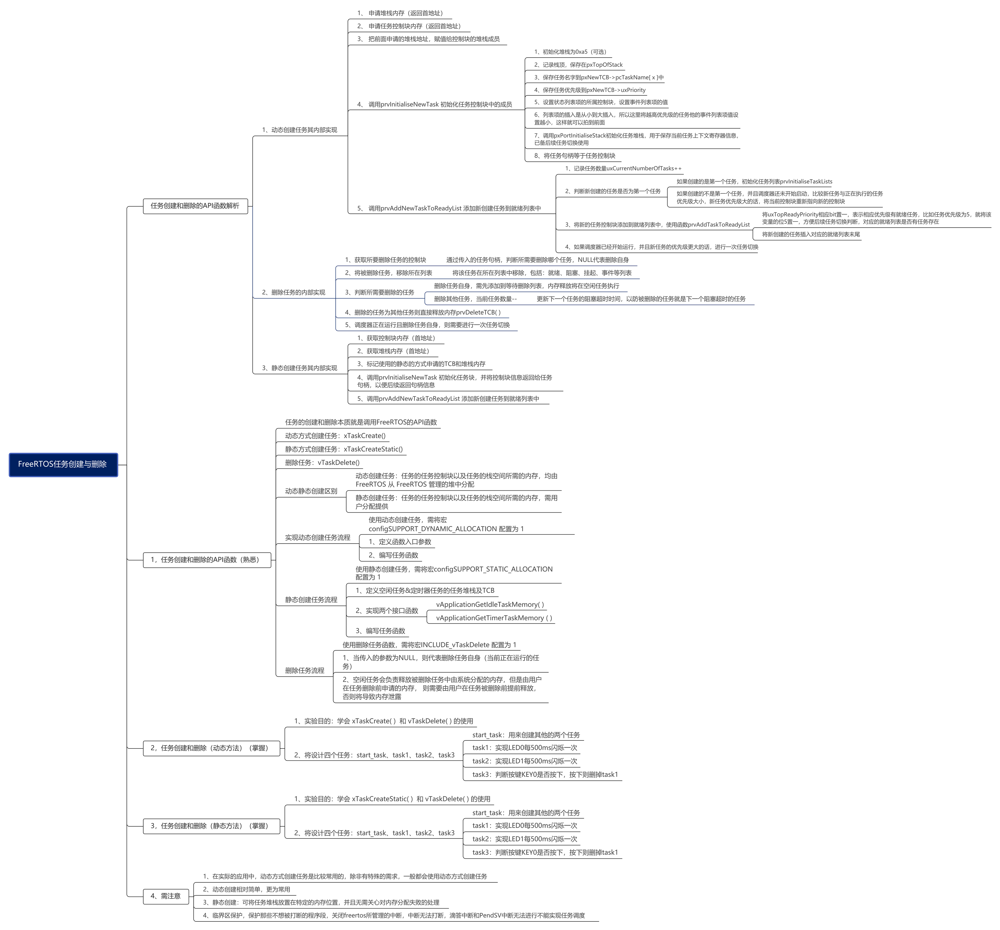


