# FreeRTOS的列表和列表项

------


## 一、列表和列表项的简介(熟悉)

### 1、什么是列表

答：列表是FreeRTOS中的一个数据结构，概念上和链表有点类似，列表被用来跟踪FreeRTOS中的任务。


### 2、什么列表项

答：列表项就是存放在列表中的项目。


### 3、列表和列表项关系

答：列表相当于链表，列表项相当于节点，FreeRTOS中的列表是一个双向环形链表。

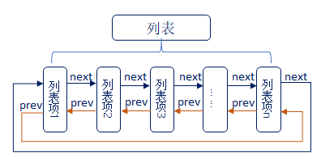


### 4、列表(链表)和数组的区别

答：

- **列表的特点**：列表项间的地址非连续的，是人为的连接到一起的。列表项的数目是由后期添加或删除的个数决定的，随时可以改变。
- **数组的特点**：数组成员地址是连续的，数组在最初确定了成员数量后，后期将无法改变。


### 5、OS中为什么使用列表

答：在OS中任务的数量是不确定的，并且任务状态是会发生改变的，所以非常适用列表(链表)这种数据结构。


### 6、列表结构体介绍

答：**有关列表的东西均在文件list.c和list.h中**，以下是列表结构体：
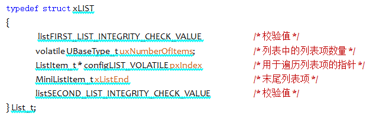

1. 在结构体中，包含两个宏(`listFIRST_LIST_INTEGRITY_CHECK_VALUE `和  `listSECOND_LIST_INTEGRITY_CHECK_VALUE`)，这两个宏是确定的已知常量，FreeRTOS通过检查这两个常量的值，来判断列表的数据在程序运行过程中，是否遭到破坏，该功能一般用于测试，默认是不开启的(我们一般不用去理会)。
2. 成员uxNumberOfltems，用于记录列表中的列表项的个数(不包括xListEnd)。
3. 成员pxIndex用于指向列表中的某个列表项，一般用于遍历列表中的所有列表项。
4. 成员变量xListEnd是一个迷你列表项，排在最末尾。

列表结构示意图：

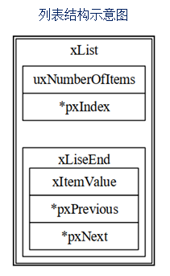


### 7、列表项结构体介绍

答：列表项是列表中用于存放数据的地方，在list.h文件中，列表项的相关结构体定义：

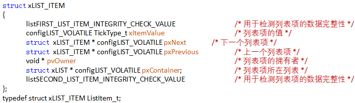

1. 成员变量xItemValue为列表项的值，这个值多用于按升序对列表中的列表项进行排序。
2. 成员变量pxNext和pxPrevious分别用于指向列表中列表项的下一个列表项和上一个列表项。
3. 成员变量pxOwner用于指向包含列表项的对象(通常是任务控制块)。
4. 成员变量pxContainer用于执行列表项所在列表。

列表项结构体示意图：

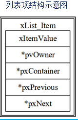


### 8、迷你列表项

答：迷你列表项也是列表项，但**迷你列表项==仅用于标记列表的末尾==和==挂载其他插入列表中的列表项==**。

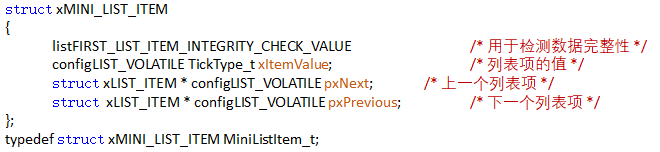

1. 成员变量xItemValue为列表项的值，这个值多用于按升序对列表中的列表项进行排序。
2. 成员变量pxNext和pxPrevious分别用于指向列表中列表项的下一个列表项和上一个列表项。
3. 迷你列表项只用于标记列表的末尾和挂载其他插入列表中的列表项，因此不需要成员变量pxOwner和pxContainer，以节省内存开销。

迷你列表项示意图：

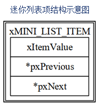


### 9、列表和列表项关系事例

答：

列表初始状态：


列表插入两个列表项：

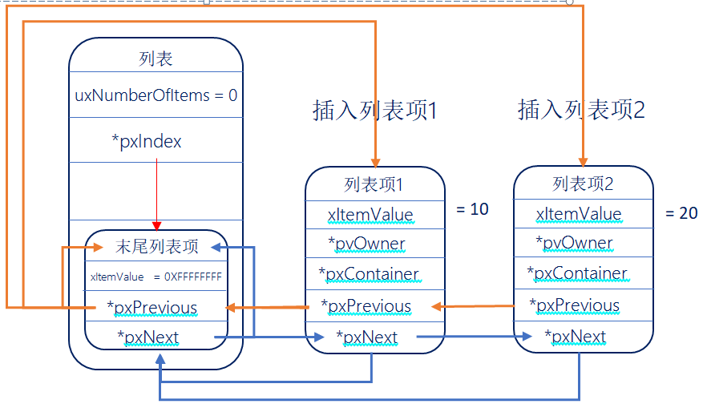

列表当前状态：

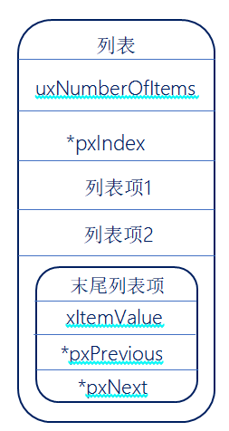

------


## 二、列表相关的API函数介绍(掌握)

### 1、列表API函数

答：

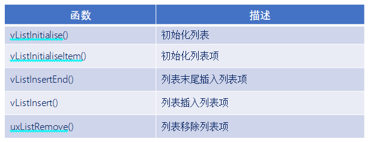


### 2、初始化列表函数vListInitialise()

答：

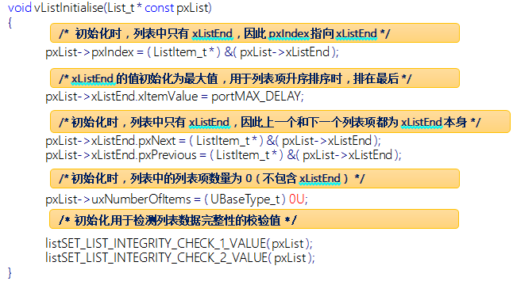

函数参数：


列表初始化后示意图：

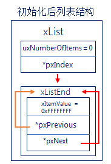


### 3、初始化列表项函数vListInitialiseItem()

答：

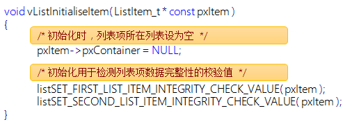

函数参数：


列表初始化后示意图：

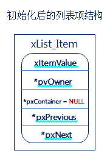


### 4、列表插入列表项函数vListInsert()

答：此函数用于将待插入列表的列表项按照列表项值升序进行排序，有序地插入到列表中 。

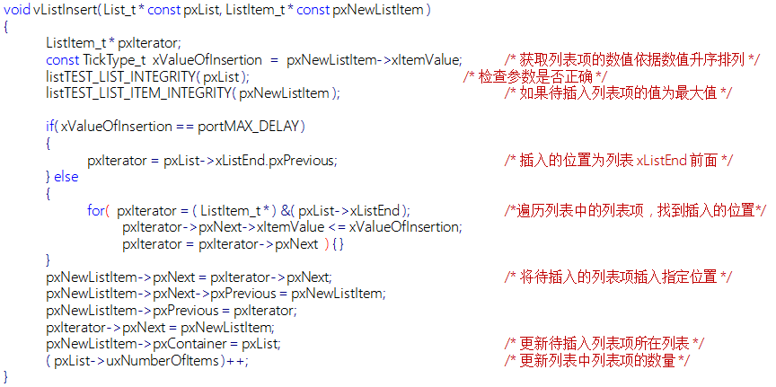

函数参数：


总结：函数vListInsert()，是将插入列表的列表项按照列表项值升序进行排列，有序地插入到列表中。


### 5、列表末尾插入列表项vListInsertEnd()

答：此函数用于将待插入列表的列表项插入到列表 pxIndex 指针指向的列表项前面，是一种无序的插入方法。

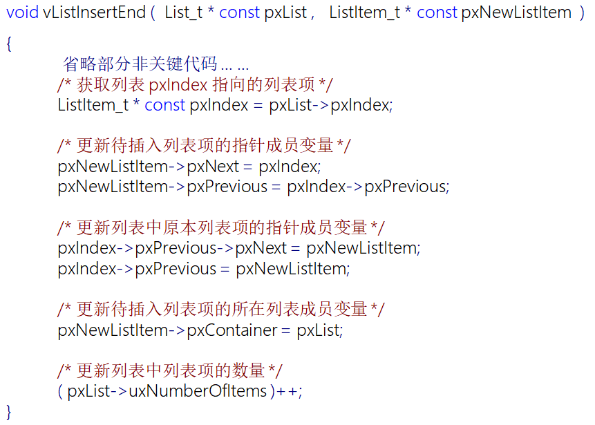

函数参数：


### 6、列表项移除函数uxListRemove()

答：此函数用于将列表项从列表项所在列表中移除。

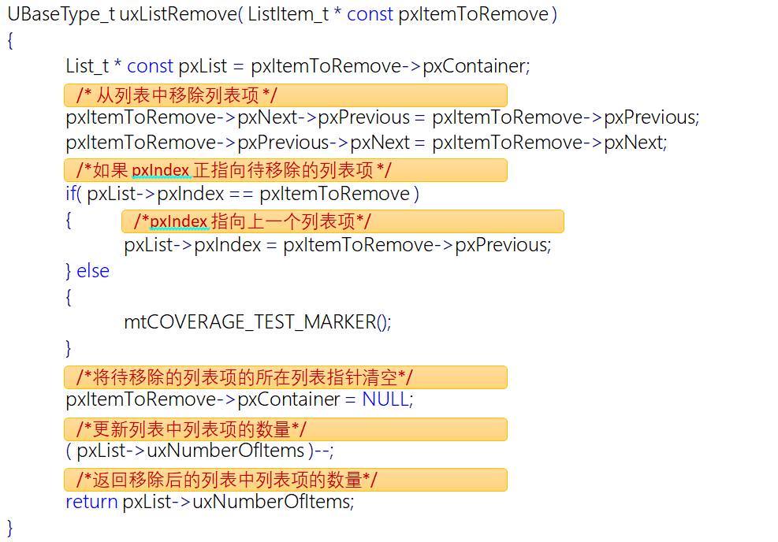

函数参数：


函数返回值：


------


```c
#include "stm32f4xx.h"                  // STM32F4系列微控制器头文件
#include "freertos.h"                   // FreeRTOS实时操作系统头文件
#include "task.h"                       // FreeRTOS任务管理头文件
#include "queue.h"                      // FreeRTOS队列管理头文件
#include "usart.h"                      // 串口通信头文件

// 任务配置宏定义
#define START_TASK_STACK_SIZE 128       // 启动任务栈大小（字）
#define START_TASK_PRIORITY1 2           // 启动任务1优先级
#define START_TASK_PRIORITY2 3           // 启动任务2优先级
#define START_TASK_PRIORITY 1            // 启动任务优先级
List_t TestList;                         //定义一个列表变量
ListItem_t TestListItem1;                //定义列表项变量1   
ListItem_t TestListItem2;                //定义列表项变量2 
ListItem_t TestListItem3;                //定义列表项变量3
/*-----------------------------------------------------------*/

void DWT_Init(void);
void Delay_us(uint32_t us);
void Delay_ms(uint32_t ms);

/**
 * @brief LED初始化函数
 * 配置GPIOC的Pin13作为LED控制引脚
 */
void LED_Init(void)
{		
    // 使能GPIOC时钟（AHB1总线）
    RCC_AHB1PeriphClockCmd(RCC_AHB1Periph_GPIOC, ENABLE);

    // 配置GPIO初始化结构体
    GPIO_InitTypeDef GPIO_InitStructure;
	GPIO_StructInit(&GPIO_InitStructure);
    GPIO_InitStructure.GPIO_Pin = GPIO_Pin_13;        // 选择引脚13
    GPIO_InitStructure.GPIO_Mode = GPIO_Mode_OUT;     // 输出模式
    GPIO_InitStructure.GPIO_OType = GPIO_OType_PP;    // 推挽输出
    GPIO_InitStructure.GPIO_Speed = GPIO_Speed_50MHz; // 输出速度50MHz
    GPIO_InitStructure.GPIO_PuPd = GPIO_PuPd_NOPULL;  // 无上拉下拉电阻
    GPIO_Init(GPIOC, &GPIO_InitStructure);            // 初始化GPIOC
}


// 任务句柄声明（用于引用和管理任务）
TaskHandle_t MytaskHandler1;    // 任务1句柄
TaskHandle_t MytaskHandler2;    // 任务2句柄
TaskHandle_t StarttaskHandler;  // 启动任务句柄

/**
 * @brief 任务1函数
 * 功能：每500个时钟节拍打印"Task1 running"
 * @param arg 任务参数（未使用）
 */
void Task1(void * arg){
    while(1){
        taskENTER_CRITICAL();    // 进入临界区（禁用中断），保护串口输出
        printf("Task1 running: \r\n");
        taskEXIT_CRITICAL();     // 退出临界区（启用中断）
		GPIO_ResetBits(GPIOC, GPIO_Pin_13);
        vTaskDelay(500);         // 延迟500个时钟节拍（约500ms，取决于系统时钟配置）
		GPIO_SetBits(GPIOC, GPIO_Pin_13);
        vTaskDelay(500);         // 延迟500个时钟节拍（约500ms，取决于系统时钟配置）
    }	
}

/**
 * @brief 任务2函数
 * 功能：每1000个时钟节拍打印"Task2 running"
 * @param arg 任务参数（未使用）
 */
void Task2(void * arg){
    while(1){
        printf("Task2 running: \r\n");
        vListInitialise(&TestList);               // 初始化列表
        vListInitialiseItem(&TestListItem1);      // 初始化列表项1
        vListInitialiseItem(&TestListItem2);      // 初始化列表项2
        vListInitialiseItem(&TestListItem3);      // 初始化列表项3
        TestListItem1.xItemValue = 300;           // 设置列表项1的值
        TestListItem2.xItemValue = 600;           // 设置列表项2的值
        TestListItem3.xItemValue = 400;           // 设置列表项3的值

        printf("打印列表和其他列表项的地址\r\n");
        printf("项目\t\t\t\t地址\r\n");
        printf("TestList\t\t\t%p\r\n", &TestList);
        printf("TestList->pxIndex\t\t%p\r\n", TestList.pxIndex);
        printf("TestList->pxIndex->pxNext\t%p\r\n", TestList.pxIndex->pxNext);
        printf("TestList->xListEnd\t\t%p\r\n", &TestList.xListEnd);
        printf("TestListItem1\t\t\t%p\r\n", &TestListItem1);
        printf("TestListItem2\t\t\t%p\r\n", &TestListItem2);
        printf("TestListItem3\t\t\t%p\r\n", &TestListItem3);
        printf("-----------------------------------------------------------------------------\r\n");


        vListInsert(&TestList, &TestListItem1);   // 将列表项1插入列表
        printf("插入TestListItem1后\r\n");
        printf("项目\t\t\t\t地址\r\n");
        printf("TestList\t\t\t%p\r\n", &TestList);
        printf("TestList->pxIndex\t\t%p\r\n", TestList.pxIndex);
        printf("TestList->pxIndex->pxNext\t%p\r\n", TestList.pxIndex->pxNext);
        printf("TestList->xListEnd\t\t%p\r\n", &TestList.xListEnd);
        printf("TestList->xListEnd->pxPrevious\t%p\r\n", TestList.xListEnd.pxPrevious);
        printf("TestList->xListEnd->pxNext\t%p\r\n", TestList.xListEnd.pxNext);
        printf("ListItem1->pxNext\t\t%p\r\n", TestListItem1.pxNext);
        printf("ListItem1->pxPrevious\t\t%p\r\n", TestListItem1.pxPrevious);
        printf("-----------------------------------------------------------------------------\r\n");

        vListInsert(&TestList, &TestListItem2);   // 将列表项2插入列表
        printf("插入TestListItem2后\r\n");
        printf("项目\t\t\t\t地址\r\n");
        printf("TestList\t\t\t%p\r\n", &TestList);
        printf("TestList->pxIndex\t\t%p\r\n", TestList.pxIndex);
        printf("TestList->pxIndex->pxNext\t%p\r\n", TestList.pxIndex->pxNext);
        printf("TestList->xListEnd\t\t%p\r\n", &TestList.xListEnd);
        printf("TestList->xListEnd->pxPrevious\t%p\r\n", TestList.xListEnd.pxPrevious);
        printf("TestList->xListEnd->pxNext\t%p\r\n", TestList.xListEnd.pxNext);
        printf("ListItem1->pxNext\t\t%p\r\n", TestListItem1.pxNext);
        printf("ListItem1->pxPrevious\t\t%p\r\n", TestListItem1.pxPrevious);
        printf("ListItem2->pxNext\t\t%p\r\n", TestListItem2.pxNext);
        printf("ListItem2->pxPrevious\t\t%p\r\n", TestListItem2.pxPrevious);
        printf("-----------------------------------------------------------------------------\r\n");

        vListInsert(&TestList, &TestListItem3);   // 将列表项3插入列表
        printf("插入TestListItem3后\r\n");
        printf("项目\t\t\t\t地址\r\n");
        printf("TestList\t\t\t%p\r\n", &TestList);
        printf("TestList->pxIndex\t\t%p\r\n", TestList.pxIndex);
        printf("TestList->pxIndex->pxNext\t%p\r\n", TestList.pxIndex->pxNext);
        printf("TestList->xListEnd\t\t%p\r\n", &TestList.xListEnd);
        printf("TestList->xListEnd->pxPrevious\t%p\r\n", TestList.xListEnd.pxPrevious);
        printf("TestList->xListEnd->pxNext\t%p\r\n", TestList.xListEnd.pxNext);
        printf("ListItem1->pxNext\t\t%p\r\n", TestListItem1.pxNext);
        printf("ListItem1->pxPrevious\t\t%p\r\n", TestListItem1.pxPrevious);
        printf("ListItem2->pxNext\t\t%p\r\n", TestListItem2.pxNext);
        printf("ListItem2->pxPrevious\t\t%p\r\n", TestListItem2.pxPrevious);
        printf("ListItem3->pxNext\t\t%p\r\n", TestListItem3.pxNext);
        printf("ListItem3->pxPrevious\t\t%p\r\n", TestListItem3.pxPrevious);
        printf("-----------------------------------------------------------------------------\r\n");
        
        uxListRemove(&TestListItem2);
        printf("移除TestListItem2后\r\n");
        printf("项目\t\t\t\t地址\r\n");
        printf("TestList\t\t\t%p\r\n", &TestList);
        printf("TestList->pxIndex\t\t%p\r\n", TestList.pxIndex);
        printf("TestList->pxIndex->pxNext\t%p\r\n", TestList.pxIndex->pxNext);
        printf("TestList->xListEnd\t\t%p\r\n", &TestList.xListEnd);
        printf("TestList->xListEnd->pxPrevious\t%p\r\n", TestList.xListEnd.pxPrevious);
        printf("TestList->xListEnd->pxNext\t%p\r\n", TestList.xListEnd.pxNext);
        printf("ListItem1->pxNext\t\t%p\r\n", TestListItem1.pxNext);
        printf("ListItem1->pxPrevious\t\t%p\r\n", TestListItem1.pxPrevious);
        printf("ListItem2->pxNext\t\t%p\r\n", TestListItem2.pxNext);
        printf("ListItem2->pxPrevious\t\t%p\r\n", TestListItem2.pxPrevious);
        printf("ListItem3->pxNext\t\t%p\r\n", TestListItem3.pxNext);
        printf("ListItem3->pxPrevious\t\t%p\r\n", TestListItem3.pxPrevious);
        printf("-----------------------------------------------------------------------------\r\n");
        vTaskDelay(10000);        // 延迟10000个时钟节拍（约10000ms，取决于系统时钟配置）
    }
}

/**
 * @brief 启动任务函数
 * 功能：创建其他三个任务后自行删除
 * @param arg 任务参数（未使用）
 */
void Starttask(void * arg){
    // 进入临界区保护串口输出
    taskENTER_CRITICAL();
    printf("Starttask running\r\n");  // 打印启动任务运行信息
    taskEXIT_CRITICAL();
    
    // 使用动态内存分配方式创建任务1
    xTaskCreate(Task1,                        // 任务函数指针
               "MyFirstTask",                 // 任务名称（用于调试）
               START_TASK_STACK_SIZE,         // 栈大小（字）
               NULL,                          // 传递给任务的参数
               START_TASK_PRIORITY1,           // 任务优先级
               &MytaskHandler1);              // 任务句柄指针
    
    // 使用动态内存分配方式创建任务2
    xTaskCreate(Task2, 
               "MySecondTask", 
               START_TASK_STACK_SIZE, 
               NULL, 
               START_TASK_PRIORITY2, 
               &MytaskHandler2);
    // 删除当前任务（启动任务），释放其占用的资源
    vTaskDelete(NULL);
}

/**
 * @brief 主函数
 * 程序入口点，初始化硬件并启动RTOS调度器
 */
int main(void)
{
	NVIC_PriorityGroupConfig(NVIC_PriorityGroup_4);
    LED_Init();                     // 初始化LED GPIO引脚
    Usart1_Init(115200);            // 初始化串口1，波特率115200
    
    // 创建启动任务（使用动态内存分配）
    xTaskCreate(Starttask,                  // 任务函数指针
               "StartTask",                 // 任务名称
               START_TASK_STACK_SIZE,       // 栈大小
               NULL,                        // 任务参数
               START_TASK_PRIORITY,         // 任务优先级
               &StarttaskHandler);          // 任务句柄
    
    // 启动FreeRTOS调度器（程序将在此处开始运行任务）
    vTaskStartScheduler();
    
    // 正常情况下，调度器启动后不会执行到这里
    // 如果调度器启动失败，程序将在此处循环
    while (1)
    {		
        // 空循环，用于处理调度器启动失败的情况
    }	
}
```

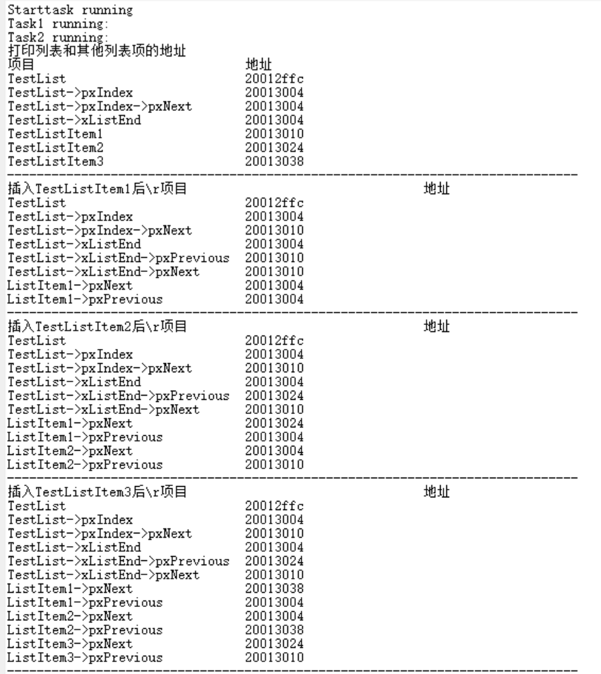

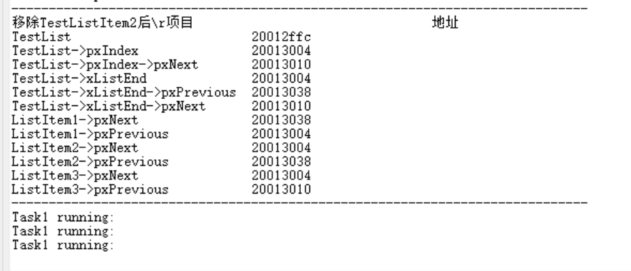


