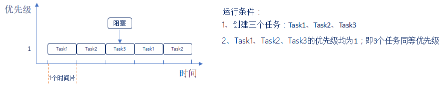

# FreeRTOS时间片轮询

------


## 1、时间片轮询简介

答：同等优先级任务轮流享有相同的CPU时间(可设置)，叫**时间片**，在FreeRTOS中，一个时间片就等于SysTick中断周期。



运行过程如下：

1. 首先Task1运行完一个时间片后，切换至Task2运行。
2. Task2运行完一个时间片后，切换至Task3运行。
3. Task3运行过程中(还不到一个时间片)，Task3阻塞了(系统延时或等待信号量等)，此时直接切换到下一个任务Task1.
4. Task1运行完一个时间片后，切换Task2运行。

总结：

1. 同等优先级任务，轮流执行，时间片流转。
2. 一个时间片大小，取决为滴答定时器中断频率。
3. 注意没有完成的时间片不会再使用，下次任务Task3得到执行还是按照一个时间片的时钟节拍执行。

------


## 函数

```c
#include "stm32f4xx.h"                  // STM32F4系列微控制器头文件
#include "freertos.h"                   // FreeRTOS实时操作系统头文件
#include "task.h"                       // FreeRTOS任务管理头文件
#include "queue.h"                      // FreeRTOS队列管理头文件
#include "usart.h"                      // 串口通信头文件
#include "delay_dwt.h"

// 任务配置宏定义
#define START_TASK_STACK_SIZE 128       // 启动任务栈大小（字）
#define START_TASK_PRIORITY 2           // 启动任务优先级


/**
 * @brief LED初始化函数
 * 配置GPIOC的Pin13作为LED控制引脚
 */
void LED_Init(void)
{		
    // 使能GPIOC时钟（AHB1总线）
    RCC_AHB1PeriphClockCmd(RCC_AHB1Periph_GPIOC, ENABLE);

    // 配置GPIO初始化结构体
    GPIO_InitTypeDef GPIO_InitStructure;
	GPIO_StructInit(&GPIO_InitStructure);
    GPIO_InitStructure.GPIO_Pin = GPIO_Pin_13;        // 选择引脚13
    GPIO_InitStructure.GPIO_Mode = GPIO_Mode_OUT;     // 输出模式
    GPIO_InitStructure.GPIO_OType = GPIO_OType_PP;    // 推挽输出
    GPIO_InitStructure.GPIO_Speed = GPIO_Speed_50MHz; // 输出速度50MHz
    GPIO_InitStructure.GPIO_PuPd = GPIO_PuPd_NOPULL;  // 无上拉下拉电阻
    GPIO_Init(GPIOC, &GPIO_InitStructure);            // 初始化GPIOC
}

void Key_Init(void){
	RCC_AHB1PeriphClockCmd(RCC_AHB1Periph_GPIOA, ENABLE);
	GPIO_InitTypeDef GPIO_InitStructure;
	GPIO_StructInit(&GPIO_InitStructure);
	GPIO_InitStructure.GPIO_Pin = GPIO_Pin_15 |  GPIO_Pin_0 | GPIO_Pin_1;
	GPIO_InitStructure.GPIO_Mode = GPIO_Mode_IN;
	GPIO_InitStructure.GPIO_Speed = GPIO_Speed_50MHz;
	GPIO_InitStructure.GPIO_PuPd = GPIO_PuPd_UP;
	GPIO_Init(GPIOA, &GPIO_InitStructure);  
}

uint8_t Key_GetNum(void)
{
	if (GPIO_ReadInputDataBit(GPIOA, GPIO_Pin_0) == 0)
	{
		vTaskDelay(20);
		if(GPIO_ReadInputDataBit(GPIOA, GPIO_Pin_0) == 0){
			return 1;
		}
	}
	else if (GPIO_ReadInputDataBit(GPIOA, GPIO_Pin_1) == 0)
	{
		vTaskDelay(20);
		if(GPIO_ReadInputDataBit(GPIOA, GPIO_Pin_1) == 0){
			return 2;
		}
	}
	else return 0;
}


// 任务句柄声明（用于引用和管理任务）
TaskHandle_t MytaskHandler1;    // 任务1句柄
TaskHandle_t MytaskHandler2;    // 任务2句柄
TaskHandle_t MytaskHandler3;    // 任务3句柄
TaskHandle_t StarttaskHandler;  // 启动任务句柄

/**
 * @brief 任务1函数
 * 功能：每500个时钟节拍打印"Task1 running"
 * @param arg 任务参数（未使用）
 */
void Task1(void * arg){
    while(1){
        taskENTER_CRITICAL();    // 进入临界区（禁用中断），保护串口输出
        printf("Task1 running:\r\n");
        taskEXIT_CRITICAL();     // 退出临界区（启用中断）
        Delay_ms(10);
    }	
}

/**
 * @brief 任务2函数
 * 功能：每500个时钟节拍打印"Task2 running"
 * @param arg 任务参数（未使用）
 */
void Task2(void * arg){
    while(1){
        taskENTER_CRITICAL();    // 进入临界区
        printf("Task2 running:\r\n");
        taskEXIT_CRITICAL();     // 退出临界区
        Delay_ms(10);
    }
}


/**
 * @brief 启动任务函数
 * 功能：创建其他三个任务后自行删除
 * @param arg 任务参数（未使用）
 */
void Starttask(void * arg){
    // 进入临界区保护串口输出
    taskENTER_CRITICAL();
    printf("Starttask running\r\n");  // 打印启动任务运行信息
    taskEXIT_CRITICAL();
    
    // 使用动态内存分配方式创建任务1
    xTaskCreate(Task1,                        // 任务函数指针
               "MyFirstTask",                 // 任务名称（用于调试）
               START_TASK_STACK_SIZE,         // 栈大小（字）
               NULL,                          // 传递给任务的参数
               START_TASK_PRIORITY,           // 任务优先级
               &MytaskHandler1);              // 任务句柄指针
    
    // 使用动态内存分配方式创建任务2
    xTaskCreate(Task2, 
               "MySecondTask", 
               START_TASK_STACK_SIZE, 
               NULL, 
               START_TASK_PRIORITY, 
               &MytaskHandler2);
    
    // 删除当前任务（启动任务），释放其占用的资源
    vTaskDelete(NULL);
}

/**
 * @brief 主函数
 * 程序入口点，初始化硬件并启动RTOS调度器
 */
int main(void)
{
	NVIC_PriorityGroupConfig(NVIC_PriorityGroup_4);
    LED_Init();                     // 初始化LED GPIO引脚
	Key_Init();
    Usart1_Init(115200);            // 初始化串口1，波特率115200
    DWT_Init();

    // 创建启动任务（使用动态内存分配）
    xTaskCreate(Starttask,                  // 任务函数指针
               "StartTask",                 // 任务名称
               START_TASK_STACK_SIZE,       // 栈大小
               NULL,                        // 任务参数
               START_TASK_PRIORITY,         // 任务优先级
               &StarttaskHandler);          // 任务句柄
    
    // 启动FreeRTOS调度器（程序将在此处开始运行任务）
    vTaskStartScheduler();
    
    // 正常情况下，调度器启动后不会执行到这里
    // 如果调度器启动失败，程序将在此处循环
    while (1)
    {		
        // 空循环，用于处理调度器启动失败的情况
    }	
}


```


