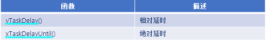
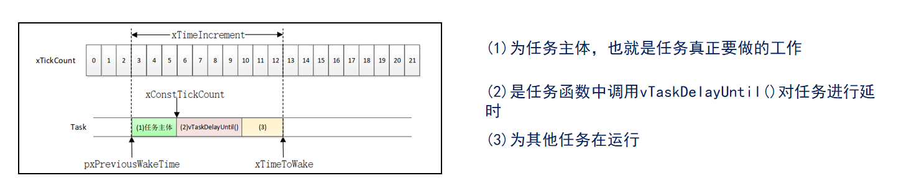
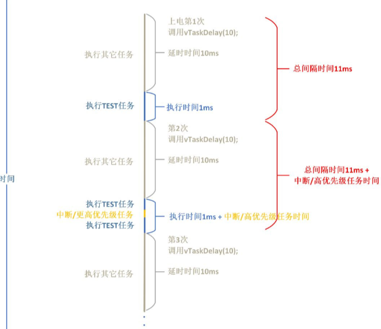

# FreeRTOS时间管理

------


## 一、延时函数介绍

### 1、FreeRTOS的延时函数

答：FreeRTOS有两种延时函数：相对延时函数 和 绝对延时函数。



- **相对延时**：指每次延时都是从执行函数vTaskDelay()开始（从vTaskDelay()开始计数），直到延时指定的时间结束。

- **绝对延时**：指将整个任务的运行周期看成一个整体，适用于需要按照一定频率运行的任务。

  

> 注意：一般来说，绝对延时中的主体任务运行所需时间必须比绝对延时时间小。


#### 与 `vTaskDelay()` 的对比

假设有一个任务，期望每 500 个滴答运行一次，单次执行需要 100 个滴答。

| 函数                             | 行为                                                                                                                                                                                                   | 结果                                                               |
| :----------------------------- | :--------------------------------------------------------------------------------------------------------------------------------------------------------------------------------------------------- | :--------------------------------------------------------------- |
| **`vTaskDelay(500)`**          | **“从函数调用完开始，延迟500个滴答”** <br>1. 任务运行 (100 ticks) <br>2. 调用 `vTaskDelay(500)` <br>3. 延迟 500 ticks <br>4. 任务再次运行                                                                                        | **实际周期 = 任务运行时间 + 延迟时间 = 100 + 500 = 600 ticks** <br> 周期不稳定，会漂移。 |
| **`vTaskDelayUntil(&x, 500)`** | **“确保两次唤醒的间隔严格为500个滴答”** <br>1. 任务在时间 `t` 被唤醒并运行 (100 ticks) <br>2. 调用 `vTaskDelayUntil(&x, 500)` <br>3. 函数内部计算：下一个唤醒时间是 `t + 500` <br>4. 由于当前已是 `t+100`，所以只需延迟 `400` ticks <br>5. 任务在 `t+500` 准时被唤醒 | **实际周期严格等于 500 ticks** <br> 任务执行时间被排除在外，周期非常精确。                  |


---

### 2、相对延时和绝对延时的区别

答：

**相对延时**：




**绝对延时**：


------


## 二、延时函数解析

### 1、相对延时函数内部解析

答：

1. 判断延时时间是否大于0，大于0才有效。
2. 挂起调度器。
3. 将当前正在运行的任务从就绪列表移除，添加到阻塞列表prvAddCurrentTaskToDelayedList( )。
   1. 将该任务从就绪列表中移除。
   2. 如果使能挂起操作，并且延时时间为0XFFFF FFFF，并且xCanBlockIndefinitely等于pdTRUE，就代表此时是一直等，相当于挂起，所以添加到挂起列表。
   3. 如果延时时间小于0XFFFF FFF。
      - 记录阻塞超时时间，并记录在列表项值里（通过该值确定插入阻塞列表的位置）。
      - 如果阻塞超时时间溢出，将该任务状态列表项添加到溢出阻塞列表。
      - 如果没溢出，则将该任务状态列表项添加到阻塞列表，并判断阻塞超时时间是否小于下一个阻塞超时时间，是的话就更新当前这个时间为下一个阻塞超时时间  
4. 恢复任务调度器。
5. 进行一次任务切换。


### 2、延时函数的流程

答：

- 正在运行的任务。
- 调用延时函数。
- 此时将该任务移除就绪列表，并添加到阻塞列表中。
- 滴答中断里边进行计时。
- 判断阻塞时间是否到达，如果到达将从阻塞列表移除，添加到就绪列表。

------

### 函数

```c
#include "stm32f4xx.h"                  // STM32F4系列微控制器头文件
#include "freertos.h"                   // FreeRTOS实时操作系统头文件
#include "task.h"                       // FreeRTOS任务管理头文件
#include "queue.h"                      // FreeRTOS队列管理头文件
#include "usart.h"                      // 串口通信头文件
#include "timer.h"                      // 定时器头文件
#include "delay_dwt.h"


/**
 * @brief LED初始化函数
 * 配置GPIOC的Pin13作为LED控制引脚
 */
void LED_Init(void)
{		
    // 使能GPIOC时钟（AHB1总线）
    RCC_AHB1PeriphClockCmd(RCC_AHB1Periph_GPIOC, ENABLE);

    // 配置GPIO初始化结构体
    GPIO_InitTypeDef GPIO_InitStructure;
	GPIO_StructInit(&GPIO_InitStructure);
    GPIO_InitStructure.GPIO_Pin = GPIO_Pin_1 | GPIO_Pin_13;        // 选择引脚13,1
    GPIO_InitStructure.GPIO_Mode = GPIO_Mode_OUT;     // 输出模式
    GPIO_InitStructure.GPIO_OType = GPIO_OType_PP;    // 推挽输出
    GPIO_InitStructure.GPIO_Speed = GPIO_Speed_50MHz; // 输出速度50MHz
    GPIO_InitStructure.GPIO_PuPd = GPIO_PuPd_NOPULL;  // 无上拉下拉电阻
    GPIO_Init(GPIOC, &GPIO_InitStructure);            // 初始化GPIOC
}

void LED_TOGGLE13(void)
{
    GPIO_ToggleBits(GPIOC, GPIO_Pin_13);
}

void LED_TOGGLE1(void)
{
    GPIO_ToggleBits(GPIOC, GPIO_Pin_1);
}

/**
 * @brief 按键初始化函数
 * 配置GPIOA的Pin0和Pin1作为按键输入引脚
 */
void Key_Init(void)
{
	RCC_AHB1PeriphClockCmd(RCC_AHB1Periph_GPIOA, ENABLE);
	GPIO_InitTypeDef GPIO_InitStructure;
	GPIO_StructInit(&GPIO_InitStructure);
	GPIO_InitStructure.GPIO_Pin = GPIO_Pin_15 |  GPIO_Pin_0 | GPIO_Pin_1;
	GPIO_InitStructure.GPIO_Mode = GPIO_Mode_IN;
	GPIO_InitStructure.GPIO_Speed = GPIO_Speed_50MHz;
	GPIO_InitStructure.GPIO_PuPd = GPIO_PuPd_UP;
	GPIO_Init(GPIOA, &GPIO_InitStructure);  
}

/**
 * @brief 获取按键编号
 * 功能：根据按键状态返回按键编号
 * @return uint8_t 按键编号（1或2），如果没有按键按下则返回0
 */
uint8_t Key_GetNum(void)
{
	if (GPIO_ReadInputDataBit(GPIOA, GPIO_Pin_0) == 0)
	{
		vTaskDelay(20);
		if(GPIO_ReadInputDataBit(GPIOA, GPIO_Pin_0) == 0){
			return 1;
		}
	}
	else if (GPIO_ReadInputDataBit(GPIOA, GPIO_Pin_1) == 0)
	{
		vTaskDelay(20);
		if(GPIO_ReadInputDataBit(GPIOA, GPIO_Pin_1) == 0){
			return 2;
		}
	} 
	else if (GPIO_ReadInputDataBit(GPIOA, GPIO_Pin_15) == 0)
	{
		vTaskDelay(20);
		if(GPIO_ReadInputDataBit(GPIOA, GPIO_Pin_15) == 0){
			return 3;
		}
	} 
	else return 0;
}

// 任务配置宏定义
#define START_TASK_STACK_SIZE 128       // 启动任务栈大小（字）
#define START_TASK_PRIORITY 2           // 启动任务优先级（数值越小优先级越高）
#define TASK1_STACK_SIZE 128           // 任务1栈大小（字）
#define TASK1_PRIORITY 2               // 任务1优先级（数值越小优先级越高）
#define TASK2_STACK_SIZE 128           // 任务2栈大小（字）
#define TASK2_PRIORITY 3               // 任务2优先级（数值越小优先级越高）
// 任务句柄声明（用于引用和管理任务）
TaskHandle_t MytaskHandler1;    // 任务1句柄
TaskHandle_t MytaskHandler2;    // 任务2句柄
TaskHandle_t StarttaskHandler;  // 启动任务句柄


/**
 * @brief 任务1函数
 * 功能：演示相对演示函数，PC13 LED闪烁
 * @param arg 任务参数（未使用）
 */
void Task1(void * arg){
    while(1){
        taskENTER_CRITICAL();    // 进入临界区
        printf("Task1 running\r\n");
        taskEXIT_CRITICAL();     // 退出临界区
        LED_TOGGLE13();  // 切换PC13 LED状态
        Delay_ms(20); // 延时20ms
        vTaskDelay(500);         // 延迟500个时钟节拍（约500ms，取决于系统时钟配置）
    }	
}

/*
注意：
task1的运行时间大概为500ms，有误差>=500ms，
因为在死等延时20ms或者在延时500ms，task2都是可以抢占的，task2的优先级比task1高
task2也是死等20ms，如果其中10ms在task1延时500ms中，task1经过了500ms之后，task1应该恢复，但是因为task1不能抢占，而且又是死等，因此那么另外的10ms也会导致task1  LED切换时间进行延长
如果task2的死等20ms全部在task1的延时500ms当中，task1经过了500ms之后，task1恢复，自然是LED1切换时间为500ms

解决，把task1优先级设置高一点，比如5，这样task1就会先运行，延时500ms，延时完成之后会立刻恢复，但是会对task2产生影响，导致时间不是500ms
*/


/*
1. task1 的运行时间大约为 500ms，但由于任务调度的原因，实际的切换时间可能会有误差。
2. task2 的优先级高于 task1，因此在 task1 延时期间，task2 可以抢占 CPU。
3. 如果 task2 的执行时间部分或全部重叠在 task1 的延时期间，会导致 task1 的实际执行时间延长。
4 你提出的解决方案是将 task1 的优先级提高到 5，使其能够优先执行并减少延迟。 
*/

/**
 * @brief 任务2函数
 * 功能：演示绝对演示函数
 * @param arg 任务参数（未使用）
 */

void Task2(void * arg){
     TickType_t xLastWakeTime;
     xLastWakeTime = xTaskGetTickCount();
    while(1){
        taskENTER_CRITICAL();    // 进入临界区
        printf("Task2 running\r\n");
        taskEXIT_CRITICAL();     // 退出临界区
        LED_TOGGLE1();  // 切换PC1 LED状态
        Delay_ms(20); // 延时20ms
        vTaskDelayUntil(&xLastWakeTime, 500);         // 延迟500个时钟节拍（约500ms，取决于系统时钟配置）
    }
}


/**
 * @brief 启动任务函数
 * 功能：创建其他三个任务后自行删除
 * @param arg 任务参数（未使用）
 */
void Starttask(void * arg){
    // 进入临界区保护串口输出
    taskENTER_CRITICAL();
    printf("Starttask running\r\n");  // 打印启动任务运行信息
    taskEXIT_CRITICAL();
    
    // 使用动态内存分配方式创建任务1
    xTaskCreate(Task1,                        // 任务函数指针
               "MyFirstTask",                 // 任务名称（用于调试）
               TASK1_STACK_SIZE,         // 栈大小（字）
               NULL,                          // 传递给任务的参数
               TASK1_PRIORITY,           // 任务优先级
               &MytaskHandler1);              // 任务句柄指针
    
    // 使用动态内存分配方式创建任务2
    xTaskCreate(Task2, 
               "MySecondTask", 
               TASK2_STACK_SIZE, 
               NULL, 
               TASK2_PRIORITY, 
               &MytaskHandler2);
    
    
    // 删除当前任务（启动任务），释放其占用的资源
    vTaskDelete(NULL);
}

/**
 * @brief 主函数
 * 程序入口点，初始化硬件并启动RTOS调度器
 */
int main(void)
{
	NVIC_PriorityGroupConfig(NVIC_PriorityGroup_4);
    LED_Init();                     // 初始化LED GPIO引脚
    Usart1_Init(115200);            // 初始化串口1，波特率115200
    Key_Init();                     // 初始化按键 GPIO引脚
    DWT_Init();                     // 初始化DWT定时器
    
    // 创建启动任务（使用动态内存分配）
    xTaskCreate(Starttask,                  // 任务函数指针
               "StartTask",                 // 任务名称
               START_TASK_STACK_SIZE,       // 栈大小
               NULL,                        // 任务参数
               START_TASK_PRIORITY,         // 任务优先级
               &StarttaskHandler);          // 任务句柄
    
    // 启动FreeRTOS调度器（程序将在此处开始运行任务）
    vTaskStartScheduler();
    
    // 正常情况下，调度器启动后不会执行到这里
    // 如果调度器启动失败，程序将在此处循环
    while (1)
    {		
        // 空循环，用于处理调度器启动失败的情况
    }	
}
```


