# FreeRTOS消息队列

------


## 一、队列简介

### 1、FreeRTOS中的消息队列是什么

答：消息队列是任务到任务、任务到中断、中断到任务数据交流的一种机制(消息传递)。


### 2、消息队列和全局变量的区别

答：消息队列作用有点类似于全局变量，但消息队列在RTOS中比全局变量更安全可靠。

假设有一个全局变量a=0，现在有两个任务都要写这个变量a。

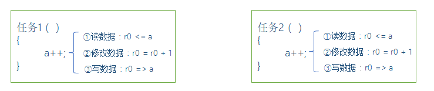

上图中任务1和任务2在RTOS中相互争取修改a的值，a的值容易受损错乱。

全局变量的弊端：数据无保护，导致数据不安全，当多个任务同时对该变量操作时，数据易受损。


### 3、使用队列的情况

答：使用队列的情况如下：

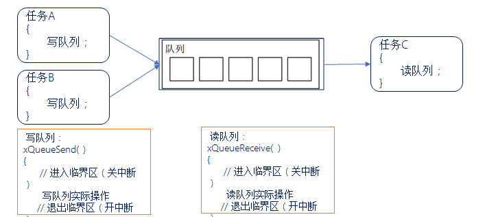

> 进入临界区：关闭中断，屏蔽可控中断，也会关闭任务调度器

读写队列做好了保护，防止多任务或中断同时访问产生冲突。我们只需直接调用API函数即可，简单易用。

注意：FreeRTOS基于队列，实现了多种功能，其中包括队列集、互斥信号量、计数信号量、二值信号量、递归互斥信号量，因此很有必要深入了解FreeRTOS的队列。


### 4、队列项目和队列长度

答：在队列中可以存储数量有限、大小固定的数据。队列中的每个数据就叫做 “队列项目” ，队列能够存储 “队列项目” 的最大数量称为队列的长度。

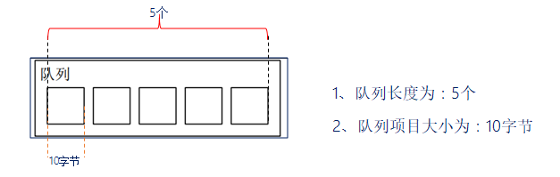

> 在创建队列时，就要指定队列长度以及队列项目的大小！
>
> 队列是一种模型，结构体数组则是一种实现方式，除了数组，链表，堆都是可以实现的


### 5、FreeRTOS队列特点

答：

1. **数据入队出队方式** ： 队列通常采用 “先进先出(FIFO)” 的数据存储缓冲机制，即先入队的数据会先从队列中被读取，FreeRTOS中也可以配置为 “后进先出(LIFO)” 方式。

2. **数据传递方式** ： FreeRTOS中队列采用实际值传递，即将数据拷贝到队列中进行传递，FreeRTOS采用拷贝数据传递，也可以传递指针，所以在传递较大的数据的时候采用指针传递。

   > x = 10传入的是值的话，把10放入队列里面，那么改变x：x = 20，那么不会改变队列里面的10（实际值传递）
   >
   > x = 10传入的是地址的话，把x的地址放入队列里面，如果改变x，那么就等于改变队列的值，因此此时x的值是不能改变的（指针传递）

3. **多任务访问** ： 队列不属于某个任务，任何任务和中断都可以向队列写入/读取消息。

4. **出队、入队阻塞** ： 当任务向一个队列发送/读取消息时，可以指定一个阻塞时间，假设此时当队列已满无法入队。


### 6、消息队列阻塞时间设置

答：

- 若阻塞时间为0                                 ：直接返回不会等待。
- 若阻塞时间为0~port_MAX_DELAY     ：等待设定阻塞时间，若在该时间内无法入队/出队，超时后直接返回不再等待。
- 若阻塞时间为port_MAX_DELAY         ：死等，一直等到可以入队/出队为止。


### 7、入队/出队阻塞过程

答：

入队阻塞：

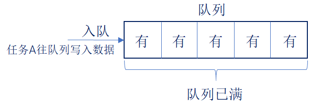

队列满了，此时写不进去数据：

1. 将该任务的状态列表项挂载在pxDelayedTaskList；

2. 将该任务的事件列表项挂载在xTasksWaitingToSend；

    

出队阻塞：

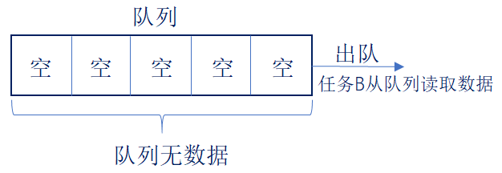

队列为空，此时读取不了数据：

1. 将该任务的状态列表挂载在pxDelayedTaskList；
2. 将该任务的事件列表项挂载在xTasksWaitingToReceive；


### 8、当多个任务写入消息给一个 “满队列” 时，这些任务都会进入阻塞状态，也就是说有多个任务在等待同一个队列的空间。那当队列有空间时，哪个任务会进入就绪态？

答：

1. 优先级最高的任务
2. 如果大家的优先级相同，那等待时间最久的任务进入就绪态。


### 9、队列创建、写入和读出过程

答：

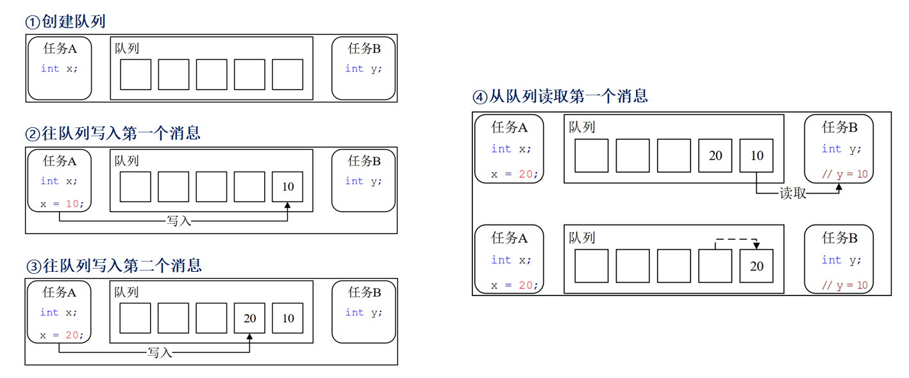

------


## 二、队列结构体介绍

### 1、队列结构体

答：

```c
typedef struct QueueDefinition 
{
    int8_t * pcHead;                       /* 存储区域的起始地址 */
    int8_t * pcWriteTo;                    /* 下一个写入的位置 */
    union
    {
        QueuePointers_t     xQueue;
        SemaphoreData_t  xSemaphore; 
    } u ;
    List_t xTasksWaitingToSend;             /* 等待发送列表 */
    List_t xTasksWaitingToReceive;          /* 等待接收列表 */
    volatile UBaseType_t uxMessagesWaiting; /* 非空闲队列项目的数量 */
    UBaseType_t uxLength；                  /* 队列长度 */
    UBaseType_t uxItemSize;                 /* 队列项目的大小 */
    volatile int8_t cRxLock;                /* 读取上锁计数器 */
    volatile int8_t cTxLock;                /* 写入上锁计数器 */
   /* 其他的一些条件编译 */
} xQUEUE;
```

当用于队列使用时：

```c
typedef struct QueuePointers
{
    int8_t * pcTail;                 /* 存储区的结束地址 */
    int8_t * pcReadFrom;             /* 最后一个读取队列的地址 */
} QueuePointers_t;
```

当用于互斥信号量和递归互斥信号量时：

```c
typedef struct SemaphoreData
{
    TaskHandle_t xMutexHolder;		    /* 互斥信号量持有者 */
    UBaseType_t uxRecursiveCallCount;	/* 递归互斥信号量的获取计数器 */
} SemaphoreData_t;
```

队列结构体示意图：

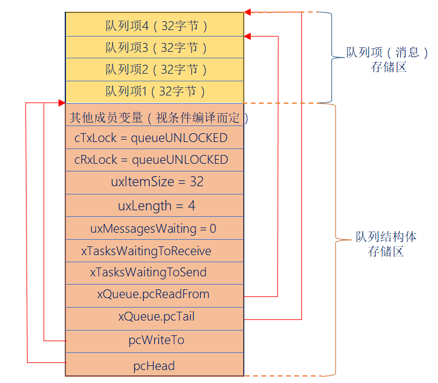

------


## 三、队列相关API函数介绍

### 1、队列使用流程

答：使用队列的主要流程：创建队列 —> 写队列 —> 读队列。


### 2、创建队列函数

答：

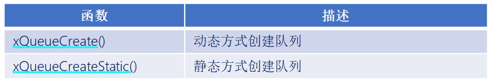

动态和静态创建队列之间的区别：队列所需的内存空间由 FreeRTOS 从 FreeRTOS 管理的堆中分配，而静态创建需要用户自行分配内存。

```c
#define xQueueCreate (  uxQueueLength,   uxItemSize  )
        xQueueGenericCreate( ( uxQueueLength ), ( uxItemSize ), (queueQUEUE_TYPE_BASE )) 
```

此函数用于使用动态方式创建队列，队列所需的内存空间由 FreeRTOS 从 FreeRTOS 管理的堆中分配。

函数参数：

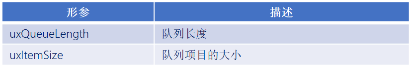

函数返回值：

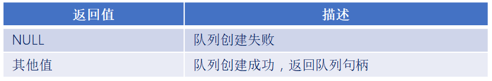


### 3、各种功能所对应的队列

答：

```c
#define queueQUEUE_TYPE_BASE                    ( ( uint8_t ) 0U )  /* 队列 */
#define queueQUEUE_TYPE_SET                     ( ( uint8_t ) 0U )  /* 队列集 */
#define queueQUEUE_TYPE_MUTEX                   ( ( uint8_t ) 1U )  /* 互斥信号量 */
#define queueQUEUE_TYPE_COUNTING_SEMAPHORE      ( ( uint8_t ) 2U )  /* 计数型信号量 */
#define queueQUEUE_TYPE_BINARY_SEMAPHORE        ( ( uint8_t ) 3U )  /* 二值信号量 */
#define queueQUEUE_TYPE_RECURSIVE_MUTEX         ( ( uint8_t ) 4U )  /* 递归互斥信号量 */
```


### 4、队列写入消息函数

答：

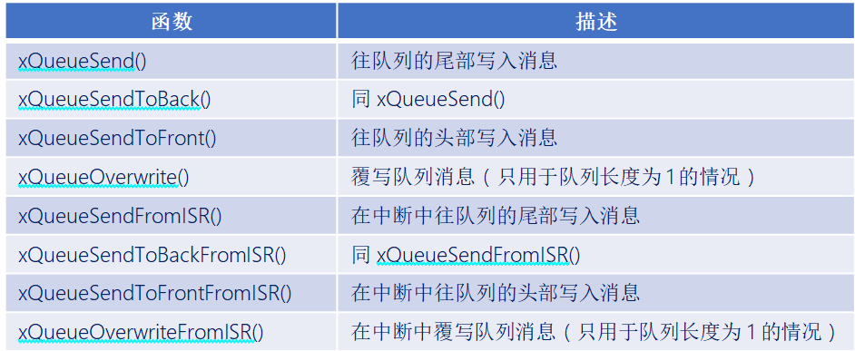

```c
#define  xQueueSend( xQueue, pvItemToQueue, xTicksToWait  )
         xQueueGenericSend( ( xQueue ), ( pvItemToQueue ), ( xTicksToWait ), queueSEND_TO_BACK )
```

```c
#define  xQueueSendToBack( xQueue, pvItemToQueue, xTicksToWait  )
         xQueueGenericSend( ( xQueue ), ( pvItemToQueue ), ( xTicksToWait ), queueSEND_TO_BACK )
```

```c
#define  xQueueSendToFront( xQueue, pvItemToQueue, xTicksToWait  )
         xQueueGenericSend( ( xQueue ), ( pvItemToQueue ), ( xTicksToWait ), queueSEND_TO_FRONT )
```

```c
#define  xQueueOverwrite(  xQueue,   pvItemToQueue  )
         xQueueGenericSend( ( xQueue ), ( pvItemToQueue ), 0, queueOVERWRITE )
```

> 可以看到这几个写入函数调用的是同一个函数xQueueGenericSend( )，只是指定了不同的写入位置！ 


队列一共有3种写入位置：

```c
#define queueSEND_TO_BACK                ( ( BaseType_t ) 0 )       /* 写入队列尾部 */
#define queueSEND_TO_FRONT              ( ( BaseType_t ) 1 )        /* 写入队列头部 */
#define queueOVERWRITE                  ( ( BaseType_t ) 2 )        /* 覆写队列*/
```

> 注意：覆写方式写入队列，只有在队列的队列长度为 1 时，才能够使用 。

> 覆盖写入没有阻塞，写入队列尾部，写入队列头部都是可以阻塞的

往队列写入消息函数入口参数解析：

```c
BaseType_t      xQueueGenericSend(  QueueHandle_t       xQueue,
                                    const void * const  pvItemToQueue,
                                    TickType_t          xTicksToWait,
                                    const BaseType_t    xCopyPosition   );
```

函数参数：

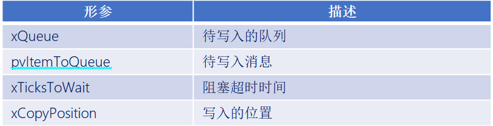

函数返回值：

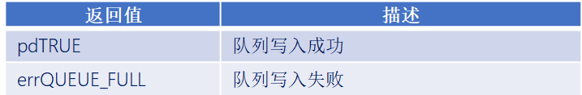


### 5、队列读出消息函数

答：

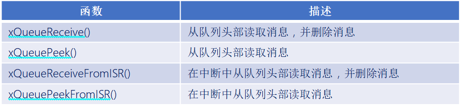

```c
BaseType_t    xQueueReceive( QueueHandle_t  xQueue, 
                             void *   const pvBuffer,  
                             TickType_t     xTicksToWait )
```

此函数用于在任务中，从队列中读取消息，并且消息读取成功后，会将消息从队列中移除。

函数参数：

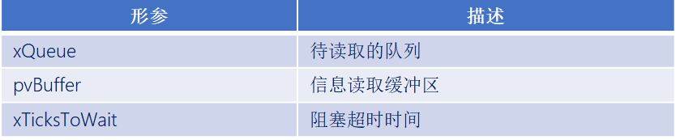

函数返回值：

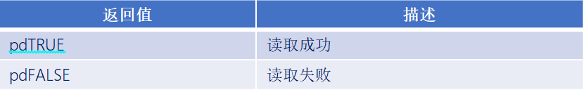


```c
BaseType_t   xQueuePeek( QueueHandle_t   xQueue,
                         void * const   pvBuffer,
                         TickType_t   xTicksToWait )
```

此函数用于在任务中，从队列中读取消息， 但与函数 xQueueReceive()不同，此函数在成功读取消息后，并不会移除已读取的消息！ 

函数参数：

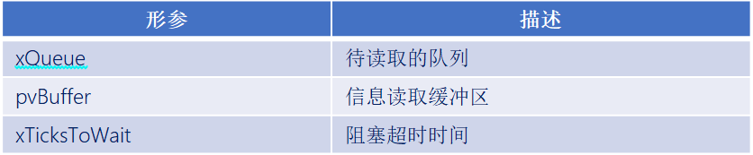

函数返回值：

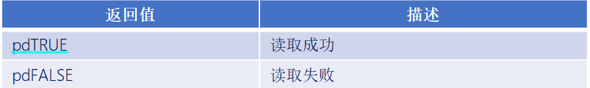

------


## 代码

```c
#include "stm32f4xx.h"                  // STM32F4系列微控制器头文件
#include "freertos.h"                   // FreeRTOS实时操作系统头文件
#include "task.h"                       // FreeRTOS任务管理头文件
#include "queue.h"                      // FreeRTOS队列管理头文件
#include "usart.h"                      // 串口通信头文件
#include "timer.h"                      // 定时器头文件
#include "delay_dwt.h"                  // 包含DWT延迟函数头文件

/**
 * @brief LED初始化函数
 * 配置GPIOC的Pin13作为LED控制引脚
 */
void LED_Init(void)
{		
    // 使能GPIOC时钟（AHB1总线）
    RCC_AHB1PeriphClockCmd(RCC_AHB1Periph_GPIOC, ENABLE);

    // 配置GPIO初始化结构体
    GPIO_InitTypeDef GPIO_InitStructure;
	GPIO_StructInit(&GPIO_InitStructure);
    GPIO_InitStructure.GPIO_Pin = GPIO_Pin_1 | GPIO_Pin_13 | GPIO_Pin_0;        // 选择引脚13,1
    GPIO_InitStructure.GPIO_Mode = GPIO_Mode_OUT;     // 输出模式
    GPIO_InitStructure.GPIO_OType = GPIO_OType_PP;    // 推挽输出
    GPIO_InitStructure.GPIO_Speed = GPIO_Speed_50MHz; // 输出速度50MHz
    GPIO_InitStructure.GPIO_PuPd = GPIO_PuPd_NOPULL;  // 无上拉下拉电阻
    GPIO_Init(GPIOC, &GPIO_InitStructure);            // 初始化GPIOC
}


/**
 * @brief LED初始化函数
 * 配置GPIOC的Pin13作为LED控制引脚
 */
void LED_TOGGLE13(void)
{
    GPIO_ToggleBits(GPIOC, GPIO_Pin_13);
}

/**
 * @brief LED初始化函数
 * 配置GPIOC的Pin1作为LED控制引脚
 */
void LED_TOGGLE1(void)
{
    GPIO_ToggleBits(GPIOC, GPIO_Pin_1);
}

/**
 * @brief LED初始化函数
 * 配置GPIOC的Pin0作为LED控制引脚
 */
void LED_TOGGLE0(void)
{
    GPIO_ToggleBits(GPIOC, GPIO_Pin_0);
}

/**
 * @brief 按键初始化函数
 * 配置GPIOA的Pin0和Pin1作为按键输入引脚
 */
void Key_Init(void)
{
	RCC_AHB1PeriphClockCmd(RCC_AHB1Periph_GPIOA, ENABLE);
	GPIO_InitTypeDef GPIO_InitStructure;
	GPIO_StructInit(&GPIO_InitStructure);
	GPIO_InitStructure.GPIO_Pin = GPIO_Pin_15 |  GPIO_Pin_0 | GPIO_Pin_1;
	GPIO_InitStructure.GPIO_Mode = GPIO_Mode_IN;
	GPIO_InitStructure.GPIO_Speed = GPIO_Speed_50MHz;
	GPIO_InitStructure.GPIO_PuPd = GPIO_PuPd_UP;
	GPIO_Init(GPIOA, &GPIO_InitStructure);  
}

/**
 * @brief 获取按键编号
 * 功能：根据按键状态返回按键编号
 * @return uint8_t 按键编号（1或2），如果没有按键按下则返回0
 */
uint8_t Key_GetNum(void)
{
	if (GPIO_ReadInputDataBit(GPIOA, GPIO_Pin_0) == 0)
	{
		vTaskDelay(20);
		if(GPIO_ReadInputDataBit(GPIOA, GPIO_Pin_0) == 0){
			return 1;
		}
	}
	else if (GPIO_ReadInputDataBit(GPIOA, GPIO_Pin_1) == 0)
	{
		vTaskDelay(20);
		if(GPIO_ReadInputDataBit(GPIOA, GPIO_Pin_1) == 0){
			return 2;
		}
	} 
	else if (GPIO_ReadInputDataBit(GPIOA, GPIO_Pin_15) == 0)
	{
		vTaskDelay(20);
		if(GPIO_ReadInputDataBit(GPIOA, GPIO_Pin_15) == 0){
			return 3;
		}
    }
    return 0;
}

// 任务配置宏定义
#define START_TASK_STACK_SIZE 128       // 启动任务栈大小（字）
#define START_TASK_PRIORITY 2           // 启动任务优先级（数值越小优先级越高）
#define TASK1_STACK_SIZE 128           // 任务1栈大小（字）
#define TASK1_PRIORITY 2               // 任务1优先级（数值越小优先级越高）
#define TASK2_STACK_SIZE 128           // 任务2栈大小（字）
#define TASK2_PRIORITY 3               // 任务2优先级（数值越小优先级越高）
#define TASK3_STACK_SIZE 128           // 任务3栈大小（字）
#define TASK3_PRIORITY 4               // 任务3优先级（数值越小优先级越高）
// 任务句柄声明（用于引用和管理任务）
TaskHandle_t MytaskHandler1;    // 任务1句柄
TaskHandle_t MytaskHandler2;    // 任务2句柄
TaskHandle_t MytaskHandler3;    // 任务3句柄
TaskHandle_t StarttaskHandler;  // 启动任务句柄
QueueHandle_t MyQueue;          // 小数据队列句柄
QueueHandle_t big_date_queue;   // 大数据队列句柄
// 为避免编译器对非 ASCII 源文件编码的潜在问题，使用 ASCII 描述字符串
char big_date[128] = "This is a big data queue used to store large data.";

/**
 * @brief 任务1函数
 * 功能：实现入队
 * @param arg 任务参数（未使用）
 */
 void Task1(void * arg){
    uint8_t KeyNum = 0;
    char *buff = big_date; // 指向大数据队列的指针
    BaseType_t xStatus;
    while(1){
        KeyNum = Key_GetNum();
        if(KeyNum <mark> 1 || KeyNum </mark> 2){
            xStatus = xQueueSend(MyQueue, &KeyNum, portMAX_DELAY);
            if(xStatus != pdPASS){
                printf("Task1: xQueueSend MyQueue failed\r\n");
            }
        } else if(KeyNum == 3){
            xStatus = xQueueSend(big_date_queue, &buff, portMAX_DELAY);
            if(xStatus != pdPASS){
                printf("Task1: xQueueSend big_date_queue failed\r\n");
            }
        }
        vTaskDelay(500);         // 延迟500个时钟节拍（约500ms，取决于系统时钟配置）
    }	
}


/**
 * @brief 任务2函数
 * 功能：小数据出队
 * @param arg 任务参数（未使用）
 */
void Task2(void * arg){
    uint8_t KeyNum = 0;
    BaseType_t xStatus;
    while(1){
        xStatus = xQueueReceive(MyQueue, &KeyNum, portMAX_DELAY);
        if(xStatus != pdPASS){
            printf("Task2: xQueueReceive MyQueue failed\r\n");
        } else {
            printf("Task2: xQueueReceive MyQueue %d\r\n", KeyNum);
        }
    }
    /*task2的优先级比task1的高
    如果队列有数据，task2会先执行，task1会阻塞(就绪态移除，移到阻塞态)，
    如果队列没有数据，task1会先执行，task2会阻塞(就绪态移除，移到阻塞态)，直到队列有数据*/
}

/**
 * @brief 任务3函数
 * 功能：大数据出队
 * @param arg 任务参数（未使用）
 */
void Task3(void * arg){
    char *buff = NULL;
    BaseType_t xStatus;
    while(1){
        xStatus = xQueueReceive(big_date_queue, &buff, portMAX_DELAY);
        if(xStatus != pdPASS){
            printf("Task3: xQueueReceive big_date_queue failed\r\n");
        } else {
            printf("Task3: xQueueReceive big_date_queue %s\r\n", buff);
        }
    }
}

/**
 * @brief 启动任务函数
 * 功能：创建其他三个任务后自行删除
 * @param arg 任务参数（未使用）
 */
void Starttask(void * arg){
    // 进入临界区保护串口输出
    taskENTER_CRITICAL();
    printf("Starttask running\r\n");  // 打印启动任务运行信息
    taskEXIT_CRITICAL();

    /*功能：创建一个用于存储uint8_t类型数据的队列，队列长度为2，每个元素大小为1字节*/
    MyQueue = xQueueCreate(2, sizeof(uint8_t));
    if(MyQueue == NULL){
        printf("MyQueue create failed\r\n");
    }else{
        printf("MyQueue create success\r\n");
    }


    /*功能：创建一个用于存储char*类型数据的队列，队列长度为1，每个元素大小为1个字符指针*/
    big_date_queue = xQueueCreate(1, sizeof(char*));
    if(big_date_queue == NULL){
        printf("big_date_queue create failed\r\n");
    }else{
        printf("big_date_queue create success\r\n");
    }

    // 使用动态内存分配方式创建任务1
    xTaskCreate(Task1,                        // 任务函数指针
               "MyFirstTask",                 // 任务名称（用于调试）
               TASK1_STACK_SIZE,         // 栈大小（字）
               NULL,                          // 传递给任务的参数
               TASK1_PRIORITY,           // 任务优先级
               &MytaskHandler1);              // 任务句柄指针
    
    // 使用动态内存分配方式创建任务2
    xTaskCreate(Task2, 
               "MySecondTask", 
               TASK2_STACK_SIZE, 
               NULL, 
               TASK2_PRIORITY, 
               &MytaskHandler2);
    
    // 使用动态内存分配方式创建任务3
    xTaskCreate(Task3, 
               "MyThirdTask", 
               TASK3_STACK_SIZE, 
               NULL, 
               TASK3_PRIORITY, 
               &MytaskHandler3);

    
    // 删除当前任务（启动任务），释放其占用的资源
    vTaskDelete(NULL);
}

/**
 * @brief 主函数
 * 程序入口点，初始化硬件并启动RTOS调度器
 */
int main(void)
{
	NVIC_PriorityGroupConfig(NVIC_PriorityGroup_4);
    LED_Init();                     // 初始化LED GPIO引脚
    Usart1_Init(115200);            // 初始化串口1，波特率115200
    Key_Init();                     // 初始化按键 GPIO引脚
    DWT_Init();                     // 初始化DWT定时器
    
    // 创建启动任务（使用动态内存分配）
    xTaskCreate(Starttask,                  // 任务函数指针
               "StartTask",                 // 任务名称
               START_TASK_STACK_SIZE,       // 栈大小
               NULL,                        // 任务参数
               START_TASK_PRIORITY,         // 任务优先级
               &StarttaskHandler);          // 任务句柄
    
    // 启动FreeRTOS调度器（程序将在此处开始运行任务）
    vTaskStartScheduler();
    
    // 正常情况下，调度器启动后不会执行到这里
    // 如果调度器启动失败，程序将在此处循环
    while (1)
    {		
        // 空循环，用于处理调度器启动失败的情况
    }	
}

```

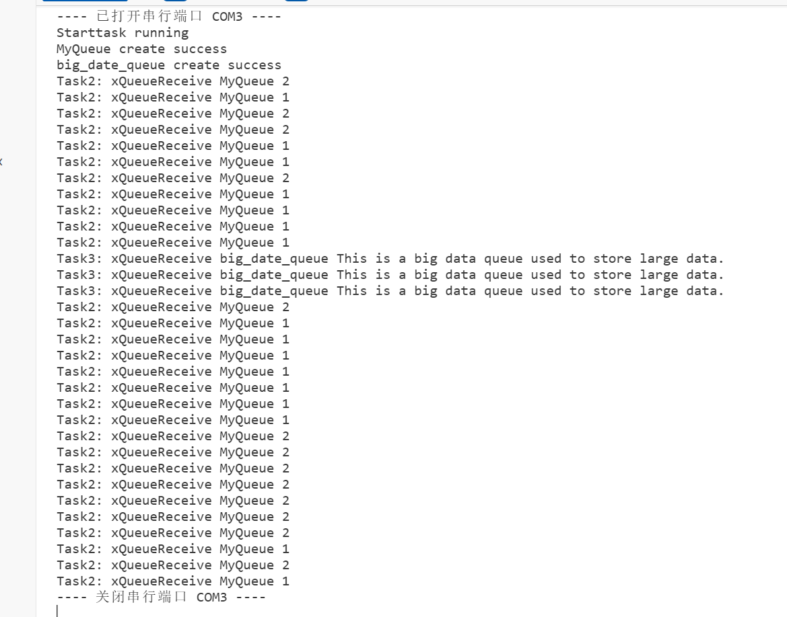


