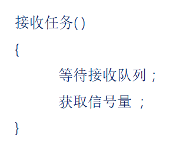
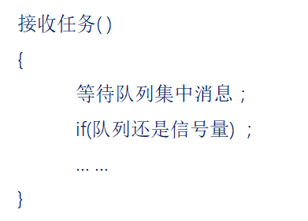
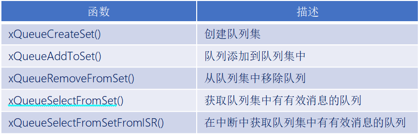
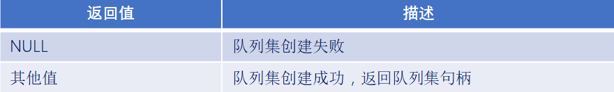
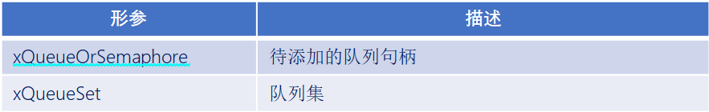
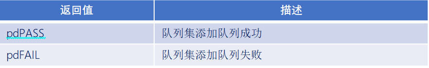
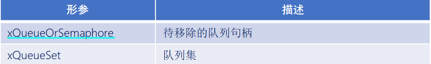
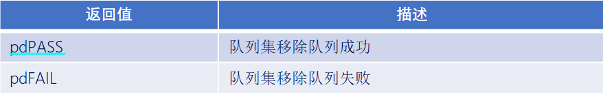
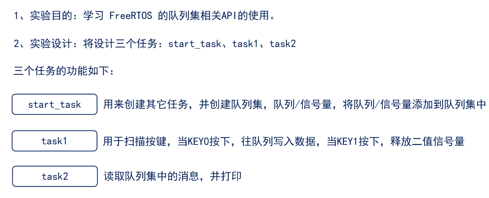
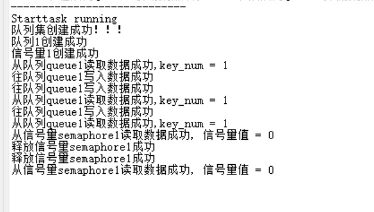

# FreeRTOS队列集

------


## 一、队列集简介

### 1、队列集介绍

答：

- 一个队列只允许任务间传递的消息为同一种数据类型，如果<mark>需要再任务间传递不同数据类型的消息时</mark>，那么就可以使用队列集！！！
- 作用：<mark>用于对多个队列或信号量进行“监听”</mark>，其中不管哪一个消息到来，都可让任务退出阻塞状态。

假设：有一个任务，使用到队列接收和信号量的获取，如下：

不使用队列集：



使用队列集：



------


## 二、队列集相关API函数

### 1、队列集相关API函数

答：




### 2、队列集创建函数

答：

```c
QueueSetHandle_t     xQueueCreateSet( const  UBaseType_t  uxEventQueueLength ); 
```

函数参数：


函数返回值：




### 3、队列集添加函数

答：

```c
BaseType_t xQueueAddToSet( QueueSetMemberHandle_t   xQueueOrSemaphore,
                           QueueSetHandle_t         xQueueSet); 
```

> 此函数用于往队列集中添加队列，要注意的时，队列在被添加到队列集之前队列中不能有有效的消息。

函数参数：



函数返回值：




### 4、队列集移除函数

答：

```c
BaseType_t   xQueueRemoveFromSet( QueueSetMemberHandle_t    xQueueOrSemaphore,
                                  QueueSetHandle_t          xQueueSet ); 
```

> 此函数用于从队列集中移除队列，要注意的是，队列在从队列集中移除之前，必须没有有效的消息。

函数参数：



函数返回值：




### 5、队列集获取函数

答：

```c
QueueSetMemberHandle_t   xQueueSelectFromSet( QueueSetHandle_t    xQueueSet,
                                              TickType_t const    xTicksToWait)
```

> 此函数用于在任务中获取队列集中有有效消息的队列。

函数参数：


函数返回值：


------


### 实验




```c
#include "stm32f4xx.h"                  // STM32F4系列微控制器头文件
#include "freertos.h"                   // FreeRTOS实时操作系统头文件
#include "task.h"                       // FreeRTOS任务管理头文件
#include "queue.h"                      // FreeRTOS队列管理头文件
#include "usart.h"                      // 串口通信头文件
#include "timer.h"                      // 定时器头文件
#include "delay_dwt.h"                  // 包含DWT延迟函数头文件
#include "semphr.h"                     // FreeRTOS信号量头文件

/**
 * @brief LED初始化函数
 * 配置GPIOC的Pin13作为LED控制引脚
 */
void LED_Init(void)
{		
    // 使能GPIOC时钟（AHB1总线）
    RCC_AHB1PeriphClockCmd(RCC_AHB1Periph_GPIOC, ENABLE);

    // 配置GPIO初始化结构体
    GPIO_InitTypeDef GPIO_InitStructure;
	GPIO_StructInit(&GPIO_InitStructure);
    GPIO_InitStructure.GPIO_Pin = GPIO_Pin_1 | GPIO_Pin_13 | GPIO_Pin_0;        // 选择引脚13,1
    GPIO_InitStructure.GPIO_Mode = GPIO_Mode_OUT;     // 输出模式
    GPIO_InitStructure.GPIO_OType = GPIO_OType_PP;    // 推挽输出
    GPIO_InitStructure.GPIO_Speed = GPIO_Speed_50MHz; // 输出速度50MHz
    GPIO_InitStructure.GPIO_PuPd = GPIO_PuPd_NOPULL;  // 无上拉下拉电阻
    GPIO_Init(GPIOC, &GPIO_InitStructure);            // 初始化GPIOC
}


/**
 * @brief LED初始化函数
 * 配置GPIOC的Pin13作为LED控制引脚
 */
void LED_TOGGLE13(void)
{
    GPIO_ToggleBits(GPIOC, GPIO_Pin_13);
}

/**
 * @brief LED初始化函数
 * 配置GPIOC的Pin1作为LED控制引脚
 */
void LED_TOGGLE1(void)
{
    GPIO_ToggleBits(GPIOC, GPIO_Pin_1);
}

/**
 * @brief LED初始化函数
 * 配置GPIOC的Pin0作为LED控制引脚
 */
void LED_TOGGLE0(void)
{
    GPIO_ToggleBits(GPIOC, GPIO_Pin_0);
}

/**
 * @brief 按键初始化函数
 * 配置GPIOA的Pin0和Pin1作为按键输入引脚
 */
void Key_Init(void)
{
	RCC_AHB1PeriphClockCmd(RCC_AHB1Periph_GPIOA, ENABLE);
	GPIO_InitTypeDef GPIO_InitStructure;
	GPIO_StructInit(&GPIO_InitStructure);
	GPIO_InitStructure.GPIO_Pin = GPIO_Pin_15 |  GPIO_Pin_0 | GPIO_Pin_1;
	GPIO_InitStructure.GPIO_Mode = GPIO_Mode_IN;
	GPIO_InitStructure.GPIO_Speed = GPIO_Speed_50MHz;
	GPIO_InitStructure.GPIO_PuPd = GPIO_PuPd_UP;
	GPIO_Init(GPIOA, &GPIO_InitStructure);  
}

/**
 * @brief 获取按键编号
 * 功能：根据按键状态返回按键编号
 * @return uint8_t 按键编号（1或2），如果没有按键按下则返回0
 */
uint8_t Key_GetNum(void)
{
	if (GPIO_ReadInputDataBit(GPIOA, GPIO_Pin_0) == 0)
	{
		vTaskDelay(20);
		if(GPIO_ReadInputDataBit(GPIOA, GPIO_Pin_0) == 0){
			return 1;
		}
	}
	else if (GPIO_ReadInputDataBit(GPIOA, GPIO_Pin_1) == 0)
	{
		vTaskDelay(20);
		if(GPIO_ReadInputDataBit(GPIOA, GPIO_Pin_1) == 0){
			return 2;
		}
	} 
	else if (GPIO_ReadInputDataBit(GPIOA, GPIO_Pin_15) == 0)
	{
		vTaskDelay(20);
		if(GPIO_ReadInputDataBit(GPIOA, GPIO_Pin_15) == 0){
			return 3;
		}
    }
    return 0;
}

// 任务配置宏定义
#define START_TASK_STACK_SIZE 128       // 启动任务栈大小（字）
#define START_TASK_PRIORITY 2           // 启动任务优先级（数值越小优先级越高）
#define TASK1_STACK_SIZE 128           // 任务1栈大小（字）
#define TASK1_PRIORITY 3               // 任务1优先级（数值越大优先级越高）
#define TASK2_STACK_SIZE 128           // 任务2栈大小（字）
#define TASK2_PRIORITY 4               // 任务2优先级（数值越大优先级越高）
// 任务句柄声明（用于引用和管理任务）
TaskHandle_t MytaskHandler1;    // 任务1句柄
TaskHandle_t MytaskHandler2;    // 任务2句柄
TaskHandle_t StarttaskHandler;  // 启动任务句柄
QueueSetHandle_t queueset_handle;        // 队列集句柄
QueueHandle_t queue1; // 队列1句柄
SemaphoreHandle_t semaphore1; // 信号量1句柄


/**
 * @brief 低优先级任务1函数
 * 功能：实现队列发送以及信号量释放
 * @param arg 任务参数（未使用）
 */
void Task1(void * arg){
    uint8_t key_num = 0;
    BaseType_t xStatus;
    while(1){
        key_num = Key_GetNum();
        if(key_num == 1){
            xStatus = xQueueSend(queue1, &key_num, portMAX_DELAY); /*将按键编号发送到队列1*/
            if(xStatus == pdPASS){
                printf("往队列queue1写入数据成功 \r\n");
            }
        } else if(key_num == 2){
            xStatus = xSemaphoreGive(semaphore1);
            if(xStatus == pdPASS){
                printf("释放信号量semaphore1成功  \r\n");
            }
        }
    }

}


/**
 * @brief 中优先级任务2函数
 * 功能：获取队列集中的信息
 * @param arg 任务参数（未使用）
 */
 void Task2(void * arg){
    QueueSetMemberHandle_t xStatus;
    while(1){
        xStatus = xQueueSelectFromSet(queueset_handle, portMAX_DELAY);
        if(xStatus == queue1){
            uint8_t key_num = 0;
            xQueueReceive(queue1, &key_num, portMAX_DELAY);
            printf("从队列queue1读取数据成功,key_num = %d\r\n", key_num);
        } else if(xStatus == semaphore1){
            xSemaphoreTake(semaphore1, portMAX_DELAY);
            printf("从信号量semaphore1读取数据成功, 信号量值 = %d\r\n", uxSemaphoreGetCount(semaphore1));
        }
        vTaskDelay(1000);
    }	
}


/**
 * @brief 启动任务函数
 * 功能：创建其他三个任务后自行删除
 * @param arg 任务参数（未使用）
 */
void Starttask(void * arg){
    // 进入临界区保护串口输出
    taskENTER_CRITICAL();
    printf("----------------------------\r\n");
    printf("Starttask running\r\n");  // 打印启动任务运行信息
    taskEXIT_CRITICAL();

    // 创建队列集
    queueset_handle = xQueueCreateSet(2); /*创建队列集，包含队列1和信号量1*/
    if(queueset_handle != NULL){
        printf("队列集创建成功！！！\r\n");
    } 
    // 创建队列1
    queue1 = xQueueCreate(1, sizeof(uint8_t)); /*创建队列1，用于存储uint8_t类型数据*/
    if(queue1 != NULL){
        printf("队列1创建成功\r\n");
    }

    // 创建信号量1
    semaphore1 = xSemaphoreCreateBinary(); /*创建信号量1，用于任务同步*/
    if(semaphore1 != NULL){
        printf("信号量1创建成功\r\n");
    }

    // 将队列1和信号量1添加到队列集中
    xQueueAddToSet(queue1, queueset_handle);
    xQueueAddToSet(semaphore1, queueset_handle);

    taskENTER_CRITICAL();
    // 使用动态内存分配方式创建任务1
    xTaskCreate(Task1,                        // 任务函数指针
               "MyFirstTask",                 // 任务名称（用于调试）
               TASK1_STACK_SIZE,         // 栈大小（字）
               NULL,                          // 传递给任务的参数
               TASK1_PRIORITY,           // 任务优先级
               &MytaskHandler1);              // 任务句柄指针
    
    // 使用动态内存分配方式创建任务2
    xTaskCreate(Task2, 
               "MySecondTask", 
               TASK2_STACK_SIZE, 
               NULL, 
               TASK2_PRIORITY, 
               &MytaskHandler2);
    
    taskEXIT_CRITICAL();
    
    // 删除当前任务（启动任务），释放其占用的资源
    vTaskDelete(NULL);
}

/**
 * @brief 主函数
 * 程序入口点，初始化硬件并启动RTOS调度器
 */
int main(void)
{
	NVIC_PriorityGroupConfig(NVIC_PriorityGroup_4);
    LED_Init();                     // 初始化LED GPIO引脚
    Usart1_Init(115200);            // 初始化串口1，波特率115200
    Key_Init();                     // 初始化按键 GPIO引脚
    DWT_Init();                     // 初始化DWT定时器
    
    // 创建启动任务（使用动态内存分配）
    xTaskCreate(Starttask,                  // 任务函数指针
               "StartTask",                 // 任务名称
               START_TASK_STACK_SIZE,       // 栈大小
               NULL,                        // 任务参数
               START_TASK_PRIORITY,         // 任务优先级
               &StarttaskHandler);          // 任务句柄
    
    // 启动FreeRTOS调度器（程序将在此处开始运行任务）
    vTaskStartScheduler();
    
    // 正常情况下，调度器启动后不会执行到这里
    // 如果调度器启动失败，程序将在此处循环
    while (1)
    {		
        // 空循环，用于处理调度器启动失败的情况
    }	
}

```




