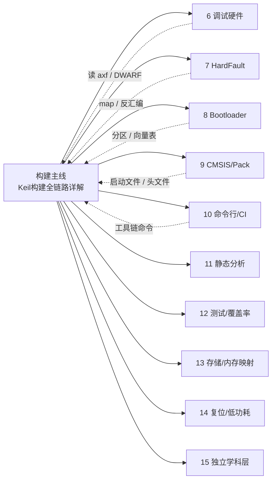

# ARM 嵌入式工具链 · 相邻专题（大纲）

> 体系总览与维护约定：00-总览

> **定位**
> 本笔记是 [Keil构建全链路详解（AC5-AC6）](../../../../../../Embedded/NoSystematic/Docs/02-工具链与构建/Keil-ARM构建知识体系/keil构建全链路详解_ac5-ac6/) 的**相邻领域清单**，不属于“构建主线”，因此单独成篇。
> 当前状态：**索引 + 待扩展清单**。10 个主题均已升级为正式版（见下方入口表）；各节保留原「知识点清单 + 待补」，作为继续扩展的方向。

## 专题总览

| # | 专题 | 与构建的关系 | 状态 |
|---|---|---|---|
| 6 | 调试硬件与 trace | 调试器如何读 axf / 控制内核 | **正式版** |
| 7 | HardFault 定位 | 运行期故障，需结合 map/反汇编 | **正式版** |
| 8 | Bootloader / IAP / OTA / 安全启动 | 多映像、向量表、链接地址 | **正式版** |
| 9 | CMSIS 体系与 Pack | 启动文件、寄存器定义、组件来源 | **正式版** |
| 10 | 命令行与 CI 构建 | 脱离 IDE 的构建、静态检查 | **正式版** |
| 11 | 静态分析与编码规范 | 构建流水线中的检查环节 | **正式版** |
| 12 | 测试与覆盖率 | 主机侧/目标侧验证 | **正式版** |
| 13 | 存储与内存映射细节 | 位带、保护、等待周期、CCM/外部存储 | **正式版** |
| 14 | 复位与低功耗 | 启动模式、时钟树、低功耗模式 | **正式版** |
| 15 | 独立学科层 | RTOS、功能安全、仿真、多核、编译器对比、加密 | **正式版** |

### 正式版入口

| # | 主题 | 正式版笔记 |
|---|---|---|
| 6 | 调试硬件与 trace | [调试硬件与trace（Cortex-M）](../../../../../../Embedded/NoSystematic/Docs/02-工具链与构建/Keil-ARM构建知识体系/调试硬件与trace_cortex-m/) |
| 7 | HardFault 定位 | [HardFault定位与故障分析（Cortex-M）](../../../../../../Embedded/NoSystematic/Docs/02-工具链与构建/Keil-ARM构建知识体系/hardfault定位与故障分析_cortex-m/) |
| 8 | Bootloader / IAP / OTA | [Bootloader与IAP-OTA（Cortex-M）](../../../../../../Embedded/NoSystematic/Docs/02-工具链与构建/Keil-ARM构建知识体系/bootloader与iap-ota_cortex-m/) |
| 9 | CMSIS 与 Pack | [CMSIS与Pack（Cortex-M）](../../../../../../Embedded/NoSystematic/Docs/02-工具链与构建/Keil-ARM构建知识体系/cmsis与pack_cortex-m/) |
| 10 | 命令行与 CI | [命令行与CI构建（Keil-ARM）](../../../../../../Embedded/NoSystematic/Docs/02-工具链与构建/Keil-ARM构建知识体系/命令行与ci构建_keil-arm/) |
| 11 | 静态分析与编码规范 | [静态分析与编码规范（MISRA）](../../../../../../Embedded/NoSystematic/Docs/02-工具链与构建/Keil-ARM构建知识体系/静态分析与编码规范_misra/) |
| 12 | 测试与覆盖率 | [测试与覆盖率（嵌入式）](../../../../../../Embedded/NoSystematic/Docs/02-工具链与构建/Keil-ARM构建知识体系/测试与覆盖率_嵌入式/) |
| 13 | 存储与内存映射 | [存储与内存映射（Cortex-M）](../../../../../../Embedded/NoSystematic/Docs/02-工具链与构建/Keil-ARM构建知识体系/存储与内存映射_cortex-m/) |
| 14 | 复位与低功耗 | [复位与低功耗（Cortex-M）](../../../../../../Embedded/NoSystematic/Docs/02-工具链与构建/Keil-ARM构建知识体系/复位与低功耗_cortex-m/) |
| 15 | 独立学科层 | [独立学科层索引（RTOS-功能安全-仿真-多核-安全）](../../../../../../Embedded/NoSystematic/Docs/02-工具链与构建/Keil-ARM构建知识体系/独立学科层索引_rtos-功能安全-仿真-多核-安全/) |

---

## 6. 调试硬件与 trace（已升级为正式版）

> 正式版见 [调试硬件与trace（Cortex-M）](../../../../../../Embedded/NoSystematic/Docs/02-工具链与构建/Keil-ARM构建知识体系/调试硬件与trace_cortex-m/)；以下清单保留，作为继续扩展的方向。

### 6.1 知识点清单

- **SWD**：`SWDIO` + `SWCLK` 两线，Cortex-M 最常用；支持多核/多器件菊花链（较少见）。
- **JTAG**：`TCK/TMS/TDI/TDO`（+`TRST`），边界扫描，老器件/FPGA 常用。
- **SWO**：单线异步 trace，输出 ITM 激励、PC 采样、时间戳。
- **ITM**：Instrumentation Trace Macrocell，32 个激励端口，`ITM_SendChar` 常用来做 printf 替代。
- **DWT**：Data Watchpoint and Trace，周期计数器（`CYCCNT`）、 watchpoint、PC 采样。
- **ETM**：指令 trace，需要并行 trace 口（TCLK/TD0…），高端调试器才支持。
- **调试探针**：J-Link、ST-Link、CMSIS-DAP、ULINK；差异在速度、协议支持、trace 能力、多核支持。
- **Keil 侧配置**：Debug 选项卡选探针、Settings 里选 SWD/JTAG、Trace 选项卡配 SWO 时钟与 ITM 通道。

### 6.2 与构建文档的衔接

- 调试器加载 `.axf` 的 `PT_LOAD` 段（见构建文档 9.1、11.6）；
- 行号/变量来自 DWARF（11.1–11.4）；
- 断点用 `BKPT`/DWT（11.5）。

### 6.3 待补内容

- [ ] SWD/JTAG 时序与接线图
- [ ] SWO 波特率计算与 ITM 配置步骤
- [ ] DWT 周期计数测函数耗时（含溢出处理）
- [ ] 各探针速度/价格/兼容性对比表
- [ ] 多核（M7+M4）调试与 trace 方案

---

## 7. HardFault 定位（已升级为正式版）

> 正式版见 [HardFault定位与故障分析（Cortex-M）](../../../../../../Embedded/NoSystematic/Docs/02-工具链与构建/Keil-ARM构建知识体系/hardfault定位与故障分析_cortex-m/)；以下清单保留，作为继续扩展的方向。

### 7.1 知识点清单

**故障寄存器**（`SCB->CFSR` 拆成三部分）：

| 寄存器 | 位 | 名称 | 含义 |
|---|---|---|---|
| MMFSR | 0 | IACCVIOL | 取指访问违例（MPU/XN） |
| | 1 | DACCVIOL | 数据访问违例 |
| | 3 | MUNSTKERR | 异常返回时出栈失败 |
| | 4 | MSTKERR | 异常入栈失败 |
| | 5 | MLSPERR | 惰性 FP 保存失败 |
| | 7 | MMARVALID | MMFAR 有效 |
| BFSR | 8 | IBUSERR | 取指总线错误 |
| | 9 | PRECISERR | 精确总线错误（地址已知） |
| | 10 | IMPRECISERR | 不精确总线错误（地址未知） |
| | 11 | UNSTKERR | 返回出栈总线错误 |
| | 12 | STKERR | 入栈总线错误 |
| | 13 | LSPERR | 惰性 FP 保存总线错误 |
| | 15 | BFARVALID | BFAR 有效 |
| UFSR | 16 | UNDEFINSTR | 未定义指令 |
| | 17 | INVSTATE | 非法状态（如 ARM/Thumb 位错） |
| | 18 | INVPC | 非法 PC（EXC_RETURN 错） |
| | 19 | NOCP | 协处理器未使能（FPU 未开） |
| | 20 | STKOF | 栈溢出 |
| | 24 | UNALIGNED | 非对齐访问 |
| | 25 | DIVBYZERO | 除零（需配置） |

**其他寄存器**：

- `HFSR`：`FORCED`（由其他 fault 升级）、`VECTTBL`（向量表读失败）；
- `MMFAR` / `BFAR`：出错地址（配合 `*ARVALID` 位）；
- `xPSR`、`LR`（`EXC_RETURN`）、`MSP/PSP`：判断出错时用的栈。

**栈帧回溯**：

1. 判断出错前用 MSP 还是 PSP（`EXC_RETURN` bit2）；
2. 从对应栈取 8 个字：`R0,R1,R2,R3,R12,LR,PC,xPSR`；
3. `PC` 即出错指令地址（精确 fault）；
4. 用 `.map` + `fromelf --disassemble` 定位到函数与源码行；
5. 若 `IMPRECISERR`，需开 write buffer 关闭或加 `DSB` 复现。

### 7.2 与构建文档的衔接

- `.map` 的符号地址（8.5）；
- 反汇编定位（9.4）；
- 启动期 fault 与栈/scatter 相关（10.10）。

### 7.3 待补内容

- [ ] 一段可直接粘贴的 HardFault_Handler（打印 CFSR/HFSR/BFAR/栈帧）
- [ ] Keil 寄存器窗口逐位解读截图
- [ ] 五个真实案例：空指针、栈溢出、非对齐、FPU 未开、中断优先级
- [ ] `IMPRECISERR` 的定位技巧（关闭写缓冲、二分注释）

---

## 8. Bootloader / IAP / OTA / 安全启动

> 正式版见 [Bootloader与IAP-OTA（Cortex-M）](../../../../../../Embedded/NoSystematic/Docs/02-工具链与构建/Keil-ARM构建知识体系/bootloader与iap-ota_cortex-m/)。

### 8.1 知识点清单

- **IAP**：在应用中编程，用芯片自身 Flash 擦写能力升级。
- **Bootloader 跳转**：关中断 → 设 MSP → 设 `SCB->VTOR` → 跳 `Reset_Handler`。
- **双区（A/B）**：两份固件互为备份，升级失败可回滚。
- **OTA**：通过无线/网络传输固件，重点在传输校验与断电恢复。
- **安全启动**：签名（ECDSA/RSA）、哈希、版本回滚保护、密钥存储。
- **TrustZone-M**：SAU/IDAU 划分安全/非安全区，安全固件负责密钥与校验。
- **MPU**：区域权限（RO/RW/XN）、栈溢出保护（guard region）。

### 8.2 与构建文档的衔接

- 链接地址与 scatter 决定 Bootloader/App 的分区（8.3、8.8）；
- 向量表偏移与 `VTOR`（10.2）；
- hex/bin 的加载地址（9.2、9.3）。

### 8.3 待补内容

- [ ] 最小 Bootloader 工程（含跳转代码与分区表）
- [ ] 双区升级状态机与断电恢复
- [ ] 签名校验流程与密钥管理
- [ ] TrustZone-M 工程模板（安全/非安全分区）
- [ ] MPU 配置示例（栈 guard、外设只读）

---

## 9. CMSIS 体系与 Pack

> 正式版见 [CMSIS与Pack（Cortex-M）](../../../../../../Embedded/NoSystematic/Docs/02-工具链与构建/Keil-ARM构建知识体系/cmsis与pack_cortex-m/)。

### 9.1 知识点清单

| 组件 | 作用 |
|---|---|
| CMSIS-Core | 内核寄存器定义、NVIC/SysTick、内联函数、启动文件 |
| CMSIS-Driver | 外设统一 API（UART/SPI/I2C…） |
| CMSIS-RTOS2 | RTOS 抽象层（FreeRTOS/RTX 等实现） |
| CMSIS-DSP | 定点/浮点 DSP 库（FIR/FFT/矩阵） |
| CMSIS-NN | 神经网络算子库 |
| RTE | Run-Time Environment，组件化配置 |
| PDSC | Pack 描述文件（器件/板级/组件） |
| Pack Installer | 安装/更新器件支持包 |

### 9.2 与构建文档的衔接

- 启动文件来自 Device Family Pack（10.2–10.3）；
- 器件头文件决定寄存器地址与中断号；
- RTE 组件会向工程注入源文件与宏定义（影响 2.x 依赖判定）。

### 9.3 待补内容

- [ ] Pack 目录结构与 PDSC 字段说明
- [ ] 自己做一个最小 Pack（器件 + 板级）
- [ ] RTE 组件与 `.uvprojx` 的对应关系
- [ ] CMSIS-Driver 移植示例

---

## 10. 命令行与 CI 构建

> 正式版见 [命令行与CI构建（Keil-ARM）](../../../../../../Embedded/NoSystematic/Docs/02-工具链与构建/Keil-ARM构建知识体系/命令行与ci构建_keil-arm/)。

### 10.1 知识点清单

- **UV4 命令行**：`UV4 -b project.uvprojx -j0 -o build.log`，可批处理构建；
- **armclang + CMake/Make**：脱离 IDE 的可复现构建；
- **compile_commands.json**：给 clangd/静态分析用；
- **栈保护**：`-fstack-protector`（canary）、MPU guard region、栈水位检测；
- **CI 流水线**：构建 → 静态检查 → 单元测试（主机侧）→ 产物归档；
- **可复现性**：固定工具链版本、固定宏、时间戳可重现（`__DATE__` 的处理）。

### 10.2 与构建文档的衔接

- 工具链真实命令（3.3）；
- 依赖与增量（第 2 章）；
- 链接参数与 map（8.6）。

### 10.3 待补内容

- [ ] UV4 批处理脚本模板（含退出码处理）
- [ ] CMake toolchain 文件（armclang）
- [ ] GitHub Actions 构建示例
- [ ] 栈保护三种方案对比与实测

---

## 11. 静态分析与编码规范

> 正式版见 [静态分析与编码规范（MISRA）](../../../../../../Embedded/NoSystematic/Docs/02-工具链与构建/Keil-ARM构建知识体系/静态分析与编码规范_misra/)。

### 11.1 知识点清单

- **MISRA C:2012**：规则分类（Mandatory/Required/Advisory）、偏离（deviation）流程、常见规则（指针转换、隐式类型、位运算）。
- **MISRA C++:2023**：C++ 子集，模板/异常/多重继承的限制。
- **工具**：clang-tidy（AC6/LLVM 生态）、cppcheck（免费）、PC-lint Plus（商业）、Keil 自带静态分析（部分版本）。
- **集成**：CI 中作为独立 job，失败即阻断；基线化历史告警。
- **误报治理**：抑制注释、规则子集、按模块分级。

### 11.2 与构建文档的衔接

- 编译选项与诊断（构建文档 3.3、14.1）；
- CI 流水线（本笔记第 10 节）。

### 11.3 待补内容

- [ ] MISRA 规则速查（按章节分类）
- [ ] clang-tidy 配置模板与 CI 集成
- [ ] 偏离记录模板
- [ ] 误报处理策略

---

## 12. 测试与覆盖率

> 正式版见 [测试与覆盖率（嵌入式）](../../../../../../Embedded/NoSystematic/Docs/02-工具链与构建/Keil-ARM构建知识体系/测试与覆盖率_嵌入式/)。

### 12.1 知识点清单

- **单元测试**：Unity + CMock（C）、GoogleTest（主机侧 C++）。
- **打桩**：硬件抽象层接口化，主机侧用 mock 替换寄存器访问。
- **覆盖率**：gcov/lcov（主机侧）、目标侧覆盖率（信号量/ITM 输出）。
- **HIL**：硬件在环，跑真实板卡 + 自动化测试脚本。
- **回归**：Golden log 对比、协议一致性测试。

### 12.2 与构建文档的衔接

- 编译产物的可测试性（`-O0`、`--coverage`）；
- 调试输出（10.11 半主机/ITM，本笔记第 6 节）。

### 12.3 待补内容

- [ ] Unity 最小工程模板
- [ ] CMake + gcov 覆盖率流程
- [ ] 目标侧覆盖率采集方案
- [ ] HIL 测试框架选型

---

## 13. 存储与内存映射细节

> 正式版见 [存储与内存映射（Cortex-M）](../../../../../../Embedded/NoSystematic/Docs/02-工具链与构建/Keil-ARM构建知识体系/存储与内存映射_cortex-m/)。

### 13.1 知识点清单

- **位带（bit-band）**：M3/M4 的别名区（外设 0x42000000、SRAM 0x22000000），原子位操作。
- **读保护**：RDP（Level 0/1/2）、WRP 写保护、选项字节（Option Bytes）。
- **Flash 等待周期**：`LATENCY` 配置、预取/ART 加速、I-Cache/D-Cache（M7）。
- **CCM RAM**（M4）：内核紧耦合内存，只能 CPU 访问，不能 DMA。
- **外部存储**：FMC/FSMC、SDRAM、QSPI Flash、XIP。
- **内存映射表**：Code/ SRAM/Peripheral/PPB 各区地址范围。

### 13.2 与构建文档的衔接

- Scatter 区域与地址（构建文档 8.3、8.8）；
- 自定义段（6.7）；
- 启动拷贝与 ZI（10.5–10.6）。

### 13.3 待补内容

- [ ] 位带公式与宏封装
- [ ] RDP/WRP 操作风险与恢复
- [ ] 等待周期与主频对照表
- [ ] CCM/外部 RAM 的 scatter 写法

---

## 14. 复位与低功耗

> 正式版见 [复位与低功耗（Cortex-M）](../../../../../../Embedded/NoSystematic/Docs/02-工具链与构建/Keil-ARM构建知识体系/复位与低功耗_cortex-m/)。

### 14.1 知识点清单

- **复位类型**：POR、BOR、软件复位（`NVIC_SystemReset`）、看门狗复位、引脚复位；读 `RCC_CSR` 判断来源。
- **启动模式**：BOOT0/BOOT1 引脚、从 Flash/System Memory/SRAM 启动。
- **时钟树**：HSI/HSE/PLL、AHB/APB 分频、时钟安全系统（CSS）。
- **低功耗**：Sleep、Stop、Standby 的进入/唤醒、功耗与唤醒时间权衡。
- **唤醒源**：EXTI、RTC、LPUART、LPTIM。

### 14.2 与构建文档的衔接

- 启动流程与 `SystemInit`（构建文档 10.3）；
- 向量表与 VTOR（10.2）。

### 14.3 待补内容

- [ ] 复位源判定代码
- [ ] 时钟树配置模板（F1/F4/H7 各一）
- [ ] 三种低功耗模式实测电流
- [ ] Standby 唤醒后的启动路径

---

## 15. 独立学科层

> 正式版见 [独立学科层索引（RTOS-功能安全-仿真-多核-安全）](../../../../../../Embedded/NoSystematic/Docs/02-工具链与构建/Keil-ARM构建知识体系/独立学科层索引_rtos-功能安全-仿真-多核-安全/)。

### 15.1 知识点清单

| 方向 | 关键内容 |
|---|---|
| RTOS 原理 | 调度器、优先级反转、互斥量、栈水位、tickless |
| 功能安全 | ISO 26262 / IEC 61508、编译器鉴定、MC/DC 覆盖 |
| 仿真 | QEMU、Arm FVP、指令级仿真与半主机 |
| 多核异构 | M7+M4 核间通信、共享内存、Mailbox、HSEM |
| 工具链对比 | ARMCC vs GCC vs IAR：ABI、优化、体积 |
| 固件安全 | 加密、签名、调试口锁定、安全启动链 |

### 15.2 与构建文档的衔接

- ABI 与链接（构建文档 8、14）；
- Bootloader 与安全启动（本笔记第 8 节）。

### 15.3 待补内容

- [ ] RTOS 栈与调度实测
- [ ] 编译器鉴定材料清单
- [ ] QEMU 跑 Cortex-M 工程示例
- [ ] 多核 IPC 最小例程

---

## 与构建文档的关系

> **展开顺序建议**
> 先 7（HardFault）→ 6（调试）→ 10（CI）→ 8（Bootloader）→ 9（CMSIS）。前三个能立刻提升日常效率，后两个是项目级能力。
