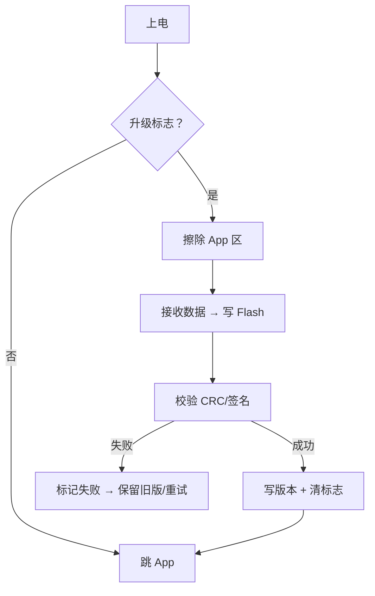

# Bootloader 与 IAP/OTA（Cortex-M）

> **验证状态**
> 本章的**跳转与升级流程**基于 ARM 文档与工程经验，**尚未在真实板卡/探针上实测**；关键数值请以实机行为为准。

> **定位**
> 相邻专题第 8 项正式版。讲清三件事：**怎么分区**、**怎么跳转**、**升级失败怎么不砖**。

## 1. 分区设计

| 区域 | 典型地址 | 作用 |
|---|---|---|
| Bootloader | `0x08000000` | 上电先跑，决定跳 App 还是进升级 |
| App | `0x08008000` | 业务固件，向量表在区首 |
| 参数区 | 末页 | 升级标志、版本、CRC、回滚计数 |
| 备份区（可选） | 第二块 | A/B 双区或旧固件备份 |

> 分区边界必须与 **scatter 文件**一致（构建文档 8.3）；App 的链接起始地址就是它的运行地址。

## 2. 跳转：四步不能少

```c
typedef void (*app_entry_t)(void);

void jump_to_app(uint32_t app_addr)
{
    uint32_t sp = *(volatile uint32_t *)app_addr;
    uint32_t pc = *(volatile uint32_t *)(app_addr + 4);

    /* 1) 简单合法性校验：SP 应落在 RAM 范围 */
    if ((sp & 0x2FFE0000) != 0x20000000) return;

    /* 2) 关中断、清 pending、停 SysTick */
    __disable_irq();
    SysTick->CTRL = 0;
    for (int i = 0; i < 8; i++) NVIC->ICER[i] = 0xFFFFFFFF;
    for (int i = 0; i < 8; i++) NVIC->ICPR[i] = 0xFFFFFFFF;

    /* 3) 设向量表与 MSP */
    SCB->VTOR = app_addr;
    __set_MSP(sp);

    /* 4) 跳复位入口 */
    ((app_entry_t)pc)();
}
```

四个要点：

1. **关中断**：跳转瞬间中断向量还指向 Boot，必须全关；
2. **设 MSP**：App 的栈顶在向量表首项，必须装载；
3. **设 VTOR**：否则 App 的中断仍进 Boot 的向量表；
4. **关外设**：跳转前把 Boot 用过的外设（UART/定时器/DMA）恢复到复位态，避免 App 初始化冲突。

> App 侧通常在 `SystemInit()` 里再设一次 `SCB->VTOR = APP_BASE`，双保险。

## 3. App 的链接与启动

- App 工程 **IROM 起始 = App 分区地址**（如 `0x08008000`），大小 = 分区大小；
- 向量表必须放在 App 区首（scatter `RESET, +First`）；
- 中断向量表用绝对地址重定位（`VTOR`），不需要拷贝到 RAM；
- 若 Boot 与 App 共用同一份启动文件，注意 `VECT_TAB_OFFSET` 宏。

## 4. IAP 升级流程



### 4.1 Flash 写入的硬约束

| 约束 | 说明 |
|---|---|
| 按页/扇区擦除 | 不能字节级覆写，必须先擦后写 |
| 擦写期间不能从同一块取指 | 代码在 Flash 上跑，擦写同一块会取指失败；F4 双 bank 可切到另一 bank |
| 关中断/停 DMA | 擦写时序敏感，中断可能拉长操作 |
| 喂狗 | 大页擦除可能几百 ms，看门狗要喂或先关 |
| 掉电保护 | 升级标志在最后写；中途掉电下次重试 |

### 4.2 校验

- 简单：CRC32（覆盖 App 区）；
- 安全：SHA-256 + 签名（ECDSA/RSA），公钥放 OTP/安全区；
- 防回滚：版本号单调递增，旧版本拒绝。

## 5. 双区（A/B）与 OTA

| 方案 | 优点 | 缺点 |
|---|---|---|
| 单区 + 备份 | 省 Flash | 升级中掉电可能两边都不完整 |
| A/B 双区 | 可回滚、掉电安全 | 占双倍 Flash |
| 外部 Flash | 容量大 | 需搬运/映射 |

OTA 状态机建议持久化：`IDLE → DOWNLOADING → VERIFIED → SWAPPING → BOOT_OK`，每个状态都带 CRC，掉电后从最后一致状态恢复。

## 6. 常见问题

| 现象 | 根因 | 处理 |
|---|---|---|
| 跳转后卡死 | 未设 MSP / 未关中断 | 按四步检查 |
| App 中断不进 | VTOR 未设或向量表不在区首 | 设 VTOR、检查 scatter |
| 跳转后 HardFault | 时钟/外设未复位、栈非法 | 跳前恢复外设、校验 SP |
| 升级后变砖 | 标志写太早、无回滚 | 最后写标志、A/B 区 |
| 擦写时死机 | 在同块取指 / 看门狗 | 搬 RAM 执行、喂狗 |
| App 运行但重启回 Boot | 向量表/复位源判断错 | 检查 VTOR 与复位标志 |

## 7. 与构建文档的关系

- 分区与 scatter（8.3、8.8）；
- hex/bin 的加载地址（9.2–9.3）；
- 启动流程与 VTOR（10.2–10.3）；
- 重定位与固定地址（12、6.7）。

## 8. 速查

```
Boot: 0x08000000  App: 0x08008000（示例）
向量表: [0]=SP, [4]=Reset_Handler
跳转: 关中断 → VTOR=APP → MSP=SP → 跳 PC
升级标志: 最后写、带 CRC、可回滚
```
