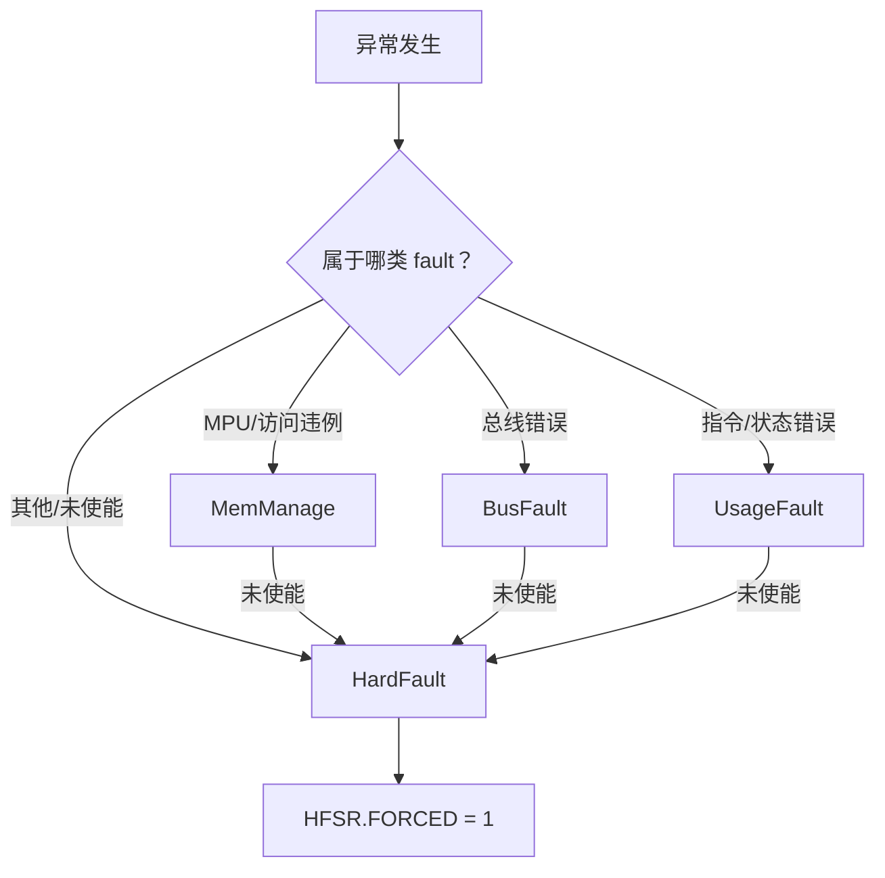
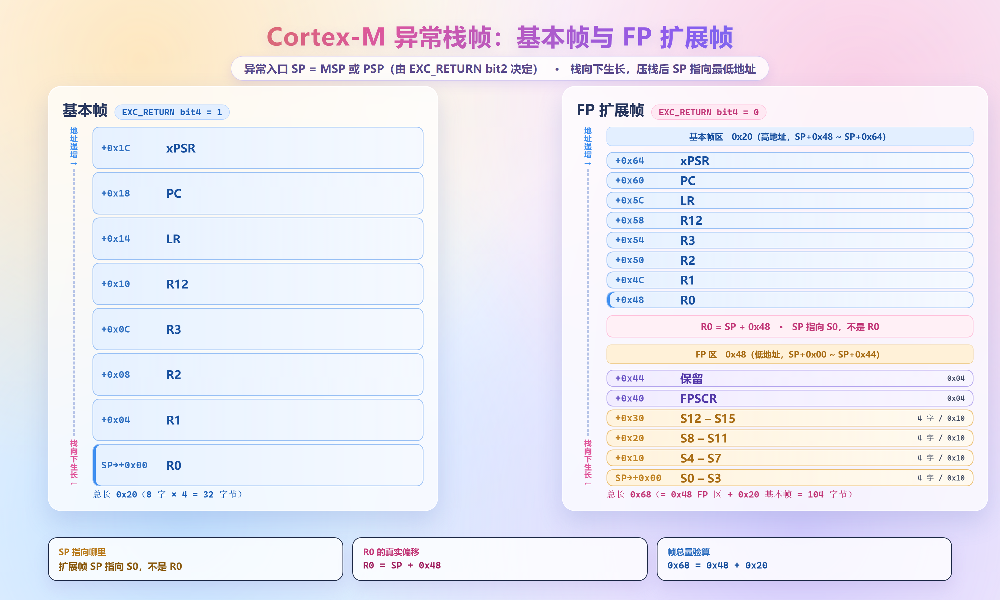
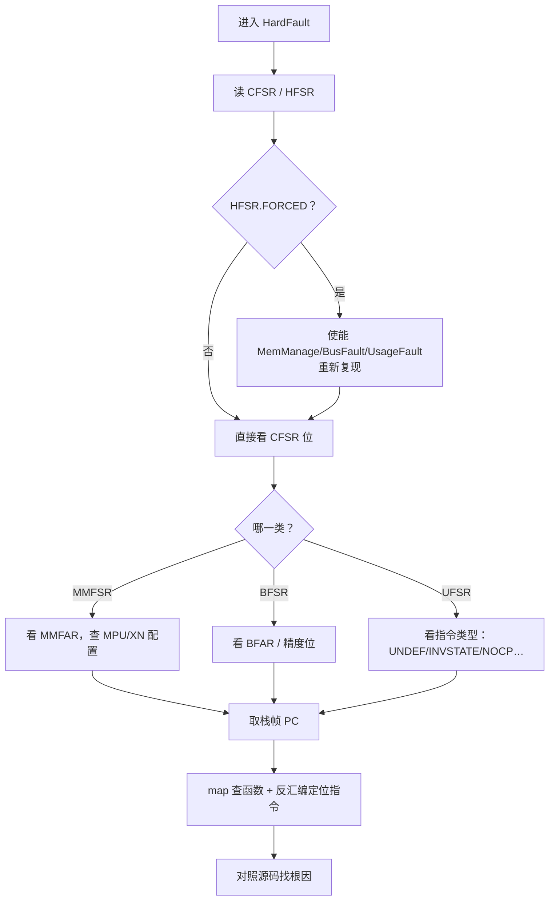

# HardFault 定位与故障分析（Cortex-M）

> **验证状态**
> 本章的**栈帧布局与故障位域**基于 ARM 文档与工程经验，**尚未在真实板卡/探针上实测**；关键数值请以实机行为为准。

> **定位**
> 本文是相邻专题第 7 项「HardFault 定位」的正式版。目标不是罗列寄存器，而是给出一套**可复现的定位流程**：从 `CFSR` 判断故障类型 → 取栈帧 → 用 `.map`/反汇编落到源码行 → 归类根因。

## 1. HardFault 是“兜底”

Cortex-M 有四类 fault：**MemManage、BusFault、UsageFault、HardFault**。前三个默认**未使能**，发生时全部升级为 HardFault，并在 `HFSR.FORCED` 置位。



**调试期建议使能三个子 fault**（写 `SCB->SHCSR`），这样能直接停在更精确的异常里：

```c
SCB->SHCSR |= SCB_SHCSR_MEMFAULTENA_Msk
            | SCB_SHCSR_BUSFAULTENA_Msk
            | SCB_SHCSR_USGFAULTENA_Msk;
```

## 2. 故障状态寄存器

| 寄存器 | 地址 | 作用 |
|---|---|---|
| `CFSR` | `0xE000ED28` | 可配置故障状态（MMFSR + BFSR + UFSR） |
| `HFSR` | `0xE000ED2C` | 硬故障状态 |
| `MMFAR` | `0xE000ED34` | MemManage 出错地址 |
| `BFAR` | `0xE000ED38` | BusFault 出错地址 |
| `DFSR` | `0xE000ED30` | 调试故障状态（一般不看） |

### 2.1 CFSR 位域

| 区段 | 位 | 名称 | 含义 |
|---|---|---|---|
| MMFSR | 0 | IACCVIOL | 取指访问违例（MPU/XN） |
| | 1 | DACCVIOL | 数据访问违例 |
| | 3 | MUNSTKERR | 异常返回出栈失败 |
| | 4 | MSTKERR | 异常入栈失败 |
| | 5 | MLSPERR | 惰性 FP 保存失败 |
| | 7 | MMARVALID | MMFAR 有效 |
| BFSR | 8 | IBUSERR | 取指总线错误 |
| | 9 | PRECISERR | 精确总线错误（地址已知） |
| | 10 | IMPRECISERR | 不精确总线错误（地址未知） |
| | 11 | UNSTKERR | 返回出栈总线错误 |
| | 12 | STKERR | 入栈总线错误 |
| | 13 | LSPERR | 惰性 FP 保存总线错误 |
| | 15 | BFARVALID | BFAR 有效 |
| UFSR | 16 | UNDEFINSTR | 未定义指令 |
| | 17 | INVSTATE | 非法状态（Thumb 位错） |
| | 18 | INVPC | 非法 PC（EXC_RETURN 错） |
| | 19 | NOCP | 协处理器未使能（FPU 未开） |
| | 20 | STKOF | 栈溢出（M8-M 才有独立位） |
| | 24 | UNALIGNED | 非对齐访问 |
| | 25 | DIVBYZERO | 除零（需 `CCR.DIV_0_TRP`） |

> `CFSR` 是**写 1 清零**；`HFSR` 同样。读之前先看清哪一位为 1，再对照上表。

### 2.2 HFSR 关键位

| 位 | 名称 | 含义 |
|---|---|---|
| 1 | VECTTBL | 向量表读取失败（向量表地址/内容错） |
| 30 | FORCED | 由其他 fault 升级而来 |
| 31 | DEBUGEVT | 调试事件触发 |

`FORCED=1` 说明“本来是别的 fault，但没使能”，应回头使能子 fault 再看 `CFSR`。

## 3. 取栈帧：MSP、PSP 与 FP 帧

### 3.1 判断用哪个栈

异常入口的 `LR` 是 `EXC_RETURN`：

| 值 | 含义 |
|---|---|
| `0xFFFFFFF1` | 返回 Handler 模式，使用 MSP |
| `0xFFFFFFF9` | 返回 Thread 模式，使用 MSP |
| `0xFFFFFFFD` | 返回 Thread 模式，使用 PSP |

判据：**bit2 = 1 → PSP，bit2 = 0 → MSP**。

### 3.2 栈帧布局

| 偏移 | 内容 |
|---|---|
| `+0x00` | R0 |
| `+0x04` | R1 |
| `+0x08` | R2 |
| `+0x0C` | R3 |
| `+0x10` | R12 |
| `+0x14` | LR（返回地址） |
| `+0x18` | PC（出错指令） |
| `+0x1C` | xPSR |

### 3.3 带 FP 的扩展帧（关键坑）

若 `EXC_RETURN` 的 **bit4 = 0**，硬件压入的是 **0x68 字节**扩展帧：

```
低地址
┌──────────────┐  ← SP（异常入口）
│ S0 – S15     │  0x40
│ FPSCR        │  0x04
│ 保留          │  0x04
├──────────────┤  ← SP + 0x48
│ R0 – R3      │  0x10
│ R12 / LR     │  0x08
│ PC / xPSR    │  0x08
└──────────────┘  ← SP + 0x68
高地址
```

**SP 指向 S0，不是 R0**。直接把 SP 当 R0 打印，会把 S0 当第一个参数、整体错位 0x48 —— 这是自制 HardFault handler 最常见的 bug。



*图：基本帧（bit4=1，0x20）与 FP 扩展帧（bit4=0，0x68）；扩展帧 SP 指向 S0，R0 在 SP+0x48。*

> 只有 `bit4=1`（无 FP 帧）时，SP 才直接指向 R0。

## 4. 可粘贴的 Handler

### 4.1 汇编入口（AC6 / GCC）

```c
__attribute__((naked)) void HardFault_Handler(void)
{
    __asm volatile (
        "tst   lr, #4            \n"
        "ite   eq                \n"
        "mrseq r0, msp           \n"
        "mrsne r0, psp           \n"
        "mov   r1, lr            \n"
        "b     HardFault_Handler_C \n"
    );
}
```

### 4.2 AC5 写法

```c
__asm void HardFault_Handler(void)
{
    TST   lr, #4
    ITE   EQ
    MRSEQ r0, MSP
    MRSNE r0, PSP
    MOV   r1, lr
    B     HardFault_Handler_C
}
```

### 4.3 C 处理函数

```c
#include <stdint.h>

typedef struct {
    uint32_t r0, r1, r2, r3, r12, lr, pc, psr;
} frame_t;

void HardFault_Handler_C(uint32_t *sp, uint32_t exc_return)
{
    /* FP 帧：SP 指向 S0，R0 在 +0x48 */
    uint32_t *frame = ((exc_return & 0x10u) == 0) ? (sp + (0x48u / 4u)) : sp;
    frame_t *f = (frame_t *)frame;

    volatile uint32_t cfsr  = SCB->CFSR;
    volatile uint32_t hfsr  = SCB->HFSR;
    volatile uint32_t mmfar = SCB->MMFAR;
    volatile uint32_t bfar  = SCB->BFAR;

    /* 不要用 printf：可能阻塞/重入；用简单寄存器打印或写 noinit RAM */
    log_u32("CFSR ", cfsr);
    log_u32("HFSR ", hfsr);
    log_u32("PC   ", f->pc);
    log_u32("LR   ", f->lr);
    log_u32("PSR  ", f->psr);

    if (cfsr & (1u << 7))  log_u32("MMFAR", mmfar);
    if (cfsr & (1u << 15)) log_u32("BFAR ", bfar);

    SCB->CFSR = cfsr;      /* 写 1 清零 */
    SCB->HFSR = hfsr;

    for (;;) { }           /* 或复位 */
}
```

> 生产环境建议：把 `frame`/`cfsr` 存到 **noinit 段**（复位不清零），复位后上报；避免在 fault 里做复杂 IO。

## 5. 定位流程



## 6. 十类典型案例

| # | 现象 | 关键位 | 根因 | 处理 |
|---|---|---|---|---|
| 1 | 写空指针 | DACCVIOL + MMARVALID，MMFAR=0 | 未判空 | 加判空；MPU 保护 0 地址 |
| 2 | 野指针写 | PRECISERR + BFARVALID | 指针越界/已释放 | 查 BFAR 地址归属 |
| 3 | 函数指针错 | INVSTATE（bit0=0）或 IBUSERR | 跳到非 Thumb 地址/空指针 | 校验函数指针 |
| 4 | 栈溢出 | STKERR / IMPRECISERR，SP 越界 | 局部数组过大/递归 | 增大栈；8.9 静态分析 + 水位 |
| 5 | FPU 未使能 | NOCP | 用了浮点但 `CPACR` 未开 | 启动时置 CP10/CP11 |
| 6 | 除零 | DIVBYZERO | 未判分母 | 判零；或开 `CCR.DIV_0_TRP` 便于发现 |
| 7 | 非对齐访问 | UNALIGNED | 强转指针/`packed` 结构体；M0 直接 fault，M3/M4 需开 `CCR.UNALIGN_TRP` 才触发 | 用 `memcpy` 或对齐访问 |
| 8 | 跳到 RAM 空区 | IBUSERR | 未初始化函数指针 | 初始化/断言 |
| 9 | 向量表错 | VECTTBL | VTOR 未设/向量表被覆盖 | 检查 scatter 与 VTOR |
| 10 | 异常返回崩溃 | INVPC | 手工改 LR/EXC_RETURN | 不要伪造 EXC_RETURN |

> 非对齐访问在 Cortex-M0/M0+ 上**必然** fault；M3/M4/M7 默认允许（硬件拆分访问），只有置位 `CCR.UNALIGN_TRP` 才会进 fault，便于调试期发现。
>
> 即便在 M3/M4/M7 上，默认允许的也只是**普通单寄存器 LDR/STR**；`LDM/STM` 多寄存器、`LDREX/STREX` 独占访问、以及 SP 相关指令遇到非对齐地址仍会产生 fault（与 `UNALIGN_TRP` 无关）。

### 6.1 `IMPRECISERR`（不精确总线错误）怎么查

写缓冲导致错误地址无法回填，`BFAR` 无效：

1. 临时关闭写缓冲（`SCB->ACTLR` 或 MPU 配置），让错误变精确；
2. 或二分注释代码，缩小触发范围；
3. 检查外设时钟是否使能（访问未开时钟的外设常表现为总线错误）。

## 7. Keil 实操

| 面板 | 用途 |
|---|---|
| Registers → Banked | 看 MSP/PSP、LR（EXC_RETURN） |
| Peripherals → Core Peripherals → SCB | 直接看 CFSR/HFSR/MMFAR/BFAR |
| Call Stack + Locals | 栈帧未损坏时可回溯调用链 |
| Disassembly | 用 PC 定位出错指令 |
| Memory | 按 BFAR/MMFAR 查看地址内容 |
| Watch | 观察关键变量是否被踩 |

实操顺序：**停住 → 读 CFSR → 读 LR 判断栈 → 读 PC → 反汇编 → 查 map**。

## 8. 防御性设计

| 手段 | 作用 |
|---|---|
| MPU guard 区 | 栈/堆边界外设只读或不可访问，越界立刻 fault 而非静默踩内存 |
| 栈水位（0xCD 填充） | 量化实际栈用量（8.9） |
| 断言 + 参数校验 | 把“野指针”挡在 fault 之前 |
| 函数指针表初始化 | 未注册的回调置为默认空实现 |
| noinit 故障记录 | 复位后仍能读到上次 fault 现场 |
| 看门狗 + 故障复位 | 现场无法恢复时保证系统自愈 |

## 9. 与构建文档的关系

- `.map` 查符号地址（构建文档 8.5）；
- `fromelf --disassemble` 定位指令（9.4）；
- 启动期 fault 与栈/scatter（10.10）；
- 静态栈分析与水位（8.9）；
- 向量表与 VTOR（10.2）。

## 10. 一页纸速查

```
CFSR = 0xE000ED28   HFSR = 0xE000ED2C
MMFAR = 0xE000ED34  BFAR = 0xE000ED38

LR bit2 = 1 → PSP，0 → MSP
LR bit4 = 0 → FP 帧：SP 指向 S0，R0 在 SP+0x48

帧：R0 R1 R2 R3 R12 LR PC xPSR
PC = 出错指令 → map + 反汇编 → 源码行
```
