# Keil 构建全链路详解（AC5 / AC6）：从源码到 .o、.lib、.axf、.hex，再到芯片上电

> **本文定位**
> 本文整理自豆包分享对话《Keil编译流程与armar.exe解析》（16 条消息、约 4.3 万字），并在此基础上做了**结构化、校勘与扩展**：补全了**工具链真实调用链、ELF 文件结构、归档格式、单遍扫描伪代码、Scatter 加载域/执行域、Intel Hex 校验和算例、DWARF 行号表、重定位编码范围、C++ 链接机制与错误排查**，并新增**AAPCS 调用约定、浮点 ABI、内联汇编、C11 原子、intrinsics、静态栈分析、自定义段与绝对定位、半主机重定向、堆管理、Scatter 高级特性**十个进阶专题。
>
> 对话中由豆包生成的**完整流程图**（3200×7040 高清 PNG + 矢量 HTML）已收录进本库，见 1.2 可视化总览。
>
> 全文坚持“**无比喻、纯机制**”，并对原对话中若干不严谨之处做了**明确标注与纠正**（见 0.3 校勘说明）。

> **阅读约定**
> - **[对话原述]**：原对话明确给出的内容，本文忠实保留。
> - **[校勘]**：原对话表述不准确、或不适用于真实 Keil 构建链的地方，本文已纠正。
> - **[工程补充]**：为把机制讲完整而补充的 ARM 工具链通用知识。
> - 具体数值（优化等级、地址、版本号）随芯片、工程配置、编译器版本变化，示例仅用于说明机制。

---

## 0. 导读

### 0.1 按目的跳转

| 你的目的 | 直接看 | 耗时 |
|---|---|---|
| 先看一张完整全景图 | #1.2 可视化总览：豆包生成流程图 | 5 min |
| 搞清 Keil 到底调用了哪些 exe | #3. 工具链真实调用链：AC5 与 AC6 | 10 min |
| 理解 `.d`、增量编译为什么“改了头文件全编” | #2. 阶段 0：增量构建与依赖判定 | 10 min |
| 搞懂 `.o` 里到底有什么 | #6. 汇编与 ELF 目标文件 | 15 min |
| 搞懂 `armar` 与符号表 | #7. 归档：armar.exe 与静态库 | 15 min |
| 搞懂链接器符号解析与库顺序 | #8.1 符号解析与按需提取（含单遍模型） | 15 min |
| 搞懂 Scatter / RO / RW / ZI | #8.3 内存布局：Scatter 加载域与执行域 | 20 min |
| 搞懂 hex / bin 是怎么来的 | #9. 映像转换：fromelf 与 hex/bin | 15 min |
| 搞懂上电后 `__main` 做了什么 | #10. 启动流程：startup.s 与 __main | 15 min |
| 搞懂调试信息与断点 | #11. DWARF 调试信息与源码级调试 | 15 min |
| 查报错 | #16. 错误分类与排查 | 随时 |
| 浮点 ABI / 半主机 / 堆 / 自定义段 | #0.4 高级主题索引（构建主线内的进阶内容） | 5 min |
| 判断结论的确定性 / 适用范围 | #0.5 五条边界与确定性层级 | 5 min |

### 0.2 知识地图

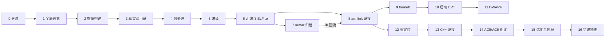

### 0.3 校勘说明：原对话中需要修正的六处

原对话整体机制正确，但有六处表述在**真实 Keil 构建**中需要修正。本文后续正文均已按修正后的说法展开：

| # | 原对话说法 | 校勘后的准确说法 |
|---|---|---|
| 1 | 每个 `.c` 先由 `armcc` 生成 `.s`，再由 `armasm` 汇编成 `.o` | **[校勘]** 真实 Keil 构建中，`.c` 只调用一次 `armcc`/`armclang`，**一次直接产出 `.o`**（编译+汇编在编译器进程内完成）。`.s` 只是可用 `-S` 导出的中间产物；只有工程里**直接提供的 `.s` 文件**才单独调用 `armasm`（AC5）或 `armclang`（AC6 内置汇编器）。 |
| 2 | 预处理是独立的一步，输出 `.i` 文件 | **[校勘]** 预处理由编译器在编译进程内完成，**Keil 默认不落盘 `.i`**；只有显式加 `-E` 才会输出。 |
| 3 | `armar --create --index ...` | **[实测校勘]** `armar` 无 `--index` 选项（`--help` 未列出，实测不识别）；Keil 库工程命令为 `armar --create <lib> <objs...>`，归档自动生成符号表。有效选项见 7.4。 |
| 4 | `.map` 由编译器/`fromelf` 生成 | **[校勘]** `.map` 由 **`armlink`** 生成（`--map`，Keil 默认开启），`fromelf` 不负责 map。 |
| 5 | Intel Hex 示例 `:040000040800F7`、`:10000000...6F` | **[校勘]** 这两个示例的字节数与校验和不自洽。本文给出**逐字节验算过**的正确示例（见 #9.3 Intel Hex 格式与校验和算例）。 |
| 6 | 硬件断点“通常 4~6 个” | **[校勘]** 数量由内核 DWT/FPB 决定：Cortex-M3/M4 常见 6 个指令断点，M0/M0+ 更少，M7 更多；应表述为“**2~8 个，视内核而定**”。 |

> 这些修正不影响原对话的机制主线，但会影响你**照着日志/命令去核对**时的判断，因此单独列出。

### 0.4 高级主题索引（构建主线内的进阶内容）

> 这几个主题仍在“构建”主线之内，但更偏工程实践，分别放在对应章节末尾。

| 主题 | 为什么属于构建 | 位置 |
|---|---|---|
| AAPCS 整数调用约定 | 参数/返回值/栈帧规则，读反汇编与栈回溯的基础 | #14.5 AAPCS 整数调用约定 |
| 浮点 ABI（soft / softfp / hard） | 编译选项 + 链接属性 + 库调用约定，选错就链接失败或运行错乱 | #14.4 浮点 ABI：soft、softfp 与 hard |
| 内联汇编 | AC5/AC6 两套写法与约束，特殊寄存器/屏障必备 | #14.6 内联汇编 |
| C11 原子与内存模型 | 屏障、内存序、LDREX/STREX，volatile 的现代替代 | #14.7 C11 原子、屏障与独占访问 |
| 编译器内置函数 | CMSIS intrinsics 清单与 AC5/AC6 差异 | #14.8 编译器内置函数（intrinsics） |
| 静态栈分析 | 构建期估算最坏栈深，栈溢出第一道防线 | #8.9 静态栈分析 |
| 自定义段与绝对定位 | 段名、地址、对齐由编译属性和链接脚本共同决定 | #6.7 自定义段、绝对定位与端序 |
| Scatter 高级特性 | 固定地址、保留区、压缩、反馈文件 | #8.8 Scatter 高级特性 |
| printf 重定向与半主机 | 库调用、链接符号、运行期 IO 依赖调试器 | #10.11 printf 重定向与半主机 |
| 堆管理 | 堆区来源、初始化、失败处理 | #10.12 堆管理 |

> 构建主线之外的相邻领域（调试硬件、HardFault 定位、Bootloader/IAP、CMSIS/Pack、命令行与 CI）另见笔记：[ARM嵌入式工具链-相邻专题（大纲）](../../../../../../Embedded/NoSystematic/Docs/02-工具链与构建/Keil-ARM构建知识体系/arm嵌入式工具链-相邻专题_大纲/)。

### 0.5 五条边界与确定性层级

> 0.3 回答的是“内容放哪（范围边界）”；本节回答的是“每条结论**有多确定、在什么前提下成立**”。前者决定归属，后者决定可信度与适用范围。
>
> 本节列出五条边界；把「内容范围」作为第 6 条的完整论述见 [Keil-ARM构建知识体系-边界与确定性层级](../../../../../../Embedded/NoSystematic/Docs/02-工具链与构建/Keil-ARM构建知识体系/keil-arm构建知识体系-边界与确定性层级/)。

#### 0.5.1 五条边界一览

| # | 边界 | 回答的问题 | 典型例子 |
|---|---|---|---|
| 1 | **时间**：构建期 vs 运行期 | 这个事实在什么时候被钉死？ | 段大小/绝对地址 vs 堆地址/函数指针目标 |
| 2 | **抽象层次** | 问题卡在哪一层？ | C 语义 → ABI → ELF → ISA → 微架构 → SoC |
| 3 | **可判定性** | 能不能静态确定？ | 直线代码可定；函数指针目标不可定 |
| 4 | **平台/工具链** | 结论在什么前提下成立？ | ARMv7-M vs v8-M；AC5 vs AC6 |
| 5 | **安全/证据** | 边界是强制的还是约定的？结论多可信？ | TrustZone SAU；[校勘] vs [待核实] |

#### 0.5.2 时间边界：谁在何时被钉死

| 事实 | 构建期 | 运行期 |
|---|---|---|
| 段大小、段地址 | ✅ 链接时确定 | 只读使用 |
| 符号绝对地址 | ✅ 重定位回填 | 使用 |
| 内联/优化决策 | ✅ 编译时确定 | — |
| RW 初值 | ✅ 存放在 Flash | ✅ `__scatterload` 拷贝到 RAM |
| ZI 大小 | ✅ 链接时记录 | ✅ 启动时清零 |
| 堆/栈实际用量 | ⚠️ 只能估算（8.9） | ✅ 实际发生 |
| 函数指针的实际目标 | ⚠️ 部分可静态分析 | ✅ 运行时才确定 |
| 中断时序、输入相关分支 | ❌ | ✅ |

跨边界的三个机制：

- **重定位**：构建期算地址、运行期使用（12 章）；
- **scatter 表**：构建期生成、启动时执行（10.5–10.6）；
- **静态栈分析**：构建期预测运行期行为（8.9）。

#### 0.5.3 可判定性：三级确定性

| 层级 | 含义 | 例子 | 工程手段 |
|---|---|---|---|
| **静态可确定** | 编译/链接期可精确计算 | 段大小、符号地址、对象布局 | 看 `.map` / `fromelf` |
| **条件确定** | 依赖版本/配置，需限定前提 | `--callgraph` 的输出内容、Call Graph 菜单位置 | 标注“部分版本/视配置” |
| **原则上不可判定** | 非平凡语义性质不可判定（Rice 定理） | 函数指针目标、递归深度、动态分配大小、输入相关路径 | 禁递归、约束函数指针、运行时水位 |

> 这解释了 8.9 的四类局限：**不是工具不够强，而是不可判定性的必然表现**。静态分析只能“保守近似”（sound but incomplete）或“漏报”（incomplete）；工程上只能用约束条件 + 运行时测量来收敛。

#### 0.5.4 抽象层次：层间是硬契约

```
应用 C/C++ 代码
   ↕ 语言语义
编译器前端 / IR / 后端（第 5 章）
   ↕ AAPCS 调用约定（14.4 / 14.5）
ELF 段 / 符号 / 重定位（第 6 章）
   ↕ 文件格式
armar / armlink / fromelf（第 7–9 章）
   ↕ 工具链调度
机器码 / ISA（ARM/Thumb）
   ↕ 寄存器与指令
微架构（流水线 / FPU / MPU / NVIC）
   ↕ 总线与外设
SoC 与电气（Flash / RAM / 供电）
```

定位问题时先问“**卡在哪一层**”：同一个 HardFault，可能是上层空指针（C 语义），也可能是下层总线错误（SoC）。分层不清，就会把语义错误当硬件故障查。

#### 0.5.5 前提与证据

- **平台前提**：ARMv6-M/7-M/8-M 指令与特性不同；AC5/AC6/GCC/IAR 的 ABI 与对象格式互通有限；器件内存映射与外设各异——迁移时必须重新验证；
- **证据分层**：确定事实 / 限定项（部分版本、视配置）/ 待核实；
- **完成度分层**：定稿（本文）/ 大纲（相邻专题）。

> **阅读任何结论前先问三件事**
> **何时成立**（构建期还是运行期）→ **在何前提下成立**（平台/版本/配置）→ **有多确定**（事实/限定/待核实）。

---

## 1. 全局总览

### 1.1 一张图看懂：五个产物、两个分支

Keil 按下 F7 之后，产物只有五类：

```
源码 .c/.s ──► 可重定位目标 .o ──┬──►（Library 目标）armar ──► .lib（终止）
                                └──►（Executable 目标）armlink ──► .axf ──► fromelf ──► .hex/.bin
                                                                  └──► .map（链接器同步输出）
```

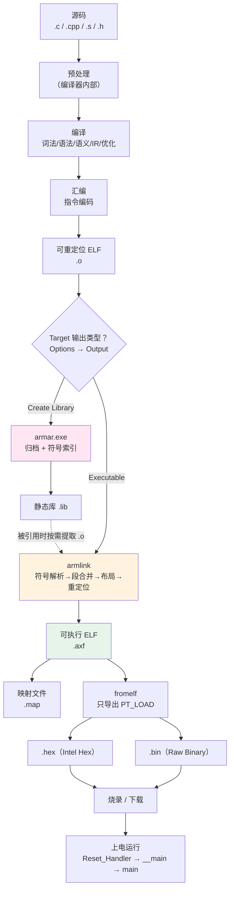

**三个必须记住的边界**：

1. **一个 Target 只能二选一**：Library 或 Executable，不能同时产出 `.lib` 和 `.axf`。
2. **使用 `.lib` ≠ 运行 `armar`**：`armar` 负责**生产**库，`armlink` 只**消费**库；应用工程构建日志里看不到 `armar` 是正常的。
3. **链接没有增量**：只要有一个 `.o` 变化，`armlink` 就会完整重跑符号解析、布局与重定位。

### 1.2 可视化总览：豆包生成流程图

> **说明**
> 下图由豆包根据对话内容生成（浅色“华丽版”），覆盖**构建期主链路 + Target 分支 + 库回流 + 运行期 CRT**，与本文正文一一对应。点击可查看原图（3200×7040）。
>
> - 高清原图：[Keil构建流程图.png](Keil构建流程图.png)（3200×7040）
> - 矢量源文件：[Keil构建流程图.html](Keil构建流程图.html)（浏览器打开，任意缩放不失真，可打印 PDF）


> **图与实测不一致处**
> 总图按早期口径绘制：①符号表写成 `__.SYMDEF`（实测首成员为 `/`，格式不同）；②写“单遍扫描 / 库顺序敏感 / `--scanlib`”（armlink 实测多遍、顺序不敏感）。以 7.3 / 7.6 / 8.1 正文为准，图待重出。

**图中六个分区与本文对应关系**：

| 图中分区 | 内容 | 本文对应 |
|---|---|---|
| 0 增量构建依赖检查 | `.d`、时间戳、判定 | #2. 阶段 0：增量构建与依赖判定 |
| 1 预处理 | 去注释、宏展开、头文件、条件编译 | #4. 预处理 |
| 2 编译 | 词法/语法/语义/IR/后端 | #5. 编译 |
| 3 汇编 | ELF `.o` 内部结构 | #6. 汇编与 ELF 目标文件 |
| 4 归档 / 5 链接 | `armar` 与 `armlink` | #7. 归档：armar.exe 与静态库、#8. 链接：armlink |
| 6 转换 / 运行期 | `fromelf`、CRT 初始化 | #9. 映像转换：fromelf 与 hex/bin、#10. 启动流程：startup.s 与 __main |

> **关于图中的 `armcc --preprocess`**
> 图是原对话的产物，保留原样。实际命令行中更常见的是 `armcc -E`；两者语义一致：**只做预处理、不编译**。真实 Keil 构建不会单独执行这一步（见 0.3 校勘 #2）。
    
### 1.3 构建期 vs 运行期

很多混淆来自把两件事混在一起：

| 阶段 | 发生在哪里 | 主角 | 产物 |
|---|---|---|---|
| **构建期** | 你的 PC | Keil IDE + ARM 工具链 | `.o`、`.lib`、`.axf`、`.map`、`.hex`、`.bin` |
| **运行期** | 芯片 | 启动代码 + C 库 + 你的程序 | 无（内存状态） |

`fromelf` 输出 `.hex/.bin` 之后，**构建就结束了**。上电后执行的是 `Reset_Handler → __main → __scatterload → __zero_init → __rt_entry → main`，这一段与构建期工具链无关，但它的**输入数据**（RW 加载地址、ZI 区间）是 `armlink` 在构建期写进映像的。

---

## 2. 阶段 0：增量构建与依赖判定

### 2.1 Keil 按下 F7 后最先做什么

不是立刻启动编译器，而是 **Build System 任务调度**：

1. 解析 `.uvprojx`（XML 工程描述）：源文件列表、Target 配置、工具链版本、包含路径、宏定义、优化等级、输出类型。
2. 读取每个 `.c` 对应的 `.d` 依赖文件。
3. 对每个编译单元做**时间戳判定**。
4. 生成待执行任务列表：哪些 `.c`/`.s` 需要编译、是否要归档或链接、是否要运行 `fromelf`。

### 2.2 .d 文件是什么

`.d` 是 **Makefile 风格的依赖清单**，由编译器在编译时顺带生成（`--depend` 类选项），内容形如：

```make
Objects\main.o: ..\Src\main.c ..\Inc\main.h ..\Inc\stm32f1xx_hal.h \
                ..\Drivers\CMSIS\Device\ST\STM32F1xx\Include\stm32f103xe.h
```

- 冒号左边是**目标文件**，右边是**它依赖的全部源文件与头文件**（直接包含 + 递归包含）；
- 反斜杠 `\` 是续行符；
- Keil 用它来判断“这个 `.o` 是否过期”。

> **`.d` 记录的是“上次编译时”的依赖**
> 如果你**新增**了一行 `#include "new.h"` 但还没编译，`.d` 里没有这个头文件；只有这次编译完成后 `.d` 才会更新。所以新增头文件后的第一次构建，依赖判定依据的是旧 `.d` —— 这也是“删掉 `.d`/执行 Rebuild 才能彻底干净”的原因之一。

### 2.3 判定规则与流程图

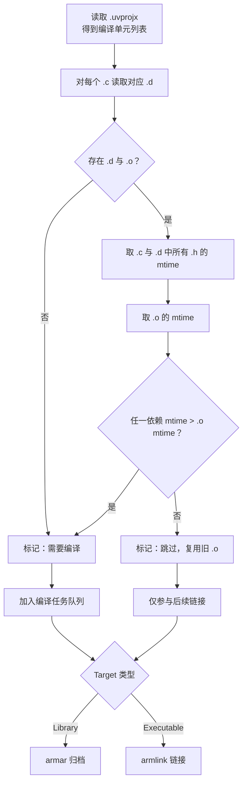

判定规则可以写成一行：

```
need_rebuild(c) = 不存在(c.o) ∨ 不存在(c.d) ∨ max(mtime(c.c), mtime(所有依赖 .h)) > mtime(c.o)
```

### 2.4 为什么“改一个头文件，半个工程重编”

因为 `.d` 是**递归展开**的：`main.c` 包含 `main.h`，`main.h` 包含 `stm32f1xx_hal.h`，而 HAL 头文件又被几十个 `.c` 包含。你改 `main.h`，所有依赖链上出现它的 `.c` 全部超时 —— 这是**正确行为**，不是 Keil 抽风。

优化手段：

| 手段 | 原理 | 代价 |
|---|---|---|
| 减少头文件互相包含 | 用前置声明、PIMPL、只暴露必要类型 | 代码结构调整 |
| 头文件只放声明 | 实现放 `.c` | 需要 discipline |
| 用 `#pragma once`/include guard | 防止重复展开 | 无 |
| 拆库 | 稳定代码打成 `.lib`，不参与重编 | 需要维护库版本 |

### 2.5 增量构建的边界（容易误判的点）

1. **`.s` 文件依赖弱**：汇编文件默认只比较自身时间戳，不追踪它 `INCLUDE` 的头文件（除非你显式配置）。
2. **链接永远全量**：`.o` 变了就重链，`armlink` 没有增量链接。
3. **`fromelf` 每次重跑**：只要 `.axf` 更新，hex/bin 就会重新生成。
4. **Build ≠ Rebuild**：
   - **Build（F7）**：增量，只编译过期单元；
   - **Rebuild（F7 长按菜单/工具栏）**：先 Clean（删 `.o/.d/.axf/.hex/.bin/.map`）再全量；
   - **Batch Build**：多 Target 依次构建。
5. **Clean 清不干净**：有些中间文件（`.crf`、`.lst`、`.lnp`）可能残留；彻底干净需手动删 `Objects/`、`Listings/`。

### 2.6 判定出错时的典型现象

| 现象 | 根因 | 处理 |
|---|---|---|
| 改了 `.h` 但没重编 | `.d` 缺失/未更新；头文件不在依赖链 | 删除对应 `.d`，Rebuild |
| 没改代码却全量重编 | 文件 mtime 被工具改动（如 Git 检出、复制） | 用 `touch` 对齐或 Rebuild 后稳定 |
| 编译成功但运行是旧逻辑 | `.axf` 未重新下载/调试器缓存 | 重新 Download，确认 Build Output 时间戳 |
| 换电脑后全量重编 | mtime 全部更新 | 正常现象 |

---

## 3. 工具链真实调用链：AC5 与 AC6

### 3.1 概念流水线 ≠ 实际进程

教科书常把构建拆成“预处理 → 编译 → 汇编”，这是**逻辑阶段**；真实 Keil 构建是**进程级调用**，阶段被合并进同一个可执行文件内部：

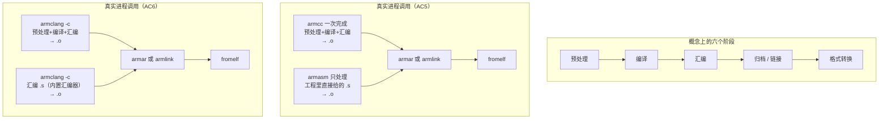

### 3.2 工具链组件对照表

| 环节 | AC5（ARM Compiler 5） | AC6（ARM Compiler 6） | 输入 | 输出 |
|---|---|---|---|---|
| C/C++ 编译 | `armcc.exe` | `armclang.exe` | `.c/.cpp` | `.o` |
| 汇编 | `armasm.exe` | `armclang.exe -c`（内置汇编器） | `.s` | `.o` |
| 归档 | `armar.exe` | `armar.exe`（同一程序） | `.o` 列表 | `.lib` |
| 链接 | `armlink.exe` | `armlink.exe` | `.o` + `.lib` + `.sct` | `.axf` + `.map` |
| 格式转换 | `fromelf.exe` | `fromelf.exe` | `.axf` | `.hex/.bin` |
| 库管理 | `armar` | `armar` | — | — |
| 反汇编/查看 | `fromelf --disassemble` | 同左，或 `fromelf --text -c` | `.axf` | 文本 |

> AC6 中 `armasm` 仅用于兼容旧语法的汇编文件；编译器自带的集成汇编器处理 GNU 语法 `.s`。

### 3.3 真实 Build Output 长什么样

默认输出（简化）：

```
Build started: Project: Demo
*** Using Compiler 'V5.06 update 7 (build 960)', folder: 'C:\Keil_v5\ARM\ARMCC\Bin'
Build target 'Demo'
compiling main.c...
compiling stm32f1xx_hal_gpio.c...
assembling startup_stm32f10x_md.s...
linking...
Program Size: Code=2864 RO-data=336 RW-data=28 ZI-data=1180
".\Objects\Demo.axf" - 0 Error(s), 0 Warning(s).
Build Time Elapsed: 00:00:03
```

勾选 **Options → Build Output → Show Command** 后可看到真实命令行（示例，参数因工程而异）：

```
armcc --c99 --cpu Cortex-M3 -DUSE_HAL_DRIVER -I..\Inc -I..\Drivers\CMSIS\Include
      -c -o Objects\main.o ..\Src\main.c
armasm --cpu Cortex-M3 -g -o Objects\startup_stm32f10x_md.o ..\Startup\startup.s
armlink --cpu Cortex-M3 --scatter Objects\Demo.sct
        -o Objects\Demo.axf --map --list Objects\Demo.map
        Objects\main.o Objects\startup.o ... --library_type=microlib
fromelf --i32combined --output Objects\Demo.hex Objects\Demo.axf
```

> **关键观察**
> - `.c` 只有一条 `armcc` 命令，**没有单独的预处理与汇编命令**；
> - `.s` 才出现 `armasm`；
> - `armar` 只在 Library 目标出现；
> - `fromelf` 每个目标只跑一次（可同时产出 hex 与 bin）。

> 命令行复现与 CI 集成见 [命令行与CI构建（Keil-ARM）](../../../../../../Embedded/NoSystematic/Docs/02-工具链与构建/Keil-ARM构建知识体系/命令行与ci构建_keil-arm/)。

### 3.4 Program Size 四个数字的含义

```
Program Size: Code=2864 RO-data=336 RW-data=28 ZI-data=1180
```

| 项 | 含义 | 归属 | 占 Flash | 占 RAM |
|---|---|---|---|---|
| `Code` | 机器码（`.text`） | RO | 是 | 否（就地执行） |
| `RO-data` | 只读常量、字符串、`const` 表（`.rodata`） | RO | 是 | 否 |
| `RW-data` | 已初始化非 0 全局/静态变量（`.data`） | RW | **是（初值）** | **是（运行副本）** |
| `ZI-data` | 零初始化全局/静态变量（`.bss`） | ZI | **否** | **是** |

由此得到两个常用估算：

```
Flash 占用 ≈ Code + RO-data + RW-data
RAM  占用 ≈ RW-data + ZI-data + Stack + Heap
```

> 这就是为什么“RW-data 既算 Flash 又算 RAM”，而 ZI-data 只算 RAM。

---

## 4. 预处理

### 4.1 预处理到底做了什么

标准 C 的翻译阶段（简化）中，预处理负责：**删除注释 → 处理续行 → 展开宏 → 插入头文件 → 条件编译 → 输出翻译单元**。

| # | 动作 | 细节 | 输出影响 |
|---|---|---|---|
| 1 | 去注释 | `//` 与 `/* */` 替换为**一个空格**；保留行号信息 | 行号不变 |
| 2 | 续行拼接 | 行尾 `\` 与换行合并 | 逻辑行变长 |
| 3 | 宏展开 | 对象宏、函数宏、`#`（字符串化）、`##`（拼接）、`__VA_ARGS__`、递归展开 | 文本替换 |
| 4 | 头文件展开 | `#include "x.h"` 按搜索顺序**原地插入全文**，递归处理 | 翻译单元膨胀 |
| 5 | 条件编译 | `#if/#ifdef/#ifndef/#elif/#else/#endif`，未成立分支**整段删除** | 代码量变化 |
| 6 | 其他指令 | `#error`、`#warning`、`#line`、`#pragma`（保留给编译器） | 诊断/配置 |

### 4.2 宏展开的几个硬规则

1. **展开是递归的**，但同一宏不会无限展开（自引用宏只展开一次）。
2. **函数宏先展开实参，再替换宏体**；除非参数前有 `#`（字符串化，不展开）或 `##`（拼接）。
3. **`#define STR(x) #x`**：把实参变成字符串字面量；`STR(1+2)` → `"1+2"`，不会计算。
4. **`##` 拼接**在替换后重新分词：`CAT(a,b)` → `ab`。
5. **可变参数宏**：`#define LOG(fmt, ...) printf(fmt, ##__VA_ARGS__)`（GNU 扩展，AC6 支持）。
6. **预定义宏**：`__FILE__`、`__LINE__`、`__DATE__`、`__TIME__`、`__STDC__`、`__STDC_VERSION__`、`__ARM_ARCH`、`__TARGET_ARCH_THUMB`、`__CC_ARM`（AC5）、`__ARMCC_VERSION`、`__clang__`（AC6）等，常用于条件编译区分编译器。

### 4.3 头文件搜索顺序

```
#include "my.h"     → 当前源文件目录 → -I 指定的目录 → 系统目录
#include <my.h>     → -I 指定的目录 → 系统目录
```

- Keil 中对应 **Options → C/C++ → Include Paths**；
- AC6 还支持 `-I`、`-isystem`、`-include`（强制包含）、`-D`/`-U`（定义/取消宏）。

### 4.4 预处理输出（.i）与调试

- `armcc -E main.c -o main.i`（AC5）或 `armclang -E main.c -o main.i`（AC6）可以导出；
- Keil 默认**不落盘** `.i`，只在内存中传给编译器；
- 排查“宏展开后到底是什么”时，导出 `.i` 是最直接的手段；
- `#line` 指令可改写后续报错的行号/文件名（代码生成器常用）。

> **预处理阶段的典型陷阱**
> - 宏参数带副作用：`#define SQ(x) ((x)*(x))`，`SQ(i++)` 会自增两次；
> - 宏缺少外层括号导致优先级错误；
> - 头文件重复包含 → 用 include guard 或 `#pragma once`；
> - `#include` 循环 → 编译报“头文件嵌套过深”或符号未定义。

---

## 5. 编译

### 5.1 编译器的内部流水线


### 5.2 各阶段在做什么、会报什么错

| 阶段 | 做什么 | 典型错误 |
|---|---|---|
| 词法分析 | 把字符流切成 Token；识别非法字符 | `error: stray '\' in program` |
| 语法分析 | 按 C 文法构建 AST | `expected ';' before '}' token` |
| 语义分析 | 类型检查、声明检查、作用域 | `implicit declaration of function`、`assignment makes pointer from integer` |
| IR 生成 | 与机器无关的中间表示 | （一般不直接报错） |
| 优化 | 常量折叠、DCE、CSE、内联、循环变换 | 优化后行为异常（UB 被放大） |
| 后端 | 指令选择、寄存器分配、调度 | `out of registers`（极端情况） |
| 汇编 | 编码为机器码、生成段/符号/重定位 | 汇编语法错误（`.s` 文件） |

### 5.3 优化等级

| 选项 | 含义 | 体积 | 速度 | 调试友好度 | 适用 |
|---|---|---|---|---|---|
| `-O0` | 不优化 | 最大 | 最慢 | 最好 | 调试期 |
| `-O1` | 基础优化 | 中 | 中 | 较好 | 平衡 |
| `-O2` | 常用优化（内联、循环优化） | 较小 | 快 | 一般 | 发布常用 |
| `-O3` | 激进优化（更多内联/向量化） | 可能变大 | 最快 | 差 | 计算密集 |
| `-Os` | 以体积为优先 | 小 | 中 | 中 | Flash 紧张 |
| `-Oz` | 极致压体积（AC6） | 最小 | 较慢 | 差 | 极限裁剪 |
| `-Omax` | AC6 最高优化等级 | 大 | 最快 | 差 | 性能优先（慎用） |

> **嵌入式常见选择**
> 调试用 `-O0` 或 `-Og`（AC6 支持）；发布用 `-Os` 或 `-O2`。**切换优化等级后必须重新验证时序与 volatile 行为**。

### 5.4 优化带来的“灵异现象”

| 现象 | 原因 | 对策 |
|---|---|---|
| 变量在 Watch 窗口显示 `<optimized out>` | 变量被放进寄存器或被消除 | `volatile`、`-O0` 调试 |
| 断点跳来跳去 | 指令重排、内联 | 关闭内联（`__attribute__((noinline))`） |
| 空循环被删掉 | 死代码消除 | 循环体内加 `volatile` 访问或 `__NOP()` |
| 延时函数变短 | 常量折叠+内联 | 用硬件定时器，别用空循环 |
| 多线程/中断共享变量异常 | 缺 `volatile`、缺内存屏障 | `volatile` + `__DMB()` |

### 5.5 AC5 与 AC6 的前端差异

| 维度 | AC5（armcc） | AC6（armclang） |
|---|---|---|
| 前端 | 基于 EDG 的私有前端 | Clang/LLVM |
| 语言标准 | C90/C99（部分 C11） | C99/C11/C17，C++11/14/17 |
| 扩展语法 | `__inline`、`__asm`、`__weak` | GNU `__attribute__`、`asm`、`__attribute__((weak))` |
| 优化能力 | 成熟稳定 | 通常更优，尤其 `-O3/-Oz` |
| 内联汇编 | `__asm { ... }`（ARM 语法） | `asm volatile("...")`（GNU 语法） |
| 兼容性 | 老工程多 | 新工程推荐 |

> **迁移提醒**
> AC5 → AC6 不是“换个编译器”那么简单：汇编语法、内联汇编、`__packed`、`#pragma`、启动文件都需要适配。Keil 提供 `--c99`、`--gnu` 等兼容开关，但不能 100% 兼容。

---

## 6. 汇编与 ELF 目标文件

### 6.1 汇编阶段做什么

| 动作 | 说明 |
|---|---|
| 扫描 | 识别助记符（`MOV/LDR/BL`）、伪指令（`AREA/EQU/SPACE/ALIGN/DCD`）、标签、表达式 |
| 常量求值 | 计算汇编期可确定的表达式（`EQU`、`ALIGN`、地址差） |
| 编码 | 把指令翻译成 ARM/Thumb 机器码（如 `MOV R0,#1` → `0xE3A00001`；Thumb 下为 16/32 位混合编码） |
| 分段 | 按代码/数据/只读/零初始化把内容放进不同 section |
| 建表 | 生成符号表与重定位表 |
| 输出 | ELF 可重定位目标文件 `.o` |

> 每个 `.c` 独立生成一个 `.o`，编译单元之间**互不知道对方符号的地址**；`.o` 里所有地址都是**段内偏移**，这是“可重定位（relocatable）”的含义。

### 6.2 ELF 文件结构

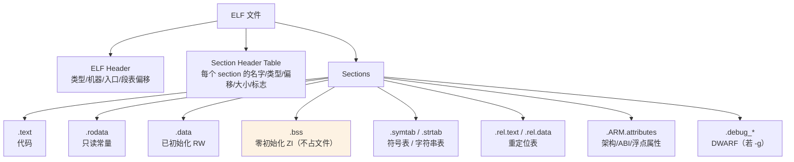

> `.o` 没有 Program Header（或为空），因为**还不能装载运行**；只有链接后的 `.axf` 才有完整的 Program Header。

### 6.3 段（Section）分类表

| 段名 | 属性 | 内容 | 占文件 | 运行时 |
|---|---|---|---|---|
| `.text` | RO，可执行 | 机器码 | 是 | Flash 就地执行 |
| `.rodata` | RO | 常量、字符串、`const` 表、vtable | 是 | Flash 就地读 |
| `.data` | RW | 已初始化非 0 全局/静态变量 | 是（初值） | 启动时拷到 RAM |
| `.bss` | ZI | 未初始化/初始化为 0 的全局/静态变量 | **否**（仅记录大小） | 启动时清零 |
| `.ARM.attributes` | 元数据 | 架构版本、ABI、浮点 ABI、`Tag_CPU_arch` | 是 | 不加载 |
| `.comment` | 元数据 | 编译器版本字符串 | 是 | 不加载 |
| `.symtab/.strtab` | 元数据 | 符号表/字符串表 | 是 | 不加载 |
| `.rel.text/.rel.data` | 元数据 | 重定位项 | 是 | 不加载 |
| `.debug_*` | 元数据 | DWARF 调试信息 | 是（`-g` 时） | 不加载 |

### 6.4 符号表：链接器眼中的“世界”

符号表条目核心字段：

| 字段 | 含义 |
|---|---|
| `st_name` | 符号名（`.strtab` 中的偏移） |
| `st_value` | 段内偏移（`.o` 中）；链接后为绝对地址 |
| `st_size` | 符号大小 |
| `st_info` | 绑定（LOCAL/GLOBAL/WEAK）+ 类型（FUNC/OBJECT/NOTYPE） |
| `st_shndx` | 所属段索引；`SHN_UNDEF` 表示未定义（需要外部提供） |

三种绑定：

- **LOCAL**：`static` 函数/变量，仅本 `.o` 可见，**不进入归档索引**；
- **GLOBAL**：普通全局符号，导出且可被引用；
- **WEAK**：弱符号，重复时“任选其一不报错”（C++ 模板/内联/vtable 常用）。

### 6.5 重定位表：为什么 .o 不能直接运行

`.o` 里的 `BL func` 还不知道 `func` 在哪，汇编器先填一个占位值，并在 `.rel.text` 里登记一条：

| 字段 | 含义 |
|---|---|
| `r_offset` | 待修正位置在段内的偏移 |
| `r_info` | 低 8 位 = 重定位类型；高 24 位 = 符号表索引 |
| `r_addend` | 加数（RELA 格式；ARM 用 RELA） |

链接器算出 `func` 的最终地址后，按类型规则回填 —— 这就是**重定位**（详见 第 12 章）。

### 6.6 常见疑问

| 疑问 | 答案 |
|---|---|
| `.o` 能直接烧录吗？ | 不能。地址未定、外部符号未解析、无程序头 |
| 为什么 `.o` 里 `.text` 从 0 开始？ | 可重定位文件以段为基准，链接时才分配绝对地址 |
| `.bss` 为什么不在文件里？ | 零初始化数据不需要存储初值，只需记录“有多大、放哪” |
| 两个 `.o` 有同名 `static` 函数会冲突吗？ | 不会，LOCAL 符号互不可见 |
| `.o` 里能看到 `printf` 的实现吗？ | 不能，只有 `SHN_UNDEF` 的引用，等链接时从库里取 |

### 6.7 自定义段、绝对定位与端序

#### 6.7.1 为什么需要自定义段

| 需求 | 典型做法 |
|---|---|
| 函数放 RAM 执行（提速/擦写 Flash 时运行） | 自定义段 + scatter 放到 RAM |
| 常量放指定 Flash 区（与 Bootloader 共享、单独升级） | 自定义段 + 固定地址执行域 |
| DMA 缓冲区按 cache line 对齐 | `aligned(32)` + 自定义段 |
| 与 Bootloader 交换参数 | 固定地址的共享区 |

#### 6.7.2 三种手段

| 手段 | 适用 | 示例 |
|---|---|---|
| 段属性 | AC5/AC6 通用 | `__attribute__((section(".ramfunc")))` |
| 编译指示 | 主要 AC5 | `#pragma arm section code=".ramfunc"` |
| 绝对定位 | AC5：`at()` 属性；AC6：`.ARM.__at_` 段名（`at` 属性被忽略） | `int buf[64] __attribute__((at(0x20000000)));` |

```c
/* 1) 段属性：把函数放进 .ramfunc */
__attribute__((section(".ramfunc")))
void flash_erase_fast(void) { /* ... */ }

/* 2) 对齐：DMA 缓冲 */
__attribute__((aligned(32))) uint8_t dma_buf[512];

/* 3) 绝对定位（实测：AC5 的 __at 关键字写法编译失败，要用 at 属性） */
#if defined(__CC_ARM)
uint8_t shared_flag __attribute__((at(0x20000000)));        /* 落在 0x20000000 */
#elif defined(__ARMCC_VERSION) && (__ARMCC_VERSION >= 6000000)
uint8_t shared_flag __attribute__((section(".ARM.__at_0x20000000")));
#endif
```

AC5 的 pragma 写法：

```c
#pragma arm section code = ".ramfunc"
void f(void) { /* 本段代码进入 .ramfunc */ }
#pragma arm section code          /* 恢复默认 */
```

#### 6.7.3 scatter 配合

```scatter
LR_IROM1 0x08000000 0x00010000 {
  ER_IROM1 0x08000000 {
    *.o (RESET, +First)
    *(InRoot$$Sections)
    .ANY (+RO)
  }
  ER_RAMFUNC 0x20000000 0x00002000 {   ; RAM 执行区
    *(.ramfunc)
  }
  RW_IRAM1 0x20002000 {
    .ANY (+RW +ZI)
  }
}
```

要点：

- 自定义段**必须被 scatter 显式引用**，否则可能被 `.ANY` 收走或被 `--remove` 丢弃；
- 仅被汇编/链接引用、C 代码没调用的段，需要 `--keep` 或 `__attribute__((used))`；
- 放到 RAM 的代码必须在 scatter 里形成“加载在 Flash、运行在 RAM”的拷贝关系（由加载域/执行域决定）；若没有拷贝，RAM 里就是未初始化内容，运行必崩；
- 绝对地址必须落在**真实存在的物理内存**内，否则运行期访问出错。

#### 6.7.4 端序、位域与打包

| 主题 | 结论 |
|---|---|
| 端序 | Cortex-M 以**小端**为主；少数内核支持 BE8 大端 |
| 位域布局 | ARM ABI 有规定（同 ABI 编译器一般一致），但**跨架构/跨端序不可移植**；寄存器映射仍建议用移位或位带 |
| `#pragma pack` / `__attribute__((packed))` | 改变结构体布局，可能产生非对齐访问 |
| 非对齐访问 | Cortex-M0 不支持，M3/M4 可配置触发 fault（`CCR.UNALIGN_TRP`） |

> 通信协议、Flash 存储结构建议用显式字节序转换（`__REV`/`__REV16` 或手写移位），不要依赖结构体直接映射。

#### 6.7.5 验证

1. 编译后看 `.map` 的 `Memory Map of the image`，确认自定义段落在预期地址；
2. `fromelf --text -z firmware.axf` 看代码/数据大小，`--text -s` 看符号地址；
3. 运行期打印函数地址（`(uint32_t)&flash_erase_fast`）核对。

---

## 7. 归档：armar.exe 与静态库

### 7.1 定位与职责边界

> **armar 是归档工具，不是编译器，也不是链接器。**

它**不做**：编译、符号解析、地址分配、重定位、段合并、符号冲突检查。
它**只做**：把一批 `.o` 原样装进归档容器，并建立一张**全局符号索引表**。


### 7.2 什么时候会跑 armar

| 场景 | 是否调用 armar | 说明 |
|---|---|---|
| Target = **Create Library** | ✅ | 标准用法，构建止于 `.lib` |
| Target = **Executable** | ❌ | 直接 `armlink`，`.lib` 只作为输入 |
| 应用工程引用外部 `.lib` | ❌ | 只是“消费”库，不生产库 |
| Options → User → Before/After Build 手动调用 | ✅（自定义） | 不属于原生流水线 |

> **最常见误解**
> **“我用了静态库，所以构建里应该有 armar”** —— 错。用库 ≠ 造库。日志里没有 `armar` 完全正常。

### 7.3 归档文件内部结构

```
┌─────────────────────────────────────────────────────┐
│ 归档全局头  "!<arch>\n"（8 字节魔数）                 │
├─────────────────────────────────────────────────────┤
│ 成员头(60B) │ "/"：符号表（第一个成员）             │
├─────────────────────────────────────────────────────┤
│ 成员头(60B) │ 成员数据：a.o 的完整 ELF 字节流       │
├─────────────────────────────────────────────────────┤
│ 成员头(60B) │ 成员数据：b.o 的完整 ELF 字节流       │
└─────────────────────────────────────────────────────┘
```

| 部分 | 内容 | 作用 |
|---|---|---|
| **归档全局头** | 8 字节 `!<arch>\n` 魔数 | 标识这是 ar 归档 |
| **符号表成员** | 名为 `/` 的**第一个成员**：4 字节大端符号数 N + N 个 4 字节大端成员头偏移 + N 个 NUL 结尾的符号名 | 让 `armlink` 查表定位成员，不必顺序扫全部成员 |
| **成员条目** | 每个 `.o` 的成员头 + 原始字节；成员名以 `/` 结尾（如 `a.o/`），奇数长度补 `0x0A` | **原样保存**，内部 ELF 字段不被修改 |

> **实测格式**（ARM Compiler 5.06u7，`armar --create`）：首个成员名为 `/`（GNU 风格命名）；数据区是 **4 字节大端符号数 N** → N 个 **4 字节大端成员头偏移** → 依次排列的 **N 个 NUL 结尾符号名**。两个成员 `a.o`/`b.o` 的实测字节：
> `00 00 00 03 | 00 00 00 6e 00 00 00 6e 00 00 05 66 | "a_func\0shared_sym\0b_func\0"`（110、110、1382 正是两个成员头的偏移）。
>
> 不要把其他 ar 变体的布局套过来：BSD ar 用 `__.SYMDEF`，表项是 `(ran_strx, ran_off)` 且带字符串表长度；GNU ar 也用 `/`，但表项是 8 字节（字符串偏移 + 成员偏移）。**跨工具链不能假设格式相同。**

> **图 D 暂停使用**
> 现有 `armar-归档结构.png` 按 BSD `__.SYMDEF`/ranlib 布局绘制，与实测 ARM armar 格式（`/` + 计数 + 成员偏移 + 名字串）不一致，先撤下；待按实测重出后再嵌入。

索引规则：

- 只收录**本库内 `.o` 定义的全局/弱符号**；
- `static`（LOCAL）不入索引；
- 未定义符号（`SHN_UNDEF`）不入索引；
- 同名符号在多个成员中出现时，索引会记录多个候选（链接时按提取顺序解决）。

### 7.4 常用命令

| 命令 | 作用 |
|---|---|
| `armar --create lib.a a.o b.o c.o` | 新建归档（覆盖同名） |
| `armar -r lib.a b.o` | 插入/替换同名成员 |
| `armar -d lib.a b.o` | 删除成员 |
| `armar -x lib.a b.o` | 提取成员到当前目录 |
| `armar -t lib.a` | 列出成员（table of contents） |
| `armar --zs lib.a` | 显示符号表（符号 → 成员 → 偏移） |
| `armar --zt lib.a` | 汇总归档内容（各成员大小 + 总计） |
| `armar -m` / `-a pos` / `-b pos` | 移动成员 / 插到某成员之后 / 之前 |
| `armar -s lib.a` | 强制重建符号表 |
| `armar -n lib.a` | 不生成符号表 |

> **[实测校勘]** 以上选项来自本机 `armar --help`（ARM Compiler 5.06u7）。文档早前写的 `--list`、`--symbols`、`--extract`、`--delete`、`--replace` **均不被识别**（实测 `armar --list` 报 `L3900U: Unrecognized option`）；列成员用 `-t`、看符号用 `--zs`。`--index` 同样不是有效选项。

粒度限制：**armar 只能按整个 `.o` 取舍，不能拆出单个函数**。库的“按需链接”单位是成员文件，不是符号。

### 7.5 与 armlink 的完整交互

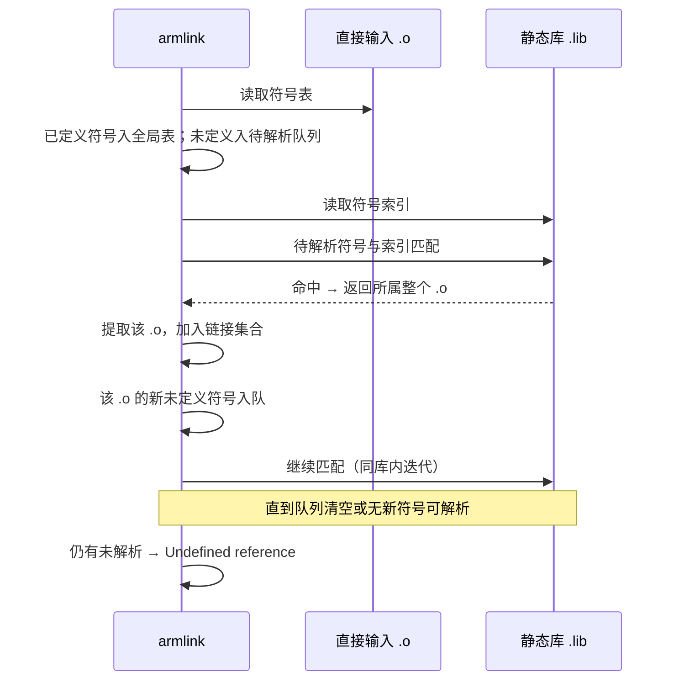

文字版：

1. 先处理所有**直接输入**的 `.o`：已定义符号入库，未定义符号入队；
2. 再按工程中的库顺序，逐个读 `.lib` 的符号表（首成员 `/`）；
3. 命中的符号 → 取出**整个成员 `.o`**，加入链接集合；
4. 新成员带来的未定义符号**追加到队尾**，继续匹配；
5. 队列清空 → 进入段合并；仍有剩余 → 报 `Undefined reference`。

### 7.6 库顺序：GNU ld 敏感，armlink 默认多遍（实测）

> **实测修正**
> 本节早前按“armlink 单遍扫描、库顺序敏感”编写；用本机 armlink 5.06u7 实测后不成立：**armlink 默认会对库重复扫描直到符号不再新增**，库顺序不影响解析。单遍模型属于 GNU ld，不是 armlink 的默认行为。

实测记录（测试工程：`main.o` 引用 `A.lib` 的 `a_func`，`a_func` 引用 `B.lib` 的 `b_func`）：

| 场景 | 库顺序 | 实测结果 |
|---|---|---|
| A 依赖 B | `B.lib` 在前 | ✅ 链接成功（`b_func` 被解析） |
| A 依赖 B | `A.lib` 在前 | ✅ 链接成功 |
| A⇄B 循环依赖 | `CA.lib`、`CB.lib` | ✅ 链接成功 |
| `--scanlib` | 任意 | 选项被接受（help 未列出），本场景无差异 |
| `--no_scanlib` | 任意 | 默认库不再被扫描（报 `__main` 未定义），**不是“单遍开关”** |

机制：armlink 先收集直接输入 `.o` 的未定义符号，扫描库索引并按需提取成员；新成员带来的未定义符号继续解析，并对库重复这一过程直到**不动点**——等价于自动多遍。

那“单遍模型”还有什么用？

- 解释 GNU ld 为什么需要 `-Wl,--start-group` / `-( … -)` 成组链接；
- 一些精简链接器/老工具链确实单遍，库顺序在这些工具上仍会踩坑；
- 理解“按需提取整个 `.o`”这一粒度（这一条对 armlink 同样成立）。

> 结论：**armlink 工程不必为库顺序焦虑**；跨到 GCC/GNU ld 时，仍按“依赖者在前、被依赖者在后”排库，或使用 `--start-group`。

### 7.7 静态库 vs 动态库

| 维度 | 静态库 `.lib` | 动态库 `.so/.dll` |
|---|---|---|
| 链接时机 | 链接期 | 加载期/运行期 |
| 代码归属 | 复制进最终映像 | 独立文件，运行时加载 |
| Cortex-M 支持 | ✅ | ❌（无加载器/MMU） |
| 工具链 | armar + armlink | 需要 OS/动态加载器 |

> Cortex-M 裸机/RTOS 固件**全部是静态链接**：用到的代码最终都进 Flash，没被引用的 `.o` 被丢弃。

### 7.8 兼容性提醒

- AC5 与 AC6 的 `armar` 是**不同构建**（`--vsn` 实测：AC5 为 `4d35f2`、AC6 为 `5f371500`），但产物格式一致：实测 AC6 打的 `.lib` 可被 AC5 `armlink` 正常链接；
- AC6 的 `.o`（LLVM 生成）可以被 `armar` 正常打包、被 `armlink` 正常读取；
- **ARM 归档 ≠ GNU/BSD 归档**：ARM armar 的符号表成员名为 `/`，但数据布局是“4B 计数 + 4B 成员偏移 + 名字串”，与 GNU armap（8B 表项）和 BSD `__.SYMDEF`（ranlib）都不同；ARM `.lib` 不能直接给 GCC `ld`，GNU `.a` 一般也不能直接给 `armlink`（可尝试但不受支持）；
- 跨工具链混链还会遇到 **ABI/属性不兼容**（`Tag_ABI_VFP_args`、浮点 ABI、`build attributes`）报错。

### 7.9 五个常见误区

| # | 误区 | 事实 |
|---|---|---|
| 1 | armar 会合并 `.o` 的段 | 不合并，只是容器；段合并是 armlink 的事 |
| 2 | 库里的函数会全部进固件 | 只提取被引用的**整个 `.o`** |
| 3 | 库能检查符号重复定义 | armar 不检查；重复定义在链接期才报 |
| 4 | 没有索引也能链接 | 实测 armlink 直接报 `L6016U: Symbol table missing/corrupt`；`armar -n` 的产物不可链接，需 `-s` 重建符号表 |
| 5 | 改库里一个函数要重编所有调用方 | 不需要，重链即可（`.h` 接口不变时） |

---

## 8. 链接：armlink

### 8.1 符号解析与按需提取（含单遍模型）

这是理解“按需提取整个 `.o`”的经典模型；单遍扫描同时解释了 GNU ld 的库顺序规则。**armlink 实测默认多遍、库顺序不敏感**（见 7.6），但成员级提取的粒度与下面一致。

#### 8.1.1 数据结构

| 名称 | 作用 |
|---|---|
| `global_defs` | 全局已定义符号表：符号名 → 符号信息（所属成员、地址、大小） |
| `unresolved` | 待解析符号队列（FIFO） |
| `selected_objs` | 已选中、将参与段合并与重定位的 `.o` 集合 |
| `lib_scan_ptr` | 当前扫描到的库下标（**单遍模型：只前进不回头**；armlink 实测会重复扫描） |

固定顺序：**先处理全部直接输入 `.o`，再按 `LIBS[]` 列表顺序扫描库**。

#### 8.1.2 伪代码

```pseudocode
global_defs   = {}
unresolved    = queue()
selected_objs = set()
lib_scan_ptr  = 0

// 阶段 A：直接输入的 .o
for obj in OBJS:
    selected_objs.add(obj)
    for sym in obj.symbols:
        if sym.is_defined:
            if sym.name in global_defs:
                error("Multiple definition of " + sym.name)
            global_defs[sym.name] = sym
        else:
            unresolved.enqueue(sym.name)

// 阶段 B：按顺序扫描库
while unresolved not empty and lib_scan_ptr < len(LIBS):
    lib = LIBS[lib_scan_ptr]
    index = lib.read_symdef()          // 符号表（首个成员 /）
    found_any = false
    next_round = queue()

    while unresolved not empty:
        name = unresolved.dequeue()
        if name in index:
            member = index[name]       // 符号所属的整个 .o
            if member not in selected_objs:
                selected_objs.add(member)
                for s in member.symbols:
                    if s.is_defined:
                        if s.name in global_defs:
                            error("Multiple definition of " + s.name)
                        global_defs[s.name] = s
                    else:
                        next_round.enqueue(s.name)   // 新产生的未定义
            found_any = true
        else:
            next_round.enqueue(name)   // 留给后面的库

    unresolved = next_round
    if not found_any:
        lib_scan_ptr += 1              // 当前库再也解不出东西，前进

if unresolved not empty:
    error("Undefined reference to " + unresolved)
```

#### 8.1.3 单遍模型的三个推论（GNU ld 适用）

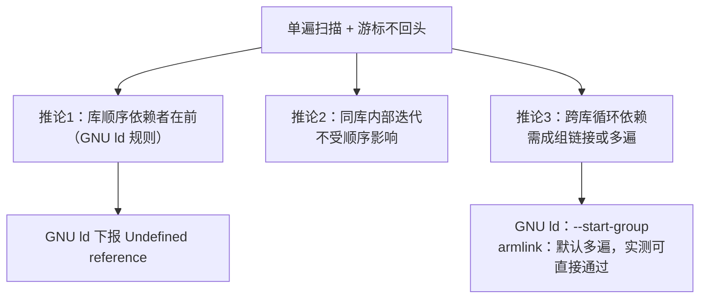

- **推论 1**：GNU ld 单遍扫描时，`A.lib` 调 `B.lib` 必须按 `A, B` 排；**armlink 实测顺序不敏感**（见 7.6）。
- **推论 2**：同一个库内部，提取成员带出的新符号会继续在当前库匹配，两种链接器都成立。
- **推论 3**：循环依赖在 GNU ld 下需要 `-Wl,--start-group … -Wl,--end-group`；armlink 实测可直接链接（默认多遍）。

#### 8.1.4 符号匹配细节

| 场景 | 规则 |
|---|---|
| C 符号 | 源码名直接匹配 |
| C++ 符号 | 匹配**修饰后**的 mangled name（如 `_ZN2ns5Class4funcEi`） |
| `static` 符号 | LOCAL，不进入符号表，不可跨 `.o` 匹配 |
| `extern "C"` | 关闭 C++ 名字修饰，按 C 规则匹配 |
| 弱符号 | 强符号优先；多个弱符号任选其一，不报错 |


*图：单遍扫描模型（GNU ld 的库顺序规则）。armlink 实测默认多遍、库顺序不敏感，见 7.6；“按需提取整个 `.o` 成员”的粒度对两者一致。*

### 8.2 段合并

符号解析完成后，链接器把所有选中 `.o` 的**输入段**按属性归类：

| 输入段 | 属性 | 合并到 |
|---|---|---|
| `.text` | RO，可执行 | 输出 RO 段 |
| `.rodata` | RO | 输出 RO 段 |
| `.data` | RW | 输出 RW 段 |
| `.bss` | ZI | 输出 ZI 段 |
| `.init_array/.fini_array` | RO | C++ 构造/析构表 |
| `.ARM.exidx/.ARM.extab` | RO | 异常索引/表 |

合并规则：

1. 按 `+RO / +RW / +ZI` 选择器归入对应**执行域**；
2. 同一执行域内按 scatter 书写顺序排布；
3. 每个段满足自身对齐要求（4/8 字节），不足处用 0 填充；
4. 合并后计算每个输出段的大小与地址。

### 8.3 内存布局：Scatter 加载域与执行域

#### 8.3.1 两个核心概念

| 概念 | 英文 | 含义 | 例子 |
|---|---|---|---|
| **加载域** | Load Region (LR) | 烧录到 Flash 的**原始存储位置** | `LR_IROM1 0x08000000` |
| **执行域** | Execution Region (ER) | 程序**运行时**段所在的地址 | `RW_IRAM1 0x20000000` |

- RO 段：加载地址 = 运行地址（Flash 就地执行）；
- RW 段：加载在 Flash（初值），运行在 RAM（启动时拷贝）；
- ZI 段：**没有加载数据**，只有运行地址与大小（启动时清零）。

> 地址空间、位带、Flash 等待周期见 [存储与内存映射（Cortex-M）](../../../../../../Embedded/NoSystematic/Docs/02-工具链与构建/Keil-ARM构建知识体系/存储与内存映射_cortex-m/)。

#### 8.3.2 自动生成的 scatter（Keil 默认）

```scatter
LR_IROM1 0x08000000 0x00010000  {          ; 加载域：Flash 起始 0x08000000，大小 64KB
  ER_IROM1 0x08000000 0x00010000  {        ; 执行域：与加载域重合
    *.o (RESET, +First)                    ; 向量表必须放最前
    *(InRoot$$Sections)                    ; __main/__scatterload 等根段
    .ANY (+RO)                             ; 其余 RO 段任意排布
  }
  RW_IRAM1 0x20000000 0x00005000  {        ; RW/ZI 执行域：RAM
    .ANY (+RW +ZI)
  }
}
```

关键语法：

| 语法 | 含义 |
|---|---|
| `*.o (RESET, +First)` | 所有目标文件的 `RESET` 段，放在本域最前面 |
| `*(InRoot$$Sections)` | C 库的根段（`__main`、scatter 加载代码），必须位于根区 |
| `.ANY (+RO)` | 剩余所有 RO 输入段，由链接器自动排布 |
| `+RO/+RW/+ZI` | 按属性筛选 |
| `ALIGN 8` | 指定域/段对齐 |

#### 8.3.3 RW 的“加载地址 ≠ 运行地址”

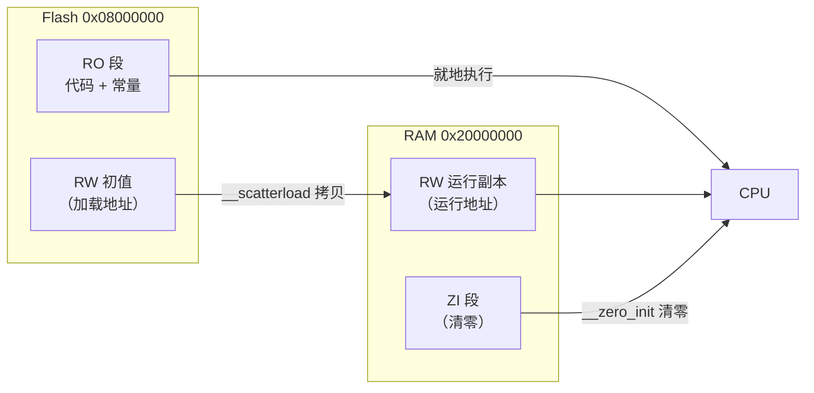


*图：加载域/执行域与 RW/ZI 布局；RW 初值在 Flash（加载地址），运行副本与 ZI 在 RAM；RO 就地执行不拷贝。*

`armlink` 为启动代码生成一组**虚拟符号**（不在任何 `.o` 里，可直接 `extern` 引用）：

| 符号 | 含义 |
|---|---|
| `Image$$ER_IROM1$$Base/Limit` | RO 执行域起止 |
| `Image$$RW_IRAM1$$Base/Limit` | RW 运行域起止 |
| `Load$$RW_IRAM1$$Base` | RW 加载地址（Flash 初值）起始 |
| `Image$$RW_IRAM1$$ZI$$Base/Limit` | ZI 段起止 |
| `Image$$ARM_LIB_STACK$$Base/Limit` | 栈区 |
| `Image$$ARM_LIB_HEAP$$Base/Limit` | 堆区 |

命名规则：`Image$$<域>$$Base` 是执行地址起点、`$$Limit` 是末尾（不含）；加载地址用 `Load$$<域>$$Base`；ZI 段用 `Image$$<域>$$ZI$$Base/Limit`。

#### 8.3.4 溢出与对齐

| 报错 | 含义 | 处理 |
|---|---|---|
| `L6220E: Execution region ... size ... exceeds limit` | 某执行域放不下 | 扩大 Flash/RAM 配置，或裁剪代码 |
| `L6406E: No space in execution regions with .ANY selector` | `.ANY` 找不到空间 | 同上，或调整 scatter |

- RO 溢出 = **Flash 不够**；
- RW + ZI 溢出 = **RAM 不够**；
- 对齐不足会导致 `__align` 相关断言或硬件异常（如 DMA、双字访问）。

### 8.4 重定位与 veneer（概览）

布局完成后，每个符号都有绝对地址，链接器遍历所有 `.o` 的重定位表逐条回填：

- 数据类：`ABS32` → 写 32 位绝对地址；
- Thumb 调用：`THM_CALL` → 编码 24 位半字偏移（±16 MB）；
- 超出范围：自动插入 **veneer 长跳转桩**（`LDR PC,[PC,#-4]` + `DCD target`）。

详见 第 12 章。

### 8.5 读懂 .map 文件

`.map` 由 `armlink --map` 生成，主要章节：

| 章节 | 内容 | 用途 |
|---|---|---|
| `Image component sizes` | 各模块 Code/RO/RW/ZI 汇总 | 找“谁占空间” |
| `Memory Map of the image` | 每个执行域的起止地址、段列表 | 确认布局、查溢出 |
| `Image Symbol Table` | 全局/局部符号地址、大小 | 查函数/变量地址 |
| `Cross References` | 段间引用关系 | 分析耦合 |
| `Removing Unused input sections` | 被 `--remove` 丢弃的段 | 确认裁剪效果 |

> **查 Flash 去哪了**
> 打开 `.map` 的 `Image component sizes`，按 `Code + RO Data` 排序，通常前几名是 HAL 库、`printf`、浮点库、大数组常量。

### 8.6 常用 armlink 选项

| 选项 | 作用 |
|---|---|
| `--scatter file.sct` | 指定分散加载文件 |
| `--map` | 生成 map（Keil 默认） |
| `--info totals,sizes,stack,unused` | 输出汇总信息 |
| `--remove` | 删除未被引用的段（配合 `-ffunction-sections` 更有效） |
| `--keep section` | 强制保留某段（中断向量、初始化表） |
| `--scanlib` | 实测被接受但 help 未列出；armlink 默认已多遍，本场景无差异（GNU ld 用 `--start-group`） |
| `--no_veneers` | 禁止自动生成 veneer（一般不推荐） |
| `--library_type=microlib` | 使用 MicroLib |
| `--entry symbol` | 指定入口（默认 `Reset_Handler` 由向量表决定，`__main` 由库提供） |
| `--strict` | 严格诊断 |
| `--diag_suppress num` | 抑制指定编号警告 |

### 8.7 未使用段的消除

- 编译器选项：AC5 `--split_sections`，AC6 `-ffunction-sections -fdata-sections`；
- 链接器选项：`--remove`；
- 效果：每个函数/变量独立成段，未被引用的段被丢弃；
- 注意：**向量表、初始化表、中断处理函数**可能“看起来没被引用”，需要 `--keep` 或 `__attribute__((used))`。

### 8.8 Scatter 高级特性

#### 8.8.1 固定地址放置

```scatter
LR_IROM1 0x08000000 0x00010000 {
  ER_IROM1 0x08000000 { *.o (RESET, +First) *(InRoot$$Sections) .ANY (+RO) }
  ER_CONFIG 0x0800F000 { config.o (+RO) }     ; 固定到 Flash 末尾
  RW_IRAM1 0x20000000 { .ANY (+RW +ZI) }
}
```

- 显式地址的执行域，段会被**钉死**在该地址；
- 多个域不能重叠，否则链接报区域重叠或溢出错误；
- 固定地址常用于：参数区、Bootloader 共享区、单独升级的配置块。

#### 8.8.2 EMPTY：只保留空间，不放内容

栈/堆常用“空区域”占位：

```scatter
LR_IROM1 0x08000000 0x00010000 {
  ER_IROM1 0x08000000 { *.o (RESET, +First) *(InRoot$$Sections) .ANY (+RO) }
  RW_IRAM1 0x20000000 0x00004000 { .ANY (+RW +ZI) }
  ARM_LIB_HEAP  0x20004000 EMPTY  0x00000400 { }   ; 堆：从 0x20004000 向上 1KB
  ARM_LIB_STACK 0x20005000 EMPTY -0x00000800 { }   ; 栈：从 0x20005000 向下 2KB
}
```

> 执行域必须写在某个加载域内（或由链接器隐式创建加载域）；栈用负长度表示“从基址向下生长”。

- `EMPTY` 区域**不产生加载数据**，只占用地址空间；
- 负长度表示从基址向下增长（栈）；
- 这样链接器就能检测“栈堆与 RW/ZI 重叠”。

#### 8.8.3 `.ANY` 与 `+First/+Last`

| 写法 | 含义 |
|---|---|
| `.ANY (+RO)` | 剩余所有 RO 段，由链接器自动排布 |
| `.ANY (+RW +ZI)` | 剩余 RW 与 ZI |
| `+First` | 放在本域最前（向量表） |
| `+Last` | 放在本域最后 |

#### 8.8.4 RW 加载数据的压缩

`armlink` 默认会对 RW 初始数据做压缩（大量 0 时效果明显）〔未实测〕：

- 好处：减小 `.hex/.bin` 体积；
- 代价：启动时 `__scatterload` 需要解压，启动略慢；
- 关闭：`--no_compress`（体积换启动速度）。

#### 8.8.5 获得布局：map 与 feedback 的边界

- 查看当前布局：`--map` 的 Execution Region 表，或 Keil 生成的 `.map`；
- `armlink --feedback=<file>`：生成**给编译器的反馈文件**（供后续优化使用），**不是** scatter 反推工具（实测 help 原文：`Generate feedback that can be used by the compiler`）；
- armlink 没有“从映像反推 scatter”的选项；要复用布局，复制或手写 `.sct`，或由 Keil Target 对话框导出。

#### 8.8.6 OVERLAY（覆盖）概念

多个代码段分时复用**同一段 RAM 地址**（加载不同功能时覆盖），用于 RAM 极小又要多功能的场景。

- 本质：多个执行域映射到相同地址，由软件保证同一时刻只有一个在使用；
- 具体语法与限制随 armlink 版本变化，使用前查对应版本文档；
- 现代工程更常用“外部 Flash + 按需搬运”，OVERLAY 已较少见。

#### 8.8.7 常见冲突与检查

| 现象 | 原因 | 处理 |
|---|---|---|
| 自定义 scatter 不生效 | 仍勾选 “Use Memory Layout from Target Dialog” | 取消勾选，改用 Use Scatter File |
| 区域重叠 | 两个 ER 地址范围交叉 | 调整地址/大小 |
| 段被丢弃 | `--remove` 删除未引用段 | `--keep` 或加引用 |
| 启动变慢 | RW 压缩解压 | `--no_compress` |

### 8.9 静态栈分析

#### 8.9.1 为什么要做

栈溢出是嵌入式最隐蔽的故障之一：踩到全局变量/堆，表现为“随机 HardFault”。构建期能做的第一件事，就是**静态估算最坏栈深**。

#### 8.9.2 Keil 里怎么拿到

| 方式 | 位置 | 输出 |
|---|---|---|
| 静态调用图〔未实测〕 | Options → Listing/Linker 页勾选 **Static Call Graph**（不同 MDK 版本位置略有差异） | `.htm`，含每个函数的栈用量与最大调用深度 |
| 链接器调用图 | `armlink --callgraph` | 生成 `.htm`，含每函数栈大小与 `Maximum Stack Usage`（实测） |
| 栈使用报告 | **无独立 `--info=stack` 主题**（实测 AC5/AC6 的 `--info` 只支持 common/debug/sizes/totals/veneers/unused） | 栈用量来自 `--callgraph` 或 Keil 的 Static Call Graph |
| map 文件 | 链接输出 | 函数大小、调用关系线索 |

#### 8.9.3 怎么读

- 每个函数给出 **stack usage**（本函数栈帧字节数）；
- 沿调用链累加得到**最大深度**；
- 注意 `Recursion` 标记：递归函数无法静态确定上限；
- 加上**中断嵌套**的栈开销（中断帧 + 处理函数栈）；
- 再加上启动文件预留的 Stack_Size 余量。

#### 8.9.4 局限（根源是不可判定性）

| 情况 | 后果 |
|---|---|
| 函数指针/回调 | 调用关系静态不可见，可能漏算 |
| 递归 | 深度不确定，只能给“单层” |
| 纯汇编函数 | 需手工标注栈用量 |
| 库函数（`printf`、浮点） | 栈用量大且随配置变化 |

> 这些局限**无法靠换更强的工具消除**：函数指针目标、递归深度属于非平凡语义性质，按 Rice 定理原则上不可判定。工具只能保守近似，工程上靠禁递归、约束函数指针、运行时水位测量收敛。详见 #0.5 五条边界与确定性层级。

#### 8.9.5 运行时水位法（互补手段）

1. 启动时把整个栈区填 `0xCD`；
2. 运行一段时间（覆盖所有工况）后扫描：
   - 从栈顶向下，连续 `0xCD` 的长度 = 未被使用的部分；
   - 剩余即峰值使用量；
3. 留 20%–30% 余量。

```c
/* 伪代码：估算栈水位 */
uint32_t *p = &__initial_sp - STACK_WORDS;
while (p < &__initial_sp && *p == 0xCDCDCDCD) p++;
used = (uint8_t*)&__initial_sp - (uint8_t*)p;
```

> 静态分析给“理论上限”，水位法给“实际峰值”，两者结合才可靠。

---

## 9. 映像转换：fromelf 与 hex/bin

### 9.1 fromelf 只看程序头

`.axf` 是完整 ELF：既有 Section Header（链接视角），也有 Program Header（装载视角）。

- **Section Header**：给链接器/调试器看（段名、属性、DWARF）；
- **Program Header（PHDR）**：给装载器看，描述 `PT_LOAD` 段。

| 字段 | 含义 |
|---|---|
| `p_type` | `PT_LOAD` 才需要烧录 |
| `p_offset` | 该段在 `.axf` 文件内的偏移 |
| `p_vaddr` | 虚拟运行地址 |
| `p_paddr` | **物理加载地址（烧录地址）** |
| `p_filesz` | 文件中占用字节数（要烧录的数据长度） |
| `p_memsz` | 运行时内存大小（ZI 的 `p_filesz=0`） |

`fromelf` 只导出 `PT_LOAD`，丢弃 DWARF、符号表、字符串表等非加载内容。

### 9.2 Raw Binary（.bin）生成规则

1. 收集全部 `PT_LOAD`，按 `p_paddr` 升序排列；
2. 取最小 `p_paddr` 作为 `base_addr`；
3. 从 `base_addr` 到最高地址输出连续字节流；
4. **段间空洞填 `0x00`**〔未实测〕；
5. 文件**不携带任何地址信息**。

后果：烧录器必须另行指定起始地址；多段分散的 Flash 会被“拉平”成一个连续文件（可能非常大）。

### 9.3 Intel Hex 格式与校验和算例

#### 9.3.1 记录结构

```
:BBAAAATTDD...DDCC
```

| 字段 | 长度 | 含义 |
|---|---|---|
| `:` | 1 | 记录起始符 |
| `BB` | 2 | 数据字节数（0x00–0xFF） |
| `AAAA` | 4 | 16 位地址偏移 |
| `TT` | 2 | 记录类型 |
| `DD...DD` | 2×BB | 数据 |
| `CC` | 2 | 校验和 |

记录类型：

| TT | 名称 | 含义 |
|---|---|---|
| `00` | Data | 固件数据 |
| `01` | EOF | 文件结束，固定 `:00000001FF` |
| `02` | Extended Segment Address | 16 位段基址（老式 8051） |
| `03` | Start Segment Address | 起始执行地址（段式） |
| `04` | Extended Linear Address | **32 位高 16 位基址（Cortex-M 必用）** |
| `05` | Start Linear Address | 起始执行地址（32 位） |

#### 9.3.2 校验和算法

```
CC = (0x100 - (BB + 高字节 + 低字节 + TT + 所有数据字节) & 0xFF) & 0xFF
```

也就是：**所有字节求和取低 8 位，再取二进制补码**。

#### 9.3.3 逐字节验算

**例 1：扩展线性地址记录**（设定高 16 位为 `0x0800`）

```
:020000040800F2
```

验算：`02 + 00 + 00 + 04 + 08 + 00 = 0x0E` → `0x100 − 0x0E = 0xF2` ✅

**例 2：数据记录**（地址 `0x0000`，16 字节）

数据：`20 01 00 08 41 01 00 08 3D 01 00 08 3B 01 00 08`

```
:1000000020010008410100083D0100083B010008F3
```

验算：字节和 = `0x10 + 0x20+0x01+0x00+0x08 + 0x41+0x01+0x00+0x08 + 0x3D+0x01+0x00+0x08 + 0x3B+0x01+0x00+0x08 = 0x10D` → 低 8 位 `0x0D` → `0x100 − 0x0D = 0xF3` ✅

**例 3：结束记录**

```
:00000001FF
```

验算：`00+00+00+01 = 0x01` → `0x100 − 0x01 = 0xFF` ✅

> **[校勘]** 原对话示例 `:040000040800F7` 的数据长度写 4 却只给 3 字节数据，校验和也对不上；以上为逐字节验算过的正确形式。

#### 9.3.4 fromelf 生成 hex 的流程

1. 收集 `PT_LOAD`，按 `p_paddr` 排序；
2. 维护当前线性基址 ELBA（初始 0）；
3. 每条数据记录最多 16 字节；
4. 地址高 16 位变化 → 先输出一条 `04` 记录；
5. 输出 `00` 数据记录；
6. 全部结束 → 输出 `01` EOF。

### 9.4 常用命令

```bash
# 生成 bin
fromelf --bin --output=firmware.bin firmware.axf

# 生成 Intel Hex（32 位地址，Cortex-M 用这个）
fromelf --i32 --output=firmware.hex firmware.axf

# 多个加载域合并为一个 hex
fromelf --i32combined --output=firmware.hex firmware.axf

# 反汇编（`--text -c` 与 `--disassemble` 等价）
fromelf --disassemble firmware.axf

# 代码/数据大小统计（-z）与符号表（-s）
fromelf --text -z firmware.axf
fromelf --text -s firmware.axf
```

### 9.5 关键误区

| 误区 | 事实 |
|---|---|
| axf 所有段都会进 bin/hex | 只有 `PT_LOAD` 会；DWARF/符号表丢弃 |
| hex 里是运行地址 | 写的是 `p_paddr`（加载/烧录地址） |
| bin 自带地址 | 不带，烧录器必须指定起始地址 |
| hex 比 bin 大所以更浪费 | hex 是文本+地址+校验，可多段；bin 是连续流 |
| fromelf 生成 map | map 由 armlink 生成 |

---

## 10. 启动流程：startup.s 与 __main

### 10.1 上电到 main 的完整路径

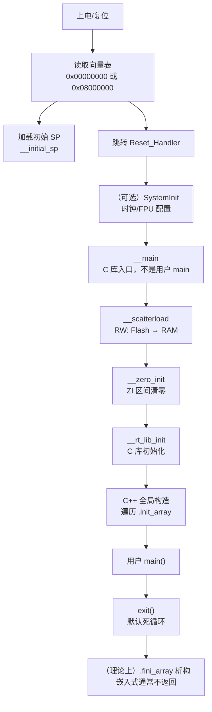

### 10.2 向量表

Cortex-M 规定复位后从向量表取两个值：

| 偏移 | 内容 | 说明 |
|---|---|---|
| `0x00` | 初始栈指针 `__initial_sp` | 栈顶地址（满递减栈） |
| `0x04` | `Reset_Handler` 地址 | 复位入口 |
| `0x08` | `NMI_Handler` | |
| `0x0C` | `HardFault_Handler` | |
| … | 其余异常/中断 | 数量由芯片决定 |

```asm
__Vectors   DCD  __initial_sp
            DCD  Reset_Handler
            DCD  NMI_Handler
            DCD  HardFault_Handler
            ...
```

> 向量表必须位于 Flash 起始处（或通过 `SCB->VTOR` 重定位）。scatter 里的 `*.o (RESET, +First)` 就是保证它排在最前。

> 多映像/分区与向量表跳转见 [Bootloader与IAP-OTA（Cortex-M）](../../../../../../Embedded/NoSystematic/Docs/02-工具链与构建/Keil-ARM构建知识体系/bootloader与iap-ota_cortex-m/)。

### 10.3 Reset_Handler

典型实现（STM32）：

```asm
Reset_Handler   PROC
                EXPORT  Reset_Handler             [WEAK]
                IMPORT  __main
                IMPORT  SystemInit
                LDR     R0, =SystemInit
                BLX     R0
                LDR     R0, =__main
                BX      R0
                ENDP
```

> **跳转 `__main` 之前，C 环境不存在**
> - 全局 RW 变量还是 Flash 里的初值，没有拷到 RAM；
> - ZI 区是随机值；
> - 不能调用任何依赖 C 库的函数。
>
> 若确实要在 `Reset_Handler` 里做早期初始化，只能做**纯寄存器操作**（时钟、看门狗、FPU 使能），且不能用全局变量。

### 10.4 __main 内部顺序

`__main` 是 ARM C 库提供的初始化入口（**不是**你的 `main`），内部固定顺序：

1. `__scatterload`：按 scatter 表把 RW 初值从 Flash 拷到 RAM；
2. `__scatterload_zeroinit` / `__zero_init`：把 ZI 区清零；
3. `__rt_entry`：C 库运行时初始化（`__rt_lib_init`）；
4. C++ 全局构造函数（`.init_array`）；
5. 调用用户 `main()`；
6. `main` 返回 → `exit()`。

> **[校勘]** “`__zero_init`”是便于理解的称呼；ARM 库中实际由 `__scatterload` 的 zero-init 表项完成清零（`__scatterload_zeroinit`）。两者语义一致：**ZI 区间写 0**。

### 10.5 __scatterload：RW 拷贝

```pseudocode
src = &Load$$RW_IRAM1$$Base            // Flash 中的初值
dst = &Image$$RW_IRAM1$$Base            // RAM 运行地址
len = Image$$RW_IRAM1$$Limit - Image$$RW_IRAM1$$Base

while len > 0:
    *dst = *src
    dst += 4
    src += 4
    len -= 4
```

- 只拷贝 **RW**（已初始化非 0 的全局/静态变量）；
- RO 不拷贝（加载地址 = 运行地址，Flash 就地访问）；
- ZI 不参与拷贝（没有加载数据）。

多个分离的 RW 执行域时，`__scatterload` 会按 scatter 表逐项处理，不是只拷一块。

### 10.6 ZI 清零

```pseudocode
dst = &Image$$RW_IRAM1$$ZI$$Base
len = Image$$RW_IRAM1$$ZI$$Limit - Image$$RW_IRAM1$$ZI$$Base

while len > 0:
    *dst = 0
    dst += 4
    len -= 4
```

- ZI = `.bss`：未初始化全局变量、显式 `= 0` 的全局/静态变量；
- Flash 中**不存在**这部分数据，链接阶段只记录地址与大小；
- 栈、堆**不属于 ZI**，不会被清零。

### 10.7 栈与堆

| 区域 | 符号 | 是否清零 | 说明 |
|---|---|---|---|
| 栈 | `__initial_sp`、`Image$$ARM_LIB_STACK$$*` | ❌ | 局部变量是随机值，必须初始化 |
| 堆 | `__heap_base`、`__heap_limit` | ❌ | `malloc` 返回的内存是随机值 |
| RW | `Image$$RW_IRAM1$$*` | ✅（拷贝初值） | 全局/静态变量有确定初值 |
| ZI | `Image$$RW_IRAM1$$ZI$$*` | ✅（清零） | 全局/静态变量为 0 |

> 这就是“局部变量必须初始化”的底层原因：栈内存没有初始化过程。

### 10.8 标准库 vs MicroLib

| 维度 | 标准 ARM C 库 | MicroLib |
|---|---|---|
| 体积 | 大 | 小 |
| `printf` | 完整（可重定向） | 精简（需 `fputc` 重定向） |
| 文件 IO | 支持 | 基本不支持 |
| 信号/线程 | 支持 | 裁剪 |
| `exit` | 完整清理 | 简单 `while(1)` |
| 适用 | 复杂应用 | 单片机裸机 |

### 10.9 main 返回之后

```c
int main(void) { return 0; }
```

- 标准库：`main` 返回 → `exit()` → 运行 `.fini_array` 析构 → 刷新缓冲区 → 最终 `_exit`；
- MicroLib：`exit` 简化为死循环；
- 裸机程序通常 `main` 内是 `while(1)`，不会返回。

### 10.10 常见启动期错误

| 现象 | 根因 | 处理 |
|---|---|---|
| 全局变量初值不对 | scatter 改了但 RW 加载域没跟随 | 检查 `Load$$...$$Base` 与 scatter |
| 进 `main` 前就 HardFault | 栈太小/栈顶错误/`SystemInit` 访问未使能外设 | 增大 Stack、检查 `__initial_sp` |
| 中断不进 | 向量表未放最前/`VTOR` 未设 | `RESET, +First`、检查 `SCB->VTOR` |
| ZI 变量不是 0 | 启动文件被替换成不调 `__main` 的版本 | 恢复标准 `startup.s` |
| 一上电就复位 | 看门狗未关/供电不稳 | 早期关看门狗 |
| C++ 全局对象构造时崩 | 构造函数里访问了未初始化外设 | 构造只做纯数据初始化 |

### 10.11 printf 重定向与半主机

#### 10.11.1 为什么 printf 没输出

ARM **标准库**的 `printf` 默认走**半主机（semihosting）**：把字符通过调试器转给主机（MicroLib 则直接调用 `fputc`）。没有调试器时，半主机调用会挂起或触发 HardFault。

半主机的底层：

| 状态 | 指令 | 说明 |
|---|---|---|
| ARM 状态 | `SVC 0x123456` | 半主机调用号 |
| Thumb 状态 | `BKPT 0xAB` | Cortex-M 常用 |

调试器拦截该异常并代理 IO；**没有调试器 = 没人处理 = 异常**。

#### 10.11.2 方案一：MicroLib + `fputc`（最常用）

```c
#include <stdio.h>

int fputc(int ch, FILE *f)
{
    while (!(USART1->SR & USART_SR_TXE)) { }
    USART1->DR = (uint8_t)ch;
    return ch;
}
```

要点：

- 勾选 **Options → Target → Use MicroLib**；
- `FILE` 来自 `<stdio.h>`，不要自己定义；
- 发送可用查询/中断/DMA，但 `printf` 是阻塞语义，别在中断里调用。

#### 10.11.3 方案二：标准库 retarget

标准库需要实现一组底层函数（`_sys_write`、`_sys_open`、`_sys_close`、`_sys_read` 等），或使用 `$Sub$$`/`$Super$$` 机制替换库函数。相比 MicroLib 更灵活，但体积更大、移植工作更多。

#### 10.11.4 `__use_no_semihosting`

在工程里声明：

```c
__asm(".global __use_no_semihosting\n");
```

AC5 也可写成 `#pragma import(__use_no_semihosting)`。作用是：**禁止库引入半主机调用**。

如果声明了它、但代码又调用了需要半主机的函数（如未重定向的 `printf`），链接会报：

```
L6915E: Library reports error: __use_no_semihosting was requested, but _sys_open was referenced
```

这是**链接期的保护**，比运行期挂死好排查得多。

#### 10.11.5 其他注意

| 事项 | 说明 |
|---|---|
| 浮点格式 | `%f` 支持与库配置有关，会显著增大体积；能不用就不用 |
| 缓冲 | stdout 默认带缓冲（重定向后可能是全缓冲，看不到输出）；可 `setvbuf(stdout, NULL, _IONBF, 0)` 关闭 |
| 中断里打印 | 阻塞式输出会拉长中断，改用环形缓冲 + 主循环发送 |
| Keil 调试输出 | 调试器支持半主机时，可在 Debug (printf) Viewer 看到输出（不接调试器则不可用） |

### 10.12 堆管理

#### 10.12.1 堆从哪里来

| 来源 | 说明 |
|---|---|
| 启动文件 `Heap_Size` | `startup.s` 里 `Heap_Size EQU 0x200`，在 ZI 后预留 |
| scatter `ARM_LIB_HEAP` 区域 | 显式指定堆地址与大小（更可控） |
| `__user_initial_stackheap` | 旧式接口，返回 heap/stack 基址（ARM 库） |

对应符号：

- `__heap_base` / `__heap_limit`：堆的起止；
- `__initial_sp`：栈顶（栈向下生长）；
- `Image$$ARM_LIB_HEAP$$Base/Limit`：使用 scatter 区域时。

> MicroLib 与标准库的堆实现不同：MicroLib 更简单，`malloc` 行为也更“轻”。

#### 10.12.2 malloc 失败必须判空

```c
uint8_t *p = malloc(1024);
if (p == NULL) {
    /* 堆耗尽：记录错误、降级、复位 */
}
```

不判空的后果：`p` 为 NULL → 写 0 地址 → HardFault（且现场难查）。

#### 10.12.3 多堆与自定义分配器

- 默认 `malloc` 只管理**一个**堆区；
- 需要多块内存（内部 SRAM、外部 SDRAM、CCM）时，可：
  - 用 scatter 定义多个区域，配合自定义分配器；
  - 直接使用静态数组/内存池（嵌入式更推荐，确定性好、无碎片）。

#### 10.12.4 碎片与实时性

| 问题 | 说明 | 对策 |
|---|---|---|
| 碎片 | 频繁 malloc/free 后大块分配失败 | 内存池、固定块分配 |
| 非确定性 | 分配耗时随碎片变化 | 初始化时一次性分配 |
| 堆栈相撞 | 堆向上、栈向下，中间无保护 | scatter 的 EMPTY 区域 + 运行时检查 |

#### 10.12.5 监控

1. `.map` 里看 `ARM_LIB_HEAP` 区域大小；
2. 运行时记录 `malloc` 峰值（封装一层计数）；
3. 栈使用量用“填充魔数 + 扫描水位”估算（如启动时把栈区填 `0xCD`）。

---

## 11. DWARF 调试信息与源码级调试

### 11.1 调试信息存在哪里

`.axf` 除了 `PT_LOAD`，还有大量**非加载段**：

| 段 | 作用 |
|---|---|
| `.debug_info` | 核心：编译单元、类型、函数、变量的 DIE 树 |
| `.debug_abbrev` | DIE 编码缩写表（压缩体积） |
| `.debug_line` | 机器码地址 ↔ 源码行号映射 |
| `.debug_str` | 字符串池（类型名、变量名、文件名） |
| `.debug_loc` / `.debug_loclists` | 变量位置表达式 |
| `.debug_frame` / `.eh_frame` | 栈帧展开信息 |
| `.debug_aranges` | 地址范围索引（加速查找） |
| `.debug_ranges` | 非连续地址范围 |

> 调试信息**不占 Flash/RAM**，只存在于 `.axf`；`hex/bin` 里没有。

### 11.2 编译单元与 DIE 树

每个 `.c/.cpp` 对应一个编译单元（CU），CU 内是一棵树：

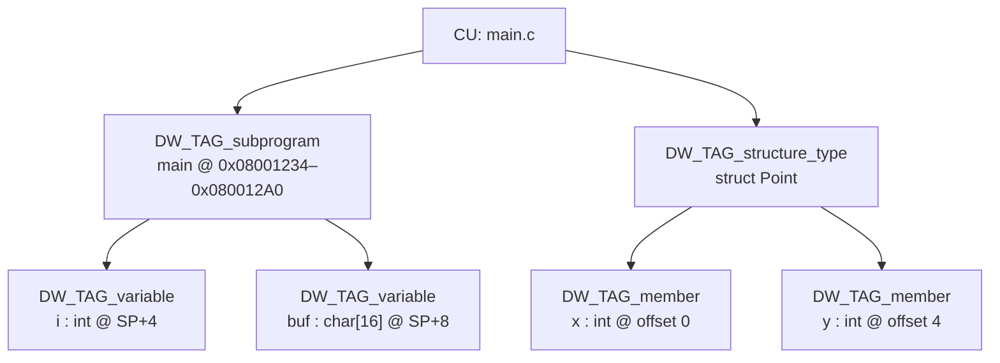

| Tag | 含义 |
|---|---|
| `DW_TAG_compile_unit` | 根节点：源文件、编译选项、语言 |
| `DW_TAG_subprogram` | 函数：名字、起止地址、返回类型 |
| `DW_TAG_variable` | 变量：名字、类型、位置、作用域 |
| `DW_TAG_base_type` | 基础类型：字节数、编码 |
| `DW_TAG_structure_type` | 结构体：成员、偏移、大小 |
| `DW_TAG_pointer_type` | 指针：指向类型 |

### 11.3 行号表：地址 → 源码行

`.debug_line` 是一个**状态机**，不是逐条地址表：

| 状态寄存器 | 含义 |
|---|---|
| `address` | 当前机器码地址 |
| `file` | 源文件编号 |
| `line` | 行号 |
| `column` | 列号 |
| `is_stmt` | 是否语句起始 |
| `basic_block` | 是否基本块起始 |
| `end_sequence` | 是否序列结束 |

指令分三类：特殊操作码（地址/行号增量）、标准操作码（设置状态）、扩展操作码。这样能用很少的字节表达整张映射表。

**调试器查询流程**：

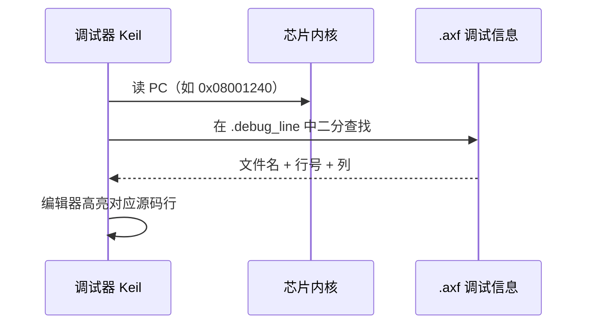

### 11.4 变量查看：位置表达式

变量不一定在内存：

| 位置 | DWARF 表达式 | 场景 |
|---|---|---|
| 绝对地址 | `DW_OP_addr 0x20000004` | 全局变量 |
| 帧指针偏移 | `DW_OP_fbreg -8` | 局部变量 |
| 寄存器 | `DW_OP_reg0` | 优化后放寄存器 |
| 常量 | `DW_OP_lit10` | 被常量折叠 |

Keil 的“查看变量”本质是：读 DIE → 解析位置表达式 → 读寄存器/内存 → 按类型解码显示。

### 11.5 断点机制

| 类型 | 实现 | 数量 | 修改指令 |
|---|---|---|---|
| 软件断点 | 写入 `BKPT #0`（Thumb: `0xBE00`） | Flash 断点受限 | 是 |
| 硬件断点 | DWT/FPB 比较器 | 2–8 个（视内核） | 否 |
| 观察点 | DWT 数据比较器 | 通常 2–4 个 | 否 |

软件断点流程：

1. 行号表反查源码行首条指令地址；
2. 备份原指令；
3. 写入 `BKPT`；
4. 命中 → 调试异常；
5. 继续时恢复原指令、单步、再写回 `BKPT`。

> Flash 断点需要擦写，因此数量有限；把代码搬到 RAM 可无限打软件断点。

### 11.6 Keil 调试启动流程

1. 加载 `.axf`，解析 ELF 与 DWARF 到宿主机内存；
2. 通过 J-Link/ST-Link 连接内核，进入调试模式；
3. 下载 `PT_LOAD` 段到 Flash；
4. 复位，PC = 复位向量；
5. 持续读 PC → 查行号表 → 高亮源码；
6. 单步/运行/变量查看由宿主机 + 仿真器协作完成。

> 探针、SWD/SWO、ITM、DWT 的细节见 [调试硬件与trace（Cortex-M）](../../../../../../Embedded/NoSystematic/Docs/02-工具链与构建/Keil-ARM构建知识体系/调试硬件与trace_cortex-m/)。

### 11.7 优化对调试的影响

| 优化 | 表现 | 应对 |
|---|---|---|
| 内联 | 原函数无断点 | `noinline` |
| 变量进寄存器 | `<optimized out>` | 局部临时变量 + `-O0` |
| 指令重排 | 高亮行跳动 | 接受或用 `-Og` |
| 死代码消除 | 断点打不上 | 加 `volatile` 访问 |
| 循环展开 | 单步次数异常 | 调试期关闭 |

---

## 12. 重定位类型与越界处理

### 12.1 重定位项结构

| 字段 | 含义 |
|---|---|
| `r_offset` | 待修正位置（段内偏移） |
| `r_info` | 低 8 位类型 + 高 24 位符号索引 |
| `r_addend` | 加数（ARM 使用 RELA） |

计算通式：`value = S + A`（绝对）或 `value = S + A − P`（相对），其中 `S` 目标符号地址、`A` 加数、`P` 修正位置地址。

### 12.2 类型分类

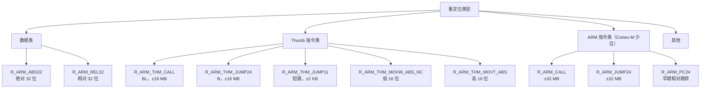

### 12.3 编码规则与范围

| 类型 | 场景 | 位宽/单位 | 范围 |
|---|---|---|---|
| `R_ARM_ABS32` | 指针、函数指针表、向量表 | 32 位绝对 | 全地址空间 |
| `R_ARM_REL32` | PC 相对数据引用 | 32 位相对 | 全地址空间 |
| `R_ARM_THM_CALL` | `BL func` | 24 位有符号 × 2B | ±16 MB |
| `R_ARM_THM_JUMP24` | `B label` | 24 位有符号 × 2B | ±16 MB |
| `R_ARM_THM_JUMP11` | 16 位短 `B` | 11 位有符号 × 2B | ±2 KB |
| `R_ARM_THM_MOVW_ABS_NC` | `MOVW` 低 16 位 | 16 位 | 无距离限制 |
| `R_ARM_THM_MOVT_ABS` | `MOVT` 高 16 位 | 16 位 | 无距离限制 |
| `R_ARM_CALL` | ARM `BL` | 24 位有符号 × 4B | ±32 MB |
| `R_ARM_JUMP24` | ARM `B` | 24 位有符号 × 4B | ±32 MB |

> `LDR R0, =symbol` 在 Thumb-2 下通常展开为 `MOVW + MOVT`，因此能加载任意 32 位地址，不受 ±16 MB 限制。

### 12.4 relocation out of range 的成因

当 `|S + A − P|` 超出编码位宽可表示的范围：

1. Flash 很大（>16 MB 的地址跨度）；
2. Flash 代码调用 RAM 中的函数（跨地址空间）；
3. 使用 16 位短跳转，目标超出 ±2 KB；
4. 手动关闭了 veneer。

### 12.5 veneer（长跳转桩）

`armlink` 默认 `--veneers`：检测到 `BL` 越界时，在源附近插入桩：

```asm
__veneer_target
    LDR  PC, [PC, #-4]     ; 取下一字到 PC
    DCD  target_address    ; 绝对地址
```

原 `BL` 改为跳到桩，桩再用绝对地址跳到真正目标。代价：多一次间接跳转 + 8 字节左右代码。

**仍会报错的情况**：

- 手动 `--no_veneers`；
- 桩本身放不下（极端碎片化）；
- 数据类重定位（ABS32 等）**没有桩机制**；
- 目标架构不支持对应桩形式。

### 12.6 位置无关代码（PIC/PI）

| 项目 | 非 PIC（默认） | PIC |
|---|---|---|
| 地址 | 链接时固定绝对地址 | 运行时相对计算 |
| 重定位 | 大量 `ABS32` | 以相对重定位为主 |
| Cortex-M 场景 | 固件标准做法 | 动态加载/多映像切换，少用 |
| 代价 | 无 | 额外间接层、性能损失 |

---

## 13. C++ 在 ARM 工具链下的额外链接机制

### 13.1 名字修饰（Name Mangling）

C++ 支持重载、命名空间、成员函数，编译器把**函数签名编码进符号名**，保证全局唯一。

| 源码 | 符号名 |
|---|---|
| `void func(int)`（C） | `func` |
| `void func(int)`（C++） | `_Z4funci` |
| `int add(int, int)` | `_Z3addii` |
| `void ns::Class::func(int)` | `_ZN2ns5Class4funcEi` |

与链接器的关系：

1. 符号解析是**字符串精确匹配**；
2. 两边修饰规则不一致 → 符号找不到 → `undefined reference`；
3. `extern "C"` 关闭修饰，实现 C/C++ 互调；
4. AC5 与 AC6 修饰规则一致，可混合链接；与 GCC 基本兼容但不保证全部场景。

### 13.2 全局构造与析构

| 内容 | 所在段 | 执行时机 |
|---|---|---|
| 全局对象构造函数调用表 | `.init_array` | `__rt_entry` 中，`main` 之前 |
| 全局对象析构函数调用表 | `.fini_array` | `main` 返回后 `exit` 流程 |
| 每个条目的函数指针 | `R_ARM_ABS32` 重定位 | 链接时回填 |

构造顺序：

- 同一编译单元内：按**声明顺序**；
- 跨编译单元：**未定义**（取决于链接顺序）；
- 可用 `__attribute__((init_priority(N)))` 指定优先级（N 越小越早）。

> **构造函数里不要碰硬件**
> 此时外设时钟、GPIO 都还没初始化；全局对象的构造只应做纯数据初始化。需要硬件初始化的逻辑放到 `main()` 或显式的 `Init()` 里。

### 13.3 vtable、RTTI 与 ODR

| 机制 | 说明 |
|---|---|
| vtable | 含虚函数的类生成函数指针数组，放 `.rodata`；对象首地址存 vptr |
| RTTI | `typeid`/`dynamic_cast` 依赖 `type_info` 对象，放 `.rodata` |
| 弱符号 | vtable、`type_info`、内联函数、模板实例化都是 weak，重复时任选其一 |
| COMDAT | 同名弱符号分组，链接器去重 |

**关键函数规则（Itanium ABI）**：vtable 由“第一个非内联、非纯虚的虚函数”所在编译单元生成。该类没实现这个函数 → vtable 缺失 → 报 `undefined reference to vtable for X`。

**多重继承与虚继承的对象布局（[工程补充]）**：

| 情形 | 对象内存布局 | 编译 / 链接 / 运行时行为 |
|---|---|---|
| 普通多重继承（多个非虚基类） | 对象内按声明顺序排布多个基类子对象；主基类与派生类共享偏移 0 处的 vptr，其余多态基类各带一个 vptr，因此对象内**可能有多处 vptr** | 派生类为每个多态基类生成对应 vtable；基类指针向上/向下转型时，编译器按该子对象的固定偏移调整 `this`（必要时生成 this 调整 thunk） |
| 虚继承（共享虚基类） | 虚基类子对象在整个对象中只保留一份；ARM Compiler 遵循 Itanium C++ ABI，**虚基类偏移存放在 vtable 的虚基偏移表项中**（MSVC 才另设 vbtable 指针） | 虚基类偏移无法在编译期完全确定，`this` 调整需运行时查 vtable 得到 |

- 这些 vtable（含虚基偏移表项）、`type_info` 都是编译器生成的只读数据（归 `.rodata` / RO），其内部指针由 `armlink` 按普通 `R_ARM_ABS32` 重定位回填；**链接器核心算法不变**，只是待重定位的指针条目增多。
- 多重继承下的跨基类转换（如 `B* → C*`）可能涉及**负偏移**调整：`static_cast` 在编译期算出固定偏移，`dynamic_cast` 则在运行时查 RTTI 确定。
- 菱形继承（同一基类经两条路径被继承）若希望共享**唯一**基类子对象、消除二义性，需要使用虚继承；非虚继承会得到两份基类子对象与两条不同的 `this` 调整路径（这正是 `d.read()` 一类调用报二义性的原因）。

### 13.4 异常处理（ARM EHABI）

| 段 | 作用 |
|---|---|
| `.ARM.exidx` | 异常索引表：PC 范围 → 处理函数/展开信息 |
| `.ARM.extab` | 展开指令（如何恢复寄存器、栈帧） |

- 都是 RO 段，不占 RAM；
- `throw` 时运行时按 PC 查 `.ARM.exidx`，展开栈帧、调用析构、匹配 `catch`；
- 显著增加体积；嵌入式常用 `--no_exceptions` / `-fno-exceptions` 关闭。

### 13.5 C++ 常见链接错误

| 错误 | 根因 | 处理 |
|---|---|---|
| `undefined reference to vtable for X` | 首个非内联虚函数未实现 | 实现它，或全部内联 |
| `multiple definition of ...` | 头文件里定义了非 inline 全局函数/变量 | 加 `inline`/`static`，或移到 `.c` |
| `undefined reference to 'foo'`（C 调 C++） | 缺 `extern "C"` | 头文件加 `extern "C"` |
| `undefined reference to 'operator new'` | 用了 `new` 但没链接 C++ 库 | 链接 `armlib`/启用 C++ |
| `__cxa_*` 未定义 | 异常/RTTI 运行时缺失 | 链接 C++ 库或关闭异常 |

---

## 14. AC5 与 AC6 全面对比

### 14.1 工具链对照

| 维度 | AC5（ARM Compiler 5） | AC6（ARM Compiler 6） |
|---|---|---|
| C 编译器 | `armcc` | `armclang` |
| C++ 编译器 | `armcc --cpp` | `armclang++`/`armclang -x c++` |
| 汇编器 | `armasm`（ARM 语法） | `armclang` 内置（GNU 语法） |
| 前端 | EDG | Clang/LLVM |
| IR | 私有 | LLVM IR |
| 链接器 | `armlink` | `armlink`（同） |
| 归档 | `armar` | `armar`（同） |
| 转换 | `fromelf` | `fromelf`（同） |
| C 标准 | C90/C99（部分 C11） | C99/C11/C17 |
| C++ 标准 | C++03（部分 C++11） | C++11/14/17 |
| 内联汇编 | `__asm { }` | `asm volatile("...")` |
| 弱符号 | `__weak` | `__attribute__((weak))` |
| 对齐 | `__align(n)` | `__attribute__((aligned(n)))` |
| 打包 | `__packed` | `__attribute__((packed))` |
| LTO | 不支持/有限 | `-flto` |
| 优化等级 | `-O0..-O3`、`-Ospace`、`-Otime` | `-O0..-O3`、`-Os`、`-Oz`、`-Omax` |
| 诊断格式 | `#1234-D` | `error: ... [-W...]` |
| 状态 | 停止维护（旧工程仍在用） | 官方主推 |

### 14.2 归档/链接/转换层是否相同

**相同**：`armar`、`armlink`、`fromelf` 是同一套程序，归档格式、索引结构、链接规则、hex/bin 生成规则一致。

**不同**：`.o` 的生成者不同（`armcc` vs `armclang`），因此：

- `.o` 里的 `.ARM.attributes` 不同（编译器版本、ABI 标记）；
- **混合链接**可能触发 `L6242E: Cannot link object ... as its attributes are incompatible`；
- 建议整个工程统一 AC5 或 AC6，不要混用。

### 14.3 AC5 → AC6 迁移检查清单

- [ ] 启动文件：AC5 的 `startup.s`（ARM 语法）需换成 AC6 版本（GNU 语法）或使用厂商提供的新版；
- [ ] 内联汇编：`__asm` 块改写为 `asm volatile`；
- [ ] `__packed`/`__align`/`__weak` 改为 `__attribute__`；
- [ ] `#pragma` 相关（`anon_unions`、`pack`）改用 `__attribute__` 或 AC6 支持的 pragma；
- [ ] 汇编启动文件里的 `AREA/EXPORT/IMPORT/DCD` 改为 `.section/.global/.extern/.word`；
- [ ] `printf` 重定向（`fputc`/`__io_putchar`）检查；
- [ ] 优化等级与 `volatile` 行为回归测试；
- [ ] 浮点 ABI（`__FPU_PRESENT`、`-mfpu`）确认；
- [ ] 链接脚本/scatter 不变，但检查 `--library_type` 与 MicroLib 设置。

### 14.4 浮点 ABI：soft、softfp 与 hard

#### 14.4.1 三种模式

| 模式 | 浮点指令 | 参数/返回值传递 | 典型开销 | 兼容性 |
|---|---|---|---|---|
| **soft** | 无，纯软件模拟 | 通用寄存器 `r0–r3` | 最慢 | 调用约定与 softfp 相同 |
| **softfp** | 有，使用 VFP 指令 | 通用寄存器（soft 约定） | 中 | 与 soft 可互调 |
| **hard** | 有 | **VFP 寄存器** `s0–s15`/`d0–d7` | 最快 | 必须全工程一致 |

> 关键区别不在“用不用硬件”，而在**函数调用时参数放在哪**：soft/softfp 走 r0–r3，hard 走 VFP 寄存器。混用就会“参数错位”。

#### 14.4.2 编译选项

| 工具链 | soft | softfp | hard |
|---|---|---|---|
| AC6 / GCC | `-mfloat-abi=soft` | `-mfloat-abi=softfp` | `-mfloat-abi=hard` |
| AC5 | `--fpu=softvfp` | 无直接对应（AC5 的硬件浮点即 VFP 调用约定） | `--fpu=fpv4-sp-d16`（M4F）/ `fpv5-d16`（M7）等 |
| Keil GUI | Floating Point Hardware: Not Used | — | Single/Double Precision |

配套还要指定 FPU 类型：`-mfpu=fpv4-sp-d16`（M4F 单精度）、`fpv5-d16`（M7 双精度）等。

> AC5 实际上只有两档：软浮点（`--fpu=softvfp`）与硬件浮点（`--fpu=<具体 FPU>`，如 `fpv4-sp-d16`）；**softfp 是 AC6/GCC 才有的中间档**。

#### 14.4.3 VFP 寄存器与调用约定

| 寄存器 | 用途 | 保存责任 |
|---|---|---|
| `s0–s31`（32 位视图） | 单精度 | `s0–s15` 调用者保存 |
| `d0–d15`（64 位视图） | 双精度 | `d0–d7` 调用者保存 |
| `s16–s31` / `d8–d15` | 被调用者保存 | 函数内用了要恢复 |
| `FPSCR` | 状态/控制（舍入、异常标志） | 特殊 |
| `FPCCR` | 惰性压栈控制（LSPEN/ASPEN） | 系统寄存器 |

#### 14.4.4 惰性压栈（lazy stacking）

Cortex-M4F/M7 在异常入口默认**惰性保存** FP 上下文：

1. 异常发生时，硬件只预留栈空间，**不立即**写 s0–s15；
2. 若异常处理函数执行了浮点指令，才触发真正保存（LSPEN=1）；
3. 若处理函数不用浮点，则完全省掉这次保存；
4. `EXC_RETURN` 的 bit4 指示是否使用 FP 扩展栈帧（总帧 **0x68** 字节 = 基本帧 0x20 + s0–s15 的 0x40 + FPSCR 4 + 保留 4，即比基本帧多 0x48）；
5. 栈必须 **8 字节对齐**，否则入栈时可能触发 fault。

> 这解释了为什么“中断里用 float 会突然变慢”以及“栈用量比预期大”。

#### 14.4.5 `__aeabi_*` 软浮点/运行时函数

soft/softfp 模式下，编译器把浮点运算变成对运行时库的调用：

| 函数 | 作用 |
|---|---|
| `__aeabi_fadd/fsub/fmul/fdiv` | 单精度四则运算 |
| `__aeabi_dadd/dsub/dmul/ddiv` | 双精度四则运算 |
| `__aeabi_i2f`、`__aeabi_f2iz` | 整型 ↔ 浮点 |
| `__aeabi_f2d`、`__aeabi_d2f` | 单精度 ↔ 双精度 |
| `__aeabi_idiv`、`__aeabi_uidiv` | 整数除法（M0 无硬件除法） |
| `__aeabi_memcpy/memset/memmove` | 库内存操作 |

#### 14.4.6 混用时的报错与排查

| 现象 | 原因 |
|---|---|
| `L6242E: ... attributes are incompatible` | 目标文件 FP ABI 不一致（`Tag_ABI_VFP_args` 不同） |
| 链接通过但浮点结果乱码 | 调用约定错位（参数寄存器对不上） |
| 一调用浮点函数就 HardFault | 栈未 8 字节对齐，或 FPU 未使能（`CPACR`） |

排查步骤：

1. 确认 **全工程**（含第三方 `.lib`）使用同一浮点模式；
2. 检查 `.ARM.attributes` 中的 `Tag_ABI_VFP_args`（0=base，1=VFP）；
3. 确认启动代码已使能 FPU（`SCB->CPACR` 置位 CP10/CP11）；
4. 确认栈 8 字节对齐。

### 14.5 AAPCS 整数调用约定

> 14.4 讲的是“浮点那一半”ABI；这一节补齐“整数那一半”，两者合起来才是完整的 ARM 过程调用标准（AAPCS）。

#### 14.5.1 寄存器职责

| 寄存器 | 别名 | 职责 | 调用前后 |
|---|---|---|---|
| `r0–r3` | a1–a4 | 传参、返回值、临时计算 | 调用者保存（可被破坏） |
| `r4–r8`、`r10`、`r11` | v1–v7 | 局部变量 | **被调用者保存**（用了要恢复） |
| `r9` | sb | 平台寄存器 | 视平台：可能被保留给系统，裸机通常可用 |
| `r12` | ip | 过程间临时寄存器（veneer/thunk 可用） | 调用者保存 |
| `r13` | sp | 栈指针，**调用边界 8 字节对齐** | 特殊 |
| `r14` | lr | 返回地址 | 特殊 |
| `r15` | pc | 程序计数器 | 特殊 |

记忆口诀：**r0–r3 随便用，r4–r11 要还回去，r12 是过路寄存器，SP 必须 8 对齐。**

#### 14.5.2 参数与返回值怎么传

| 参数类型 | 传递方式 |
|---|---|
| 1–4 个 32 位整数/指针 | `r0–r3` 依次 |
| 第 5 个及以后 | 压栈（调用者分配） |
| 64 位整数 | 占用两个寄存器（`r0:r1`），且需偶数对齐 |
| ≤4 字节的结构体/联合体 | 打包进 `r0` |
| 8 字节且 8 字节对齐的结构体 | `r0:r1` |
| 更大的结构体 | 调用者分配内存，**传指针**（被调用者可能修改副本） |
| HFA（同质浮点聚合，≤4 元素） | `s0–s15`/`d0–d7`（AAPCS-VFP） |
| 返回值 | `r0`（64 位用 `r0:r1`；HFA 用 `s0–s3`） |

#### 14.5.3 典型栈帧

以 Thumb-2 为例：

```asm
func
    PUSH    {r4-r6, lr}      ; 4 个寄存器 = 16 字节，保持 8 字节对齐
    SUB     sp, sp, #8       ; 局部变量
    MOV     r4, r0           ; 保存第一个参数
    ...
    ADD     sp, sp, #8
    POP     {r4-r6, pc}      ; 弹回 LR 直接返回到 PC
```

要点：

- `PUSH` 奇数个寄存器（如 `PUSH {r4-r7, lr}` = 5 个、20 字节）会破坏 8 字节对齐，需再 `SUB sp,#4` 补齐；偶数个（如上文 `PUSH {r4-r6, lr}` = 16 字节）天然保持对齐；
- 叶子函数（不调用别人）可不建栈帧，直接用 `r0–r3`、`r12`；
- `POP {..., pc}` 是标准返回方式（把 LR 弹进 PC）。

#### 14.5.4 调用示例与反汇编

```c
int sum5(int a, int b, int c, int d, int e) { return a+b+c+d+e; }
```

- `a–d` → `r0–r3`
- `e` → 栈上 `[sp]`
- 返回 → `r0`

```asm
    ADD   r0, r0, r1
    ADD   r0, r0, r2
    ADD   r0, r0, r3
    LDR   r3, [sp, #0]      ; 第 5 个参数
    ADD   r0, r0, r3
    BX    lr
```

#### 14.5.5 与 14.4 的关系

| 标准 | 整数/指针 | 浮点 | 说明 |
|---|---|---|---|
| AAPCS（base） | r0–r3 | 走 `__aeabi_*`（soft） | 默认 |
| AAPCS + softfp | r0–r3 | 硬件指令，仍走 r0–r3 | 混合调用安全 |
| AAPCS-VFP（hard） | r0–r3 | s0–s15/d0–d7 | 全工程统一 |

#### 14.5.6 常见坑

| 现象 | 根因 |
|---|---|
| 调用未声明原型的函数，参数错乱 | 编译器按默认规则猜类型；`int` 之外的参数会错位 |
| 结构体传参后值被改 | 大结构体按引用传递，被调用者改的是副本/原对象（依实现） |
| 中断里调用 C 函数后寄存器异常 | 汇编中断处理没有保存 `r0–r3/r12/lr` |
| SP 比预期多降 4 字节 | `PUSH` 奇数个寄存器后补了 4 字节对齐 |
| 回调函数一调用就 HardFault | 函数指针类型不匹配（参数个数/类型不同） |

### 14.6 内联汇编

#### 14.6.1 什么时候必须用

| 场景 | 例子 |
|---|---|
| 访问特殊寄存器 | `MRS/MSR` 读 PRIMASK、CONTROL、MSP |
| 屏障指令 | `DSB/DMB/ISB` |
| 独占访问 | `LDREX/STREX` |
| 启动极早期代码 | 栈未建立时的寄存器操作 |
| 性能关键的手写序列 | 位操作、CRC、饱和运算 |

#### 14.6.2 AC5 写法

```c
__asm void disable_irq(void)
{
    CPSID   I
    BX      LR
}
```

或函数内嵌：

```c
__asm
{
    MRS r0, PRIMASK
    CPSID I
}
```

限制：

- 直接写**物理寄存器名**，编译器不知道你用了哪些寄存器；
- 不能像 GCC 那样声明输入/输出/破坏列表，优化时可能与 C 代码冲突；
- 与 C 变量交互要手动 `LDR/STR`，容易出错。

#### 14.6.3 AC6/GCC 写法

```c
static inline void dsb(void)
{
    __asm volatile ("dsb 0xF" ::: "memory");
}

static inline uint32_t read_msp(void)
{
    uint32_t v;
    __asm volatile ("mrs %0, msp" : "=r"(v));
    return v;
}
```

约束与破坏列表：

| 语法 | 含义 |
|---|---|
| `"r"(x)` | 输入放通用寄存器 |
| `"=r"(y)` | 输出到通用寄存器 |
| `"=&r"(y)` | 早绑定输出（输出不能与输入同寄存器） |
| `"m"(x)` | 内存操作数 |
| `"I"(n)` | 立即数（范围受限） |
| `"i"(n)` | 编译期常量 |
| `"cc"` | 会改条件标志 |
| `"memory"` | 会读写内存（阻止编译器重排/缓存） |

#### 14.6.4 三个最容易犯的错

1. **忘了 `volatile`**：无输出的 asm 会被优化掉；
2. **忘了 `"memory"`**：编译器可能把内存读写挪到 asm 前后，屏障失效；
3. **忘了 `"cc"`**：asm 改了标志位，编译器仍按旧标志做条件跳转。

#### 14.6.5 优先用 intrinsics

大多数常用操作已有 CMSIS 封装（见 14.8），可移植性和可读性都更好：

```c
__DSB();          // 优于手写 asm("dsb")
__disable_irq();  // 优于手写 CPSID I
__get_MSP();
```

### 14.7 C11 原子、屏障与独占访问

#### 14.7.1 为什么 `volatile` 不够

`volatile` 只保证“每次都从内存读写、不被优化掉”，**不保证原子性，也不保证顺序**：

- 多字节变量（`int64_t`）读写可能被拆开；
- 编译器和 CPU 都可能重排；
- 单核中断与主循环共享变量时，`volatile` 不够，需要**临界区或原子操作**。

#### 14.7.2 三档工具

| 方案 | 可用性 | 说明 |
|---|---|---|
| C11 `<stdatomic.h>` | AC6 编译通过（实测）；AC5 无此头（实测 `cannot open source input file "stdatomic.h"`） | `_Atomic`、`atomic_*`、`memory_order` |
| GCC/Clang `__atomic_*` 内建 | AC6 支持 | `__atomic_load_n`、`__atomic_fetch_add` |
| 临界区（关中断） | 全平台 | 简单可靠，但影响中断延迟 |

#### 14.7.3 内存序与屏障映射

| `memory_order` | 语义 | Cortex-M 近似实现 |
|---|---|---|
| `relaxed` | 只保证原子性 | 无屏障 |
| `acquire` | 之后的读写不能提前 | `DMB`（读侧） |
| `release` | 之前的读写不能推后 | `DMB`（写侧） |
| `acq_rel` | 两者兼具 | `DMB` |
| `seq_cst` | 全局顺序一致 | `DMB SY`（更强） |

> 单核 Cortex-M 常用 `DMB SY`；多核/多总线主控按共享域选择屏障强度。

#### 14.7.4 示例

```c
#include <stdatomic.h>

atomic_int ready;

void producer(void) {
    /* 写数据 ... */
    atomic_store_explicit(&ready, 1, memory_order_release);
}

void consumer(void) {
    if (atomic_load_explicit(&ready, memory_order_acquire)) {
        /* 安全读取数据 */
    }
}
```

#### 14.7.5 独占访问：LDREX/STREX

Cortex-M3/M4/M7 用独占监视器实现读-改-写：

```c
do {
    old = __LDREXW(&counter);
    new = old + 1;
} while (__STREXW(new, &counter) != 0);
```

- `STREX` 失败（返回非 0）说明期间有别的访问，需要重试；
- 中途不要插入函数调用/中断处理里修改同一地址；
- `__CLREX` 可显式清除独占状态。

#### 14.7.6 限制与注意

| 问题 | 说明 |
|---|---|
| 非 lock-free 类型 | 实测 AC6（Cortex-M3）：8 字节原子触发 `-Watomic-alignment`（max lock-free 为 4 字节），链接报 `Undefined symbol __sync_fetch_and_add_8`；需要 libatomic/运行时支持，裸机通常不可用 |
| AC5 无 C11 原子 | 用 `__ldrex/__strex` + 临界区替代 |
| ISR 与主循环共享 | 优先“关中断的极短临界区”，比原子操作更直观 |
| 内存序过度使用 | `seq_cst` 最安全但屏障最重，热路径可用 acquire/release |

### 14.8 编译器内置函数（intrinsics）

#### 14.8.1 常用 CMSIS intrinsics

| 类别 | 函数 | 作用 |
|---|---|---|
| 空操作/低功耗 | `__NOP()`、`__WFI()`、`__WFE()`、`__SEV()` | 空转、等待中断/事件 |
| 屏障 | `__ISB()`、`__DSB()`、`__DMB()` | 指令同步、数据同步、内存屏障 |
| 位操作 | `__CLZ()`、`__REV()`、`__REV16()`、`__RBIT()` | 前导零、字节序反转、位反转 |
| 饱和运算 | `__SSAT()`、`__USAT()` | 有/无符号饱和 |
| 独占访问 | `__LDREXW()`、`__STREXW()`、`__CLREX()` | 原子读改写 |
| 中断控制 | `__disable_irq()`、`__enable_irq()`、`__get_PRIMASK()`、`__set_PRIMASK()` | 开关中断、读改写 PRIMASK |
| 栈指针 | `__get_MSP()`、`__set_MSP()`、`__get_PSP()`、`__set_PSP()` | 读写主/进程栈指针 |
| 控制寄存器 | `__get_CONTROL()`、`__set_CONTROL()` | 特权级/栈选择/FPCA |

#### 14.8.2 AC5 与 AC6 的差异

| 操作 | AC5 | AC6 / CMSIS |
|---|---|---|
| 空操作 | `__nop()` | `__NOP()` |
| 等待中断 | `__wfi()` | `__WFI()` |
| 屏障 | `__dmb(0)`、`__dsb(0)`、`__isb(0)`（**带参数**） | `__DMB()`、`__DSB()`、`__ISB()`（无参） |
| 前导零 | `__clz()` | `__CLZ()` |
| 字节反转 | `__rev()`；**无 `__rev16`**（实测 implicit declaration） | `__REV()`、`__REV16()` |
| 独占 | `__ldrex()`、`__strex()`（已弃用，warning #3731-D） | `__LDREXW()`、`__STREXW()` |

> 上表由本机 armcc 5.06u7 实测：`__nop()/__wfi()/__clz()/__rev()/__rbit()/__ssat()/__usat()` 可用；`__dmb/__dsb/__isb` 必须带参数（`__dmb(0)` 编译通过，`__dmb()` 报 #165）。

> 大小写差异是移植时的常见坑；包含 `cmsis_compiler.h`/`cmsis_gcc.h` 后统一用大写版本。

#### 14.8.3 DSP intrinsics

Cortex-M4/M7 的 SIMD 指令有对应内建函数（CMSIS-DSP 或编译器提供）：

| 函数 | 作用 |
|---|---|
| `__SMLAD`、`__SMLALD` | 双 16 位乘加 |
| `__QADD16`、`__QSUB16` | 16 位饱和加减 |
| `__SADD16`、`__SSUB16` | 16 位并行加减 |
| `__SMUAD`、`__SMUSD` | 无符号/有符号乘加 |

这些函数在 M0/M3 上会退化为多条指令，**跨内核移植要重新评估性能**。

#### 14.8.4 取舍

| 需求 | 推荐 |
|---|---|
| 常规屏障/中断/位操作 | intrinsics |
| 特殊指令序列（无 intrinsic） | 内联汇编 |
| 需要精确控制寄存器分配 | 内联汇编 + 约束 |
| 需要跨 AC5/AC6 | intrinsics 优先 |

---

## 15. 优化与体积控制

### 15.1 体积优化手段

| 手段 | 作用 | 代价 |
|---|---|---|
| `-Os` / `-Oz` | 编译器以体积优先 | 速度下降 |
| `--split_sections`（AC5）/ `-ffunction-sections -fdata-sections`（AC6） | 每个函数/变量独立成段 | 段数增多 |
| `--remove` | 丢弃未引用段 | 需配合上面两项才有效 |
| MicroLib | 精简 C 库 | 功能受限 |
| `--no_exceptions` / `-fno-exceptions` | 去掉异常表 | 不能用 try/catch |
| `-fno-rtti` | 去掉 RTTI | 不能用 dynamic_cast/typeid |
| 去掉 `printf`/`sprintf` | 常占数 KB | 改用轻量输出 |
| 库裁剪 | 只链接用到的 `.o` | 依赖库设计 |
| `-flto` | 跨模块优化 | 编译链接变慢，调试变难 |
| 常量表改 Flash 存储 | 避免复制到 RAM | 访问速度略降 |

### 15.2 速度优化手段

| 手段 | 说明 |
|---|---|
| `-O2` / `-O3` | 内联、循环优化、向量化 |
| 关键函数 `__attribute__((always_inline))` | 强制内联 |
| 把热代码放 RAM（`__attribute__((section(".ramfunc")))`） | 避开 Flash 等待周期 |
| DMA | 减少 CPU 搬运 |
| 查表代替实时计算 | 用 Flash 换时间 |
| 定点数代替浮点 | Cortex-M0/M3 无 FPU 时收益大 |
| 中断里只做标记，主循环处理 | 降低中断延迟 |

### 15.3 优化与调试的取舍

| 目标 | 推荐 |
|---|---|
| 调试期 | `-O0`/`-Og` + 完整 DWARF |
| 发布但保留可调试性 | `-O1`/`-O2` + `-g` |
| 极限体积 | `-Oz` + LTO + `--remove` + MicroLib |
| 极限速度 | `-O3`/`-Omax` + LTO + RAM 代码 |

---

## 16. 错误分类与排查

### 16.1 错误分类

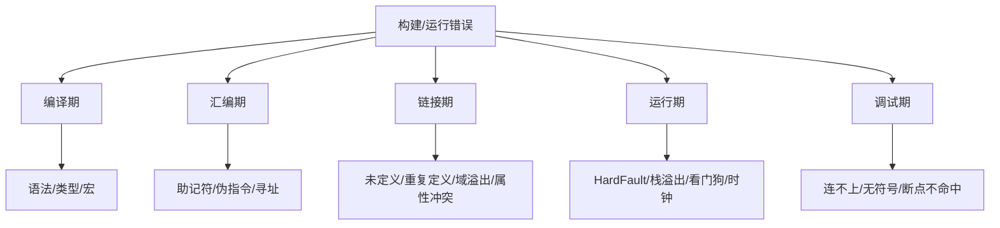

### 16.2 常见链接错误

| 错误码/信息 | 含义 | 常见原因 | 处理 |
|---|---|---|---|
| `L6218E: Undefined symbol xxx` | 符号未定义 | 忘了加 `.c`/`.lib`；C/C++ 名字不匹配；库顺序错 | 补文件、加 `extern "C"`、调整库顺序 |
| `L6200E: Symbol xxx multiply defined` | 重复定义 | 头文件里定义变量/函数；两个 `.c` 同名 | 改 `extern`、加 `static`/`inline` |
| `L6220E: Execution region ... exceeds limit` | 域溢出 | Flash/RAM 不够 | 裁剪代码、扩大配置 |
| `L6406E: No space in execution regions with .ANY` | `.ANY` 无空间 | 同上 | 调整 scatter/裁剪 |
| `L6242E: ... attributes are incompatible` | 属性冲突 | AC5/AC6 混链、浮点 ABI 不一致 | 统一工具链/ABI |
| `L6915E: Library reports error` | 库级错误 | 半主机冲突、`__use_no_semihosting` | 检查重定向/库配置 |
| `relocation out of range` | 重定位越界 | 跳转超 ±16 MB/±2 KB | 开 veneer、改布局 |

### 16.3 排查决策树

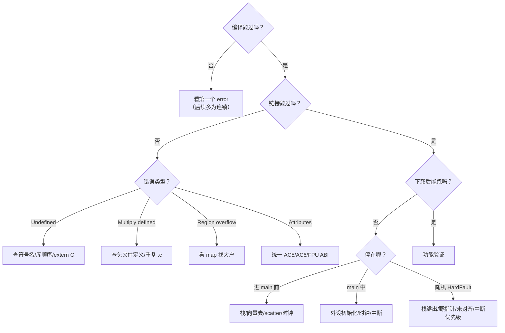

### 16.4 三个典型案例

**案例 1：`undefined reference to HAL_GPIO_Init`**

- 现象：链接报未定义；
- 排查：`main.c` 调用了 HAL，但工程里没加 `stm32f1xx_hal_gpio.c`；
- 处理：加入源文件，或把 HAL 编译成库后正确加入工程；
- 延伸：若使用库，检查库顺序（调用者在被调用者之前）。

**案例 2：`L6220E` 域溢出**

- 现象：加了一个大数组后链接失败；
- 排查：打开 `.map` → `Image component sizes`，找到最大的模块；
- 处理：数组改 `const` 放 Flash、减小缓冲区、开 `--remove`、换大容量芯片；
- 注意：ZI 溢出是 RAM 不够，不要误以为加 Flash 能解决。

**案例 3：上电即 HardFault**

- 现象：下载后一复位就进 HardFault，`main` 没执行；
- 排查：`__initial_sp` 是否指向有效 RAM；栈是否太小；`SystemInit` 是否访问了未使能时钟的外设；向量表是否在 0x08000000；
- 处理：增大 Stack、检查 scatter、确认启动文件与芯片匹配；完整定位方法见 [HardFault定位与故障分析（Cortex-M）](../../../../../../Embedded/NoSystematic/Docs/02-工具链与构建/Keil-ARM构建知识体系/hardfault定位与故障分析_cortex-m/)。

---

## 17. 验证实验：自己动手确认机制

### 17.1 看真实命令

1. `Options for Target → Build Output` 勾选 **Show Command**；
2. Rebuild，观察 `armcc/armclang`、`armasm`、`armlink`、`fromelf` 的完整参数；
3. 切到 `Create Library` 目标，确认出现 `armar`，且没有 `armlink`。

### 17.2 查看 ELF 段与符号

```bash
fromelf --text -z firmware.axf          # 代码/数据大小
fromelf --text -s firmware.axf          # 符号表
fromelf --disassemble firmware.axf      # 反汇编
```

### 17.3 查看库内容

```bash
armar -t  mylib.lib        # 列成员
armar --zs mylib.lib       # 列符号（符号 → 成员 → 偏移）
armar -x  mylib.lib a.o    # 提取成员
```

### 17.4 验证库解析顺序（实测）

1. 建 `A.lib`（其成员调用 `B.lib` 的 `b_func`）；
2. 按 `B.lib A.lib` 链接 → **实测通过**（armlink 5.06u7 默认多遍扫描，顺序不敏感）；
3. 按 `A.lib B.lib` 再链一次 → 同样通过；
4. 若手边有 GNU ld，用同一组库单遍链接对照：`B` 在前会报 `undefined reference`，加 `-Wl,--start-group … -Wl,--end-group` 后通过。

### 17.5 验证 ZI 不占 Flash

1. 定义 `uint8_t big[8192];`（未初始化）；
2. 编译看 `ZI-data` 增加 8192，`.hex` 大小基本不变；
3. 改成 `uint8_t big[8192] = {1};` → `RW-data` 增加，`.hex` 明显变大。

### 17.6 验证 hex 校验和

用 Python 快速验算任意一行：

```python
line = ":1000000020010008410100083D0100083B010008F3"
data = bytes.fromhex(line[1:])
assert sum(data) & 0xFF == 0, "checksum error"
```

> Intel Hex 的性质：**整行所有字节（含校验和）相加，低 8 位为 0**。

---

## 18. 知识点覆盖对照（对话 → 本文）

| # | 原对话知识点 | 本文位置 |
|---|---|---|
| 1 | 按 F7 后的 Build System 调度 | #1.1 一张图看懂：五个产物、两个分支、#2.1 Keil 按下 F7 后最先做什么 |
| 2 | `.d` 依赖文件与时间戳判定 | #2.2 .d 文件是什么、#2.3 判定规则与流程图 |
| 3 | 增量编译边界（改头文件全编） | #2.4 为什么“改一个头文件，半个工程重编” |
| 4 | 预处理五件事 | #4.1 预处理到底做了什么 |
| 5 | 宏展开规则 | #4.2 宏展开的几个硬规则 |
| 6 | 词法/语法/语义/IR/优化/后端 | #5.1 编译器的内部流水线、#5.2 各阶段在做什么、会报什么错 |
| 7 | `.o` 的段、符号表、重定位表 | #6.2 ELF 文件结构、#6.3 段（Section）分类表、#6.4 符号表：链接器眼中的“世界”、#6.5 重定位表：为什么 .o 不能直接运行 |
| 8 | armar 的定位与职责边界 | #7.1 定位与职责边界 |
| 9 | 为什么 Executable 不跑 armar | #7.2 什么时候会跑 armar |
| 10 | `.lib` 内部结构（头/成员/索引） | #7.3 归档文件内部结构 |
| 11 | armar 命令 | #7.4 常用命令 |
| 12 | armar 与 armlink 交互 | #7.5 与 armlink 的完整交互 |
| 13 | 库顺序与多遍扫描（实测校正） | #7.6 库顺序：GNU ld 敏感，armlink 默认多遍（实测）、#8.1 符号解析与按需提取（含单遍模型） |
| 14 | 静态库 vs 动态库 | #7.7 静态库 vs 动态库 |
| 15 | 单遍扫描伪代码 | #8.1.2 伪代码 |
| 16 | 段合并 | #8.2 段合并 |
| 17 | Scatter / LR / ER / RO / RW / ZI | #8.3 内存布局：Scatter 加载域与执行域 |
| 18 | `Image$$...$$Base` 虚拟符号 | #8.3.3 RW 的“加载地址 ≠ 运行地址” |
| 19 | 重定位与 veneer | #8.4 重定位与 veneer（概览）、#12. 重定位类型与越界处理 |
| 20 | `.map` 文件 | #8.5 读懂 .map 文件 |
| 21 | fromelf 与 PT_LOAD | #9.1 fromelf 只看程序头 |
| 22 | bin 的段间空洞 | #9.2 Raw Binary（.bin）生成规则 |
| 23 | Intel Hex 记录与校验和 | #9.3 Intel Hex 格式与校验和算例 |
| 24 | fromelf 命令 | #9.4 常用命令 |
| 25 | 向量表与 `Reset_Handler` | #10.2 向量表、#10.3 Reset_Handler |
| 26 | `__main` / `__scatterload` / `__zero_init` | #10.4 __main 内部顺序、#10.5 __scatterload：RW 拷贝、#10.6 ZI 清零 |
| 27 | 栈堆不初始化 | #10.7 栈与堆 |
| 28 | 标准库 vs MicroLib | #10.8 标准库 vs MicroLib |
| 29 | DWARF 段与 DIE | #11.1 调试信息存在哪里、#11.2 编译单元与 DIE 树 |
| 30 | 行号表与断点 | #11.3 行号表：地址 → 源码行、#11.5 断点机制 |
| 31 | 重定位类型全集 | #12.2 类型分类、#12.3 编码规则与范围 |
| 32 | `relocation out of range` 与 veneer | #12.4 relocation out of range 的成因、#12.5 veneer（长跳转桩） |
| 33 | C++ 名字修饰/构造/vtable/EH/RTTI | #13. C++ 在 ARM 工具链下的额外链接机制 |
| 34 | AC5/AC6 差异 | #3.2 工具链组件对照表、#14. AC5 与 AC6 全面对比 |
| 35 | 生成的流程图 | #1.2 可视化总览：豆包生成流程图 |

---

## 19. 术语表

| 术语 | 英文 | 含义 |
|---|---|---|
| 构建系统 | Build System | Keil 内部调度编译/链接的任务管理器 |
| 编译单元 | Translation Unit | 一个 `.c` 经预处理后的完整文本 |
| 可重定位目标 | Relocatable object | `.o`，地址未定、符号可解析 |
| 归档 | Archive | `.lib`，`.o` 的容器 + 符号索引 |
| 符号解析 | Symbol resolution | 把未定义符号与定义匹配 |
| 重定位 | Relocation | 按最终地址回填指令/数据 |
| 加载域 | Load Region | 烧录到 Flash 的存储位置 |
| 执行域 | Execution Region | 运行时的地址空间 |
| RO / RW / ZI | Read-Only / Read-Write / Zero-Init | 三类段属性 |
| 分散加载 | Scatter loading | 用 `.sct` 描述内存布局 |
| 映像 | Image | 链接后的完整固件（`.axf`） |
| 符号表 | Symbol table | 符号名 → 地址/大小/绑定 |
| 弱符号 | Weak symbol | 可被强符号覆盖的符号 |
| 长跳转桩 | Veneer | 解决跳转越界的中间桩 |
| 调试信息 | DWARF | 地址/类型/变量/行号描述格式 |
| 行号表 | Line table | 地址 ↔ 源码行映射 |
| 半主机 | Semihosting | 通过调试器借用主机 IO |
| 微库 | MicroLib | Keil 精简 C 库 |
| C 运行环境 | CRT | `main` 之前的初始化环境 |
| 向量表 | Vector table | 异常/中断入口地址表 |
| 属性 | Build attributes | `.ARM.attributes` 中的 ABI 标记 |
| 程序头 | Program Header | 装载视角的段描述 |
| 段头 | Section Header | 链接视角的段描述 |
| 入口点 | Entry point | 复位后第一条指令地址 |

---

## 20. 附录

### 20.1 文件类型速查

| 扩展名 | 阶段 | 说明 |
|---|---|---|
| `.uvprojx` | 工程 | XML 工程描述（源文件、配置） |
| `.uvoptx` | 工程 | 调试/界面选项 |
| `.c/.cpp/.h/.s` | 源码 | C/C++/头/汇编 |
| `.d` | 编译 | Makefile 风格依赖清单 |
| `.i` | 预处理 | 预处理输出（默认不落盘） |
| `.s` | 编译 | 汇编输出（`-S` 时可见） |
| `.o` | 汇编 | ELF 可重定位目标 |
| `.crf` | 编译 | 交叉引用/列表文件 |
| `.lst` | 汇编 | 汇编列表 |
| `.lib` | 归档 | 静态库（ar 归档） |
| `.axf` | 链接 | 可执行 ELF（含调试信息） |
| `.map` | 链接 | 地址映射/符号表 |
| `.sct` | 链接 | Scatter 分散加载描述 |
| `.hex` | 转换 | Intel Hex |
| `.bin` | 转换 | Raw Binary |
| `.lnp` | 链接 | 链接输入清单（部分版本） |

### 20.2 命令速查

```bash
# 编译（AC5 / AC6）
armcc   --c99 --cpu Cortex-M3 -c -o main.o main.c
armclang --target=arm-arm-none-eabi -mcpu=cortex-m3 -c -o main.o main.c

# 汇编
armasm --cpu Cortex-M3 -o startup.o startup.s
armclang --target=arm-arm-none-eabi -mcpu=cortex-m3 -c -o startup.o startup.s

# 归档
armar --create libdemo.lib a.o b.o
armar -t libdemo.lib          # 列成员
armar --zs libdemo.lib        # 列符号

# 链接
armlink --cpu Cortex-M3 --scatter demo.sct -o demo.axf a.o b.o --map

# 转换
fromelf --i32 --output demo.hex demo.axf
fromelf --bin --output demo.bin demo.axf
fromelf --disassemble demo.axf
```

### 20.3 Intel Hex 校验和公式

```
CC = (0x100 - (sum(BB, AAAA_hi, AAAA_lo, TT, DD...) & 0xFF)) & 0xFF
```

等价校验：整行字节（含 `CC`）之和的低 8 位为 0。

### 20.4 参考资料

- 豆包分享对话《Keil编译流程与armar.exe解析》（本文主来源，含豆包生成的流程图）；
- ARM Compiler `armar` 用户指南（归档格式与命令）；
- ARM Compiler `armlink` 用户指南（Scatter、veneer、map、`--callgraph`）；
- ARM Compiler `fromelf` 用户指南（`--i32`、`--bin`、`--disassemble`）；
- ARM Compiler `armcc/armclang` 用户指南（优化选项、DWARF、内联汇编）；
- DWARF Debugging Information Format（行号表状态机、DIE）；
- ARM EHABI（`.ARM.exidx/.ARM.extab`）。

> **关于版本**
> 不同 MDK 版本（5.24–5.40+）在选项名、诊断编号、默认行为上略有差异；本文以常见行为为准，具体以你本机 Build Output 与 ARM 文档为准。

### 20.5 版本记录

| 版本 | 日期 | 说明 |
|---|---|---|
| v1.0 | 2026-11-17 | 基于对话整理，补校勘、结构、图与算例 |

---

> **一页纸总结**
> **F7 → 依赖判定 → 编译器一次产出 `.o`（预处理/编译/汇编在进程内完成）→ 二选一：`armar` 打包 `.lib`，或 `armlink` 链接 `.axf` → `fromelf` 只导出 `PT_LOAD` 成 `.hex/.bin`。**
> **`armar` 只归档不链接；`armlink` 只消费库不生产库；库顺序依赖者在前；ZI 不占 Flash；链接无增量。**
> **上电：向量表 → `Reset_Handler` → `__main`（RW 拷贝、ZI 清零、库初始化、C++ 构造）→ `main`。**
