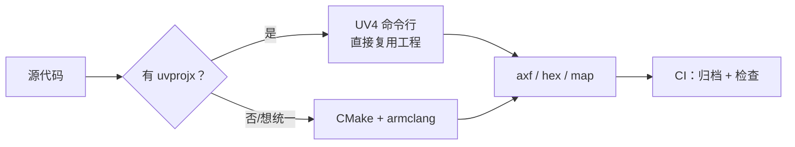

# 命令行与 CI 构建（Keil / ARM）

> **定位**
> 相邻专题第 10 项正式版。目标：让构建**离开 IDE 也能复现**，并接入流水线。

## 1. 两条路线



| 路线 | 优点 | 缺点 |
|---|---|---|
| UV4 批处理 | 零改造，和 IDE 配置完全一致 | 依赖 Keil 安装与许可证；日志难解析 |
| CMake + armclang | 跨平台、可缓存、可生成 `compile_commands.json` | 需要重写工程配置 |

## 2. UV4 批处理

> **〔未实测〕**
> 本节命令与返回码来自工具文档与常见约定，未在本机实际运行 UV4；首次使用请用 `UV4 -h` 核对当前版本。

```bat
UV4 -b Demo.uvprojx -o build.log
```

- `-b`：构建指定工程；
- `-o`：输出日志文件；
- 重建/清理等开关随版本不同，以 `UV4 -h` 为准；
- 退出码（常见约定，随版本略有差异）：

| 退出码 | 含义 |
|---|---|
| 0 | 无错误、无警告 |
| 1 | 有警告 |
| 2 | 有错误 |
| 3 | 致命错误/无法构建 |

> 不同 MDK 版本对返回码的细分可能不同，**不要只依赖退出码**：同时检查日志中的 `Error(s)`/`Warning(s)` 计数更稳。

日志判据（比退出码更可靠）：

```bash
grep -E "Error\(s\)|Warning\(s\)" build.log
grep -E "[0-9]+ Error" build.log && exit 1 || true
```

> 注意：路径含空格/中文时，批处理要加引号；CI 机器需预装对应 MDK 版本与器件 Pack。

## 3. CMake + armclang

### 3.1 toolchain 文件

```cmake
set(CMAKE_SYSTEM_NAME Generic)
set(CMAKE_SYSTEM_PROCESSOR arm)

set(CMAKE_C_COMPILER   armclang)
set(CMAKE_CXX_COMPILER armclang)
set(CMAKE_ASM_COMPILER armclang)

set(CMAKE_C_FLAGS_INIT "--target=arm-arm-none-eabi -mcpu=cortex-m4 \
    -mfpu=fpv4-sp-d16 -mfloat-abi=hard -ffunction-sections -fdata-sections")

set(CMAKE_EXE_LINKER_FLAGS_INIT "--cpu=Cortex-M4 \
    --scatter=${CMAKE_SOURCE_DIR}/link.sct --map --callgraph")

set(CMAKE_TRY_COMPILE_TARGET_TYPE STATIC_LIBRARY)
```

### 3.2 构建与产物

```bash
cmake -B build -G Ninja -DCMAKE_TOOLCHAIN_FILE=armclang.cmake
cmake --build build
fromelf --i32combined --output build/app.hex build/app.axf
```

### 3.3 compile_commands.json

```bash
cmake -B build -DCMAKE_EXPORT_COMPILE_COMMANDS=ON
```

- 只对 Makefile/Ninja 生成器有效；
- 供 clangd、clang-tidy、静态分析使用（见《静态分析与编码规范》）；
- 注意头文件路径与宏要和真实构建一致，否则分析结果失真。

## 4. CI 流水线骨架

```yaml
steps:
  - uses: actions/checkout@v4

  - name: Build
    run: |
      UV4 -b Demo.uvprojx -o build.log
      cat build.log
      ! grep -qE "[1-9][0-9]* Error" build.log

  - name: Static analysis
    run: clang-tidy -p build $(git ls-files '*.c')

  - name: Host tests
    run: cmake -B host -S tests && cmake --build host && ctest --test-dir host

  - uses: actions/upload-artifact@v4
    with:
      name: firmware
      path: |
        Objects/*.hex
        Objects/*.bin
        Objects/*.map
        build.log
```

要点：

- **失败要快**：日志里出现 `Error` 即失败，不要只看退出码；
- **产物齐全**：hex/bin/map/log 全部归档，便于回溯；
- **缓存**：依赖包/Pack 可缓存，但工具链版本要固定。

## 5. 构建期质量关卡

| 关卡 | 手段 |
|---|---|
| 编译告警 | `-Wall -Wextra`，CI 中 `-Werror` |
| 静态分析 | clang-tidy / cppcheck（见专篇） |
| 体积回归 | 解析 map 的 `Code/RO/RW/ZI`，超阈值失败 |
| 栈深回归 | `armlink --callgraph` 生成的 `.htm`（含 Maximum Stack Usage）与基线比对（8.9） |
| 栈保护 | `-fstack-protector-strong` + `__stack_chk_fail` 实现（视工具链支持） |
| 许可与版权 | 扫描第三方库许可证 |

### 5.1 栈保护：canary 与 MPU guard 的分工

| 方案 | 原理 | 优点 | 代价 |
|---|---|---|---|
| `-fstack-protector-strong` | 函数入口写入 canary，返回前校验；被改写则调用 `__stack_chk_fail` | 纯软件，能定位到函数 | 需实现 `__stack_chk_fail`（打印/复位）；有少量开销 |
| MPU guard 区 | 栈底设不可访问区，越界立即 MemManage fault | 实时、硬件强制 | 需 MPU 与 scatter 配合；只保护“越界”不保护“写坏” |
| 栈水位 | 0xCD 填充 + 扫描 | 无运行时开销 | 只能事后评估（8.9） |

> armclang 基于 Clang，支持 `-fstack-protector-strong`；AC5 无对应选项，只能用 MPU/水位。

## 6. 可复现构建

- 固定工具链版本（AC5/AC6 的具体 build 号）、固定 Pack 版本；
- 避免 `__DATE__`/`__TIME__` 进入固件（或统一注入构建号）；
- 统一换行符与编码（UTF-8）；
- 记录 git commit + 工具链版本 + 编译参数到版本字符串。

## 7. 常见坑

| 现象 | 根因 | 处理 |
|---|---|---|
| CI 构建通过但本地失败 | 工具链/Pack 版本不同 | 固定版本，写入镜像 |
| 路径中文报错 | 编译器对非 ASCII 路径支持差 | 用纯英文路径 |
| 并行构建不稳定 | 依赖声明不完整 | 串行或补依赖 |
| map 体积波动 | 优化/链接顺序变化 | 固定参数，比较趋势 |
| 许可证失败 | CI 无 Keil license | 用 license server 或改 CMake 路线 |

## 8. 与构建文档的关系

- 工具链真实命令（3.3）；
- 依赖与增量（第 2 章）；
- 链接参数与 map（8.6）；
- 栈分析（8.9）。
