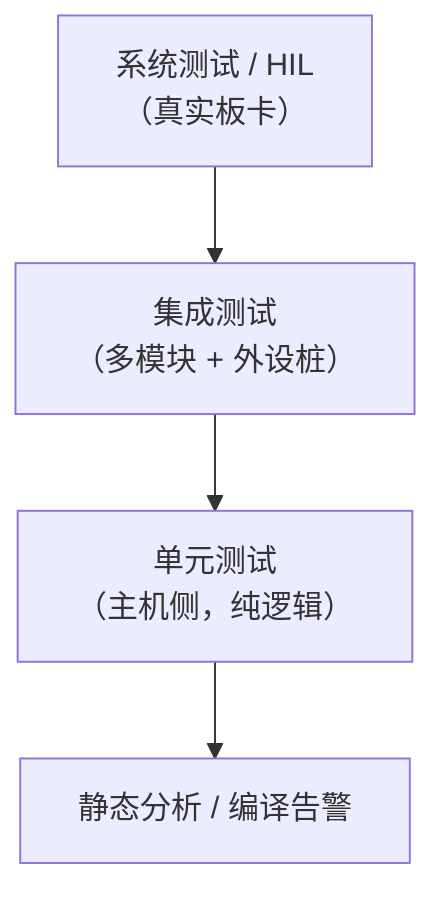

# 测试与覆盖率（嵌入式）

> **定位**
> 相邻专题第 12 项正式版。嵌入式测试的关键不是“写不写测试”，而是**把硬件依赖隔离出去**，让大部分逻辑能在主机上跑。

## 1. 测试分层



| 层 | 跑在哪 | 速度 | 价值 |
|---|---|---|---|
| 单元 | PC | 毫秒 | 逻辑正确性、回归 |
| 集成 | PC + 桩 | 秒 | 模块交互 |
| HIL | 真实板 | 分钟 | 时序、外设、电气 |
| 系统 | 整机 | 小时 | 业务闭环 |

## 2. 主机侧单元测试

### 2.1 工程结构

```
src/            业务逻辑（不直接碰寄存器）
hal/            硬件抽象接口
tests/          Unity 测试
  test_pid.c
  unity/        Unity 源码
```

### 2.2 Unity 最小示例

```c
#include "unity.h"
#include "pid.h"

void setUp(void) {}
void tearDown(void) {}

static void test_pid_output_limited(void)
{
    pid_t pid;
    pid_init(&pid, 1.0f, 0.1f, 0.0f, -100.0f, 100.0f);
    TEST_ASSERT_EQUAL_FLOAT(100.0f, pid_update(&pid, 1000.0f, 0.0f));
}

int main(void)
{
    UNITY_BEGIN();
    RUN_TEST(test_pid_output_limited);
    return UNITY_END();
}
```

### 2.3 打桩（Mock）

- **CMock** 可根据头文件自动生成 mock；
- 手工桩：实现 `hal_uart_write()` 记录调用参数，断言“发了什么”；
- 原则：**业务代码只依赖抽象接口**，不直接 `#include "stm32f1xx_hal.h"`。

## 3. 覆盖率

### 3.1 主机侧（gcov/lcov）

```bash
gcc --coverage -O0 -I src tests/test_pid.c src/pid.c -o test_pid
./test_pid
gcov pid.c
lcov --capture --directory . --output-file coverage.info
genhtml coverage.info --output-directory coverage_html
```

| 指标 | 含义 |
|---|---|
| 行覆盖 | 执行到的源码行比例 |
| 分支覆盖 | 条件分支的两侧是否都走到 |
| 函数/调用覆盖 | 是否被调用 |

> 嵌入式更关注**分支覆盖**；行覆盖高但分支没走全，等于没测到边界。

### 3.2 目标侧覆盖率

- 通过 ITM/SWO 或串口输出命中信息（见《调试硬件与 trace》）；
- 或在 RAM 里维护位图，测试结束读出；
- 代价：插桩影响时序，需评估实时性。

## 4. HIL（硬件在环）

- 用脚本驱动真实板卡（串口/CAN/USB）；
- 断言输出、时序、功耗；
- 适合验证：外设初始化、通信协议、低功耗唤醒、升级流程。

## 5. 回归策略

| 策略 | 做法 |
|---|---|
| 冒烟 | 每次提交跑核心 10% 用例 |
| 全量 | 每夜跑全部单元 + 集成 |
| 版本基线 | 发布前冻结用例与结果 |
| 缺陷回归 | 每个 bug 补一条用例 |

## 6. 常见坑

| 现象 | 根因 | 处理 |
|---|---|---|
| 测试通过但板子跑不对 | 测试与固件编译选项不同 | 统一 `-O0`/宏定义 |
| mock 与真实行为不一致 | 桩实现简化过度 | 用真实协议/时序核对 |
| 覆盖率虚高 | 只测直线路径 | 补边界与异常分支 |
| 测试依赖硬件 | 未做 HAL 抽象 | 先重构接口 |
| 浮点比较失败 | 精度问题 | 用容差比较 |

## 7. 与构建文档的关系

- 编译选项与优化（5.3）；
- 调试输出（10.11）；
- CI 流水线（命令行与 CI 构建）。
