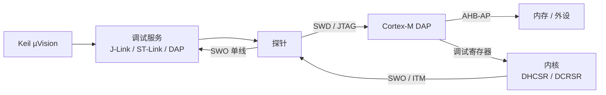

# 调试硬件与 trace（Cortex-M）

> **验证状态**
> 本章的**SWO/ITM/DWT 与探针行为**基于 ARM 文档与工程经验，**尚未在真实板卡/探针上实测**；关键数值请以实机行为为准。

> **定位**
> 本文是相邻专题第 6 项「调试硬件与 trace」的正式版。回答三件事：**怎么连上**（SWD/JTAG）、**怎么在读的同时不打断**（SWO/ITM）、**怎么量化时间**（DWT）。

## 1. 调试链路总览



- **探针**负责电气协议；**DAP** 把“读内存/写寄存器/暂停/单步”翻译成总线访问；
- 暂停、单步、断点走内核调试寄存器（`DHCSR` 等），与 ISP 串口下载是两套机制，只是共用引脚；
- trace（SWO/ETM）是**单向输出**：目标 → 主机，不打断 CPU。

## 2. SWD 与 JTAG

### 2.1 引脚与时序

| 项目 | SWD | JTAG |
|---|---|---|
| 数据线 | `SWDIO`（双向） | `TDI` + `TDO` |
| 时钟 | `SWCLK` | `TCK` |
| 模式选择 | — | `TMS` |
| 可选 | `nRESET`、`SWO` | `TRST`、`SRST` |
| 线数 | 2 + GND（+VREF） | 4–5 + GND |
| 拓扑 | 点对点为主 | 菊花链（多器件） |

### 2.2 协议要点

- 上电后先发 **≥50 个时钟的高电平**（line reset），让目标进入 SWD 状态；
- 从 JTAG 切到 SWD 需发切换序列 `0xE79E`（16 位）；
- 每个包有 **ACK**（OK / WAIT / FAULT）与奇偶校验；
- 主机与目标之间有 **turnaround** 周期（通常 1–3 个时钟），高速时更明显；
- 速率不是越高越好：线长、上拉、目标主频都会影响；连不上时先降速。

### 2.3 SWD 引脚被复用

STM32 的 `PA13/PA14` 默认是 SWD；若代码把它们重映射成 GPIO，或在低功耗模式下关闭调试，探针就连不上。

对策：

1. **Connect under reset**：探针按住复位、在复位期间访问；
2. 启动代码里加延时，给探针留连接窗口；
3. 保留 SWD 引脚，不挪作他用（或至少上电后延时再重映射）。

## 3. SWO 与 ITM：不打断的 printf

### 3.1 原理

- **SWO**：单线异步串行（NRZ，部分内核支持 Manchester），由 `TRACECLK`/CPU 时钟分频得到波特率；
- **ITM**：Instrumentation Trace Macrocell，32 个激励端口（0–31）；
- 常用约定：**port 0 做 printf**，port 1 给 RTOS/Event Recorder，port 2 给自定义事件。

### 3.2 ITM printf 的正确写法

```c
#include "core_cm4.h"

int ITM_SendChar(int ch)
{
    if ((ITM->TCR & ITM_TCR_ITMENA_Msk) &&
        (ITM->TER & 1UL)) {                 /* 端口 0 已使能 */
        while (ITM->PORT[0].u32 == 0) { }   /* 等 FIFO 就绪 */
        ITM->PORT[0].u8 = (uint8_t)ch;
    }
    return ch;
}
```

> **无调试器时会卡死**
> `while (ITM->PORT[0].u32 == 0)` 在**没有调试器/没使能 ITM** 时不返回（或返回 0 进入死等）。量产固件必须：
> - 用 `DEMCR.TRCENA` 或“调试器已连接”标志做守卫；或
> - 加超时退出；或
> - 编译期开关整个 ITM 输出。

### 3.3 SWO 时钟与波特率

```
SWO 位率 ≈ TRACECLK / (ACPR + 1)
```

- `TRACECLK` 在 Cortex-M 上通常取 **HCLK**（以芯片手册为准）；
- `ACPR` 是 TPIU 的异步时钟预分频；
- Keil 的 Trace 设置里填 **Core Clock** 与 **SWO 时钟**，工具据此换算；
- 例：72 MHz 主频、分频 4 → 18 MHz 位率；探针与线材要支持该速率；
- **配错的典型表现**：能连上、能断点，但 ITM 输出全是乱码或完全无数据。

> 排查顺序：先降 SWO 时钟（如 1–2 MHz）确认有数据，再逐步提速。

### 3.4 Keil 侧配置

| 位置 | 设置 |
|---|---|
| Debug → Settings | Port = SWD；Max Clock 先降速 |
| Trace 选项卡 | **Core Clock** 填实际主频（如 72 MHz） |
| Trace | SWO 时钟 / 波特率（与探针能力匹配） |
| Trace | 勾选 ITM 端口 0（printf） |
| 查看窗口 | Trace / ITM Viewer 或 Event Recorder（随版本） |

> 常见错误：Core Clock 填错 → SWO 数据全是乱码；SWO 引脚（常为 PB3/JTDO）未配置为复用功能 → 无输出。

## 4. DWT：用周期计数器量时间

### 4.1 初始化

```c
static inline void dwt_init(void)
{
    CoreDebug->DEMCR |= CoreDebug_DEMCR_TRCENA_Msk;  /* 使能 trace 单元 */
    DWT->CYCCNT = 0;
    DWT->CTRL  |= DWT_CTRL_CYCCNTENA_Msk;            /* 启动周期计数 */
}

static inline uint32_t dwt_cycles(void) { return DWT->CYCCNT; }
```

### 4.2 测一段代码

```c
uint32_t t0 = dwt_cycles();
critical_work();
uint32_t dt = dwt_cycles() - t0;          /* 无符号相减，自动处理回绕 */
uint32_t us = dt / (SystemCoreClock / 1000000U);
```

要点：

- `CYCCNT` 是 **32 位**，72 MHz 下约 **59.6 秒**回绕一次；**换主频要重算**（168 MHz 时约 **25.6 秒**），不要把 59.6 s 当通用常数；用无符号减法可安全跨回绕；
- 测量期间最好关中断，避免被中断“摊薄”；
- 编译器优化可能删掉空循环，测量代码要有可见副作用。

### 4.3 DWT 的其他用途

| 功能 | 说明 |
|---|---|
| 数据观察点 | 比较器命中即暂停/触发，查“谁改了这个变量” |
| PC 采样 | 粗略性能分析（采样 PC，统计热点） |
| 异常/睡眠计数 | `CPICNT`/`EXCCNT`/`SLEEPCNT` 统计 |

## 5. ETM 与指令 trace

- **ETM** 输出“执行过哪些指令”的压缩流，需要 **TPIU + 并行 trace 引脚**（多根），带宽高；
- ETM 是**可选组件**：M3/M4/M7 的常见实现带 ETM，M0/M0+ 没有；
- 用途：崩溃前指令流、中断时序、覆盖率；
- 支持 ETM 的探针通常是高端型号（J-Trace、ULINKpro 等），J-Link 需看具体型号与目标引脚。

> 多数项目用 **SWO + ITM + DWT** 就够；ETM 属于“有则更好”的深挖手段。

## 6. 探针对比

| 探针 | 协议 | trace | 生态 | 适用 |
|---|---|---|---|---|
| J-Link | SWD/JTAG | SWO；部分型号 ETM | 全平台 | 通用、速度好 |
| ST-Link | SWD/JTAG | SWO（V2/V3 有限） | STM32 为主 | 低成本 STM32 |
| CMSIS-DAP | SWD/JTAG | SWO（依固件） | 开放标准 | 教学、自研板 |
| ULINK2/plus | SWD/JTAG | SWO / ETM（plus/pro） | Keil 原生 | Keil 深度用户 |
| Black Magic | SWD/JTAG | 有限 | 开源 | GDB 工作流 |

选型看三点：**目标芯片支持什么**、**你要不要 trace**、**调试器软件是否支持**。

## 7. Keil 调试配置清单

- [ ] Debug → Use 选对探针；
- [ ] Port 选 SWD（除非板子只出 JTAG）；
- [ ] Max Clock 先 1 MHz，连上再提速；
- [ ] Reset 方式：Normal / Hardware / SYSRESETREQ / Core（低功耗或看门狗场景要试）；
- [ ] Trace → Core Clock 与实际主频一致；
- [ ] 需要 printf 时开 ITM port 0；
- [ ] 需要事件时开 Event Recorder（可走 ITM 或 RAM 缓冲）。

## 8. 常见问题

| 现象 | 常见原因 | 处理 |
|---|---|---|
| No target connected | 供电/地、SWDIO 与 SWCLK 接反、复位被拉低 | 查线、查供电、Connect under reset |
| 能连但一运行就断 | 低功耗/看门狗复位、时钟切换 | 改复位方式、调试期关看门狗 |
| SWO 无输出 | Core Clock 错、SWO 引脚未复用、ITM 未使能 | 核对时钟与引脚配置 |
| SWO 乱码 | 波特率/时钟不匹配 | 降 SWO 时钟 |
| 断点不命中 | 优化、代码未下载、断点数量超限 | 关优化、重新下载、用硬件断点 |
| 变量显示 `<optimized out>` | 优化把变量放寄存器 | `volatile`、`-O0` |
| 连接被拒绝 | RDP 读保护、调试口锁定 | 解除保护（会全片擦除） |
| 停在 HardFault | 见另一篇 | [HardFault定位与故障分析（Cortex-M）](../../../../../../Embedded/NoSystematic/Docs/02-工具链与构建/Keil-ARM构建知识体系/hardfault定位与故障分析_cortex-m/) |

## 9. 与构建文档的关系

- 调试器加载 `.axf` 的 `PT_LOAD`（构建文档 9.1、11.6）；
- 行号/变量来自 DWARF（11.1–11.4）；
- 断点用 `BKPT`/DWT（11.5）；
- 优化对调试的影响（11.7）。

## 10. 速查

```
SWD: SWDIO / SWCLK / GND / VREF (+nRESET, SWO)
SWO 引脚: 常见 PB3（STM32，需复用配置）
ITM 基址: 0xE0000000    TPIU: 0xE0040000
DWT: 0xE0001000  CYCCNT: 0xE0001004
DEMCR: 0xE000EDFC（bit24 TRCENA）
DHCSR: 0xE000EDF0
```
