# Windows 构建环境：MSYS2 与 Cygwin

> **本文定位**
> 在 Windows 上获得类 Unix 工具链的两条路：**MSYS2**（轻量，产出原生 Windows 程序）与 **Cygwin**（完整 POSIX 兼容层）。
> 两者都能编译 SDL 1.2.15 这类跨平台库；本文给出安装、换源、常用工具、验证与排错的完整流程。

> **一分钟选型**
> | 你的需求 | 选择 |
> |---|---|
> | 编译**原生 Windows EXE/DLL**，不依赖额外 DLL | **MSYS2** |
> | 跑 Linux 脚本 / 服务，需要完整 POSIX 环境 | **Cygwin** |
> | 只要 gcc / make / cmake + 包管理 | **MSYS2（UCRT64 终端）** |

---

## 一、MSYS2：轻量编译环境

MSYS2 集成了 **pacman 包管理器**、MinGW 工具链与 GNU 工具，可编译 Linux / Unix 软件，也是 Windows 上搭建 C/C++ 开发环境的常用选择。

### 1.1 系统要求

- Windows 10 1809+ / Windows 11（64 位）
- NTFS 分区，至少 2 GB 空闲空间
- 安装路径**无中文、无空格、无特殊字符**（推荐 `C:\msys64`）

### 1.2 下载

- 官网：<https://www.msys2.org/>
- 安装包：`msys2-x86_64-latest.exe`
- 国内镜像（更快）：
  - 中科大：<https://mirrors.ustc.edu.cn/msys2/distrib/msys2-x86_64-latest.exe>
  - 清华：<https://mirrors.tuna.tsinghua.edu.cn/msys2/distrib/msys2-x86_64-latest.exe>

### 1.3 安装步骤

1. 运行安装程序，点击 **Next**。
2. 安装路径保持默认 `C:\msys64`（纯英文、无空格），避免编译报错。

   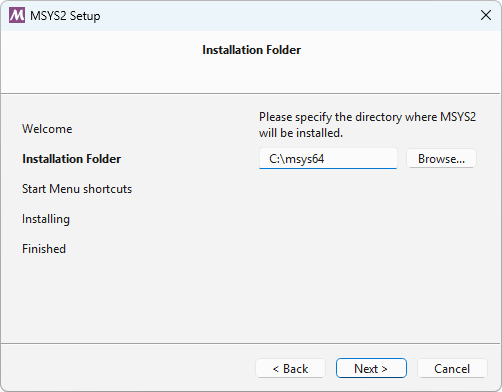

3. 开始菜单文件夹默认，点击 **Next** → **Install**。
4. 勾选 **Run MSYS2 now**，点击 **Finish**。

   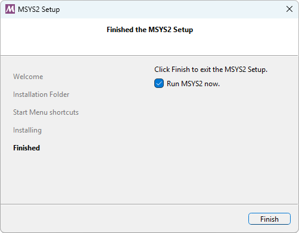

### 1.4 首次更新（关键）

安装完成后会自动打开 **MSYS2 UCRT64** 终端：

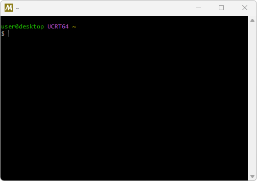

```bash
pacman -Syu
```

提示 `==> Please close the terminal` 时，**关闭当前终端**，从开始菜单重新打开，再执行：

```bash
pacman -Su
```

### 1.5 配置国内镜像（提速）

编辑 `C:\msys64\etc\pacman.d\mirrorlist.msys`，注释原有 `Server`，加入：

```text
Server = https://mirrors.tuna.tsinghua.edu.cn/msys2/msys/$arch
```

编辑 `C:\msys64\etc\pacman.d\mirrorlist.mingw64`，加入：

```text
Server = https://mirrors.tuna.tsinghua.edu.cn/msys2/mingw/x86_64
```

刷新缓存：

```bash
pacman -Sy
```

### 1.6 终端怎么选

| 终端 | 用途 | 建议 |
|---|---|---|
| MSYS2 UCRT64 | 现代 C 运行时，兼容性与性能更好 | **日常开发首选** |
| MSYS2 MINGW64 | 经典 64 位 MinGW 环境 | 兼容老工程 |
| MSYS2 MSYS | 类 Unix 环境，编译 Linux 工具 | 特定场景 |

### 1.7 安装常用工具

在 **UCRT64** 终端执行：

```bash
# 完整工具链：gcc / g++ / gdb / make / binutils
pacman -S mingw-w64-ucrt-x86_64-toolchain

# 构建与编辑工具
pacman -S mingw-w64-ucrt-x86_64-cmake mingw-w64-ucrt-x86_64-ninja
pacman -S git vim
```

验证：

```bash
gcc --version
g++ --version
make --version
cmake --version
```

> **加到系统 PATH（可选）**
> 想让 CMD / PowerShell 直接用 MSYS2 工具，把下面两项加入系统变量 `Path`：
> `C:\msys64\ucrt64\bin`、`C:\msys64\usr\bin`，保存后重启终端。

### 1.8 测试：编译 SDL 1.2.15

```bash
# 安装 X11、OpenGL 依赖
pacman -S mingw-w64-ucrt-x86_64-libX11 mingw-w64-ucrt-x86_64-mesa

# 下载、解压、编译
wget https://www.libsdl.org/release/SDL-1.2.15.tar.gz
tar -zxvf SDL-1.2.15.tar.gz
cd SDL-1.2.15
./configure --prefix=/ucrt64
make -j8
make install
```

### 1.9 MSYS2 常见问题

| 现象 | 处理 |
|---|---|
| `pacman` 下载慢 / 失败 | 配置清华或中科大镜像（1.5） |
| 编译报错：路径含中文 / 空格 | 重装到 `C:\msys64` |
| 命令找不到（如 gcc） | 确认打开的是 **UCRT64 / MINGW64** 终端，而不是 MSYS；检查 PATH 是否含 `...\ucrt64\bin` |
| 更新时提示关闭终端 | 关闭后重开，再执行 `pacman -Su` |

---

## 二、Cygwin：完整 POSIX 兼容层

**Cygwin** 通过 `cygwin1.dll` 模拟 POSIX 接口，可以直接运行 GNU 工具、Shell 脚本与 Linux 软件。

### 2.1 Cygwin 与 MSYS2 的区别

| 特性 | **Cygwin** | **MSYS2** |
|---|---|---|
| 核心定位 | 完整 POSIX 兼容层 | 轻量编译环境（Cygwin 精简版） |
| 运行依赖 | 必须带 `cygwin1.dll` | 命令依赖 `msys-2.0.dll`，编译用 MinGW 原生 |
| 编译产物 | 依赖 Cygwin DLL，**不能独立分发** | 原生 Windows EXE/DLL，无额外依赖 |
| 包管理器 | `setup.exe`（图形 / 命令行） | `pacman`（速度快、功能强） |
| 软件库 | 极全（10000+ 包，含 X11、服务） | 够用（开发工具、库、编译器） |
| 适合场景 | 跑 Linux 脚本、服务、完整环境 | 编译 Windows 程序、交叉编译 |

> **一句话建议**
> 要**完整 Linux 体验、跑服务 / 脚本** → Cygwin；要**原生 Windows 程序、轻量环境** → MSYS2。

### 2.2 安装步骤

1. 下载安装器：官网 <https://cygwin.com/setup-x86_64.exe>；国内镜像：
   - 清华 <https://mirrors.tuna.tsinghua.edu.cn/cygwin/setup-x86_64.exe>
   - 中科大 <https://mirrors.ustc.edu.cn/cygwin/setup-x86_64.exe>
2. 运行 `setup-x86_64.exe` → **Next**。

   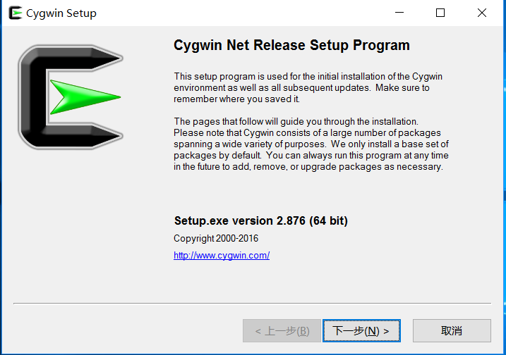

3. **Install from Internet**（在线安装）→ **Next**。

   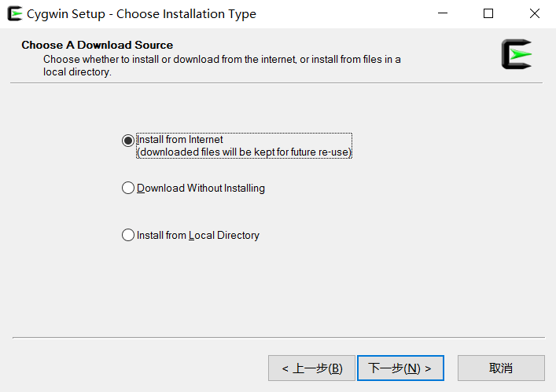

4. **Root Directory**：默认 `C:\cygwin64`（无中文、无空格），All Users → **Next**。

   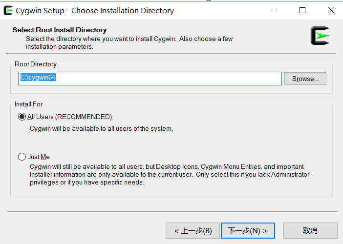

5. **Local Package Directory**：默认即可 → **Next**。

   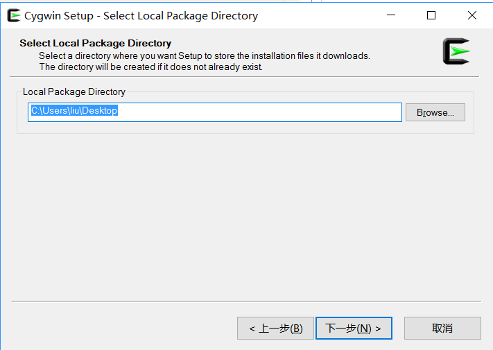

6. **Direct Connection**（直连）→ **Next**。

   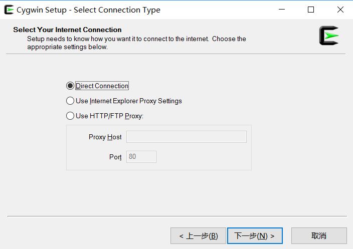

7. **Choose Download Site**：选清华或中科大镜像 → **Next**。

   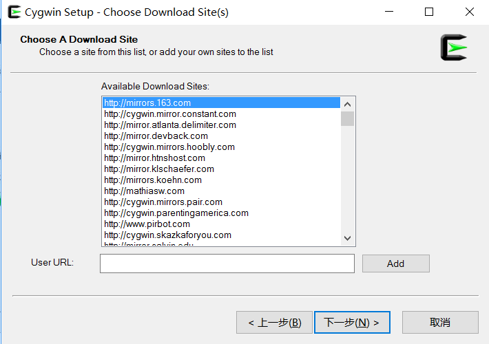
8. **Select Packages**：搜索并点 **Skip** 切换为版本号（出现绿色勾选即选中）。建议安装：

   ```text
   # 基础命令
   bash, coreutils, grep, sed, awk, vim, nano, wget, curl, git
   # 开发工具
   gcc, g++, make, gdb, cmake
   # 网络
   openssh, inetutils
   ```

   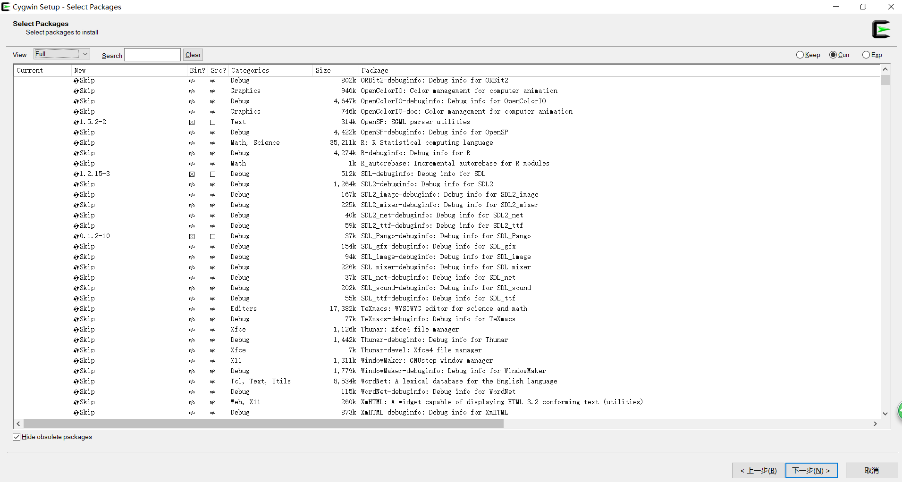

9. **Next** → 同意安装依赖 → 等待完成 → **Finish**。

   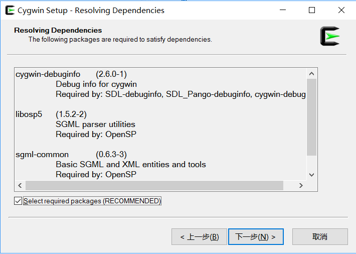

### 2.3 首次使用与包管理

- 双击 **Cygwin64 Terminal**，首次启动会创建 `/home/你的用户名`。
- 出现 `用户名@主机名 ~ $` 即成功。
- 增删软件：重新运行 `setup-x86_64.exe`，到 **Select Packages** 勾选 / 选 Uninstall。
- 静默安装示例：

```bash
setup-x86_64.exe -q -P git,vim,gcc,make
```

### 2.4 路径映射

| Windows | Cygwin |
|---|---|
| `C:\` | `/cygdrive/c/` |
| `D:\` | `/cygdrive/d/` |

例如访问 `D:\project`：

```bash
cd /cygdrive/d/project
```

### 2.5 编译测试

```c
#include <stdio.h>
int main(void) {
    printf("Hello, Cygwin!\n");
    return 0;
}
```

```bash
gcc hello.c -o hello
./hello
ldd hello.exe     # 必须带 cygwin1.dll
```

### 2.6 Cygwin 常见问题

| 现象 | 处理 |
|---|---|
| 下载慢 / 失败 | 换清华或中科大镜像 |
| 命令找不到（如 gcc） | 重新运行 `setup-x86_64`，安装对应包 |
| Windows 与 Cygwin 互操作 | Cygwin 里可直接运行 `.exe`；Windows 访问 Cygwin 目录用 `C:\cygwin64\home\用户名` |
| 编译的程序换机不能运行 | Cygwin 程序必须附带 `cygwin1.dll`（在 `C:\cygwin64\bin`） |

---

## 三、怎么选：给本库读者的结论

- 只是**在 Windows 上编译 SDL / FFmpeg / 小型 C 工程** → MSYS2（UCRT64），产物可直接分发。
- 需要**完整 Shell、服务、复杂 Linux 工程移植** → Cygwin，接受 DLL 依赖。
- 真正的嵌入式目标（ARM Linux / 裸机）→ 不要停在 MSYS2，继续用 [交叉编译与工具链](../../../../../../Embedded/NoSystematic/Docs/02-工具链与构建/交叉编译与构建知识体系/交叉编译与工具链/)。

## 相关笔记

- [SDL1.2.15 移植与编译指南](../../../../../../Embedded/NoSystematic/Docs/02-工具链与构建/交叉编译与构建知识体系/sdl1_2_15_移植与编译指南/) —— 本文的配套实战：在 Linux 原生与交叉编译 SDL
- [交叉编译与工具链](../../../../../../Embedded/NoSystematic/Docs/02-工具链与构建/交叉编译与构建知识体系/交叉编译与工具链/) —— 工具链组成、命名前缀与常见问题
- [Makefile与CMake](../../../../../../Embedded/NoSystematic/Docs/02-工具链与构建/交叉编译与构建知识体系/makefile与cmake/) —— 环境装好之后，工程怎么组织

> **截图来源**
> MSYS2 截图来自官网 <https://www.msys2.org/>；Cygwin 安装向导截图来自 [CSDN 图文教程](https://blog.csdn.net/weixin_44917365/article/details/142921778)（2019 年版界面，与现版向导页面基本一致）。原笔记的签名外链已过期失效，2026-11-18 全部本地化至 `assets/Windows构建环境/`。
