# 电机知识体系详解：术语 · 分类 · 编码器 · 闭环 · 选型

> **本文定位**
> 本文是对分享对话《电机，舵机，直流电机，减速电机，马达，编码器，无刷电机，步进电机……》的**大幅度扩展版整理**。原对话回答的是“这些词什么意思”；本文在此基础上补全了**术语层级、九维分类体系、各类型电机拆解、编码器与霍尔传感器、闭环控制与 PID、42 步进闭环改造、370/MG 系列选型**等内容，并配有 **30 张 Mermaid 流程图/结构图**、**60 余张分类与对比表**、**公式速查**与**检查清单**。
>
> 原始对话的精简版总结未随本库收录；本文保留扩展后的全部内容，与简版不重复、不冲突。

> **数据可信度约定**
> - **[对话结论]**：原对话经过联网搜索后给出的判断，本文忠实保留。
> - **[工程补充]**：为把问题讲透而补的通用工程知识（教科书/行业通识层面），不是原对话内容。
> - **[待核实]**：原对话中来源单一、不同网页说法冲突、或明显属于某一卖家口径的参数，采购前必须查规格书。
> - 所有具体型号参数（370、MG370、MG310、42 步进等）均为**典型值/参考值**，不同批次、不同卖家、不同减速比差异很大。

---

## 0. 阅读指南

### 0.1 按目的跳转

| 你的目的 | 直接看 | 预计耗时 |
|---|---|---|
| 5 分钟搞懂这些词的关系 | #1. 全景速览 | 5 min |
| 搞清楚“谁包含谁、谁是谁的零件” | #2. 术语层级：谁包含谁 | 15 min |
| 写报告/做 PPT，要完整分类树 | #3. 市面电机的九维分类体系 | 30 min |
| 了解某类电机的结构与原理 | #4. 常见电机类型逐一拆解 | 40 min |
| 搞懂霍尔、编码器、GMR 的区别 | #5. 编码器与位置传感器体系 | 25 min |
| 搞懂闭环、PID、三环控制 | #6. 闭环控制体系：从开环到三环 | 25 min |
| 想把 42 步进改成闭环 | #7. 专题：42 步进电机闭环改造 | 20 min |
| 在 370 / MG370 / MG310 之间选 | #8. 专题：370、众灵、MG370、MG310 | 20 min |
| 给一个新项目做选型 | #9. 选型方法论：从需求到型号 | 30 min |
| 查公式、单位、术语对照 | #12. 附录：公式、单位与速查表 | 随时 |

**完整章节目录**

1. #1. 全景速览 —— 一句话版本、十二条结论、全景关系图
2. #2. 术语层级：谁包含谁 —— 词条表、层级图、六个易混点
3. #3. 市面电机的九维分类体系 —— 九维分类树、交叉命名法
4. #4. 常见电机类型逐一拆解 —— 有刷/无刷/异步/步进/伺服/减速/直线
5. #5. 编码器与位置传感器体系 —— 霍尔、编码器、PPR/CPR、A/B/Z
6. #6. 闭环控制体系：从开环到三环 —— PID、三环、故障排查
7. #7. 专题：42 步进电机闭环改造 —— 磁柱、链路、校准、精度
8. #8. 专题：370、众灵、MG370、MG310 —— 参数、对比、决策树
9. #9. 选型方法论：从需求到型号 —— 计算、算例、检查清单
10. #10. 常见误区与 FAQ —— 十个误区、二十问
11. #11. 术语中英对照表 —— 40+ 术语
12. #12. 附录：公式、单位与速查表 —— 公式、换算、型号速查

### 0.2 文档地图

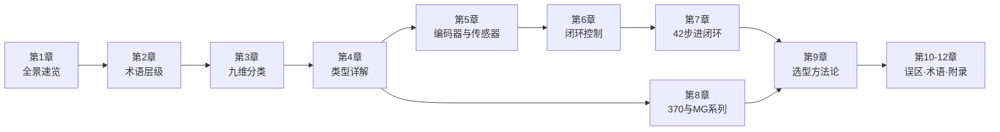

### 0.3 三层认知模型（全文的组织逻辑）

理解电机领域的混乱，根源在于**把三个不同层级的东西放在一起比较**。本文始终按下面三层来组织：

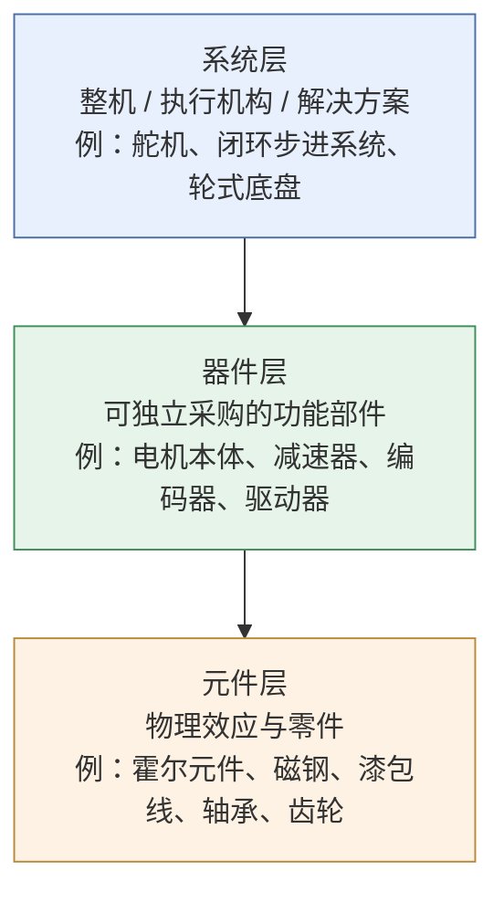

- **元件层**回答“靠什么物理效应工作”（霍尔效应、电磁感应、磁阻效应、逆压电效应）。
- **器件层**回答“这个部件能单独买、单独换吗”（电机、编码器、减速器、驱动器）。
- **系统层**回答“它是不是一个已经封装好的完整方案”（舵机 = 电机 + 减速 + 反馈 + 驱动；闭环步进 = 步进 + 编码器 + 闭环驱动器）。

**大量混淆都来自层级错位**：把“编码器”和“电机”并列（一个是器件、一个是另一类器件）、把“舵机”和“无刷电机”并列（一个是系统、一个是器件）、把“霍尔传感器”说成“编码器”（一个是元件、一个是器件）。

---

## 1. 全景速览

### 1.1 一句话版本

> **电机（马达）是总称；直流/交流是按电源分，同步/异步/直流是按原理分，驱动/控制是按用途分；无刷是直流的技术分支，步进与伺服是控制电机的两大代表；舵机是“电机+减速+反馈+驱动”的集成系统，减速电机是“电机+减速器”的组合，编码器是反馈传感器而不是电机；所谓“闭环”，本质是给执行器补上“眼睛（编码器）+ 大脑（控制器）”。**

### 1.2 十二条核心结论

1. **“电机”是总称，“马达（Motor）”是俗称**，二者基本同义；日常语境里的“电机”绝大多数指**电动机**（电能→机械能），与之并列的是**发电机**（机械能→电能）。[对话结论]
2. **这些词不在同一层级**：无刷电机 ⊂ 直流电机；步进、伺服 ⊂ 控制电机；舵机是**成品系统**；减速电机是**组合体**；编码器是**传感器**。[对话结论]
3. **电机没有唯一“完美”分类法**，必须多维度交叉看：同一台“三相异步防爆电机”同时体现了电源（交流三相）、原理（异步）、用途（驱动）、环境（防爆）四个属性。[对话结论]
4. **42 步进“带磁柱”≠ 闭环**。磁柱只是尾部预留的磁铁安装位，真正闭环还需要：径向磁铁 + 磁编码器芯片 + 闭环驱动器/控制器。[对话结论]
5. **“众灵 370”大概率是标准 370 有刷直流电机**；众灵更像机器人开发/套件/控制方案品牌或社区，而非电机原厂。[对话结论][待核实]
6. **MG370 不是严格标准型号**，更像“带编码器接口的 370 减速电机平台”，常见于轮趣科技等创客品牌；分**霍尔版**与 **GMR 版**，且存在“有刷/无刷”口径冲突，买前必须确认。[对话结论][待核实]
7. **MG310 定位轻负载高精度**：扭矩约 0.4 kgf·cm、连续电流约 1100 mA，动力弱于 MG370，但 GMR 版定位精度高、响应快。[对话结论]
8. **霍尔传感器是元件，编码器是器件/功能类别**。霍尔可以做编码器（霍尔编码器），但编码器还可以是光电、GMR/TMR、电容、感应、旋变等。[对话结论]
9. **“霍尔版 / GMR 版”都是磁编码器**，但分辨率差几个数量级：13 线磁环只能做速度闭环，500 线 GMR 才能做像样的位置闭环。[对话结论]
10. **闭环三要素 = 执行器 + 反馈传感器 + 控制器/驱动器**；PID 的作用是根据“目标 − 反馈”的偏差动态修正输出。[工程补充]
11. **加编码器不会提升扭矩和最高转速**，它解决的是“丢步、精度、稳定性”，不是“更有劲”。[对话结论]
12. **选型的本质是权衡**：负载（扭矩）× 速度（转速）× 精度（反馈分辨率）× 体积重量 × 成本 × 控制器能力，六个变量里最多同时满足四个。[工程补充]

### 1.3 全景关系图

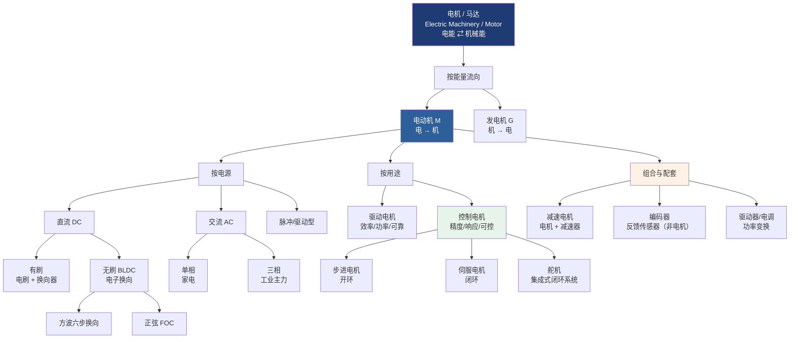

### 1.4 学习路径建议


> **学习顺序的经验**
> 不要按“型号”学，要按“**能量变换 → 控制方式 → 反馈方式**”三条主线学。学会一条主线，绝大多数型号名你都能自己拆解（见 3.12 交叉命名法）。

---

## 2. 术语层级：谁包含谁

### 2.1 基础词条

| 术语 | 英文 | 符号 | 定义 | 边界说明 |
|---|---|---|---|---|
| 电机 | Electric machinery | — | 实现电能与机械能相互转换的电磁装置总称 | 包含电动机与发电机 |
| 马达 | Motor | — | “电动机”的俗称，源自英文 Motor | 日常与“电机”基本同义 |
| 电动机 | Electric motor | M | 把电能转换为机械能 | 日常说“电机”多指它 |
| 发电机 | Generator | G | 把机械能转换为电能 | 与电动机可逆（同一台机可作两用） |
| 直流电机 | DC motor | — | 使用直流电工作的电机 | 广义含无刷；狭义常指有刷 |
| 无刷直流电机 | BLDC | — | 用电子换向替代机械电刷的直流电机 | 属直流电机的技术分支 |
| 交流电机 | AC motor | — | 使用交流电工作的电机 | 分单相/三相；分同步/异步 |
| 步进电机 | Stepper motor | — | 按脉冲步进旋转的开环控制电机 | 属控制电机 |
| 伺服电机 | Servo motor | — | 带位置/速度反馈的闭环控制电机 | 常与“伺服系统”混称 |
| 舵机 | Servo (hobby) | — | 集成电机+减速+反馈+驱动的成品执行机构 | 属系统，不属单一器件 |
| 减速电机 | Gear motor | — | 电机与减速器的组合体 | 属组合体，不是新原理 |
| 减速器 | Gearbox / Reducer | — | 降低转速、放大扭矩的传动装置 | 属器件，可独立采购 |
| 编码器 | Encoder | — | 把位置/速度/方向转换为电信号的传感器 | 属传感器，不是电机 |
| 霍尔传感器 | Hall sensor | — | 基于霍尔效应感知磁场的元件 | 属元件；可构成霍尔编码器 |

### 2.2 层级关系图

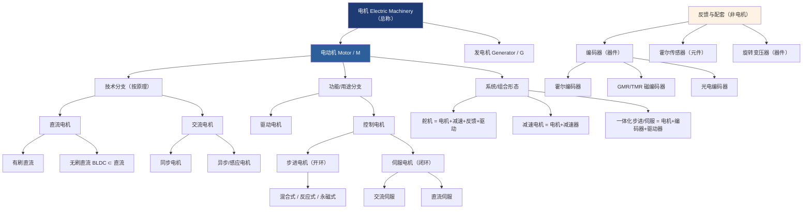

> **读图要点**
> - 实线框是**同一条从属链**：无刷 ⊂ 直流 ⊂ 电机。
> - “舵机/减速电机/一体化步进”不是新原理，而是**组合形态**，所以它们挂在“系统/组合”分支下，而不是和“直流/交流”并列。
> - 编码器、霍尔传感器在**另一棵独立的传感器树**上，只在功能上与电机耦合。

### 2.3 关系类型总表

判断两个词的关系，先问一句：**它们是“包含关系”“并列关系”，还是“组合/部件关系”？**

| 术语 A | 术语 B | 关系类型 | 一句话解释 |
|---|---|---|---|
| 电机 | 马达 | 同义（俗称） | Motor 的音译俗称 |
| 电机 | 电动机 | 包含 | 电机 ⊃ 电动机 + 发电机 |
| 直流电机 | 无刷电机 | 包含 | 无刷是直流的技术分支 |
| 直流电机 | 有刷直流 | 包含（狭义默认） | 日常说“直流电机”多指有刷 |
| 交流电机 | 同步电机 | 包含 | 按转子转速与磁场是否同步分 |
| 交流电机 | 异步电机 | 包含 | 存在转差的感应电机 |
| 控制电机 | 步进电机 | 包含 | 步进属控制电机 |
| 控制电机 | 伺服电机 | 包含 | 伺服属控制电机 |
| 步进电机 | 伺服电机 | 并列（同层） | 同为控制电机，一个开环一个闭环 |
| 舵机 | 伺服电机 | 组合 | 舵机内部**含**电机与反馈，是系统 |
| 减速电机 | 减速器 | 组合 | 减速电机 = 电机 + 减速器 |
| 编码器 | 电机 | 部件/配套 | 编码器是传感器，不是电机本体 |
| 编码器 | 霍尔传感器 | 实现方式 | 霍尔可做编码器，但编码器不止霍尔 |
| 霍尔编码器 | 磁编码器 | 包含 | 霍尔编码器 ⊂ 磁编码器 |
| GMR 编码器 | 磁编码器 | 包含 | 磁阻原理，也是磁编码器 |
| 无刷电机 | 永磁同步电机 | 高度重叠 | 工程上常混用，严格说换向波形/反电动势不同 |

### 2.4 六个高频混淆点逐一拆解

#### 混淆点 1：电机 = 马达？

**基本等同**，但语体不同：

- “电机”偏书面/工程/铭牌用语（如“三相异步电动机”）；
- “马达”偏口语/港台/消费电子用语（如“振动马达”“马达驱动”）；
- 严格讲“电机”是总称，包含发电机；而“马达（Motor）”在英文里也只指电动机，**不包括 Generator**。

> 所以：**“电机”⊃“马达”**，日常可互换，但写技术文档时“发电机”不能叫“马达”。

#### 混淆点 2：直流电机 vs 无刷电机

**包含关系**，不是并列关系：

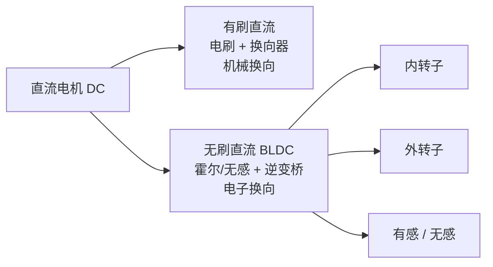

- **有刷**：结构简单、便宜、低速扭矩好，但电刷磨损、火花、噪声、寿命受限。
- **无刷**：效率高、寿命长、噪声低、可高速，但**必须配电调/驱动器**，成本高，控制复杂。

#### 混淆点 3：无刷电机 vs 永磁同步电机（PMSM）

工程上经常混用，严格区分看两点：

| 维度 | BLDC（方波无刷） | PMSM（永磁同步） |
|---|---|---|
| 反电动势波形 | 梯形波 | 正弦波 |
| 驱动电流 | 方波/六步换向 | 正弦波（FOC/SVPWM） |
| 位置反馈 | 三霍尔即可 | 编码器/旋变，或无感观测 |
| 转矩脉动 | 较大 | 小，运行平稳 |
| 典型场景 | 风机、水泵、电动工具、航模 | 伺服、电动汽车、精密传动 |

> 日常口语里“无刷电机”常泛指两者；买伺服时看到“交流伺服”，其本体基本就是 **PMSM + 高分辨率编码器**。[工程补充]

#### 混淆点 4：步进 vs 伺服

| 维度 | 步进电机 | 伺服电机 |
|---|---|---|
| 控制方式 | **开环**（可加编码器变闭环） | **闭环**（天生带反馈） |
| 反馈 | 通常无 | 编码器/旋变，分辨率高 |
| 过载能力 | 弱，过载直接**失步** | 强，可短时过载 2–3 倍 |
| 低速平稳性 | 有低频共振，需细分/阻尼 | 好 |
| 高速性能 | 扭矩随转速快速下降 | 恒扭矩区宽，弱磁可扩速 |
| 成本 | 低 | 高（电机+驱动器+编码器） |
| 调试难度 | 低（给脉冲就行） | 高（需整定 PID、惯量匹配） |
| 典型场景 | 3D 打印机、雕刻机、点胶机 | 机械臂、CNC、AGV 转向 |

#### 混淆点 5：舵机 vs 伺服

- **舵机是“成品伺服系统”**：内部 = 直流电机 + 减速齿轮组 + 电位器/磁编码器 + 控制电路，输入 PWM，输出角度。
- **工业伺服是“器件级产品”**：伺服驱动器 + 伺服电机 + 编码器分开卖，输入指令（脉冲/总线），输出力矩/位置。
- 二者**原理同源（闭环位置控制）**，差别在**集成度、功率、精度、接口、成本**。

#### 混淆点 6：编码器 vs 霍尔传感器

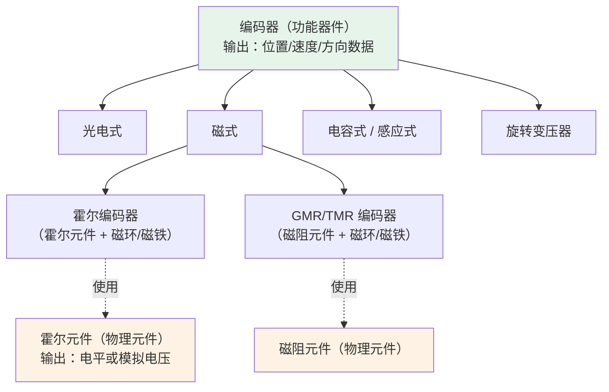

- **霍尔传感器**：把磁场变成电信号的**元件**，输出是“有/无磁场”或“磁场强度电压”。
- **编码器**：把运动变成**可直接使用的数字量**的**器件**，内部已包含“传感元件 + 信号处理（放大、比较、计数、细分、接口）”。
- 因此“霍尔传感器可替代编码器”这句话只在**功能层面**成立（线性霍尔 + 控制器做角度解算），**元件层面不成立**。[对话结论]

### 2.5 一张表记住全部从属关系

| 你听到的词 | 它是什么 | 它的上位 | 它的下位/组成 |
|---|---|---|---|
| 电机 | 总称 | — | 电动机、发电机 |
| 马达 | 俗称 | 电机 | — |
| 电动机 | 器件 | 电机 | 直流、交流、步进、伺服…… |
| 发电机 | 器件 | 电机 | 同步发电机、异步发电机 |
| 直流电机 | 原理类别 | 电动机 | 有刷、无刷 |
| 无刷电机 | 技术分支 | 直流电机 | 内转子/外转子、有感/无感 |
| 交流电机 | 原理类别 | 电动机 | 单相/三相、同步/异步 |
| 步进电机 | 控制电机 | 电动机 | 反应式、永磁式、混合式 |
| 伺服电机 | 控制电机 | 电动机 | 交流伺服、直流伺服 |
| 舵机 | 系统 | 伺服系统 | 电机+减速+反馈+驱动 |
| 减速电机 | 组合体 | 电动机 | 电机+减速器 |
| 编码器 | 传感器 | — | 增量/绝对、光电/磁/电容 |
| 霍尔传感器 | 元件 | — | 开关型、锁存型、线性型 |

---

## 3. 市面电机的九维分类体系

### 3.1 为什么没有“唯一正确”的分类

同一台电机可以同时被贴很多标签：

> 一台用在化工泵上的 **三相异步防爆电机**，同时属于：
> 交流电机（电源）· 异步/感应电机（原理）· 驱动电机（用途）· 低速大扭矩（速度取向）· 鼠笼转子（结构）· 防爆型（环境）· 中型（功率）。

所以正确姿势不是找“唯一分类”，而是**用九个维度去“投影”一台电机**，每个维度回答一个问题。

### 3.2 分类总图

```mermaid
flowchart TD
    M["电机（任意一台）"]

    M --> D1["① 电源"]
    D1 --> D11["直流"]
    D1 --> D12["交流"]
    D1 --> D13["脉冲/交直流两用"]

    M --> D2["② 电磁原理"]
    D2 --> D21["同步"]
    D2 --> D22["异步/感应"]
    D2 --> D23["直流换向"]
    D2 --> D24["步进/磁阻/压电等"]

    M --> D3["③ 用途"]
    D3 --> D31["驱动"]
    D3 --> D32["控制"]
    D3 --> D33["信号/执行"]

    M --> D4["④ 转速"]
    D4 --> D41["高速"]
    D4 --> D42["中速"]
    D4 --> D43["低速/力矩"]

    M --> D5["⑤ 结构"]
    D5 --> D51["内转子/外转子"]
    D5 --> D52["笼型/绕线"]
    D5 --> D53["径向/轴向磁通"]

    M --> D6["⑥ 运动形式"]
    D6 --> D61["旋转"]
    D6 --> D62["直线"]
    D6 --> D63["摆动/振动"]

    M --> D7["⑦ 环境与防护"]
    D7 --> D71["防爆/普通"]
    D7 --> D72["IP 等级"]
    D7 --> D73["绝缘等级"]

    M --> D8["⑧ 功率与尺寸"]
    D8 --> D81["微特/小型"]
    D8 --> D82["中型/大型"]

    M --> D9["⑨ 控制方式"]
    D9 --> D91["定速"]
    D9 --> D92["调速"]
    D9 --> D93["开环/闭环/伺服"]

    style M fill:#1f3b73,color:#fff
```

### 3.3 维度一：按工作电源

| 类别 | 细分 | 说明 | 常见场景 |
|---|---|---|---|
| **直流电机 DC** | 有刷永磁、有刷励磁 | 电刷+换向器机械换向，结构简单、便宜 | 玩具、小车、电动工具、370 系列 |
| | 无刷直流 BLDC | 电子换向，效率高、寿命长，需电调 | 无人机、风机、机器人、云台 |
| **交流电机 AC** | 单相 | 常见于小功率家电 | 风扇、洗衣机、冰箱压缩机 |
| | 三相 | 工业主力，效率高、可变频 | 泵、风机、压缩机、机床 |
| **交直流两用** | 串励电机 | 交直流通用，启动转矩大 | 吸尘器、电动工具 |
| **脉冲驱动** | 步进电机 | 靠脉冲序列驱动，本质是直流/脉冲 | 打印机、雕刻机 |

> **一个容易忽略的点**
> **“直流/交流”分的是“供电形式”，不是“内部原理”**。BLDC 虽然叫直流，内部三相绕组通的是**电子换向后的方波/正弦电流**；变频器驱动的异步电机，供电侧是交流，中间环节是直流。分类时看清“按哪个口算”。

### 3.4 维度二：按电磁原理

这是**最“硬核”的分类维度**，决定了电机的运行特性。

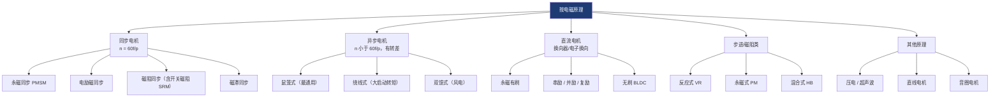

#### 3.4.1 同步电机

- **定义**：转子转速与定子旋转磁场**严格同步**，转差率 s = 0。
- **转速公式**：`n = 60f / p`（f 为频率 Hz，p 为极对数）。
- **特点**：效率高、功率因数可调（电励磁）、转速恒定不随负载变化。
- **细分**：
  - **永磁同步（PMSM）**：转子用永磁体，效率最高，是现代伺服与新能源车主力。
  - **电励磁同步**：转子绕组通直流励磁，可调功率因数，用于大型发电。
  - **磁阻同步**：靠转子凸极的磁阻差异产生转矩，结构坚固。
  - **开关磁阻（SRM）**：双凸极结构，无永磁体、耐高温、容错强，但转矩脉动大、噪声大。
  - **磁滞同步**：小功率、恒速场合（如计时器）。

#### 3.4.2 异步电机（感应电机）

- **定义**：转子转速**略低于**同步转速，存在**转差率** `s = (n1 − n)/n1`，靠转子感应电流与气隙磁场作用产生转矩。
- **特点**：结构简单、无电刷、极其耐用、成本低，是工业用电的绝对主力（约占工业电机 80% 以上）。
- **细分**：
  - **鼠笼式**：转子为铸铝/铜条笼，最通用。
  - **绕线式**：转子绕组可外接电阻，启动转矩大、可调速，用于起重机、轧机。
  - **双馈式**：转子也接电网，用于风力发电。

#### 3.4.3 直流电机（换向类）

- **有刷**：电刷 + 换向器机械换向，转矩大、控制简单（调压调速），但需维护。
- **无刷**：逆变桥 + 转子位置信息电子换向，寿命长、效率高。
- **励磁方式**（有刷）：串励（启动转矩大）、并励（转速稳）、复励（兼顾）、永磁（小功率主流）。

#### 3.4.4 步进与磁阻类

- 步进电机严格说属于**同步电机的一种特殊运行方式**（转子跟随定子磁场步进），但工程上单独成类。
- 细分见 4.5 步进电机。

#### 3.4.5 非电磁原理

- **压电/超声波电机**：逆压电效应 + 摩擦驱动，低速大扭矩、断电自锁、无电磁干扰。
- **静电电机**：MEMS 微执行器。
- **形状记忆合金**：特殊场景，效率低。

### 3.5 维度三：按用途

| 类别 | 目标 | 核心指标 | 代表 |
|---|---|---|---|
| **驱动电机** | 把电能变成“干活的力量” | 效率、功率密度、可靠性、成本 | 电动工具、家电、风机水泵、电动车 |
| **控制电机** | 把电能变成“听指令的动作” | 精度、响应、线性度、可控性 | 步进、伺服、力矩电机 |
| **信号电机** | 把机械量变成电信号 | 精度、线性度、分辨率 | 旋转变压器、测速发电机、自整角机 |
| **执行电机** | 小功率精密动作 | 体积、响应、功耗 | 音圈电机、振动马达、舵机 |

> **用途维度是**选型第一问****
> “这台电机是要**出力**，还是要**听话**？”——出力看效率与扭矩，听话看反馈与控制。舵机之所以贵，是因为它同时要“听话”。

### 3.6 维度四：按运转速度

| 类别 | 典型转速 | 特点 | 场景 |
|---|---|---|---|
| 高速电机 | > 10 000 rpm（可达数十万） | 功率密度高，需解决散热、轴承、转子强度 | 高速主轴、涡轮、无人机、牙钻 |
| 中速电机 | 1 000 – 10 000 rpm | 通用区间 | 大多数工业电机 |
| 低速电机 | < 500 rpm | 追求大扭矩，常配减速器或做力矩电机 | 直驱转台、AGV 轮毂 |
| 恒速电机 | 转速基本恒定 | 同步电机、磁滞电机 | 计时、录音机 |
| 调速电机 | 宽范围可调 | 直流调压、变频、伺服 | 电动车、变频家电、机床 |

> **转速与扭矩的“跷跷板”**
> 功率不变时，**转速越低、扭矩越大**（T = 9550P/n）。这就是减速器存在的意义：用转速换扭矩。

### 3.7 维度五：按结构与转子形式

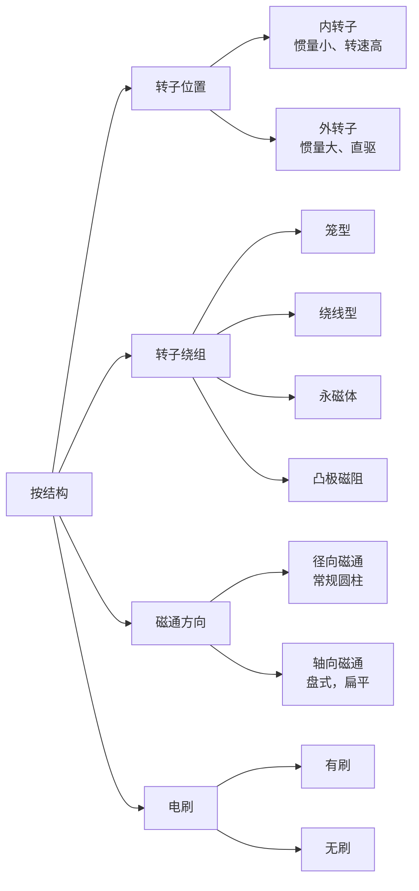

- **内转子 vs 外转子**：无人机多用外转子（大惯量、直驱桨）；云台多用内转子（低惯量、响应快）。
- **轴向磁通（盘式）**：扁平、功率密度高，用于轮毂、电梯、无人机。
- **集中绕组 vs 分布绕组**：集中绕组工艺简单、端部短；分布绕组反电动势更正弦、转矩脉动小。

### 3.8 维度六：按运动形式

| 形式 | 说明 | 典型 |
|---|---|---|
| 旋转运动 | 最常见，输出轴旋转 | 绝大多数电机 |
| 直线运动 | 电能直接转直线运动，无中间传动 | 直线电机、音圈电机、电磁铁 |
| 摆动/有限角度 | 输出轴在有限角度内往复 | 舵机、摆动电机、振镜电机 |
| 振动 | 偏心块或往复质量产生振动 | 手机振动马达、振动盘 |

> 直线电机的价值：**取消丝杠/皮带**，消除背隙与弹性，刚性好、速度快、精度高（磁悬浮、精密机床、3D 打印）。

### 3.9 维度七：按环境与防护

#### 3.9.1 防爆型式（GB 3836 / IEC 60079）

| 型式 | 代号 | 原理 | 适用 |
|---|---|---|---|
| 隔爆型 | Ex d | 外壳能承受内部爆炸且不引燃外部 | 1 区、2 区，化工、煤矿 |
| 增安型 | Ex e | 采取措施防止产生火花/高温 | 2 区，无火花设备 |
| 本安型 | Ex i | 限制能量，使火花不足以点燃 | 仪表、弱电 |
| 正压型 | Ex p | 壳内充正压气体 | 大型电机 |
| 无火花型 | Ex n | 正常运行不产生火花 | 2 区 |

#### 3.9.2 防护等级 IP

`IPXY`：X = 防尘（0–6），Y = 防水（0–8）。

| 等级 | 含义 | 场景 |
|---|---|---|
| IP54 | 防尘、防溅水 | 一般工业 |
| IP65 | 尘密、防喷水 | 户外、清洗环境 |
| IP67 | 防短时浸泡 | 水下机器人、AGV |
| IP68 | 长期浸泡 | 深水设备 |

#### 3.9.3 其他环境属性

- **绝缘等级**：B（130 ℃）、F（155 ℃）、H（180 ℃），等级越高耐温越好。
- **工作制**：S1 连续、S2 短时、S3 断续周期。
- **防腐/防盐雾**：海洋环境。
- **耐低温/高温**：-40 ℃ 或 120 ℃ 以上。

### 3.10 维度八：按功率与尺寸

| 级别 | 功率范围 | 典型 |
|---|---|---|
| 微特电机 | < 1 W ~ 数百 W | 手机马达、玩具、370、空心杯 |
| 小型电机 | 数百 W ~ 数 kW | 家电、泵、风机 |
| 中型电机 | 数 kW ~ 数百 kW | 工业驱动 |
| 大型电机 | > 数百 kW ~ MW | 轧机、矿山、发电 |

> 尺寸命名惯例：**NEMA 17 = 1.7 英寸见方 ≈ 42 mm**，“42 步进”即 NEMA 17；NEMA 23 ≈ 57 mm；NEMA 34 ≈ 86 mm。

### 3.11 维度九：按控制方式

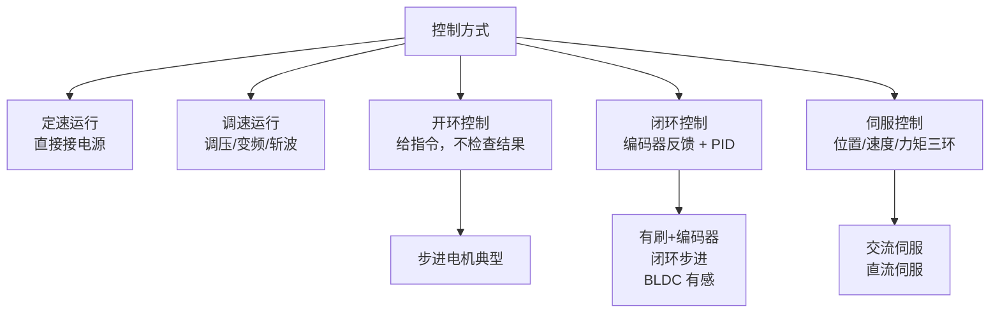

| 控制方式 | 是否反馈 | 精度 | 成本 | 典型 |
|---|---|---|---|---|
| 定速 | 否 | 低 | 最低 | 风扇、泵 |
| 调速 | 否 | 中 | 低 | 调光风扇、电动车 |
| 开环位置 | 否 | 中（会丢步） | 低 | 步进 |
| 闭环速度 | 是 | 中高 | 中 | 智能车、AGV |
| 闭环位置/伺服 | 是 | 高 | 高 | 机械臂、CNC |

### 3.12 交叉命名法：如何读懂一个电机型号名

市场上的电机名几乎都是**“维度拼接”**，拆开看就懂了：

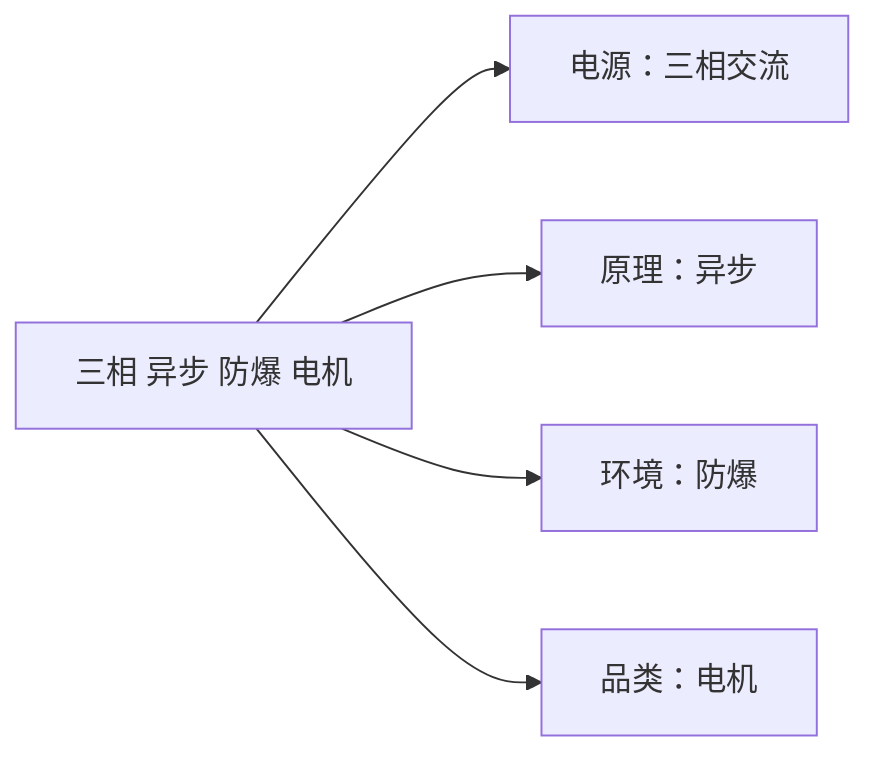

| 型号/叫法 | 拆解 | 结论 |
|---|---|---|
| 42 闭环步进 | 42 = NEMA17 机座；闭环 = 带编码器+闭环驱动 | 带反馈的混合式步进系统 |
| 370 减速电机 | 370 = 机座/系列号；减速 = 带减速箱 | 微型有刷直流 + 齿轮箱 |
| MG370 12V 1:34 GMR | MG 系列；370 机座；12 V；减速比 1:34；GMR 编码器 | 带高分辨率编码器的直流减速电机平台 |
| 57BLDC 24V 4000rpm | 57 机座；无刷；24 V；额定 4000 rpm | 中功率无刷 |
| NEMA23 闭环步进 8N·m | 57 mm 机座；闭环；保持扭矩 8 N·m | 大扭矩闭环步进 |
| 60ST-M00630 | 60 机座交流伺服；0.6 kW；3000 rpm | 交流伺服电机 |
| MG310 GMR 1:30 | 310 平台；GMR 编码器；1:30 | 轻负载高精度减速电机 |

> **拆名三步法**
> 1. **找机座号**（42/57/370/310/MG…）→ 定尺寸与扭矩量级；
> 2. **找技术词**（无刷/步进/伺服/闭环/减速）→ 定原理与形态；
> 3. **找电气参数**（电压/转速/减速比/编码器类型）→ 定驱动与反馈方案。

### 3.13 九维分类速查矩阵

| 维度 | 选项 | 对选型的影响 |
|---|---|---|
| 电源 | 直流 / 交流 / 脉冲 | 决定驱动器与供电 |
| 原理 | 同步 / 异步 / 直流 / 步进 / 其他 | 决定扭矩-转速特性、效率 |
| 用途 | 驱动 / 控制 / 信号 / 执行 | 决定指标优先级 |
| 转速 | 高 / 中 / 低 / 恒速 / 调速 | 决定是否需减速器 |
| 结构 | 内/外转子、笼型/绕线、径向/轴向 | 决定惯量、体积、成本 |
| 运动 | 旋转 / 直线 / 摆动 / 振动 | 决定传动链 |
| 环境 | 防爆 / IP / 绝缘 / 工作制 | 决定外壳与材料 |
| 功率 | 微特 / 小 / 中 / 大 | 决定驱动功率等级 |
| 控制 | 定速 / 调速 / 开环 / 闭环 / 伺服 | 决定成本与精度上限 |

---

## 4. 常见电机类型逐一拆解

> 本章对每一类电机按统一模板展开：**结构 → 原理 → 优点/缺点 → 典型参数 → 驱动方式 → 应用 → 选型要点**。参数均为典型量级，具体型号以规格书为准。

### 4.1 有刷直流电机（Brushed DC）

#### 结构


#### 原理

电流经电刷进入换向器，换向器随转子旋转**周期性改变电枢电流方向**，保证同一磁极下的导体电流方向不变，从而产生**单向持续转矩**。

#### 优缺点

| 优点 | 缺点 |
|---|---|
| 结构简单、成本最低 | 电刷磨损，寿命受限（几百至几千小时） |
| 启动转矩大、低速性能好 | 换向火花、电磁干扰（EMI） |
| 调速简单（调压即可） | 噪声大，高速受限 |
| 驱动电路极简（H 桥即可） | 需定期维护，不适合洁净/防爆环境 |

#### 典型参数（以 370 系列为例）

| 项目 | 典型值 |
|---|---|
| 外径 | 约 24.3 mm |
| 机身长度 | 约 30.8 mm |
| 电压 | 6 V / 12 V |
| 空载转速 | 6 V 约 16 500 rpm；12 V 约 33 600 rpm |
| 空载电流 | 12 V 约 0.51 A |
| 堵转电流 | 可达约 20 A |
| 堵转扭矩 | 约 0.7 kg·cm ≈ 0.069 N·m |
| 特点 | 功率密度大、发热明显、非静音 |

> **堵转电流 20 A 的含义**
> 如果驱动器只给 2 A，堵转时电压会被拉垮或直接烧驱动。**选 H 桥/驱动芯片要看峰值电流，不是看空载电流。**

#### 驱动方式

- 单向：MOSFET 低边开关（只需调速）。
- 双向：H 桥（L298N、TB6612、DRV8871、BTS7960）。
- 调速：PWM（频率建议 10–20 kHz，避开音频段）。
- 保护：续流二极管、过流检测、软启动。

#### 选型要点

1. 先看**堵转电流**与**额定电流**，驱动器留 2 倍余量；
2. 看**寿命**要求，长时间运行优先无刷；
3. 需要低速大扭矩 → 加**减速器**（即减速电机）；
4. 需要精确控制 → 加**编码器** + 闭环驱动器。

### 4.2 无刷直流电机（BLDC）

#### 结构


#### 原理

用**逆变桥**按转子位置依次给三相绕组通电，产生**旋转磁场**拖动永磁转子。换向由电子电路完成，不再有机械电刷。

#### 有感和无感

| 类型 | 位置信息来源 | 优点 | 缺点 | 场景 |
|---|---|---|---|---|
| **有感** | 3 个霍尔（120° 电角度） | 低速启动可靠、成本低 | 霍尔怕高温、布线多 | 电动自行车、风机 |
| **无感** | 反电动势过零/磁链观测 | 无传感器、耐高温、线少 | 低速启动困难、需算法 | 水泵、无人机、压缩机 |
| **编码器型** | 增量/绝对编码器 | 精度最高、可位置控制 | 成本高 | 伺服、机器人关节 |

#### 六步换向（方波驱动）

以 120° 安装的三个霍尔为例，转子每转一个电周期有 6 个状态，每次只导通两相：

| 步 | 霍尔 H1H2H3 | 导通相 | 电流方向 |
|---|---|---|---|
| 1 | 001 | A→B | A 高 B 低 |
| 2 | 101 | A→C | A 高 C 低 |
| 3 | 100 | B→C | B 高 C 低 |
| 4 | 110 | B→A | B 高 A 低 |
| 5 | 010 | C→A | C 高 A 低 |
| 6 | 011 | C→B | C 高 B 低 |

> **状态编码随霍尔安装顺序、相序定义不同会变化，**以实际换向表为准**；这张表只表达“6 个状态循环”的思想。**

#### 方波 vs 正弦（FOC）

| 维度 | 六步方波 | FOC 正弦 |
|---|---|---|
| 电流波形 | 方波，每 60° 切换 | 正弦，连续 |
| 转矩脉动 | 大（换向瞬间） | 小，平稳 |
| 噪声/振动 | 较大 | 小 |
| 算法复杂度 | 低（查表） | 高（Clarke/Park、双环） |
| 硬件要求 | 霍尔即可 | 编码器或高精度无感 |
| 场景 | 风机、水泵、电动工具 | 云台、伺服、电动车 |

#### 优缺点

| 优点 | 缺点 |
|---|---|
| 效率高（80–90%+） | 必须配驱动器/电调，成本高 |
| 寿命长（无电刷） | 控制复杂，调试门槛高 |
| 高速性能好 | 低速大扭矩需减速器 |
| 噪声低、维护少 | 霍尔/编码器增加故障点 |

#### 选型要点

1. **Kv 值**（rpm/V）决定转速：`n ≈ Kv × U`；
2. **Kt**（N·m/A）≈ 9.55 / Kv，决定扭矩常数；
3. 低速启动看是否**有感**；
4. 需要力矩平稳 → FOC；
5. 电调电流留 1.5–2 倍余量。

### 4.3 永磁同步电机（PMSM）

- **与 BLDC 的关系**：本体结构几乎一样（永磁转子 + 三相定子），差别在**反电动势波形**（正弦 vs 梯形）与**驱动方式**（FOC vs 六步）。
- **优势**：转矩平稳、效率高、功率密度高、调速范围宽（弱磁扩速）。
- **典型场景**：交流伺服、电动汽车驱动、压缩机、精密机床。
- **关键概念**：
  - **d/q 轴**：Park 变换后，d 轴励磁、q 轴转矩；
  - **Id = 0 控制**：表贴式 PMSM 常用，单位电流最大转矩；
  - **弱磁控制**：高速时注入负 Id，降低反电动势，扩展转速。

### 4.4 交流异步电机（感应电机）

#### 原理

定子三相绕组通三相交流电产生**旋转磁场**，转子导体切割磁力线感应电流，感应电流与磁场作用产生转矩。转子转速**永远追不上**同步转速（否则无转差、无感应电流、无转矩）。

`转差率 s = (n1 − n) / n1`，额定负载时 s 通常 1%–5%。

#### 分类

| 类型 | 转子 | 特点 | 场景 |
|---|---|---|---|
| 鼠笼式 | 铸铝/铜条笼 | 结构最简单、最耐用、最便宜 | 风机、水泵、压缩机 |
| 绕线式 | 三相绕组 + 滑环 | 可外接电阻，启动转矩大、可调速 | 起重机、轧机、球磨机 |
| 双馈式 | 绕线 + 变频器 | 转子也接电网，调速效率高 | 风力发电 |

#### 优缺点

| 优点 | 缺点 |
|---|---|
| 无电刷、极耐用 | 效率略低于永磁同步 |
| 成本低、易维护 | 启动转矩较小（鼠笼） |
| 可直接接电网运行 | 调速需变频器，低速效率下降 |
| 过载能力强 | 功率因数滞后，需补偿 |

#### 调速

- **变频调速（VFD）**：改变频率 f 即可改变同步转速 `n1 = 60f/p`，是现代主流。
- **变极调速**：改变极对数，有级调速。
- **降压调速**：简单但损耗大，已少用。

### 4.5 步进电机：开环定位的性价比之王

#### 结构分类

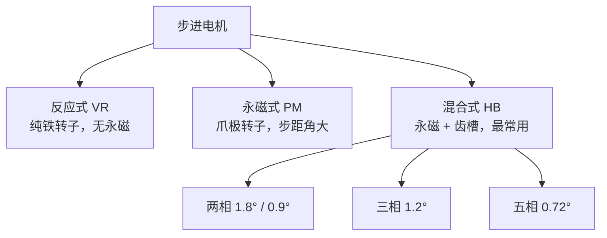

| 类型 | 步距角 | 特点 | 场景 |
|---|---|---|---|
| 反应式 VR | 较大（如 7.5°） | 结构简单、无永磁、转矩小 | 仪表、打印机 |
| 永磁式 PM | 较大（如 7.5°/15°） | 成本低、转矩小 | 家电、玩具 |
| 混合式 HB | 1.8°/0.9°/0.72° | 精度高、转矩大，绝对主流 | 3D 打印、CNC、雕刻机 |

#### 工作原理

定子绕组按**脉冲序列**依次通电，每来一个脉冲，转子转过一个**步距角**。

- 42 步进（NEMA 17）：步距角 1.8° → **每转 200 步**；
- 57 步进（NEMA 23）：步距角 1.8° → 每转 200 步；
- 0.9° 电机 → 每转 400 步。

#### 细分驱动

驱动器把“一个整步”再细分为 N 个微步（常见 2/4/8/16/32/64/128/256）：

`每转脉冲数 = 360° / 步距角 × 细分`

| 步距角 | 细分 | 每转脉冲 | 单脉冲角度 |
|---|---|---|---|
| 1.8° | 1 | 200 | 1.8° |
| 1.8° | 16 | 3 200 | 0.1125° |
| 1.8° | 64 | 12 800 | 0.0281° |
| 1.8° | 256 | 51 200 | 0.00703° |

> **细分 ≠ 精度**
> 细分让**运动更平滑、分辨率更高**，但**定位精度**受限于电机本身的步距角误差（通常 ±5%）、齿槽转矩、负载与传动背隙。**细分 256 不代表能定位到 0.007°**。

#### 关键参数

| 参数 | 含义 | 42 步进典型值 |
|---|---|---|
| 步距角 | 每步转角 | 1.8° |
| 保持扭矩 | 通电静止时的最大抗扭 | 0.2–0.5 N·m（42×48 约 0.4–0.5） |
| 额定电流 | 每相电流 | 1.0–2.0 A |
| 相电阻/电感 | 影响高速性能 | 1–5 Ω / 2–10 mH |
| 转子惯量 | 影响加减速 | 约 50–80 g·cm² |
| 定位转矩 | 断电时的齿槽保持力 | 约 0.02 N·m |

#### 优缺点

| 优点 | 缺点 |
|---|---|
| 开环即可精确定位，成本低 | 过载**失步**，且无报警 |
| 低速大扭矩、响应快 | 高速扭矩快速下降 |
| 停止时自锁（通电） | 有低频共振区（约 100–200 Hz） |
| 控制简单（脉冲+方向） | 发热大、效率低（恒流驱动） |
| 无累积误差（不丢步时） | 噪声与振动较大 |

#### 失步与共振

- **失步**：负载扭矩 > 输出扭矩，或加速度 > 电机能力，转子跟不上磁场 → 位置永久偏差。
- **共振**：某些转速区间（尤其低速）转子振荡，表现为噪声/丢步 → 解决：**细分、加阻尼、避开共振区、加减速曲线**。

#### 驱动方式

- **恒压驱动**（L298N）：简单，低速转矩差、发热大。
- **恒流斩波驱动**（A4988、DRV8825、TMC 系列）：主流，电流可调、细分高。
- **闭环步进**：加编码器 + 闭环驱动器，见 第 7 章。

### 4.6 伺服电机与舵机

#### 4.6.1 伺服系统的构成

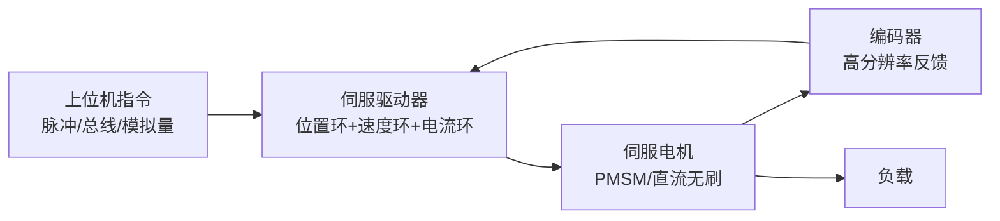

- **三环**：电流环（最内，μs 级）→ 速度环（ms 级）→ 位置环（最外）。
- **刚性**：伺服的核心竞争力是“**指令到位的跟随精度**”，靠高分辨率编码器 + 高带宽电流环。

#### 4.6.2 交流伺服 vs 直流伺服

| 维度 | 交流伺服 | 直流伺服 |
|---|---|---|
| 电机本体 | PMSM | 有刷/无刷直流 |
| 效率 | 高 | 中（有刷） |
| 维护 | 无刷，免维护 | 有刷需换碳刷 |
| 功率范围 | 几十 W – 几十 kW | 小功率为主 |
| 成本 | 高 | 中 |
| 场景 | 机床、机械臂、注塑机 | 小型设备、AGV |

#### 4.6.3 舵机（Hobby Servo）

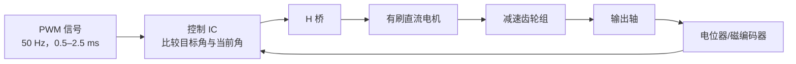

- **输入**：50 Hz PWM，脉宽 0.5–2.5 ms 对应 0–180°（不同型号略有差异）。
- **内部**：电位器反馈 + 比较器 + H 桥，本质是**模拟位置闭环**。
- **指标**：扭矩（kg·cm）、速度（s/60°）、死区、虚位。
- **数字舵机**：更高 PWM 频率（可达 300 Hz）、更高分辨率、可编程。
- **总线舵机**：串行总线（TTL/RS485），可读角度、温度、负载，适合多关节机器人。

> **舵机的“堵转”**
> 舵机没有真正的过流保护（低成本型号），**卡住不动会持续大电流烧电机或烧驱动**。选型时扭矩留 1.5–2 倍余量。

### 4.7 减速电机：用转速换扭矩

#### 减速器类型

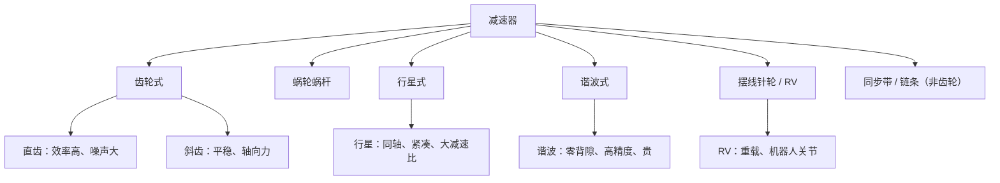

| 类型 | 单级减速比 | 效率 | 背隙 | 特点 | 场景 |
|---|---|---|---|---|---|
| 直齿轮 | 2–8 | 95%+ | 中 | 简单便宜 | 玩具、小车 |
| 斜齿轮 | 2–8 | 95%+ | 中 | 平稳、噪声低 | 家电、工业 |
| 行星 | 3–10（多级更大） | 90–97% | 小 | 同轴、紧凑、扭矩大 | 机器人、云台 |
| 蜗轮蜗杆 | 5–100 | 50–80% | 中 | 大减速比、可自锁 | 门锁、升降 |
| 谐波 | 30–160 | 70–85% | ≈0 | 零背隙、高精度 | 机械臂关节 |
| 摆线/RV | 30–200 | 80–90% | 小 | 重载、抗冲击 | 工业机器人 |

#### 关键关系

- `n_out = n_in / i`（i 为减速比）
- `T_out = T_in × i × η`（η 为效率，0.5–0.97）
- 减速比越大 → 转速越低、扭矩越大、**背隙与惯量折算也越大**。

> **惯量折算**
> 负载惯量折算到电机侧要除以 `i²`：`J_load' = J_load / i²`。所以大减速比能让小电机驱动大惯量，但也降低了系统的“手感”与带宽。

### 4.8 直线电机

- **原理**：把旋转电机“剖开铺平”，定子（磁轨）与动子（线圈）相对直线运动。
- **类型**：平板式、U 型槽式、圆柱式；有铁芯（推力大、有吸力）与无铁芯（无吸力、轻）。
- **优点**：无接触传动、无背隙、高加速度、高精度、长行程。
- **缺点**：贵、发热集中、需光栅/磁栅反馈、防护要求高。
- **场景**：磁悬浮、精密机床、半导体设备、3D 打印。

### 4.9 压电电机 / 超声波电机

- **原理**：逆压电效应使定子产生微幅振动，通过摩擦力驱动转子/动子。
- **优点**：低速大扭矩、断电自锁、无电磁干扰、无齿轮背隙、可做到极小。
- **缺点**：寿命受摩擦材料限制、效率低、驱动电路特殊（高频高压）。
- **场景**：相机自动对焦、精密位移台、手表、医疗微型设备。

### 4.10 力矩电机 / 直驱电机

- **特点**：极对数多、转速低、扭矩大，**直接驱动负载**，省去减速器。
- **优点**：无背隙、刚性好、响应快、安静。
- **缺点**：体积大、成本高、需高分辨率反馈。
- **场景**：转台、云台、机器人关节（协作机器人）、电梯曳引机。

### 4.11 其他特种电机速览

| 类型 | 特点 | 场景 |
|---|---|---|
| 空心杯电机 | 无铁芯转子，惯量极低、响应快、无齿槽 | 医疗、机器人手、舵机 |
| 无框电机 | 只有定转子，直接嵌入结构 | 关节模组、云台 |
| 轮毂电机 | 电机集成在车轮内 | 电动自行车、AGV |
| 音圈电机 | 直线、短行程、高响应 | 镜头对焦、精密定位 |
| 振动马达 | 偏心转子/线性马达 | 手机、游戏手柄 |
| 磁悬浮电机 | 无接触悬浮 + 驱动 | 高速飞轮、真空泵 |

### 4.12 类型对比总表

| 类型 | 效率 | 控制精度 | 低速扭矩 | 寿命 | 成本 | 驱动复杂度 | 典型场景 |
|---|---|---|---|---|---|---|---|
| 有刷直流 | 60–75% | 低（可加编码器） | 好 | 短 | 最低 | 低 | 玩具、小车、370 |
| 无刷 BLDC | 80–90% | 中（有感） | 中 | 长 | 中 | 中高 | 风机、无人机、云台 |
| PMSM 伺服 | 90%+ | 高 | 好 | 长 | 高 | 高 | 机械臂、CNC |
| 异步电机 | 75–92% | 低 | 中 | 极长 | 低 | 中（变频器） | 泵、风机、工业 |
| 步进（开环） | 40–60% | 中（会丢步） | 好 | 长 | 低 | 低 | 3D 打印、雕刻机 |
| 步进（闭环） | 50–70% | 中高 | 好 | 长 | 中 | 中 | 精密点胶、送料 |
| 舵机 | 50–70% | 中 | 中 | 中 | 低 | 极低 | 航模、机器人关节 |
| 直线电机 | 高 | 极高 | — | 长 | 很高 | 高 | 半导体、精密机床 |
| 压电电机 | 低 | 高 | 极好 | 中 | 高 | 高 | 相机对焦、精密台 |

> **一句话记忆**
> **有刷便宜、无刷耐用、步进省事、伺服精准、异步皮实、直驱刚性好、压电微细。**

---

## 5. 编码器与位置传感器体系

### 5.1 先把三个词摆正

| 词 | 层级 | 本质 | 直接输出 |
|---|---|---|---|
| 霍尔传感器 | **元件** | 磁敏半导体 | 高低电平 / 模拟电压 |
| 编码传感器 | **非标准泛称** | 泛指“测位置/速度的传感器” | 视实现而定 |
| 编码器 | **器件/功能类别** | 传感元件 + 信号处理 + 接口 | 脉冲 / 数字位置 / 总线数据 |

> **一句话**：霍尔传感器是“零件”，编码器是“功能”。霍尔可以组成编码器，但编码器远不止霍尔。[对话结论]

### 5.2 霍尔传感器（Hall Sensor）

#### 5.2.1 原理

电流通过半导体薄片，在垂直方向施加磁场，载流子受洛伦兹力偏转，两侧产生**霍尔电压** `V_H ∝ I × B`。由此把**磁场**变成**电信号**。

#### 5.2.2 三种类型

| 类型 | 输出 | 特点 | 典型用途 |
|---|---|---|---|
| **开关型** | 高/低电平 | 有磁场即翻转，最简单 | 限位、接近开关、转速计数 |
| **锁存型** | 磁场极性翻转时输出翻转 | 需要 N/S 交替，抗抖动 | **BLDC 换向**（三霍尔） |
| **线性型** | 模拟电压 ∝ 磁场强度 | 可测角度/位移 | 角度检测、电流传感器、油门踏板 |

#### 5.2.3 在 BLDC 中的角色：换向，不是测位置

- 三个锁存霍尔相隔 **120° 电角度**安装；
- 转子每转一圈（电周期）输出 6 种组合；
- MCU 查表决定导通哪两相 → **六步换向**。

> 这里的霍尔**只告诉控制器“现在在哪个 60° 扇区”**，分辨率只有 6 个状态/电周期，**不能做高精度位置控制**。这是“霍尔版只能做速度闭环”的根本原因。[对话结论]

#### 5.2.4 线性霍尔做角度

两个线性霍尔正交放置，测 `Bx、By`，用 `θ = atan2(By, Bx)` 解算角度 → 这就是很多**磁编码器芯片**的内部原理（如 AS5600 一类）。

### 5.3 编码器分类

#### 5.3.1 按输出信号

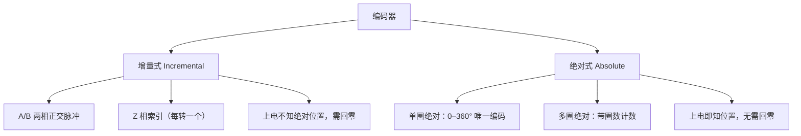

| 维度 | 增量式 | 绝对式 |
|---|---|---|
| 上电位置 | 未知，需找 Z 相/回零 | 已知 |
| 信号 | A/B/Z 脉冲 | SSI、BiSS、SPI、并行、总线 |
| 抗干扰 | 计数会丢，需处理 | 每帧校验，抗干扰好 |
| 成本 | 低 | 高 |
| 典型 | 智能车、MG 系列、光电码盘 | 伺服电机、机器人关节 |

#### 5.3.2 按物理原理

| 原理 | 分辨率 | 环境耐受 | 成本 | 场景 |
|---|---|---|---|---|
| **光电式** | 极高（数千–数万 PPR） | 怕粉尘、油污、震动 | 中高 | CNC、精密伺服 |
| **磁式（霍尔）** | 低–中（几 PPR–数百） | 耐粉尘油污、抗振 | 低 | 智能车、BLDC 换向 |
| **磁式（GMR/TMR）** | 高（可达数千 PPR 或高位数角度） | 好 | 中 | MG 系列 GMR 版、关节 |
| **电容式** | 中高 | 较好 | 中 | 工业编码器 |
| **感应式（旋变）** | 高，绝对 | 极好（耐高温、抗振） | 高 | 伺服、航空、电机端 |
| **激光干涉** | 极高 | 要求洁净 | 极高 | 超精密平台 |

#### 5.3.3 结构形态

- **旋转编码器**：轴式、空心轴式、套轴式。
- **直线编码器**：光栅尺、磁栅尺。
- **一体式**：编码器芯片直接焊在电机尾部 PCB 上（MG 系列、闭环步进常见）。

### 5.4 分辨率：PPR、CPR、线数、倍频

这是选型时**最容易踩坑**的地方。

#### 5.4.1 三个概念

| 术语 | 全称 | 含义 | 单位 |
|---|---|---|---|
| **PPR** | Pulses Per Revolution | 每转**脉冲数**（单相） | 脉冲/转 |
| **线数** | Lines | 码盘刻线数，常与 PPR 混用 | 线/转 |
| **CPR** | Counts Per Revolution | 每转**计数**（四倍频后） | 计数/转 |

#### 5.4.2 核心公式

```
CPR（电机轴）      = PPR × 4                 （A/B 正交四倍频）
CPR（输出轴）      = PPR × 4 × 减速比 i
角分辨率（°）      = 360 / CPR
转速（rpm）        = 脉冲频率(Hz) × 60 / CPR
```

#### 5.4.3 算例

**例 1：MG370 霍尔版（13 线磁环）**

- 电机轴 CPR = 13 × 4 = 52；
- 减速比 1:34 → 输出轴 CPR = 52 × 34 ≈ 1 768；
- 输出轴角分辨率 ≈ 360 / 1 768 ≈ **0.204°**。

**例 2：MG370 GMR 版（500 PPR，减速比 34.014）**

- 电机轴 CPR = 500 × 4 = 2 000；
- 输出轴 CPR = 2 000 × 34.014 ≈ **68 028**；[对话结论]
- 输出轴角分辨率 ≈ 360 / 68 028 ≈ **0.0053°**。

**例 3：42 步进闭环（14 位磁编码器）**

- CPR = 2¹⁴ = 16 384；
- 角分辨率 = 360 / 16 384 ≈ **0.022°**（即对话中“理论精度约 0.02°”的来源）。[对话结论]

> **分辨率 ≠ 精度**
> - **分辨率**是“能分辨的最小变化”；
> - **精度**是“测量值与真实值的偏差”；
> - 中间还隔着**安装偏心、磁铁充磁不均、码盘刻线误差、传动背隙、温漂**。
> 500 线编码器给 0.005° 分辨率，不代表系统能定位到 0.005°。

### 5.5 A/B/Z 信号与方向判断

#### 5.5.1 正交信号

- A、B 两相相位差 **90° 电角度**；
- **A 超前 B** → 正转；**B 超前 A** → 反转；
- 上升沿 + 下降沿都计数 → **四倍频**。

#### 5.5.2 波形（ASCII 示意）

```
正转：
A  ‾‾|__|‾‾|__|‾‾|__|‾‾|__
B  __|‾‾|__|‾‾|__|‾‾|__|‾‾
      ↑  A 上升沿时 B=0  → 正转

反转：
A  __|‾‾|__|‾‾|__|‾‾|__|‾‾
B  ‾‾|__|‾‾|__|‾‾|__|‾‾|__
      ↑  A 上升沿时 B=1  → 反转
```

#### 5.5.3 四倍频计数表

| A | B | 计数变化 |
|---|---|---|
| 0 | 0 | 基准 |
| 1 | 0 | +1（正转） |
| 1 | 1 | +1 |
| 0 | 1 | +1 |
| 0 | 0 | +1 |

每转 4 × PPR 个计数，方向由 A/B 相位关系判定。

#### 5.5.4 Z 相（Index）

- 每转输出**一个**脉冲，用于**找零/回零**；
- 增量式编码器上电后必须**先回零**（找 Z 或限位），否则位置是“相对”的。

### 5.6 霍尔编码器 vs GMR vs 光电 vs 旋变

| 维度 | 霍尔编码器 | GMR/TMR 编码器 | 光电编码器 | 旋转变压器 |
|---|---|---|---|---|
| 原理 | 霍尔元件 + 磁环 | 磁阻元件 + 磁环/磁铁 | 光栅遮光 | 电磁感应 |
| 分辨率 | 低（几–几百 PPR） | 高（数百–数千 PPR 或高位数） | 极高 | 高 |
| 抗粉尘油污 | 好 | 好 | **差** | 极好 |
| 抗振动 | 好 | 好 | 中 | 极好 |
| 耐高温 | 中 | 中 | 中 | **极好** |
| 成本 | 低 | 中 | 中高 | 高 |
| 典型场景 | 智能车测速、BLDC 换向 | MG 系列、关节、云台 | CNC、精密伺服 | 伺服、航空、汽车 |

> **回到 MG 系列**
> MG310/MG370 的“霍尔版”与“GMR 版”**都是磁编码器**，差别只在磁敏元件与磁环精度：[对话结论]
> - 霍尔版：13 线磁环 → 输出轴约 1 700 计数/转 → 做**速度闭环**够用；
> - GMR 版：500 线 → 输出轴约 68 000 计数/转 → 才谈得上**位置闭环**。

### 5.7 编码器选型检查清单

- [ ] 需要**绝对位置**还是**相对位置**？（决定增量/绝对）
- [ ] 分辨率需求：目标定位精度 → 反推所需 CPR？
- [ ] 安装空间：轴式/套轴/芯片式？
- [ ] 环境：粉尘、油污、水、振动、温度？
- [ ] 信号接口：A/B 正交、SPI、SSI、BiSS、RS485？
- [ ] 控制器能否处理该频率的脉冲？（软件中断 vs 硬件计数器）
- [ ] 是否需要 Z 相/限位回零？
- [ ] 线缆屏蔽与接地是否到位？（高频脉冲易受干扰）

---

## 6. 闭环控制体系：从开环到三环

### 6.1 开环与闭环

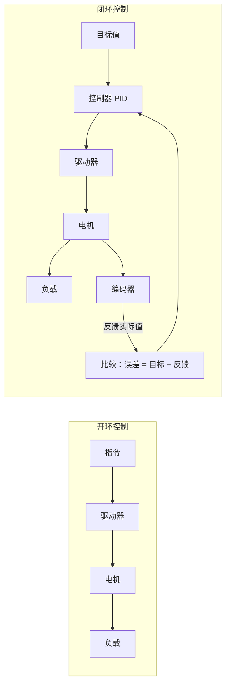

| 维度 | 开环 | 闭环 |
|---|---|---|
| 是否检测结果 | 否 | 是 |
| 误差来源 | 负载、温漂、丢步无法感知 | 实时纠正 |
| 精度 | 取决于执行器本身 | 取决于反馈分辨率 + 控制带宽 |
| 成本 | 低 | 高（传感器+控制器） |
| 稳定性 | 简单可靠 | 参数不当会振荡 |
| 典型 | 步进开环、普通风扇 | 伺服、闭环步进、有刷+编码器 |

### 6.2 闭环三要素与信号链

```mermaid
flowchart LR
    A["① 执行器<br/>电机 + 减速器"] --> B["② 反馈<br/>编码器/霍尔"]
    B --> C["③ 控制器<br/>MCU/DSP + 驱动器"]
    C -->|"PWM / 电流指令"| A
    C -->|"误差 = 目标 − 实际"| C
```

以“有刷直流 + 编码器 + PID”为例：

1. 编码器输出 A/B 脉冲 → MCU 计数得到**位置**，差分得到**速度**；
2. 与目标速度比较，得到误差 `e = v_ref − v_actual`；
3. PID 计算输出 `u`；
4. `u` 映射为 PWM 占空比 → H 桥 → 电机电压；
5. 循环，直到误差趋近 0。

### 6.3 三环控制结构

```mermaid
flowchart LR
    POS["位置指令 θ*"] --> E1["位置误差"]
    E1 --> P["位置环 P"]
    P --> VREF["速度指令 ω*"]
    VREF --> E2["速度误差"]
    E2 --> PI["速度环 PI"]
    PI --> IREF["电流/转矩指令 i*"]
    IREF --> E3["电流误差"]
    E3 --> C["电流环 PI"]
    C --> PWM["PWM / SVPWM"]
    PWM --> M["电机"]
    M --> F["编码器"]
    M --> CS["电流传感器"]
    F -->|"θ, ω"| E1
    F -->|"ω"| E2
    CS -->|"i"| E3
```

| 环 | 输入 | 输出 | 带宽 | 作用 |
|---|---|---|---|---|
| 电流环（最内） | 电流指令 | 电压/PWM | 最高（kHz） | 快速跟踪转矩，限流保护 |
| 速度环（中间） | 速度指令 | 电流指令 | 中（百 Hz） | 稳速、抗负载扰动 |
| 位置环（最外） | 位置指令 | 速度指令 | 最低（十 Hz） | 定位、轨迹跟踪 |

> **调试顺序**
> **先内后外**：电流环 → 速度环 → 位置环。内环不稳，外环永远调不好。

### 6.4 PID 原理与调试

#### 6.4.1 公式

**位置式**：

```
u(k) = Kp·e(k) + Ki·Σe(j)·T + Kd·[e(k) − e(k−1)] / T
```

**增量式**：

```
Δu(k) = Kp·[e(k) − e(k−1)] + Ki·e(k)·T + Kd·[e(k) − 2e(k−1) + e(k−2)] / T
u(k) = u(k−1) + Δu(k)
```

#### 6.4.2 三项作用

| 项 | 作用 | 过大的后果 | 过小的后果 |
|---|---|---|---|
| **P 比例** | 按误差大小出力 | 超调、振荡 | 响应慢、稳态误差大 |
| **I 积分** | 消除稳态误差 | 积分饱和、超调、滞后 | 稳态误差消不掉 |
| **D 微分** | 抑制变化、增加阻尼 | 放大噪声、抖动 | 超调大、易振荡 |

#### 6.4.3 调试步骤（经验法）

```mermaid
flowchart TD
    S1["① 只开 P，从小到大<br/>直到出现轻微振荡"] --> S2["② 回调 P 至稳定<br/>（约振荡临界值的 50–60%）"]
    S2 --> S3["③ 加 I，从小增大<br/>消除稳态误差"]
    S3 --> S4["④ 若超调明显，加 D<br/>抑制超调"]
    S4 --> S5["⑤ 施加负载扰动<br/>验证恢复能力"]
    S5 --> S6["⑥ 记录参数，做温漂/电压波动测试"]
```

#### 6.4.4 常见问题与对策

| 现象 | 可能原因 | 对策 |
|---|---|---|
| 持续振荡 | P 过大、D 过大、反馈噪声 | 降 P、加滤波、降 D |
| 稳态误差 | I 太小、死区、摩擦 | 加 I、死区补偿 |
| 响应慢 | P 太小、带宽低 | 加 P、提高采样率 |
| 超调大 | P 过大、I 饱和 | 降 P、抗积分饱和 |
| 低速爬行 | 摩擦死区、编码器分辨率低 | 死区补偿、提高分辨率 |
| 换向抖动 | 编码器安装偏心、A/B 干扰 | 检查安装、加屏蔽 |
| 积分饱和 | 长时间大误差 | 积分限幅、分离式 PID |

### 6.5 工程补充：让闭环“好用”的几个细节

1. **抗积分饱和（Anti-windup）**：输出限幅时停止积分，或积分分离（误差大时不积分）。
2. **前馈**：把目标速度/加速度直接前馈到输出，减少 PID 负担（`u = u_pid + Kf·v_ref`）。
3. **低通滤波**：编码器差分速度噪声大，加一阶低通（截止频率取带宽的 2–5 倍）。
4. **死区补偿**：齿轮背隙、静摩擦导致的“小误差不动”，可加最小 PWM 或摩擦模型。
5. **采样同步**：编码器计数与 PWM 更新同步，避免拍频。
6. **限流/限速**：任何闭环都要有输出限幅，否则堵转即烧。

### 6.6 闭环系统故障排查流程

```mermaid
flowchart TD
    Q1{"上电后电机<br/>是否转动？"} -->|"否"| A1["查供电/使能/驱动器故障灯"]
    Q1 -->|"是"| Q2{"转向是否正确？"}
    Q2 -->|"否"| A2["交换电机线两相<br/>或软件取反"]
    Q2 -->|"是"| Q3{"速度是否稳定？"}
    Q3 -->|"否"| A3["查编码器接线/屏蔽<br/>调 PID/加滤波"]
    Q3 -->|"是"| Q4{"定位是否准确？"}
    Q4 -->|"否"| A4["查减速比/CPR 设置<br/>查背隙/回零"]
    Q4 -->|"是"| Q5{"带载是否丢步/堵转？"}
    Q5 -->|"是"| A5["扭矩不足：降加速度<br/>换大电机/加减速比"]
    Q5 -->|"否"| OK["系统正常"]
```

---

## 7. 专题：42 步进电机闭环改造

### 7.1 结论先行

> **可以闭环，但“带磁柱”本身不等于闭环。** [对话结论]
> “磁柱”只是尾部预留的**机械安装位**，为磁编码器提供“可读的目标”。真正闭环需要补齐整条链路：**磁铁 → 磁编码器芯片 → 闭环驱动器/控制器**。

### 7.2 “磁柱”到底是什么

- 42 步进电机（NEMA 17）尾部常见一个**圆柱形凸台/孔位**，业内叫“磁柱”或“磁柱孔”。
- 作用是**固定径向充磁的磁铁**，让磁铁与转子同轴旋转。
- 商家卖“带磁柱的闭环专用电机”，本质是**出厂就帮你把安装位留好了**，省去自己加工。[对话结论]

```mermaid
flowchart LR
    A["42 步进电机"] --> B["尾部磁柱<br/>（安装位）"]
    B --> C["径向磁铁 6×5 mm"]
    C --> D["磁编码器芯片<br/>（PCB 固定）"]
    D --> E["闭环驱动器"]
    E --> F["PID 校正"]
    F --> A
```

### 7.3 完整闭环链路

```mermaid
flowchart TD
    subgraph MECH [机械层]
        M1["电机轴/磁柱"] --> M2["径向磁铁"]
        M2 --> M3["气隙小于 2 mm，精确对中"]
    end
    subgraph SENSE [传感层]
        S1["磁编码器芯片<br/>AS5600 / TLE5012B / MT6816"]
        S1 --> S2["SSI / SPI / ABZ 输出"]
    end
    subgraph CTRL [控制层]
        C1["闭环驱动器<br/>STM32/TMC/专用芯片"]
        C2["电流环 + 速度环 + 位置环"]
        C1 --> C2
    end
    subgraph ACT [执行层]
        A1["两相步进绕组"]
        A2["细分驱动"]
    end

    M3 --> S1
    S2 --> C1
    C2 --> A2
    A2 --> A1
    A1 --> M1
```

### 7.4 器件选型

#### 7.4.1 磁铁

| 项目 | 建议 | 说明 |
|---|---|---|
| 形状 | 圆片/圆环，径向充磁 | 径向充磁才能让芯片读到 360° 连续角度 |
| 常见规格 | 直径 6 mm × 厚 5 mm（6×5） | 对话中提到的常见规格 |
| 材料 | 钕铁硼 N35–N42 | 磁场强、体积小 |
| 安装 | 与电机轴同轴，胶粘/压装 | 偏心会直接引入角度误差 |

#### 7.4.2 磁编码器芯片

| 芯片 | 分辨率 | 接口 | 特点 |
|---|---|---|---|
| AS5600 | 12 位（4096） | I²C / 模拟 / PWM | 便宜、易用，适合入门 |
| MT6816 | 14 位（16 384） | SPI / ABZ | 性价比高，常见于闭环步进 |
| TLE5012B | 15 位（32 768） | SSC/SPI | 精度高，工业级 |
| AS5047P | 14 位 | SPI / ABZ | 集成度高，带 ABZ 输出 |

> 对话中“14 位 ≈ 0.02°”对应的就是 **16 384 CPR** 这一档。[对话结论]

#### 7.4.3 闭环驱动器

- **专用闭环步进驱动器**：内置编码器接口 + 三环，直接吃脉冲/总线指令（如 Emm42 一类）。
- **自搭方案**：STM32 + 编码器接口 + 步进驱动芯片（TMC2209/DRV8825）+ PID。
- **关键**：驱动器必须能**读编码器**并做**位置误差校正**，否则只是“带编码器的开环”。

### 7.5 精度计算

| 指标 | 计算 | 结果 |
|---|---|---|
| 整步数/转 | 360 / 1.8 | 200 |
| 细分 16 后脉冲/转 | 200 × 16 | 3 200 |
| 单脉冲角度（细分 16） | 360 / 3 200 | 0.1125° |
| 编码器 14 位 CPR | 2¹⁴ | 16 384 |
| 编码器角分辨率 | 360 / 16 384 | **≈ 0.022°** |
| 400 线编码器四倍频 | 400 × 4 | 1 600 CPR → 0.225° |

> **两个“精度”不是一回事**
> - **步进分辨率**（细分后每脉冲角度）决定“能命令到多细”；
> - **编码器分辨率**决定“能测到多细”。
> 闭环系统的实际精度由**两者中较差的那个 + 机械误差**决定。所以“0.02° 理论精度”是**编码器测量分辨率**，不是整机重复定位精度。

### 7.6 安装要点（决定成败）

1. **气隙 < 2 mm**：磁铁与芯片距离过大，磁场太弱，读数跳变。[对话结论]
2. **精确对中**：磁铁中心与芯片中心偏差 > 0.5 mm 就会引入周期性角度误差。
3. **磁铁与芯片平行**：倾斜会产生非线性误差。
4. **远离干扰源**：电机绕组、电源线、PWM 走线要远离芯片与信号线。
5. **PCB 固定牢**：振动导致气隙变化 → 读数抖动。
6. **信号线屏蔽/双绞**：SPI 时钟线尤其容易串扰。

### 7.7 校准流程

```mermaid
flowchart TD
    S1["空载安装<br/>磁铁+芯片+驱动器"] --> S2["上电，读原始角度"]
    S2 --> S3["检查角度是否<br/>随转动连续变化？"]
    S3 -->|"跳变/卡死"| F1["查气隙/对中/接线"]
    F1 --> S2
    S3 -->|"正常"| S4["空载校准<br/>学习磁铁-芯片对应关系"]
    S4 --> S5["验证：手动转一圈<br/>角度误差小于目标？"]
    S5 -->|"否"| F2["重新对中/换磁铁/查偏心"]
    F2 --> S4
    S5 -->|"是"| S6["带载测试<br/>低速→高速→加减速"]
    S6 --> S7["整定 PID<br/>位置环/速度环"]
    S7 --> S8["记录参数，做温漂测试"]
```

> **校准不能带载做**
> 首次校准应**空载**，让驱动器学习“磁铁角度 ↔ 电角度”的对应关系。带载校准会把负载形变、背隙一并学进去，引入系统误差。[对话结论]

### 7.8 效果边界与常见误区

| 误区 | 事实 |
|---|---|
| “加了编码器扭矩变大” | **不会**。扭矩由电机与电流决定，编码器只提供反馈。[对话结论] |
| “闭环后不会堵转” | 会。扭矩不够照样堵转，只是驱动器**知道**并报警。 |
| “闭环能提高最高转速” | 基本不能。高速受反电动势与驱动器电压限制。 |
| “0.02° 就是整机精度” | 只是编码器分辨率；整机还受背隙、形变、安装误差影响。 |
| “带磁柱就是闭环电机” | 磁柱只是安装位，没有芯片和闭环驱动器仍是开环。 |
| “细分越高精度越高” | 细分提高平滑度与分辨率，不消除步距角误差与背隙。 |

### 7.9 三种方案对比

| 维度 | 开环步进 | 闭环步进 | 交流伺服 |
|---|---|---|---|
| 反馈 | 无 | 编码器 | 高分辨率编码器/旋变 |
| 丢步 | 会，且无感知 | 可检测并纠正 | 不会（闭环） |
| 过载 | 直接失步 | 短时过载可恢复 | 2–3 倍过载 |
| 高速 | 差 | 中 | 好 |
| 成本 | 低 | 中 | 高 |
| 调试 | 简单 | 中 | 复杂 |
| 适用 | 轻载、低成本、低速 | 中载、要防丢步 | 高动态、高精度 |

---

## 8. 专题：370、众灵、MG370、MG310

### 8.1 370 电机：一个“机座号”，不是品牌

- **370 = 微型直流电机的一个系列/机座代号**（外径约 24 mm），不是某一家独有。
- 市面上有大量厂家生产，参数差异极大（绕组匝数决定电压-转速）。
- 常见形态：
  - **光轴 370**：只有电机；
  - **370 减速电机**：带电机的齿轮箱（减速比 1:10–1:300）；
  - **370 带编码器**：尾部加霍尔/GMR 编码器。

#### 典型参数（“暴力 370”参考值，对话结论 / 待核实）

| 项目 | 参数 |
|---|---|
| 外径 | 约 24.3 mm |
| 机身长度 | 约 30.8 mm |
| 电压 | 6 V / 12 V |
| 空载转速 | 6 V ≈ 16 500 rpm；12 V ≈ 33 600 rpm |
| 空载电流 | 12 V ≈ 0.51 A |
| 堵转电流 | 可达 ≈ 20 A |
| 堵转扭矩 | ≈ 0.7 kg·cm（≈ 0.069 N·m） |
| 特性 | 功率密度大、发热明显、非静音 |

> **20 A 堵转电流**
> 直接接电池会瞬间拉低电压、烧开关、烧线。**必须有限流或保险**，驱动器峰值电流至少 2 倍额定。

### 8.2 “众灵” 370

- “众灵”更多是**机器人开发/DIY/开源硬件/STM32 教程**相关品牌或社区，不是电机原厂。[对话结论][待核实]
- 其套件里的 370 电机大概率是**标准有刷 370**。
- 杭州众灵科技的专利涉及**总线舵机、步进驱动器**等控制板 → 擅长“驱动与控制方案”，而非电机本体制造。[对话结论]
- 结论：**不要把“众灵 370”当成特殊电机**，它就是通用 370 平台的一个采购渠道。

### 8.3 MG370：带编码器的 370 减速电机平台

#### 8.3.1 定位

- 不是严格标准型号，更像**“370 减速电机 + 编码器”的产品平台**，常见于轮趣科技等创客品牌。[对话结论]
- 关键特征：**出厂预装编码器**，直接可做闭环。
- **口径冲突**：有资料称 MG370 是“带内置霍尔的三相无刷电机统称”，也有产品页显示是“带编码器的有刷直流减速电机”。[对话结论][待核实]
- **买前必确认：有刷还是无刷**——两者驱动器完全不通用。

#### 8.3.2 两种编码器版本

| 版本 | 编码器 | 电机轴分辨率 | 减速比 | 输出轴 CPR | 能力 |
|---|---|---|---|---|---|
| **霍尔版** | 磁环 13 对极 | 13 PPR | 1:34 | ≈ 1 768 | 速度闭环、里程计 |
| **GMR 版** | 500 线 GMR | 500 PPR | 1:34.014 | ≈ 68 028 | 高精度位置闭环 |

> 计算：`500 × 4 × 34.014 ≈ 68 028`。[对话结论]

#### 8.3.3 闭环逻辑

```mermaid
flowchart LR
    MCU["MCU<br/>STM32/ESP32"] --> DRV["电机驱动<br/>TB6612/DRV8871"]
    DRV --> M["MG370 电机"]
    M --> E["编码器 A/B"]
    E -->|"脉冲"| Q["正交解码<br/>PCNT/定时器"]
    Q -->|"位置/速度"| PID["PID"]
    PID -->|"PWM"| DRV
```

- A/B 相位先后 → 判方向；
- 脉冲频率 → 算转速；
- 脉冲累计 → 算位移；
- PID 输出 PWM → 调电压。

#### 8.3.4 硬件注意

- GMR 版脉冲频率极高：以 12 V 空载 33 600 rpm 计，电机轴 500 PPR × 4 = 2 000 计数/转 → **1.12 MHz** 计数频率，**软件中断必死**。
- 必须用**硬件正交解码**（STM32 定时器编码器模式、ESP32 PCNT、专用芯片）。[对话结论]

### 8.4 MG310：轻负载高精度

#### 8.4.1 定位

- 同为直流减速电机平台（轮趣等），但**扭矩小、体积小、精度取向**。
- 扭矩约 **0.4 kgf·cm ≈ 0.039 N·m**，连续电流约 **1 100 mA**。[对话结论]
- 适合：小型智能车、桌面机械臂、云台、精密启停。

#### 8.4.2 编码器版本

| 版本 | 分辨率 | 说明 |
|---|---|---|
| 霍尔版 | 60 PPR 或 13 PPR（来源不一）[待核实] | 基础闭环、匀速控制 |
| GMR 版 | 500 PPR | 定位精度可达约 0.72°/步（实测口径）[对话结论] |

> 0.72° 是“输出轴每步”还是“每计数”取决于具体口径，采购时要以 CPR 与减速比自行核算。

#### 8.4.3 闭环实现

典型方案：**STM32/Arduino + TB6612/L298N + PID**。

现象：用手捏住转轴，电机能感到“主动加力”维持转速 → 这就是闭环在实时纠偏。[对话结论]

#### 8.4.4 性能边界

- 扭矩小：驱动超设计负载时 PID 很快饱和 → 仍会堵转。
- “稳”的前提是**负载匹配**。

### 8.5 四者对比矩阵

| 维度 | 370（通用） | 众灵 370 | MG370 | MG310 |
|---|---|---|---|---|
| 本质 | 微型有刷直流 | 通用 370 的套件渠道 | 370 减速电机 + 编码器平台 | 小型减速电机 + 编码器平台 |
| 扭矩 | 大（0.069 N·m 堵转） | 同 370 | 较大 | 小（0.039 N·m） |
| 转速 | 极高（万转级） | 同 370 | 中（经减速） | 中 |
| 编码器 | 通常无 | 通常无 | 霍尔 13PPR / GMR 500PPR | 霍尔 60/13PPR / GMR 500PPR |
| 闭环能力 | 需自行加装 | 需自行加装 | 原生支持 | 原生支持 |
| 定位精度 | 无 | 无 | 中 / 高 | 中 / 高（GMR） |
| 典型用途 | 风扇、玩具、泵 | 教学套件 | 智能车、机器人底盘 | 小型车、云台、桌面臂 |
| 选型关键词 | 便宜、猛、热 | 套件、教程 | 动力+精度兼顾 | 轻载+高精度 |

### 8.6 选型决策树

```mermaid
flowchart TD
    Q1{"需要精确<br/>位置控制？"} -->|"否"| A1["普通 370 / 减速电机<br/>加限流即可"]
    Q1 -->|"是"| Q2{"负载有多重？"}
    Q2 -->|"轻（小于 1 kg 级）"| Q3{"需要多高精度？"}
    Q2 -->|"中（几 kg）"| B1["MG370"]
    Q3 -->|"速度闭环即可"| C1["MG310 霍尔版"]
    Q3 -->|"要定位/锁位"| C2["MG310 GMR 版"]
    Q2 -->|"重/大扭矩"| D1["MG370 GMR<br/>或 57 步进/伺服"]
    B1 --> E{"需要高精度定位？"}
    E -->|"是"| E1["MG370 GMR"]
    E -->|"否"| E2["MG370 霍尔版"]
```

### 8.7 采购避坑清单

1. **确认有刷/无刷**：MG370 存在两种口径，驱动器不通用。
2. **确认编码器类型与 PPR**：霍尔 13 线 ≠ GMR 500 线。
3. **确认减速比**：输出转速、扭矩、CPR 全依赖它。
4. **确认输出轴形式**：D 字轴/光轴/双出轴。
5. **确认电压**：6 V 与 12 V 绕组不同，别超压。
6. **确认堵转电流**：驱动器与电源要扛得住。
7. **确认是否带霍尔线序图**：接反会飞车。
8. **要求规格书**：网页参数经常是“典型值”，批次差异大。

---

## 9. 选型方法论：从需求到型号

### 9.1 需求 → 参数映射

| 你的需求（人话） | 对应的工程参数 | 影响的选择 |
|---|---|---|
| “要拉动多重的东西” | 负载扭矩、额定扭矩 | 电机功率、减速比 |
| “要多快” | 输出转速、线速度 | 电机转速、减速比 |
| “要停得准” | 定位精度、重复精度 | 编码器分辨率、闭环 |
| “要反应快” | 加速度、带宽、惯量比 | 电机惯量、驱动器电流环 |
| “要连续跑” | 工作制、温升、寿命 | 有刷/无刷、散热 |
| “空间很小” | 体积、重量 | 空心杯、行星减速、无框 |
| “环境恶劣” | IP、防爆、温度 | 防护等级、材料 |
| “预算有限” | 成本 | 开环步进、有刷 |

### 9.2 关键计算

#### 9.2.1 转速与线速度

```
轮/带线速度 v = π × D × n_out / 60      （D 为轮径 m，n_out 为 rpm）
输出转速 n_out = v × 60 / (π × D)
电机转速 n_in = n_out × i
```

#### 9.2.2 扭矩

```
T = F × r                     （F 为切向力 N，r 为半径 m）
T(N·m) = 9550 × P(kW) / n(rpm)
P(W) = T(N·m) × ω(rad/s)
```

#### 9.2.3 减速比

```
i = n_in / n_out = T_out / (T_in × η)
```

#### 9.2.4 编码器脉冲频率

```
f_pulse = CPR × n(rpm) / 60
```

#### 9.2.5 惯量匹配

```
惯量比 = J_load' / J_motor     （J_load' = J_load / i²）
伺服：建议 < 10；步进：建议 < 5
```

#### 9.2.6 算例：2 kg 智能车

**已知**：整车 2 kg，轮径 65 mm，目标 1 m/s，加速度 1 m/s²，双轮驱动，滚动阻力系数 0.02。

| 步骤 | 计算 | 结果 |
|---|---|---|
| 轮周长 | π × 0.065 | 0.204 m |
| 轮转速 | 1 / 0.204 | 4.90 rps ≈ 294 rpm |
| 滚动阻力 | 0.02 × 2 × 9.81 | 0.39 N |
| 加速力 | 2 × 1 | 2.0 N |
| 总阻力 | 0.39 + 2.0 | 2.39 N |
| 每轮切向力 | 2.39 / 2 | 1.20 N |
| 每轮扭矩 | 1.20 × 0.0325 | **0.039 N·m ≈ 0.4 kgf·cm** |
| 每轮功率 | 0.039 × 2π × 4.9 | ≈ 1.2 W |

**结论**：

- 0.4 kgf·cm **正好是 MG310 的额定扭矩** → 没有余量，加速或爬坡就会吃力；
- 选 **MG370** 更稳妥，或降低加速度；
- 若减速比 1:34，电机侧需 ≈ 294 × 34 ≈ **10 000 rpm**，要核对电机空载转速是否覆盖（370 级可以）。

> **余量原则**
> 扭矩留 **1.5–2 倍**，转速留 **1.2–1.5 倍**，电流留 **2 倍**（应对堵转与启动）。

### 9.3 驱动与电源匹配

| 项目 | 要点 |
|---|---|
| 驱动器电流 | ≥ 电机额定电流 × 2（峰值按堵转） |
| 驱动器电压 | 覆盖电机额定电压，留 10–20% 余量 |
| 电源功率 | ≥ 电机输入功率 × 1.5 |
| 电源纹波 | 大电流启动时电压跌落要可接受 |
| 续流/吸收 | 感性负载必须加续流二极管或 TVS |
| 制动 | 频繁启停需考虑能量回馈/制动电阻 |

### 9.4 控制器选型

| 需求 | 推荐 |
|---|---|
| 单路有刷调速 | 1 个定时器 + H 桥 |
| 双路编码器电机 | STM32（定时器编码器模式）/ ESP32（PCNT） |
| 多路步进 | 专用步进驱动 + 脉冲发生（定时器/PWM） |
| BLDC 有感 | 六步换向（霍尔接口）或 FOC 库（SimpleFOC） |
| 高精度伺服 | 专用伺服驱动器 + 总线（CAN/EtherCAT） |
| 舵机阵列 | PCA9685 等 PWM 扩展 |

### 9.5 选型流程

```mermaid
flowchart TD
    A["① 明确负载<br/>质量/力矩/惯量"] --> B["② 明确运动<br/>速度/加速度/行程"]
    B --> C["③ 算扭矩与转速<br/>留 1.5–2 倍余量"]
    C --> D["④ 选电机类型<br/>有刷/无刷/步进/伺服"]
    D --> E["⑤ 选减速比<br/>匹配转速与扭矩"]
    E --> F["⑥ 选反馈<br/>是否需要编码器/分辨率"]
    F --> G["⑦ 选驱动器<br/>电流/电压/接口"]
    G --> H["⑧ 选控制器<br/>计数能力/实时性"]
    H --> I["⑨ 校核<br/>发热/惯量/电源/成本"]
    I -->|"不通过"| D
    I -->|"通过"| J["⑩ 打样验证"]
```

### 9.6 选型检查清单

- [ ] 负载扭矩算了吗？含加速扭矩与摩擦？
- [ ] 转速够吗？含减速比折算？
- [ ] 扭矩余量 ≥ 1.5 倍？
- [ ] 惯量比在范围内？
- [ ] 需要闭环吗？分辨率够吗？
- [ ] 编码器脉冲频率控制器能处理吗？
- [ ] 驱动器电流/电压够吗？
- [ ] 电源功率与纹波够吗？
- [ ] 散热/工作制满足吗？
- [ ] 环境防护（IP/防爆/温度）满足吗？
- [ ] 安装尺寸/轴径/法兰匹配吗？
- [ ] 成本与交期可接受吗？

---

## 10. 常见误区与 FAQ

### 10.1 十个高频误区

| # | 误区 | 纠正 |
|---|---|---|
| 1 | 电机分类是一棵树 | 是多维交叉，一台电机可同时属于多个类 |
| 2 | 无刷电机不用驱动器 | 必须配电调/驱动器，否则不转 |
| 3 | 步进电机不会丢步 | 过载/加速过猛必丢步，且无感知 |
| 4 | 闭环 = 扭矩变大 | 闭环只提升精度与抗扰，不提升扭矩上限 |
| 5 | 编码器线数越高越好 | 要看控制器能否处理、安装精度是否匹配 |
| 6 | 舵机就是伺服电机 | 舵机是集成系统，含电机+减速+反馈+驱动 |
| 7 | 减速比越大越好 | 减速比大→转速低、背隙与惯量折算变大 |
| 8 | 霍尔传感器就是编码器 | 霍尔是元件，编码器是器件 |
| 9 | 带磁柱就是闭环电机 | 磁柱只是安装位，还需芯片+闭环驱动器 |
| 10 | 12 V 电机接 24 V 更有劲 | 超压会过热、减寿，甚至烧毁 |

### 10.2 二十问速答

**Q1：电机和马达到底有什么区别？**
基本同义，“电机”是总称、偏书面，“马达”是 Motor 的俗称、偏口语；严格说“电机”还包含发电机。

**Q2：无刷电机是不是接上电就能转？**
不能。必须有驱动器/电调按转子位置换向。

**Q3：步进电机会丢步吗？**
会。负载超扭矩、加速度过大、共振区、驱动电流不足都会丢步，且开环下无感知。

**Q4：闭环步进能替代伺服吗？**
中低速、中负载可以；高动态、高速、高过载场景仍建议伺服。

**Q5：编码器线数越高越好吗？**
不是。要看控制器计数能力、安装精度、传动背隙；过高分辨率在低精度机械上是浪费。

**Q6：霍尔版和 GMR 版怎么选？**
只要测速/里程 → 霍尔版；要定位/锁位/低速平稳 → GMR 版。

**Q7：42 步进带磁柱就能闭环吗？**
不能。“带磁柱”只是有安装位，还需磁铁、磁编码器芯片、闭环驱动器。

**Q8：MG370 是有刷还是无刷？**
两种口径都有，买前必须确认；有刷与无刷驱动器不通用。

**Q9：舵机和伺服有什么区别？**
舵机是集成好的位置伺服系统（PWM 输入），工业伺服是分体器件（驱动器+电机+编码器）。

**Q10：减速比越大越好吗？**
不是。大减速比换扭矩，但降低转速、增加背隙与惯量折算，还可能自锁。

**Q11：电机为什么发热严重？**
电流大、散热差、长时间堵转、驱动波形差、电压过高。步进恒流驱动本身就热。

**Q12：PWM 频率选多少？**
有刷：10–20 kHz（避开听觉）；步进斩波：20–40 kHz；BLDC：按驱动器要求。

**Q13：编码器计数跳动/丢数怎么办？**
查屏蔽与接地、加滤波、降脉冲频率、用硬件计数、查 A/B 接线与上拉。

**Q14：电机反转怎么改？**
有刷：交换两根电机线；无刷：交换任意两相线或软件改相序；步进：交换一相的两根线或改方向引脚。

**Q15：堵转电流为什么这么大？**
堵转时反电动势为 0，电流只受绕组电阻限制，I = U/R，所以远大于额定。

**Q16：12 V 电机能接 24 V 吗？**
短时可能转得更快，但发热、电刷磨损、绝缘都会恶化，不建议长期超压。

**Q17：步进电机为什么高速没劲？**
绕组电感限制电流上升速度，频率越高电流越小，扭矩随转速快速下降。

**Q18：编码器需要屏蔽吗？**
需要。A/B 是高频脉冲，长线必须双绞屏蔽，屏蔽层单端接地。

**Q19：失步、堵转、过冲分别是什么？**
失步：转子跟不上磁场；堵转：负载卡死、转速为 0 但通电；过冲：超调后回摆。

**Q20：选型第一步该做什么？**
算负载扭矩与转速，并留 1.5–2 倍余量——其余都是在这个基础上做取舍。

---

## 11. 术语中英对照表

| 中文 | 英文 | 缩写 |
|---|---|---|
| 电机 | Electric machinery | — |
| 电动机 | Electric motor | M |
| 发电机 | Generator | G |
| 直流电机 | Direct current motor | DC motor |
| 无刷直流电机 | Brushless DC motor | BLDC |
| 永磁同步电机 | Permanent magnet synchronous motor | PMSM |
| 异步/感应电机 | Induction motor | IM |
| 开关磁阻电机 | Switched reluctance motor | SRM |
| 步进电机 | Stepper motor | — |
| 伺服电机 | Servo motor | — |
| 舵机 | Hobby servo | — |
| 减速电机 | Gear motor | — |
| 减速器 | Gearbox / Reducer | — |
| 行星减速器 | Planetary gearbox | — |
| 谐波减速器 | Harmonic drive | — |
| 编码器 | Encoder | — |
| 增量式编码器 | Incremental encoder | — |
| 绝对式编码器 | Absolute encoder | — |
| 霍尔传感器 | Hall sensor | — |
| 巨磁阻 | Giant magnetoresistance | GMR |
| 隧道磁阻 | Tunnel magnetoresistance | TMR |
| 旋转变压器 | Resolver | — |
| 每转脉冲数 | Pulses per revolution | PPR |
| 每转计数 | Counts per revolution | CPR |
| 正交编码 | Quadrature encoding | — |
| 闭环控制 | Closed-loop control | — |
| 开环控制 | Open-loop control | — |
| 比例积分微分 | Proportional-integral-derivative | PID |
| 磁场定向控制 | Field-oriented control | FOC |
| 脉宽调制 | Pulse width modulation | PWM |
| 电子调速器 | Electronic speed controller | ESC |
| 反电动势 | Back electromotive force | BEMF |
| 转矩常数 | Torque constant | Kt |
| 转速常数 | Speed constant | Kv |
| 保持扭矩 | Holding torque | — |
| 步距角 | Step angle | — |
| 细分 | Microstepping | — |
| 失步 | Step loss | — |
| 堵转 | Stall | — |
| 背隙 | Backlash | — |
| 惯量匹配 | Inertia matching | — |
| 防护等级 | Ingress protection | IP |
| 防爆 | Explosion-proof | Ex |

---

## 12. 附录：公式、单位与速查表

### 12.1 公式速查

| 场景 | 公式 |
|---|---|
| 同步转速 | `n = 60f / p` |
| 转差率 | `s = (n1 − n) / n1` |
| 功率-扭矩-转速 | `T = 9550 × P / n`（N·m, kW, rpm） |
| 机械功率 | `P = T × ω`，`ω = 2πn / 60` |
| 减速输出 | `n_out = n_in / i`，`T_out = T_in × i × η` |
| 编码器 CPR | `CPR = PPR × 4 × i` |
| 角分辨率 | `θ = 360° / CPR` |
| 脉冲频率 | `f = CPR × n / 60` |
| 步进脉冲/转 | `360 / 步距角 × 细分` |
| 转矩常数 | `Kt ≈ 9.55 / Kv` |
| 线速度 | `v = π × D × n / 60` |
| 惯量比 | `J_load' / J_motor = (J_load / i²) / J_motor` |

### 12.2 单位换算

| 换算 | 系数 |
|---|---|
| 1 kgf·cm → N·m | × 0.098 1 |
| 1 N·m → kgf·cm | × 10.2 |
| 1 kg·cm → N·m | × 0.098 1 |
| 1 rpm → rad/s | × 0.104 7 |
| 1 rad/s → rpm | × 9.549 |
| 1 mH → H | × 0.001 |
| 1 g·cm² → kg·m² | × 1e-7 |

### 12.3 常见型号参数速查

| 型号 | 类型 | 关键参数 | 备注 |
|---|---|---|---|
| 370 | 微型有刷直流 | 24.3 mm 外径，6/12 V，最高 3 万转 | 需限流，发热大 |
| MG310 | 直流减速电机 | 0.4 kgf·cm，1.1 A，霍尔/GMR | 轻负载高精度 |
| MG370 | 直流减速电机 | 霍尔 13PPR / GMR 500PPR | 动力+精度兼顾 |
| 42 步进（NEMA17） | 混合式步进 | 1.8°，200 步/转，0.2–0.5 N·m | 可闭环改造 |
| 57 步进（NEMA23） | 混合式步进 | 1.8°，1–3 N·m | 中型设备 |
| SG90 | 舵机 | 9 g，约 1.8 kgf·cm | 航模/小关节 |
| MG996R | 舵机 | 约 55 g，约 9–11 kgf·cm | 机器人关节 |

### 12.4 参考资料与可信度说明

- 本文第 1–8 章的事实性内容主要来自分享对话（对话本身经过联网搜索），但**具体型号参数属公开网页口径**，不同来源存在冲突（如 MG370 有刷/无刷、MG310 霍尔 60/13 PPR）。
- 第 9–12 章的计算方法与工程建议为通用工程知识补充，用于理解与估算，**不替代厂家设计手册**。
- 采购、打样、量产前请以**厂家规格书、铭牌、实测**为准。

### 12.5 版本记录

| 版本 | 日期 | 说明 |
|---|---|---|
| v1.0 | 2026-11-17 | 基于分享对话整理的精简总结 |
| v2.0 | 2026-11-17 | 扩展为体系化长文档：九维分类、类型详解、编码器体系、闭环控制、42 步进改造、MG 系列选型、公式与 FAQ |

> **一页纸总结**
> **电机是总称；直流/交流看电源，同步/异步/直流看原理，驱动/控制看用途；无刷是直流的分支，步进与伺服是控制电机的代表；舵机是集成系统，减速电机是组合体，编码器是传感器；霍尔是元件、编码器是器件；闭环 = 执行器 + 反馈 + 控制器；42 步进“带磁柱”只是安装位，闭环还需磁铁、磁编码器和闭环驱动器；370 是机座号，众灵是渠道，MG370 偏动力、MG310 偏精度，霍尔版做测速、GMR 版做定位；选型的本质是扭矩、转速、精度、体积、成本、控制器能力之间的权衡。**
