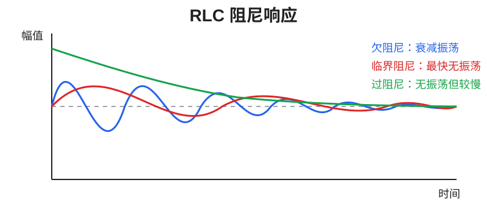
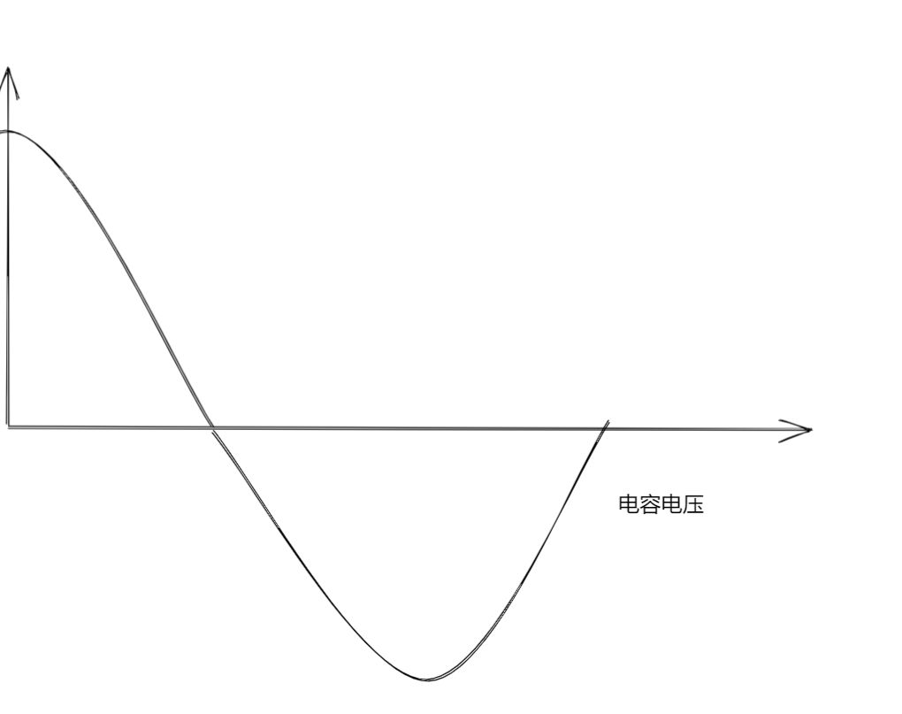
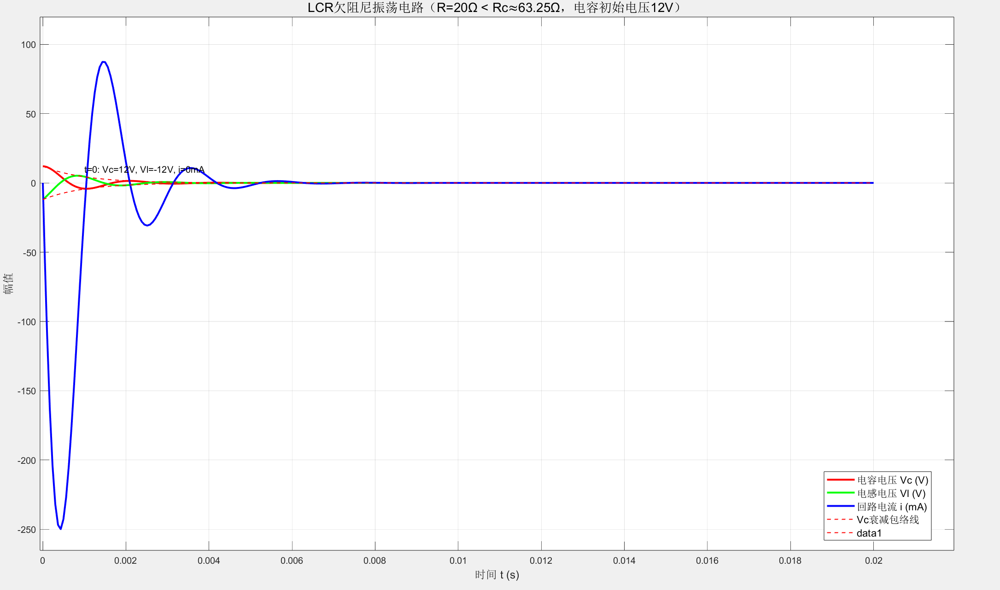
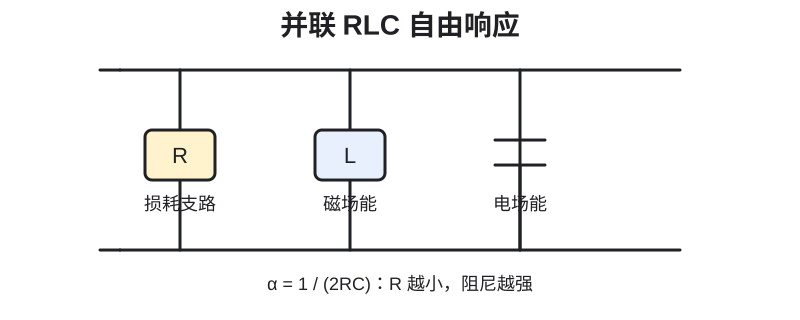
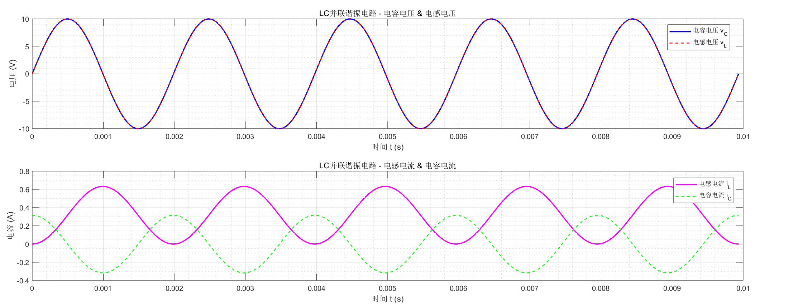
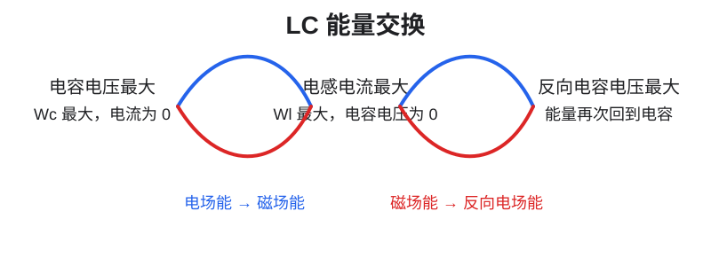
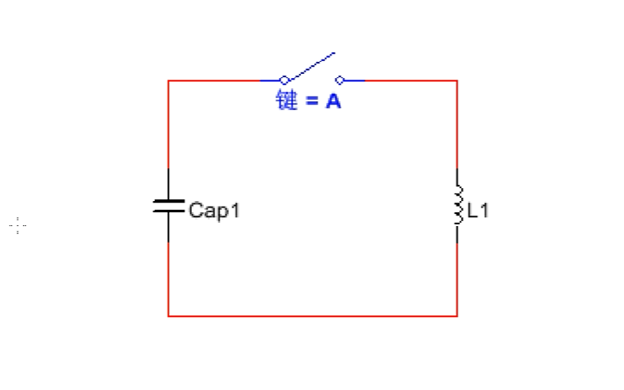
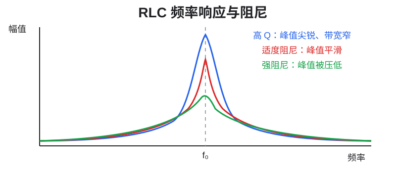
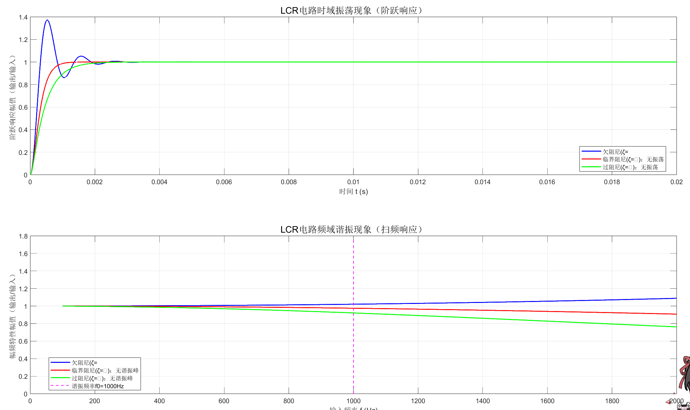

# 偏置、截止频率、谐振与振荡

> 本文是概念辨析与数学分析版。第一次接触这些术语，建议先读：[零基础/偏置、截止频率与振荡-零基础概念](../../../../../../../Embedded/PCB/assets/Expand/Docs/零基础/偏置_截止频率与振荡-零基础概念/)

这份文档整理了原笔记中的四组概念：

1. 直流偏置和静态工作点；
2. 截止频率与一阶滤波器；
3. RLC 谐振与带宽；
4. LC 自由响应、持续振荡和阻尼。

这些概念经常同时出现在模拟电路中，但它们描述的对象不同：

| 概念 | 主要回答的问题 |
| --- | --- |
| 偏置 | 有源器件在没有交流信号时处于什么工作状态？ |
| 截止频率 | 滤波器从通带过渡到阻带的位置在哪里？ |
| 谐振频率 | L 和 C 的能量交换在哪个频率最强？ |
| 振荡 | 电路能否在没有外部周期信号的情况下产生周期波形？ |
| 阻尼 | 暂态振荡衰减得快不快，会不会过冲？ |

## 1. 直流偏置与静态工作点

### 1.1 什么是偏置

偏置（bias）是施加在有源器件上的直流电压或直流电流，用来设定器件的**静态工作点**（Q 点）。

实际信号通常可以写成：

$$
x(t)=X_Q+x_{ac}(t)
$$

其中：

- $X_Q$ 是直流偏置量；
- $x_{ac}(t)$ 是叠加在偏置上的交流或变化信号。

偏置本身不等于干扰。它可能是电路正常工作所必需的基准，也可能在信号耦合到后级时需要被隔离或去除，具体取决于电路功能。

### 1.2 为什么晶体管需要偏置

以 NPN 三极管共射放大器为例，基极需要一个合适的直流电压，使发射结处于正向偏置、集电结处于反向偏置，晶体管才能在放大区附近工作。

没有合适偏置时：

- 输入正半周可能使晶体管导通；
- 输入负半周可能使晶体管截止；
- 输出只能保留部分波形，出现截止失真。

有合适偏置时，交流信号可以在 Q 点附近上下摆动：

```text
器件允许的线性范围
        ↑
        │       交流信号
        │      /\    /\
        │  ───/──\──/──\──
        │      ↑
        │    直流工作点 Q
        └──────────────────→ 时间
```

偏置点还决定：

- 最大不失真输出幅度；
- 小信号增益；
- 功耗和效率；
- 器件处于截止、放大还是饱和状态。

### 1.3 偏置的常见实现

- 三极管：基极偏置电阻、发射极电阻、集电极负载；
- MOSFET：栅极偏置电压和源极电阻；
- 运算放大器：输入共模电压、输出静态电平和虚拟地；
- 射频功放：栅极或基极静态偏压、漏极或集电极供电；
- ADC/DAC 前端：把双极性信号平移到允许的单电源输入范围。

### 1.4 偏置与交流耦合

如果后级不希望接收到前级的直流分量，可以使用串联电容或变压器进行交流耦合：

```text
前级：Vbias + 交流信号 ── 串联电容 ── 后级：重新建立自己的偏置
```

串联电容不能凭空“消除所有低频”，它和后级输入电阻共同形成高通滤波器。截止频率为：

$$
f_c=\frac{1}{2\pi R_{eq}C}
$$

如果有效信号中包含低频成分，截止频率选择过高会连同有用信号一起衰减。

## 2. 截止频率：滤波器的边界参数

### 2.1 截止频率的定义

对常见的一阶滤波器，截止频率 $f_c$ 通常定义为幅值下降到通带幅值的：

$$
\frac{1}{\sqrt{2}}\approx0.707
$$

对应：

$$
20\log_{10}\left(\frac{1}{\sqrt{2}}\right)\approx-3.01\text{ dB}
$$

如果负载是相同且近似纯电阻的负载，输出功率约为通带功率的 50%。这里的“幅值减到 0.707”不能理解为电压减到 0.5。

### 2.2 常见一阶 RC、RL 截止频率

| 电路 | 典型拓扑 | 截止频率 |
| --- | --- | --- |
| RC 低通 | R 串联、C 对地，输出取 C 两端 | $f_c=1/(2\pi RC)$ |
| RC 高通 | C 串联、R 对地，输出取 R 两端 | $f_c=1/(2\pi RC)$ |
| RL 低通 | L 串联、R 对地，输出取 R 两端 | $f_c=R/(2\pi L)$ |
| RL 高通 | R 串联、L 对地，输出取 L 两端 | $f_c=R/(2\pi L)$ |

RC 和 RL 的公式不能写成 $2\pi RC$ 或 $2\pi LR$。截止频率的单位必须是 Hz，因此应检查公式的量纲：

- $RC$ 的单位是 s，必须取倒数；
- $L/R$ 的单位是 s，必须取倒数；
- 因此 RL 电路的结果是 $R/(2\pi L)$。

### 2.3 截止频率不是谐振频率

一阶 RC/RL 滤波器只有一个储能元件，通常没有 L-C 能量交换形成的谐振峰。它仍然有截止频率，但不一定有谐振频率。

截止频率描述的是**幅频响应的规定衰减点**；谐振频率描述的是**含 L、C 系统的响应峰值或阻抗极值点**。

## 3. LC 谐振频率

### 3.1 理想 LC 的固有角频率

理想 LC 系统的固有角频率为：

$$
\omega_0=\frac{1}{\sqrt{LC}}
$$

换算为普通频率：

$$
f_0=\frac{1}{2\pi\sqrt{LC}}
$$

这个公式的量纲为：

$$
[LC]=\text{s}^2
$$

所以 $1/\sqrt{LC}$ 的单位是 rad/s，除以 $2\pi$ 后得到 Hz。

### 3.2 串联 RLC 谐振

串联 RLC 的阻抗为：

$$
Z=R+j\left(\omega L-\frac{1}{\omega C}\right)
$$

谐振条件是：

$$
\omega_0L=\frac{1}{\omega_0C}
$$

因此：

- 总电抗为 0；
- 总阻抗最小，理想情况下 $Z=R$；
- 回路电流达到最大值；
- 电感和电容两端电压大小相等、相位相反；
- 电源电压与回路电流同相。

串联谐振的“电流最大”并不表示电路无损耗。电阻仍然消耗功率，电源必须持续补充损耗能量。

### 3.3 并联 RLC 谐振

并联 RLC 的导纳为：

$$
Y=\frac{1}{R}+j\left(\omega C-\frac{1}{\omega L}\right)
$$

理想谐振条件仍然是：

$$
\omega_0C=\frac{1}{\omega_0L}
$$

但并联谐振的特性与串联谐振相反：

- 总导纳的虚部为 0；
- 对理想并联 RLC，输入阻抗达到最大；
- 外部电源提供的线电流较小；
- L、C 支路之间可以存在较大的循环电流。

真实电感的绕组电阻、寄生电容和负载会使并联谐振频率发生偏移，因此工程上应使用实际等效模型。

## 4. 谐振、振荡与自由响应

### 4.1 谐振是受迫响应

谐振是指系统受到外部周期信号激励时，激励频率接近系统固有频率，响应幅值或能量交换显著增强的现象。

```text
外部正弦源 ── 持续供能 ── RLC 系统
                         ↑
                 f 接近 f0 时响应增强
```

谐振通常依赖外部持续激励。断开信号源后，带损耗的 RLC 电路不会无限保持等幅振荡。

### 4.2 自由响应是初始能量释放

给电容预先充电，或给电感预先建立电流，然后断开外部激励，RLC 会产生自然响应：

- 理想 LC：等幅自由振荡；
- 含电阻的 RLC：振荡幅值逐渐衰减，或直接单调衰减；
- 没有持续能量补充时，实际电路最终回到稳态。

### 4.3 持续振荡需要有源补偿

实际的持续振荡器需要电源、放大器和反馈网络。它通过正反馈补偿电阻、晶体管和负载造成的能量损耗。

常用的起振条件可以用巴克豪森条件概括：

$$
|A\beta|\ge1
$$

并且总相位满足正反馈条件：

$$
\angle(A\beta)=0^\circ+360^\circ k
$$

稳态时非线性会把环路增益限制到接近 1。因而“LC 自由响应”和“有源振荡器的持续输出”不能混为一谈。

## 5. 串联 RLC 的阻尼

### 5.1 微分方程

对无外部激励的串联 RLC，以电容电压 $v_C(t)$ 为变量：

$$
LC\frac{d^2v_C}{dt^2}+RC\frac{dv_C}{dt}+v_C=0
$$

标准形式为：

$$
\frac{d^2v_C}{dt^2}+2\alpha\frac{dv_C}{dt}+\omega_0^2v_C=0
$$

其中：

$$
\alpha=\frac{R}{2L},\qquad \omega_0=\frac{1}{\sqrt{LC}}
$$

这里的 $\alpha$ 单位是 $\text{s}^{-1}$，表示振幅包络的衰减速度。

### 5.2 三种阻尼状态

| 状态 | 条件 | 电阻条件 | 波形特征 |
| --- | --- | --- | --- |
| 欠阻尼 | $\alpha<\omega_0$ | $R<2\sqrt{L/C}$ | 衰减振荡，可能有过冲 |
| 临界阻尼 | $\alpha=\omega_0$ | $R=2\sqrt{L/C}$ | 无振荡且回到稳态最快 |
| 过阻尼 | $\alpha>\omega_0$ | $R>2\sqrt{L/C}$ | 无振荡，但通常比临界阻尼更慢 |

欠阻尼时的阻尼振荡角频率为：

$$
\omega_d=\sqrt{\omega_0^2-\alpha^2}
$$

响应包络大致按 $e^{-\alpha t}$ 衰减。注意：阻尼越大不代表所有响应指标都越快；超过临界阻尼后，响应会变成两个衰减指数，建立时间反而可能增加。

### 5.3 串联 RLC 的临界电阻

由 $\alpha=\omega_0$ 得：

$$
R_{critical}=2\sqrt{\frac{L}{C}}
$$

例如：

$$
L=10\text{ mH},\qquad C=10\,\mu\text{F}
$$

则：

$$
R_{critical}=2\sqrt{\frac{10\times10^{-3}}{10\times10^{-6}}}
\approx63.2\,\Omega
$$

### 5.4 品质因数

串联 RLC 在理想小损耗条件下的品质因数为：

$$
Q=\frac{\omega_0L}{R}=\frac{1}{\omega_0CR}
$$

对于串联 RLC，临界阻尼对应 $Q=0.5$。高 $Q$ 通常意味着谐振峰更尖锐、带宽更窄，但也意味着对元件容差、负载变化和寄生参数更敏感。

### 5.5 原笔记中的串联 RLC 波形图

下面保留原笔记中的部分波形和电路图，用于对照欠阻尼、临界阻尼和过阻尼的概念。图中的具体参数应以图注或仿真设置为准，不能只根据颜色判断阻尼类型。

> **> 原文件还引用了 `QQ_1768204961650.png`，但当前工作区中未找到该图片文件，因此这里没有继续嵌入，避免留下失效图片链接。**



原始仿真波形截图：





## 6. 并联 RLC 的阻尼

### 6.1 先确认电阻的连接位置

以下公式针对“$R$、$L$、$C$ 三者并联”的拓扑：

```text
        ┌── R ──┐
节点 ───┼── L ──┼── 地
        └── C ──┘
```

如果电阻是串联在电感支路、串联在信号源，或负载以其他方式连接，阻尼系数必须重新推导，不能直接套用并联公式。

### 6.2 并联 RLC 的参数

对并联 RLC 的节点电压：

$$
\frac{d^2v}{dt^2}+\frac{1}{RC}\frac{dv}{dt}+\frac{1}{LC}v=0
$$

因此：

$$
\alpha=\frac{1}{2RC},\qquad \omega_0=\frac{1}{\sqrt{LC}}
$$

这里与串联 RLC 不同：

- 并联电阻 $R$ 越小，损耗越大，阻尼越强；
- 并联电阻 $R$ 越大，损耗越小，阻尼越弱。

### 6.3 并联 RLC 的临界电阻

令 $\alpha=\omega_0$：

$$
R_{critical}=\frac{1}{2}\sqrt{\frac{L}{C}}
$$

判断关系为：

| 状态 | 并联电阻条件 |
| --- | --- |
| 欠阻尼 | $R>R_{critical}$ |
| 临界阻尼 | $R=R_{critical}$ |
| 过阻尼 | $R<R_{critical}$ |

这与串联 RLC 的电阻判断方向相反，原因是串联电阻越大损耗越大，而并联电阻越小损耗越大。

### 6.4 原笔记中的并联 LC 图示

以下图片对应原笔记中的并联 LC 及其阻尼示意。判断公式仍应以本节给出的并联拓扑为准：

$$
\alpha=\frac{1}{2RC}
$$



原始并联 LC 仿真截图：



## 7. RLC 的能量交换

电容储存电场能：

$$
W_C=\frac{1}{2}Cv_C^2
$$

电感储存磁场能：

$$
W_L=\frac{1}{2}Li^2
$$

理想 LC 中总能量保持不变：

$$
W_{total}=W_C+W_L=\text{constant}
$$

一个周期内可以这样理解：

```text
电容电压最大、 电流为 0
        ↓
电容能量 → 电感能量
        ↓
电容电压为 0、 电流最大
        ↓
电感能量 → 反向电容能量
        ↓
电容反向电压最大、 电流为 0
```

### 7.1 原笔记中的串联 LC 电荷变化图

下面三张图展示了原笔记中从电容初始带电、开关闭合到电荷开始移动的过程。图中的开关只是启动条件；一旦闭合，实际电流方向和极板电荷会随时间反转。



原始串联 LC 电荷状态截图：



关键点：电容电压为 0 时，表示电容两端的净电荷为 0，并不表示回路中没有电荷，也不表示电流为 0。此时电感磁场能量达到最大，电流通常达到峰值。

电感的电压关系为：

$$
v_L=L\frac{di}{dt}
$$

当电流达到峰值时，$di/dt=0$，所以电感两端瞬时电压为 0；电流仍可继续流动，只是随后会在电容反向充电产生的电场作用下逐渐减小。

## 8. 输入频率、谐振频率和截止频率

### 8.1 输入频率 $f$

输入频率是由信号源决定的外部变量。扫频测试时，改变的就是 $f$，然后观察输出幅值、相位、电流或阻抗的变化。

### 8.2 谐振频率 $f_0$

谐振频率主要由 L、C 和拓扑决定。对理想 LC 或低损耗 RLC：

$$
f_0=\frac{1}{2\pi\sqrt{LC}}
$$

实际电阻会改变峰值高度、带宽和阻尼；寄生参数还会改变有效的 L、C，因此实际谐振点可能偏离标称公式。

### 8.3 截止频率 $f_c$

截止频率是某个传递函数达到规定衰减的频率。对于带通或谐振响应，通常存在两个截止频率：

- 下截止频率 $f_{c1}$；
- 上截止频率 $f_{c2}$。

带宽为：

$$
BW=f_{c2}-f_{c1}
$$

对于高 Q 串联 RLC：

$$
BW\approx\frac{f_0}{Q}
$$

精确的半功率角频率为：

$$
\omega_{1,2}=\omega_0\left(\sqrt{1+\frac{1}{4Q^2}}\mp\frac{1}{2Q}\right)
$$

其中下标 1 取减号，上截止频率取加号。

### 8.4 三者的关系

| 参数 | 由谁决定 | 在测试中扮演的角色 |
| --- | --- | --- |
| 输入频率 $f$ | 信号源 | 被扫描或设定的自变量 |
| 谐振频率 $f_0$ | L、C、拓扑和寄生参数 | 响应峰值或阻抗极值附近的位置 |
| 截止频率 $f_c$ | 传递函数、负载和规定衰减 | 通带、阻带或带宽的边界 |

谐振频率和截止频率在某些特殊滤波器中可能接近或重合，但不能在所有 LC 电路中直接认为 $f_c=f_0$。

### 8.5 原笔记中的频域仿真图

原笔记还包含用于比较不同阻尼状态的仿真图。阅读这类图时，应同时关注：峰值高度、半功率带宽、衰减时间和输入/输出的测量位置。



原始频域仿真截图：



## 9. 一个数值例子

设：

$$
L=10\text{ mH},\qquad C=10\,\mu\text{F}
$$

则：

$$
f_0=\frac{1}{2\pi\sqrt{10\times10^{-3}\times10\times10^{-6}}}
\approx503.3\text{ Hz}
$$

串联 RLC 的临界电阻：

$$
R_{critical,series}=2\sqrt{\frac{L}{C}}
\approx63.2\,\Omega
$$

并联 RLC 的临界电阻：

$$
R_{critical,parallel}=\frac{1}{2}\sqrt{\frac{L}{C}}
\approx15.8\,\Omega
$$

注意两个临界电阻不同，而且并联电阻的欠阻尼/过阻尼判断方向与串联电阻相反。

## 10. 工程上如何判断问题

### 10.1 看到直流偏移

先问：这个直流分量是前级正常偏置，还是后级不需要的偏置？

- 若有源器件需要它：保留并稳定 Q 点；
- 若后级只需要交流：用耦合电容或变压器隔离，并重新计算高通截止频率；
- 若信号是单电源系统的虚拟地信号：不要把“偏置”误判成接地错误。

### 10.2 看到频率选择

先判断是在研究：

- 一阶滤波器的通带/阻带边界：使用 $f_c$；
- L、C 的能量交换峰值：使用 $f_0$；
- 外部信号源当前施加的频率：使用 $f$。

### 10.3 看到衰减振荡

先确认拓扑，再写阻尼参数：

- 串联 RLC：$\alpha=R/(2L)$；
- 并联 RLC：$\alpha=1/(2RC)$（R、L、C 三者并联时）；
- 其他拓扑：重新列 KVL/KCL，不要直接套用上述公式。

## 11. 原笔记中需要特别纠正的地方

| 原有倾向 | 更准确的结论 |
| --- | --- |
| RC 截止频率写成 $2\pi RC$ | 应为 $1/(2\pi RC)$ |
| RL 截止频率写成 $2\pi LR$ 的倒数形式 | 典型 RL 一阶电路为 $f_c=R/(2\pi L)$ |
| LC 谐振频率写成 $2\pi LC$ 的倒数形式不完整 | 应为 $f_0=1/(2\pi\sqrt{LC})$ |
| 并联 RLC 也使用 $\alpha=R/(2L)$ | 三者并联且 R 为并联电阻时，应为 $\alpha=1/(2RC)$ |
| 并联电阻越小阻尼越弱 | 并联电阻越小，损耗越大，阻尼越强 |
| 频率高低可以直接判断共模或差模 | 模式由电流路径和相对关系决定，不由频率单独决定 |
| 电容电压为 0 时电流也为 0 | 在理想 LC 中，电容电压为 0 时电流通常达到最大 |
| 谐振等于持续振荡 | 谐振是受迫响应；持续振荡需要有源反馈补偿损耗 |
| 临界阻尼永远是所有指标下最快 | 临界阻尼无振荡且通常响应最快，但具体稳定时间仍取决于定义和系统结构 |

## 12. 总结

- **偏置**是给有源器件设定静态工作点的直流条件；
- **截止频率**是滤波器达到规定衰减的边界；
- **谐振频率**是 L、C 能量交换最强或阻抗出现极值的频率；
- **自由响应**是初始能量在电感和电容之间交换后的自然响应；
- **持续振荡**需要有源电路和反馈来补偿损耗；
- **串联 RLC** 的阻尼系数为 $R/(2L)$；
- **并联 RLC**（R、L、C 三者并联）的阻尼系数为 (1/(2RC))；
- 任何公式都必须先确认电路拓扑、元件连接位置和符号约定。

> 一句话记忆：**偏置决定器件站在哪个工作点，截止频率决定滤波器从哪里开始衰减，谐振频率决定 L 与 C 在哪里交换能量最强，阻尼决定这场能量交换会不会明显振荡以及多久停下来。**
