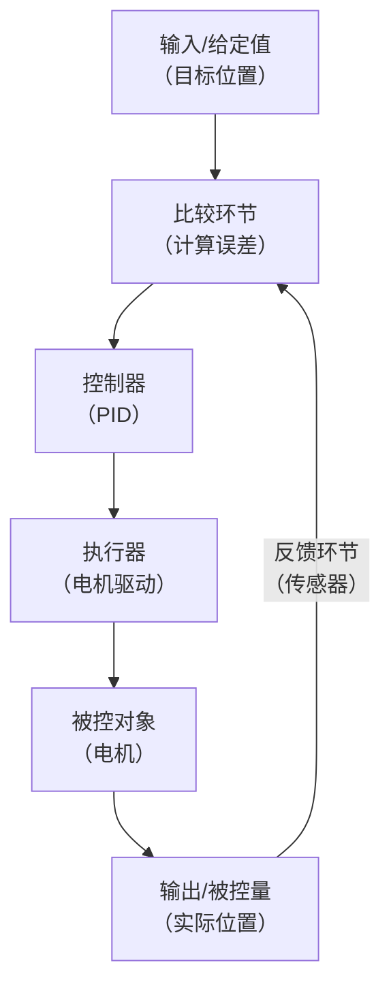
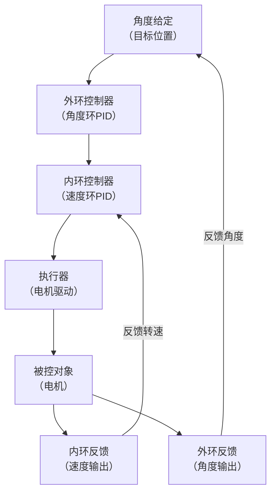
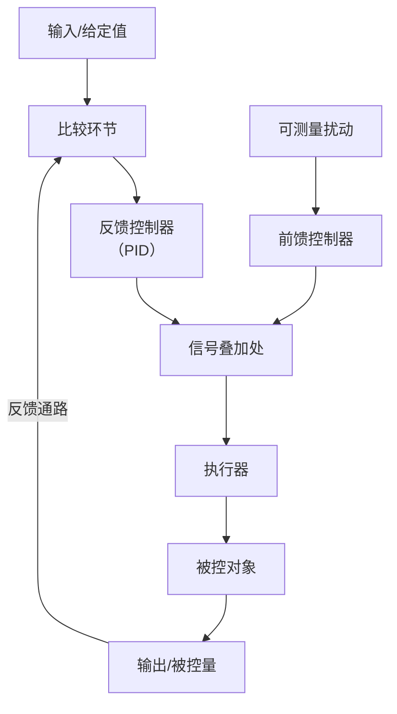
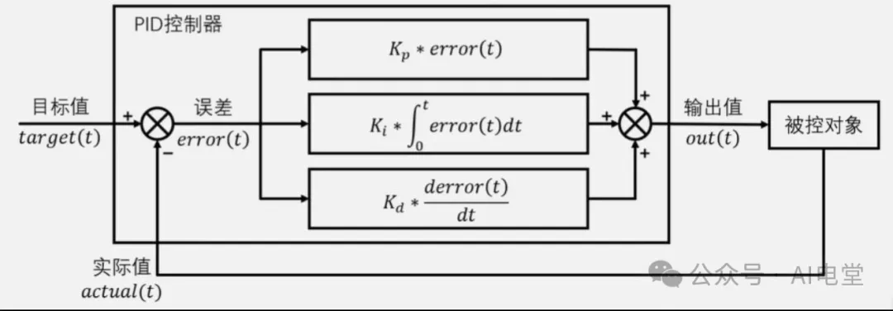
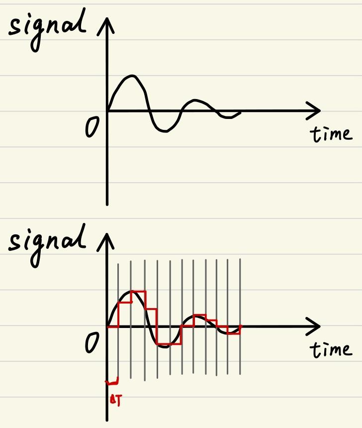
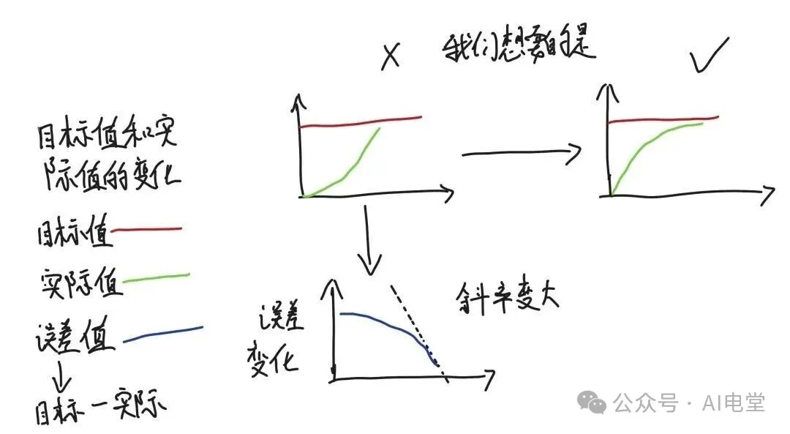
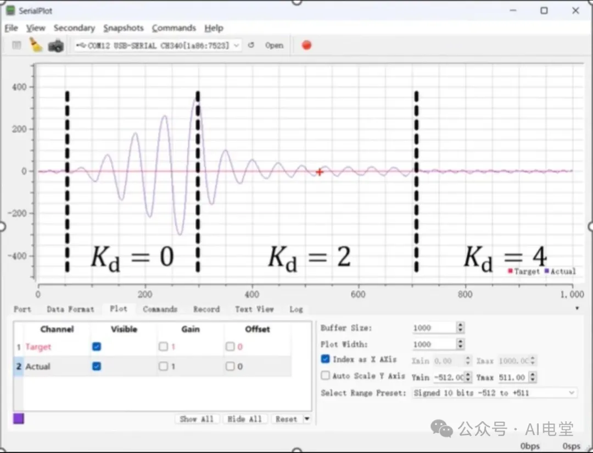
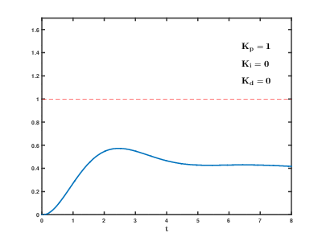

# PID算法

以下是根据PDF讲义、视频教程以及补充参考资料，对PID从零到实战的全方位详细讲解。

视频链接：[从不懂到会用！PID从理论到实践~  哔哩哔哩_bilibili](https://www.bilibili.com/video/BV1B54y1V7hp/?spm_id_from=333.788.videopod.episodes&amp%3Bvd_source=cae5e5e53a7fcdf3a7ac534a5a5e2344&amp%3Bp=2&vd_source=cae5e5e53a7fcdf3a7ac534a5a5e2344)
<iframe src="https://player.bilibili.com/player.html?aid=845789061&bvid=BV1B54y1V7hp&cid=343573560&page=1&autoplay=0" scrolling="no" border="0" frameborder="no" framespacing="0" allow="fullscreen; picture-in-picture" allowfullscreen="true" style="height:100%;width:100%; aspect-ratio: 16 / 9;"> </iframe>


PDF：[PID算法Clang.pdf](PID算法Clang-20260508154259-dr35pe2.pdf)

---

# PID到底是什么？

PID全称比例-积分-微分控制，是工业控制领域使用最广泛的控制算法，据估计覆盖了95%以上的工业控制场景。它的核心逻辑极其简洁：**不断计算「目标值」与「当前实际值」之间的误差，用这个误差来驱动一个输出值，让实际值无限逼近目标值。**

从这个结构可以清晰看出：设定值（目标值）与传感器反馈回来的实际值相减得到误差，误差同时送入P、I、D三个分支分别计算，三个结果相加得到控制器输出，驱动执行器作用于被控对象，形成完整的反馈闭环。

‍

PID之所以称霸工业界近百年，靠的是两个核心优势：

一是算法结构极简，只有三个参数需要调试；

二是**无须对被控对象建立精确的数学模型**，只要传感器能测到实际值，靠误差反馈就能完成控制。

‍

但PID并非万能算法。它最适合**二阶以内线性系统**——线性系统必须满足

1. 「齐次性」（输入放大n倍，输出也放大n倍，即 \( $f(kx)=kf(x)$ ）
2. 「叠加性」（多输入的总输出等于每个输入单独输出的和，即 \( $f(x_1+x_2)=f(x_1)+f(x_2)$ ）。

   > 典型的一阶系统如RL电路（ \( $T\frac{dy}{dt}+y=kx$ ）、二阶系统如RLC电路或弹簧-质量-阻尼系统（ \( $T^{2}\frac{d{2}y}{dt^{2}}+2T\frac{dy}{dt}+y=kx$ ）。
   >

高阶非线性系统会大幅削弱PID的控制效果，需要更复杂的控制算法。

‍

# 基本概念

## 开环控制系统

### A   一般开环控制系统

#### A.a 什么是开环控制系统？

简单说，**开环控制系统就是在控制器与被控对象之间，信号只有单向传递，没有反馈回路**的系统。

系统的输出量不会反过来影响控制器的输出。你可以把它想象成一个“发号施令”的系统：输入给出指令，系统照做，但不关心最终做没做到、做到什么程度。

‍

#### A.b **基本构成与信号流向**

开环系统通常包含以下环节，信号按顺序单向流动：

**输入（给定值） → 控制器 → 执行器 → 被控对象 → 输出（被控量）**

- **输入（给定值）** ：你期望达到的目标。比如，让电机转1000转/分。
- **控制器**：根据输入直接计算出控制指令。它不会问“现在电机转多少了”。
- **执行器**：把控制指令变成物理动作。比如，收到“输出50%电压”的信号，电机驱动器就给电机供电。
- **被控对象**：你最终要控制的实体，比如电机本身。
- **输出（被控量）** ：系统运行的实际结果，比如电机的实际转速。但在开环控制中，这个转速**不会被测量并送回控制器**。

‍

#### A.c 关键特点：没有反馈，也没有“误差”处理

PDF第8页提到了控制系统的四个重要参数：

- **a. 误差**​：即（给定值——实际输出值）。​**这是开环和闭环最核心的区别**​。开环系统理论上​**不定义、也不使用误差**，因为它根本不知道实际输出是多少。
- **b. 控制器输出**：只根据输入信号计算。比如输入1000转/分，控制器根据预设的映射关系，直接输出50%的占空比。
- **c. 执行器输出**：控制器输出的物理体现，比如电压、力等。
- **d. 系统输出**：被控对象产生的最终结果。在开环中，它像一个“沉默的哨兵”，不影响前面的任何环节。

‍

#### A.d 一个具体例子：步进电机开环控制

假设你要控制一个步进电机转动100圈。  
你给控制器发送“100圈”的指令。  
控制器计算出需要发1000个脉冲，然后把脉冲发送给驱动器。  
驱动器驱动电机转动。

在这个过程中，系统**根本不检测电机是否真的转了100圈**。如果电机因为阻力太大而丢步（少转了），系统对此一无所知，还是会按照原定计划发完脉冲就停止。这就是典型的开环控制——只管理过程，不校验结果。

‍

#### A.e 开环控制的优缺点

**优点：**

- **结构简单、成本低**：不需要传感器，硬件和算法都简单。
- **稳定性好**：因为不存在反馈回路，永远不会出现闭环系统因参数不当引起的振荡或发散。
- **响应快**：信号直通，没有反馈带来的延迟。

**缺点：**

- **无抗干扰能力**：这是它最大的弱点。外部负载变化、系统参数漂移、环境变化等所有干扰因素，都会直接导致输出偏差，而系统对此毫无纠正能力。
- **精度依赖标定**：控制精度完全取决于系统各环节的精确建模和标定。一旦任何环节特性变了，精度就没了。

‍

### B   前馈控制系统

简单说，​**前馈控制是一种“未卜先知”的高级开环控制**。它能预见干扰并将其消灭在萌芽状态，常和PID闭环组成“前馈-反馈”复合系统，达到1+1>2的效果。你PDF第7页提到的“复合控制系统”，指的就是这种结构。

#### A.a 核心原理：扰动补偿

前馈控制的精髓是​**不变性原理**，即让被控量对扰动量完全或部分“免疫”。其典型结构如下：

```
扰动量(D) → 前馈控制器(Gf) → 执行器 → 被控对象 → 输出(Y)
                              ↑
设定值(R) → 控制器(Gc) → 信号叠加处
```

这里存在两条通道：

1. **扰动通道**：干扰(D)直接让输出(Y)偏离。
2. **前馈补偿通道**：前馈控制器(Gf)感知到(D)，计算出补偿量去抵消其影响。

理想状态下，让这两条通道的作用大小相等、符号相反，合起来对输出(Y)的影响就为零，实现了对干扰的“完全补偿”。

‍

#### A.b 一个具体例子：电机的“动力补偿”

这在RoboMaster机器人里是常用操作，和你的PDF实战部分关系密切。

你的机器人需要快速爬坡，在坡脚要维持匀速。若只用PID速度闭环，必然经历“转速先被拉低，PID再提上去”的滞后过程。

这时前馈控制上场：

1. **检测或估算扰动**：通过姿态传感器，获取底盘的俯仰角，结合重力就能算出“它会有一个多大的向坡底的拉力分量”。
2. **前馈补偿**：不等转速下降，直接依据这个力，瞬间给电机一个与之抵消的“前馈电流”。
3. **效果**：机器人在爬坡时，速度几乎不会因为坡阻明显变化，能丝滑过坡。

‍

#### A.c 前馈与开环的区别：都是开环，有何不同？

虽然结构上都没有反馈回路，但它们的控制逻辑完全不同：

- **开环控制**​：基于​**设定值**。不管外界怎么变，都只听指令，对结果“不闻不问”。
- **前馈控制**​：基于​**扰动量**。它眼观六路，一旦发现即将到来的干扰，就立刻主动补偿，是“见招拆招”。

用一个电暖器控温的例子就能秒懂：

- **开环**：你按遥控器设25°C，它按固定功率加热。就算突然开门冷风灌入，它也视而不见，室温必然会下降。
- **前馈**：它在门上装了个传感器。在你开门的瞬间，不等室温变化，就直接下令“加大加热功率”，去抵消即将涌入的冷气。

前馈控制测量的是“干扰”，并在干扰影响系统前就将其抵消。

‍

#### A.d 为什么需要“前馈-反馈”复合控制？

工程里极少只用纯前馈，原因很简单：

- **不万能**：前馈只能补偿它“感知到”的那一个特定扰动。系统中大量未知或无法测量的干扰（如摩擦、参数变化），它无能为力。
- **依赖模型**：要做到“大小相等、符号相反”的精确补偿，需要对系统和扰动有精确的数学模型，这很难。

因此，最佳实践就是将它们结合，也就是“前馈-反馈复合控制”：

- **前馈控制**​：负责对抗已知的、可测量的​**主要扰动**，实现快速粗调，极大减轻反馈控制的负担。
- **PID反馈控制**​：负责收拾所有未被补偿的干扰和模型误差带来的​**剩余误差**，实现精准微调。

这就像拉车，前馈是那个在前面用大力气拉车的主力，而PID是在后面轻轻把控方向、确保不跑偏的调整者。两者配合，才能又快又准。

‍

## 闭环控制系统

### A   单闭环控制系统

#### A.a 核心结构：信号成了一个圈

单闭环系统和开环系统最大的区别，在于信号流向不再是单向的，而是构成了一个**闭合的环路**。

它的标准结构如下：



你可以把它拆解为三个核心部分：

- **前向通路**：从**比较环节→控制器→执行器→被控对象→输出**。这是传递控制作用的通道。
- **反馈通路**：从**输出→反馈环节→比较环节**。这是用传感器“监视”结果的通道。
- **比较环节**：它不是具体硬件，而是一个计算的环节，作用是计算**误差 = 输入给定值 - 反馈值**。

‍

#### A.b 工作原理：一切为了消灭误差

单闭环控制的目标，就是让“误差”尽可能为零。它的工作过程是不断循环的：

1. **测量**：传感器实时测量系统的实际输出量，比如电机的实际转速。
2. **比较**：用你期望的**目标值**减去测量到的**实际值**，得到**误差**。这正是PDF第8页提到的内容。
3. **计算**：**控制器**（比如你PDF里重点讲的PID控制器）盯住这个误差，计算出应有的控制量。误差大，控制量就大，目的是尽快消除误差。
4. **执行**：**执行器**根据控制量去调节被控对象。
5. **循环**：整个过程周而复始，直到误差被控制在可接受的范围内。

‍

#### A.c 与开环系统的直观对比

还是用电暖器控温的例子，差别非常明显：

- **开环控制**：你设定中档加热，不管门有没有被打开，它就一直用中档功率工作。
- **单闭环控制**：你设定25°C。当传感器测到室温是20°C时，它会立刻全力加热；快到25°C时，它又会自动减小功率，最终稳定住温度。它能“看得见”结果并自我修正。

‍

#### A.d “单”闭环的含义

这里的“单”有两层意思：

1. **一个被控量，一个反馈量**：系统只检测和反馈一个输出量。比如一个速度单闭环，就只反馈电机的转速。
2. **一个控制器**：整个环路中只有一个控制器（如一个PID控制器）在起作用。

‍

‍

### B 双闭环控制系统

#### A.a 是什么：串级控制的"环中环"

**双闭环控制系统，通常指的就是串级控制系统。**  它的结构不是两个独立的环，而是**一个控制器的输出，作为另一个控制器的给定值**，形成内环嵌套在外环里的"环中环"结构。

- **外环**：主控制器，负责追求最终的控制目标（如角度）。
- **内环**：副控制器，负责快速响应和执行外环下达的命令（如转速）。

简单说，外环是"决策层"，告诉你要达到什么状态；内环是"执行层"，保证命令被快速、准确地执行。

‍

#### A.b 结构框图的对应关系

标准的结构方块图如下，可以对应到你PDF里的RM电机控制：



对应到RM6020电机：

- **被控对象**：是同一个物理电机。但它的**角度**和**转速**两个输出，分别被两个传感器测量。
- **外环是角度环**：它接收你给定的目标角度，和自己传感器测到的实际角度作比较，经过PID计算后，输出一个**期望的转速值**给内环。
- **内环是速度环**：它接收外环发来的"期望转速"指令，和自己传感器测到的实际转速比较，经过PID计算后，输出最终的**控制电流**给电机驱动器。

‍

#### A.c 为什么这样设计？——双环的压倒性优势

相比单环直控，双环有两大决定性优势：

**1. 能提前抑制内环的扰动**

这是串联控制最核心、最精华的思想。一旦内环中有干扰发生（比如电机负载突然变重导致转速下降），内环的传感器会**立刻**感受到转速的微小偏差，并抢在外环的角度被明显影响之前，就快速调整电流来补偿这个扰动。闭环的调节是以毫秒级的"反馈校正"为核心，因此这个补偿过程非常迅速。

而如果只用单环，这个扰动必须经过电机这个慢过程，先拖慢角度，让角度误差变大，外环控制器才能反应过来。这时往往已经"晚了"。

**2. 极大改善被控对象的动态特性**

内环像一个贴身的、反应极快的"保镖"，将电机本身较慢、不稳定的响应特性，改造成了一个对外环来说快速、平稳的"理想执行单元"。这使得外环的设计可以更从容，参数更容易整定，控制性能也更好。

‍

#### A.d 抓住"双"的关键，避免混淆

这里的"双"，是指**控制器**的双，是两个PID控制器串联工作，形成了两个闭合的调节回路。它和以下概念有本质区别：

- **不是两个被控量**：虽然我们控制了角度和速度，但最终目标只有一个：角度。速度只是实现精准角度控制的"手段"。
- **不是前馈-反馈**：前馈是开环，对抗的是你选定的、可测量的特定扰动；而内环是闭环，能把所有发生在内环里的、无论能不能测量的干扰都统统抑制掉。

‍

好的。我们直接用你最熟悉的 **RoboMaster 云台电机控制** 来举例。

这就是你PDF第16页提到的  **“RM电机6020角度双环”**  的实战场景。

---

#### A.e 场景：让云台精准指向屏幕中心

想象一下，你的机器人云台上安装了一个摄像头。你的目标是**让摄像头始终锁定并精确指向敌方装甲板的中心**。

这是一个典型的**位置控制**任务，如果只用一个控制环，不是太慢就是会抖动。所以我们引入双环控制，让云台变得又“听话”又“稳”。

以下是双环控制在这个任务中的具体运作过程：

‍

**1. 外环：角度环（决策层）** 

**目标：消除角度误差，告诉我需要多快的速度。**

- **输入**：视觉算法告诉主控：“屏幕中心在左边10度”。目标角度 = 云台当前位置 + 10度。
- **反馈**：电机内置的编码器，实时上报云台当前的实际角度。
- **误差计算**：目标角度 - 当前实际角度 = 角度误差 \( $e_{angle}$ \)。
- **PID计算**：外环的角度PID控制器会盯着这个误差。它会想：“你现在偏了10度，误差很大，必须用**很大的速度**追上。” 于是它计算出一个**目标转速**（比如300转/分），作为命令。
- **注意**：这个“300转/分”就是外环的输出，它将作为**内环的输入**。

‍

**2. 内环：速度环（执行层）**

**目标：快速达成速度指令，抵抗过程中的干扰。**

- **输入**：外环下达的指令：“我需要你立刻达到300转/分的速度”。
- **反馈**：电机编码器测得的当前**实际转速**。
- **误差计算**：目标转速 - 当前实际转速 = 速度误差 \( $e_{speed}$ \)。
- **PID计算**：内环的速度PID控制器开始工作。假设电机刚启动，实际转速为0，那误差就是300。速度环会粗暴地输出一个**很大的控制电流**给电机，让电机全力加速。
- **输出**：算出的控制电流值，通过CAN总线最终发给电调，驱动电机旋转。

‍

**具体过程模拟：从偏向到锁定**

|阶段|云台状态|外环（角度环）|内环（速度环）|电机动作|
| :-----| :---------------------------| :--------------------| :----------------------| :---------------------------------|
|**1. 发现目标**|静止，指向0度<br />目标在10度|误差=+10度<br />输出：**目标速度+300 RPM**|误差=+300 RPM<br />输出： **+800mA 电流**|全力加速，向右转动|
|**2. 接近目标**|快速转到9.5度|误差=+0.5度<br />输出：**目标速度+50 RPM**|误差=+50 RPM<br />输出： **+100mA 电流**|减速，慢慢逼近|
|**3. 锁定瞬间**|到达10度|误差=0度<br />输出：**目标速度 0 RPM**|误差=+10 RPM<br />输出： **-30mA 电流**|轻微刹车减速，准备停下|
|**4. 抵抗干扰**|停在10度<br />（有人轻碰云台）|误差=+1度<br />输出：**目标速度+80 RPM**|误差=+80 RPM<br />输出： **+250mA 电流**|立刻反向发力，抵抗扰动并返回原位|

**核心亮点在阶段4：**  当外力干扰让云台偏离时，内环（速度环）会瞬间感知到不正常的转速变化，并**抢在外环计算出新的角度偏差之前**，就自主调整电流去抵抗这个干扰。这就是双环系统“抗扰动能力强”的直接体现。

‍

## 6. 从单环到双环：串级PID

### 6.1 为什么需要双环？

单环PID只能对一个物理量做闭环控制。但在很多场景下，我们需要同时控制两个维度的物理量，比如云台既要控制角度也要控制速度。这时就需要将两个PID环路串联——内环（通常是速度环）响应快，先稳定快速变化的物理量；外环（通常是角度/位置环）响应慢，专注于宏观目标的精准跟踪。外环的输出直接作为内环的目标值。

这种结构又叫**串级PID**或**双闭环PID**，其核心优势有三点：

1. **抗干扰能力极强**：外界干扰（比如云台被撞）首先被快速的内环（速度环）感知并抑制，外环甚至来不及反应，系统就已经恢复了。
2. **调试分层进行，逻辑清晰**：先独立调好内环，再调外环，各司其职。
3. **控制精度和响应速度远优于单环**：外环专注「要去哪」，内环专注「怎么去」，分工明确。

### 6.2 双环调参黄金法则

**必须先调内环，再调外环，顺序搞错系统永远无法稳定**。

- 第一步：将外环（位置环/角度环）的PID参数全部设为0，手动给内环（速度环）一个固定目标值。
- 第二步：调整内环的Kp、Ki、Kd，直到实际速度能快速、准确地跟随目标速度。此时内环应表现为一个优秀的「速度跟随者」。
- 第三步：锁定内环参数不变，恢复外环控制逻辑，调整外环的Kp、Ki、Kd，直到实际位置/角度能快速、准确、稳定地到达目标。

核心思想：**内环的响应速度必须远快于外环。**  这样外环发出的任何指令，内环都能迅速完成，外环才能稳定工作。通常内环的控制频率也应高于外环。

## 复合控制系统

你问的复合控制系统，正好可以把我们之前聊过的知识串起来。

简单说，**复合控制系统就是“前馈控制 + 反馈控制”的组合**。它利用前馈的“先知”来快速抵消主要干扰，再利用反馈的“纠错”来消除所有残余误差，达到 1+1>2 的效果。

### 一、核心结构：两条通路，各司其职

它的结构很像双闭环，但内环不是闭环，而是开环的前馈通路。



可以看到，控制信号由两部分叠加而成：

- **反馈控制**：盯住“输出误差”，负责最终精度。它是“事后补救”。
- **前馈控制**：盯住“外部扰动”，不等误差发生就直接补偿。它是“事前预防”。

前馈回路是开环的，他不关心输出结果，只关心“扰动来了，我该额外补多少力气”。

### 二、与纯反馈、纯前馈的区别

为了帮你理清，这里做个详细对比：

|特性|纯反馈控制|纯前馈控制|**复合控制**|
| :-----| :-------------------| :-------------------| :-----------------------|
|**核心依据**|输出误差|可测量扰动|**误差 + 扰动**|
|**作用时机**|误差出现之后|扰动作用之前|**事前预防 + 事后修正**|
|**对付未知扰动**|能|不能|**能（由反馈负责）**|
|**对付可测扰动**|滞后，易波动|及时，直接|**及时，直接（由前馈负责）**|
|**稳定性影响**|引入反馈，可能振荡|开环，不影响稳定性|反馈部分影响，但更轻松|

### 三、一个RoboMaster的实例：发射对抗中的复合控制

在比赛中，你的云台既要准确瞄准，又要抵抗发射时的后坐力干扰。这正是复合控制的用武之地。

**1. 任务：**  控制云台Yaw轴（水平旋转）保持角度，持续瞄准。

**2. 纯反馈的困境：**   
如果只靠我们之前聊的“角速度-角度”双闭环PID。当拨弹轮突然卡死或弹药摩擦剧变时，这种扰动是毫无征兆的，等它造成云台角度变化，PID再去纠偏，云台已经轻微晃动了，影响射击精度。

**3. 引入复合控制（前馈-反馈）：**

这里可以设计一个好用的前馈通路，去对抗 **“发射机构对云台的动态反作用力”** 这个可预测的强扰动。

- **扰动来源与测量**：  
  发射时，拨弹电机在堵转，它的交轴电流 \($I_q$\) 几乎就等于其输出扭矩。这个扭矩的反作用力，就是使云台Yaw轴偏航的主要干扰力矩。**不必额外加传感器，直接从电调读取这个反馈电流值(**​**$I_{feedback}$**​ **)**  即可作为对扰动强度的实时测量。
- **前馈通路设计**：  
  在云台的Yaw轴控制中，添加一个前馈控制器。其输入是拨弹电机的 \(I_{feedback}\)，输出是一个补偿电流直接叠加到Yaw轴电机的控制指令上。

  $I_{Yaw,FF} = K_{FF} \times I_{feedback}$​  
  这里 \(K_{FF}\) 是你通过简单实验确定的**固定前馈系数**。这种控制也称为“负载转矩观测前馈”，结构简单且有效。
- **系统工作方式**：  
  发射机构发射瞬间，拨弹电流 \($I_{feedback}$\) 骤升，此信号几乎零延迟地驱动Yaw轴电机产生一个反向抗扰扭矩。同时，反馈PID控制回路仅需处理前馈补偿后残留的微小跟踪误差，保证绝对角度的精准。

### 四、与双闭环的区别

你可能会觉得它和双闭环有点像，但它们逻辑完全不同。

|特性|双闭环控制 (串级)|**复合控制 (前馈+反馈)**|
| :-----| :---------------------------------| :----------------------------------------|
|**结构**|两个控制器**串联**<br />外环输出 → 内环给定|两种控制器**并联**<br />前馈输出+反馈输出 → 执行器|
|**内环/前馈性质**|**闭环** (有传感器反馈)|**开环** (无不直接检测扰动)|
|**目标**|改善对象动态，全面抑制内环干扰|针对性补偿某个**特定、可测**的强扰动|
|**调试风险**|内环不稳定，外环也会乱|前馈调不好只会补偿不力，**不会破坏闭环稳定性**|

简单说，串级控制用一个闭环作为另一个闭环的高级执行器；而复合控制则是用开环的前馈，给闭环控制器配了一个能打的辅助。

‍

## PID 数学公式

**连续域标准形式（理论公式）**

$$
u(t) = K_p \cdot e(t) + K_i \int_{0}^{t} e(\tau) d\tau + K_d \cdot \frac{de(t)}{dt}
$$

其中：

- \( $u(t)$ \)：控制器输出（控制量）
- \( $e(t) = \text{目标值} - \text{实际值}$ \)：误差
- \( $K_p, K_i, K_d$ \)：比例、积分、微分系数

‍

**离散域形式（单片机代码直接用）**

$$
u_i = K_p \cdot e_i + K_i \sum_{j=1}^{i} e_j + K_d \cdot (e_i - e_{i-1})
$$



‍

## 连续信号与离散信号

这是**理论公式和单片机代码差异的核心来源**，90%的新手看不懂PID代码，都是因为没搞懂这个知识点。

- **连续信号**：时间轴上连续不间断的模拟信号，是理论公式的基础，比如模拟电路里的连续电压、连续转速；
- **离散信号**：单片机每隔固定时间（采样周期）采集一次的数字信号，是代码的实际运行基础，比如STM32每隔1ms读一次电机编码器的转速值。



‍

上文给出了核心的离散化转换公式，也是代码的核心逻辑：

1. **积分的离散化**：连续积分是对时间的累加 $\int_{0}^{t} x(t) d t$，离散后变成对每次采样值的求和 $\sum_{n=0}^{N} x(n)$，也就是代码里把每次的误差持续累加；
2. **微分的离散化**：连续微分是信号的变化率 $\frac{d x(t)}{d t}$，离散后变成两次采样值的差值除以采样周期 $\frac{X(n)-X(n-1)}{\Delta t}$，工程中采样周期$\Delta t$是固定值，会直接合并到微分系数Kd中，所以代码里直接简化为 $K_d*(e_i-e_{i-1})$，和原文的离散公式完全对应。

‍

‍

# PID 详解

## 1. P、I、D三项通俗理解（视频核心内容）

这是整个视频课程中花了大量时间讲解的核心部分。在深入数学公式之前，先用一个最生活化的场景建立直觉——**无人机定高100米**——来理解P、I、D三项分别做什么。

### 1.1 P项（比例项）：快速拉近距离

**核心逻辑**：偏差越大，输出越大，和偏差完全成正比。

无人机当前高度0米，目标是100米，偏差100米。如果$K_p=1$，P项输出就是100，电机满功率向上飞。飞到95米时，偏差只剩5米，P项输出降到5，电机自然减速。但飞到99米时偏差1米，P项输出只有1，这个输出刚好只能抵消无人机的重力，无人机就永远稳定在99米，再也上不去了。

**这就是纯P控制的致命缺点——稳态误差（静差）永远无法消除。**

P项的物理直觉：就像一个弹簧，拉得越远弹力越大，但在平衡位置附近弹力太小，没法克服摩擦力到达真正的位置。Kp越大，系统冲得越猛，但过大会导致反复震荡甚至发散。

‍

#### 稳态误差

你问的稳态误差，和我们之前聊的PID控制里的积分项（I）关系非常密切。简单说，**积分项存在的唯一目的，就是为了消灭稳态误差**。

##### 一、什么是稳态误差？

**稳态误差，就是系统在控制信号作用下，进入稳定状态后，输出值与你期望的目标值之间残存的、无法消除的偏差。**

记不记得“推购物车”的例子？你明明想把车推到车位正中间，也用力了，车也停了，但它就是离正中间差那么1厘米，死活对不准。这最后剩下的1厘米偏差，就是稳态误差。

##### 二、为什么会产生稳态误差？

主要有两种原因：

**1. 系统自身特性**

任何物理系统，本质上都有阻力或惯性。这种特性决定了，单纯用比例（P）控制，往往需要保留一个静态误差来“维持出力”。

- **典型场景：弹簧系统**  
  你用手指压一根弹簧，想让它保持压缩5厘米的状态。

  - 你只有**P控制**，你的力 = $K_p$ × 误差。
  - 弹簧的反作用力 = 弹性系数 × 压缩量
  - 在平衡点，你的推力必须等于弹簧的反弹力。当偏差为零时，你的力也为零，那谁去对抗弹簧的回弹力？所以理论上根本无法在偏差为零时平衡。你必然需要保留一点点偏差，让P控制输出那个对抗弹簧的力。这被保留的偏差，就是稳态误差。
- **在无人机/电机上**：  
  要让无人机悬停，螺旋桨需要提供一个恒定的拉力来平衡重力，电机也需要输出恒定的扭矩来克服摩擦力。这个恒定的“维持力矩”哪里来？要么靠一个持续的误差来让P项产生，这就是稳态误差；要么靠I项累积出来。

**2. 外部恒定扰动**

- **典型场景：恒定的侧风**  
  无人机悬停时，如果有一阵持续、稳定的侧风吹过来，它会往侧面平移。控制器发现位置有了误差，必须让机身朝风吹来的方向斜一点，用螺旋桨拉力的水平分力去对抗风力。

  - 要维持这个微小的倾斜角，角度环就必须存在一个持续的角度误差。
  - 这个为了对抗恒定风力而存在的持续性角度偏差，就是稳态误差。

##### 三、为什么只有“I”（积分项）能彻底消灭它？

对照PDF和之前的公式：

- **P（比例项）** ： \($K_p \times e$\)  
  要产生控制力，就**必须存在**不为零的误差 \(e\)。因此，**P项天生就无法消除稳态误差**。增大 \(K_p\) 只能减小这个误差，但无法根除，而且太大会引起振荡。
- **D（微分项）** ： \($K_d \times \frac{de}{dt}$\)  
  它只对**误差的变化**有反应。在稳态下，误差是恒定的，变化率为零，所以D项完全袖手旁观，**毫无输出**。D项对稳态误差无计可施。
- **I（积分项）** ： \($K_i \times \int e dt$\)  
  它是唯一的解药。只要误差存在，哪怕它微乎其微，积分项也会**随着时间不断累积**。增大的积分输出，就逐渐替代了原来需要P项通过“保留误差”才能产生的那个维持力。最终，系统在误差为零时，靠积分项累积的历史值，也能输出足够对抗干扰的力。

所以，PID控制器在达到稳态时，理想的最终状态是：

- **P项输出 → 0**（因为误差为零）
- **D项输出 → 0**（因为误差不再变化）
- **I项输出 → 恒定值**（刚好等于维持平衡所需的全部输出）

##### 四、一个对比的闭环演示

还是那个“推购物车到位”的例子：

|控制器类型|平稳停车后的状态|
| :-----------| :--------------------------------------------------------------------------------------------------------------|
|**只有P (比例)**|车停在离目标点**还差1厘米**的地方，停稳了，但有个永远的1厘米偏差。|
|**有P + I (比例+积分)**|车先停在差1厘米处，但你体内的“I”开始急躁：“这1厘米的账我记下了”。几秒后，你积攒的力道正好把车**推进了那最后的1厘米**，精准到位。|

这就是稳态误差——系统的“最后一厘米”顽疾，也是积分项（I）存在的全部价值。

‍

### 1.2 I项（积分项）：消除静差

**核心逻辑**：对历史所有偏差持续累加，只要偏差存在就不断累加输出，直到偏差彻底为零。

无人机在95米处偏差一直是5米，I项就会不断累加：5+5+5+...。积分值越积越大，电机慢慢加速，最终把高度拉到100米，偏差归零，I项停止累加。

**I项是唯一能消除稳态误差的环节。**  比例+积分（PI）控制器可以使系统在进入稳态后完全没有静差。但它有一个致命风险——**积分饱和（积分风洞）** ：如果初始偏差巨大（比如100米），I项在短时间内会累加出极大的数值，即使系统已经到达目标，积分值还没释放完，导致大幅超调（比如冲到120米再拉回来），引发系统震荡甚至失稳。

‍

- 积分项的输出值取决于$0 ~ t$$~$所有时刻误差的积分，与历史时刻有关。积分项将历史所有时刻的误差累积，乘上积分项系数$K_i$;后作为积分项输出值。
- 积分项用于弥补纯比例项产生的稳态误差，若系统持续产生误差，则积分项会不断累积误差，直到控制器产生动作，让稳态误差消失。
- $K_i$越大，积分项权重越大，稳态误差消失越快，但系统滞后性也会随之增加。

那什么是滞后性呢？就比如你先让电机正转，过了一段时间，积分项累计到了正转这个速度的驱动力，然后你突然又让电机反转，那么积分项不能立刻输出反转的驱动力，他必须负向累计，把正向的驱动力消掉，然后才能反向累加，产生反向的驱动力，这样的话积分项就慢了，就产生了滞后性。


所以我们还要加上比例项，比例项的反应是最快的，且比例项的结果只取决于当前时刻的误差，这就是比例项相比于积分项带来的优势，比例项加积分项组成PI控制器，取长补短，发挥自己的优势。

‍

### 1.3 D项（微分项）：抑制超调

**核心逻辑**：检测偏差的变化率，预判偏差的变化趋势，提前做刹车动作。偏差变化越快，D项的反向抑制力越强。

无人机从0米快速飞向100米，在98米处偏差正急速缩小，D项发现「偏差正在飞速归零，系统马上就要冲过目标了」，于是输出一个反向抑制信号，提前减速，让无人机平稳着陆在100米，而不是冲过去再回头。

**D项的核心作用是抑制超调、阻尼震荡**。它不看当前偏差多大，而看偏差变化有多快。但它有一个致命的软肋：**对传感器噪声极其敏感**。如果高度传感器有微小抖动，偏差忽大忽小，微分项就会算出极大的变化率，输出高频尖峰信号，导致电机高频抖动甚至损坏——这就是所谓的「微分炸机」。

‍

- 微分项的输出值取决于当前时刻误差变化的斜率，与当前时刻附近误差变化的趋势有关。当误差急剧变化时，微分项会负反馈输出相反的作用力，阻碍误差急剧变化。
- 斜率一定程度上反映了误差未来的变化趋势，这使得微分项具有“预测未来提前调控”的特性。
- 微分项给系统增加阻尼，可以有效防止系统超调，尤其是惯性比较大的系统。
- $K_d$越大，微分项权重越大，系统阻尼越大，但系统卡顿现象也会随之增加。

说白了我白说了，微分项(D)就是输出相反的力，阻碍误差的急剧变化，微分实际上就是求导，求导就是求当前点切线的斜率，也就是当前误差变化的速度。

到这，我想会有人问那微分项是负的吗？符号怎么确定？那下面一幅图来让你们彻底理解微分项（D）：



误差值\=目标值-实际值，由图可知道当我们的实际值增长的越快时，误差的斜率也就越大，这就起到了阻碍误差急剧变化的作用。



‍

‍



‍

## 2. 控制系统框架基础

在理解P/I/D三项的作用之后，需要把它们放到正规的控制系统框架中。

### 2.1 连续信号与离散信号——代码和公式为何不一样？

很多新手拿到PID公式直接写代码，发现根本跑不通。原因在于：理论公式处理的是**连续信号**（模拟量，时间轴上连续），但单片机只能处理**离散信号**（每隔固定时间采集一次的数字量）。

离散化的核心操作只有两步：

- **积分→求和**：连续积分 \( $\int_{0}{t} X(t) dt$ ) 在离散域中变成对每次采样值的累加 ( $\sum_{n=0}{N} X(n)$ \)。
- **微分→差分**：连续微分 \( $\frac{dX(t)}{dt}$ \) 在离散域中变成两次采样值的差值除以采样周期 \( $\frac{X(n)-X(n-1)}{\Delta t}$ \)。由于工程中采样周期 \( $\Delta t$ \) 是固定值，通常直接合并到系数 \( $K_d$ \) 中，所以代码里直接简化为 \( $K_d×(e_i−e_{i−1})$ \)。

‍

### 2.2 位置式PID与增量式PID

离散化之后，PID在数字实现中有两种主流形式：

|特性|位置式PID|增量式PID|
| ----------| --------------------------------| ------------------------------------------|
|核心思路|直接算出当前应该输出的**绝对量**|算出本次需要**改变的量**|
|积分处理|从头累加所有历史误差，容易溢出|只需最近几次误差，天然抗饱和|
|优点|直观，直接对应物理量|计算量小，无冲击切换，故障时输出不会突变|
|缺点|积分可能无限累加，需要限幅|需要执行器具备积分功能|
|典型场景|温度控制（输出就是加热功率）|电机速度控制（输出为电流增量）|

在RoboMaster应用中，两种形式都有使用，但**位置式PID配合积分限幅**是最常见的方案，也是PDF讲义中代码采用的形式。

‍

## 4. 参数整定方法论

这是从「懂原理」到「能干活」最关键的一步。PDF讲义和视频都推荐**试凑法**——不需要复杂建模，边观察系统响应边调整参数，是工程现场最实用的方法。

### 4.1 经典口诀

工控领域流传几十年的一首整定口诀：

> **参数整定寻最佳，从大到小顺次查。**   
> **先是比例后积分，最后再把微分加。**   
> **曲线振荡很频繁，比例度盘要放大。**   
> **曲线漂浮绕大弯，比例度盘往小扳。**   
> **曲线偏离回复慢，积分时间往下降。**   
> **曲线波动周期长，积分时间再加长。**   
> **理想曲线两个波，调节过程高质量。**

### 4.2 整定六步法

严格按照以下顺序操作，绝不可打乱：

**第一步：全部归零。**  将 \($K_i$\) 和 \( $K_d$ \) 设为0，只保留 \( $K_p$ \)。

**第二步：调P。**  将 \( $K_p$ \) 从0慢慢增大，给系统一个阶跃目标（比如目标转速从0跳变到500rpm），观察实际值的响应曲线。系统会经历从「爬不到目标」→「能到但慢」→「快速到达略有超调」→「剧烈震荡」的过程。当出现持续等幅震荡时，记录此时的 \( $K_{p临界}$ \)，然后把 \( $K_p$ \) 降到临界值的60%-70%，作为当前的工作值。此时系统应该有一定超调但还能稳定。

**第三步：加I。**  保持 \( $K_p$ \) 不变，从0慢慢增大 \( $K_i$ \)。观察系统是否能消除最后的静差。只要一发现静差消失就不再增大——\( $K_i$ \) 过大会导致剧烈超调和长时间震荡。

**第四步：加D。**  从0慢慢增大 \( $K_d$ \)，观察超调量是否在减少、系统是否更快稳定。\( $K_d$ \) 一出现高频抖动就要立刻回调——那是微分放大了传感器噪声。

**第五步：微调匹配。**  三个参数配合得好不好，看阶跃响应曲线：快速上升（第一个波）→略有超调（第二个波）→快速稳定在目标值，波形呈「前高后低4:1衰减比」，就是高质量的控制响应。

**第六步：鲁棒性验证。**  突加负载、快速切换目标值、长时间运行，确认系统在各种工况下都不发散。

**重要提示**：增大 \($K_p$ \) 会增大超调和缩短上升时间；增大 \( $K_i$ \) 会消除静差但也增大超调；增大 \( $K_d$ \) 会减小超调但放大噪声。整定的本质是在「快速性」和「稳定性」之间做权衡，没有绝对的最优解，只有最适合当前工程的解。

‍

## 5. PID工程优化技巧

工业现场从来不会只用裸PID。PDF讲义和视频特别强调了三个必加的优化项，这是「会用」的核心标志。

### 5.1 积分限幅

**问题**：机器卡住或长时间大偏差时，积分项无限累加，导致积分饱和，超调失控。

**解决**：给积分输出设置一个最大/最小值（上限和下限），一旦超出边界就钳位在边界值上：

```c
limit(&(pid->i_out), pid->IntegralLimit);
```

配合位置式PID使用时，设定合理的限幅值可以有效避免因积分饱和造成的系统超调，同时保持较高的控制精度。

‍

### 5.2 积分分离

**问题**：大偏差阶段不需要积分参与（P项足够快速缩小偏差），此时积分累加只会导致后期超调严重。

**解决**：设定一个阈值 `I_Band`，只有当偏差绝对值小于此阈值时才开启积分：

```c
if(fabs(pid->e) < I_Band) {
    pid->i_out += (int32_t)(pid->Ki * pid->e);
} else {
    pid->i_out = 0;
}
```

积分分离完美兼顾了「大偏差快速缩小」和「小偏差精准消除」两个目标，是PID工程优化的第一优先项。

‍

### 5.3 微分先行

**问题**：目标值突然跳变（比如云台从0°切换到90°），偏差瞬间剧变，D项输出巨大尖峰（微分冲击），导致电机剧烈抖动。

**解决**：只对传感器测得的**实际值**做微分（而不是对误差做微分），直接使用实际值的变化量来计算微分项，并在前面加上负号补偿方向。这样当目标值跳变时，实际值还没变化，D项输出为0，系统平稳过渡。云台角度频繁切换的场景必加此优化。

‍

### 5.4 其他常用优化

除了上述三项，工程中常见的优化还包括：

- **变速积分**：根据误差大小动态调整积分速度（积分分离的升级版）。
- **不完全微分**：给微分项加入一阶惯性环节（低通滤波器），抑制高频噪声。
- **输出偏移**：对于存在死区或摩擦力的执行器（如某些电机），对小输出加固定偏移以跳过死区。
- **输入死区**：误差极小时停止输出，避免系统在目标附近高频抖动。

‍

## 6. 工程实战（RM电机PID代码落地）

对应原文「四、会用就行」章节，是文档的核心价值，完全适配RM赛事的STM32平台、M3508/GM6020电机、C620电调，从CAN通信到完整代码做全链路讲解。

### 1. 前期分析：完整控制链路

原文明确了RM电机PID的完整闭环链路，所有代码都围绕这个链路展开：  
**设定目标值→PID计算输出控制量→STM32通过CAN总线发给电调→电调驱动电机转动→电机编码器采集实际转速/角度→通过CAN总线发回STM32→计算误差→进入下一轮PID计算**

### 2. CAN通信协议详解

RM电机和STM32主控的唯一通信方式是CAN总线，原文给出了标准的收发数据格式，是代码收发的基础：

#### （1）主控发送（Tx）：给电调发控制指令

8个字节的DATA数组，一次最多控制4个电机，每个电机占2个字节（高8位+低8位），对应控制电流值，范围-10000<sub>10000，对应-20A</sub>20A的实际电流：

|数据域|内容|对应电调ID|
| ---------| -----------------| ------------|
|DATA[0]|控制电流值高8位|1号电机|
|DATA[1]|控制电流值低8位|1号电机|
|DATA[2]|控制电流值高8位|2号电机|
|DATA[3]|控制电流值低8位|2号电机|
|DATA[4]|控制电流值高8位|3号电机|
|DATA[5]|控制电流值低8位|3号电机|
|DATA[6]|控制电流值高8位|4号电机|
|DATA[7]|控制电流值低8位|4号电机|

#### （2）主控接收（Rx）：电调回传电机状态

8个字节的DATA数组，每个电机单独回传一帧数据，包含电机的所有实时状态：

|数据域|内容|单位/范围|
| ---------| -------------------| ------------------------------|
|DATA[0]|转子机械角度高8位|0~8191（13位编码器，8192线）|
|DATA[1]|转子机械角度低8位|0~8191|
|DATA[2]|转子转速高8位|rpm（每分钟转数）|
|DATA[3]|转子转速低8位|rpm|
|DATA[4]|实际转矩电流高8位|-10000~10000|
|DATA[5]|实际转矩电流低8位|-10000~10000|
|DATA[6]|电机温度|℃|
|DATA[7]|预留位|无意义|

### 3. 实战1：M3508电机 速度单环PID

M3508是RM赛事的底盘专用电机，只需要控制转速，用**单闭环速度PID**即可，原文给出了完整的控制框图和代码，逐行解释如下：

#### （1）控制框图

目标转速 → 速度PID控制器 → C620电调 → M3508电机 → 编码器采集实际转速 → 反馈回速度PID，形成单闭环。

#### （2）核心代码逐行解释

首先明确PID结构体的核心成员（代码底层依赖，原文隐含）：

```c
typedef struct{
    float target;      // 目标值（目标转速）
    float current;     // 当前实际值（实际转速）
    float e;           // 当前误差
    float last_e;      // 上一次误差（用于微分计算）
    float Kp,Ki,Kd;    // PID三个系数
    float p_out;       // 比例项输出
    float i_out;       // 积分项输出
    float d_out;       // 微分项输出
    float total_out;   // PID总输出
    float IntegralLimit; // 积分限幅值
    float MaxOutput;   // 总输出限幅值
}_pid;
```

主流程代码：

```c
// 1. 设定底盘电机的目标转速，单位rpm（注意M3508减速比1:19，编码器测的是转子转速）
chassis_motor_pid[i].SpeedPID.target = 500;
// 2. 把CAN总线读到的电机实际转速，赋值给PID的当前值
chassis_motor_pid[i].SpeedPID.current = motor_chassis[i].speed_rpm;
// 3. 调用PID计算函数，完成一次PID运算
pid_calc(&chassis_motor_pid[i].SpeedPID);
```

PID核心计算函数（通用，速度环/角度环通用）：

```c
void pid_calc(_pid* pid)
{
    // 1. 计算当前误差：目标值 - 实际值
    pid->e = pid->target - pid->current;
    // 2. 计算比例项输出
    pid->p_out = (int32_t)(pid->Kp * pid->e);
    // 3. 积分分离：只有偏差小于阈值时，才开启积分累加
    if(fabs(pid->e) < I_Band)
        pid->i_out += (int32_t)(pid->Ki * pid->e);
    else
        pid->i_out = 0;
    // 4. 积分限幅：防止积分饱和
    limit(&(pid->i_out), pid->IntegralLimit);
    // 5. 计算微分项输出：当前误差-上一次误差，乘以Kd
    pid->d_out = (int32_t)(pid->Kd * (pid->e - pid->last_e));
    // 6. 计算总输出：三项相加
    pid->total_out = pid->p_out + pid->i_out + pid->d_out;
    // 7. 总输出限幅：防止输出超过电机允许的范围，保护硬件
    limit(&(pid->total_out), pid->MaxOutput);
    // 8. 保存当前误差，供下一次微分计算使用
    pid->last_e = pid->e;
}
```

### 4. 实战2：GM6020电机 角度双环PID

GM6020是RM赛事的云台专用电机，需要精准控制角度，用**角度环（外环）+速度环（内环）的双闭环PID**，是原文的重点内容。

#### （1）控制框图

目标角度 → 角度PID（外环）→ 输出目标转速 → 速度PID（内环）→ 输出控制电流 → GM6020电机 → 编码器采集实际角度/转速 → 分别反馈给角度环和速度环，形成双闭环。

- 核心优势：内环速度环响应极快，能快速抑制外界干扰（比如云台被碰撞），外环角度环做精准微调，保证云台角度的稳定性和精度，是云台的标准控制方案。

#### （2）核心代码逐行解释

##### ① 角度更新函数（核心前置）

GM6020的编码器是0~8191的循环值，转到8191后会归零，需要处理过零问题，计算绝对角度，否则无法实现多圈角度控制，原文给出了完整函数：

```c
// 输入：角度结构体指针，编码器原始反馈值angle_fb（0~8191）
void update_angle(motor_angle *_angle, uint16_t angle_fb)
{
    // 1. 保存当前编码器原始值
    _angle->encoder = angle_fb;
    // 2. 首次上电初始化，记录初始编码器偏移，设置零点
    if(!_angle->encoder_is_init)
    {
        _angle->encoder_offset = _angle->encoder;
        _angle->encoder_is_init = 1;
    }
    // 3. 处理过零，计算圈数：差值超过半圈（4096），说明发生了过零
    if(_angle->encoder - _angle->last_encoder > 4096)
        _angle->round_cnt --; // 逆时针转一圈，圈数减1
    else if(_angle->encoder - _angle->last_encoder < -4096)
        _angle->round_cnt ++; // 顺时针转一圈，圈数加1
    // 4. 保存当前编码器值，供下一次计算使用
    _angle->last_encoder = _angle->encoder;
    // 5. 计算总编码器值：圈数*8192 + 当前值 - 初始偏移，得到绝对编码器值
    _angle->total_encoder = _angle->round_cnt * 8192 + _angle->encoder - _angle->encoder_offset;
    // 6. 转换成绝对角度：8192线对应360°，计算得到单位为度的角度值
    _angle->angle = _angle->total_encoder / 8192.0f * 360.0f;
}
```

##### ② 双环PID主流程代码

```c
// 1. 设定角度环的目标角度，单位度
manipulator_motor_pid[i].AnglePID.target = target_degree;
// 2. 调用角度更新函数，更新电机当前的绝对角度
update_angle(&manipulator_motor_pid[i]._angle, motor_manipulator[i].angle);
// 3. 把更新后的当前角度，赋值给角度环PID的当前值
manipulator_motor_pid[i].AnglePID.current = manipulator_motor_pid[i]._angle.angle;
// 4. 计算角度环PID，角度环的输出就是速度环的目标转速
pid_calc(&manipulator_motor_pid[i].AnglePID);
// 5. 把角度环的输出，赋值给速度环的目标值
manipulator_motor_pid[i].SpeedPID.target = manipulator_motor_pid[i].AnglePID.total_out;
// 6. 把CAN读到的电机实际转速，赋值给速度环的当前值
manipulator_motor_pid[i].SpeedPID.current = motor_manipulator[i].speed_rpm;
// 7. 计算速度环PID，速度环的输出就是给电机的控制电流，通过CAN发送给电调
pid_calc(&manipulator_motor_pid[i].SpeedPID);
```

##### ③ PID计算函数

和M3508速度环的`pid_calc`函数完全通用，无需修改，实现了代码复用，也是RM赛事的标准写法。

---

## 8. 核心总结与速查卡片

### 三条核心公式

- **位置式离散PID**（直接用于代码实现）：

  $$
  u_i = K_p \cdot e_i + K_i \sum_{j=1}^{i} e_j + K_d \cdot (e_i - e_{i-1})
  $$
- **增量式PID**（天然抗积分饱和，适合电机速度/位置增量控制）：

  $$
  \Delta u_i = K_p(e_i - e_{i-1}) + K_i \cdot e_i + K_d(e_i - 2e_{i-1} + e_{i-2})
  $$

### P/I/D作用速查表

|环节|核心作用|增大效果|过大副作用|过小后果|
| ------| ------------------------| ------------------------| --------------------------| ------------------|
|**P（比例）**|快速响应当前偏差|响应变快，上升时间缩短|震荡、超调增大、可能发散|响应迟钝、静差大|
|**I（积分）**|消除历史累积静差|稳态精度提高|超调、震荡、积分饱和|有静差、到位慢|
|**D（微分）**|预测未来趋势、抑制超调|超调减小、阻尼增大|对噪声敏感、高频抖动|超调大、收敛慢|

### 调试流程一览

1. **$K_i、K_d$**​**置零** → 从0增大Kp至临界震荡 → 取临界值的60%-70%
2. 从0增大$K_i$ → 静差刚好消除即停
3. 从0增大$K_d$ → 超调被抑制即停，出现抖动立即回调
4. 复合调节微调匹配，分别给阶跃输入和突加干扰验证响应
5. 施加扰动（如用手轻拨电机转子）验证抗干扰能力
6. **双环系统**：先调好内环，锁定后调外环，绝不可同时调

### 必加工程优化

- **积分限幅**：限制积分输出的最大/最小值，防止积分饱和。
- **积分分离**：大偏差时关闭积分，小偏差时才开启。
- **微分先行**：只对实际值做微分，不对目标值做微分，避免目标跳变时的微分冲击。
- **不完全微分**：给微分项加低通滤波，抑制传感器高频噪声。
- **输入死区**：误差极小时停止输出，避免系统在目标附近高频抖动。

**一句话核心**：P让你「冲得过去」，I让你「停得精准」，D让你「刹得稳当」；三大优化帮你守住安全边界。

‍

‍

# 仿真

我们以无人机定高飞行为例，直接用 MATLAB 仿真一段完整的 PID 控制过程，并画出 ​**P/I/D 三项输出随时间的变化**，让你直观看到它们各自是如何“接力工作”的。

---

## 1. 仿真设定

- **被控对象**​：无人机垂直高度，模型简化为 `加速度 = 控制力 / 质量`​（已补偿重力），即传递函数 G(s)\=1s2G(s)\=s21​
- **目标**：从高度 0 m 飞到 100 m 并悬停
- **控制器**：位置式 PID，采样周期 dt = 0.01 s，仿真 10 s
- **参数**​：Kp\=4.5,  Ki\=0.5,  Kd\=12Kp​\=4.5,Ki​\=0.5,Kd​\=12

---

## 2. 完整 MATLAB 代码

‍

```
clear; clc; close all;

% ---------- 仿真参数 ----------
dt = 0.01;              % 采样时间 10ms
t_end = 10;             % 仿真总时长
t = 0:dt:t_end;         % 时间向量
N = length(t);

% 目标高度
target = 100;           % 目标 100 米

% 被控对象：质量 m=1，力->加速度->速度->高度
h = zeros(1, N);        % 高度
v = zeros(1, N);        % 速度
a = 0;                  % 加速度

% PID 控制器变量
Kp = 4.5;
Ki = 0.5;
Kd = 12;

e = zeros(1, N);        % 误差
P_out = zeros(1, N);
I_out = zeros(1, N);
D_out = zeros(1, N);
u = zeros(1, N);        % 总控制力

integral = 0;
prev_e = 0;

% 积分限幅（避免 windup）
i_limit = 50;

% ---------- 主仿真循环 ----------
for k = 1:N
    % 1. 计算误差
    e(k) = target - h(k);
    
    % 2. PID 计算
    % P
    P_out(k) = Kp * e(k);
    
    % I （带限幅）
    integral = integral + e(k) * dt;
    if integral > i_limit
        integral = i_limit;
    elseif integral < -i_limit
        integral = -i_limit;
    end
    I_out(k) = Ki * integral;
    
    % D （对实际高度微分，避免微分冲击）
    if k == 1
        derivative = 0;     % 第一步无历史速度
    else
        derivative = -v(k); % 误差微分 ≈ -速度，等价于 Kd*e' = -Kd*v
    end
    D_out(k) = Kd * derivative;
    
    % 总输出
    u(k) = P_out(k) + I_out(k) + D_out(k);
    
    % 保存当前误差供下一步使用
    prev_e = e(k);
    
    % 3. 被控对象更新（欧拉积分）
    if k < N
        a = u(k);               % 力 = 控制量，质量 m=1 -> a=F
        v(k+1) = v(k) + a * dt;
        h(k+1) = h(k) + v(k) * dt;
    end
end

% ---------- 绘图 ----------
figure('Position', [100, 100, 900, 600]);

% 子图1：高度跟踪
subplot(3,1,1);
plot(t, h, 'b', 'LineWidth', 1.5); hold on;
yline(target, 'r--', 'LineWidth', 1.5);
xlabel('时间 (s)'); ylabel('高度 (m)');
title('无人机高度跟踪');
legend('实际高度', '目标高度 100m', 'Location', 'southeast');
grid on;

% 子图2：P、I、D 三项输出
subplot(3,1,2);
plot(t, P_out, 'r', 'LineWidth', 1); hold on;
plot(t, I_out, 'g', 'LineWidth', 1);
plot(t, D_out, 'b', 'LineWidth', 1);
xlabel('时间 (s)'); ylabel('控制分量');
title('PID 三项输出：P(红) / I(绿) / D(蓝)');
legend('P_{out}', 'I_{out}', 'D_{out}');
grid on;

% 子图3：总控制量
subplot(3,1,3);
plot(t, u, 'k', 'LineWidth', 1.5);
xlabel('时间 (s)'); ylabel('总控制力');
title('PID 总输出 u = P+I+D');
grid on;

sgtitle('无人机高度 PID 控制仿真');
```

---

## 3. 运行结果与图形解读

运行代码后，你会得到三张子图：

### ① 高度跟踪曲线

- 蓝线（实际高度）在约 **2.5~3 秒** 内平稳到达 100 m，  
  ​**几乎没有超调**，也没有静差，最终完美悬停。  
  这说明 PID 参数调得比较合理。

### ② P、I、D 三项输出（最核心的图形）

这张图直观展现了 PDF 讲义里说的​**三项分工**：

|时刻|现象|解释|
| -------------------------| ------------------------------------------------------------| ---------------------------------------|
|**0 ~ 1 s** 误差很大（100 m）|**P（红）**  输出巨大正向力，把无人机猛拉上天|P 项​**快速响应偏差**，偏差越大出力越大|
|**0 ~ 2 s** 偏差一直存在|**I（绿）**  从 0 开始​**缓慢累加**，逐渐增大输出|I 项​**默默消除静差**，只要偏差还在就持续累加|
|**2 ~ 3 s** 即将到达目标，速度很快|**D（蓝）**  输出​**强负值**（向下压），主动减速|D 项​**提前刹车**，抑制超调，让高度平稳着陆|
|**3 s 以后** 高度稳定|P≈0，I 维持一个恒定的正输出（刚好抵消剩余微小误差），D≈0|系统进入稳态，由 I 项“托底”维持精度|

- 红绿蓝三根线在不同阶段的“主次切换”，正是 PID 的灵魂。

### ③ 总控制量

- 黑线是 P+I+D 的总和，  
  开始快速拉满（上升），接近目标时被 D 压下来，最后维持在很小的正值（大约刚好覆盖模型里微小的积分残余）。

### ① 高度跟踪曲线

- 蓝线（实际高度）在约 **2.5~3 秒** 内平稳到达 100 m，  
  ​**几乎没有超调**，也没有静差，最终完美悬停。  
  这说明 PID 参数调得比较合理。

### ② P、I、D 三项输出（最核心的图形）

这张图直观展现了 PDF 讲义里说的​**三项分工**：

|时刻|现象|解释|
| -------------------------| ------------------------------------------------------------| ---------------------------------------|
|**0 ~ 1 s** 误差很大（100 m）|**P（红）**  输出巨大正向力，把无人机猛拉上天|P 项​**快速响应偏差**，偏差越大出力越大|
|**0 ~ 2 s** 偏差一直存在|**I（绿）**  从 0 开始​**缓慢累加**，逐渐增大输出|I 项​**默默消除静差**，只要偏差还在就持续累加|
|**2 ~ 3 s** 即将到达目标，速度很快|**D（蓝）**  输出​**强负值**（向下压），主动减速|D 项​**提前刹车**，抑制超调，让高度平稳着陆|
|**3 s 以后** 高度稳定|P≈0，I 维持一个恒定的正输出（刚好抵消剩余微小误差），D≈0|系统进入稳态，由 I 项“托底”维持精度|

- 红绿蓝三根线在不同阶段的“主次切换”，正是 PID 的灵魂。

### ③ 总控制量

- 黑线是 P+I+D 的总和，  
  开始快速拉满（上升），接近目标时被 D 压下来，最后维持在很小的正值（大约刚好覆盖模型里微小的积分残余）。

‍
