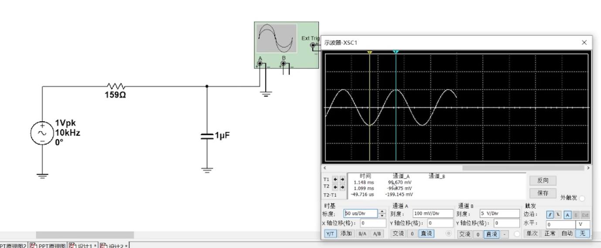
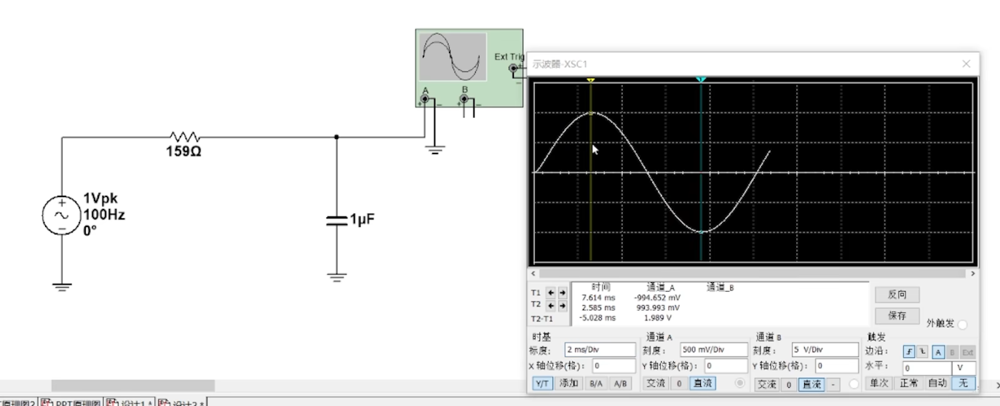
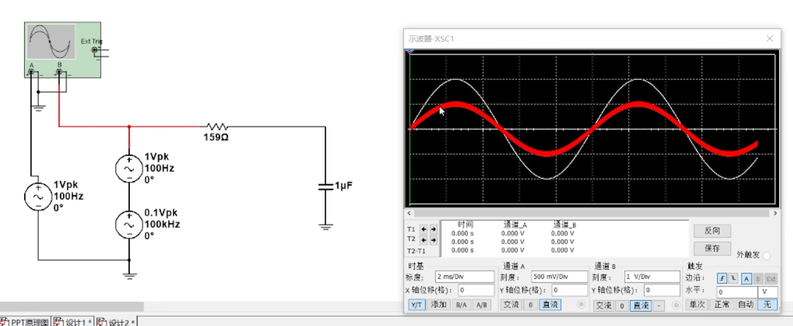
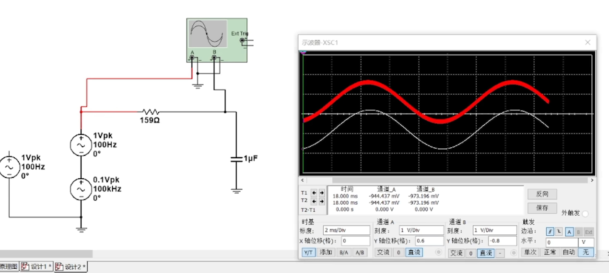
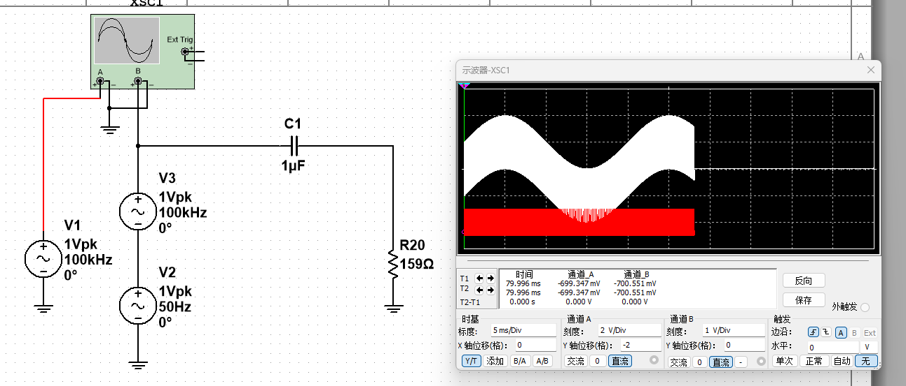
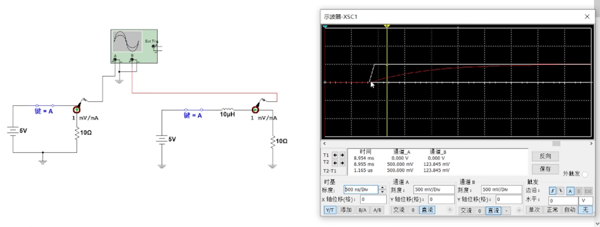
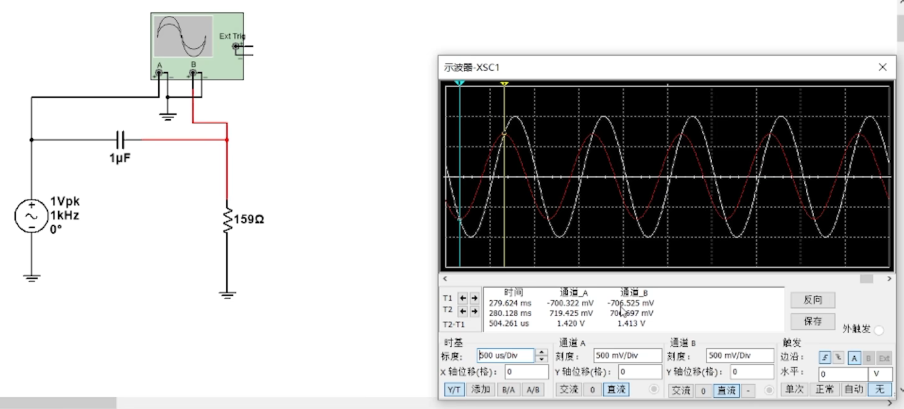
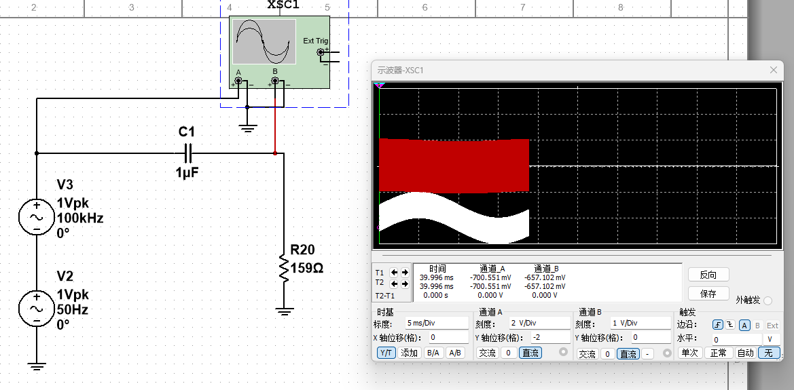

## 知识总览

> 操作系统是一种系统软件，但与其他系统软件和应用软件有很大的不同，它有自己的特殊性，即基本特征。

操作系统的四个基本特征是：**并发、共享、虚拟和异步**。其中，**并发和共享是操作系统最基本的两个特征，二者互为存在条件**。

## 1. 并发

### 1.1 并发与并行

- **并发**：两个或多个事件在**同一时间间隔内**发生。宏观上看，这些事件是**同时发生**的；微观上看，它们是**交替发生**的
- **并行**：两个或多个事件**在同一时刻发生**

- **操作系统的并发性**：指计算机系统中“同时”运行着多个程序，这些程序宏观上看是同时运行着的，而微观上看是交替运行的。
- 操作系统伴随着“多道程序技术”而出现，因此，操作系统和程序并发是一起诞生的。

> [!example] 注意（重要考点）
> - **单核CPU**同一时刻只能执行==一个程序==，各个程序只能==并发==地执行
> - **多核CPU**同一时刻可以同时执行==多个程序==，多个程序可以==并行==地执行

现代计算机通常采用多核 CPU，能够在同一时刻并行处理多个执行流。但是，系统中需要运行的任务数量通常多于可用的 CPU 核心数，因此仍然需要通过并发技术对任务进行调度，并发性必不可少

> ==并发性是操作系统一个最基本的性质==

### 1.2 相关概念：多道程序设计

> [!note] 多道程序设计
> 多道程序设计是指在计算机内存中同时存放几道相互独立的程序，使它们在管理程序的控制下相互穿插地运行。两个或两个以上的程序在计算机系统中同时处于从开始到结束之间的状态，就称为多道程序设计。
>
> 多道程序技术的运行特征是：**多道、宏观上并行、微观上串行**。

## 2. 共享

**共享**即资源共享：是指系统中的资源可以供内存中多个并发执行的进程共同使用

共享分为两类：**互斥共享**和**同时共享**。

### 2.1 互斥共享

- 计算机中的某个资源在一段时间内只允许**一个进程**访问，其他进程此时没有使用权。
- **临界资源（独占资源）**：在一段时间内只允许一个进程访问的资源。计算机中的大多数物理设备，以及某些软件中的栈、变量和表格，都属于临界资源，需要被互斥共享。

> [!example] 示例
> QQ 和微信同时进行视频通话时，同一段时间内，摄像头只能分配给其中一个进程

### 2.2 同时共享

- 计算机中的某个资源在一段时间内可以“同时”允许多个进程访问。
- 同时共享通常要求将一个请求分成若干时间片段，多个进程的请求交替完成，即“分时共享”。
- 这里的“同时”通常是指宏观上同时、微观上交替访问。由于 CPU 处理速度很快，用户一般感觉不到这种交替过程。

> [!example] 示例：两个进程访问磁盘
> QQ 进程正在发送文件 A，微信进程正在发送文件 B。宏观上看，两个进程都在访问磁盘，仿佛同时进行；微观上看，两个进程交替访问磁盘。由于交替的时间间隔很短，用户通常感觉不到。

> [!note] 补充说明
> 有时，多个进程可能确实在同时访问资源。例如，玩游戏时可以同时播放音乐，用户既能听见游戏声音，也能听见音乐。实际实现中，这些声音通常会先由操作系统或音频服务进行混音，再交给音频设备播放。

### 2.3 并发性和共享性互为存在条件

## 3. 虚拟

- **虚拟**：把一个物理上的实体变为若干逻辑上的对应物。
- 物理实体是实际存在的；逻辑上的对应物是虚拟的，是用户感觉到的事物。
- **虚拟技术**：用于实现虚拟的技术。

### 3.1 常见的虚拟形式

- **虚拟处理器（CPU）**：通过多道程序设计技术，使多道程序并发执行、分时使用一个 CPU。物理上只有一个 CPU，但用户感觉像有多个 CPU。
- **虚拟存储器**：从逻辑上扩充存储器容量，使用户感觉拥有实际并不存在的更大存储器。
- **虚拟设备**：将一台物理设备虚拟为逻辑上的多台设备，使多个用户能够在同一时间段内访问同一台设备，实现同时共享。用户宏观上感觉是同时访问，实际则可能是在微观上交替访问同一台设备。

### 3.2 虚拟技术的分类

- **时分复用技术**：从时间上复用资源。不同程序轮流使用同一个物理资源。
    - 典型例子：虚拟处理器。
    - 一个物理 CPU 按时间片为多个进程服务，使每个进程都感觉自己拥有一个 CPU。
- **空分复用技术**：从空间上复用资源。将物理存储空间划分、映射给不同程序使用。
    - 典型例子：虚拟存储器。
    - 多个进程拥有各自独立的虚拟地址空间，由操作系统将虚拟地址映射到物理内存或外存。

可以这样记：

> **CPU 主要按时间轮流用——时分复用；存储器主要按空间划分用——空分复用。**

[[空分复用技术详解]]

## 4. 异步

- **异步**：多道程序环境允许多个程序并发执行，但由于资源有限，例如只有一个 CPU，进程的执行并不是一贯到底的，而是走走停停，以不可预知的速度向前推进。

> [!example] 示例
> A 进程正在占用 CPU 进行计算，此时 B 进程也想使用 CPU，B 进程只能等待。当 A 进程完成计算并访问磁盘时，B 进程开始占用 CPU 进行计算。
>
> 如果 B 进程尚未计算完，A 进程已经从磁盘取得所需资源，那么 A 进程发现 CPU 正被 B 进程占用，也需要等待。等 B 进程释放 CPU 后，A 进程才能继续计算。
>
> 由于每个进程占用资源的时间并不固定，因此，进程会以不可预知的速度向前推进。

## 知识回顾与重要考点

## 参考资料

- 《2021 王道操作系统考研》
- [Bilibili：操作系统课程视频](https://www.bilibili.com/video/av70156862?p=2)
