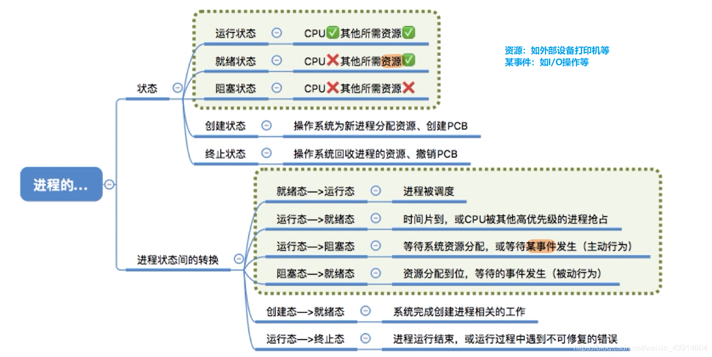
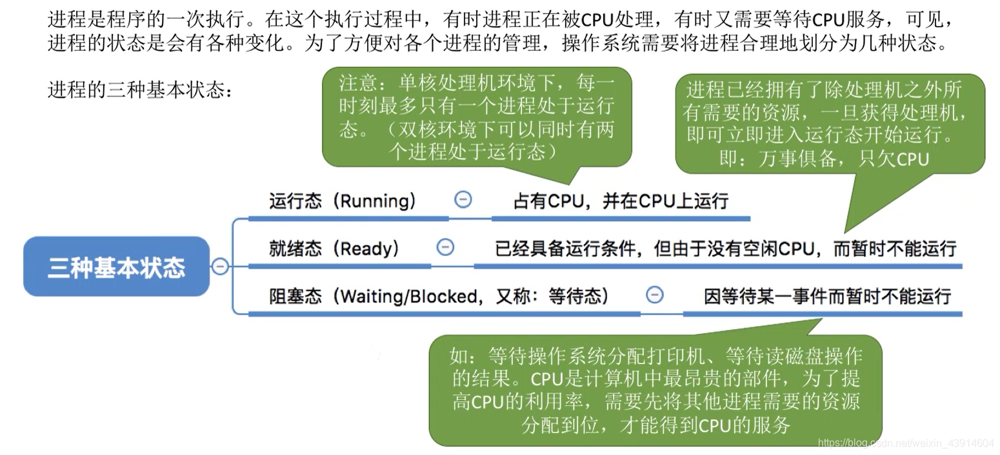
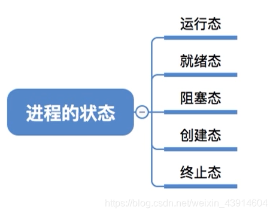
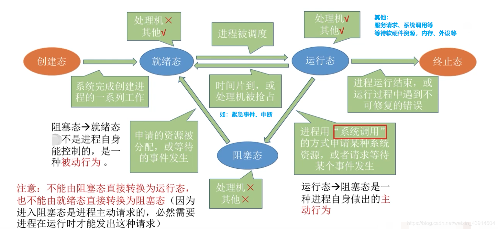
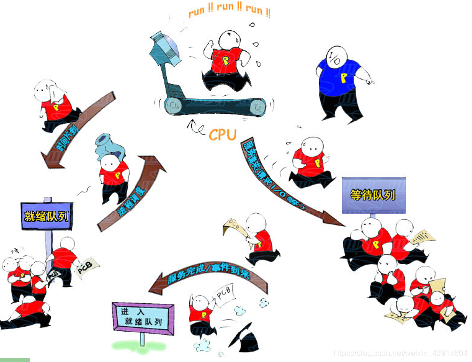

---

#### 1.思维导图总览

#### 2.进程的状态

##### （1）三种基本状态（就绪、运行、阻塞）

##### （2）创建态和结束态

#### 3.进程状态之间的转换

- 进程一共有如下5种状态，那么他们之间如何实现切换呢？

- 咱们从一个进程的从无到有看起，来了解进程5种状态之间的转换  
	
- 来一张形象生动的图片感受一下5种状态之间的切换  
	

参考：https://www.bilibili.com/video/av70156862?p=8