---

#### 0.思维导图

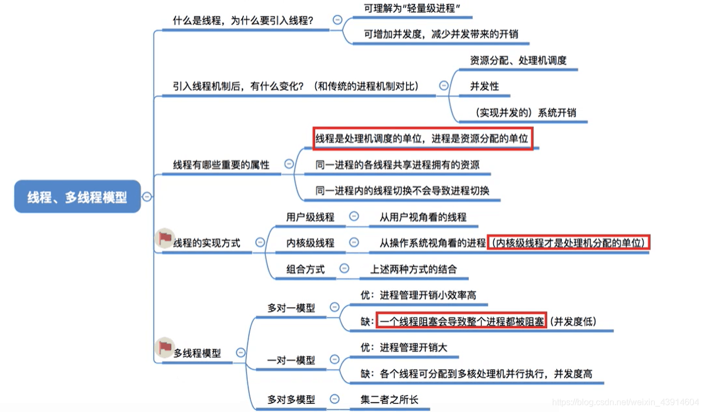

#### 1.为什么要引入线程？

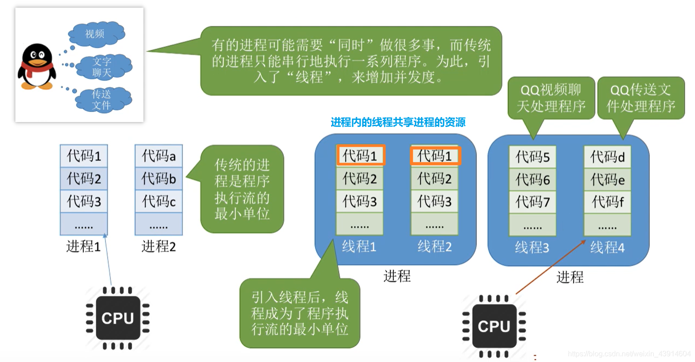

- 为了方便于理解，我打开了我的任务管理器，可以看出chrome一个进程，下面有很多分支，可以把这些分支当做线程看待，PID即进程和线程都有的标识符。  
	

#### 2.什么是线程？

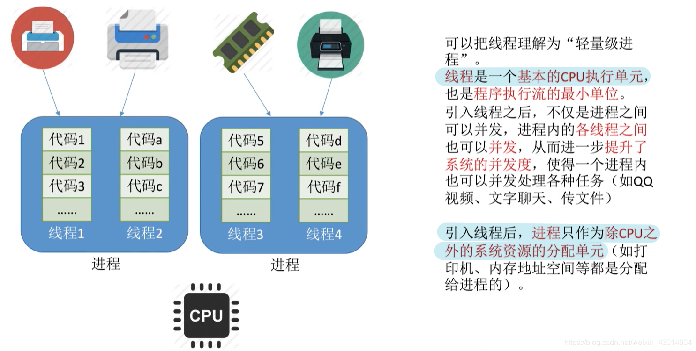

#### 3.引入线程带来的变化及进程与线程的比较

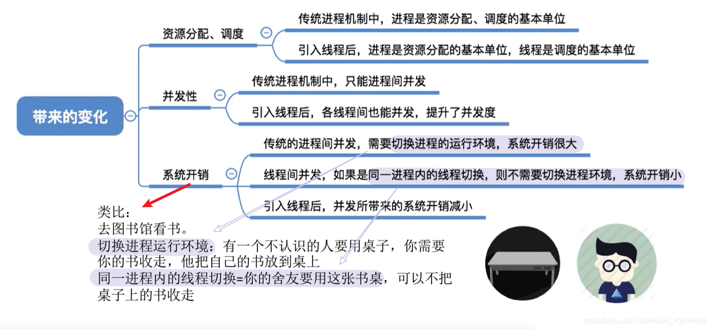

#### 4.线程的属性

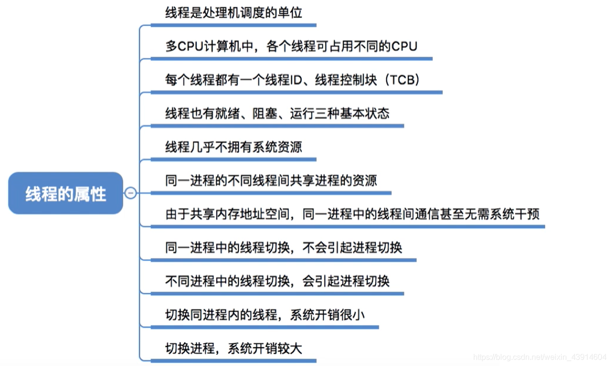

#### 5.线程的实现方式

- 前面我们了解了引入线程的好处和引入线程的变化，以及线程的属性，那么线程如何实现呢？
- 线程的实现分为两类： `用户级线程` (User-Level Thread,UTL)和 `内核级线程` (Kernel-Level Thread, KTL)l。内核级线程又称 `内核支持的线程` 。

##### （1）用户级线程

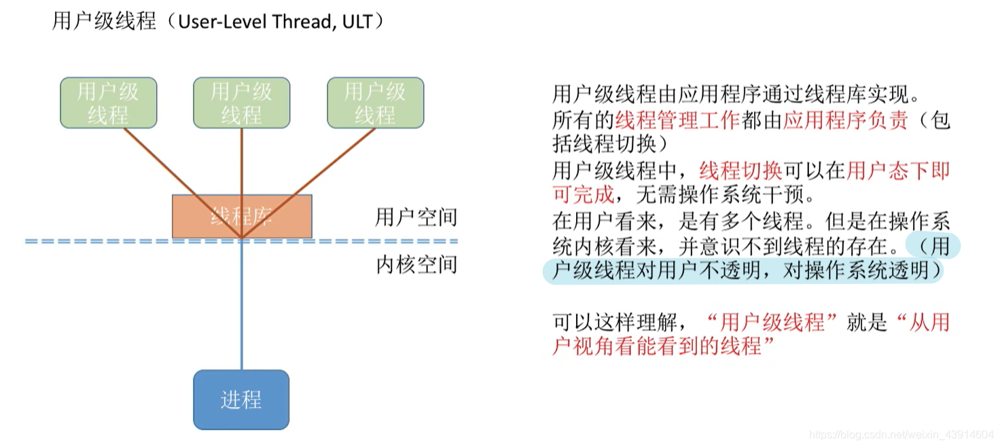

##### （2）内核级线程

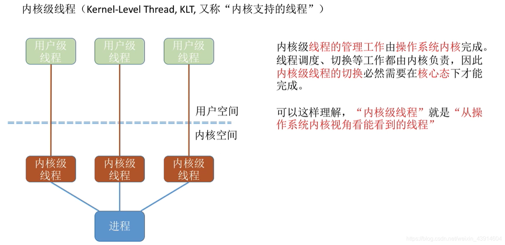

##### （3）特殊的组合方式及重点注意

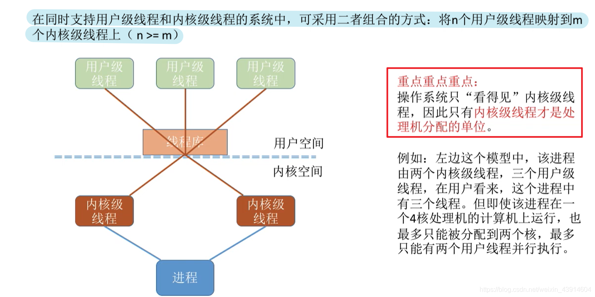

#### 6.多线程模型

- 前面我们提到了线程的实现方式，有用户级和内核级。那么这两种模式的交叉组合就会产生几种不一样的组织结构，即不一样的模型。

##### （1）多对一模型

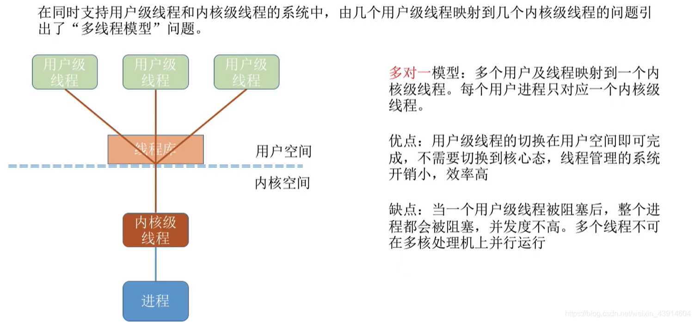

##### （2）一对一模型

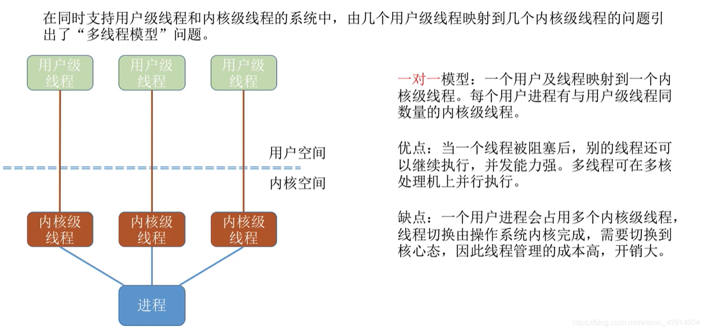

##### （3）多对多模型

- 此种模型效率是三种模型中最好的  
	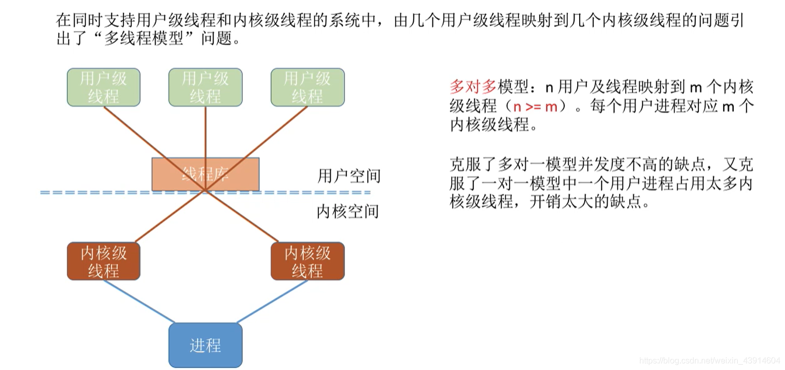  
	参考： [https://www.bilibili.com/video/av70156862?p=11](https://www.bilibili.com/video/av70156862?p=11)