---

### 0.思维导图

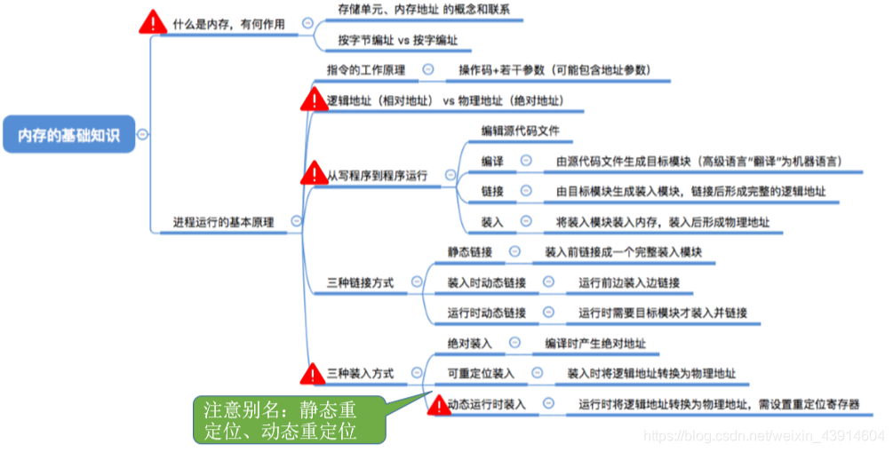

### 1.什么是内存？有何作用？

#### （1）存储单元

- 关于存储单元有关内容在我写的组成原理笔记中有提到： [存储单元](https://blog.csdn.net/weixin_43914604/article/details/104099953)  
	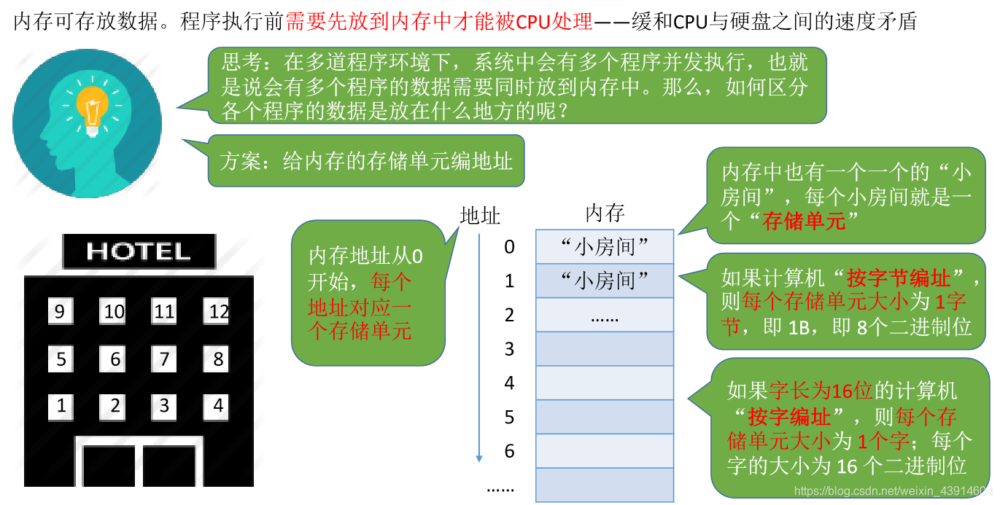

#### （2）几个常用数量单位&内存地址

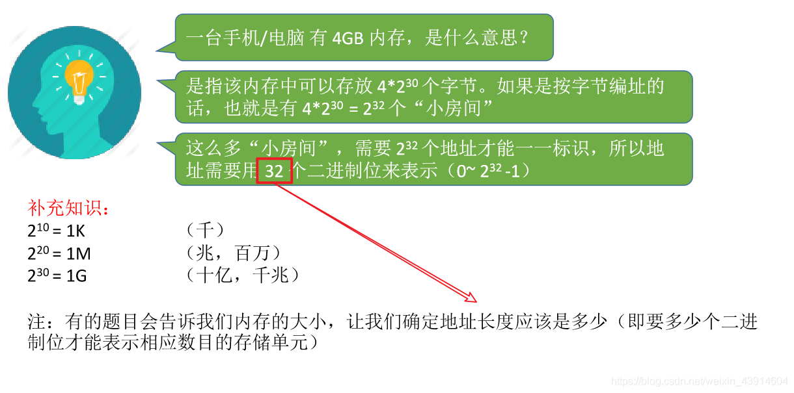

### 2.进程运行的基本原理

#### （1）指令的工作原理—操作码+若干参数（可能包含地址参数）

- 从X=X+1大致看一下指令的执行过程  
	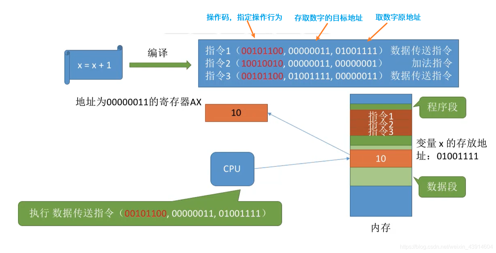  
	  
	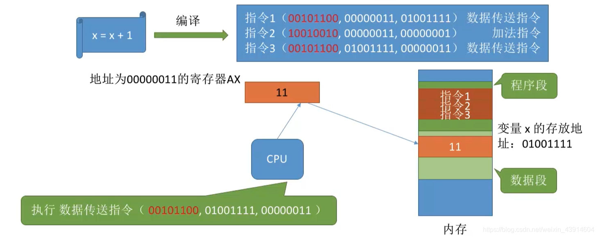

#### （2）逻辑地址（相对地址）vs物理地址（绝对地址）

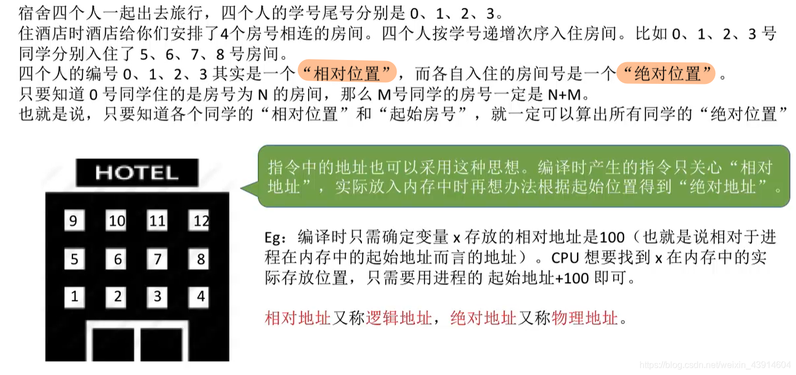

#### （3）从写程序到程序运行—编译、 链接 、装入

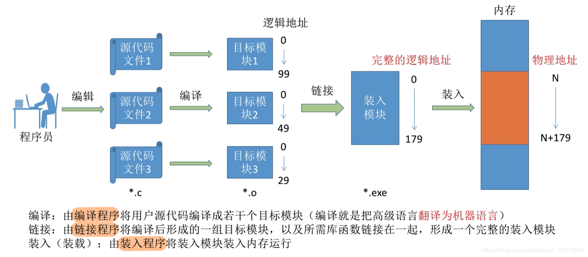

#### （4）装入模块装入内存

**不修改装入模块中的指令地址就直接装入内存的话：**  
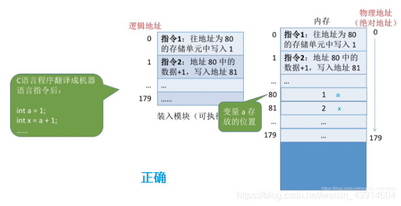  

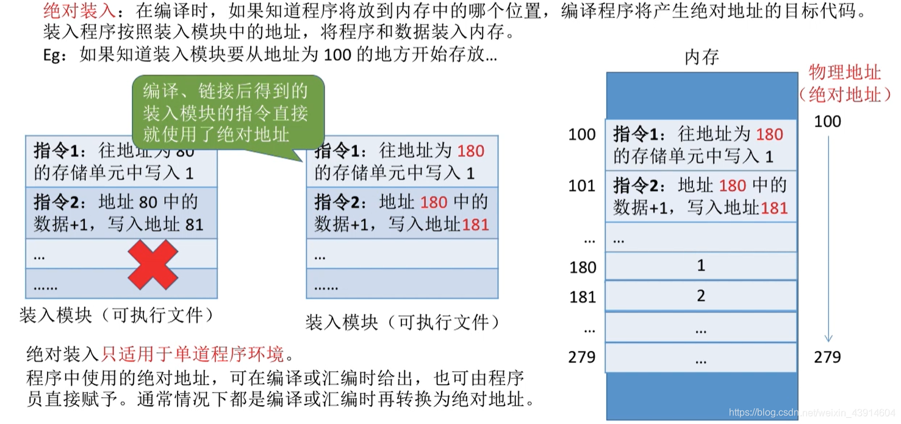

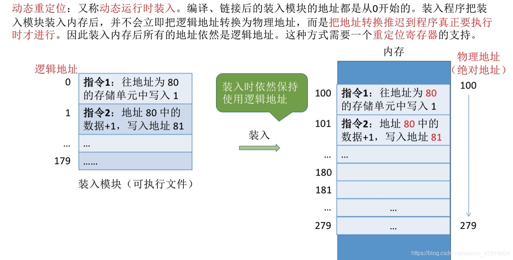  
  
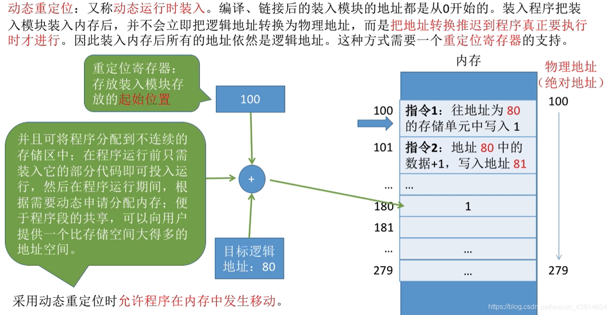

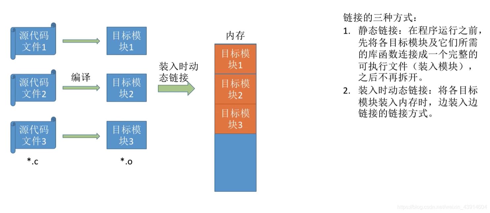