---

## 0.思维导图

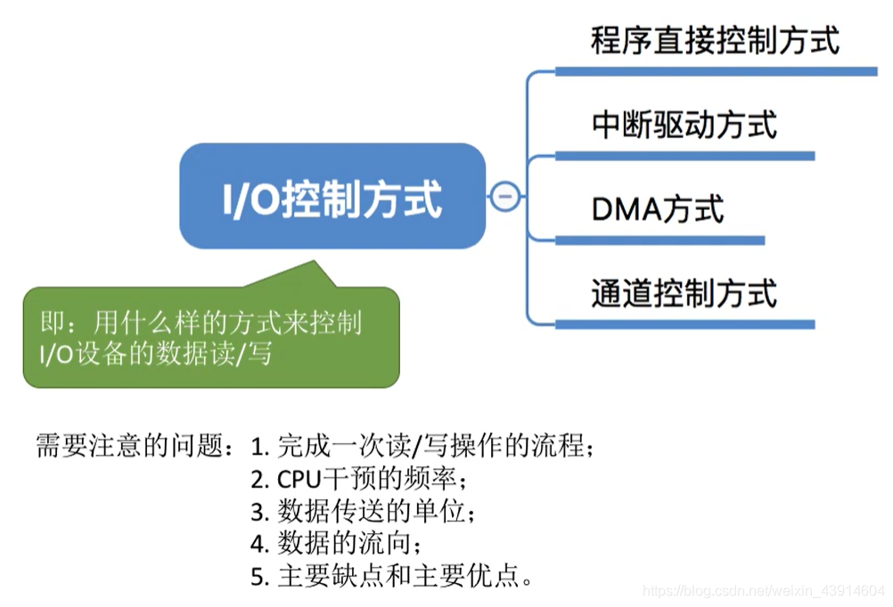

## 1.程序直接控制方式

**key word: 轮询**

- 完成一次读/写操作的流程图(以读操作为例)  
	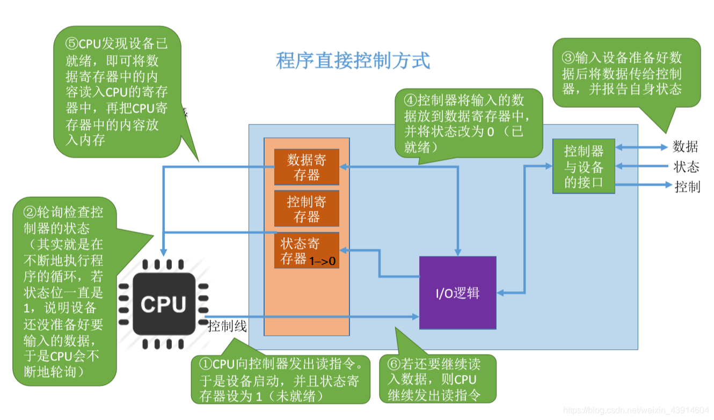  
	**下面以C语言代码和流程图来剖析，程序直接控制方式**  
	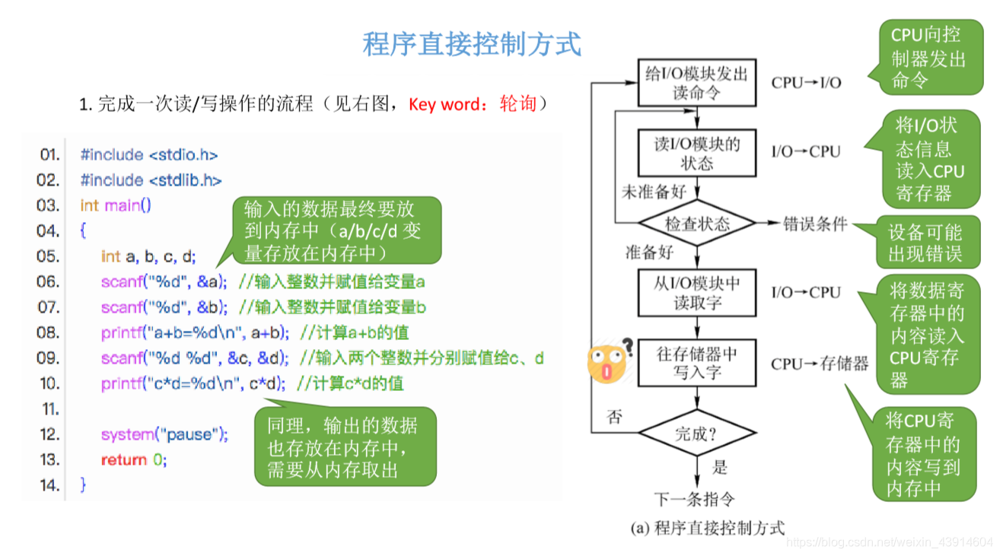  
	**分析一下在思维导图中提到的几个问题：**  
	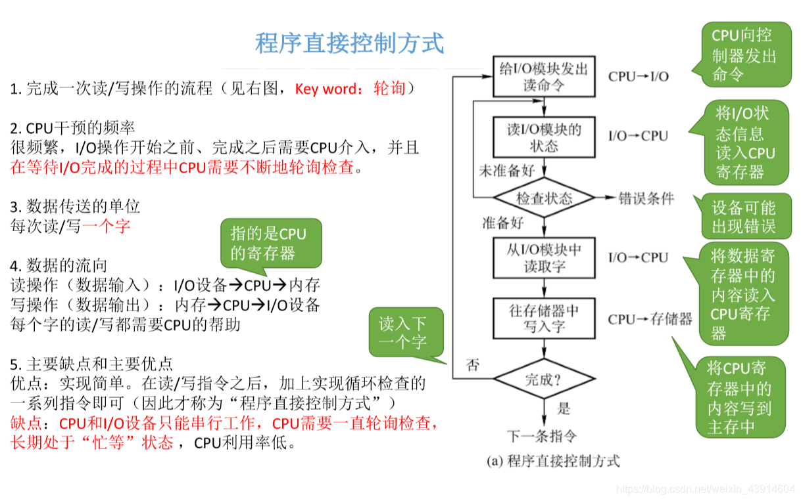

## 2.中断驱动方式

- 由于 `程序直接控制方式` CPU利用率低，忙等，所以提出了中断驱动方式。

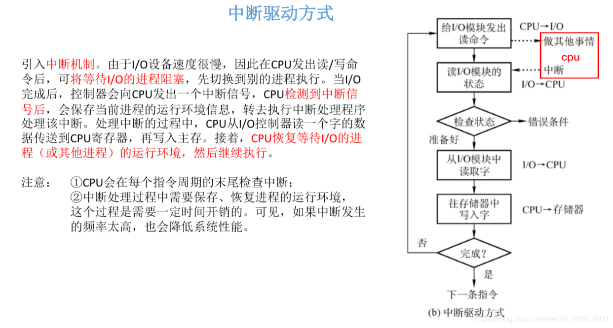  
**分析一下在思维导图中提到的几个问题：**

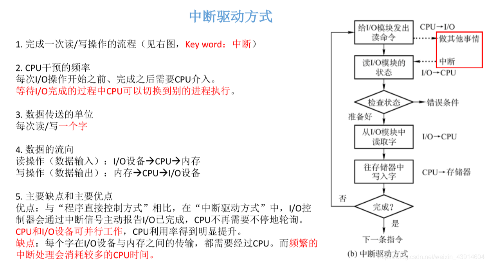

## 3.DMA方式

- 虽然 `中断驱动方式解决了程序直接控制方式` 的问题，但是每一次只能读/写一个字，导致CPU频繁切换，耗费了很多时间。于是人们又发明了DMA方式。

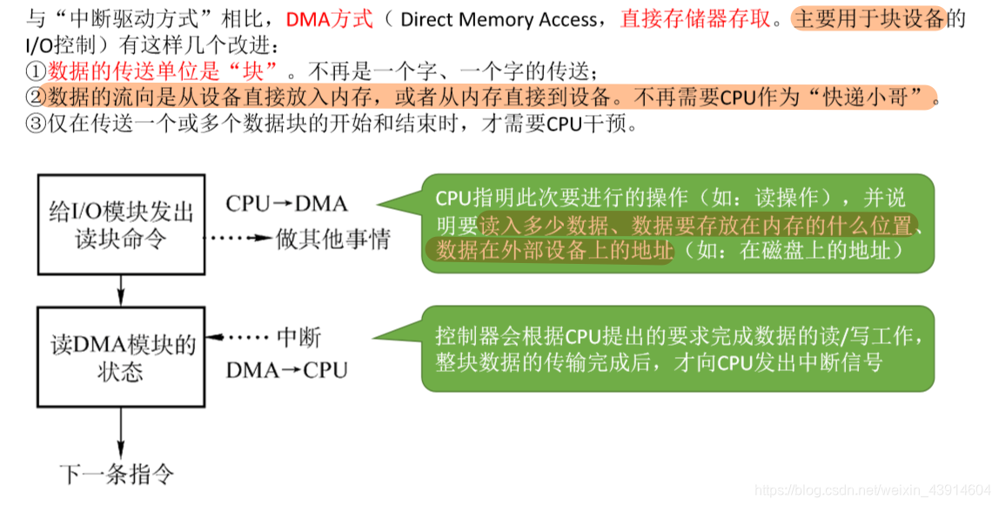  
**DMA控制器：**  
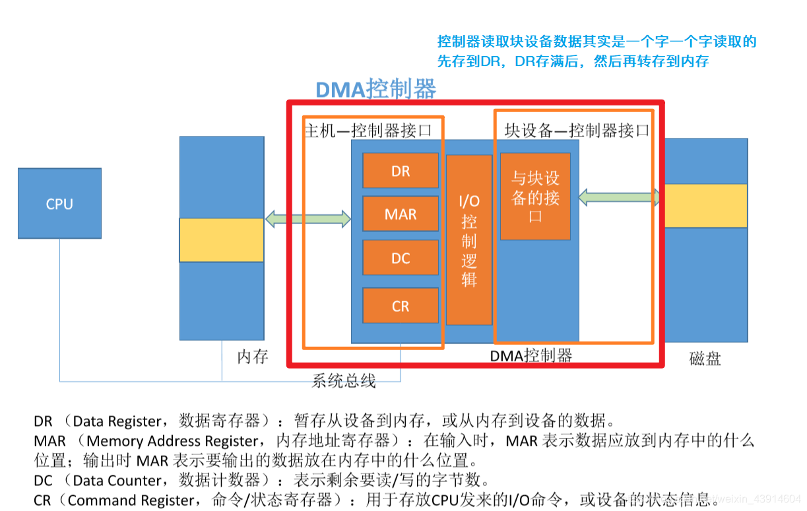  
**分析一下在思维导图中提到的几个问题：**  
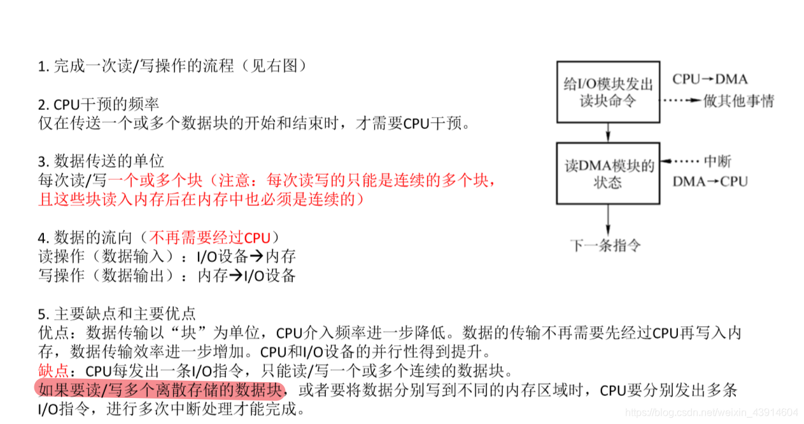

## 4.通道控制方式

- 通道控制方式是为了解决DMA方式连续存储的问题

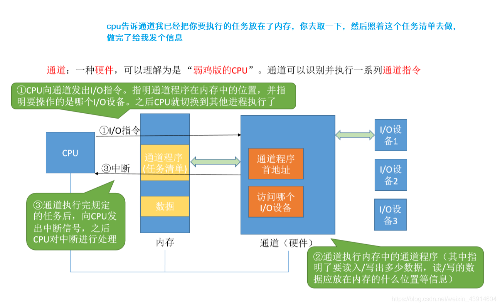  
**分析一下在思维导图中提到的几个问题：**  
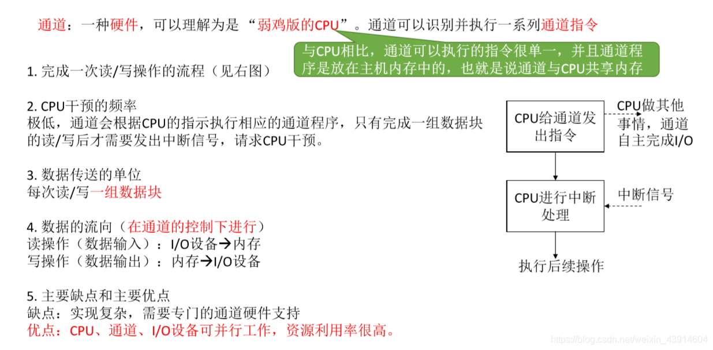

## 5.四种方式总结一下

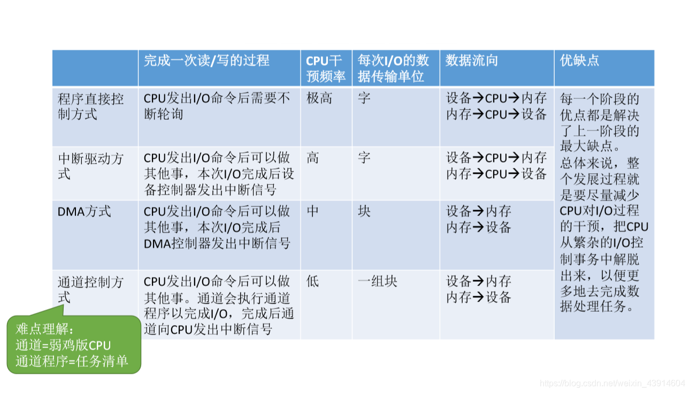  
参考：《王道操作系统》