## 0.思维导图

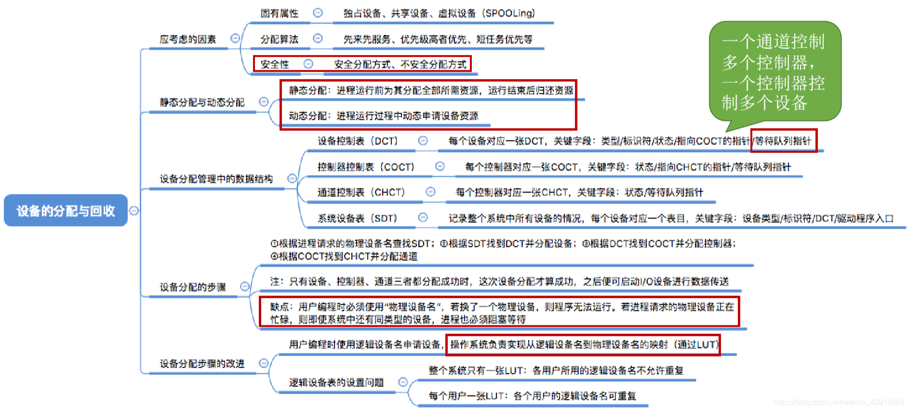

## 1.设备分配时应该考虑的因素

### 设备的固有属性

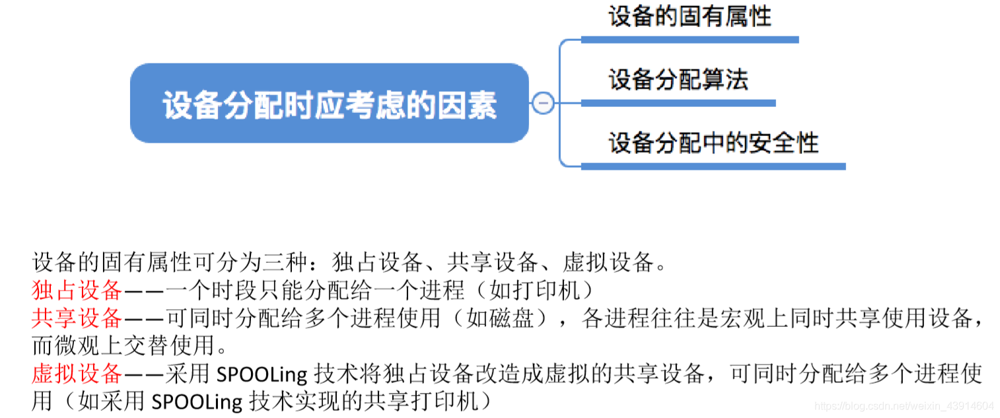

### 设备的分配算法

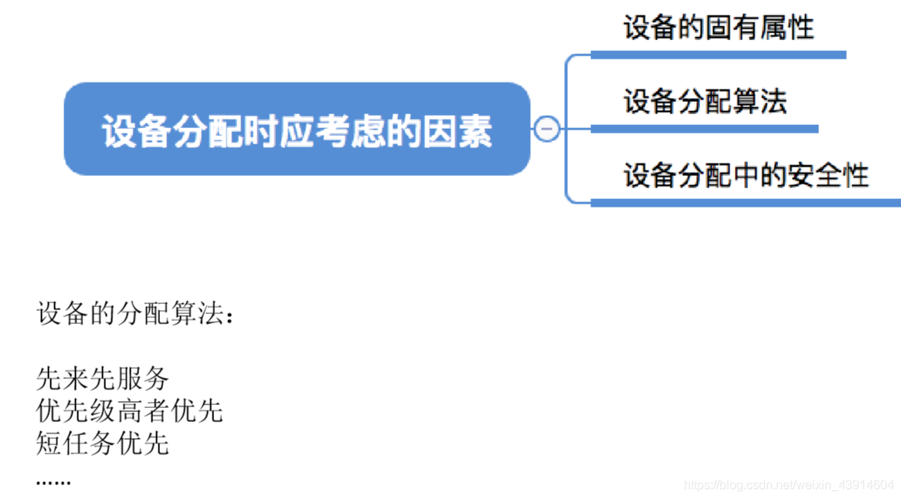

### 设备分配中的安全性

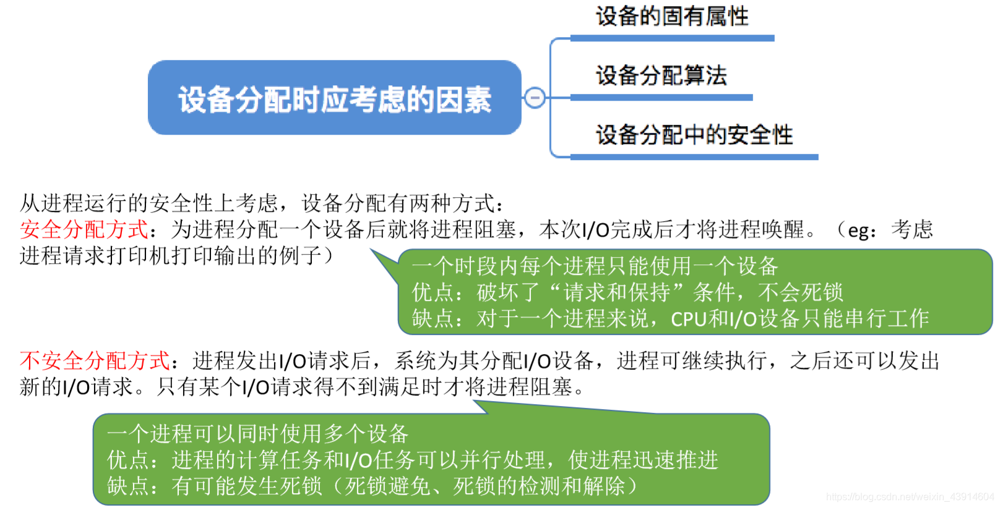

## 2.静态分配与动态分配

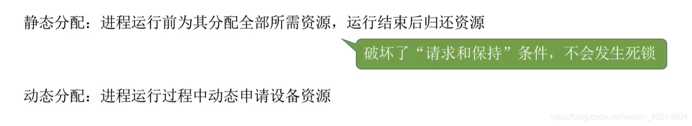

## 3.设备分配管理中的数据结构

**设备、控制器、通道之间的关系：**  
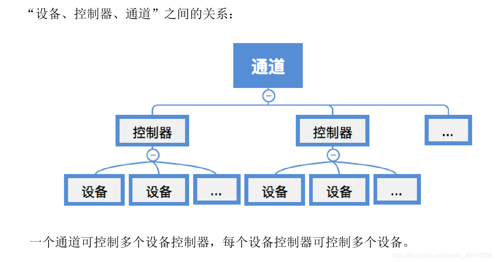

### 设备控制表—DCT

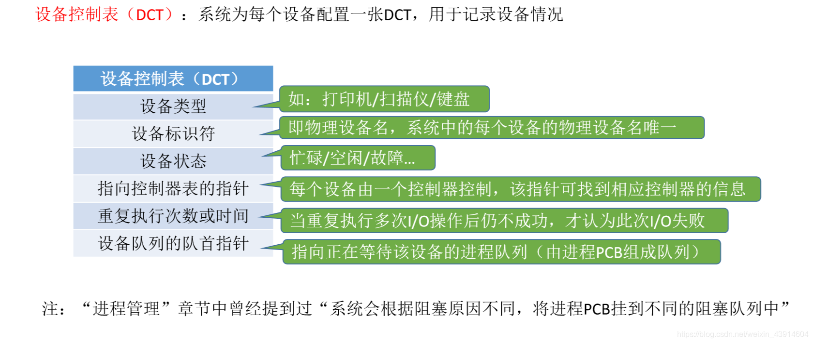

### 控制器控制表—COCT

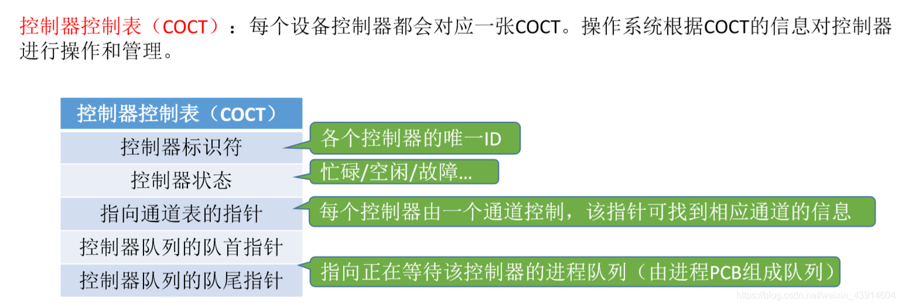

### 通道控制表—CHCT

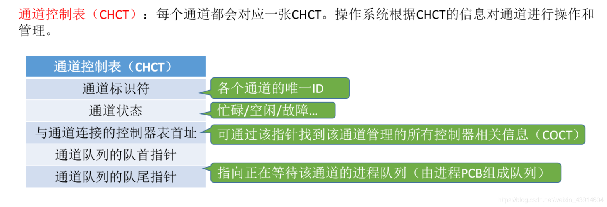

### 系统设备表—SDT

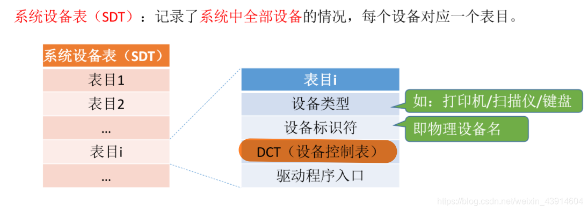

## 4.设备分配的步骤

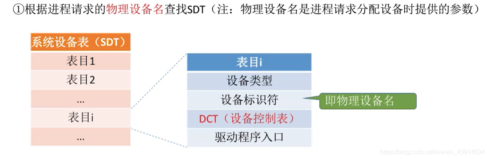  
  
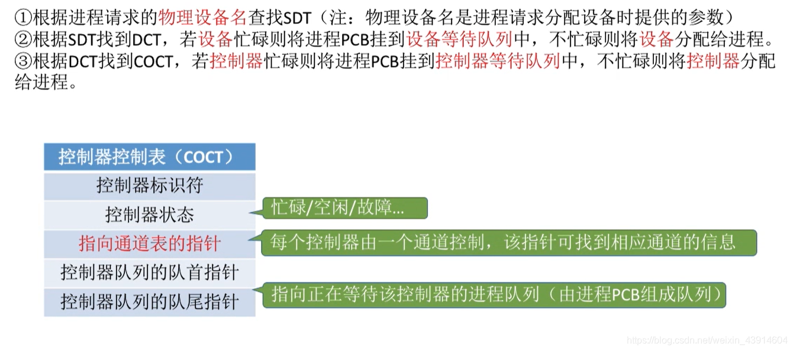  

### 设备分配的改进步骤

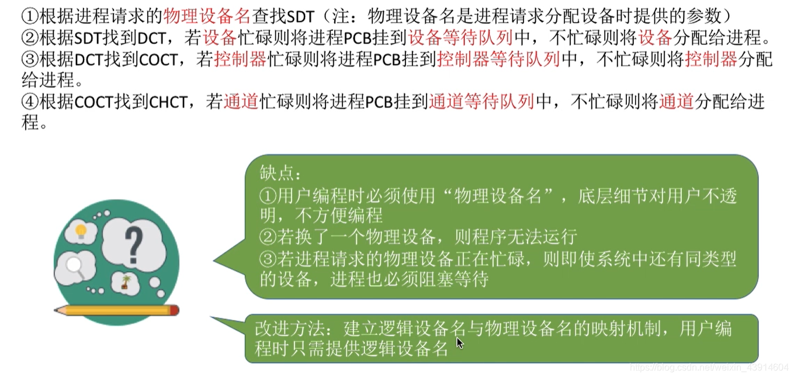  
  
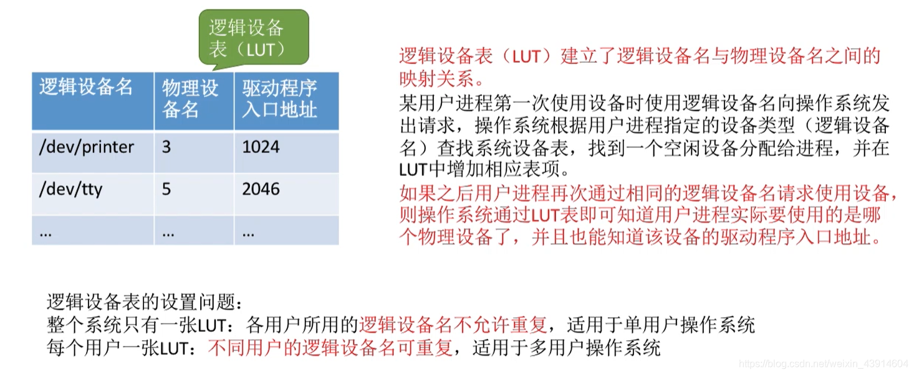  
参考：《王道操作系统》