# FreeRTOS中断管理简介

------


## 一、中断介绍(了解)

### 1、什么是中断

答：让CPU打断正常运行的程序，转而去处理紧急的事件(程序)，就叫中断。

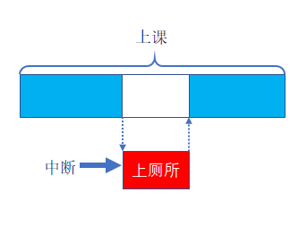


### 2、中断执行机制

答：可简单概括为三步：

1. **中断请求** ：外设产生中断请求(如：GPIO外部中断、定时器中断...)。
2. **响应中断** ：CPU停止执行当前程序，转而执行中断处理程序(ISR)。
3. **退出中断** ：执行完毕，返回被打断的程序处，继续往下执行。

------


## 二、中断优先级分组设置(熟悉)

### 1、中断优先级分组介绍

答：ARM Cortex-M 使用了8位宽的寄存器（0-255）来配置中断的优先等级，这个寄存器就是中断优先级配置寄存器。但STM32只用了中断优先级配置寄存器的高4位[7:4]，所以STM32提供了最大16级(0~15)的中断优先等级。

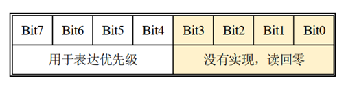


### 2、什么是抢占优先级，什么是子优先级

答：STM32的中断优先级可以分为抢占优先级和子优先级。

- **抢占优先级** ：抢占优先级的中断可以打断正在执行但抢占优先级低的中断。
- **子优先级** ：当同时发生具有相同抢占优先级的两个中断时，子优先级数小的优先执行。

> 注意 ：中断优先级(抢占优先级和子优先级)数值越小，优先级越高。


- 扩展：

当两个中断的**抢占优先级相同**时，**响应优先级（子优先级）仅决定“同时到达时的执行顺序”**，而**不具备中断嵌套能力**。

具体逻辑可拆解为：

1. **同时到达**：抢占优先级相同的中断同时触发时，响应优先级高的先执行。
2. **先后到达**：若低响应优先级的中断已在执行，即使此时高响应优先级的中断触发，也**无法打断前者**，需等待低响应优先级中断处理完毕后才能执行。

这是因为**响应优先级仅用于“仲裁”，不赋予“抢占权”**。只有抢占优先级更高的中断才能嵌套打断当前中断


### 3、中断优先级配置方式

答：一共有5种配置方式，对应着中断优先级分组的5个组。

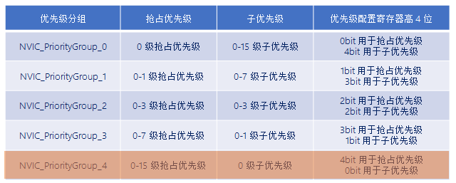

注意：FreeRTOS中为了方便管理，采用第4号(NVIC_PriorityGroup_4)分配方式。

> **我们用的是标准库，用NVIC_PriorityGroupConfig(NVIC_PriorityGroup_4)来设置中断优先级分组**


### 4、FreeRTOS中对中断优先级的管理

答： 

1. 低于configMAX_SYSCALL_INTERRUPT_PRIORITY优先级的中断才允许调用FreeRTOS的API函数。

2. 建议将所有优先级位指定为抢占优先级位，方便FreeRTOS管理。

3. <mark>中断优先级数值越小越优先，任务优先级数值越大越优先</mark>。

   > **宏configMAX_SYSCALL_INTERRUPT_PRIORITY的值是5，所以FreeRTOS中的中断优先级只能是5-15这个范围。**

   > **中断优先级数值越小越优先，跟FreeRTOS的任务优先级相反**

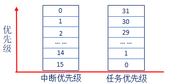

------


## 三、中断相关寄存器(熟悉)

### 1、系统中断优先级配置寄存器

答：三个系统中断优先级配置寄存器，分别为 SHPR1、 SHPR2、 SHPR3 。

- SHPR1寄存器地址：0xE000ED18 ~ 0xE000ED1B
- SHPR2寄存器地址：0xE000ED1C ~ 0xE000ED1F
- SHPR3寄存器地址：0xE000ED20 ~ 0xE000ED23

一个地址是8位，一个寄存器是32位

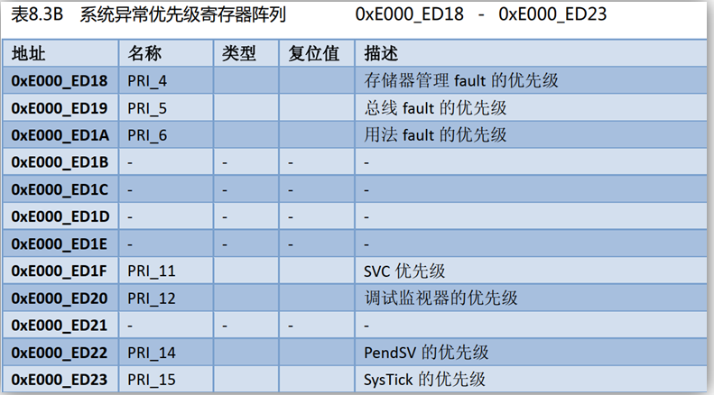

> 注意：FreeRTOS主要是使用SHPR3寄存器对**PendSV**和**Systick**中断优先级进行设置(设置为最低优先级)。

> <mark>SVC、PendSV、SysTick三个系统中断很重要</mark>

### 2、FreeRTOS如何配置PendSV和Systick中断优先级

答：

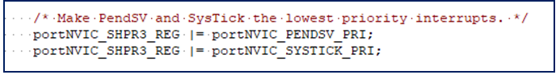

**这个是对寄存器进行一个偏移，从而找到自己想要的那一个位**

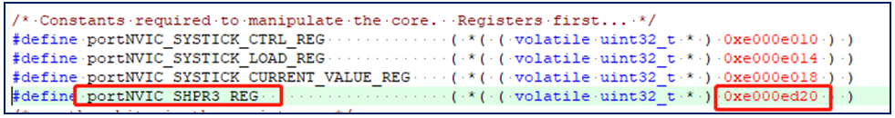

**各个寄存器的首地址**

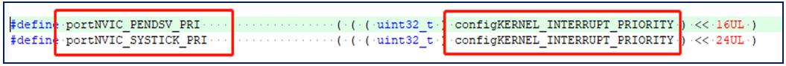

**偏移量：把寄存器的地址进行一个偏移，此时这个是SHPR3寄存器地址向左偏移16位是PendSV的地址，向左偏移24位是SysTick的地址**

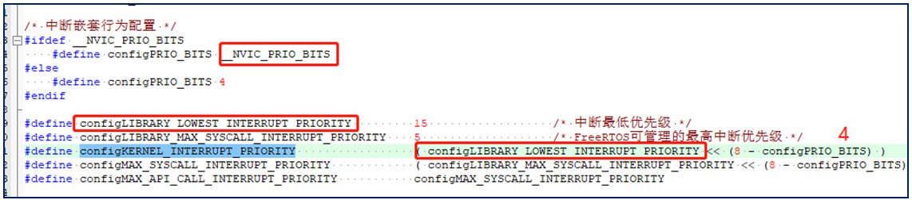

**因为低4位是没有用的，因此向左偏移4位**

> 注意：在FreeRTOS系统中PendSV和SysTick设置最低优先级（将PenSV和SysTick中断优先级设置到了15（最低优先级）)。
>
> ​	寄存器的高地址在左，低地址在右


### 3、为什么将PendSV和SysTick设置最低优先级

答：保证系统任务切换不会阻塞系统其他中断的响应。


### 4、中断屏蔽寄存器

答：三个中断屏蔽寄存器，分别为PRIMASK、FAULTMASK和BASEPRI 。

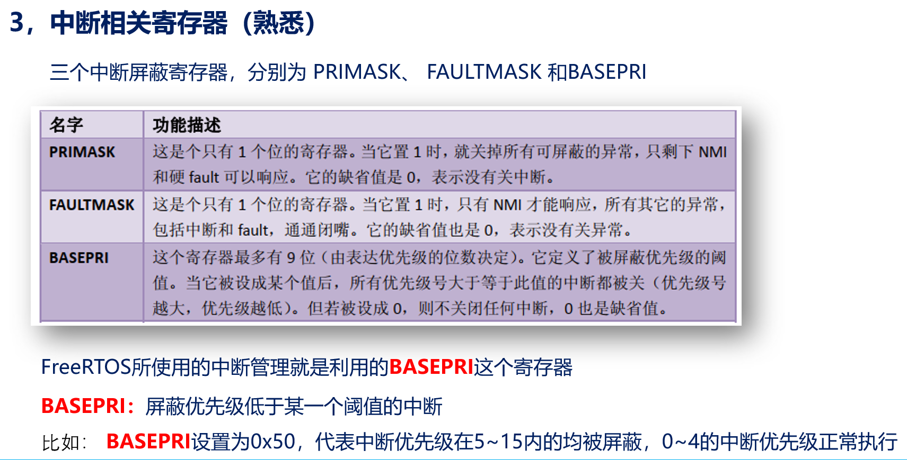

FreeRTOS所使用的中断管理就是利用的**BASEPRI**这个寄存器。

> **FreeRTOS使用的BASEPRI这个寄存器来进行中断管理，优先级比它的值大的中断都会被屏蔽**


### 5、FreeRTOS的关中断程序

<mark>BASEPRI：屏蔽优先级低于某一个阈值的中断，当设置为0时，则不关闭任何中断</mark>

答：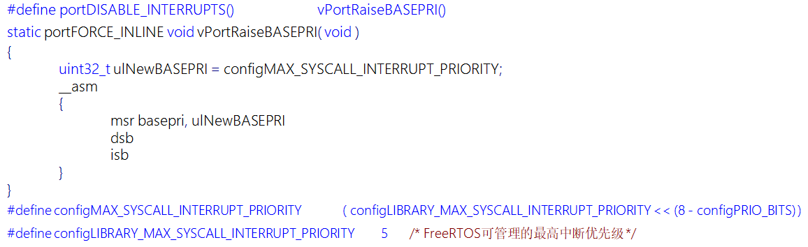**中断优先级在5 ~ 15的全部被关闭，0~4的我们是操作不了（意思是我们无法关闭0-4的，可以关闭5-15)**


### 6、BASEPRI中断屏蔽寄存器

答：BASEPRI：屏蔽优先级低于某一个阈值的中断，当设置为0时，则不关闭任何中断。

比如： BASEPRI设置为0x50，代表中断优先级在5\~15内的均被屏蔽，0~4的中断优先级正常执行

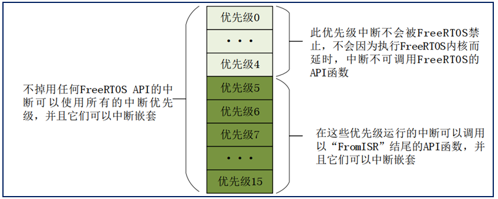

>中断服务函数调用FreeRTOS的API函数需注意：
>1. 中断服务函数的优先级需在FreeRTOS所管理的范围内( 5 - 15 )。
>2. 在中断服务函数里边需调用FreeRTOS的API函数，必须使用带“FromISR”后缀的函数。
>3. 优先级分组要分为组4，全部设置为抢占式优先级


### 7、FreeRTOS的开中断程序

答：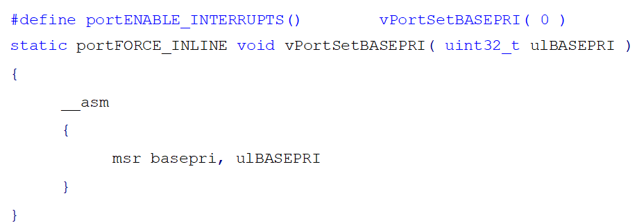

**总结：FreeRTOS中断管理就是利用BASEPRI寄存器实现的**


### 8、 FreeRTOS 开关中断函数

FreeRTOS 开关中断函数其实是宏定义，在 portmacro.h 中有定义，如下：

```c
#define portDISABLE_INTERRUPTS()          vPortRaiseBASEPRI()
#define portENABLE_INTERRUPTS()           vPortSetBASEPRI( 0 )
```

调用portENABLE_INTERRUPTS() 它, FreeRTOS会打开管理的所有中断

调用portDISABLE_INTERRUPTS() 它, FreeRTOS会关闭管理的所有中断

（本质上就是设置BASEPRI）


**BASEPRI 寄存器是关键**

在 ARM Cortex-M 内核中，`BASEPRI` 寄存器用于**屏蔽特定优先级及以下的所有中断**。FreeRTOS 利用这一特性来实现高效的中断管理。

```c
// 实际底层函数实现（通常在 port.c 中）
static portFORCE_INLINE void vPortRaiseBASEPRI( void )
{
    // 将 configMAX_SYSCALL_INTERRUPT_PRIORITY 写入 BASEPRI
    // 屏蔽所有优先级 >= configMAX_SYSCALL_INTERRUPT_PRIORITY 的中断
    __set_BASEPRI( configMAX_SYSCALL_INTERRUPT_PRIORITY << (8 - __NVIC_PRIO_BITS) );
}

static portFORCE_INLINE void vPortSetBASEPRI( uint32_t ulNewMask )
{
    // 写入 0 表示取消所有中断屏蔽
    __set_BASEPRI( ulNewMask );
}
```


------


## 四、FreeRTOS中断管理实验

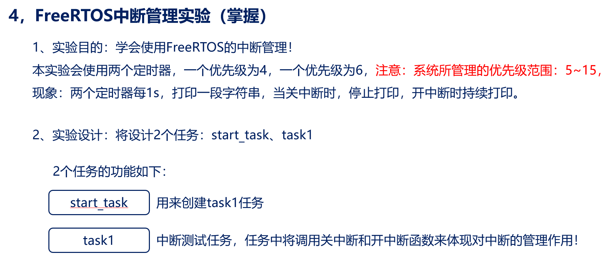


```c
#include "stm32f4xx.h"                  // STM32F4系列微控制器头文件
#include "freertos.h"                   // FreeRTOS实时操作系统头文件
#include "task.h"                       // FreeRTOS任务管理头文件
#include "queue.h"                      // FreeRTOS队列管理头文件
#include "usart.h"                      // 串口通信头文件
#include "delay.h"

// 任务配置宏定义
#define START_TASK_STACK_SIZE 128       // 启动任务栈大小（字）
#define START_TASK_PRIORITY 2           // 启动任务优先级

/**
 * @brief LED初始化函数
 * 配置GPIOC的Pin13作为LED控制引脚
 */
void LED_Init(void)
{		
    // 使能GPIOC时钟（AHB1总线）
    RCC_AHB1PeriphClockCmd(RCC_AHB1Periph_GPIOC, ENABLE);

    // 配置GPIO初始化结构体
    GPIO_InitTypeDef GPIO_InitStructure;
	GPIO_StructInit(&GPIO_InitStructure);
    GPIO_InitStructure.GPIO_Pin = GPIO_Pin_13;        // 选择引脚13
    GPIO_InitStructure.GPIO_Mode = GPIO_Mode_OUT;     // 输出模式
    GPIO_InitStructure.GPIO_OType = GPIO_OType_PP;    // 推挽输出
    GPIO_InitStructure.GPIO_Speed = GPIO_Speed_50MHz; // 输出速度50MHz
    GPIO_InitStructure.GPIO_PuPd = GPIO_PuPd_NOPULL;  // 无上拉下拉电阻
    GPIO_Init(GPIOC, &GPIO_InitStructure);            // 初始化GPIOC
}

void Timer3_Init(uint16_t arr, uint16_t psc){
	RCC_APB1PeriphClockCmd(RCC_APB1Periph_TIM3, ENABLE);
	TIM_TimeBaseInitTypeDef TIM_TimeBaseInitStructure;
	TIM_TimeBaseInitStructure.TIM_ClockDivision = TIM_CKD_DIV1;
	TIM_TimeBaseInitStructure.TIM_CounterMode = TIM_CounterMode_Up;
	TIM_TimeBaseInitStructure.TIM_Period = arr - 1;
	TIM_TimeBaseInitStructure.TIM_Prescaler = psc - 1;
	TIM_TimeBaseInitStructure.TIM_RepetitionCounter = 0;
	TIM_TimeBaseInit(TIM3, &TIM_TimeBaseInitStructure);
	
	TIM_ITConfig(TIM3, TIM_IT_Update, ENABLE);
	
	NVIC_SetPriority(TIM3_IRQn, 7);
	NVIC_EnableIRQ(TIM3_IRQn);
	
	TIM_Cmd(TIM3, ENABLE);
	
}

void Timer4_Init(uint16_t arr, uint16_t psc){
	RCC_APB1PeriphClockCmd(RCC_APB1Periph_TIM4, ENABLE);
	TIM_TimeBaseInitTypeDef TIM_TimeBaseInitStructure;
	TIM_TimeBaseInitStructure.TIM_ClockDivision = TIM_CKD_DIV1;
	TIM_TimeBaseInitStructure.TIM_CounterMode = TIM_CounterMode_Up;
	TIM_TimeBaseInitStructure.TIM_Period = arr - 1;
	TIM_TimeBaseInitStructure.TIM_Prescaler = psc - 1;
	TIM_TimeBaseInitStructure.TIM_RepetitionCounter = 0;
	TIM_TimeBaseInit(TIM4, &TIM_TimeBaseInitStructure);
	
	TIM_ITConfig(TIM4 ,TIM_IT_Update, ENABLE);
	
	NVIC_SetPriority(TIM4_IRQn, 3);
	NVIC_EnableIRQ(TIM4_IRQn);
	
	TIM_Cmd(TIM4, ENABLE);	
}


// 任务句柄声明（用于引用和管理任务）
TaskHandle_t MytaskHandler1;    // 任务1句柄
TaskHandle_t StarttaskHandler;  // 启动任务句柄

/**
 * @brief 任务1函数
 * 功能：每500个时钟节拍打印"Task1 running"
 * @param arg 任务参数（未使用）
 */
void Task1(void * arg){
	
	uint8_t task1_num = 0;
    while(1){
		if(++task1_num == 5){
			printf("关闭中断\r\n");
			portDISABLE_INTERRUPTS();
			delay_ms(5000);
			portENABLE_INTERRUPTS();
			printf("开启中断\r\n");
			
		}
        vTaskDelay(500);         // 延迟500个时钟节拍（约500ms，取决于系统时钟配置）
		
    }	
}


/**
 * @brief 启动任务函数
 * 功能：创建一个任务后自行删除
 * @param arg 任务参数（未使用）
 */
void Starttask(void * arg){
    // 进入临界区保护串口输出
    taskENTER_CRITICAL();
    printf("Starttask running\r\n");  // 打印启动任务运行信息
    taskEXIT_CRITICAL();
    
    // 使用动态内存分配方式创建任务1
    xTaskCreate(Task1,                        // 任务函数指针
               "MyFirstTask",                 // 任务名称（用于调试）
               START_TASK_STACK_SIZE,         // 栈大小（字）
               NULL,                          // 传递给任务的参数
               START_TASK_PRIORITY,           // 任务优先级
               &MytaskHandler1);              // 任务句柄指针
    
    // 删除当前任务（启动任务），释放其占用的资源
    vTaskDelete(NULL);
}

/**
 * @brief 主函数
 * 程序入口点，初始化硬件并启动RTOS调度器
 */
int main(void)
{
	NVIC_PriorityGroupConfig(NVIC_PriorityGroup_4);
    LED_Init();                     // 初始化LED GPIO引脚
    Usart1_Init(115200);            // 初始化串口1，波特率115200
	delay_init(168);
    Timer3_Init(1000, 8400);
	Timer4_Init(1000, 8400);
    // 创建启动任务（使用动态内存分配）
    xTaskCreate(Starttask,                  // 任务函数指针
               "StartTask",                 // 任务名称
               START_TASK_STACK_SIZE,       // 栈大小
               NULL,                        // 任务参数
               START_TASK_PRIORITY,         // 任务优先级
               &StarttaskHandler);          // 任务句柄
    
    // 启动FreeRTOS调度器（程序将在此处开始运行任务）
    vTaskStartScheduler();
    
    // 正常情况下，调度器启动后不会执行到这里
    // 如果调度器启动失败，程序将在此处循环
    while (1)
    {		
        // 空循环，用于处理调度器启动失败的情况
    }	
}

/**
  * @brief  TIM3中断服务函数
  * @retval 无
  */
void TIM3_IRQHandler(void)
{
    if (TIM_GetITStatus(TIM3, TIM_IT_Update) != RESET)   // 检查更新中断
    {
		printf("TIM3优先级为6的正在运行\r\n");
        TIM_ClearITPendingBit(TIM3, TIM_IT_Update);      // 清除中断标志

    }
}

void TIM4_IRQHandler(void){
	if (TIM_GetITStatus(TIM4, TIM_IT_Update) != RESET)   // 检查更新中断
    {
		printf("TIM4优先级为4的正在运行\r\n");
        TIM_ClearITPendingBit(TIM4, TIM_IT_Update);      // 清除中断标志

    }
}

```

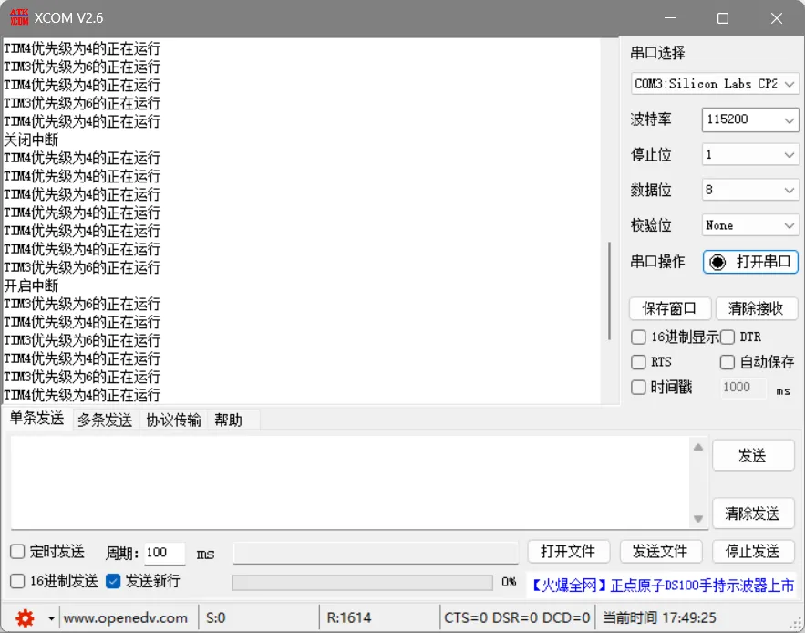

**在关中断后，只有TIM4中断函数还在继续运行，TIM3中断函数被RTOS关闭了，因为TIM4优先级是3，不在5~15范围内**

**这里设置的TIM3和TIM4定时中断是100ms触发一次，正点原子的这个延时函数最大只支持798ms的阻塞延时（不用OS[操作系统]的情况下），至于为啥不用OS，因为它修改后的版本是HAL库的，我用的标准库，懒得再改了，知道是这样就行**


**总结：**
**关中断和开中断实验中<mark>不能使用FreeRTOS自带的vTaskDelay()函数进行非阻塞式延时</mark>，<mark>因为关闭所有中断后，SysTick中断也将被禁止</mark>，<mark>导致节拍计数器无法更新</mark>，<mark>因此vTaskDelay()所等待的节拍数将永远不会达到</mark>，任务将无限期阻塞，无法继续运行。同时也不能进行任务切换**


## 五、课堂总结


