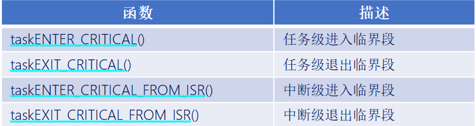
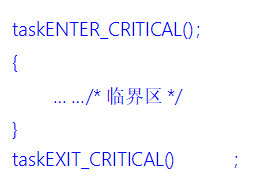
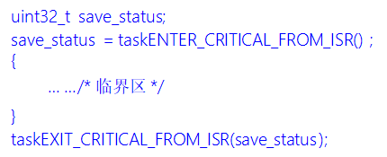

# FreeRTOS临界段代码保护

------


## 一、临界段代码保护简介(熟悉)

### 1、什么是临界段

答：临界段代码也叫临界区，是指那些必须完整运行，不能被打断的代码片段。运行时临界段代码时需要关闭中断，当处理完临界段代码以后再打开中断。


### 2、适用什么场合

答：

- **外设** ：需要严格按照时序初始化的外设，如IIC、SPI等。
- **系统** ：系统自身需求，如任务切换过程等。
- **用户** ：用户需求，如我们写的任务创建任务。


### 3、什么可以打断当前程序的运行

答：中断、任务调度。

------


## 二、临界段代码保护函数介绍(掌握)

### 1、临界段代码保护函数

答：



任务级临界区调用格式示例：



中断级临界区调用格式示例：




```c
uint32_t save_status;
save_status = taskENTER_CRITICAL_FROM_ISR();
{
//临界区
}
taskEXIT_CRITICAL_FROM_ISR(save_status);
/*
- 保存状态：ulPortRaiseBASEPRI() 会：
  1.读取当前的 BASEPRI 寄存器值
  2.设置新的 BASEPRI 来屏蔽中断
  3.返回之前的中断状态（保存在 save_status 中）
  
- 恢复状态：taskEXIT_CRITICAL_FROM_ISR(save_status) 将之前保存的状态写回 BASEPRI
*/
```


**临界区函数本质上还是调用了portDISABLE_INTERRUPTS()和portENABLE_INTERRUPTS()两个开关中断的函数，仍然是只能屏蔽 5~15优先级 的中断，0~4优先级中断管不到**

**区别：临界区函数能嵌套（单纯的层数嵌套，有一个变量会根据进入临界区还是退出临界区进行自增自减，变量值为0就开中断了），开关中断函数不能嵌套**


### 2、临界段代码保护函数使用特点

答：

1. 成对使用。
2. 支持嵌套。
3. 尽量保持临界段耗时短。

4. 临界区是直接屏蔽了中断，系统任务调度（SpendSV）靠中断，ISR（中断服务函数）也靠中断


------


## 三、 临界段代码保护函数的代码


### 任务的临界段的开启/关闭

```c
/*开启*/
taskENTER_CRITICAL()    
//1.
#define taskENTER_CRITICAL()               portENTER_CRITICAL()
//2.
#define portENTER_CRITICAL()               vPortEnterCritical()  
//3.
void vPortEnterCritical( void )
{
    portDISABLE_INTERRUPTS();
    uxCriticalNesting++;
    /*初始化为0*/

	/* 这不是 enter critical 函数的中断安全版本，因此
	* assert（） 如果它是从中断上下文调用的。 仅限 API
	* 以“FromISR”结尾的函数可以在中断中使用。 仅在以下情况下断言
	* 临界嵌套计数为 1，以防止递归调用，如果
	* assert 函数也使用临界部分。*/
    if( uxCriticalNesting == 1 )
    {
        configASSERT( ( portNVIC_INT_CTRL_REG & portVECTACTIVE_MASK ) == 0 );
    }
}
/*
每进入一次临界段，全局变量uxCriticalNesting都会加一
*/

//4.
#define portDISABLE_INTERRUPTS()              vPortRaiseBASEPRI()
//5.
    static portFORCE_INLINE void vPortRaiseBASEPRI( void )
    {
        uint32_t ulNewBASEPRI = configMAX_SYSCALL_INTERRUPT_PRIORITY;

        __asm
        {
            /* Set BASEPRI to the max syscall priority to effect a critical
             * section. */
			/* *INDENT-OFF* */
            msr basepri/*中断屏蔽寄存器*/, ulNewBASEPRI /*把ulNewBASEPRI给basepri*/
            dsb
            isb
			/* *INDENT-ON* */
        }
    }

//configMAX_SYSCALL_INTERRUPT_PRIORITY: 
#define configMAX_SYSCALL_INTERRUPT_PRIORITY 	( configLIBRARY_MAX_SYSCALL_INTERRUPT_PRIORITY << (8 - configPRIO_BITS) )
#define configLIBRARY_MAX_SYSCALL_INTERRUPT_PRIORITY	5     /* 受FreeRTOS管理的中断最高优先级：5 */


/*关闭*/
taskEXIT_CRITICAL()
//1.
#define taskEXIT_CRITICAL()                portEXIT_CRITICAL()
//2.
#define portEXIT_CRITICAL()                vPortExitCritical()
//3.
void vPortExitCritical( void )
{
    configASSERT( uxCriticalNesting );
    uxCriticalNesting--;
    /*每调用一次退出临界段，uxCriticalNesting减一*/
    
    if( uxCriticalNesting == 0 )
    {
        /*只有当 uxCriticalNesting 为 0 的时候才会调用函数 portENABLE_INTERRUPTS()使能中断*/
        portENABLE_INTERRUPTS();
    }
}
//4.
#define configASSERT( x ) if( ( x ) == 0 ) { taskDISABLE_INTERRUPTS(); for( ;; ); }  /* 断言失败时禁用中断并死循环 */
//5.
#define portENABLE_INTERRUPTS()                   vPortSetBASEPRI( 0 )
//6.
    static portFORCE_INLINE void vPortSetBASEPRI( uint32_t ulBASEPRI )
    {
        __asm
        {
            /* Barrier instructions are not used as this function is only used to
             * lower the BASEPRI value. */
/* *INDENT-OFF* */
            msr basepri, ulBASEPRI
/* *INDENT-ON* */
        }
    }


```


进入和退出临界段是成对使用的。

每进入一次临界段，全局变量uxCriticalNesting都会加一，每调用一次退出临界段，uxCriticalNesting减一，只有当 uxCriticalNesting 为 0 的时候才会调用函数 portENABLE_INTERRUPTS()使能中断。

这确保了在存在多个临界段代码的情况下，不会因为某个临界段代码的退出而破坏其他临界段的保护。只有当所有的临界段代码都退出时，中断才会被重新使能。因此可以进行嵌套


### 中断级的临界段函数

```c
/*开启*/
taskENTER_CRITICAL_FROM_ISR();
//1.
#define taskENTER_CRITICAL_FROM_ISR()      portSET_INTERRUPT_MASK_FROM_ISR()
//2.
#define portSET_INTERRUPT_MASK_FROM_ISR()         ulPortRaiseBASEPRI()
//3.
    static portFORCE_INLINE uint32_t ulPortRaiseBASEPRI( void )
    {
        uint32_t ulReturn, ulNewBASEPRI = configMAX_SYSCALL_INTERRUPT_PRIORITY;

        __asm
        {
            /* Set BASEPRI to the max syscall priority to effect a critical
             * section. */
/* *INDENT-OFF* */
            mrs ulReturn, basepri /*把中断屏蔽寄存器首先提取出来*/
            msr basepri, ulNewBASEPRI /*把中断给关闭，写入后，所有优先级数值大于或等于 ulNewBASEPRI 的中断会被立即屏蔽*/
            dsb
            isb
/* *INDENT-ON* */
        }

        return ulReturn; /*返回*/
    } /*提取中断屏蔽寄存器的值（中断寄存器缺省值），把自己设置的值写入，所有优先级数值大于或等于 ulNewBASEPRI 的中断会被立即屏蔽*/
//4.
/* !!!! configMAX_SYSCALL_INTERRUPT_PRIORITY不能设置为零 !!!!
   参见http://www.FreeRTOS.org/RTOS-Cortex-M3-M4.html */
#define configMAX_SYSCALL_INTERRUPT_PRIORITY 	( configLIBRARY_MAX_SYSCALL_INTERRUPT_PRIORITY << (8 - configPRIO_BITS) )
#define configLIBRARY_MAX_SYSCALL_INTERRUPT_PRIORITY	5     /* 受FreeRTOS管理的中断最高优先级：5 */


/*关闭*/
taskEXIT_CRITICAL_FROM_ISR( x )
//1.
define taskEXIT_CRITICAL_FROM_ISR( x )    portCLEAR_INTERRUPT_MASK_FROM_ISR( x )
//2.
#define portCLEAR_INTERRUPT_MASK_FROM_ISR( x )    vPortSetBASEPRI( x )
//3.
    static portFORCE_INLINE void vPortSetBASEPRI( uint32_t ulBASEPRI )
    {
        __asm
        {
            /* Barrier instructions are not used as this function is only used to
             * lower the BASEPRI value. */
/* *INDENT-OFF* */
            msr basepri, ulBASEPRI /*恢复中断屏蔽寄存器的值*/
/* *INDENT-ON* */
        }
    }
    
    
```

这种看似是不可以进行嵌套的，实则不然, 这种可以理解为

1. 在进入时保存上一层的中断屏蔽寄存器的值（第一次进入时，是保存缺省值），在退出时恢复上一层的中断屏蔽寄存器的值，因此每一层都是独立的，是可行的

```c
uint32_t save_status1, save_status2, save_status3;

// 第一层嵌套
save_status1 = taskENTER_CRITICAL_FROM_ISR(); // BASEPRI = 0 -> 5, 返回 0
{
    // 第二层嵌套  
    save_status2 = taskENTER_CRITICAL_FROM_ISR(); // BASEPRI = 5 -> 5, 返回 5
    {
        // 第三层嵌套
        save_status3 = taskENTER_CRITICAL_FROM_ISR(); // BASEPRI = 5 -> 5, 返回 5
        {
            // 临界区代码
        }
        taskEXIT_CRITICAL_FROM_ISR(save_status3); // BASEPRI = 5 -> 5
    }
    taskEXIT_CRITICAL_FROM_ISR(save_status2); // BASEPRI = 5 -> 5
}
taskEXIT_CRITICAL_FROM_ISR(save_status1); // BASEPRI = 5 -> 0 (完全恢复)

```


**总结：**

**任务临界段的函数本质 和 中断临界区函数的本质都是调用了portDISABLE_INTERRUPTS()和portENABLE_INTERRUPTS()两个开关中断的函数（仍然是只能屏蔽 5~15优先级 的中断，0~4优先级中断管不到），但是其触发嵌套的运行方法是不同的**


