# FreeRTOS信号量

------


## 一、信号量简介

### 1、什么是信号量 

答：信号量是一种解决同步问题的机制，可以实现对共享资源的有序访问。

假设有一个人需要在停车场停车。


- 空车位：信号量资源数(计数值)
- 让出占用车位： 释放信号量(计数值++)
- 占用车位： 获取信号量(计数值--)

1. 首先判断停车场是否还有空车位(判断信号量是否有资源)。
2. 停车场正好有空车位(信号量有资源)，那么就可以直接将车开入停车位进行停车(获取信号量成功)。
3. 停车场已经没有空车位了(信号量没有资源)，那么可以选择不停车(获取信号量失败)，也可以选择等待(任务阻塞)其他人将车开出停车位(释放信号)，然后在将车停如空车位。


### 2、信号量简介

答：

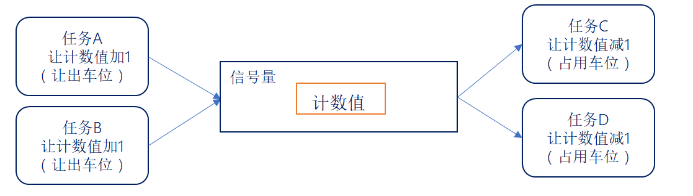

- 当计数值大于0，表示有信号量资源。
- 当释放信号量，信号量计数值(资源数)加一。
- 当获取信号量，信号量计数值(资源数)减一。
- 信号量的计数值都是有限的：限定最大值。
- 如果最大值被限定为1，那么它就是二值信号量。
- 如果最大值不是1，它就是计数型信号量。

> 注意：信号量用于传递状态。


### 3、队列与信号量的对比

答：

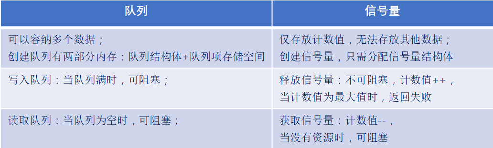

------


## 二、二值信号量

### 1、二值信号量介绍

答：二值信号量的==本质是一个队列长度为1的队列==，==该队列就只有空和满两种情况==。这就是二值信号量。

> 注意：二值信号量通常用于==互斥访问或任务同步==，与互斥信号量比较类似，但是二值信号量有可能会==导致优先级翻转的问题==，所以二值信号量更适合用于同步！！！
>
> 
>
> 互斥访问：原理：像一个**钥匙**。一个任务拿到钥匙后，才能访问共享资源。其他任务想访问，必须等待钥匙被释放
>
> 任务同步：一个任务的执行需要**等待另一个（或多个）任务达到某个状态或完成某个操作**后才能继续


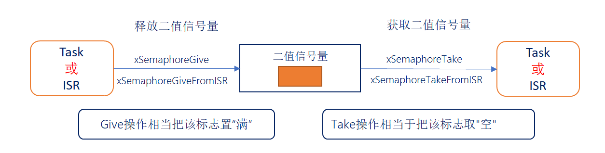


### 2、二值信号量相关API函数

答：使用二值信号量的过程：创建二值信号量  ->  释放二值信号量  ->  获取二值信号量

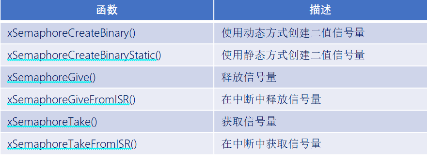


### 3、创建二值信号量函数

答：创建二值信号量函数：

```c
SemaphoreHandle_t  xSemaphoreCreateBinary( void );
```

```c
#define   xSemaphoreCreateBinary()
xQueueGenericCreate(1 , semSEMAPHORE_QUEUE_ITEM_LENGTH, queueQUEUE_TYPE_BINARY_SEMAPHORE)
#define   semSEMAPHORE_QUEUE_ITEM_LENGTH   (( uint8_t ) 0U)
```

```c
#define   queueQUEUE_TYPE_BASE                           ( ( uint8_t ) 0U ) /* 队列 */
#define   queueQUEUE_TYPE_SET                            ( ( uint8_t ) 0U ) /* 队列集 */
#define   queueQUEUE_TYPE_MUTEX                          ( ( uint8_t ) 1U ) /* 互斥信号量 */
#define   queueQUEUE_TYPE_COUNTING_SEMAPHORE             ( ( uint8_t ) 2U ) /* 计数型信号量 */
#define   queueQUEUE_TYPE_BINARY_SEMAPHORE               ( ( uint8_t ) 3U ) /* 二值信号量 */
#define   queueQUEUE_TYPE_RECURSIVE_MUTEX                ( ( uint8_t ) 4U ) /* 递归互斥信号量 */
```

返回值：

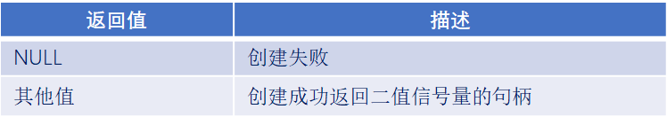


### 4、释放二值信号量函数

答：释放二值信号量函数：

```c
BaseType_t   xSemaphoreGive( xSemaphore ) 
```

```c
#define   xSemaphoreGive ( xSemaphore )
xQueueGenericSend((QueueHandle_t)( xSemaphore ), NULL, semGIVE_BLOCK_TIME, queueSEND_TO_BACK)
#define   semGIVE_BLOCK_TIME       ( ( TickType_t ) 0U )
```

函数参数：


函数返回值：

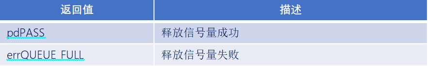

> 不支持阻塞时间

### 5、获取二值信号量函数

答：获取二值信号量函数：

```c
BaseType_t   xSemaphoreTake( xSemaphore, xBlockTime ) 
```

函数参数：

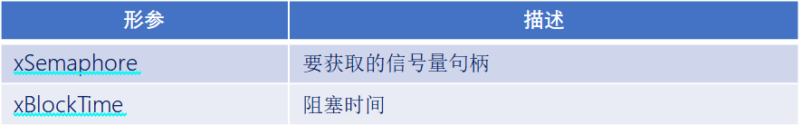

函数返回值：

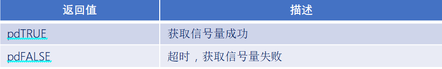


> 支持阻塞时间


------

### 实验

1. 实验目的：学习FreeRTOS的二值信号量相关API函数的使用

2. 实验设计：将设计三个任务：start_task, task1,  task2
   - start_task：用来创建task1，task2
   - task1：用于按键扫描，当检测到按键KEY0被按下时，释放二值信号量
   - task2：获取二值信号量，当成功获取后打印提示信息


```c
#include "stm32f4xx.h"                  // STM32F4系列微控制器头文件
#include "freertos.h"                   // FreeRTOS实时操作系统头文件
#include "task.h"                       // FreeRTOS任务管理头文件
#include "queue.h"                      // FreeRTOS队列管理头文件
#include "usart.h"                      // 串口通信头文件
#include "timer.h"                      // 定时器头文件
#include "delay_dwt.h"                  // 包含DWT延迟函数头文件
#include "semphr.h"                     // FreeRTOS信号量头文件

/**
 * @brief LED初始化函数
 * 配置GPIOC的Pin13作为LED控制引脚
 */
void LED_Init(void)
{		
    // 使能GPIOC时钟（AHB1总线）
    RCC_AHB1PeriphClockCmd(RCC_AHB1Periph_GPIOC, ENABLE);

    // 配置GPIO初始化结构体
    GPIO_InitTypeDef GPIO_InitStructure;
	GPIO_StructInit(&GPIO_InitStructure);
    GPIO_InitStructure.GPIO_Pin = GPIO_Pin_1 | GPIO_Pin_13 | GPIO_Pin_0;        // 选择引脚13,1
    GPIO_InitStructure.GPIO_Mode = GPIO_Mode_OUT;     // 输出模式
    GPIO_InitStructure.GPIO_OType = GPIO_OType_PP;    // 推挽输出
    GPIO_InitStructure.GPIO_Speed = GPIO_Speed_50MHz; // 输出速度50MHz
    GPIO_InitStructure.GPIO_PuPd = GPIO_PuPd_NOPULL;  // 无上拉下拉电阻
    GPIO_Init(GPIOC, &GPIO_InitStructure);            // 初始化GPIOC
}


/**
 * @brief LED初始化函数
 * 配置GPIOC的Pin13作为LED控制引脚
 */
void LED_TOGGLE13(void)
{
    GPIO_ToggleBits(GPIOC, GPIO_Pin_13);
}

/**
 * @brief LED初始化函数
 * 配置GPIOC的Pin1作为LED控制引脚
 */
void LED_TOGGLE1(void)
{
    GPIO_ToggleBits(GPIOC, GPIO_Pin_1);
}

/**
 * @brief LED初始化函数
 * 配置GPIOC的Pin0作为LED控制引脚
 */
void LED_TOGGLE0(void)
{
    GPIO_ToggleBits(GPIOC, GPIO_Pin_0);
}

/**
 * @brief 按键初始化函数
 * 配置GPIOA的Pin0和Pin1作为按键输入引脚
 */
void Key_Init(void)
{
	RCC_AHB1PeriphClockCmd(RCC_AHB1Periph_GPIOA, ENABLE);
	GPIO_InitTypeDef GPIO_InitStructure;
	GPIO_StructInit(&GPIO_InitStructure);
	GPIO_InitStructure.GPIO_Pin = GPIO_Pin_15 |  GPIO_Pin_0 | GPIO_Pin_1;
	GPIO_InitStructure.GPIO_Mode = GPIO_Mode_IN;
	GPIO_InitStructure.GPIO_Speed = GPIO_Speed_50MHz;
	GPIO_InitStructure.GPIO_PuPd = GPIO_PuPd_UP;
	GPIO_Init(GPIOA, &GPIO_InitStructure);  
}

/**
 * @brief 获取按键编号
 * 功能：根据按键状态返回按键编号
 * @return uint8_t 按键编号（1或2），如果没有按键按下则返回0
 */
uint8_t Key_GetNum(void)
{
	if (GPIO_ReadInputDataBit(GPIOA, GPIO_Pin_0) == 0)
	{
		vTaskDelay(20);
		if(GPIO_ReadInputDataBit(GPIOA, GPIO_Pin_0) == 0){
			return 1;
		}
	}
	else if (GPIO_ReadInputDataBit(GPIOA, GPIO_Pin_1) == 0)
	{
		vTaskDelay(20);
		if(GPIO_ReadInputDataBit(GPIOA, GPIO_Pin_1) == 0){
			return 2;
		}
	} 
	else if (GPIO_ReadInputDataBit(GPIOA, GPIO_Pin_15) == 0)
	{
		vTaskDelay(20);
		if(GPIO_ReadInputDataBit(GPIOA, GPIO_Pin_15) == 0){
			return 3;
		}
    }
    return 0;
}

// 任务配置宏定义
#define START_TASK_STACK_SIZE 128       // 启动任务栈大小（字）
#define START_TASK_PRIORITY 2           // 启动任务优先级（数值越小优先级越高）
#define TASK1_STACK_SIZE 128           // 任务1栈大小（字）
#define TASK1_PRIORITY 2               // 任务1优先级（数值越小优先级越高）
#define TASK2_STACK_SIZE 128           // 任务2栈大小（字）
#define TASK2_PRIORITY 3               // 任务2优先级（数值越小优先级越高）
// 任务句柄声明（用于引用和管理任务）
TaskHandle_t MytaskHandler1;    // 任务1句柄
TaskHandle_t MytaskHandler2;    // 任务2句柄
TaskHandle_t StarttaskHandler;  // 启动任务句柄
QueueHandle_t semaphore;        // 二值信号量句柄


/**
 * @brief 任务1函数
 * 功能：释放二值信号量
 * @param arg 任务参数（未使用）
 */
void Task1(void * arg){
    uint8_t keyNum = 0;
    BaseType_t xStatus;
    while(1){
        keyNum = Key_GetNum();
        if(keyNum == 1){
            if(semaphore != NULL){
                xStatus = xSemaphoreGive(semaphore);
                if(xStatus == pdPASS){
                    printf("Semaphore give success\r\n");
                }else {
                    printf("Semaphore give failed\r\n");
                }
            }
        }
        vTaskDelay(100);
    }

}


/**
 * @brief 任务2函数
 * 功能：获取二值信号量
 * @param arg 任务参数（未使用）
 */
 void Task2(void * arg){
    uint32_t i = 0;
    BaseType_t xStatus;
    while(1){
        xStatus = xSemaphoreTake(semaphore, portMAX_DELAY);
        if(xStatus == pdPASS){
            printf("Semaphore take success \r\n");
        }else {
            printf("Semaphore take failed %d\r\n", ++ i);   
        }
    }	
}

/*为什么task2的先打印出来？
因为task2的优先级高，但是在xSemaphoreTake()函数中，如果信号量不可用，任务会被阻塞，直到信号量被释放。
此时task1运行，会先释放信号量，然后task2获取到信号量，会立刻抢占task1，打印出"Semaphore take success"。
task2执行完到xSemaphoreTake()函数，会再次阻塞，等待信号量被释放。此时task1才打印出"Semaphore take success "。
*/

/*如果portMAX_DELAY改为1000，会发生什么？
会发生任务2的打印失败，因为任务2的优先级高，但是在1000个时钟节拍内，信号量还没有被释放，所以任务2会打印失败。
直到任务1释放信号量，任务2才会打印成功。又会发生任务2的打印失败，因为任务2的优先级低，在100个时钟节拍内，信号量还没有被释放，所以任务2会打印失败。
*/

/**
 * @brief 启动任务函数
 * 功能：创建其他三个任务后自行删除
 * @param arg 任务参数（未使用）
 */
void Starttask(void * arg){
    // 进入临界区保护串口输出
    taskENTER_CRITICAL();
    printf("Starttask running\r\n");  // 打印启动任务运行信息
    taskEXIT_CRITICAL();

     /**
      * @brief 创建二值信号量
      * 功能：创建一个二值信号量，用于任务间同步
      */
    semaphore = xSemaphoreCreateBinary();
    if(semaphore == NULL){
        printf("Semaphore create failed\r\n");
    }else{
        printf("Semaphore create success\r\n");
    }

    // 使用动态内存分配方式创建任务1
    xTaskCreate(Task1,                        // 任务函数指针
               "MyFirstTask",                 // 任务名称（用于调试）
               TASK1_STACK_SIZE,         // 栈大小（字）
               NULL,                          // 传递给任务的参数
               TASK1_PRIORITY,           // 任务优先级
               &MytaskHandler1);              // 任务句柄指针
    
    // 使用动态内存分配方式创建任务2
    xTaskCreate(Task2, 
               "MySecondTask", 
               TASK2_STACK_SIZE, 
               NULL, 
               TASK2_PRIORITY, 
               &MytaskHandler2);
    
    
    
    // 删除当前任务（启动任务），释放其占用的资源
    vTaskDelete(NULL);
}

/**
 * @brief 主函数
 * 程序入口点，初始化硬件并启动RTOS调度器
 */
int main(void)
{
	NVIC_PriorityGroupConfig(NVIC_PriorityGroup_4);
    LED_Init();                     // 初始化LED GPIO引脚
    Usart1_Init(115200);            // 初始化串口1，波特率115200
    Key_Init();                     // 初始化按键 GPIO引脚
    DWT_Init();                     // 初始化DWT定时器
    
    // 创建启动任务（使用动态内存分配）
    xTaskCreate(Starttask,                  // 任务函数指针
               "StartTask",                 // 任务名称
               START_TASK_STACK_SIZE,       // 栈大小
               NULL,                        // 任务参数
               START_TASK_PRIORITY,         // 任务优先级
               &StarttaskHandler);          // 任务句柄
    
    // 启动FreeRTOS调度器（程序将在此处开始运行任务）
    vTaskStartScheduler();
    
    // 正常情况下，调度器启动后不会执行到这里
    // 如果调度器启动失败，程序将在此处循环
    while (1)
    {		
        // 空循环，用于处理调度器启动失败的情况
    }	
}

```


**portMAX_DELAY改为1000**

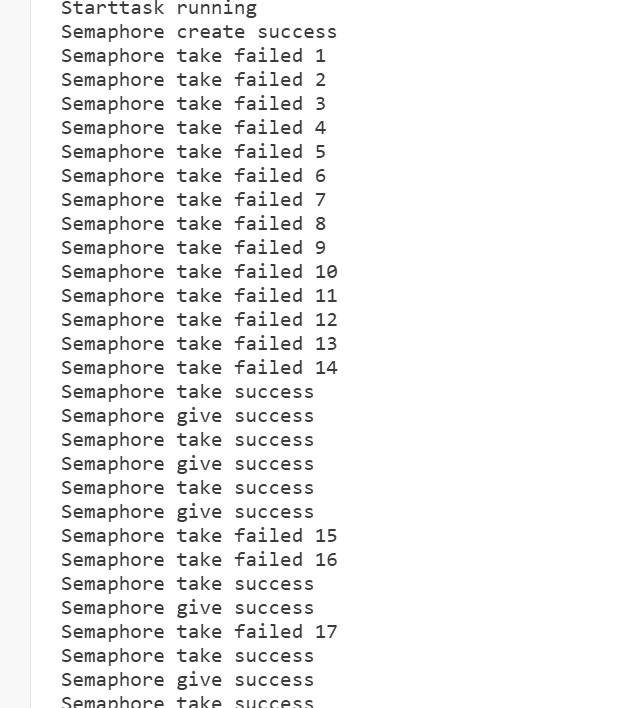

**portMAX_DELAY不改为1000**

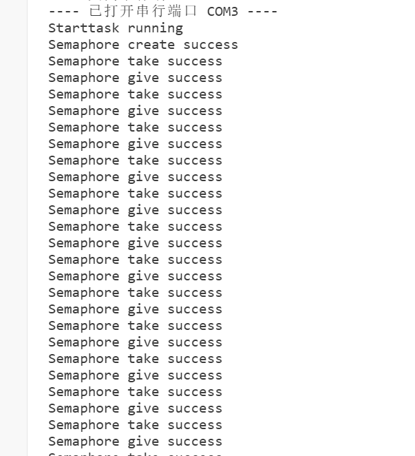


## 三、计数型信号量

### 1、计数型信号量介绍

答：==计数型信号量相当于队列长度为1的队列==，因此计数型信号量能够容纳多个资源，这在计数型信号量被创建的时候确定的。

计数型信号量适用场合：

- 事件计数 ： 当每次事件发生后，在事件处理函数中释放计数型信号量(计数值+1)，其他任务会获取计数型信号量(计数值-1)，这种场合一般在==创建时将初始化计数值设置为0.（队列长度代表的是它的上限值）==
- 资源管理 ： 信号量表示有效资源数量。任务必须先获取信号量(信号计数值-1)才能获取资源控制权。当计数值减为0时表示没有资源。当任务使用完资源后，必须释放信号量(信号量计数值+1)。==信号量创建时计数值应等于最大资源数目。==


### 2、计数型信号量相关API函数

答：使用计数型信号量的过程：创建计数型信号量  ->  释放信号量  ->  获取信号量

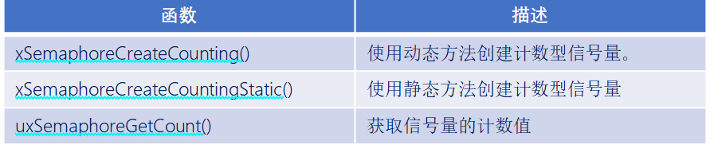

注意：计数型信号量的释放与获取的函数和二值信号量一样。


### 3、计数型信号量创建函数

答：

```c
#define 	xSemaphoreCreateCounting( uxMaxCount , uxInitialCount )
            xQueueCreateCountingSemaphore( ( uxMaxCount ) , ( uxInitialCount ) ) 
```

函数参数：

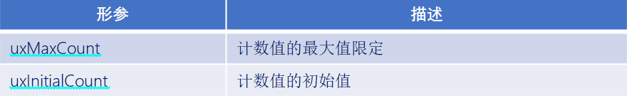

函数返回值：

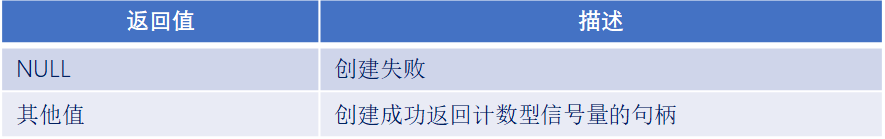


### 4、获取计数型信号量计数值函数

答：

```c
#define 	uxSemaphoreGetCount( xSemaphore ) 
            uxQueueMessagesWaiting(( QueueHandle_t )( xSemaphore ))
```

函数参数：

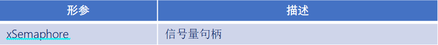

函数返回值：


### 实验

1. 实验目的：学习FreeRTOS的计数值信号量相关API函数的使用

2. 实验设计：将设计三个任务：start_task, task1，task2
   - start_task：用来创建task1，task2
   - task1：用于按键扫描，当检测到按键KEY0被按下时，释放计数值信号量（+1）
   - task2：每过一秒获取一次计数值信号量（-1），当成功获取后打印提示信息

```c
#include "stm32f4xx.h"                  // STM32F4系列微控制器头文件
#include "freertos.h"                   // FreeRTOS实时操作系统头文件
#include "task.h"                       // FreeRTOS任务管理头文件
#include "queue.h"                      // FreeRTOS队列管理头文件
#include "usart.h"                      // 串口通信头文件
#include "timer.h"                      // 定时器头文件
#include "delay_dwt.h"                  // 包含DWT延迟函数头文件
#include "semphr.h"                     // FreeRTOS信号量头文件

/**
 * @brief LED初始化函数
 * 配置GPIOC的Pin13作为LED控制引脚
 */
void LED_Init(void)
{		
    // 使能GPIOC时钟（AHB1总线）
    RCC_AHB1PeriphClockCmd(RCC_AHB1Periph_GPIOC, ENABLE);

    // 配置GPIO初始化结构体
    GPIO_InitTypeDef GPIO_InitStructure;
	GPIO_StructInit(&GPIO_InitStructure);
    GPIO_InitStructure.GPIO_Pin = GPIO_Pin_1 | GPIO_Pin_13 | GPIO_Pin_0;        // 选择引脚13,1
    GPIO_InitStructure.GPIO_Mode = GPIO_Mode_OUT;     // 输出模式
    GPIO_InitStructure.GPIO_OType = GPIO_OType_PP;    // 推挽输出
    GPIO_InitStructure.GPIO_Speed = GPIO_Speed_50MHz; // 输出速度50MHz
    GPIO_InitStructure.GPIO_PuPd = GPIO_PuPd_NOPULL;  // 无上拉下拉电阻
    GPIO_Init(GPIOC, &GPIO_InitStructure);            // 初始化GPIOC
}


/**
 * @brief LED初始化函数
 * 配置GPIOC的Pin13作为LED控制引脚
 */
void LED_TOGGLE13(void)
{
    GPIO_ToggleBits(GPIOC, GPIO_Pin_13);
}

/**
 * @brief LED初始化函数
 * 配置GPIOC的Pin1作为LED控制引脚
 */
void LED_TOGGLE1(void)
{
    GPIO_ToggleBits(GPIOC, GPIO_Pin_1);
}

/**
 * @brief LED初始化函数
 * 配置GPIOC的Pin0作为LED控制引脚
 */
void LED_TOGGLE0(void)
{
    GPIO_ToggleBits(GPIOC, GPIO_Pin_0);
}

/**
 * @brief 按键初始化函数
 * 配置GPIOA的Pin0和Pin1作为按键输入引脚
 */
void Key_Init(void)
{
	RCC_AHB1PeriphClockCmd(RCC_AHB1Periph_GPIOA, ENABLE);
	GPIO_InitTypeDef GPIO_InitStructure;
	GPIO_StructInit(&GPIO_InitStructure);
	GPIO_InitStructure.GPIO_Pin = GPIO_Pin_15 |  GPIO_Pin_0 | GPIO_Pin_1;
	GPIO_InitStructure.GPIO_Mode = GPIO_Mode_IN;
	GPIO_InitStructure.GPIO_Speed = GPIO_Speed_50MHz;
	GPIO_InitStructure.GPIO_PuPd = GPIO_PuPd_UP;
	GPIO_Init(GPIOA, &GPIO_InitStructure);  
}

/**
 * @brief 获取按键编号
 * 功能：根据按键状态返回按键编号
 * @return uint8_t 按键编号（1或2），如果没有按键按下则返回0
 */
uint8_t Key_GetNum(void)
{
	if (GPIO_ReadInputDataBit(GPIOA, GPIO_Pin_0) == 0)
	{
		vTaskDelay(20);
		if(GPIO_ReadInputDataBit(GPIOA, GPIO_Pin_0) == 0){
			return 1;
		}
	}
	else if (GPIO_ReadInputDataBit(GPIOA, GPIO_Pin_1) == 0)
	{
		vTaskDelay(20);
		if(GPIO_ReadInputDataBit(GPIOA, GPIO_Pin_1) == 0){
			return 2;
		}
	} 
	else if (GPIO_ReadInputDataBit(GPIOA, GPIO_Pin_15) == 0)
	{
		vTaskDelay(20);
		if(GPIO_ReadInputDataBit(GPIOA, GPIO_Pin_15) == 0){
			return 3;
		}
    }
    return 0;
}

// 任务配置宏定义
#define START_TASK_STACK_SIZE 128       // 启动任务栈大小（字）
#define START_TASK_PRIORITY 2           // 启动任务优先级（数值越小优先级越高）
#define TASK1_STACK_SIZE 128           // 任务1栈大小（字）
#define TASK1_PRIORITY 2               // 任务1优先级（数值越小优先级越高）
#define TASK2_STACK_SIZE 128           // 任务2栈大小（字）
#define TASK2_PRIORITY 3               // 任务2优先级（数值越小优先级越高）
// 任务句柄声明（用于引用和管理任务）
TaskHandle_t MytaskHandler1;    // 任务1句柄
TaskHandle_t MytaskHandler2;    // 任务2句柄
TaskHandle_t StarttaskHandler;  // 启动任务句柄
QueueHandle_t count_semaphore;        // 二值信号量句柄


/**
 * @brief 任务1函数
 * 功能：释放二值信号量
 * @param arg 任务参数（未使用）
 */
void Task1(void * arg){
    uint8_t keyNum = 0;
    while(1){
        keyNum = Key_GetNum();
        if(keyNum == 1){
            if(count_semaphore != NULL){
                xSemaphoreGive(count_semaphore); /*释放计数信号量*/
            }
        }
        vTaskDelay(100);
    }

}


/**
 * @brief 任务2函数
 * 功能：获取二值信号量
 * @param arg 任务参数（未使用）
 */
 void Task2(void * arg){
    BaseType_t xStatus;
    while(1){
        xStatus = xSemaphoreTake(count_semaphore, portMAX_DELAY); /*获取计数信号量*/
        /*设置信号量的初始值是0，没有资源，获取不到，会阻塞在这*/
        if(xStatus == pdTRUE){
            printf("信号量的计数值为:%d\r\n", (int)uxSemaphoreGetCount(count_semaphore));
        }
        vTaskDelay(1000);
    }	
}


/**
 * @brief 启动任务函数
 * 功能：创建其他三个任务后自行删除
 * @param arg 任务参数（未使用）
 */
void Starttask(void * arg){
    // 进入临界区保护串口输出
    taskENTER_CRITICAL();
    printf("Starttask running\r\n");  // 打印启动任务运行信息
    taskEXIT_CRITICAL();

     /**
      * @brief 创建计数信号量
      * 功能：创建一个计数信号量，用于任务间同步
      */
    count_semaphore = xSemaphoreCreateCounting(100, 15);
    if(count_semaphore == NULL){
        printf("Count semaphore create failed\r\n");
    }else{
        printf("Count semaphore create success\r\n");
    }

    // 使用动态内存分配方式创建任务1
    xTaskCreate(Task1,                        // 任务函数指针
               "MyFirstTask",                 // 任务名称（用于调试）
               TASK1_STACK_SIZE,         // 栈大小（字）
               NULL,                          // 传递给任务的参数
               TASK1_PRIORITY,           // 任务优先级
               &MytaskHandler1);              // 任务句柄指针
    
    // 使用动态内存分配方式创建任务2
    xTaskCreate(Task2, 
               "MySecondTask", 
               TASK2_STACK_SIZE, 
               NULL, 
               TASK2_PRIORITY, 
               &MytaskHandler2);
    
    
    
    // 删除当前任务（启动任务），释放其占用的资源
    vTaskDelete(NULL);
}

/**
 * @brief 主函数
 * 程序入口点，初始化硬件并启动RTOS调度器
 */
int main(void)
{
	NVIC_PriorityGroupConfig(NVIC_PriorityGroup_4);
    LED_Init();                     // 初始化LED GPIO引脚
    Usart1_Init(115200);            // 初始化串口1，波特率115200
    Key_Init();                     // 初始化按键 GPIO引脚
    DWT_Init();                     // 初始化DWT定时器
    
    // 创建启动任务（使用动态内存分配）
    xTaskCreate(Starttask,                  // 任务函数指针
               "StartTask",                 // 任务名称
               START_TASK_STACK_SIZE,       // 栈大小
               NULL,                        // 任务参数
               START_TASK_PRIORITY,         // 任务优先级
               &StarttaskHandler);          // 任务句柄
    
    // 启动FreeRTOS调度器（程序将在此处开始运行任务）
    vTaskStartScheduler();
    
    // 正常情况下，调度器启动后不会执行到这里
    // 如果调度器启动失败，程序将在此处循环
    while (1)
    {		
        // 空循环，用于处理调度器启动失败的情况
    }	
}


```


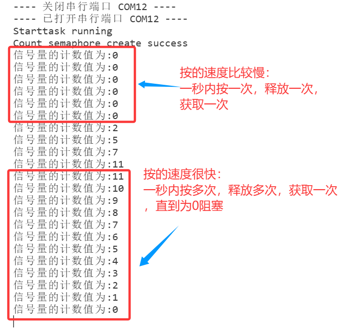


------


## 四、优先级翻转介绍

### 1、优先级翻转简介

答：优先级翻转：高优先级的任务反而慢执行，低优先级的任务反而优先执行。

优先级翻转在抢占式内核中是非常常见的，但是在实时操作系统中是不允许出现优先级翻转的，因为优先级翻转会破坏任务的预期顺序，可能会导致未知的严重后果。

在使用二值信号量的时候，经常会遇到优先级翻转的问题。


### 2、优先级翻转的例子

答：

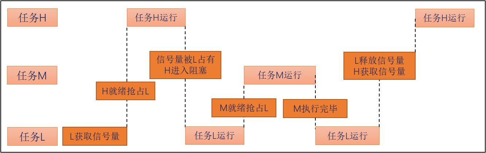

高优先级任务被低优先级任务阻塞，导致高优先级任务迟迟得不到调度。但其他中等优先级的任务却能抢到CPU资源。从现象上看，就像是中等优先级的任务比高优先级任务具有更高的优先权(即优先级翻转)。


### 实验

实验目的：在使用二值信号量的时候会存在优先级翻转的问题，本实验通过模拟的方式实现优先级翻转，观察优先级翻转对抢占式内核的影响

实验设计：将设计四个任务：start_task，high_task，middle_task，low_task

四个实现功能：

- start_task，用来创建其他任务
- high_task，高优先级任务，会获取二值信号量，获取成功以后打印提示信息，处理完之后释放信号量
- middle_task，中等优先级，简单的应用任务
- low_task  低优先级任务，通高优先级一样的操作，不同的是低优先级任务占用信号量的时间久一点


```c
#include "stm32f4xx.h"                  // STM32F4系列微控制器头文件
#include "freertos.h"                   // FreeRTOS实时操作系统头文件
#include "task.h"                       // FreeRTOS任务管理头文件
#include "queue.h"                      // FreeRTOS队列管理头文件
#include "usart.h"                      // 串口通信头文件
#include "timer.h"                      // 定时器头文件
#include "delay_dwt.h"                  // 包含DWT延迟函数头文件
#include "semphr.h"                     // FreeRTOS信号量头文件

/**
 * @brief LED初始化函数
 * 配置GPIOC的Pin13作为LED控制引脚
 */
void LED_Init(void)
{		
    // 使能GPIOC时钟（AHB1总线）
    RCC_AHB1PeriphClockCmd(RCC_AHB1Periph_GPIOC, ENABLE);

    // 配置GPIO初始化结构体
    GPIO_InitTypeDef GPIO_InitStructure;
	GPIO_StructInit(&GPIO_InitStructure);
    GPIO_InitStructure.GPIO_Pin = GPIO_Pin_1 | GPIO_Pin_13 | GPIO_Pin_0;        // 选择引脚13,1
    GPIO_InitStructure.GPIO_Mode = GPIO_Mode_OUT;     // 输出模式
    GPIO_InitStructure.GPIO_OType = GPIO_OType_PP;    // 推挽输出
    GPIO_InitStructure.GPIO_Speed = GPIO_Speed_50MHz; // 输出速度50MHz
    GPIO_InitStructure.GPIO_PuPd = GPIO_PuPd_NOPULL;  // 无上拉下拉电阻
    GPIO_Init(GPIOC, &GPIO_InitStructure);            // 初始化GPIOC
}


/**
 * @brief LED初始化函数
 * 配置GPIOC的Pin13作为LED控制引脚
 */
void LED_TOGGLE13(void)
{
    GPIO_ToggleBits(GPIOC, GPIO_Pin_13);
}

/**
 * @brief LED初始化函数
 * 配置GPIOC的Pin1作为LED控制引脚
 */
void LED_TOGGLE1(void)
{
    GPIO_ToggleBits(GPIOC, GPIO_Pin_1);
}

/**
 * @brief LED初始化函数
 * 配置GPIOC的Pin0作为LED控制引脚
 */
void LED_TOGGLE0(void)
{
    GPIO_ToggleBits(GPIOC, GPIO_Pin_0);
}

/**
 * @brief 按键初始化函数
 * 配置GPIOA的Pin0和Pin1作为按键输入引脚
 */
void Key_Init(void)
{
	RCC_AHB1PeriphClockCmd(RCC_AHB1Periph_GPIOA, ENABLE);
	GPIO_InitTypeDef GPIO_InitStructure;
	GPIO_StructInit(&GPIO_InitStructure);
	GPIO_InitStructure.GPIO_Pin = GPIO_Pin_15 |  GPIO_Pin_0 | GPIO_Pin_1;
	GPIO_InitStructure.GPIO_Mode = GPIO_Mode_IN;
	GPIO_InitStructure.GPIO_Speed = GPIO_Speed_50MHz;
	GPIO_InitStructure.GPIO_PuPd = GPIO_PuPd_UP;
	GPIO_Init(GPIOA, &GPIO_InitStructure);  
}

/**
 * @brief 获取按键编号
 * 功能：根据按键状态返回按键编号
 * @return uint8_t 按键编号（1或2），如果没有按键按下则返回0
 */
uint8_t Key_GetNum(void)
{
	if (GPIO_ReadInputDataBit(GPIOA, GPIO_Pin_0) == 0)
	{
		vTaskDelay(20);
		if(GPIO_ReadInputDataBit(GPIOA, GPIO_Pin_0) == 0){
			return 1;
		}
	}
	else if (GPIO_ReadInputDataBit(GPIOA, GPIO_Pin_1) == 0)
	{
		vTaskDelay(20);
		if(GPIO_ReadInputDataBit(GPIOA, GPIO_Pin_1) == 0){
			return 2;
		}
	} 
	else if (GPIO_ReadInputDataBit(GPIOA, GPIO_Pin_15) == 0)
	{
		vTaskDelay(20);
		if(GPIO_ReadInputDataBit(GPIOA, GPIO_Pin_15) == 0){
			return 3;
		}
    }
    return 0;
}

// 任务配置宏定义
#define START_TASK_STACK_SIZE 128       // 启动任务栈大小（字）
#define START_TASK_PRIORITY 2           // 启动任务优先级（数值越小优先级越高）
#define TASK1_STACK_SIZE 128           // 任务1栈大小（字）
#define TASK1_PRIORITY 3               // 任务1优先级（数值越大优先级越高）
#define TASK2_STACK_SIZE 128           // 任务2栈大小（字）
#define TASK2_PRIORITY 4               // 任务2优先级（数值越大优先级越高）
#define TASK3_STACK_SIZE 128           // 任务3栈大小（字）
#define TASK3_PRIORITY 5               // 任务3优先级（数值越大优先级越高）
// 任务句柄声明（用于引用和管理任务）
TaskHandle_t MytaskHandler1;    // 任务1句柄
TaskHandle_t MytaskHandler2;    // 任务2句柄
TaskHandle_t MytaskHandler3;    // 任务3句柄
TaskHandle_t StarttaskHandler;  // 启动任务句柄
QueueHandle_t semaphore;        // 二值信号量句柄


/**
 * @brief 低优先级任务1函数
 * 功能：
 * @param arg 任务参数（未使用）
 */
void low_Task1(void * arg){
    while(1){
        printf("low_Task1 等待信号量\r\n");
        xSemaphoreTake(semaphore, portMAX_DELAY);
        printf("low_Task1 running\r\n");
        Delay_ms(3000);
        printf("low_Task1 释放信号量\r\n");
        xSemaphoreGive(semaphore);
        vTaskDelay(1000);
    }

}


/**
 * @brief 中优先级任务2函数
 * 功能：
 * @param arg 任务参数（未使用）
 */
 void middle_Task2(void * arg){
    
    while(1){
        printf("middle_Task2 running\r\n");
        vTaskDelay(1000);
    }	
}

/**
 * @brief 高优先级任务3函数
 * 功能：
 * @param arg 任务参数（未使用）
 */
 void high_Task3(void * arg){
    
    while(1){
        printf("high_Task3 等待信号量\r\n");
        xSemaphoreTake(semaphore, portMAX_DELAY);
        printf("high_Task3 running\r\n");
        Delay_ms(1000);
        printf("high_Task3 释放信号量\r\n");
        xSemaphoreGive(semaphore);
        vTaskDelay(1000);
    }	
}


/**
 * @brief 启动任务函数
 * 功能：创建其他三个任务后自行删除
 * @param arg 任务参数（未使用）
 */
void Starttask(void * arg){
    // 进入临界区保护串口输出
    taskENTER_CRITICAL();
    printf("----------------------------\r\n");
    printf("Starttask running\r\n");  // 打印启动任务运行信息
    taskEXIT_CRITICAL();

    // 创建二值信号量
    semaphore = xSemaphoreCreateBinary();
    if(semaphore == NULL){
        printf("Semaphore create failed\r\n");
    }else{
        printf("Semaphore create success\r\n");
    }

    // 释放信号量，使低优先级任务1可以运行
    xSemaphoreGive(semaphore);

    taskENTER_CRITICAL();
    // 使用动态内存分配方式创建任务1
    xTaskCreate(low_Task1,                        // 任务函数指针
               "MyFirstTask",                 // 任务名称（用于调试）
               TASK1_STACK_SIZE,         // 栈大小（字）
               NULL,                          // 传递给任务的参数
               TASK1_PRIORITY,           // 任务优先级
               &MytaskHandler1);              // 任务句柄指针
    
    // 使用动态内存分配方式创建任务2
    xTaskCreate(middle_Task2, 
               "MySecondTask", 
               TASK2_STACK_SIZE, 
               NULL, 
               TASK2_PRIORITY, 
               &MytaskHandler2);
    
    // 使用动态内存分配方式创建任务3
    xTaskCreate(high_Task3, 
               "MyThirdTask", 
               TASK3_STACK_SIZE, 
               NULL, 
               TASK3_PRIORITY, 
               &MytaskHandler3);
    taskEXIT_CRITICAL();
    
    // 删除当前任务（启动任务），释放其占用的资源
    vTaskDelete(NULL);
}

/**
 * @brief 主函数
 * 程序入口点，初始化硬件并启动RTOS调度器
 */
int main(void)
{
	NVIC_PriorityGroupConfig(NVIC_PriorityGroup_4);
    LED_Init();                     // 初始化LED GPIO引脚
    Usart1_Init(115200);            // 初始化串口1，波特率115200
    Key_Init();                     // 初始化按键 GPIO引脚
    DWT_Init();                     // 初始化DWT定时器
    
    // 创建启动任务（使用动态内存分配）
    xTaskCreate(Starttask,                  // 任务函数指针
               "StartTask",                 // 任务名称
               START_TASK_STACK_SIZE,       // 栈大小
               NULL,                        // 任务参数
               START_TASK_PRIORITY,         // 任务优先级
               &StarttaskHandler);          // 任务句柄
    
    // 启动FreeRTOS调度器（程序将在此处开始运行任务）
    vTaskStartScheduler();
    
    // 正常情况下，调度器启动后不会执行到这里
    // 如果调度器启动失败，程序将在此处循环
    while (1)
    {		
        // 空循环，用于处理调度器启动失败的情况
    }	
}
```


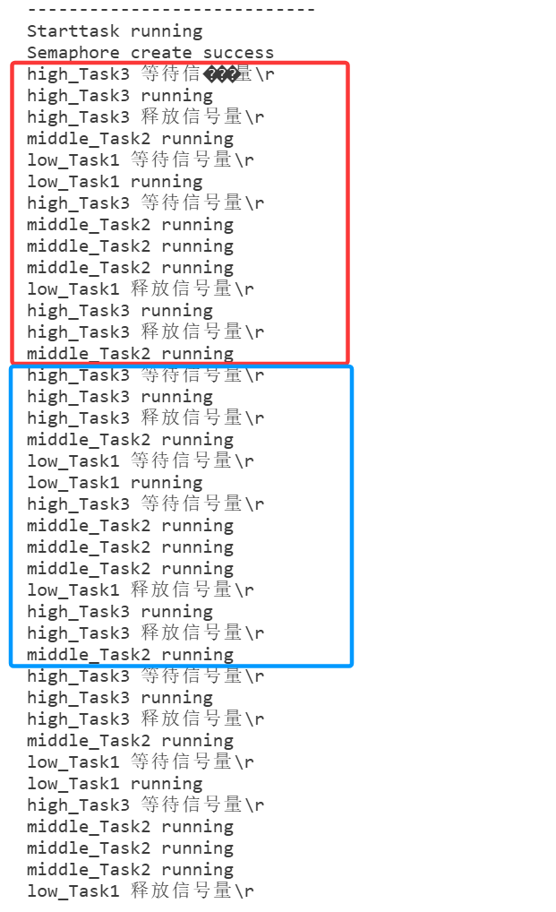


------


## 五、互斥信号量

### 1、互斥信号量介绍

答：互斥信号量其实就是一个 拥有优先级翻转的二值信号量。

- 二值信号量更适用于同步的应用。
- 互斥信号量更适合那些需要互斥访问的应用(资源紧缺，需要资源保护)。


### 2、什么是优先级继承

答：当一个互斥信号量正在被一个低优先级的任务持有时，如果此时有一个高优先级的任务也尝试获取这个互斥信号量，那么这个高优先级的任务就会被阻塞。==不过这个高优先级的任务会将低优先级任务的优先级提升到与自己相同的优先级。==


### 3、优先级继承示例

答：

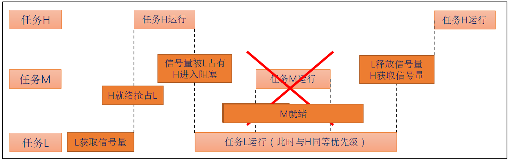

此时任务H的阻塞时间仅仅是任务L的执行时间，将优先级翻转的危害降低到了最低。


### 4、互斥信号量的注意事项

答：优先级继承并不能完全的消除优先级翻转的问题，它只是尽可能的降低优先级翻转带来的影响。

注意：互斥信号量不能用于中断服务函数中，原因如下：

1. 互斥信号量有优先级继承的机制，但是中断不是任务，没有任务优先级，所以互斥信号量只能用于任务中，不能用于中断服务函数中。
2. 中断服务函数中不能因为要等待互斥信号量而设置阻塞时间进入阻塞态。


### 5、互斥信号量相关API函数

答：使用互斥信号量：首先将宏configUSE_MUTEXES置1.

使用流程：创建互斥信号量  ->  (task)获取信号量  ->  (give)释放信号量

创建互斥信号量函数：

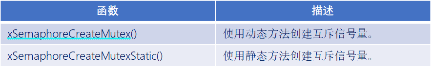

互斥信号量的释放和获取函数与二值信号量相同！！！只不过互斥信号量不支持中断中调用。

注意：创建互斥信号量时，会主动释放一次信号量。


### 6、创建互斥信号量函数

答：

```c
#define   xSemaphoreCreateMutex()      xQueueCreateMutex( queueQUEUE_TYPE_MUTEX )
```

函数返回值：

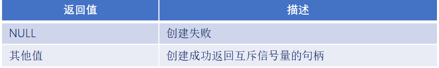


### 实验

```c
#include "stm32f4xx.h"                  // STM32F4系列微控制器头文件
#include "freertos.h"                   // FreeRTOS实时操作系统头文件
#include "task.h"                       // FreeRTOS任务管理头文件
#include "queue.h"                      // FreeRTOS队列管理头文件
#include "usart.h"                      // 串口通信头文件
#include "timer.h"                      // 定时器头文件
#include "delay_dwt.h"                  // 包含DWT延迟函数头文件
#include "semphr.h"                     // FreeRTOS信号量头文件

/**
 * @brief LED初始化函数
 * 配置GPIOC的Pin13作为LED控制引脚
 */
void LED_Init(void)
{		
    // 使能GPIOC时钟（AHB1总线）
    RCC_AHB1PeriphClockCmd(RCC_AHB1Periph_GPIOC, ENABLE);

    // 配置GPIO初始化结构体
    GPIO_InitTypeDef GPIO_InitStructure;
	GPIO_StructInit(&GPIO_InitStructure);
    GPIO_InitStructure.GPIO_Pin = GPIO_Pin_1 | GPIO_Pin_13 | GPIO_Pin_0;        // 选择引脚13,1
    GPIO_InitStructure.GPIO_Mode = GPIO_Mode_OUT;     // 输出模式
    GPIO_InitStructure.GPIO_OType = GPIO_OType_PP;    // 推挽输出
    GPIO_InitStructure.GPIO_Speed = GPIO_Speed_50MHz; // 输出速度50MHz
    GPIO_InitStructure.GPIO_PuPd = GPIO_PuPd_NOPULL;  // 无上拉下拉电阻
    GPIO_Init(GPIOC, &GPIO_InitStructure);            // 初始化GPIOC
}


/**
 * @brief LED初始化函数
 * 配置GPIOC的Pin13作为LED控制引脚
 */
void LED_TOGGLE13(void)
{
    GPIO_ToggleBits(GPIOC, GPIO_Pin_13);
}

/**
 * @brief LED初始化函数
 * 配置GPIOC的Pin1作为LED控制引脚
 */
void LED_TOGGLE1(void)
{
    GPIO_ToggleBits(GPIOC, GPIO_Pin_1);
}

/**
 * @brief LED初始化函数
 * 配置GPIOC的Pin0作为LED控制引脚
 */
void LED_TOGGLE0(void)
{
    GPIO_ToggleBits(GPIOC, GPIO_Pin_0);
}

/**
 * @brief 按键初始化函数
 * 配置GPIOA的Pin0和Pin1作为按键输入引脚
 */
void Key_Init(void)
{
	RCC_AHB1PeriphClockCmd(RCC_AHB1Periph_GPIOA, ENABLE);
	GPIO_InitTypeDef GPIO_InitStructure;
	GPIO_StructInit(&GPIO_InitStructure);
	GPIO_InitStructure.GPIO_Pin = GPIO_Pin_15 |  GPIO_Pin_0 | GPIO_Pin_1;
	GPIO_InitStructure.GPIO_Mode = GPIO_Mode_IN;
	GPIO_InitStructure.GPIO_Speed = GPIO_Speed_50MHz;
	GPIO_InitStructure.GPIO_PuPd = GPIO_PuPd_UP;
	GPIO_Init(GPIOA, &GPIO_InitStructure);  
}

/**
 * @brief 获取按键编号
 * 功能：根据按键状态返回按键编号
 * @return uint8_t 按键编号（1或2），如果没有按键按下则返回0
 */
uint8_t Key_GetNum(void)
{
	if (GPIO_ReadInputDataBit(GPIOA, GPIO_Pin_0) == 0)
	{
		vTaskDelay(20);
		if(GPIO_ReadInputDataBit(GPIOA, GPIO_Pin_0) == 0){
			return 1;
		}
	}
	else if (GPIO_ReadInputDataBit(GPIOA, GPIO_Pin_1) == 0)
	{
		vTaskDelay(20);
		if(GPIO_ReadInputDataBit(GPIOA, GPIO_Pin_1) == 0){
			return 2;
		}
	} 
	else if (GPIO_ReadInputDataBit(GPIOA, GPIO_Pin_15) == 0)
	{
		vTaskDelay(20);
		if(GPIO_ReadInputDataBit(GPIOA, GPIO_Pin_15) == 0){
			return 3;
		}
    }
    return 0;
}

// 任务配置宏定义
#define START_TASK_STACK_SIZE 128       // 启动任务栈大小（字）
#define START_TASK_PRIORITY 2           // 启动任务优先级（数值越小优先级越高）
#define TASK1_STACK_SIZE 128           // 任务1栈大小（字）
#define TASK1_PRIORITY 3               // 任务1优先级（数值越大优先级越高）
#define TASK2_STACK_SIZE 128           // 任务2栈大小（字）
#define TASK2_PRIORITY 4               // 任务2优先级（数值越大优先级越高）
#define TASK3_STACK_SIZE 128           // 任务3栈大小（字）
#define TASK3_PRIORITY 5               // 任务3优先级（数值越大优先级越高）
// 任务句柄声明（用于引用和管理任务）
TaskHandle_t MytaskHandler1;    // 任务1句柄
TaskHandle_t MytaskHandler2;    // 任务2句柄
TaskHandle_t MytaskHandler3;    // 任务3句柄
TaskHandle_t StarttaskHandler;  // 启动任务句柄
QueueHandle_t mutex_semaphore;        // 互斥信号量句柄


/**
 * @brief 低优先级任务1函数
 * 功能：
 * @param arg 任务参数（未使用）
 */
void low_Task1(void * arg){
    while(1){
        printf("low_Task1 等待信号量\r\n");
        xSemaphoreTake(mutex_semaphore, portMAX_DELAY);
        printf("low_Task1 running\r\n");
        Delay_ms(3000);
        printf("low_Task1 释放信号量\r\n");
        xSemaphoreGive(mutex_semaphore);
        vTaskDelay(1000);
    }

}


/**
 * @brief 中优先级任务2函数
 * 功能：
 * @param arg 任务参数（未使用）
 */
 void middle_Task2(void * arg){
    
    while(1){
        printf("middle_Task2 running\r\n");
        vTaskDelay(1000);
    }	
}

/**
 * @brief 高优先级任务3函数
 * 功能：
 * @param arg 任务参数（未使用）
 */
 void high_Task3(void * arg){
    
    while(1){
        printf("high_Task3 等待信号量\r\n");
        xSemaphoreTake(mutex_semaphore, portMAX_DELAY);
        printf("high_Task3 running\r\n");
        Delay_ms(1000);
        printf("high_Task3 释放信号量\r\n");
        xSemaphoreGive(mutex_semaphore);
        vTaskDelay(1000);
    }	
}


/**
 * @brief 启动任务函数
 * 功能：创建其他三个任务后自行删除
 * @param arg 任务参数（未使用）
 */
void Starttask(void * arg){
    // 进入临界区保护串口输出
    taskENTER_CRITICAL();
    printf("----------------------------\r\n");
    printf("Starttask running\r\n");  // 打印启动任务运行信息
    taskEXIT_CRITICAL();

    // 创建互斥信号量
    mutex_semaphore = xSemaphoreCreateMutex(); /*创建互斥信号量，并主动释放一次信号量，默认有效*/
    if(mutex_semaphore == NULL){
        printf("Mutex Semaphore create failed\r\n");
    }else{
        printf("Mutex Semaphore create success\r\n");
    }

    taskENTER_CRITICAL();
    // 使用动态内存分配方式创建任务1
    xTaskCreate(low_Task1,                        // 任务函数指针
               "MyFirstTask",                 // 任务名称（用于调试）
               TASK1_STACK_SIZE,         // 栈大小（字）
               NULL,                          // 传递给任务的参数
               TASK1_PRIORITY,           // 任务优先级
               &MytaskHandler1);              // 任务句柄指针
    
    // 使用动态内存分配方式创建任务2
    xTaskCreate(middle_Task2, 
               "MySecondTask", 
               TASK2_STACK_SIZE, 
               NULL, 
               TASK2_PRIORITY, 
               &MytaskHandler2);
    
    // 使用动态内存分配方式创建任务3
    xTaskCreate(high_Task3, 
               "MyThirdTask", 
               TASK3_STACK_SIZE, 
               NULL, 
               TASK3_PRIORITY, 
               &MytaskHandler3);
    taskEXIT_CRITICAL();
    
    // 删除当前任务（启动任务），释放其占用的资源
    vTaskDelete(NULL);
}

/**
 * @brief 主函数
 * 程序入口点，初始化硬件并启动RTOS调度器
 */
int main(void)
{
	NVIC_PriorityGroupConfig(NVIC_PriorityGroup_4);
    LED_Init();                     // 初始化LED GPIO引脚
    Usart1_Init(115200);            // 初始化串口1，波特率115200
    Key_Init();                     // 初始化按键 GPIO引脚
    DWT_Init();                     // 初始化DWT定时器
    
    // 创建启动任务（使用动态内存分配）
    xTaskCreate(Starttask,                  // 任务函数指针
               "StartTask",                 // 任务名称
               START_TASK_STACK_SIZE,       // 栈大小
               NULL,                        // 任务参数
               START_TASK_PRIORITY,         // 任务优先级
               &StarttaskHandler);          // 任务句柄
    
    // 启动FreeRTOS调度器（程序将在此处开始运行任务）
    vTaskStartScheduler();
    
    // 正常情况下，调度器启动后不会执行到这里
    // 如果调度器启动失败，程序将在此处循环
    while (1)
    {		
        // 空循环，用于处理调度器启动失败的情况
    }	
}

```


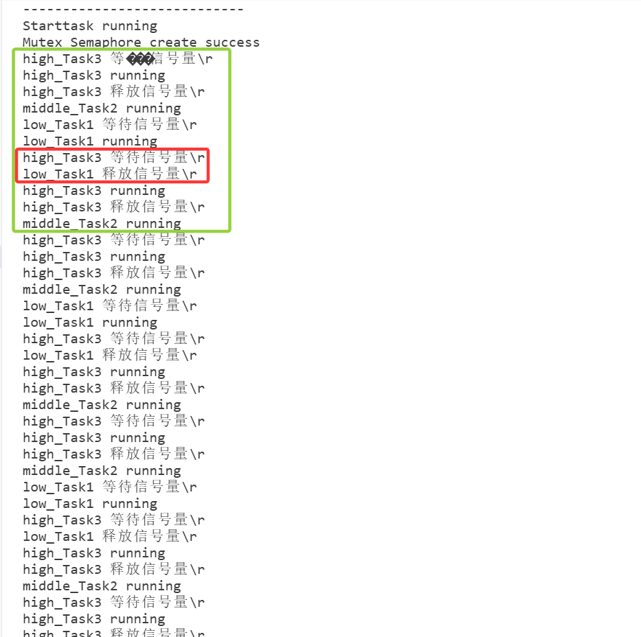


------


