# FreeRTOS事件标志组

------


## 一、事件标志组简介

### 1、事件标志组介绍

答：

事件标志位：用一个位，来表示事件是否发生。

事件标志组是一组事件标志位的合集，可以简单的理解事件标志组，就是一个整数。


### 2、事件标志组的特点

答：

- 它的每一个位表示一个事件(高8位不算)。
- 每一位事件的含义，由用户自己决定，如：bit0表示按键是否按下，bit1表示是否接收到信息......
- <mark>这些位的值为1表示事件发生了，值为0表示事件未发生。</mark>
- 任意任务或中断都可以读写这些位。
- 可以等待某一位成立，或者等待多位同时成立。


### 3、事件标志组的标志变量

答：一个事件组就包含了一个EventBits_t数据类型的变量，变量类型EventBits_t数据类型的定义如下所示：

```c
typedef TickType_t EventBits_t;
#if ( configUSE_16_BIT_TICKS  ==  1 )
	typedef   uint16_t   TickType_t;
#else
	typedef   uint32_t   TickType_t;
#endif

#define  configUSE_16_BIT_TICKS    0 
```

EventBits_t 实际上是一个 16 位或 32 位无符号的数据类型。

注意：虽然使用了32为/16位无符号的数据类型变量来存储事件标志，但<mark>其中的高8为作用是存储事件标志组的控制信息</mark>，<mark>低24位/8位的作用才是存储事件标志</mark>，所以说<mark>一个事件标志组最多可以存储24个事件标志</mark>！！！

24位事件标志组示例图：

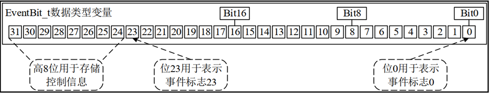


### 4、事件标志组与队列、信号量的区别

答：

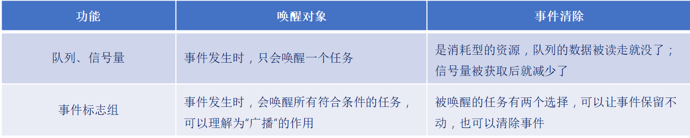

------


## 二、事件标志组相关API函数介绍

### 1、事件标志组相关API函数

答：

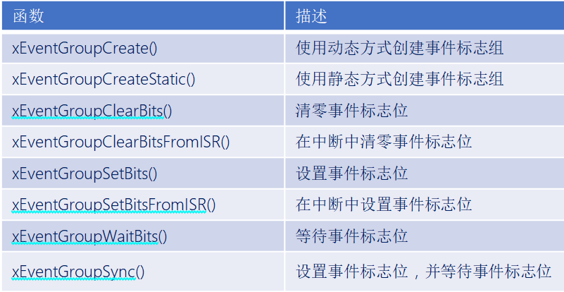


### 2、动态创建事件标志组函数

答：

```c
EventGroupHandle_t    xEventGroupCreate ( void ); 
```

函数返回值：

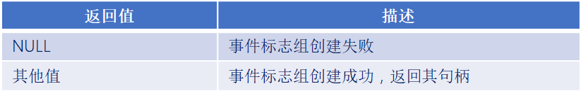


### 3、消除事件标志位函数

答：

```c
EventBits_t  xEventGroupClearBits( EventGroupHandle_t   xEventGroup,
                                   const EventBits_t    uxBitsToClear) 
```

函数参数：

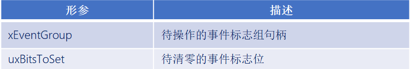

函数返回值：

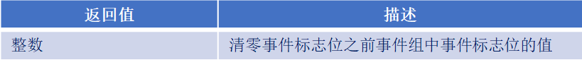


### 4、设置事件标志位函数

答：

```c
EventBits_t   xEventGroupSetBits(  EventGroupHandle_t   xEventGroup,
                                   const EventBits_t    uxBitsToSet ) 
```

函数参数：

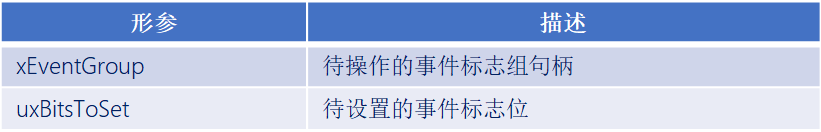

函数返回值：

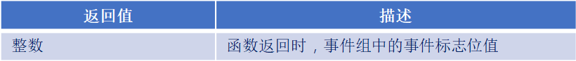


### 5、等待事件标志位函数

答：

```c
EventBits_t   xEventGroupWaitBits(   EventGroupHandle_t   xEventGroup,
                                     const EventBits_t    uxBitsToWaitFor,
                                     const BaseType_t     xClearOnExit,
                                     const BaseType_t     xWaitForAllBits,
                                     TickType_t           xTicksToWait  )
```

函数参数：

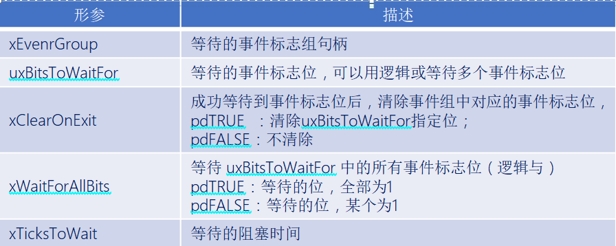

函数返回值：

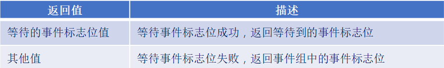

函数特点：

1. 可以等待某一为、也可以等待多位。
2. 等待期望的事件后，可以选择自动清除相关位或者不清除。


### 6、同步事件标志组函数

答：

```c
EventBits_t     xEventGroupSync(   EventGroupHandle_t   xEventGroup,
                                   const EventBits_t    uxBitsToSet,
                                   const EventBits_t    uxBitsToWaitFor,
                                   TickType_t           xTicksToWait) 
```

函数参数：

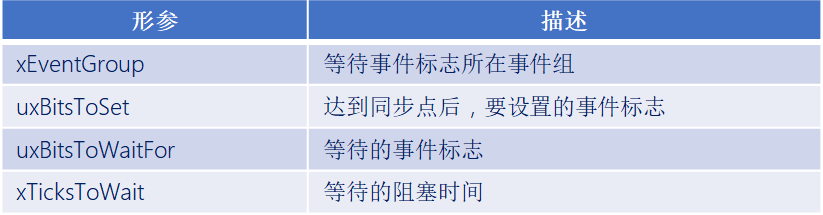

函数返回值：

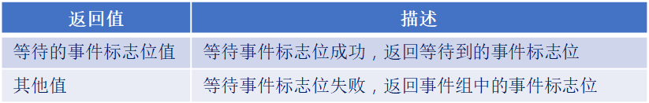


例子：

Task1：做饭

Task2：做菜

Task1做好自己的事之后，需要等待才也做好，大家在一起吃饭

特点：同步


------


### 实验

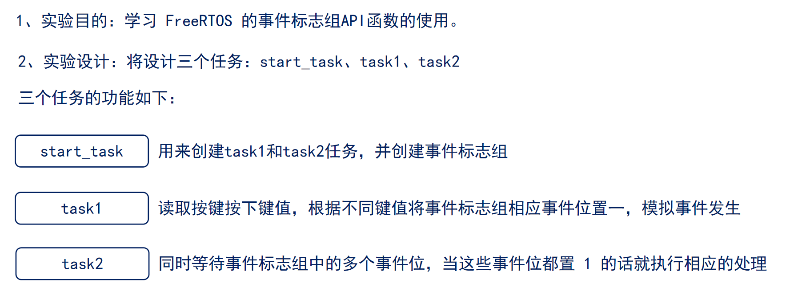

```c
#include "stm32f4xx.h"                  // STM32F4系列微控制器头文件
#include "freertos.h"                   // FreeRTOS实时操作系统头文件
#include "task.h"                       // FreeRTOS任务管理头文件
#include "queue.h"                      // FreeRTOS队列管理头文件
#include "usart.h"                      // 串口通信头文件
#include "timer.h"                      // 定时器头文件
#include "delay_dwt.h"                  // 包含DWT延迟函数头文件
#include "semphr.h"                     // FreeRTOS信号量头文件
#include "event_groups.h"

/**
 * @brief LED初始化函数
 * 配置GPIOC的Pin13作为LED控制引脚
 */
void LED_Init(void)
{		
    // 使能GPIOC时钟（AHB1总线）
    RCC_AHB1PeriphClockCmd(RCC_AHB1Periph_GPIOC, ENABLE);

    // 配置GPIO初始化结构体
    GPIO_InitTypeDef GPIO_InitStructure;
	GPIO_StructInit(&GPIO_InitStructure);
    GPIO_InitStructure.GPIO_Pin = GPIO_Pin_1 | GPIO_Pin_13 | GPIO_Pin_0;        // 选择引脚13,1
    GPIO_InitStructure.GPIO_Mode = GPIO_Mode_OUT;     // 输出模式
    GPIO_InitStructure.GPIO_OType = GPIO_OType_PP;    // 推挽输出
    GPIO_InitStructure.GPIO_Speed = GPIO_Speed_50MHz; // 输出速度50MHz
    GPIO_InitStructure.GPIO_PuPd = GPIO_PuPd_NOPULL;  // 无上拉下拉电阻
    GPIO_Init(GPIOC, &GPIO_InitStructure);            // 初始化GPIOC
}


/**
 * @brief LED初始化函数
 * 配置GPIOC的Pin13作为LED控制引脚
 */
void LED_TOGGLE13(void)
{
    GPIO_ToggleBits(GPIOC, GPIO_Pin_13);
}

/**
 * @brief LED初始化函数
 * 配置GPIOC的Pin1作为LED控制引脚
 */
void LED_TOGGLE1(void)
{
    GPIO_ToggleBits(GPIOC, GPIO_Pin_1);
}

/**
 * @brief LED初始化函数
 * 配置GPIOC的Pin0作为LED控制引脚
 */
void LED_TOGGLE0(void)
{
    GPIO_ToggleBits(GPIOC, GPIO_Pin_0);
}

/**
 * @brief 按键初始化函数
 * 配置GPIOA的Pin0和Pin1作为按键输入引脚
 */
void Key_Init(void)
{
	RCC_AHB1PeriphClockCmd(RCC_AHB1Periph_GPIOA, ENABLE);
	GPIO_InitTypeDef GPIO_InitStructure;
	GPIO_StructInit(&GPIO_InitStructure);
	GPIO_InitStructure.GPIO_Pin = GPIO_Pin_15 |  GPIO_Pin_0 | GPIO_Pin_1;
	GPIO_InitStructure.GPIO_Mode = GPIO_Mode_IN;
	GPIO_InitStructure.GPIO_Speed = GPIO_Speed_50MHz;
	GPIO_InitStructure.GPIO_PuPd = GPIO_PuPd_UP;
	GPIO_Init(GPIOA, &GPIO_InitStructure);  
}

/**
 * @brief 获取按键编号
 * 功能：根据按键状态返回按键编号
 * @return uint8_t 按键编号（1或2），如果没有按键按下则返回0
 */
uint8_t Key_GetNum(void)
{
	if (GPIO_ReadInputDataBit(GPIOA, GPIO_Pin_0) == 0)
	{
		vTaskDelay(20);
		if(GPIO_ReadInputDataBit(GPIOA, GPIO_Pin_0) == 0){
			return 1;
		}
	}
	else if (GPIO_ReadInputDataBit(GPIOA, GPIO_Pin_1) == 0)
	{
		vTaskDelay(20);
		if(GPIO_ReadInputDataBit(GPIOA, GPIO_Pin_1) == 0){
			return 2;
		}
	} 
	else if (GPIO_ReadInputDataBit(GPIOA, GPIO_Pin_15) == 0)
	{
		vTaskDelay(20);
		if(GPIO_ReadInputDataBit(GPIOA, GPIO_Pin_15) == 0){
			return 3;
		}
    }
    return 0;
}

// 任务配置宏定义
#define START_TASK_STACK_SIZE 128       // 启动任务栈大小（字）
#define START_TASK_PRIORITY 2           // 启动任务优先级（数值越小优先级越高）
#define TASK1_STACK_SIZE 128           // 任务1栈大小（字）
#define TASK1_PRIORITY 3               // 任务1优先级（数值越大优先级越高）
#define TASK2_STACK_SIZE 128           // 任务2栈大小（字）
#define TASK2_PRIORITY 4               // 任务2优先级（数值越大优先级越高）
// 任务句柄声明（用于引用和管理任务）
TaskHandle_t MytaskHandler1;    // 任务1句柄
TaskHandle_t MytaskHandler2;    // 任务2句柄
TaskHandle_t StarttaskHandler;  // 启动任务句柄
EventGroupHandle_t event_group;
// 事件组位定义
#define EVENT_BIT_0 (0x01) /*第0位*/
#define EVENT_BIT_1 (0x02) /*第1位*/


/**
 * @brief 低优先级任务1函数
 * 功能：设置事件组中的事件位
 * @param arg 任务参数（未使用）
 */
void Task1(void * arg){
    uint8_t key_num = 0;
    while(1){
        key_num = Key_GetNum();
        if(key_num == 1){
            xEventGroupSetBits(event_group, EVENT_BIT_0); /*设置事件组中的第0位为1*/
        }
        else if(key_num == 2){
            xEventGroupSetBits(event_group, EVENT_BIT_1);
        }
        vTaskDelay(20);
    }
}


/**
 * @brief 中优先级任务2函数
 * 功能：等待事件组中的事件发生
 * @param arg 任务参数（未使用）
 */
 void Task2(void * arg){
    EventBits_t event_bits = 0;
    while(1){
        /*等待事件组中的第0位和第1位都为1*/
        event_bits = xEventGroupWaitBits(event_group, /*等待事件组中的第0位和第1位都为1*/
            EVENT_BIT_0 | EVENT_BIT_1, /*等待第0位和第1位都为1*/
            pdTRUE, /*清除第0位和第1位*/
            pdTRUE, /*返回事件组中的第0位和第1位*/
            portMAX_DELAY); /*等待事件组中的第0位和第1位都为1，超时时间为最大延时*/ 
        printf("事件组中的第0位和第1位都为1,事件位为:0x%02x\r\n", event_bits);
        LED_TOGGLE13();
        vTaskDelay(1000);
    }	
}


/**
 * @brief 启动任务函数
 * 功能：创建其他三个任务后自行删除
 * @param arg 任务参数（未使用）
 */
void Starttask(void * arg){
    // 进入临界区保护串口输出
    taskENTER_CRITICAL();
    printf("----------------------------\r\n");
    printf("Starttask running\r\n");  // 打印启动任务运行信息
    taskEXIT_CRITICAL();

    /*创建事件组*/
    event_group = xEventGroupCreate();
    if(event_group != NULL){
        printf("事件组创建成功！！！\r\n");
    }

    taskENTER_CRITICAL();
    // 使用动态内存分配方式创建任务1
    xTaskCreate(Task1,                        // 任务函数指针
               "MyFirstTask",                 // 任务名称（用于调试）
               TASK1_STACK_SIZE,         // 栈大小（字）
               NULL,                          // 传递给任务的参数
               TASK1_PRIORITY,           // 任务优先级
               &MytaskHandler1);              // 任务句柄指针
    
    // 使用动态内存分配方式创建任务2
    xTaskCreate(Task2, 
               "MySecondTask", 
               TASK2_STACK_SIZE, 
               NULL, 
               TASK2_PRIORITY, 
               &MytaskHandler2);
    
    taskEXIT_CRITICAL();
    
    // 删除当前任务（启动任务），释放其占用的资源
    vTaskDelete(NULL);
}

/**
 * @brief 主函数
 * 程序入口点，初始化硬件并启动RTOS调度器
 */
int main(void)
{
	NVIC_PriorityGroupConfig(NVIC_PriorityGroup_4);
    LED_Init();                     // 初始化LED GPIO引脚
    Usart1_Init(115200);            // 初始化串口1，波特率115200
    Key_Init();                     // 初始化按键 GPIO引脚
    DWT_Init();                     // 初始化DWT定时器
    
    // 创建启动任务（使用动态内存分配）
    xTaskCreate(Starttask,                  // 任务函数指针
               "StartTask",                 // 任务名称
               START_TASK_STACK_SIZE,       // 栈大小
               NULL,                        // 任务参数
               START_TASK_PRIORITY,         // 任务优先级
               &StarttaskHandler);          // 任务句柄
    
    // 启动FreeRTOS调度器（程序将在此处开始运行任务）
    vTaskStartScheduler();
    
    // 正常情况下，调度器启动后不会执行到这里
    // 如果调度器启动失败，程序将在此处循环
    while (1)
    {		
        // 空循环，用于处理调度器启动失败的情况
    }	
}

```

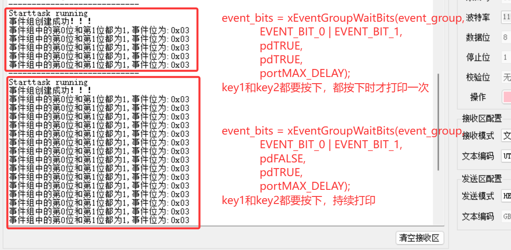


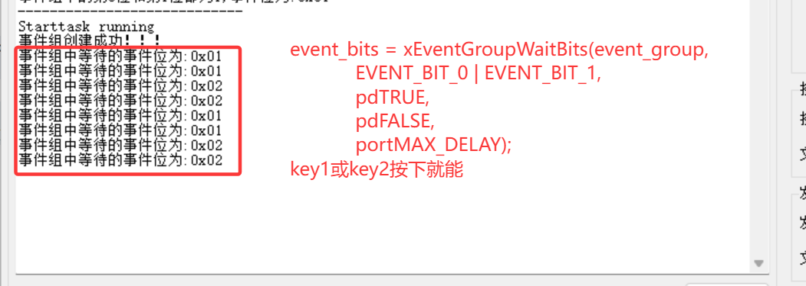

