#  FreeRTOS任务通知

------


## 一、任务通知的简介

### 1、任务通知介绍

答：任务通知：用来通知任务的，任务控制块中的结构体成员变量ulNotifiedValue就是这个通知值。

（不需要另外进行创建，ulNotifiedValue是在创建任务时，这个就已经创建好了，所需要的内存很小）

- 使用队列、信号量、事件标志组时都需要另外创建一个结构体，通过中间的结构体进行间接通信。

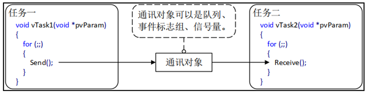

- 使用任务通知时，任务结构体TCB中就包含了内部对象，可以直接接收别人发过来的“通知”。

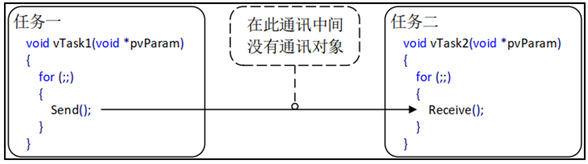

（任务一发送时，就是操作任务二的TCB，给任务二的TCB中结构体成员变量ulNotifiedValue赋值；任务二读取时，可以直接进行读取）


### 2、任务通知值的更新方式

答：

- 不覆盖接收任务的通知值。
- 覆盖接收任务的通知值。
- 更新接收任务通知值的一个或多个位。
- 增加接收任务的通知值。

> 只要合理，灵活的利用任务通知的特点，可以在一些场合中替代队列、信号量、事件标志组。


### 3、任务通知值的优势及劣势

答：

任务通知的优势：

- **效率更高**：使用任务通知向任务发送事件或数据比使用队列、事件标志组或信号量快得多（官方：快了45%左右）。
- **使用内存更小**：使用其他方法时都要先创建对应的结构体，使用任务通知时无需额外创建结构体。

任务通知的劣势：

- **无法发送数据给ISR**：ISR（中断）没有任务结构体，所以无法给ISR发送数据。**但是ISR可以使用任务通知的功能，发数据给任务。**
- **无法广播给多个任务**：任务通知只能是被指定的一个任务接收并处理 。
- **无法缓存多个数据**：任务通知是通过更新任务通知值来发送数据的，任务结构体中**只有一个任务通知值**，**只能保持一个数据**。
- **发送受阻不支持阻塞**：==发送方无法进入阻塞状态等待==。

------


## 二、任务通知值和通知状态

### 1、任务通知结构体

答：

任务都有一个结构体---任务控制块（TCB），它里面有两个结构体成员变量：

```c
typedef  struct  tskTaskControlBlock 
{
      ......
      #if ( configUSE_TASK_NOTIFICATIONS  ==  1 )
           volatile  uint32_t    ulNotifiedValue [ configTASK_NOTIFICATION_ARRAY_ENTRIES ];
           volatile  uint8_t      ucNotifyState [ configTASK_NOTIFICATION_ARRAY_ENTRIES ];
      endif
      ......
} tskTCB;

#define  configTASK_NOTIFICATION_ARRAY_ENTRIES	1  	/* 定义任务通知数组的大小, 默认: 1 */
```

- 一个是uint32_t类型，用来表示任务通知值。
- 一个是uint16_t类型，用来表示任务通知状态。

 

### 2、任务通知值

答：

任务通知值的更新方式有多种类型：

1. 计数值(数值累加，类似信号量)。
2. 相应位置1(类似事件标志组)。
3. 任意数值(支持覆写或不覆写，类似队列)。


### 3、任务通知状态

答：任务通知状态共有3种。

```c
#define     taskNOT_WAITING_NOTIFICATION    ( ( uint8_t ) 0 )        /* 任务未等待通知 */
#define     taskWAITING_NOTIFICATION        ( ( uint8_t ) 1 )        /* 任务在等待通知 */
#define     taskNOTIFICATION_RECEIVED       ( ( uint8_t ) 2 )        /* 任务在等待接收 */
```

- **任务未等待通知**：任务通知默认的初始化状态【不等待通知，也不等待接收】。
- 等待通知：接收方已经准备好了(调用了接收任务通知函数)，等待发送方给个通知。
- 等待接收：发送方已经发送过去(调用了发送任务通知函数)，等待接收方接收。

------


## 三、任务通知相关API函数

### 1、任务通知相关API函数介绍

答：任务通知API函数主要有两类：1-发送通知，2-接收通知。

> 注意：发送通知API函数可以用于==任务和中断函数==中，但接受通知API函数==只能用在任务中==。（中断ISR没有任务结构体）

发送通知相关API函数：

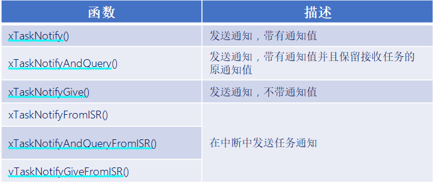

接收通知相关API函数：

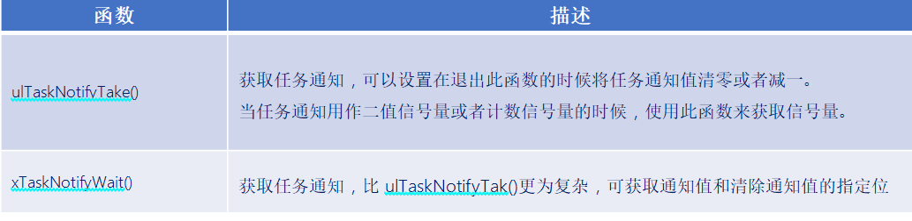


### 2、发送任务通知函数

答：

所有发送任务通知函数：


```c
#define     xTaskNotifyAndQuery( xTaskToNotify,  ulValue,  eAction,  pulPreviousNotifyValue )
            xTaskGenericNotify( ( xTaskToNotify ), 
					          ( tskDEFAULT_INDEX_TO_NOTIFY ), 
					          ( ulValue ), 
					          ( eAction ),
					          ( pulPreviousNotifyValue ) )

#define     xTaskNotify  (xTaskToNotify ,  ulValue ,  eAction)
            xTaskGenericNotify(  ( xTaskToNotify ) ,  
                                 ( tskDEFAULT_INDEX_TO_NOTIFY ) ,  
                                 ( ulValue ) ,
                                 ( eAction ) , 
                                   NULL    )
 
#define     xTaskNotifyGive(  xTaskToNotify  )
            xTaskGenericNotify(  ( xTaskToNotify ) ,
                                 ( tskDEFAULT_INDEX_TO_NOTIFY ) ,
                                 ( 0 ) ,
                                 eIncrement ,
                                 NULL )
```

**关键函数：**

```c
BaseType_t     xTaskGenericNotify(  TaskHandle_t     xTaskToNotify,
                                    UBaseType_t      uxIndexToNotify,
                                    uint32_t         ulValue,
                                    eNotifyAction    eAction,
                                    uint32_t *       pulPreviousNotificationValue  )
/*uxIndexToNotify、ulValue、eAction、pulPreviousNotificationValue都是定值，类似于信号量*/
```

发送任务通知的关键函数的参数：

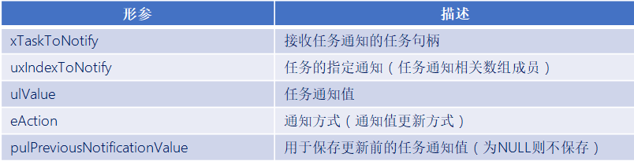

任务通知方式枚举：

```c
typedef  enum
{    
     eNoAction = 0,              /* 无操作 */
     eSetBits                    /* 更新指定bit */
     eIncrement                  /* 通知值加一 */
     eSetValueWithOverwrite      /* 覆写的方式更新通知值 */
     eSetValueWithoutOverwrite   /* 不覆写通知值 */
} eNotifyAction;
```


### 3、接收任务通知函数

答：


注意：

- 当任务通知用于信号量时，使用函数 ulTaskNotifyTake() 获取获取信号量。
- 当任务通知用于事件标志组或队列时，使用函数 xTaskNotifyWait() 来获取。


ulTaskNotifyTake()函数：

```c
#define     ulTaskNotifyTake( xClearCountOnExit  ,   xTicksToWait )
            ulTaskGenericNotifyTake( ( tskDEFAULT_INDEX_TO_NOTIFY ),
                                     ( xClearCountOnExit ),
                                     ( xTicksToWait ) )
```

此函数用于接收任务通知值，可以设置在退出此函数的时候将任务通知值清零或者减一。

函数参数：

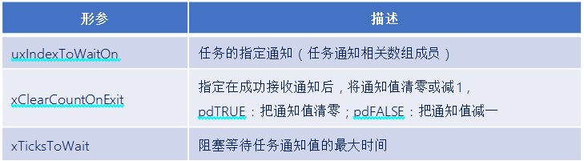

函数返回值：

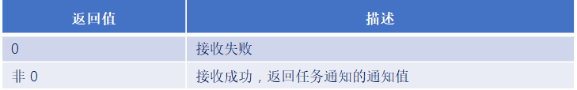


xTaskNotifyWait()函数：

```c
#define     xTaskNotifyWait(    ulBitsToClearOnEntry,
                                ulBitsToClearOnExit,
                                pulNotificationValue,
                                xTicksToWait) 
            xTaskGenericNotifyWait(   tskDEFAULT_INDEX_TO_NOTIFY,
                                      ( ulBitsToClearOnEntry ),
                                      ( ulBitsToClearOnExit ),
                                      ( pulNotificationValue ),
                                      ( xTicksToWait )         ) 
                                   
```

此函数用于获取通知值和清除通知值的指定位值，适用于模拟队列和事件标志组，使用该函数来获取任务通知


```c
BaseType_t     xTaskGenericNotifyWait(     UBaseType_t     uxIndexToWaitOn,
                                           uint32_t        ulBitsToClearOnEntry,
                                           uint32_t        ulBitsToClearOnExit,
                                           uint32_t *      pulNotificationValue,
                                           TickType_t      xTicksToWait	    ); 
```

函数参数：

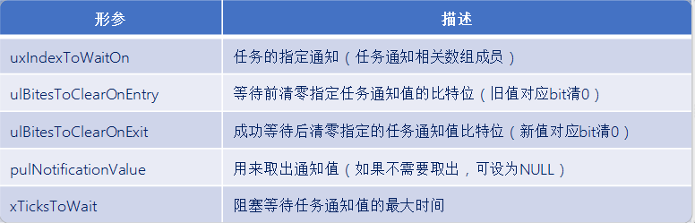

函数返回值：

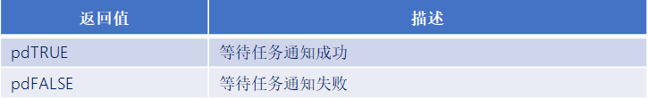

------


## 实验

### 第一个实验


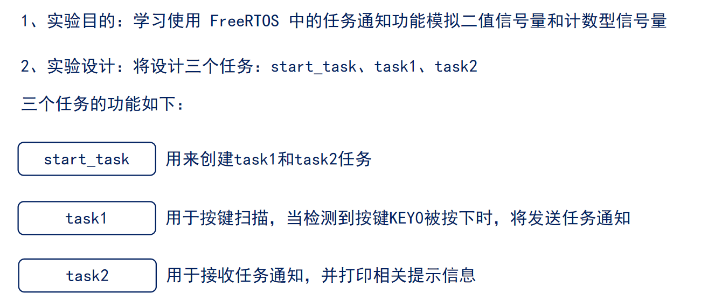

```c
#include "stm32f4xx.h"                  // STM32F4系列微控制器头文件
#include "freertos.h"                   // FreeRTOS实时操作系统头文件
#include "task.h"                       // FreeRTOS任务管理头文件
#include "queue.h"                      // FreeRTOS队列管理头文件
#include "usart.h"                      // 串口通信头文件
#include "timer.h"                      // 定时器头文件
#include "delay_dwt.h"                  // 包含DWT延迟函数头文件
#include "semphr.h"                     // FreeRTOS信号量头文件
#include "event_groups.h"

/**
 * @brief LED初始化函数
 * 配置GPIOC的Pin13作为LED控制引脚
 */
void LED_Init(void)
{		
    // 使能GPIOC时钟（AHB1总线）
    RCC_AHB1PeriphClockCmd(RCC_AHB1Periph_GPIOC, ENABLE);

    // 配置GPIO初始化结构体
    GPIO_InitTypeDef GPIO_InitStructure;
	GPIO_StructInit(&GPIO_InitStructure);
    GPIO_InitStructure.GPIO_Pin = GPIO_Pin_1 | GPIO_Pin_13 | GPIO_Pin_0;        // 选择引脚13,1
    GPIO_InitStructure.GPIO_Mode = GPIO_Mode_OUT;     // 输出模式
    GPIO_InitStructure.GPIO_OType = GPIO_OType_PP;    // 推挽输出
    GPIO_InitStructure.GPIO_Speed = GPIO_Speed_50MHz; // 输出速度50MHz
    GPIO_InitStructure.GPIO_PuPd = GPIO_PuPd_NOPULL;  // 无上拉下拉电阻
    GPIO_Init(GPIOC, &GPIO_InitStructure);            // 初始化GPIOC
}


/**
 * @brief LED初始化函数
 * 配置GPIOC的Pin13作为LED控制引脚
 */
void LED_TOGGLE13(void)
{
    GPIO_ToggleBits(GPIOC, GPIO_Pin_13);
}

/**
 * @brief LED初始化函数
 * 配置GPIOC的Pin1作为LED控制引脚
 */
void LED_TOGGLE1(void)
{
    GPIO_ToggleBits(GPIOC, GPIO_Pin_1);
}

/**
 * @brief LED初始化函数
 * 配置GPIOC的Pin0作为LED控制引脚
 */
void LED_TOGGLE0(void)
{
    GPIO_ToggleBits(GPIOC, GPIO_Pin_0);
}

/**
 * @brief 按键初始化函数
 * 配置GPIOA的Pin0和Pin1作为按键输入引脚
 */
void Key_Init(void)
{
	RCC_AHB1PeriphClockCmd(RCC_AHB1Periph_GPIOA, ENABLE);
	GPIO_InitTypeDef GPIO_InitStructure;
	GPIO_StructInit(&GPIO_InitStructure);
	GPIO_InitStructure.GPIO_Pin = GPIO_Pin_15 |  GPIO_Pin_0 | GPIO_Pin_1;
	GPIO_InitStructure.GPIO_Mode = GPIO_Mode_IN;
	GPIO_InitStructure.GPIO_Speed = GPIO_Speed_50MHz;
	GPIO_InitStructure.GPIO_PuPd = GPIO_PuPd_UP;
	GPIO_Init(GPIOA, &GPIO_InitStructure);  
}

/**
 * @brief 获取按键编号
 * 功能：根据按键状态返回按键编号
 * @return uint8_t 按键编号（1或2），如果没有按键按下则返回0
 */
uint8_t Key_GetNum(void)
{
	if (GPIO_ReadInputDataBit(GPIOA, GPIO_Pin_0) == 0)
	{
		vTaskDelay(20);
		if(GPIO_ReadInputDataBit(GPIOA, GPIO_Pin_0) == 0){
			return 1;
		}
	}
	else if (GPIO_ReadInputDataBit(GPIOA, GPIO_Pin_1) == 0)
	{
		vTaskDelay(20);
		if(GPIO_ReadInputDataBit(GPIOA, GPIO_Pin_1) == 0){
			return 2;
		}
	} 
	else if (GPIO_ReadInputDataBit(GPIOA, GPIO_Pin_15) == 0)
	{
		vTaskDelay(20);
		if(GPIO_ReadInputDataBit(GPIOA, GPIO_Pin_15) == 0){
			return 3;
		}
    }
    return 0;
}

// 任务配置宏定义
#define START_TASK_STACK_SIZE 128       // 启动任务栈大小（字）
#define START_TASK_PRIORITY 2           // 启动任务优先级（数值越小优先级越高）
#define TASK1_STACK_SIZE 128           // 任务1栈大小（字）
#define TASK1_PRIORITY 3               // 任务1优先级（数值越大优先级越高）
#define TASK2_STACK_SIZE 128           // 任务2栈大小（字）
#define TASK2_PRIORITY 4               // 任务2优先级（数值越大优先级越高）
// 任务句柄声明（用于引用和管理任务）
TaskHandle_t MytaskHandler1;    // 任务1句柄
TaskHandle_t MytaskHandler2;    // 任务2句柄
TaskHandle_t StarttaskHandler;  // 启动任务句柄

/*任务一：发送任务通知*/
void Task1(void * arg){
    uint8_t keynum;
    while(1){
        keynum = Key_GetNum();
        if(keynum == 1){
            printf("任务通知模拟二值/计数信号量释放\r\n");
            xTaskNotifyGive(MytaskHandler2);
            /*任务一一按下key0，就给任务二发送通知值*/
            
        }
        vTaskDelay(20);
    }
}


/*任务二：接受任务通知*/
 void Task2(void * arg){
    uint32_t notifyvalue;
    while(1){
        notifyvalue = ulTaskNotifyTake(pdFALSE, portMAX_DELAY);
        if(notifyvalue != 0) {
            printf("接受任务通知成功，模拟获取二值/计数信号量  \r\n");
            printf("notifyvalue = %d\r\n", notifyvalue);
        }
        vTaskDelay(1000);
    }	
}


/**
 * @brief 启动任务函数
 * 功能：创建其他三个任务后自行删除
 * @param arg 任务参数（未使用）
 */
void Starttask(void * arg){
    // 进入临界区保护串口输出
    taskENTER_CRITICAL();
    printf("----------------------------\r\n");
    printf("Starttask running\r\n");  // 打印启动任务运行信息
    taskEXIT_CRITICAL();

    

    taskENTER_CRITICAL();
    // 使用动态内存分配方式创建任务1
    xTaskCreate(Task1,                        // 任务函数指针
               "MyFirstTask",                 // 任务名称（用于调试）
               TASK1_STACK_SIZE,         // 栈大小（字）
               NULL,                          // 传递给任务的参数
               TASK1_PRIORITY,           // 任务优先级
               &MytaskHandler1);              // 任务句柄指针
    
    // 使用动态内存分配方式创建任务2
    xTaskCreate(Task2, 
               "MySecondTask", 
               TASK2_STACK_SIZE, 
               NULL, 
               TASK2_PRIORITY, 
               &MytaskHandler2);
    
    taskEXIT_CRITICAL();
    
    // 删除当前任务（启动任务），释放其占用的资源
    vTaskDelete(NULL);
}

/**
 * @brief 主函数
 * 程序入口点，初始化硬件并启动RTOS调度器
 */
int main(void)
{
	NVIC_PriorityGroupConfig(NVIC_PriorityGroup_4);
    LED_Init();                     // 初始化LED GPIO引脚
    Usart1_Init(115200);            // 初始化串口1，波特率115200
    Key_Init();                     // 初始化按键 GPIO引脚
    DWT_Init();                     // 初始化DWT定时器
    
    // 创建启动任务（使用动态内存分配）
    xTaskCreate(Starttask,                  // 任务函数指针
               "StartTask",                 // 任务名称
               START_TASK_STACK_SIZE,       // 栈大小
               NULL,                        // 任务参数
               START_TASK_PRIORITY,         // 任务优先级
               &StarttaskHandler);          // 任务句柄
    
    // 启动FreeRTOS调度器（程序将在此处开始运行任务）
    vTaskStartScheduler();
    
    // 正常情况下，调度器启动后不会执行到这里
    // 如果调度器启动失败，程序将在此处循环
    while (1)
    {		
        // 空循环，用于处理调度器启动失败的情况
    }	
}
```


- ulTaskNotifyTake(pdTRUE, portMAX_DELAY);

 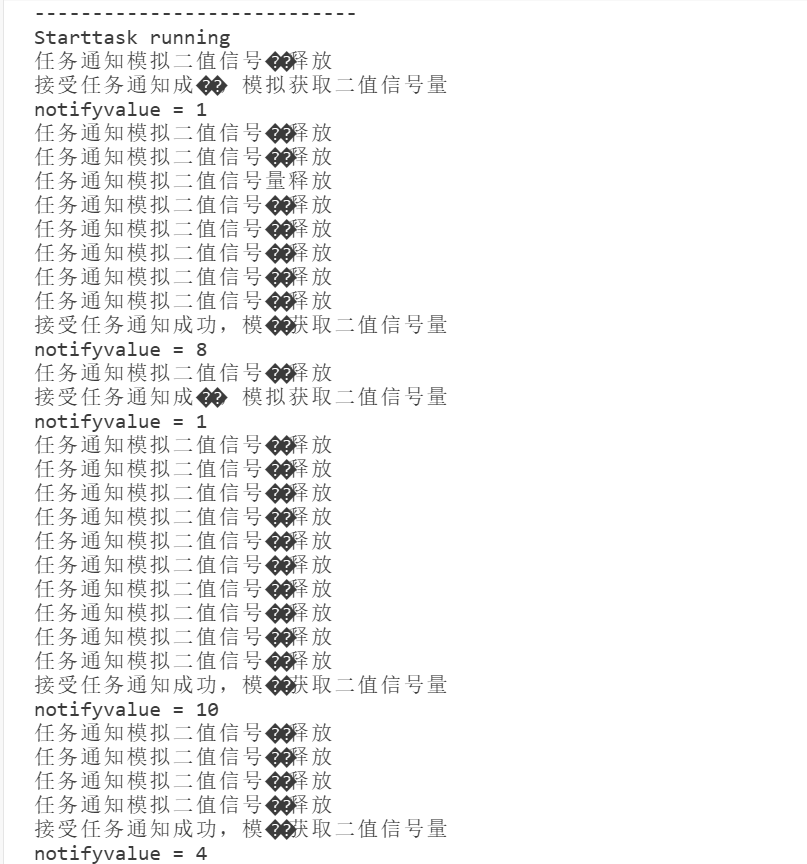

- ulTaskNotifyTake(pdFALSE, portMAX_DELAY);

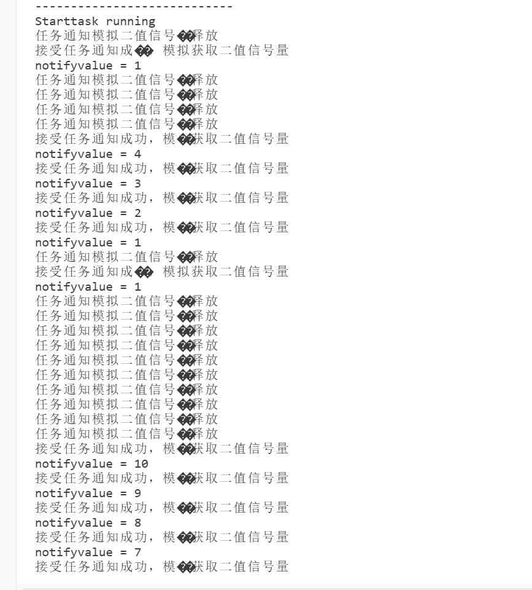


### 第二个实验

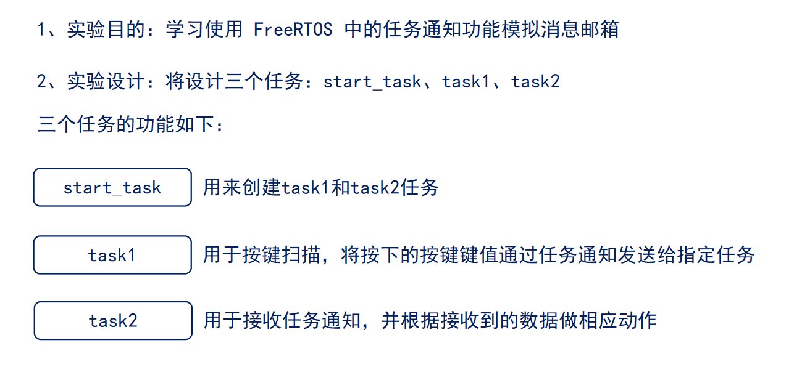

```c
#include "stm32f4xx.h"                  // STM32F4系列微控制器头文件
#include "freertos.h"                   // FreeRTOS实时操作系统头文件
#include "task.h"                       // FreeRTOS任务管理头文件
#include "queue.h"                      // FreeRTOS队列管理头文件
#include "usart.h"                      // 串口通信头文件
#include "timer.h"                      // 定时器头文件
#include "delay_dwt.h"                  // 包含DWT延迟函数头文件
#include "semphr.h"                     // FreeRTOS信号量头文件
#include "event_groups.h"

/**
 * @brief LED初始化函数
 * 配置GPIOC的Pin13作为LED控制引脚
 */
void LED_Init(void)
{		
    // 使能GPIOC时钟（AHB1总线）
    RCC_AHB1PeriphClockCmd(RCC_AHB1Periph_GPIOC, ENABLE);

    // 配置GPIO初始化结构体
    GPIO_InitTypeDef GPIO_InitStructure;
	GPIO_StructInit(&GPIO_InitStructure);
    GPIO_InitStructure.GPIO_Pin = GPIO_Pin_1 | GPIO_Pin_13 | GPIO_Pin_0;        // 选择引脚13,1
    GPIO_InitStructure.GPIO_Mode = GPIO_Mode_OUT;     // 输出模式
    GPIO_InitStructure.GPIO_OType = GPIO_OType_PP;    // 推挽输出
    GPIO_InitStructure.GPIO_Speed = GPIO_Speed_50MHz; // 输出速度50MHz
    GPIO_InitStructure.GPIO_PuPd = GPIO_PuPd_NOPULL;  // 无上拉下拉电阻
    GPIO_Init(GPIOC, &GPIO_InitStructure);            // 初始化GPIOC
}


/**
 * @brief LED初始化函数
 * 配置GPIOC的Pin13作为LED控制引脚
 */
void LED_TOGGLE13(void)
{
    GPIO_ToggleBits(GPIOC, GPIO_Pin_13);
}

/**
 * @brief LED初始化函数
 * 配置GPIOC的Pin1作为LED控制引脚
 */
void LED_TOGGLE1(void)
{
    GPIO_ToggleBits(GPIOC, GPIO_Pin_1);
}

/**
 * @brief LED初始化函数
 * 配置GPIOC的Pin0作为LED控制引脚
 */
void LED_TOGGLE0(void)
{
    GPIO_ToggleBits(GPIOC, GPIO_Pin_0);
}

/**
 * @brief 按键初始化函数
 * 配置GPIOA的Pin0和Pin1作为按键输入引脚
 */
void Key_Init(void)
{
	RCC_AHB1PeriphClockCmd(RCC_AHB1Periph_GPIOA, ENABLE);
	GPIO_InitTypeDef GPIO_InitStructure;
	GPIO_StructInit(&GPIO_InitStructure);
	GPIO_InitStructure.GPIO_Pin = GPIO_Pin_15 |  GPIO_Pin_0 | GPIO_Pin_1;
	GPIO_InitStructure.GPIO_Mode = GPIO_Mode_IN;
	GPIO_InitStructure.GPIO_Speed = GPIO_Speed_50MHz;
	GPIO_InitStructure.GPIO_PuPd = GPIO_PuPd_UP;
	GPIO_Init(GPIOA, &GPIO_InitStructure);  
}

/**
 * @brief 获取按键编号
 * 功能：根据按键状态返回按键编号
 * @return uint8_t 按键编号（1或2），如果没有按键按下则返回0
 */
uint8_t Key_GetNum(void)
{
	if (GPIO_ReadInputDataBit(GPIOA, GPIO_Pin_0) == 0)
	{
		vTaskDelay(20);
		if(GPIO_ReadInputDataBit(GPIOA, GPIO_Pin_0) == 0){
			return 1;
		}
	}
	else if (GPIO_ReadInputDataBit(GPIOA, GPIO_Pin_1) == 0)
	{
		vTaskDelay(20);
		if(GPIO_ReadInputDataBit(GPIOA, GPIO_Pin_1) == 0){
			return 2;
		}
	} 
	else if (GPIO_ReadInputDataBit(GPIOA, GPIO_Pin_15) == 0)
	{
		vTaskDelay(20);
		if(GPIO_ReadInputDataBit(GPIOA, GPIO_Pin_15) == 0){
			return 3;
		}
    }
    return 0;
}

// 任务配置宏定义
#define START_TASK_STACK_SIZE 128       // 启动任务栈大小（字）
#define START_TASK_PRIORITY 2           // 启动任务优先级（数值越小优先级越高）
#define TASK1_STACK_SIZE 128           // 任务1栈大小（字）
#define TASK1_PRIORITY 3               // 任务1优先级（数值越大优先级越高）
#define TASK2_STACK_SIZE 128           // 任务2栈大小（字）
#define TASK2_PRIORITY 4               // 任务2优先级（数值越大优先级越高）
// 任务句柄声明（用于引用和管理任务）
TaskHandle_t MytaskHandler1;    // 任务1句柄
TaskHandle_t MytaskHandler2;    // 任务2句柄
TaskHandle_t StarttaskHandler;  // 启动任务句柄

/*任务一：发送任务通知(通知值就是键值)*/
void Task1(void * arg){
    uint8_t keynum;
    while(1){
        keynum = Key_GetNum();  // 获取按键编号
        if(keynum != 0 && (MytaskHandler2 != NULL)){
            printf("任务通知模拟消息邮箱发送,发送的键值为：%d\r\n", keynum);
            // 发送任务通知给任务2，通知值为按键编号
            xTaskNotify(MytaskHandler2, keynum, eSetValueWithOverwrite);
        }
        vTaskDelay(1000);
    }
}


/*任务二：接受任务通知*/
 void Task2(void * arg){
    uint32_t notifiedValue;
    while(1){
        xTaskNotifyWait(0, 0xFFFFFFFF, &notifiedValue, portMAX_DELAY);        
            /*
            xTaskNotifyWait(0,   // 不清除任何位
            0xFFFFFFFF,         // 清除所有位
            &notifiedValue,     // 存储接收到的通知值
            portMAX_DELAY);     // 无限等待通知
            */
        switch(notifiedValue){
            case 1:
                printf("接受的通知值为%d\r\n", notifiedValue);
                LED_TOGGLE13();
                break;
            case 2:
                printf("接受的通知值为%d\r\n", notifiedValue);
                LED_TOGGLE1();
                break;
            case 3:
                printf("接受的通知值为%d\r\n", notifiedValue);
                LED_TOGGLE0();
                break;
            default:
                break;
        }
        vTaskDelay(1000);
    }	
}


/**
 * @brief 启动任务函数
 * 功能：创建其他三个任务后自行删除
 * @param arg 任务参数（未使用）
 */
void Starttask(void * arg){
    // 进入临界区保护串口输出
    taskENTER_CRITICAL();
    printf("----------------------------\r\n");
    printf("Starttask running\r\n");  // 打印启动任务运行信息
    taskEXIT_CRITICAL();

    

    taskENTER_CRITICAL();
    // 使用动态内存分配方式创建任务1
    xTaskCreate(Task1,                        // 任务函数指针
               "MyFirstTask",                 // 任务名称（用于调试）
               TASK1_STACK_SIZE,         // 栈大小（字）
               NULL,                          // 传递给任务的参数
               TASK1_PRIORITY,           // 任务优先级
               &MytaskHandler1);              // 任务句柄指针
    
    // 使用动态内存分配方式创建任务2
    xTaskCreate(Task2, 
               "MySecondTask", 
               TASK2_STACK_SIZE, 
               NULL, 
               TASK2_PRIORITY, 
               &MytaskHandler2);
    
    taskEXIT_CRITICAL();
    
    // 删除当前任务（启动任务），释放其占用的资源
    vTaskDelete(NULL);
}

/**
 * @brief 主函数
 * 程序入口点，初始化硬件并启动RTOS调度器
 */
int main(void)
{
	NVIC_PriorityGroupConfig(NVIC_PriorityGroup_4);
    LED_Init();                     // 初始化LED GPIO引脚
    Usart1_Init(115200);            // 初始化串口1，波特率115200
    Key_Init();                     // 初始化按键 GPIO引脚
    DWT_Init();                     // 初始化DWT定时器
    
    // 创建启动任务（使用动态内存分配）
    xTaskCreate(Starttask,                  // 任务函数指针
               "StartTask",                 // 任务名称
               START_TASK_STACK_SIZE,       // 栈大小
               NULL,                        // 任务参数
               START_TASK_PRIORITY,         // 任务优先级
               &StarttaskHandler);          // 任务句柄
    
    // 启动FreeRTOS调度器（程序将在此处开始运行任务）
    vTaskStartScheduler();
    
    // 正常情况下，调度器启动后不会执行到这里
    // 如果调度器启动失败，程序将在此处循环
    while (1)
    {		
        // 空循环，用于处理调度器启动失败的情况
    }	
}
```

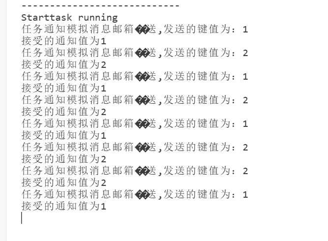


### 第三个实验


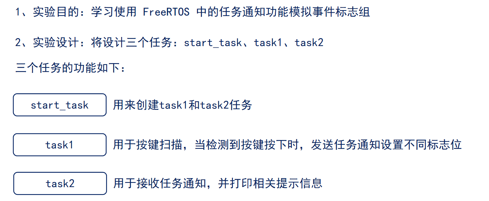

```c
#include "stm32f4xx.h"                  // STM32F4系列微控制器头文件
#include "freertos.h"                   // FreeRTOS实时操作系统头文件
#include "task.h"                       // FreeRTOS任务管理头文件
#include "queue.h"                      // FreeRTOS队列管理头文件
#include "usart.h"                      // 串口通信头文件
#include "timer.h"                      // 定时器头文件
#include "delay_dwt.h"                  // 包含DWT延迟函数头文件
#include "semphr.h"                     // FreeRTOS信号量头文件
#include "event_groups.h"

/**
 * @brief LED初始化函数
 * 配置GPIOC的Pin13作为LED控制引脚
 */
void LED_Init(void)
{		
    // 使能GPIOC时钟（AHB1总线）
    RCC_AHB1PeriphClockCmd(RCC_AHB1Periph_GPIOC, ENABLE);

    // 配置GPIO初始化结构体
    GPIO_InitTypeDef GPIO_InitStructure;
	GPIO_StructInit(&GPIO_InitStructure);
    GPIO_InitStructure.GPIO_Pin = GPIO_Pin_1 | GPIO_Pin_13 | GPIO_Pin_0;        // 选择引脚13,1
    GPIO_InitStructure.GPIO_Mode = GPIO_Mode_OUT;     // 输出模式
    GPIO_InitStructure.GPIO_OType = GPIO_OType_PP;    // 推挽输出
    GPIO_InitStructure.GPIO_Speed = GPIO_Speed_50MHz; // 输出速度50MHz
    GPIO_InitStructure.GPIO_PuPd = GPIO_PuPd_NOPULL;  // 无上拉下拉电阻
    GPIO_Init(GPIOC, &GPIO_InitStructure);            // 初始化GPIOC
}


/**
 * @brief LED初始化函数
 * 配置GPIOC的Pin13作为LED控制引脚
 */
void LED_TOGGLE13(void)
{
    GPIO_ToggleBits(GPIOC, GPIO_Pin_13);
}

/**
 * @brief LED初始化函数
 * 配置GPIOC的Pin1作为LED控制引脚
 */
void LED_TOGGLE1(void)
{
    GPIO_ToggleBits(GPIOC, GPIO_Pin_1);
}

/**
 * @brief LED初始化函数
 * 配置GPIOC的Pin0作为LED控制引脚
 */
void LED_TOGGLE0(void)
{
    GPIO_ToggleBits(GPIOC, GPIO_Pin_0);
}

/**
 * @brief 按键初始化函数
 * 配置GPIOA的Pin0和Pin1作为按键输入引脚
 */
void Key_Init(void)
{
	RCC_AHB1PeriphClockCmd(RCC_AHB1Periph_GPIOA, ENABLE);
	GPIO_InitTypeDef GPIO_InitStructure;
	GPIO_StructInit(&GPIO_InitStructure);
	GPIO_InitStructure.GPIO_Pin = GPIO_Pin_15 |  GPIO_Pin_0 | GPIO_Pin_1;
	GPIO_InitStructure.GPIO_Mode = GPIO_Mode_IN;
	GPIO_InitStructure.GPIO_Speed = GPIO_Speed_50MHz;
	GPIO_InitStructure.GPIO_PuPd = GPIO_PuPd_UP;
	GPIO_Init(GPIOA, &GPIO_InitStructure);  
}

/**
 * @brief 获取按键编号
 * 功能：根据按键状态返回按键编号
 * @return uint8_t 按键编号（1或2），如果没有按键按下则返回0
 */
uint8_t Key_GetNum(void)
{
	if (GPIO_ReadInputDataBit(GPIOA, GPIO_Pin_0) == 0)
	{
		vTaskDelay(20);
		if(GPIO_ReadInputDataBit(GPIOA, GPIO_Pin_0) == 0){
			return 1;
		}
	}
	else if (GPIO_ReadInputDataBit(GPIOA, GPIO_Pin_1) == 0)
	{
		vTaskDelay(20);
		if(GPIO_ReadInputDataBit(GPIOA, GPIO_Pin_1) == 0){
			return 2;
		}
	} 
	else if (GPIO_ReadInputDataBit(GPIOA, GPIO_Pin_15) == 0)
	{
		vTaskDelay(20);
		if(GPIO_ReadInputDataBit(GPIOA, GPIO_Pin_15) == 0){
			return 3;
		}
    }
    return 0;
}

// 任务配置宏定义
#define START_TASK_STACK_SIZE 128       // 启动任务栈大小（字）
#define START_TASK_PRIORITY 2           // 启动任务优先级（数值越小优先级越高）
#define TASK1_STACK_SIZE 128           // 任务1栈大小（字）
#define TASK1_PRIORITY 3               // 任务1优先级（数值越大优先级越高）
#define TASK2_STACK_SIZE 128           // 任务2栈大小（字）
#define TASK2_PRIORITY 4               // 任务2优先级（数值越大优先级越高）
// 任务句柄声明（用于引用和管理任务）
TaskHandle_t MytaskHandler1;    // 任务1句柄
TaskHandle_t MytaskHandler2;    // 任务2句柄
TaskHandle_t StarttaskHandler;  // 启动任务句柄
#define NOTIFY_VALUE_1 0x01  // 任务通知值1
#define NOTIFY_VALUE_2 0x02  // 任务通知值2
#define ULONG_MAX 0xFFFFFFFF  // 定义ULONG_MAX为32位无符号整数的最大值
#define ULONG_MIN 0x00000000  // 定义ULONG_MIN为0

/*任务一：发送任务通知(通知值就是键值)*/
void Task1(void * arg){
    uint8_t keynum;
    while(1){
        keynum = Key_GetNum();  // 获取按键编号
        if(keynum == 1){
            printf("Task1: Key %d pressed, sending notification to Task2\r\n", keynum);
            xTaskNotify(MytaskHandler2, NOTIFY_VALUE_1, eSetBits); // 发送任务通知，通知值为按键编号
        } else if (keynum == 2){
            printf("Task1: Key %d pressed, sending notification to Task2\r\n", keynum);
            xTaskNotify(MytaskHandler2, NOTIFY_VALUE_2, eSetBits); // 发送任务通知，通知值为按键编号
        }
        vTaskDelay(1000);
    }
}


/*任务二：接受任务通知*/
 void Task2(void * arg){
    uint32_t notifyValue;
    uint32_t event_bits = 0;
    while(1){
        xTaskNotifyWait(0x00,          // 不清除任何位
                       ULONG_MIN,    // 不清除
                       &notifyValue, // 存储接收到的通知值
                       portMAX_DELAY); // 无限等待通知
        
        if(notifyValue & NOTIFY_VALUE_1){
            event_bits |= NOTIFY_VALUE_1;
            printf("Task2: NOTIFY_VALUE_1 received\r\n");
        }

        if(notifyValue & NOTIFY_VALUE_2){
            event_bits |= NOTIFY_VALUE_2;
            printf("Task2: NOTIFY_VALUE_2 received\r\n");
        }

        if(event_bits == (NOTIFY_VALUE_1 | NOTIFY_VALUE_2)){
            printf("Task2: Received notifications for Key 1 and Key 2\r\n");
            event_bits = 0; // 清除事件位
        } else if(event_bits == NOTIFY_VALUE_1){
            printf("Task2: Received notification for Key 1\r\n");
        } else if(event_bits == NOTIFY_VALUE_2){
            printf("Task2: Received notification for Key 2\r\n");
        }
        vTaskDelay(1000);
    }	
}


/**
 * @brief 启动任务函数
 * 功能：创建其他三个任务后自行删除
 * @param arg 任务参数（未使用）
 */
void Starttask(void * arg){
    // 进入临界区保护串口输出
    taskENTER_CRITICAL();
    printf("----------------------------\r\n");
    printf("Starttask running\r\n");  // 打印启动任务运行信息
    taskEXIT_CRITICAL();

    

    taskENTER_CRITICAL();
    // 使用动态内存分配方式创建任务1
    xTaskCreate(Task1,                        // 任务函数指针
               "MyFirstTask",                 // 任务名称（用于调试）
               TASK1_STACK_SIZE,         // 栈大小（字）
               NULL,                          // 传递给任务的参数
               TASK1_PRIORITY,           // 任务优先级
               &MytaskHandler1);              // 任务句柄指针
    
    // 使用动态内存分配方式创建任务2
    xTaskCreate(Task2, 
               "MySecondTask", 
               TASK2_STACK_SIZE, 
               NULL, 
               TASK2_PRIORITY, 
               &MytaskHandler2);
    
    taskEXIT_CRITICAL();
    
    // 删除当前任务（启动任务），释放其占用的资源
    vTaskDelete(NULL);
}

/**
 * @brief 主函数
 * 程序入口点，初始化硬件并启动RTOS调度器
 */
int main(void)
{
	NVIC_PriorityGroupConfig(NVIC_PriorityGroup_4);
    LED_Init();                     // 初始化LED GPIO引脚
    Usart1_Init(115200);            // 初始化串口1，波特率115200
    Key_Init();                     // 初始化按键 GPIO引脚
    DWT_Init();                     // 初始化DWT定时器
    
    // 创建启动任务（使用动态内存分配）
    xTaskCreate(Starttask,                  // 任务函数指针
               "StartTask",                 // 任务名称
               START_TASK_STACK_SIZE,       // 栈大小
               NULL,                        // 任务参数
               START_TASK_PRIORITY,         // 任务优先级
               &StarttaskHandler);          // 任务句柄
    
    // 启动FreeRTOS调度器（程序将在此处开始运行任务）
    vTaskStartScheduler();
    
    // 正常情况下，调度器启动后不会执行到这里
    // 如果调度器启动失败，程序将在此处循环
    while (1)
    {		
        // 空循环，用于处理调度器启动失败的情况
    }	
}
```

- xTaskNotifyWait(0x00,          // 不清除任何位
                         ULONG_MAX,    // 清除所有位
                         &notifyValue, // 存储接收到的通知值
                         portMAX_DELAY); // 无限等待通知

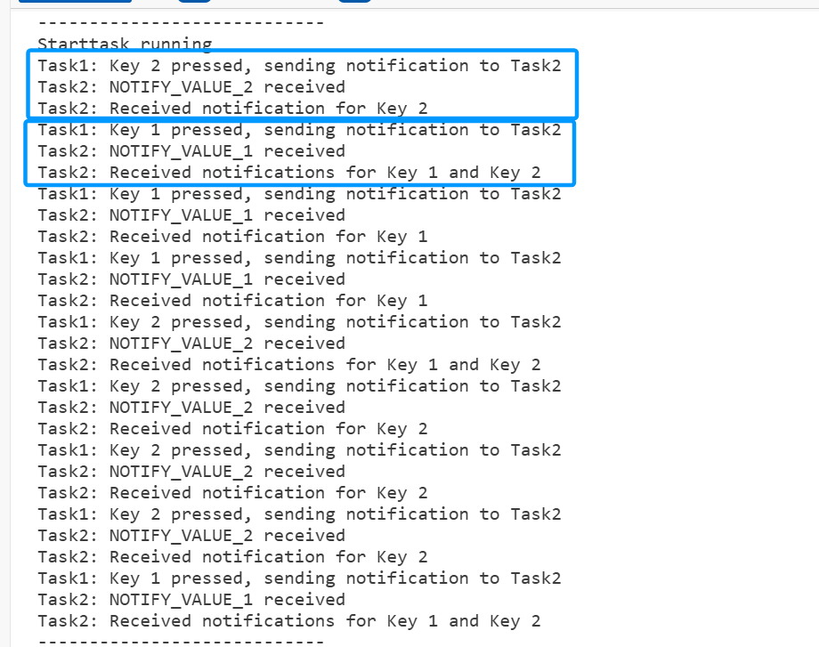


- xTaskNotifyWait(0x00,          // 不清除任何位
                     ULONG_MIN,    // 不清除
                     &notifyValue, // 存储接收到的通知值
                     portMAX_DELAY); // 无限等待通知

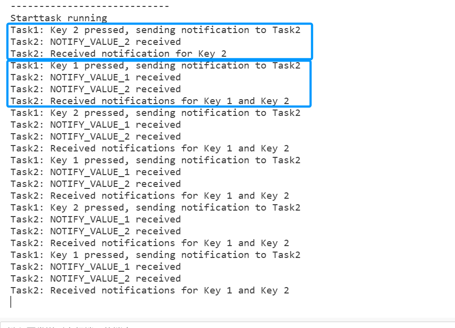


