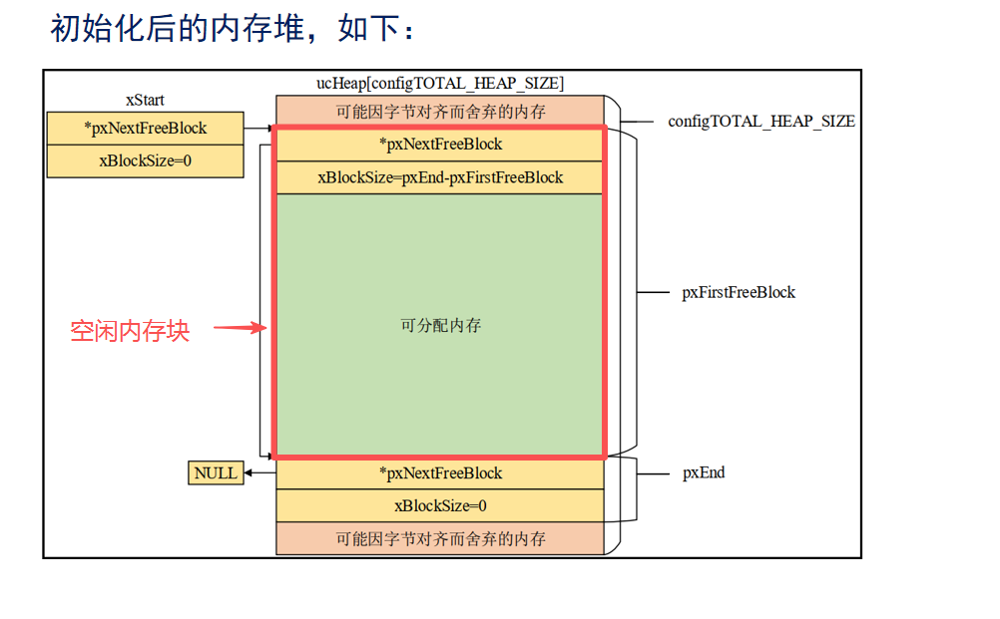
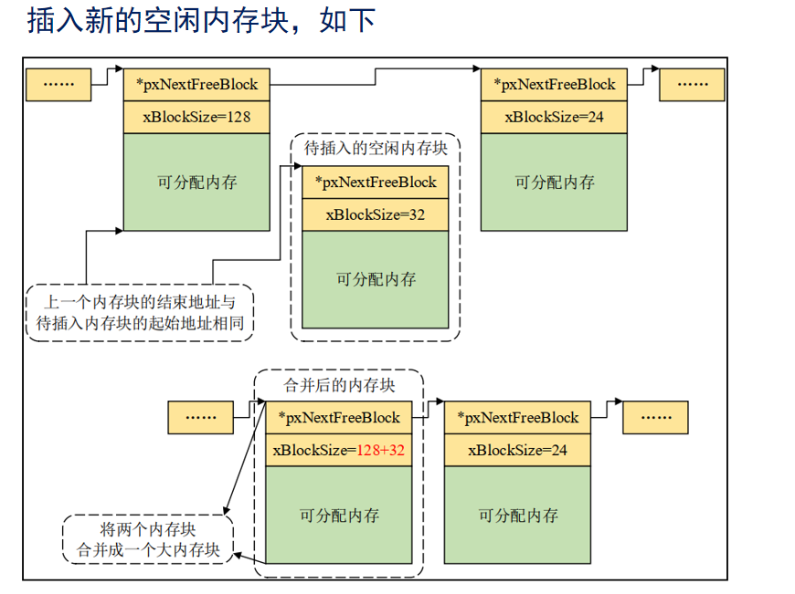

```c
/*
 * FreeRTOS Kernel V10.5.1
 * Copyright (C) 2021 Amazon.com, Inc. or its affiliates.  All Rights Reserved.
 *
 * SPDX-License-Identifier: MIT
 *
 * Permission is hereby granted, free of charge, to any person obtaining a copy of
 * this software and associated documentation files (the "Software"), to deal in
 * the Software without restriction, including without limitation the rights to
 * use, copy, modify, merge, publish, distribute, sublicense, and/or sell copies of
 * the Software, and to permit persons to whom the Software is furnished to do so,
 * subject to the following conditions:
 *
 * The above copyright notice and this permission notice shall be included in all
 * copies or substantial portions of the Software.
 *
 * THE SOFTWARE IS PROVIDED "AS IS", WITHOUT WARRANTY OF ANY KIND, EXPRESS OR
 * IMPLIED, INCLUDING BUT NOT LIMITED TO THE WARRANTIES OF MERCHANTABILITY, FITNESS
 * FOR A PARTICULAR PURPOSE AND NONINFRINGEMENT. IN NO EVENT SHALL THE AUTHORS OR
 * COPYRIGHT HOLDERS BE LIABLE FOR ANY CLAIM, DAMAGES OR OTHER LIABILITY, WHETHER
 * IN AN ACTION OF CONTRACT, TORT OR OTHERWISE, ARISING FROM, OUT OF OR IN
 * CONNECTION WITH THE SOFTWARE OR THE USE OR OTHER DEALINGS IN THE SOFTWARE.
 *
 * https://www.FreeRTOS.org
 * https://github.com/FreeRTOS
 *
 */


/*
 * pvPortMalloc（） 和 vPortFree（） 的示例实现，该实现会将
 * 释放的相邻内存块合并，从而减少内存碎片化问题。
 *
 * 另见 heap_1.c、heap_2.c 和 heap_3.c，更多信息请参考
 * https://www.FreeRTOS.org 网站的内存管理章节。
 */
#include <stdlib.h>
#include <string.h>

/* 定义 MPU_WRAPPERS_INCLUDED_FROM_API_FILE 防止 task.h 重新定义
 * 所有使用 MPU 封装器的 API 函数。该宏仅应在从应用程序文件
 * 包含 task.h 时定义。
*/
#define MPU_WRAPPERS_INCLUDED_FROM_API_FILE

#include "FreeRTOS.h"
#include "task.h"

#undef MPU_WRAPPERS_INCLUDED_FROM_API_FILE

#if ( configSUPPORT_DYNAMIC_ALLOCATION == 0 )
    #error 当 configSUPPORT_DYNAMIC_ALLOCATION 为 0 时，禁止使用此文件
#endif

#ifndef configHEAP_CLEAR_MEMORY_ON_FREE
    #define configHEAP_CLEAR_MEMORY_ON_FREE    0
#endif

/* 内存块大小不能过小 */
#define heapMINIMUM_BLOCK_SIZE    ( ( size_t ) ( xHeapStructSize << 1 ) )

/* 假定字节为 8 位！ */
#define heapBITS_PER_BYTE         ( ( size_t ) 8 )

/* size_t 类型能容纳的最大值 */
#define heapSIZE_MAX              ( ~( ( size_t ) 0 ) )

/* 检查 a 和 b 相乘是否会导致溢出 */
#define heapMULTIPLY_WILL_OVERFLOW( a, b )    ( ( ( a ) > 0 ) && ( ( b ) > ( heapSIZE_MAX / ( a ) ) ) )

/* 检查 a 和 b 相加是否会导致溢出 */
#define heapADD_WILL_OVERFLOW( a, b )         ( ( a ) > ( heapSIZE_MAX - ( b ) ) )

/* BlockLink_t 结构体中 xBlockSize 成员的最高位用于标记
 * 内存块的分配状态。当该位被置位时，表示内存块已被应用程序占用；
 * 当该位未置位时，表示内存块仍属于堆的空闲空间。 */
#define heapBLOCK_ALLOCATED_BITMASK    ( ( ( size_t ) 1 ) << ( ( sizeof( size_t ) * heapBITS_PER_BYTE ) - 1 ) )
#define heapBLOCK_SIZE_IS_VALID( xBlockSize )    ( ( ( xBlockSize ) & heapBLOCK_ALLOCATED_BITMASK ) == 0 )
#define heapBLOCK_IS_ALLOCATED( pxBlock )        ( ( ( pxBlock->xBlockSize ) & heapBLOCK_ALLOCATED_BITMASK ) != 0 )
#define heapALLOCATE_BLOCK( pxBlock )            ( ( pxBlock->xBlockSize ) |= heapBLOCK_ALLOCATED_BITMASK )
#define heapFREE_BLOCK( pxBlock )                ( ( pxBlock->xBlockSize ) &= ~heapBLOCK_ALLOCATED_BITMASK )

/*-----------------------------------------------------------*/

/* 为堆分配内存空间 */
#if ( configAPPLICATION_ALLOCATED_HEAP == 1 )

/* 应用程序开发者已自行定义了 RTOS 堆使用的数组
* - 通常是为了将其放置在特殊的内存段或地址上 */
    extern uint8_t ucHeap[ configTOTAL_HEAP_SIZE ];
#else
    PRIVILEGED_DATA static uint8_t ucHeap[ configTOTAL_HEAP_SIZE ];
#endif /* configAPPLICATION_ALLOCATED_HEAP */

/* 定义链表结构体，用于按内存地址顺序链接空闲内存块 */
typedef struct A_BLOCK_LINK
{
    struct A_BLOCK_LINK * pxNextFreeBlock; /*<< 链表中的下一个空闲内存块指针 */
    /* 最高位表示是否被申请，其余位表示内存块大小 */
    size_t xBlockSize;                     /*<< 空闲内存块的总大小（包含头部结构体） */
} BlockLink_t;

/*-----------------------------------------------------------*/

/*
 * 将释放的内存块插入到空闲内存块链表的正确位置。
 * 如果被释放的内存块与其前/后内存块地址相邻，
 * 则会将这些内存块合并为一个连续的大内存块。
 */
static void prvInsertBlockIntoFreeList( BlockLink_t * pxBlockToInsert ) PRIVILEGED_FUNCTION;

/*
 * 首次调用 pvPortMalloc() 时会自动调用此函数，
 * 用于初始化堆所需的链表结构。
 */
static void prvHeapInit( void ) PRIVILEGED_FUNCTION;

/*-----------------------------------------------------------*/

/* 每个已分配内存块头部的结构体大小必须满足字节对齐要求 */
static const size_t xHeapStructSize = ( sizeof( BlockLink_t ) + ( ( size_t ) ( portBYTE_ALIGNMENT - 1 ) ) ) & ~( ( size_t ) portBYTE_ALIGNMENT_MASK );

/* 创建两个链表节点，用于标记空闲链表的起始和结束位置 */
PRIVILEGED_DATA static BlockLink_t xStart;
PRIVILEGED_DATA static BlockLink_t * pxEnd = NULL;

/* 跟踪内存分配/释放的调用次数以及剩余空闲字节数，
 * 但无法反映内存碎片化程度 */
PRIVILEGED_DATA static size_t xFreeBytesRemaining = 0U;
PRIVILEGED_DATA static size_t xMinimumEverFreeBytesRemaining = 0U;
PRIVILEGED_DATA static size_t xNumberOfSuccessfulAllocations = 0;
PRIVILEGED_DATA static size_t xNumberOfSuccessfulFrees = 0;

/*-----------------------------------------------------------*/

void * pvPortMalloc( size_t xWantedSize )
{
    BlockLink_t * pxBlock;               // 当前遍历到的空闲内存块
    BlockLink_t * pxPreviousBlock;       // 上一个空闲内存块
    BlockLink_t * pxNewBlockLink;        // 分割后新生成的空闲内存块
    void * pvReturn = NULL;              // 最终返回的内存地址
    size_t xAdditionalRequiredSize;      // 额外需要的内存大小（对齐+头部）

    vTaskSuspendAll();
    {
        /* 如果是首次调用 malloc，则需要初始化堆结构，
         * 建立空闲内存块链表 */
        if( pxEnd == NULL )
        {
            prvHeapInit();
        }
        else
        {
            mtCOVERAGE_TEST_MARKER();
        }

        if( xWantedSize > 0 )
        {
            /* 需要扩展申请的内存大小，以容纳 BlockLink_t 结构体
             * 以及满足字节对齐要求 */
            xAdditionalRequiredSize = xHeapStructSize + portBYTE_ALIGNMENT - ( xWantedSize & portBYTE_ALIGNMENT_MASK );

            if( heapADD_WILL_OVERFLOW( xWantedSize, xAdditionalRequiredSize ) == 0 )
            {
                xWantedSize += xAdditionalRequiredSize;
            }
            else
            {
                xWantedSize = 0;
            }
        }
        else
        {
            mtCOVERAGE_TEST_MARKER();
        }

        /* 检查要分配的内存块大小是否过大，导致最高位被置位。
         * BlockLink_t 结构体中 xBlockSize 成员的最高位用于标记
         * 内存块归属（应用程序/内核），因此该位必须为 0 */
        if( heapBLOCK_SIZE_IS_VALID( xWantedSize ) != 0 )
        {
            if( ( xWantedSize > 0 ) && ( xWantedSize <= xFreeBytesRemaining ) )
            {
                /* 从链表起始位置（最低地址）开始遍历，
                 * 寻找第一个大小足够的空闲内存块 */
                pxPreviousBlock = &xStart;
                pxBlock = xStart.pxNextFreeBlock;

                while( ( pxBlock->xBlockSize < xWantedSize ) && ( pxBlock->pxNextFreeBlock != NULL ) )
                {
                    pxPreviousBlock = pxBlock;
                    pxBlock = pxBlock->pxNextFreeBlock;
                }

                /* 如果遍历到链表末尾仍未找到足够大的内存块，
                 * 则分配失败 */
                if( pxBlock != pxEnd )
                {
                    /* 返回可用的内存地址 - 跳过头部的 BlockLink_t 结构体 */
                    pvReturn = ( void * ) ( ( ( uint8_t * ) pxPreviousBlock->pxNextFreeBlock ) + xHeapStructSize );

                    /* 该内存块即将被使用，需要从空闲链表中移除 */
                    pxPreviousBlock->pxNextFreeBlock = pxBlock->pxNextFreeBlock;

                    /* 如果找到的内存块远大于需求，则将其分割为两个块 */
                    if( ( pxBlock->xBlockSize - xWantedSize ) > heapMINIMUM_BLOCK_SIZE )
                    {
                        /* 分割内存块，在申请的内存后创建新的空闲块。
                         * 此处的 void 强制转换用于避免编译器的字节对齐警告 */
                        pxNewBlockLink = ( void * ) ( ( ( uint8_t * ) pxBlock ) + xWantedSize );
                        configASSERT( ( ( ( size_t ) pxNewBlockLink ) & portBYTE_ALIGNMENT_MASK ) == 0 );

                        /* 计算分割后两个内存块的大小 */
                        pxNewBlockLink->xBlockSize = pxBlock->xBlockSize - xWantedSize;
                        pxBlock->xBlockSize = xWantedSize;

                        /* 将新的空闲块插入到空闲链表中 */
                        prvInsertBlockIntoFreeList( pxNewBlockLink );
                    }
                    else
                    {
                        mtCOVERAGE_TEST_MARKER();
                    }

                    xFreeBytesRemaining -= pxBlock->xBlockSize;

                    /* 更新历史最小空闲内存字节数 */
                    if( xFreeBytesRemaining < xMinimumEverFreeBytesRemaining )
                    {
                        xMinimumEverFreeBytesRemaining = xFreeBytesRemaining;
                    }
                    else
                    {
                        mtCOVERAGE_TEST_MARKER();
                    }

                    /* 标记该内存块为已分配状态，归属应用程序所有，
                     * 并清空下一个空闲块指针 */
                    heapALLOCATE_BLOCK( pxBlock );
                    pxBlock->pxNextFreeBlock = NULL;
                    xNumberOfSuccessfulAllocations++;
                }
                else
                {
                    mtCOVERAGE_TEST_MARKER();
                }
            }
            else
            {
                mtCOVERAGE_TEST_MARKER();
            }
        }
        else
        {
            mtCOVERAGE_TEST_MARKER();
        }

        traceMALLOC( pvReturn, xWantedSize );
    }
    ( void ) xTaskResumeAll();

    #if ( configUSE_MALLOC_FAILED_HOOK == 1 )
    {
        /* 如果内存分配失败，调用钩子函数 */
        if( pvReturn == NULL )
        {
            vApplicationMallocFailedHook();
        }
        else
        {
            mtCOVERAGE_TEST_MARKER();
        }
    }
    #endif /* if ( configUSE_MALLOC_FAILED_HOOK == 1 ) */

    /* 确保返回的内存地址满足字节对齐要求 */
    configASSERT( ( ( ( size_t ) pvReturn ) & ( size_t ) portBYTE_ALIGNMENT_MASK ) == 0 );
    return pvReturn;
}
/*-----------------------------------------------------------*/

void vPortFree( void * pv )
{
    uint8_t * puc = ( uint8_t * ) pv;    // 待释放的内存地址
    BlockLink_t * pxLink;                // 内存块头部的 BlockLink_t 结构体

    if( pv != NULL )
    {
        /* 待释放的内存块前方紧邻着 BlockLink_t 结构体 */
        puc -= xHeapStructSize;  

        /* 类型转换避免编译器警告 */
        pxLink = ( void * ) puc;

        /* 断言：确保内存块处于已分配状态，且下一个空闲块指针为空 */
        configASSERT( heapBLOCK_IS_ALLOCATED( pxLink ) != 0 );
        configASSERT( pxLink->pxNextFreeBlock == NULL );

        if( heapBLOCK_IS_ALLOCATED( pxLink ) != 0 ) /*判断该内存块是否被使用*/
        {
            if( pxLink->pxNextFreeBlock == NULL )  /*判断该内存块时候已经不再空闲列表*/
            {
                /* 将内存块标记为空闲状态，归还给堆 */
                heapFREE_BLOCK( pxLink );
                #if ( configHEAP_CLEAR_MEMORY_ON_FREE == 1 )
                {
                    /* 如果配置了释放时清空内存，则将内存块数据置 0 */
                    ( void ) memset( puc + xHeapStructSize, 0, pxLink->xBlockSize - xHeapStructSize );
                }
                #endif

                vTaskSuspendAll();
                {
                    /* 将该内存块添加到空闲链表中 */
                    xFreeBytesRemaining += pxLink->xBlockSize;
                    traceFREE( pv, pxLink->xBlockSize );
                    prvInsertBlockIntoFreeList( ( ( BlockLink_t * ) pxLink ) );
                    xNumberOfSuccessfulFrees++;
                }
                ( void ) xTaskResumeAll();
            }
            else
            {
                mtCOVERAGE_TEST_MARKER();
            }
        }
        else
        {
            mtCOVERAGE_TEST_MARKER();
        }
    }
}
/*-----------------------------------------------------------*/

/* 获取当前堆的剩余空闲字节数 */
size_t xPortGetFreeHeapSize( void )
{
    return xFreeBytesRemaining;
}
/*-----------------------------------------------------------*/

/* 获取堆历史最小剩余空闲字节数 */
size_t xPortGetMinimumEverFreeHeapSize( void )
{
    return xMinimumEverFreeBytesRemaining;
}
/*-----------------------------------------------------------*/

/* 初始化内存块链表（仅用于消除链接器警告） */
void vPortInitialiseBlocks( void )
{
    /* 空函数，仅用于兼容链接器 */
}
/*-----------------------------------------------------------*/

/* 分配并清零内存（类似标准库的 calloc 函数） */
void * pvPortCalloc( size_t xNum,
                     size_t xSize )
{
    void * pv = NULL;

    /* 检查乘法是否溢出 */
    if( heapMULTIPLY_WILL_OVERFLOW( xNum, xSize ) == 0 )
    {
        pv = pvPortMalloc( xNum * xSize );

        /* 如果分配成功，将内存块数据置 0 */
        if( pv != NULL )
        {
            ( void ) memset( pv, 0, xNum * xSize );
        }
    }

    return pv;
}
/*-----------------------------------------------------------*/

/* 内存堆的初始化函数 */
static void prvHeapInit( void ) /* PRIVILEGED_FUNCTION */
{
    BlockLink_t * pxFirstFreeBlock;    // 第一个空闲内存块
    uint8_t * pucAlignedHeap;          // 对齐后的堆起始地址
    portPOINTER_SIZE_TYPE uxAddress;   // 内存地址
    size_t xTotalHeapSize = configTOTAL_HEAP_SIZE;  // 堆总大小

    /* 确保堆起始地址满足字节对齐要求 */
    uxAddress = ( portPOINTER_SIZE_TYPE ) ucHeap;

    if( ( uxAddress & portBYTE_ALIGNMENT_MASK ) != 0 )
    {
        /* 调整地址至对齐边界 */
        uxAddress += ( portBYTE_ALIGNMENT - 1 );
        uxAddress &= ~( ( portPOINTER_SIZE_TYPE ) portBYTE_ALIGNMENT_MASK );
        /* 减去因对齐损失的内存大小 */
        xTotalHeapSize -= uxAddress - ( portPOINTER_SIZE_TYPE ) ucHeap;
    }

    pucAlignedHeap = ( uint8_t * ) uxAddress;

    /* xStart 用于指向空闲链表的第一个节点，
     * void 强制转换避免编译器警告 */
    xStart.pxNextFreeBlock = ( void * ) pucAlignedHeap;
    xStart.xBlockSize = ( size_t ) 0;

    /* pxEnd 用于标记空闲链表的末尾，放置在堆空间的最后 */
    uxAddress = ( ( portPOINTER_SIZE_TYPE ) pucAlignedHeap ) + xTotalHeapSize;
    uxAddress -= xHeapStructSize;                  // 预留 pxEnd 结构体空间
    uxAddress &= ~( ( portPOINTER_SIZE_TYPE ) portBYTE_ALIGNMENT_MASK );  // 对齐
    pxEnd = ( BlockLink_t * ) uxAddress;
    pxEnd->xBlockSize = 0;
    pxEnd->pxNextFreeBlock = NULL;

    /* 初始状态下，整个堆空间（除 pxEnd 外）为一个大的空闲块 */
    pxFirstFreeBlock = ( BlockLink_t * ) pucAlignedHeap;
    pxFirstFreeBlock->xBlockSize = ( size_t ) ( uxAddress - ( portPOINTER_SIZE_TYPE ) pxFirstFreeBlock );
    pxFirstFreeBlock->pxNextFreeBlock = pxEnd;

    /* 初始时只有一个空闲块，覆盖整个可用堆空间 */
    xMinimumEverFreeBytesRemaining = pxFirstFreeBlock->xBlockSize;
    xFreeBytesRemaining = pxFirstFreeBlock->xBlockSize;
}
/*-----------------------------------------------------------*/

/* 将内存块插入空闲链表，并合并相邻的空闲块 */
static void prvInsertBlockIntoFreeList( BlockLink_t * pxBlockToInsert ) /* PRIVILEGED_FUNCTION */
{
    BlockLink_t * pxIterator;    // 链表遍历指针
    uint8_t * puc;               // 内存地址临时变量

    /* 遍历链表，找到比待插入块地址更高的第一个节点 */
    for( pxIterator = &xStart; pxIterator->pxNextFreeBlock < pxBlockToInsert; pxIterator = pxIterator->pxNextFreeBlock )
    {
        /* 仅遍历，无其他操作 */
    }

    /* 检查待插入块与前一个块是否地址连续 */
    puc = ( uint8_t * ) pxIterator;

    if( ( puc + pxIterator->xBlockSize ) == ( uint8_t * ) pxBlockToInsert )
    {
        /* 合并前一个块和待插入块 */
        pxIterator->xBlockSize += pxBlockToInsert->xBlockSize;
        pxBlockToInsert = pxIterator;
    }
    else
    {
        mtCOVERAGE_TEST_MARKER();
    }

    /* 检查待插入块与后一个块是否地址连续 */
    puc = ( uint8_t * ) pxBlockToInsert;

    if( ( puc + pxBlockToInsert->xBlockSize ) == ( uint8_t * ) pxIterator->pxNextFreeBlock )
    {
        if( pxIterator->pxNextFreeBlock != pxEnd )
        {
            /* 将待插入块与后一个块合并为一个大内存块 */
            pxBlockToInsert->xBlockSize += pxIterator->pxNextFreeBlock->xBlockSize;
            pxBlockToInsert->pxNextFreeBlock = pxIterator->pxNextFreeBlock->pxNextFreeBlock;
        }
        else
        {
            pxBlockToInsert->pxNextFreeBlock = pxEnd;
        }
    }
    else
    {
        pxBlockToInsert->pxNextFreeBlock = pxIterator->pxNextFreeBlock;
    }

    /* 如果待插入块同时合并了前后块，则其 pxNextFreeBlock 已设置，
     * 无需再次赋值（避免自引用） */
    if( pxIterator != pxBlockToInsert )
    {
        pxIterator->pxNextFreeBlock = pxBlockToInsert;
    }
    else
    {
        mtCOVERAGE_TEST_MARKER();
    }
}
/*-----------------------------------------------------------*/

/* 获取堆状态统计信息 */
void vPortGetHeapStats( HeapStats_t * pxHeapStats )
{
    BlockLink_t * pxBlock;                // 链表遍历指针
    size_t xBlocks = 0, xMaxSize = 0, xMinSize = portMAX_DELAY; /* portMAX_DELAY 用于跨平台获取最大值 */

    vTaskSuspendAll();
    {
        pxBlock = xStart.pxNextFreeBlock;

        /* 如果堆尚未初始化，pxBlock 为 NULL（堆在首次分配时自动初始化） */
        if( pxBlock != NULL )
        {
            while( pxBlock != pxEnd )
            {
                /* 统计空闲块数量，并记录最大/最小空闲块大小 */
                xBlocks++;

                if( pxBlock->xBlockSize > xMaxSize )
                {
                    xMaxSize = pxBlock->xBlockSize;
                }

                if( pxBlock->xBlockSize < xMinSize )
                {
                    xMinSize = pxBlock->xBlockSize;
                }

                /* 遍历至链表末尾 */
                pxBlock = pxBlock->pxNextFreeBlock;
            }
        }
    }
    ( void ) xTaskResumeAll();

    /* 填充堆统计信息结构体 */
    pxHeapStats->xSizeOfLargestFreeBlockInBytes = xMaxSize;   // 最大空闲块大小
    pxHeapStats->xSizeOfSmallestFreeBlockInBytes = xMinSize;  // 最小空闲块大小
    pxHeapStats->xNumberOfFreeBlocks = xBlocks;               // 空闲块数量

    taskENTER_CRITICAL();
    {
        pxHeapStats->xAvailableHeapSpaceInBytes = xFreeBytesRemaining;        // 剩余空闲字节数
        pxHeapStats->xNumberOfSuccessfulAllocations = xNumberOfSuccessfulAllocations;  // 成功分配次数
        pxHeapStats->xNumberOfSuccessfulFrees = xNumberOfSuccessfulFrees;      // 成功释放次数
        pxHeapStats->xMinimumEverFreeBytesRemaining = xMinimumEverFreeBytesRemaining;  // 历史最小空闲字节数
    }
    taskEXIT_CRITICAL();
}
/*-----------------------------------------------------------*/
```


## prvHeapInit（）

```c
/* 内存堆的初始化函数 */
static void prvHeapInit( void ) /* PRIVILEGED_FUNCTION */
{
    BlockLink_t * pxFirstFreeBlock;    // 第一个空闲内存块
    uint8_t * pucAlignedHeap;          // 对齐后的堆起始地址
    portPOINTER_SIZE_TYPE uxAddress;   // 内存地址
    size_t xTotalHeapSize = configTOTAL_HEAP_SIZE;  // 获取内存堆的总大小

    /* 确保堆起始地址满足字节对齐要求 */
    // 1. 获取堆原始首地址（ucHeap 是堆内存数组，由 FreeRTOS 定义）
	uxAddress = ( portPOINTER_SIZE_TYPE ) ucHeap;

	// 2. 检查地址是否满足字节对齐（portBYTE_ALIGNMENT 通常为 8 字节）
	if( ( uxAddress & portBYTE_ALIGNMENT_MASK ) != 0 ) /*#define portBYTE_ALIGNMENT_MASK    ( 0x0007 )*/
	{
    	// 2.1 调整到「下一个对齐边界」：比如地址 1001，8 字节对齐则调整为 1100 uxAddress = 1100
    	uxAddress += ( portBYTE_ALIGNMENT - 1 );
    	// 2.2 清零低 N 位（N=对齐位数-1），确保地址对齐   
        //1100 & 1000 = 1000 uxAddress = 1000
    	uxAddress &= ~( ( portPOINTER_SIZE_TYPE ) portBYTE_ALIGNMENT_MASK ); /*字节对齐后的起始地址*/
   	    // 2.3 扣减因对齐损失的内存（比如损失 3 字节，总堆大小减少 3）
    	xTotalHeapSize -= uxAddress - ( portPOINTER_SIZE_TYPE ) ucHeap; /*字节对齐后剩余的内存堆大小*/
        /*
        为什么要对齐？
        CPU 访问非对齐地址（如 8 字节数据存在 1001）时，需要两次内存读写，效率极低；部分架构（如 ARM Cortex-M）甚至会触发硬件异常。FreeRTOS 		    强制要求分配的内存满足 portBYTE_ALIGNMENT 对齐。
        */
	}

	// 3. 记录对齐后的堆起始地址（后续所有操作基于此地址）
	pucAlignedHeap = ( uint8_t * ) uxAddress;

    /* xStart 用于指向空闲链表的第一个节点，
     * void 强制转换避免编译器警告 */
    // xStart 是「哨兵节点」（不存储实际内存块，仅标记链表起点）
	xStart.pxNextFreeBlock = ( void * ) pucAlignedHeap;  // 指向第一个空闲块
	xStart.xBlockSize = ( size_t ) 0;                   // 哨兵节点大小为 0
    /*
    空闲链表结构：xStart → 空闲块 1 → 空闲块 2 → ... → pxEnd；
	xStart 本身不占用堆空间，是全局静态变量，仅用于链表遍历的起点。
    */

    /* pxEnd 用于标记空闲链表的末尾，放置在堆空间的最后 */
    // 1. 计算堆的「原始结束地址」（对齐后的起始 + 调整后内存堆的总大小）
	uxAddress = ( ( portPOINTER_SIZE_TYPE ) pucAlignedHeap ) + xTotalHeapSize; 		/*获取内存堆的末尾地址*/
	// 2. 预留 pxEnd 结构体的空间（xHeapStructSize 是 BlockLink_t 对齐后的大小）
	uxAddress -= xHeapStructSize;												/*往上偏移*/
	// 3. 确保 pxEnd 地址也满足对齐（避免尾节点地址不对齐）
	uxAddress &= ~( ( portPOINTER_SIZE_TYPE ) portBYTE_ALIGNMENT_MASK ); 			/*字节对齐*/
	// 4. 赋值 pxEnd 指针（标记链表末尾）
	pxEnd = ( BlockLink_t * ) uxAddress;
	pxEnd->xBlockSize = 0;          // 尾哨兵节点大小为 0
	pxEnd->pxNextFreeBlock = NULL;  // 尾节点无后续块
    /*
    +-------------------+---------------------------+-------------------+
	| pucAlignedHeap    | 空闲块（堆主体）          | pxEnd           	 |
	| （初始空闲块起点） | （大小 = pxEnd - 起点）   | （尾哨兵节点）    	  |
	+-------------------+---------------------------+-------------------+
    */

    /* 初始状态下，整个堆空间（除 pxEnd 外）为一个大的空闲块 */
	// 1. 初始空闲块的起点 = 对齐后的堆起始地址
	pxFirstFreeBlock = ( BlockLink_t * ) pucAlignedHeap;
	// 2. 初始空闲块大小 = pxEnd 地址 - 空闲块起点地址（覆盖整个可用堆）
	pxFirstFreeBlock->xBlockSize = ( size_t ) ( uxAddress - ( portPOINTER_SIZE_TYPE ) pxFirstFreeBlock );
	// 3. 初始空闲块的下一个节点 = 尾哨兵 pxEnd
	pxFirstFreeBlock->pxNextFreeBlock = pxEnd;

    
    /* 初始时只有一个空闲块，覆盖整个可用堆空间 */
	// 历史最小空闲字节数（初始时等于总空闲）
	xMinimumEverFreeBytesRemaining = pxFirstFreeBlock->xBlockSize;
	// 当前剩余空闲字节数（初始时等于总空闲）
	xFreeBytesRemaining = pxFirstFreeBlock->xBlockSize;
}
```




## prvInsertBlockIntoFreeList（）

```c
/* 将空闲的内存块插入空闲链表，可以将两个相邻且空闲的空闲块进行合并，并且插入的内存块排列顺序由低地址往高地址 */ 
static void prvInsertBlockIntoFreeList( BlockLink_t * pxBlockToInsert ) /* PRIVILEGED_FUNCTION */
{
    /*1. 变量定义*/
    BlockLink_t * pxIterator;    // 链表遍历指针（从 xStart 开始）
	uint8_t * puc;               // 临时地址变量（用于计算地址连续性）
	
    
    /*2. 遍历链表，找到插入位置*/
    // 遍历条件：
	// 1. 从 xStart 开始；
	// 2. 只要「下一个空闲块地址」 < 「待插入块地址」，就继续遍历
	for( pxIterator = &xStart; pxIterator->pxNextFreeBlock < pxBlockToInsert; pxIterator = pxIterator->pxNextFreeBlock )
	{
    	// 仅遍历，无操作：找到第一个「下一个块地址 ≥ 待插入块地址」的节点
	}
	/*
	核心逻辑：heap_4 的空闲链表是按内存地址升序排列的，因此必须找到待插入块的「前序节点」pxIterator（即待插入块应该插在 pxIterator 和 	pxIterator->pxNextFreeBlock 之间）。
	*/
    
    
    /*3. 前向合并（与前序块合并）*/
	// 1. 转换为字节指针，计算前序块的「结束地址」
	puc = ( uint8_t * ) pxIterator; 									/*要插入块的前一个块的起始地址（前序块的起始地址）*/
	// 前序块结束地址 = 前序块起始地址 + 前序块大小
	// 若等于待插入块起始地址 → 地址连续，可合并
	if( ( puc + pxIterator->xBlockSize ) == ( uint8_t * ) pxBlockToInsert )
	{
    	// 合并：前序块大小 = 前序块大小 + 待插入块大小
    	pxIterator->xBlockSize += pxBlockToInsert->xBlockSize;
    	// 合并后，待插入块变为「合并后的前序块」（后续处理合并后的块）- 也就是前序块的起始地址
    	pxBlockToInsert = pxIterator;
	}
	else
	{
   	 	mtCOVERAGE_TEST_MARKER();  // FreeRTOS 覆盖率测试标记，无实际逻辑
	}
 	/*
 	合并前：[pxIterator 块] → [空闲间隙] → [待插入块]
	合并后：[pxIterator 块（大小叠加）] → 无间隙
 	*/
    
    
    /*4. 后向合并（与后序块合并）*/
    /* 检查待插入块与后一个块是否地址连续 */
    // 1. 转换为字节指针，计算待插入块的「结束地址」
	puc = ( uint8_t * ) pxBlockToInsert;								/*要插入块的前一个块的起始地址（前序块的起始地址）*/
	// 待插入块结束地址 = 待插入块起始地址 + 待插入块大小
	// 若等于后序块起始地址 → 地址连续，可合并
	if( ( puc + pxBlockToInsert->xBlockSize ) == ( uint8_t * ) pxIterator->pxNextFreeBlock )
	{
    	// 后序块不是尾哨兵（pxEnd）才合并
    	if( pxIterator->pxNextFreeBlock != pxEnd )
    	{
        	// 合并：待插入块大小 = 自身大小 + 后序块大小
        	pxBlockToInsert->xBlockSize += pxIterator->pxNextFreeBlock->xBlockSize;
        	// 待插入块的下一个节点 = 后序块的下一个节点（跳过被合并的后序块）
        	pxBlockToInsert->pxNextFreeBlock = pxIterator->pxNextFreeBlock->pxNextFreeBlock;
    	}
    	else
   	 	{
        	// 后序块是尾哨兵，直接指向 pxEnd
        	pxBlockToInsert->pxNextFreeBlock = pxEnd;
    	}
	}
	else
	{
    	// 地址不连续，待插入块的下一个节点 = 原前序块的下一个节点
    	pxBlockToInsert->pxNextFreeBlock = pxIterator->pxNextFreeBlock;
	}
    /*
	合并前：[待插入块] → [空闲间隙] → [pxIterator->pxNextFreeBlock 块]
	合并后：[待插入块（大小叠加）] → 无间隙
    */
	
    
   	/*5. 最终插入链表（避免自引用）*/
    // 若「前序节点」≠「待插入块」（说明未发生前向合并）
	if( pxIterator != pxBlockToInsert )
	{
    	// 前序节点的下一个节点 = 待插入块（完成插入）
    	pxIterator->pxNextFreeBlock = pxBlockToInsert;
	}
	else
	{
   	 	mtCOVERAGE_TEST_MARKER();  // 已前向合并，无需插入（避免自引用）
	}
}
```




##  pvPortMalloc()

### 一、函数整体定位

`pvPortMalloc()` 是 FreeRTOS heap_4 内存管理的**核心分配函数**（对标标准库 `malloc()`），专为嵌入式多任务场景设计，核心特性：

- 基于「首次适配算法」（遍历空闲链表找第一个足够大的块）；
- 强制字节对齐（满足 CPU 高效访问要求）；
- 支持内存块分割（避免大块内存浪费）；
- 多任务临界区保护（防止链表操作错乱）；
- 内置溢出 / 合法性检查（提升鲁棒性）；
- 适配 heap_4 的「空闲块自动合并」特性（配合 `vPortFree()` 解决碎片化）。

函数核心流程：`临界区保护` → 首次调用初始化堆 → 修正申请大小（头部 + 对齐） → 合法性检查 → 遍历找空闲块 → 块分割（按需） → 标记分配 + 更新统计 → 临界区释放 → 失败回调 → 返回地址。

### 二、逐模块详细解析（结合代码 + 原理）

#### 1. 变量定义：核心变量的用途与内存模型


```c
BlockLink_t * pxBlock;               // 遍历空闲链表时，指向「当前检查的空闲块」
BlockLink_t * pxPreviousBlock;       // 遍历链表时，指向「当前块的前一个块」（双指针遍历）
BlockLink_t * pxNewBlockLink;        // 块分割后，指向「新生成的空闲块」
void * pvReturn = NULL;              // 最终返回给用户的内存地址（初始NULL，失败则返回NULL）
size_t xAdditionalRequiredSize;      // 额外需要的内存（BlockLink_t头部 + 对齐补位）
```

**关键内存模型铺垫**：每个分配的内存块包含「管理头部」和「用户可用区域」，示例如下：

```plaintext
┌───────────────────┬───────────────────┐
│ 管理头部 BlockLink_t │ 用户可用区域       │
│ （xHeapStructSize） │ （用户申请的大小） │
└───────────────────┴───────────────────┘
块起始地址 → 0x20000000        0x20000008 → 返回给用户的地址
```

- `xHeapStructSize`：`BlockLink_t` 结构体**对齐后的大小**（如 8 字节），是堆管理的「元信息开销」；
- 双指针 `pxPreviousBlock` + `pxBlock`：遍历链表时，既记录当前块，又保留前序块，方便后续从链表中移除目标块。

---

#### 2. 临界区保护：多任务安全的基础


```c
vTaskSuspendAll();  // 挂起所有任务调度（软临界区，不关闭中断）
{
    // 核心分配逻辑（无任务切换，保证链表操作原子性）
}
( void ) xTaskResumeAll();  // 恢复任务调度
```

- **为什么需要**：空闲链表是全局共享资源，若多个任务同时调用 `pvPortMalloc()`/`vPortFree()`，会导致链表指针错乱（比如一个任务遍历链表，另一个任务修改链表）；
- **软临界区特点**：仅挂起任务调度，不关闭中断（中断服务函数仍可执行），平衡 “安全性” 和 “实时性”；
- `( void )`：屏蔽 `xTaskResumeAll()` 返回值未使用的警告（返回值表示是否需要触发任务切换）。

---

#### 3. 首次调用：堆初始化


```c
// pxEnd 是堆初始化的标志（prvHeapInit() 会初始化 pxEnd 为尾哨兵节点）
if( pxEnd == NULL )
{
    prvHeapInit();  // 仅首次调用时执行，初始化堆结构（地址对齐、构建初始空闲链表）
}
else
{
    mtCOVERAGE_TEST_MARKER();  // 覆盖率测试标记，无实际逻辑
}
```

- `prvHeapInit()` 作用：将配置的堆内存（`ucHeap`）做字节对齐，构建「头哨兵节点 `xStart`」「尾哨兵节点 `pxEnd`」，并将整个堆初始化为一个超大空闲块；
- `mtCOVERAGE_TEST_MARKER()`：空宏，仅让代码覆盖率工具识别分支已覆盖，不影响功能。

---

#### 4. 核心：申请大小修正（头部 + 对齐）

用户传入的 `xWantedSize` 是「实际需要的字节数」，但分配时需额外预留空间，这是嵌入式内存分配的关键细节：


```c
if( xWantedSize > 0 )
{
    // 计算额外需要的内存：头部大小 + 对齐补位
    xAdditionalRequiredSize = xHeapStructSize + portBYTE_ALIGNMENT - ( xWantedSize & portBYTE_ALIGNMENT_MASK );

    // 溢出检查：避免 xWantedSize + xAdditionalRequiredSize 超过 size_t 最大值
    if( heapADD_WILL_OVERFLOW( xWantedSize, xAdditionalRequiredSize ) == 0 )
    {
        xWantedSize += xAdditionalRequiredSize;  // 修正后：用户需求 + 头部 + 补位
    }
    else
    {
        xWantedSize = 0;  // 溢出则标记为无效大小，后续分配失败
    }
}
```

##### 公式拆解（以 `portBYTE_ALIGNMENT=4`、`xHeapStructSize=8` 为例）：

| 公式部分                                | 含义                                                        | 示例（用户申请 10 字节） |
| --------------------------------------- | ----------------------------------------------------------- | ------------------------ |
| `xHeapStructSize`                       | 管理头部大小（必须预留）                                    | 8 字节                   |
| `xWantedSize & portBYTE_ALIGNMENT_MASK` | 计算用户需求的「未对齐部分」（`portBYTE_ALIGNMENT_MASK=3`） | 10 & 3 = 2               |
| `portBYTE_ALIGNMENT - 未对齐部分`       | 对齐补位（凑够 4 字节对齐）                                 | 4 - 2 = 2                |
| `xAdditionalRequiredSize`               | 总额外开销                                                  | 8 + 2 = 10 字节          |
| 修正后 `xWantedSize`                    | 实际分配的块大小                                            | 10 + 10 = 20 字节        |

##### 溢出检查：`heapADD_WILL_OVERFLOW`

- 宏实现：`( ( a ) > ( heapSIZE_MAX - b ) )`（`heapSIZE_MAX` 是 `size_t` 最大值，如 32 位为 `0xFFFFFFFF`）；
- 目的：防止大小溢出导致的非法内存访问（比如申请 `0x7FFFFFFF` 字节，额外开销 10 字节，总和超过 `0xFFFFFFFF`）。

---

#### 5. 合法性检查：避免块大小冲突

```c
// 检查 xWantedSize 的最高位是否为 0（最高位是「分配标记位」，不能占用）
if( heapBLOCK_SIZE_IS_VALID( xWantedSize ) != 0 )
{
    // 进一步检查：大小有效 + 剩余空闲内存足够
    if( ( xWantedSize > 0 ) && ( xWantedSize <= xFreeBytesRemaining ) )
    {
        // 核心分配逻辑...
    }
}
```

##### 关键背景：`heapBLOCK_SIZE_IS_VALID`

`BlockLink_t` 的 `xBlockSize` 成员的**最高位**是「分配标记位」：

- 最高位 = 1 → 块已分配（归应用程序）；

- 最高位 = 0 → 块空闲（归堆管理）。

  

  因此，`xWantedSize`不能占用最高位（否则会和分配标记冲突），宏实现：

```c
#define heapBLOCK_ALLOCATED_BITMASK    ( ( ( size_t ) 1 ) << ( ( sizeof( size_t ) * 8 ) - 1 ) )
#define heapBLOCK_SIZE_IS_VALID( xBlockSize )    ( ( ( xBlockSize ) & heapBLOCK_ALLOCATED_BITMASK ) == 0 )
```

示例：32 位系统中，`heapBLOCK_ALLOCATED_BITMASK=0x80000000`，若 `xWantedSize>0x7FFFFFFF`，则最高位为 1，合法性检查失败。

---

#### 6. 首次适配：遍历空闲链表找块

```c
// 初始化遍历指针：从「头哨兵节点 xStart」开始
pxPreviousBlock = &xStart;
pxBlock = xStart.pxNextFreeBlock;

// 遍历条件：
// 1. 当前块大小 < 需要的大小（块不够大）；
// 2. 未到链表尾（pxBlock->pxNextFreeBlock != NULL）；
while( ( pxBlock->xBlockSize < xWantedSize ) && ( pxBlock->pxNextFreeBlock != NULL ) )
{
    pxPreviousBlock = pxBlock;    // 前序块 = 当前块
    pxBlock = pxBlock->pxNextFreeBlock;  // 当前块 = 下一个块
}
```

- **首次适配算法**：从链表头（最低地址）开始，找到**第一个大小足够**的空闲块就停止；
- 优点：遍历效率高（无需遍历所有块）；
- 缺点：容易产生小碎片（但 heap_4 会通过 `prvInsertBlockIntoFreeList()` 合并碎片缓解）；
- 双指针作用：`pxPreviousBlock` 记录前序块，方便后续从链表中移除目标块。

----

#### 7. 找到有效块：核心分配逻辑


```c
// 检查是否找到有效块（未遍历到尾哨兵 pxEnd）
if( pxBlock != pxEnd )
{
    // 步骤1：计算返回给用户的地址（跳过管理头部）
    // pxPreviousBlock->pxNextFreeBlock 是目标块的起始地址，加 xHeapStructSize 跳过头部
    pvReturn = ( void * ) ( ( ( uint8_t * ) pxPreviousBlock->pxNextFreeBlock ) + xHeapStructSize );

    // 步骤2：从空闲链表中移除该块（前序块直接指向当前块的下一个块）
    pxPreviousBlock->pxNextFreeBlock = pxBlock->pxNextFreeBlock;

    // 步骤3：块分割（若剩余空间足够大）
    if( ( pxBlock->xBlockSize - xWantedSize ) > heapMINIMUM_BLOCK_SIZE )
    {
        // 3.1 计算新空闲块的地址：当前块起始 + 分配的大小
        pxNewBlockLink = ( void * ) ( ( ( uint8_t * ) pxBlock ) + xWantedSize );
        // 断言：新块地址必须对齐（防止后续操作出错）
        configASSERT( ( ( ( size_t ) pxNewBlockLink ) & portBYTE_ALIGNMENT_MASK ) == 0 );

        // 3.2 设置新块的大小：原块大小 - 分配的大小
        pxNewBlockLink->xBlockSize = pxBlock->xBlockSize - xWantedSize;
        // 3.3 更新原块大小为分配的大小
        pxBlock->xBlockSize = xWantedSize;

        // 3.4 将新块插入空闲链表（自动合并相邻块）
        prvInsertBlockIntoFreeList( pxNewBlockLink );
    }

    // 步骤4：更新堆统计信息
    xFreeBytesRemaining -= pxBlock->xBlockSize;  // 剩余空闲字节 -= 分配的大小
    // 更新历史最小空闲字节数（监控堆碎片化）
    if( xFreeBytesRemaining < xMinimumEverFreeBytesRemaining )
    {
        xMinimumEverFreeBytesRemaining = xFreeBytesRemaining;
    }

    // 步骤5：标记块为已分配（置位最高位）
    heapALLOCATE_BLOCK( pxBlock );
    pxBlock->pxNextFreeBlock = NULL;  // 已分配块无需链表指针，清空
    xNumberOfSuccessfulAllocations++;  // 成功分配次数+1
}
```

##### 关键细节拆解：

###### （1）返回地址计算

- 目标块起始地址：`pxPreviousBlock->pxNextFreeBlock`（即 `pxBlock`）；
- 用户可用地址：`块起始地址 + xHeapStructSize`（跳过管理头部）；
- 示例：块起始地址 0x20000000，头部 8 字节 → 用户可用地址 0x20000008。

###### （2）块分割条件

`heapMINIMUM_BLOCK_SIZE` 是最小空闲块大小（通常为 `2 * xHeapStructSize`），若剩余空间小于该值，不分割（避免产生无法使用的极小碎片）：

- 示例：原块大小 100 字节，分配 80 字节，剩余 20 字节；若 `heapMINIMUM_BLOCK_SIZE=16` → 剩余 20>16，分割；若剩余 15<16，不分割（分配整个 100 字节，剩余 15 字节随块分配，用户用不到但堆也不回收）。

###### （3）标记已分配

`heapALLOCATE_BLOCK( pxBlock )` 宏实现：`pxBlock->xBlockSize |= heapBLOCK_ALLOCATED_BITMASK`（置位最高位）；

- 示例：原块大小 20 字节（`0x14`）→ 置位后为 `0x80000014`（最高位 1 表示已分配，低 31 位表示块大小）。

---

#### 8. 调试跟踪：`traceMALLOC( pvReturn, xWantedSize )`

- 调试宏，若启用 FreeRTOS 调试工具（如 Tracealyzer），会记录「分配的地址 `pvReturn`」和「块大小 `xWantedSize`」，方便定位内存泄漏 / 异常。

---

#### 9. 分配失败：钩子函数回调


```c
#if ( configUSE_MALLOC_FAILED_HOOK == 1 )
{
    if( pvReturn == NULL )
    {
        vApplicationMallocFailedHook();  // 调用用户自定义的分配失败钩子
    }
}
#endif
```

- 用户可实现 `vApplicationMallocFailedHook()` 处理分配失败（如打印日志、重启系统、触发报警）；
- 开关：`configUSE_MALLOC_FAILED_HOOK` 在 `FreeRTOSConfig.h` 中定义，1 = 开启，0 = 关闭。

---

#### 10. 最终检查：返回地址对齐

```c
// 断言：返回地址必须满足字节对齐（防止 CPU 访问非对齐地址导致效率低/异常）
configASSERT( ( ( ( size_t ) pvReturn ) & ( size_t ) portBYTE_ALIGNMENT_MASK ) == 0 );
return pvReturn;
```

- `portBYTE_ALIGNMENT_MASK`：对齐掩码（如 4 字节对齐为 3，8 字节对齐为 7）；
- 若断言触发：说明地址对齐逻辑出错（如块分割后的地址未对齐），需检查 `prvHeapInit()` 或块分割逻辑。

### 三、典型执行流程示例（用户申请 10 字节）

1. 首次调用 → 执行 `prvHeapInit()`，堆初始化为一个超大空闲块（如 10240 字节）；
2. 修正大小：10 + 8（头部） + 2（对齐补位）= 20 字节；
3. 遍历空闲链表 → 找到超大块（大小 10240 > 20）；
4. 分割块：原块大小 10240 - 20 = 10220 字节，新块插入空闲链表；
5. 标记原块为已分配（最高位置 1），返回「块起始 + 8 字节」的地址（如 0x20000008）；
6. 更新剩余空闲字节（10240 - 20 = 10220），恢复任务调度；
7. 返回用户可用地址 0x20000008。

### 四、关键易错点总结

1. **申请大小不能超过 `0x7FFFFFFF`（32 位）**：否则最高位为 1，合法性检查失败；
2. **返回地址是跳过头部的可用地址**：用户不可修改头部区域（否则释放时会崩溃）；
3. **块分割的最小尺寸限制**：剩余空间小于 `heapMINIMUM_BLOCK_SIZE` 时不分割，避免极小碎片；
4. **临界区仅包裹核心逻辑**：最小化临界区时长，保证任务响应性；
5. **仅能通过 `vPortFree()` 释放**：不能用标准库 `free()`，也不能释放非 `pvPortMalloc()` 分配的地址。

该函数是 FreeRTOS heap_4 内存管理的核心，理解它不仅能掌握嵌入式动态内存分配的实现逻辑，也能规避内存泄漏、碎片化等常见问题。


## vPortFree()

```c
void vPortFree( void * pv )
{
    // 待释放的内存地址（用户传入的 pv，转为字节指针方便地址偏移）
    uint8_t * puc = ( uint8_t * ) pv;    
    // 指向内存块「管理头部」的指针（存储块的大小、链表关系、分配状态）
    BlockLink_t * pxLink;                

    // 空指针防护：避免对 NULL 地址做偏移/解引用操作
    if( pv != NULL )
    {
        /* 核心：找回内存块的管理头部 */
        // 用户拿到的地址是「跳过管理头部」的可用地址，释放需先回退到头部
        puc -= xHeapStructSize;

        /* 类型转换：字节指针 → BlockLink_t 指针（避免编译器警告） */
        pxLink = ( void * ) puc;

        /* 断言校验（调试阶段）：提前发现非法释放 */
        // 断言1：块必须是「已分配状态」（防止重复释放/释放空闲块）
        configASSERT( heapBLOCK_IS_ALLOCATED( pxLink ) != 0 );
        // 断言2：已分配块的链表指针必须为空（防止链表逻辑错乱）
        configASSERT( pxLink->pxNextFreeBlock == NULL );

        /* 二次校验（Release 模式）：断言关闭时仍保证鲁棒性 */
        if( heapBLOCK_IS_ALLOCATED( pxLink ) != 0 )
        {
            if( pxLink->pxNextFreeBlock == NULL )
            {
                /* 标记块为空闲：清空「已分配标记位」 */
                heapFREE_BLOCK( pxLink );

                // 可选配置：释放时清空内存（防止敏感数据泄露）
                #if ( configHEAP_CLEAR_MEMORY_ON_FREE == 1 )
                {
                    // puc + xHeapStructSize：用户实际使用的内存起始地址
                    // pxLink->xBlockSize - xHeapStructSize：用户可用内存大小
                    ( void ) memset( puc + xHeapStructSize, 0, pxLink->xBlockSize - xHeapStructSize );
                }
                #endif

                /* 临界区保护：多任务下防止链表操作错乱 */
                vTaskSuspendAll();  // 挂起所有任务调度（软临界区，不关中断）
                {
                    /* 回收内存：插入空闲链表 + 更新统计 */
                    xFreeBytesRemaining += pxLink->xBlockSize; // 空闲字节数累加
                    traceFREE( pv, pxLink->xBlockSize );       // 调试跟踪（记录释放操作）
                    // 核心：插入链表并自动合并相邻块（解决内存碎片化）
                    prvInsertBlockIntoFreeList( ( BlockLink_t * ) pxLink );
                    xNumberOfSuccessfulFrees++;                 // 成功释放次数+1
                }
                ( void ) xTaskResumeAll(); // 恢复任务调度（屏蔽返回值警告）
            }
            else
            {
                mtCOVERAGE_TEST_MARKER(); // 覆盖率测试标记（无实际逻辑）
            }
        }
        else
        {
            mtCOVERAGE_TEST_MARKER(); // 覆盖率测试标记（无实际逻辑）
        }
    }
}
```


