# 三极管入门：PN 结、NPN/PNP、工作区与实际应用

> 正式整理版。原始笔记备份：三极管入门-original

> 本文在原始《三极管入门》笔记的基础上整理。原文中的图片、视频、公式、工作状态和输出特性曲线均保留，并补充更严谨的物理解释、工程公式、设计方法和常见误区。

## 0. 学习路线与符号约定

学习三极管时建议按下面的顺序：

1. 先理解 PN 结的正偏、反偏、耗尽层和电流方向。
2. 再理解三极管的三层结构：发射区 E、基区 B、集电区 C。
3. 用载流子运动解释“为什么小基极电流能够控制大集电极电流”。
4. 在输出特性曲线上定位截止区、放大区和饱和区。
5. 最后把三极管分别用于模拟放大和数字开关。

本文默认使用传统电流方向。电子运动方向与传统电流方向相反，空穴运动方向与传统电流方向相同。

### 常用符号怎么看？

电路符号通常由“物理量字母 + 下标”组成：$V$ 表示电压，$I$ 表示电流，$R$ 表示电阻；下标说明这个量与哪个端子或支路有关。

> **怎样读 $V_{CE}$、$I_C$ 和 $R_C$？**
> - **两个端子下标的电压**：$V_{XY}=V_X-V_Y$，读作“X 相对 Y 的电压”。因此 $V_{CE}=V_C-V_E$，表示集电极相对发射极的电压；下标的先后顺序不能颠倒，$V_{EC}=-V_{CE}$。
> - **一个端子下标的电流**：$I_C$、$I_B$、$I_E$ 分别表示集电极、基极、发射极电流。电流的正负还取决于采用的参考方向；只讨论大小时可写成 $|I_C|$。
> - **一个端子下标的电阻**：$R_C$、$R_B$ 通常分别表示集电极支路和基极支路中的电阻。这里的下标表示电阻所在的位置或用途，并不是“C 的电阻”这种器件内部参数。
> - **括号或附加下标**：$\mathrm{on}$ 表示导通状态，$\mathrm{sat}$ 表示饱和状态，$Q$ 表示静态工作点。例如 $V_{CE(\mathrm{sat})}$ 是饱和时的集电极-发射极电压，$V_{CEQ}$ 是静态工作点处的 $V_{CE}$。

#### 端子和电流

| 符号 | 英文 | 含义 |
| :---: | :--- | :--- |
| E | Emitter | 发射极或发射区 |
| B | Base | 基极或基区 |
| C | Collector | 集电极或集电区 |
| $I_E$ | Emitter current | 发射极电流 |
| $I_B$ | Base current | 基极电流 |
| $I_C$ | Collector current | 集电极电流 |
| $I_{CEO}$ | Collector-emitter leakage current | 基极开路时的集电极-发射极漏电流，其中 O 表示基极开路（open） |

#### 电压和电阻

| 符号 | 展开关系或名称 | 含义 |
| :---: | :--- | :--- |
| $V_E$、$V_B$、$V_C$ | 端点电位 | E、B、C 三个端子相对电路参考点（通常是 GND）的电压 |
| $V_{BE}$ | $V_B-V_E$ | 基极相对发射极的电压，用于判断发射结是否正偏 |
| $V_{CE}$ | $V_C-V_E$ | 集电极相对发射极的电压 |
| $V_{CB}$ | $V_C-V_B$ | 集电极相对基极的电压，用于判断集电结的偏置状态 |
| $V_{CC}$ | Collector supply voltage | 集电极回路的供电电压，常指电路的正电源；它是历史命名，不按 $V_X-V_Y$ 展开 |
| $V_{RC}$ | Collector-resistor voltage | 集电极电阻 $R_C$ 两端的压降 |
| $R_C$ | Collector resistor | 集电极支路的负载电阻 |
| $R_B$ | Base resistor | 基极支路的偏置或限流电阻 |

#### 常见参数和状态下标

| 符号 | 含义 |
| :---: | :--- |
| $\beta$ 或 $h_{FE}$ | 共射极直流电流放大系数，放大区常近似有 $I_C\approx\beta I_B$ |
| $V_{BE(\mathrm{on})}$ | 基极-发射结达到明显导通时的 $V_{BE}$ |
| $V_{CE(\mathrm{sat})}$ | 三极管饱和导通时的 $V_{CE}$，硅管常见约为 0.1～0.3 V |
| $I_{C(\mathrm{sat})}$ | 外部电源和负载所允许的饱和集电极电流 |
| $V_{CEQ}$ | 静态工作点 Q 处的集电极-发射极电压 |
| $V_{\mathrm{drive}}$ | 驱动源提供的电压，例如 MCU 输出电压 |
| $P_D$ | 三极管的耗散功率，常近似为 $V_{CE}I_C$ |
| $g_m$ | 跨导，表示基极-发射极电压对集电极电流的控制能力 |
| $V_T$ | 热电压，室温下约为 25～26 mV；不是三极管的导通阈值电压 |
| $V_A$ | 厄尔利电压，用于描述放大区中 $I_C$ 随 $V_{CE}$ 略微变化的现象 |

> **$V_{CC}$ 为什么有两个 C？**
> 早期晶体管电路常用重复下标表示与某个端子相关的电源：$V_{CC}$ 是集电极侧电源，$V_{EE}$ 是发射极侧电源。它们是电源名称，不要套用 $V_{XY}=V_X-V_Y$ 的端子间电压规则。

> **怎样读 $V_{CE}=V_{CC}-I_C R_C$？**
> 在常见的 NPN 共射极电路中，若发射极接 GND，集电极通过 $R_C$ 接 $V_{CC}$，则电源电压分配在 $R_C$ 和三极管 C-E 两端：
> $$
> V_{CC}=\underbrace{I_C R_C}_{R_C\text{ 上的压降}}+\underbrace{V_{CE}}_{\text{三极管 C-E 两端电压}}
> $$
> 因而 $V_{CE}=V_{CC}-I_C R_C$。例如 $V_{CC}=5\text{ V}$、$I_C=5\text{ mA}$、$R_C=680\ \Omega$ 时，$R_C$ 上的压降为 $3.4\text{ V}$，所以 $V_{CE}=1.6\text{ V}$。这也说明：$I_C$ 增大时，$R_C$ 上的压降增大，剩给三极管的 $V_{CE}$ 就会减小。

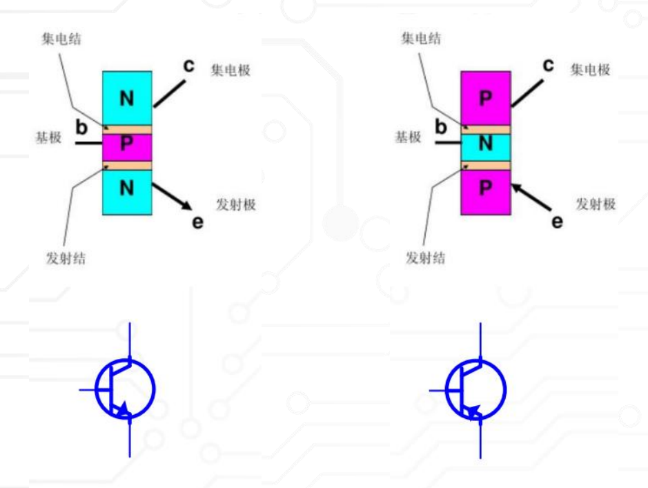

---
首先看看这个视频：
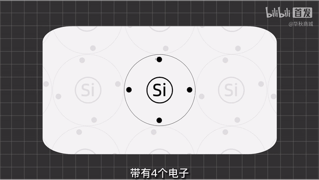

## 一、PN 结

### 1. PN 结的结构

P 型半导体中<mark>空穴</mark>是多数载流子，N 型半导体中<mark>电子</mark>是多数载流子。P 区与 N 区接触后，电子会从 N 区向 P 区扩散，空穴会从 P 区向 N 区扩散。

> **空穴和电子分别是什么？**
> - **电子**：真实存在的基本粒子，带一个单位的负电荷。在半导体中，获得足够能量并脱离原子共价键束缚的电子可以在晶体中移动，因而成为导电的载流子。
> - **空穴**：共价键中缺少一个电子后留下的“空位”，并不是真实存在的独立粒子。邻近电子不断填补这个空位时，空位的位置会沿相反方向移动，因此可以把它等效看成一个带正电、能够移动的载流子。
>
> 可以把空穴理解成“一排座位中的空座”：人依次坐到前面的空座上，空座看起来就在向相反方向移动。电子遇到空穴并填入空位称为**复合**；电子脱离共价键时，则会同时产生一个自由电子和一个空穴。因为电子带负电，所以电子运动方向与传统电流方向相反；空穴等效带正电，其运动方向与传统电流方向相同。

> **什么是正偏和反偏？**
> 判断 PN 结的偏置，关键看 **P 区和 N 区谁的电位更高**，而不是只看电源正负极的名称：
> - **正偏（forward bias）**：P 区电位高于 N 区（$V_P>V_N$）。外加电场抵消部分内建电场，耗尽层变窄、势垒降低，多数载流子更容易越过 PN 结，电流会明显增大。
> - **反偏（reverse bias）**：P 区电位低于 N 区（$V_P<V_N$）。外加电场与内建电场同向，耗尽层变宽、势垒升高，多数载流子难以通过，只剩少数载流子产生的很小漏电流；反向电压过高时还可能发生击穿。
>
> 记忆方法：**P 高 N 低是正偏，P 低 N 高是反偏**。在三极管中，发射结和集电结要分别按各自的 P/N 两侧判断；例如 NPN 放大区是发射结正偏、集电结反偏。

扩散后，结区附近留下不能自由移动的带电离子，形成耗尽层和内建电场。内建电场会阻碍多数载流子的继续扩散，同时推动少数载流子产生漂移运动。

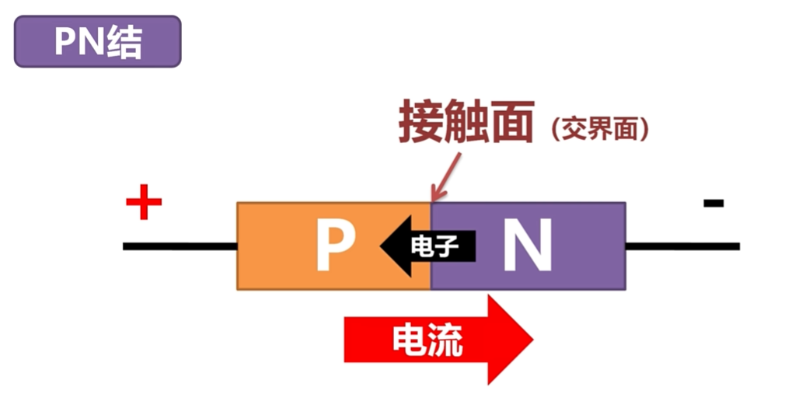

图中表示 PN 结正向偏置：

- P 区接电源正极；
- N 区接电源负极；
- 电子从 N 区向 P 区运动；
- 空穴从 P 区向 N 区运动；
- 传统电流方向从 P 区指向 N 区。

原笔记中的说法“电子只能从 N 流向 P，那么电流只能从 P 流向 N”需要加上适用条件。更准确的说法是：

> 在 PN 结正向偏置时，电子主要从 N 区扩散到 P 区，空穴从 P 区扩散到 N 区；按照传统电流方向，外部电路中的电流从 P 区流向 N 区。反向偏置时仍存在少数载流子造成的反向漏电流，因此不能使用“只能”概括所有情况。

### 2. PN 结正偏

正偏条件是 P 区电位高于 N 区电位：

$$
V_P > V_N
$$

正偏后：

1. 外部电场削弱 PN 结内建电场；
2. 耗尽层变窄；
3. 多数载流子更容易越过结区；
4. 扩散电流快速增加；
5. PN 结表现为低阻导通。

硅 PN 结的正向压降常见约为 0.6～0.8 V，但这个数值不是固定电压，实际取决于电流、温度和器件工艺。锗管的正向压降通常低于硅管。

### 3. PN 结反偏

反偏条件是 N 区电位高于 P 区电位：

$$
V_N > V_P
$$

反偏后：

- 耗尽层变宽；
- 内建电场增强；
- 多数载流子难以越过结区；
- 只有少数载流子形成很小的反向电流；
- 当反向电压超过击穿电压时，电流可能急剧增加。

PN 结的正偏、反偏概念，是判断三极管工作区的基础。

---

## 二、从 PN 结引入三极管

视频：[极速入门三极管NPN与PNP放大原理【极速入门数模电路P05】bilibili](https://www.bilibili.com/video/BV1UM4m1m7ZR?spm_id_from=333.788.videopod.sections&vd_source=cae5e5e53a7fcdf3a7ac534a5a5e2344)

### 1. NPN 三极管

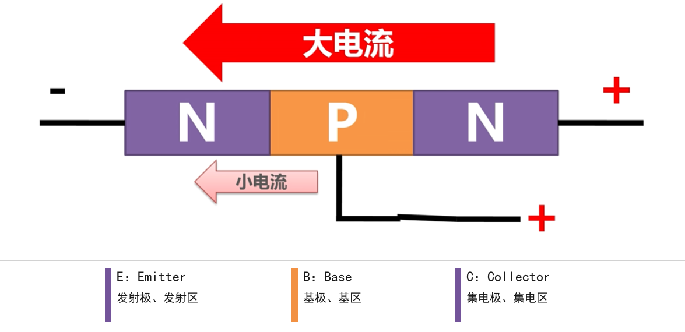

NPN 三极管的结构是：

$$
N-P-N
$$

在正常放大区，NPN 三极管通常满足：

$$
V_C > V_B > V_E
$$

传统电流方向：

- 电流从 C 流入；
- 电流从 B 流入；
- 电流从 E 流出。

主要载流子是电子。电子的主要运动方向是 E 到 C，而传统电流的主要方向是 C 到 E。

### 2. PNP 三极管

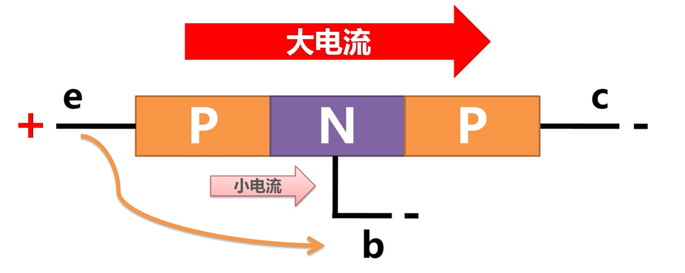

PNP 三极管的结构是：

$$
P-N-P
$$

在正常放大区，PNP 三极管通常满足：

$$
V_E > V_B > V_C
$$

按传统电流方向，PNP 放大区的电流是**从发射极 E 流入器件**，再分别**从集电极 C 和基极 B 流出器件**。这里说的是三极管三个端子与外部电路之间的电流方向，并不是说电流先后经过 C、B 两条路径。PNP 的主要载流子是空穴，空穴在器件内部主要由发射区经基区运动到集电区，因此其运动方向与传统电流方向大体一致。

若只表示电流大小，则有：

$$
|I_E|=|I_C|+|I_B|
$$

若采用“流入器件为正”的端口符号约定，则 PNP 放大区中 $I_E>0$，而 $I_C<0$、$I_B<0$；初学时用上面的电流方向和电流大小关系更不容易混淆。

PNP 并不一定需要负电源。它可以在普通正电源系统中作为高端开关使用：

$$
+V \rightarrow \text{PNP 发射极}
$$

$$
\text{PNP 集电极} \rightarrow \text{负载} \rightarrow \text{GND}
$$

### 3. 为什么小电流能够控制大电流？

原笔记中的问题是：

> 为什么有这个小电流，大电流就可以从 N 到 P 了？

原笔记中“基极小电流填补 P 区空穴，再利用互斥力把载流子挤到右边”的说法适合表达直观感受，但不是准确的三极管物理机制。

更准确的过程，以 NPN 为例：

1. 发射结正向偏置；
2. 发射区向基区注入大量电子；
3. 基区很薄且掺杂浓度低；
4. 大部分电子来不及和基区空穴复合，就扩散到集电结附近；
5. 集电结反向偏置形成电场；
6. 该电场快速把电子收集到集电区；
7. 少部分载流子在基区复合，形成基极电流。

因此，基极电流不是一个“把电子推出来的动力源”，而是反映基区复合和基极输运的控制量。集电极大电流的能量主要由外部电源提供。

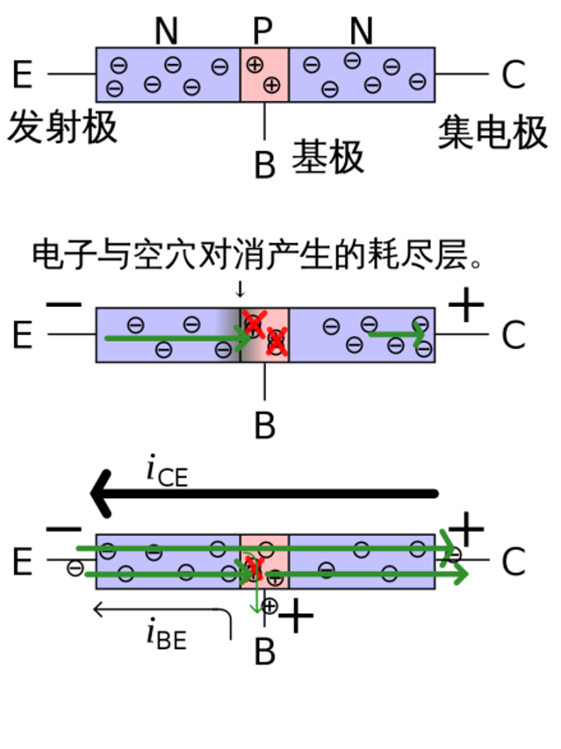

---

## 三、水龙头类比

### 1. 水流能量来自外部水源

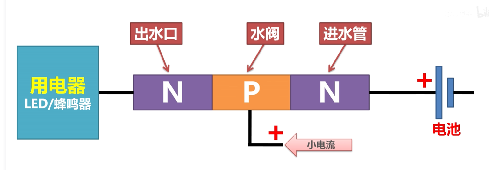

类比关系如下：

| 水系统 | 三极管电路 |
| :--- | :--- |
| 自来水公司、水泵 | 外部电源 |
| 进水管中的水流 | 主电流 |
| 水龙头阀门 | 基极控制作用 |
| 手指施加的小力 | 小的输入信号或基极电流 |
| 出水口的大水流 | 集电极电流 |
| 洗衣机、喷水枪 | 负载 |

水龙头类比说明的是“控制关系”，不能完全替代半导体物理模型。三极管主电流的能量来自电源，不是由基极小电流直接提供。

### 2. 水龙头类比对应 NPN 开关

在 NPN 低端开关中：

$$
+V \rightarrow \text{负载} \rightarrow C
$$

$$
E \rightarrow \text{GND}
$$

当基极电压升高到足以使发射结正偏时，NPN 导通，负载中出现电流。基极必须串联限流电阻，否则基极-发射极 PN 结可能因过流损坏。

---

## 四、三极管的结构和符号

### 1. 三极管是三个区域、两个 PN 结

**PNP** 是一种 BJT，其中 N 型材料位于两个 P 型材料之间；**NPN** 是 P 型材料位于两个 N 型材料之间。

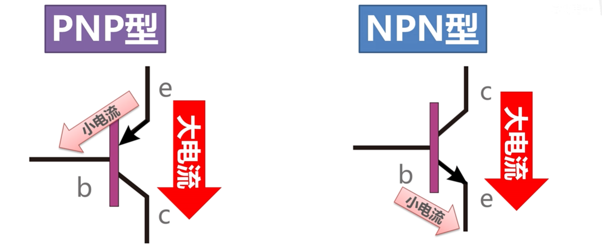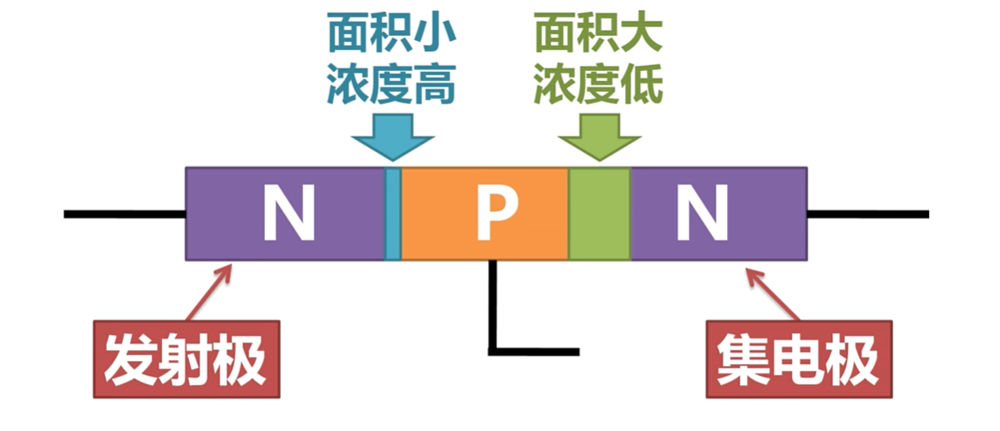

两个 PN 结分别是：

- 发射结：E-B 结；
- 集电结：C-B 结。

从结构上看，三极管包含两个 PN 结，但不能把它简单看成两个彼此独立的二极管。两个 PN 结共享一个薄基区，正是这种载流子耦合产生了电流放大作用。

### 2. 发射区、基区、集电区的差异

三层区域的典型特点：

| 区域 | 主要作用 | 典型结构特点 |
| :--- | :--- | :--- |
| 发射区 E | 注入载流子 | 掺杂浓度最高 |
| 基区 B | 控制和传输载流子 | 很薄、掺杂浓度低 |
| 集电区 C | 收集载流子、承受电压和散热 | 面积较大、耐压要求高 |

### 3. 为什么集电极和发射极不能直接互换？

原笔记指出，集电极和发射极不能调换。这个结论用于正常电路设计是正确的，原因是：

- 发射区和集电区掺杂浓度不同；
- 两者面积和结构不同；
- 集电区需要承受较高反向电压；
- 发射区主要追求高注入效率；
- 反向使用时反向电流增益很低。

更严谨地说，三极管可以进入反向有源区，但性能远不如正常工作方向，因此不能把 E、C 当作完全对称的端子。

### 4. 三极管符号的箭头

判断 NPN 和 PNP 时看发射极箭头：

- NPN：箭头不指向基极；
- PNP：箭头指向基极。

常用口诀：

> NPN：Not Pointing iN，箭头不指向里面。  
> PNP：Pointing iN，箭头指向里面。

箭头表示传统电流方向，不表示电子运动方向。

### 5. 自绘结构图：NPN 与 PNP 的载流子方向

下面这张自绘图把原文多张结构图合并为一张对照图，重点标出 E、B、C 三个区域、主导载流子和传统电流方向：

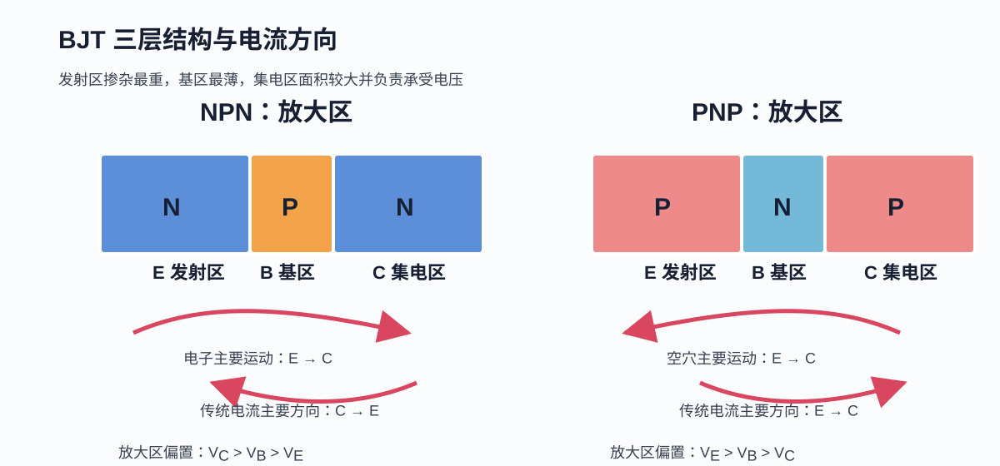

---

## 五、三极管的电流关系和载流子运动

### 1. 电流分配关系

按照基尔霍夫电流定律，使用电流大小表示时：

$$
I_E = I_C + I_B
$$

在放大区的近似关系是：

$$
I_C \approx \beta I_B
$$

$$
\beta = \frac{\Delta I_C}{\Delta I_B}
$$

$\beta$ 不是永久固定的常数，会随电流、温度、集电极电压、频率、器件批次而变化。设计时不能只使用数据手册上的典型 $\beta$，应查看最小 $h_{FE}$ 或使用强迫 $\beta$。

### 2. NPN 的电流方向

NPN 放大区中，按传统电流方向：

- $I_C$ 流入集电极；
- $I_B$ 流入基极；
- $I_E$ 流出发射极。

电子运动方向主要是：

$$
E \rightarrow B \rightarrow C
$$

传统电流主要是：

$$
C \rightarrow E
$$

### 3. PNP 的电流方向

PNP 放大区中，按传统电流方向：

- $I_E$ 流入发射极；
- $I_C$ 从集电极流出；
- $I_B$ 从基极流出。

PNP 的主要载流子是空穴。为了避免符号混乱，工程分析中经常使用电流大小：

$$
|I_C| \approx \beta |I_B|
$$

### 4. 穿透电流

原笔记提到 $I_{CEO}$。它表示基极开路时，集电极和发射极之间的漏电流，通常与集电结反向饱和电流有关，并且对温度非常敏感。

在高温下，漏电流可能显著增大。因此实际电路需要注意：

- 额定结温；
- 热失控；
- 基极偏置的温度稳定性；
- 功率器件的散热。

---

## 六、三极管的三种工作状态

### 0. 自绘工作区总览

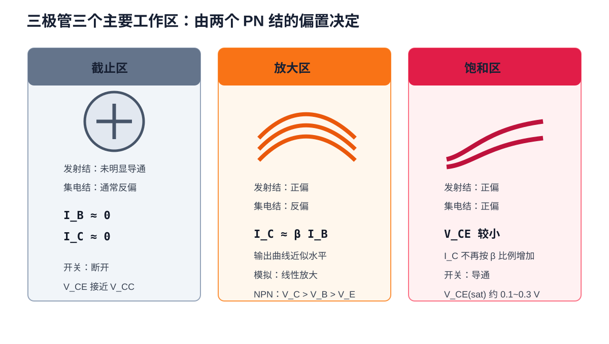

### 1. 截止区

偏置条件：

- 发射结反偏或没有达到明显正向导通；
- 集电结通常反偏；
- $I_B\approx 0$；
- $I_C$ 只有漏电流。

NPN 截止时通常：

$$
V_{BE} < V_{BE(\mathrm{on})}
$$

结果：

- C、E 之间近似开路；
- $V_{CE}$ 接近电源电压；
- 适合数字开关的“关断”状态。

需要注意，$V_{BE}=0.5\text{ V}$ 并不是严格的截止分界线。PN 结电流随电压连续变化，所谓截止只是工程上的近似。

### 2. 放大区，也称线性区或有源区

偏置条件：

- 发射结正偏；
- 集电结反偏。

对 NPN：

$$
V_C > V_B > V_E
$$

在一定范围内：

$$
I_C \approx \beta I_B
$$

特点：

- 基极电流变化可以控制集电极电流变化；
- 适合模拟放大；
- 输出电流还没有被负载或饱和条件限制；
- 输出特性曲线大致水平，但会因厄尔利效应略微上翘。

### 3. 饱和区

偏置条件：

- 发射结正偏；
- 集电结也正偏。

对 NPN，通常表现为：

$$
V_C \lesssim V_B
$$

特点：

- $V_{CE}$ 较小；
- $I_C$ 不再严格满足 $I_C=\beta I_B$；
- 继续增加 $I_B$ 不会使 $I_C$ 按比例增加；
- 适合数字开关的“导通”状态。

典型饱和压降约为：

$$
V_{CE(\mathrm{sat})} \approx 0.1\sim0.3\text{ V}
$$

具体值取决于集电极电流、基极驱动电流、温度和器件型号。

### 4. 反向有源区和击穿区

原笔记重点讲了截止、放大、饱和三个常用区域，还可以补充两个区域：

- 反向有源区：发射结反偏，集电结正偏，器件可以反向工作，但电流增益很低；
- 击穿区：集电结反向电压超过额定值，电流急剧增加，若没有限流可能损坏器件。

---

## 七、三极管输出特性曲线

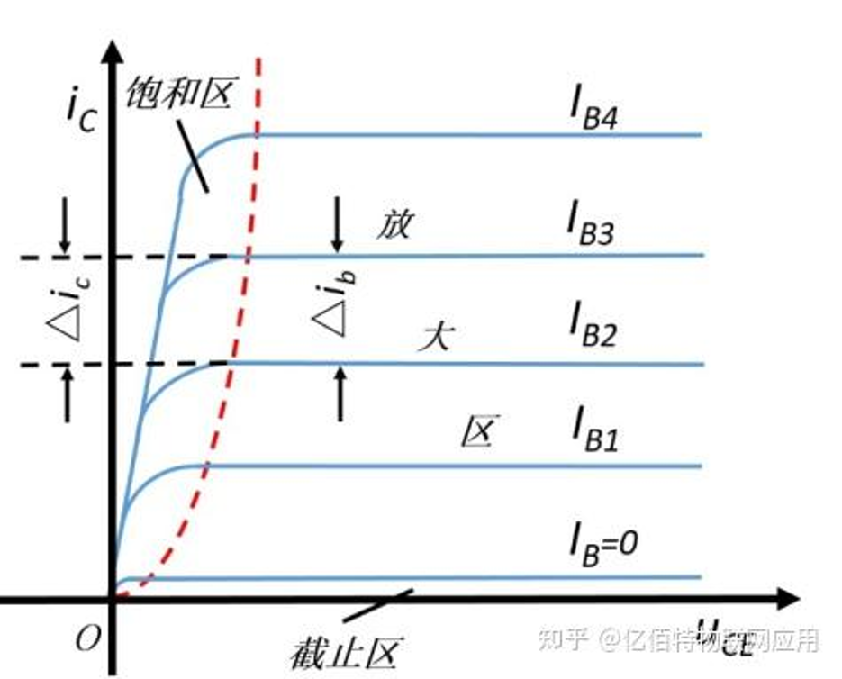

输出特性曲线是在固定 $I_B$ 的条件下，观察 $I_C$ 随 $V_{CE}$ 变化的关系：

$$
I_C=f(V_{CE})\big|_{I_B=\text{常数}}
$$

曲线族中每一条曲线对应一个基极电流，例如：

$$
I_B=0,\ I_{B1},\ I_{B2},\ I_{B3},\ I_{B4}
$$

### 1. 截止区

- 位于曲线最底部；
- $I_B\approx 0$；
- $I_C\approx 0$，只有漏电流；
- $V_{CE}$ 可以接近电源电压；
- 三极管相当于开路。

### 2. 放大区

- 位于曲线中间较平坦的区域；
- 不同 $I_B$ 对应不同的近似水平曲线；
- $I_B$ 增加，曲线整体向上移动；
- 近似满足 $I_C\approx\beta I_B$；
- 曲线轻微上翘是厄尔利效应。

更精确的近似表达为：

$$
I_C\approx\beta I_B\left(1+\frac{V_{CE}}{V_A}\right)
$$

其中 $V_A$ 是厄尔利电压。

### 3. 饱和区

- 位于曲线左侧急剧弯曲的区域；
- $V_{CE}$ 较小；
- 两个 PN 结都处于正偏；
- $I_C$ 主要受外部负载和电源限制；
- 增加基极电流后，集电极电流不再按 $\beta$ 比例增加。

饱和区的曲线并不是完全与 $I_B$ 无关。增加 $I_B$ 常会降低 $V_{CE(\mathrm{sat})}$，并可能让负载电流有所增加，但不会像放大区那样维持理想的 $I_C=\beta I_B$ 关系。

### 4. 输出特性曲线总结

| 特性 | 截止区 | 放大区 | 饱和区 |
| :--- | :--- | :--- | :--- |
| 曲线位置 | 底部、接近横轴 | 中间平坦区域 | 左侧弯曲区域 |
| 发射结 | 反偏或未明显导通 | 正偏 | 正偏 |
| 集电结 | 通常反偏 | 反偏 | 正偏 |
| $I_C$ 与 $I_B$ | $I_C\approx 0$ | $I_C\approx\beta I_B$ | 不再按 $\beta$ 比例增加 |
| $I_C$ 与 $V_{CE}$ | 很小 | 变化较小 | 关系很强 |
| 电路等效 | 开路 | 受控电流源 | 低阻导通状态 |
| 典型用途 | 开关关断 | 模拟放大 | 开关导通 |

---

## 八、工作状态转换和负载线

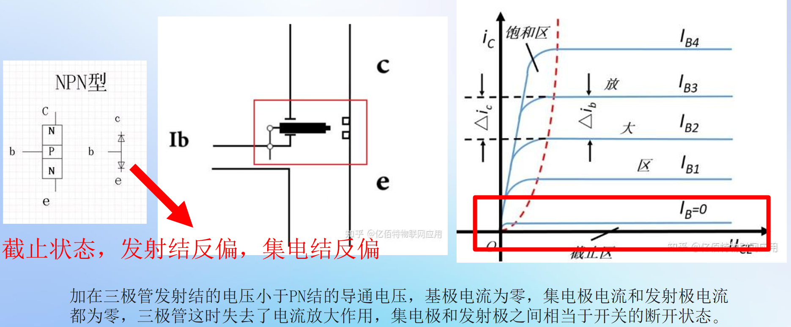

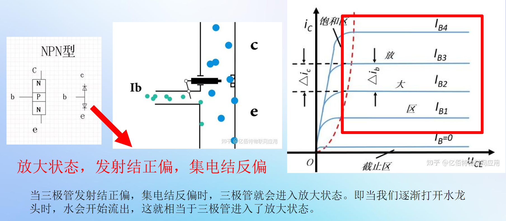

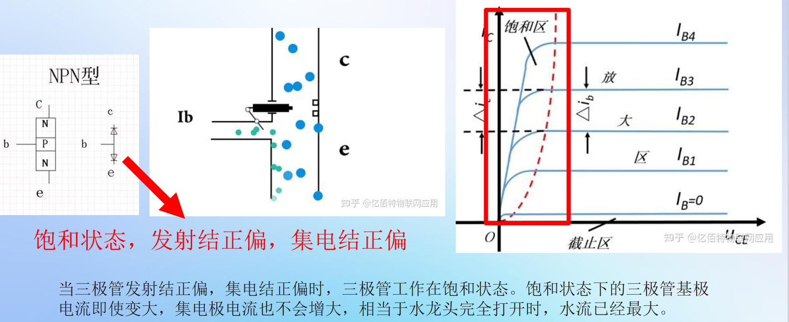

### 1. 从截止进入放大区

以 NPN 共射极电路为例：

$$
V_{CC}\longrightarrow R_C\longrightarrow C,\qquad E\longrightarrow\mathrm{GND}
$$

$$
\text{输入}\longrightarrow R_B\longrightarrow B
$$

起始时：

$$
I_B\approx0,\quad I_C\approx0,\quad V_{CE}\approx V_{CC}
$$

当 $V_{BE}$ 增加到一定程度后，发射结开始导通，基极电流出现，集电极电流也开始增加：

$$
I_C\approx\beta I_B
$$

集电极电阻上的压降为：

$$
V_{RC}=I_C R_C
$$

因此：

$$
V_{CE}=V_{CC}-I_C R_C
$$

### 2. 从放大区进入饱和区

继续增加 $I_B$：

1. $I_B$ 增大；
2. 放大区预测的 $I_C=\beta I_B$ 增大；
3. $R_C$ 上的压降增大；
4. $V_{CE}$ 下降；
5. 集电结反向偏置逐渐减弱；
6. 当 $V_C$ 接近或低于 $V_B$ 时，集电结变为正偏；
7. 三极管进入饱和区。

负载能够允许的最大集电极电流近似为：

$$
I_{C(\mathrm{sat})}\approx\frac{V_{CC}-V_{CE(\mathrm{sat})}}{R_C}
$$

如果继续增加基极电流，$I_C$ 也不能无限增加，因为外部电源和负载已经限制了电流。

### 3. 负载线和静态工作点 Q

由外部集电极回路得到：

$$
V_{CE}=V_{CC}-I_C R_C
$$

这是一条直线，称为直流负载线。它与三极管输出特性曲线的交点就是静态工作点 Q。

模拟放大通常把 Q 点设置在放大区中间附近，以获得尽可能对称的输出摆幅：

$$
V_{CEQ}\approx\frac{V_{CC}}{2}
$$

当输入信号增大时，Q 点沿负载线移动：

- 向截止区移动会出现截止失真；
- 向饱和区移动会出现饱和失真；
- 输入过大时，输出波形会被削顶。

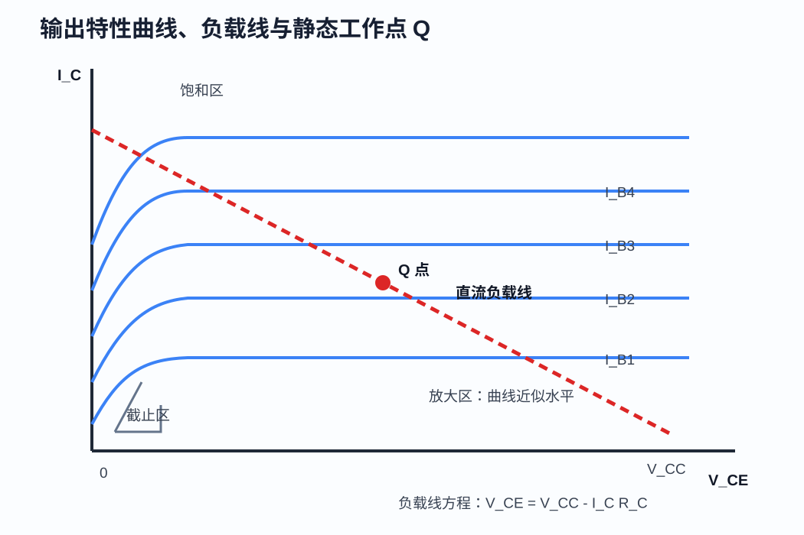

上图中的红色虚线是外部电路决定的直流负载线，蓝色曲线是不同基极电流对应的输出特性，二者交点就是实际工作点。改变基极偏置会改变曲线，改变 $R_C$ 或 $V_{CC}$ 会改变负载线。

---

## 九、为什么降低 $V_{CE}$ 后 $I_C$ 也会降低？

这是理解饱和区的关键问题。

### 1. 放大区时

NPN 放大区中：

- 发射结正偏；
- 集电结反偏；
- 基区电子扩散到集电结附近；
- 集电结耗尽层电场把电子快速收集到集电区。

载流子的主要方向是：

~~~text
发射区 N → 基区 P → 集电区 N
~~~

此时集电极电流主要由发射结的载流子注入决定，因此对 $V_{CE}$ 不太敏感。

### 2. 接近饱和时

当 $V_{CE}$ 降低到接近 $V_{BE}$：

$$
V_{CB}=V_C-V_B\approx0
$$

集电结耗尽层电场减弱，电子不再能被强力快速收集。

### 3. 进入饱和区时

当：

$$
V_C<V_B
$$

集电结变为正偏。此时集电区和基区之间也会发生载流子注入，出现两个方向的载流子输运：

1. 发射区向基区注入的载流子；
2. 集电区向基区注入的载流子。

后果是：

- 基区中的复合增多；
- 原来的单向浓度梯度被削弱；
- 集电结收集作用变差；
- $I_C$ 不再按 $\beta I_B$ 增加；
- $V_{CE}$ 接近 $V_{CE(\mathrm{sat})}$。

饱和区不是“导通后电流无限大”，而是一个两个 PN 结都正偏、载流子双向注入、受外部负载限制的低电压工作状态。

---

## 十、正偏、反偏与工作模式

### 1. PN 结的判断规则

PN 结正偏：

$$
V_P>V_N
$$

PN 结反偏：

$$
V_N>V_P
$$

### 2. NPN 的判断

NPN 结构是 N-P-N。

发射结正偏：

$$
V_B>V_E
$$

集电结反偏：

$$
V_C>V_B
$$

所以放大区通常满足：

$$
V_C>V_B>V_E
$$

### 3. PNP 的判断

PNP 结构是 P-N-P。

发射结正偏：

$$
V_E>V_B
$$

集电结反偏：

$$
V_B>V_C
$$

所以放大区通常满足：

$$
V_E>V_B>V_C
$$

### 4. 偏置状态与工作模式表

| 工作模式 | 发射结 | 集电结 | 主要特征 |
| :---: | :---: | :---: | :--- |
| 截止区 | 反偏或未明显导通 | 通常反偏 | $I_B\approx 0$，$I_C\approx 0$ |
| 放大区 | 正偏 | 反偏 | $I_C\approx\beta I_B$ |
| 饱和区 | 正偏 | 正偏 | $I_C$ 不再按 $\beta$ 比例增加 |
| 反向有源区 | 反偏 | 正偏 | 可以工作，但反向增益很低 |

---

## 十一、三极管本质的电流流动

[三极管是如何导电？超形象动画让你一看就懂！哔哩哔哩_bilibili](https://www.bilibili.com/video/BV1kv411574Y/?spm_id_from=333.1007.top_right_bar_window_default_collection.content.click&vd_source=cae5e5e53a7fcdf3a7ac534a5a5e2344)

[终于有人讲了，凭什么三极管能放大? 哔哩哔哩_bilibili](https://www.bilibili.com/video/BV1fB4y147Gn/?spm_id_from=333.1387.favlist.content.click&vd_source=cae5e5e53a7fcdf3a7ac534a5a5e2344)

[1.3 晶体三极管 哔哩哔哩_bilibili](https://www.bilibili.com/video/BV13R4y1q7sp?spm_id_from=333.788.videopod.episodes&vd_source=cae5e5e53a7fcdf3a7ac534a5a5e2344&p=3)

### NPN 放大区的微观过程

~~~text
发射区 N ──电子注入──> 基区 P ──扩散──> 集电结 ──电场收集──> 集电区 N
~~~

下面的 GIF 用绿色粒子表示电子，用红色粒子表示基区中的少量复合或控制过程。粒子数量随帧变化，用来直观表示基极控制量增加时，能够被集电结收集的电子数量增加。它是教学示意，不是严格比例的器件仿真。

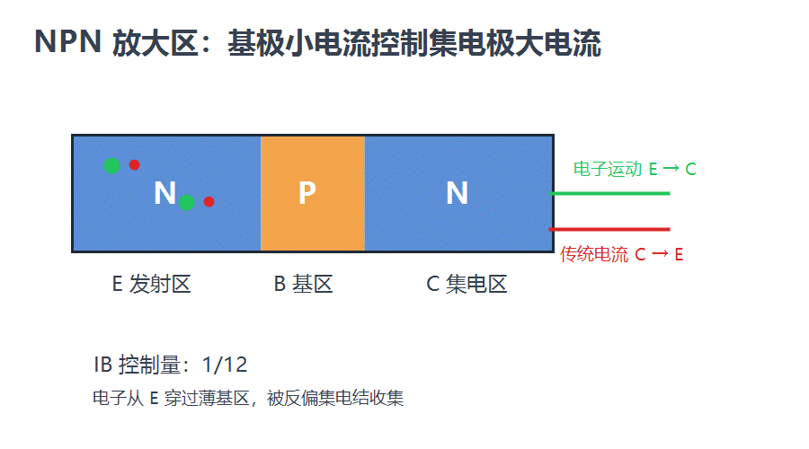

- 发射区掺杂浓度高，能够注入大量电子；
- 基区很薄，电子不容易在其中复合；
- 基区掺杂浓度低，基极电流相对较小；
- 集电结反偏后，耗尽层电场把电子拉入集电区；
- 大部分电子形成 $I_C$，少部分复合形成 $I_B$。

### PNP 放大区的微观过程

PNP 的过程与 NPN 类似，但主导载流子换成空穴：

~~~text
发射区 P ──空穴注入──> 基区 N ──扩散──> 集电结 ──电场收集──> 集电区 P
~~~

---

## 十二、输入特性和输出特性

### 1. 输入特性

输入特性是在固定 $V_{CE}$ 下观察 $I_B$ 与 $V_{BE}$ 的关系：

$$
I_B=f(V_{BE})\big|_{V_{CE}=\text{常数}}
$$

它类似二极管正向伏安特性：

- 低电压时电流很小；
- 超过一定范围后电流快速增大；
- 硅管常在约 0.6～0.8 V 附近出现明显导通；
- 温度升高时，达到相同电流所需的 $V_{BE}$ 通常降低。

### 2. 输出特性

输出特性是在固定 $I_B$ 下观察 $I_C$ 与 $V_{CE}$ 的关系：

$$
I_C=f(V_{CE})\big|_{I_B=\text{常数}}
$$

输出特性可以定位：

- 截止区；
- 放大区；
- 饱和区；
- 高电压下的击穿区。

---

## 十三、NPN 与 PNP 特性对比

### 1. 基本结构

| 类型 | 结构层排列 | 发射区主要载流子 | 基区主要载流子 | 集电区主要载流子 |
| :---: | :---: | :---: | :---: | :---: |
| NPN | N-P-N | 电子 | 空穴 | 电子 |
| PNP | P-N-P | 空穴 | 电子 | 空穴 |

### 2. 正常放大区偏置

| 类型 | 发射结正偏 | 集电结反偏 | 常见电位顺序 |
| :---: | :--- | :--- | :--- |
| NPN | $V_B>V_E$ | $V_C>V_B$ | $V_C>V_B>V_E$ |
| PNP | $V_E>V_B$ | $V_B>V_C$ | $V_E>V_B>V_C$ |

### 3. 电路应用

| 应用特点 | NPN | PNP |
| :--- | :--- | :--- |
| 常见位置 | 低端开关 | 高端开关 |
| 导通条件 | 基极高于发射极 | 基极低于发射极 |
| 传统主电流 | C 到 E | E 到 C |
| 常见用途 | 低端负载驱动、放大 | 高端负载驱动、互补电路 |
| 注意事项 | 基极需要限流 | 基极电压不能低于额定范围 |

NPN 和 PNP 的核心原理相同，主要区别在于半导体层排列、主导载流子、电压极性和传统电流方向。PNP 并不天然适合负电源，NPN 也不局限于正电源。

---

## 十四、三极管作为开关

### 1. NPN 低端开关

典型连接：

$$
V_{CC}\longrightarrow\text{负载}\longrightarrow C,\qquad E\longrightarrow\mathrm{GND}
$$

$$
\mathrm{MCU}\longrightarrow R_B\longrightarrow B
$$

截止时：

> $V_{BE}$ 不足，$I_B\approx 0$，$I_C\approx 0$。

饱和时：

> $V_{BE}$ 对应的发射结正偏，$V_{CB}<0$，即集电结正偏，且 $V_{CE}$ 较小。

### 2. 开关设计公式

负载所需的集电极电流：

$$
I_{C(\mathrm{sat})}\approx\frac{V_{CC}-V_{CE(\mathrm{sat})}}{R_C}
$$

使用强迫 $\beta$ 设计基极电流：

$$
I_B\geq\frac{I_{C(\mathrm{sat})}}{\beta_{\mathrm{forced}}}
$$

基极限流电阻：

$$
R_B=\frac{V_{\mathrm{drive}}-V_{BE}}{I_B}
$$

开关设计中常用 $\beta_{\mathrm{forced}}=5～20$，不建议直接把数据手册中的典型 $h_{FE}$ 当作开关设计依据。

### 3. 关断延迟和存储时间

三极管进入深度饱和后，基区会积累较多载流子。关断时必须先清除这些存储电荷，因此会出现存储时间，导致开关变慢。

高速电路可以考虑：

- 避免深度饱和；
- 使用肖特基钳位三极管；
- 增加基极放电通路；
- 使用专用三极管驱动器；
- 在高速场景中改用 MOSFET。

---

## 十五、三极管作为模拟放大器

### 1. 放大区是模拟放大的基础

如果三极管始终工作在放大区，则小信号可以近似满足：

$$
\Delta I_C\approx\beta\Delta I_B
$$

或者从跨导角度表示：

$$
g_m=\frac{I_C}{V_T}
$$

室温下 $V_T$ 约为 25～26 mV。

### 2. 静态工作点

模拟放大电路需要先设置直流工作点 Q，使三极管处于放大区。然后输入信号在 Q 点附近小幅变化。

如果 Q 点太接近截止区，输出向上或向下摆动时容易进入截止；如果太接近饱和区，则容易产生饱和失真。

常见的初步设计是：

$$
V_{CEQ}\approx\frac{V_{CC}}{2}
$$

### 3. 放大与失真

输入信号过大时：

- 一侧进入截止区；
- 另一侧进入饱和区；
- 输出波形被削顶；
- 放大器产生非线性失真。

因此，三极管“能放大”并不表示任何幅度的信号都能无失真放大。

---

## 十六、温度、功耗和可靠性

三极管的工作点会受温度影响：

- $V_{BE}$ 通常随温度升高而下降；
- 漏电流随温度升高而增大；
- $\beta$ 会随温度和电流变化；
- 功耗增大可能导致结温继续升高；
- 某些情况下会产生热失控。

三极管功耗为：

$$
P_D\approx V_{CE}I_C
$$

在开关状态下：

- 截止区 $I_C$ 很小；
- 饱和区 $V_{CE}$ 很小；
- 两者功耗通常较低。

在放大区，如果 $V_{CE}$ 和 $I_C$ 同时较大，功耗可能很高，需要检查：

- 最大集电极电流；
- 最大集电极-发射极电压；
- 最大功耗；
- 安全工作区 SOA；
- 结温和散热条件。

---

## 十七、常见错误和纠正

### 错误 1：电子方向就是电流方向

纠正：

> 电子带负电，电子运动方向与传统电流方向相反；空穴运动方向与传统电流方向相同。

### 错误 2：基极电流把空穴填满后挤出大电流

纠正：

> 基极电压控制发射结的载流子注入，薄基区和集电结电场使大部分载流子到达集电极。

### 错误 3：$\beta$ 永远是固定值

纠正：

> $\beta$ 受电流、温度、电压、频率和器件批次影响，数据手册通常给出范围而不是唯一值。

### 错误 4：饱和后 $I_C$ 完全不变

纠正：

> 饱和后 $I_C$ 不再按 $\beta I_B$ 成比例增加，但仍受负载、电源、$V_{CE(\mathrm{sat})}$ 和基极过驱程度影响。

### 错误 5：PNP 必须接负电源

纠正：

> PNP 可以使用普通正电源，最常见的是作为高端开关使用。

### 错误 6：三极管等于两个独立二极管

纠正：

> 三极管内部有两个 PN 结，但两个结共享薄基区，载流子耦合才是电流放大的来源。

### 错误 7：集电极和发射极完全不能互换

纠正：

> 正常设计中不能互换；器件可以反向工作，但反向增益和耐压性能通常很差。

### 错误 8：饱和区就是固定小电阻

纠正：

> 饱和区可以在有限范围内近似为低阻态，但其伏安关系仍然是非线性的。

---

## 十八、四个视频的学习建议

### 视频 1：极速入门三极管 NPN 与 PNP 放大原理

[打开视频](https://www.bilibili.com/video/BV1UM4m1m7ZR?spm_id_from=333.788.videopod.sections&vd_source=cae5e5e53a7fcdf3a7ac534a5a5e2344)

适合建立整体认识：

- NPN 和 PNP 的区别；
- 基极控制集电极；
- 开关和放大的差异；
- 水龙头类比。

### 视频 2：三极管是如何导电

[打开视频](https://www.bilibili.com/video/BV1kv411574Y/?spm_id_from=333.1007.top_right_bar_window_default_collection.content.click&vd_source=cae5e5e53a7fcdf3a7ac534a5a5e2344)

适合建立载流子直觉，但视频简介明确说明为了便于理解省略了 PN 结内建电场。因此看完后要补回：

- 耗尽层；
- 内建电场；
- 集电结反偏收集；
- 漂移和扩散的区别。

### 视频 3：凭什么三极管能放大

[打开视频](https://www.bilibili.com/video/BV1fB4y147Gn/?spm_id_from=333.1387.favlist.content.click&vd_source=cae5e5e53a7fcdf3a7ac534a5a5e2344)

适合回答：

- 为什么两个 PN 结共享薄基区后可以放大；
- 为什么基极电流小于集电极电流；
- 二极管原理如何过渡到三极管原理。

#### 视频原片段：二极管与三极管原理（00:10–03:14）

以下资源直接截取自上面的视频链接，不是重新绘制的示意动画：

- 原始片段：带声音的 MP4，便于完整观看讲解；
- 循环预览：同一片段转换为无声音 GIF，便于在笔记中快速复习。

assets/PCB/1-2 基础知识点2.assets/bjt-diode-trim-00m10s-03m14s.mp4

截取范围对应原视频：

~~~text
视频：BV1fB4y147Gn
起点：00:10
终点：03:14
片段长度：03:04
~~~

### 视频 4：1.3 晶体三极管

[打开视频](https://www.bilibili.com/video/BV13R4y1q7sp?spm_id_from=333.788.videopod.episodes&vd_source=cae5e5e53a7fcdf3a7ac534a5a5e2344&p=3)

适合系统学习：

- 输入特性；
- 输出特性；
- 工作区；
- 静态工作点；
- 负载线；
- 模拟电子技术中的三极管模型。

---

## 十九、最终总结

三极管的核心不是“用一个小电流凭空产生一个大电流”，而是：

1. 发射结正偏，负责注入载流子；
2. 基区很薄且掺杂较轻，允许大部分载流子通过；
3. 集电结反偏，负责用电场收集载流子；
4. 少部分载流子在基区复合，形成较小的基极电流；
5. 大部分载流子到达集电极，形成较大的集电极电流；
6. 外部电源提供主电流的能量；
7. 基极信号控制载流子注入量和主电流大小。

三种主要工作状态可以这样记忆：

| 状态 | PN 结偏置 | 作用 |
| :--- | :--- | :--- |
| 截止 | 发射结未导通，集电结通常反偏 | 开关断开 |
| 放大 | 发射结正偏，集电结反偏 | 模拟放大 |
| 饱和 | 发射结和集电结都正偏 | 开关导通 |

最重要的工程判断口诀是：

> NPN 放大：$V_C>V_B>V_E$。  
> PNP 放大：$V_E>V_B>V_C$。  
> 基极控制电流，电源提供能量。  
> 模拟用放大区，开关用截止区和饱和区。
