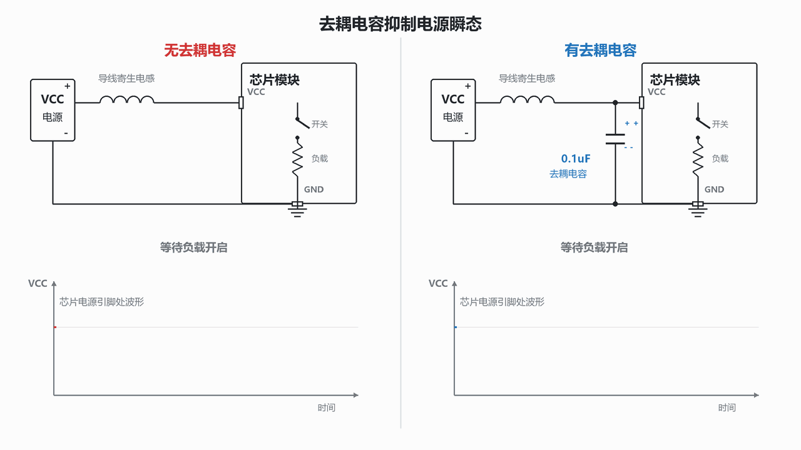

# 嵌入式去耦电容工作原理

在嵌入式电路中，MCU、传感器、存储器等芯片的 VCC 与 GND 之间，通常都会就近放置一颗 **0.1uF（100nF）陶瓷电容**。这颗看似不起眼的电容叫作**去耦电容**，也常被称为旁路电容。

它的核心作用可以先记成一句话：

> 当芯片突然需要一股电流，而远处的电源来不及立刻送达时，去耦电容在芯片旁边先补上这股电流，减小 VCC 的瞬时跌落。

这里的关键词是“突然”“旁边”和“瞬时”。去耦电容不是用来代替主电源的，而是专门处理纳秒到微秒量级的快速电流变化。



## 1. 两种电路有什么不同

为了突出关键路径，下面省略了与瞬态分析无关的引脚。图中的开关可理解为芯片内部大量晶体管突然导通，或者某个高电流负载突然开始工作。

### 1.1 无去耦电容的电路

```text
             较长的供电走线（含寄生电感 Lp）
            ─────────── Lp ───────────
           │                              │
        +--+--+         S                VCC
        | VCC |────────o/ o────────────┌───────┐
        | 电源 |                        │ 芯片  │
        +--+--+                        │ +负载 │
           │                            └───┬───┘
           │                                │
          GND──────────────────────────────GND
```

开关 S 闭合、芯片负载电流突然增大时，所需电流只能从较远的电源经过走线送到芯片。真实导线和 PCB 走线并不是理想的零阻抗连接，它们都带有很小的电阻和**寄生电感**。

### 1.2 增加去耦电容后的电路

```text
             较长的供电走线（含寄生电感 Lp）
            ─────────── Lp ───────────
           │                              │
        +--+--+         S                VCC
        | VCC |────────o/ o───────┬────┌───────┐
        | 电源 |                   │    │ 芯片  │
        +--+--+              0.1uF││   │ +负载 │
           │                去耦电容││   └───┬───┘
           │                       │        │
          GND──────────────────────┴────────GND
                                  ↑
                         必须靠近 VCC/GND 引脚
```

增加电容后，芯片附近多了一条很短的局部供电路径：

```text
去耦电容正端 → 芯片 VCC → 芯片内部负载 → 芯片 GND → 去耦电容负端
```

这个回路越短，寄生电感越小，电容就越能在高频瞬态发生时迅速供出电流。

## 2. 为什么导线会造成瞬间供电不足

### 2.1 真实导线自带寄生电感

任何有长度的导线、PCB 走线、过孔和器件引脚都存在寄生电感。虽然它的数值通常只有几 nH，但芯片电流变化得非常快，因此不能忽略。

电感两端的电压满足：

$$V_L=L\frac{di}{dt}$$

其中：

- $L$ 是供电路径的寄生电感；
- $di/dt$ 是电流变化速度；
- $V_L$ 是为了阻碍电流突变而产生的电压。

电感的基本特性是**电流不能瞬间突变**。芯片需要的电流可能在纳秒级从很小跳到很大，但远处电源送来的电流受寄生电感限制，只能逐步增加。需求已经出现，供给却还没跟上，缺口只能暂时消耗芯片引脚附近原有的电荷，于是 VCC 电压向下跌落。

例如，假设供电回路的等效寄生电感只有 5nH，负载电流以 0.2A/ns 的速度变化：

$$V_L=5\text{nH}\times0.2\text{A/ns}=1\text{V}$$

对 3.3V 芯片来说，1V 的瞬态扰动已经非常严重。这也说明：问题不一定来自“电源功率不够”，而可能只是电源距离太远、供电回路太长，无法足够快地响应。

### 2.2 电压下冲是怎样出现的

开关 S 闭合或芯片内部大量逻辑门同时翻转时，过程可以分成四步：

1. 芯片负载电流突然增大；
2. 供电走线的寄生电感阻碍电源电流快速上升；
3. 在短暂的纳秒到微秒时间内，芯片得到的电流小于它需要的电流；
4. 芯片 VCC 引脚处出现一个快速向下的电压尖峰，也叫**电压下冲**或**电源跌落**。

如果电压跌破芯片允许的最低工作电压，即使只持续很短时间，也可能使数字逻辑进入不确定状态。

## 3. 为什么直流万用表通常测不出来

直流万用表适合观察变化缓慢的直流电压。它的采样、积分和屏幕刷新速度都比较慢，显示值往往是几十毫秒甚至更长时间内的平均结果。

假设 3.3V 电源在 1us 内跌到 2.4V，随后立刻恢复。这个尖峰虽然足以干扰芯片，但相对于万用表的测量周期实在太短，平均之后几乎仍是 3.3V。用户看到的读数会非常稳定，容易误判为供电没有问题。

| 测量工具 | 更擅长观察什么 | 对微秒级下冲的表现 |
| --- | --- | --- |
| 直流万用表 | 稳态电压、低速变化、平均值 | 通常直接平均掉，看不见尖峰 |
| 示波器 | 电压随时间的快速变化 | 能显示下冲幅度、持续时间和振铃 |

因此必须使用示波器观察瞬态波形。测量时应注意：

- 探头要直接测在芯片的 VCC 与 GND 引脚附近，而不是只测电源输出端；
- 使用 `10X` 探头，并尽量使用短接地弹簧，避免长鳄鱼夹地线引入额外电感和假振铃；
- 将示波器设为单次触发，触发源可选 VCC 的下降沿；
- 根据现场现象，从微秒时基开始，再逐步缩短到纳秒级观察细节；
- 带宽限制不能开得过低，否则真实的高速尖峰也可能被仪器滤掉。

## 4. 去耦电容为什么像“微型应急电池”

在电源稳定工作时，去耦电容被充到接近 VCC 电压，并储存少量电荷：

$$Q=CV$$

当芯片突然需要额外电流时，远端电源还没来得及响应，已经充好电的去耦电容便先向芯片放电，填补瞬时电流缺口。几纳秒或几微秒之后，远端电源电流跟上，并重新给电容补充电荷。

如果在短时间内近似认为电流缺口不变，电容电压变化可估算为：

$$\Delta V=\frac{\Delta I\cdot\Delta t}{C}$$

例如，一颗 0.1uF 电容需要补充 50mA 电流、持续 100ns，理想情况下电压变化约为：

$$\Delta V=\frac{0.05\text{A}\times100\text{ns}}{0.1\text{uF}}=0.05\text{V}$$

实际电路还会受到电容 ESR、ESL、封装、过孔和走线电感影响，因此布局和器件选择同样重要。

### 有无去耦电容的波形对比

```text
无去耦电容
VCC ──────────┐      ┌────────────────────
              │      │
              └──────┘
                 ↑
            深而窄的电压下冲
            可能低于芯片工作门限

有去耦电容
VCC ───────────\__／──────────────────────
                 ↑
              轻微下凹
        电容补偿了瞬时电流缺口
```

| 对比项 | 无去耦电容 | 有就近去耦电容 |
| --- | --- | --- |
| 瞬时电流来源 | 只能等待远端电源经走线送来 | 电容先就地供电，远端电源随后接手 |
| 高频供电回路 | 长，寄生电感大 | 短，寄生电感小 |
| VCC 波形 | 容易出现深下冲和振铃 | 通常只有较小下凹 |
| 芯片状态 | 更容易复位、跑飞或误动作 | 电源完整性更好，工作更稳定 |

> **> “微型应急电池”是帮助理解的类比，但不能无限延伸。去耦电容只能支撑很短的瞬态，也不能调节输出电压。若整条电源轨刚从 0V 冷启动，电容一开始同样没有电荷，不能凭空给芯片供电；真正的冷启动过程还取决于稳压器启动能力、软启动、电源时序和输入/输出大电容。去耦电容作为“应急电池”的典型场景，是 VCC 已经建立后芯片负载电流突然变化。**

## 5. 用水管和小水箱理解

可以把供电系统想象成一套供水系统：

| 电路元件或现象 | 水路类比 |
| --- | --- |
| 电压 | 水压 |
| 电流 | 水流量 |
| 远端电源 | 远处的水厂或水泵 |
| 较长的供电走线 | 又长又细的水管 |
| 走线寄生电感 | 水流的惯性，流量不能瞬间改变 |
| 芯片 | 突然大量用水的设备 |
| 去耦电容 | 设备旁边的小水箱 |

没有小水箱时，设备突然打开阀门，大量用水。远处的水还没来得及通过长水管补上，设备入口处的水压就会瞬间下降。

有小水箱时，平时水泵先把小水箱装满。设备突然用水，小水箱立即在本地放水，维持入口水压；等长水管中的流量逐渐增加后，再由水泵继续供水并把小水箱补满。

这也解释了为什么去耦电容必须靠近芯片：水箱若仍放在远处，它与设备之间那段长水管的惯性仍然存在，就不能及时救急。

## 6. 没有去耦电容会出现哪些故障

缺少去耦电容不一定让电路完全无法启动。更麻烦的情况是，电路大部分时间看似正常，却在特定负载、温度、代码路径或外部干扰下偶发故障。

常见表现包括：

- MCU 偶发死机或程序跑飞；
- 芯片异常复位，复位原因寄存器可能显示欠压复位；
- ADC 采样值跳动，模拟前端噪声增大；
- 通信偶发错误，例如 SPI、I2C、UART 数据随机出错；
- Flash、EEPROM 或外部存储器在高负载时读写异常；
- 射频、时钟或高速数字电路产生难以复现的随机 bug；
- 同一块板有时正常、有时异常，换电源、换线缆或用手触碰后现象又发生变化。

之所以呈现“随机”，是因为下冲是否越过芯片门限，取决于负载切换时刻、走线寄生参数、电源响应、环境温度和器件个体差异。软件日志可能只记录到结果，看不到发生在微秒内的电源原因。

## 7. 实操工程要点

### 7.1 默认从 0.1uF 陶瓷电容开始

对常见 MCU 和数字芯片，每个 VCC/VDD 电源引脚旁通常先配置一颗 **0.1uF（100nF）多层陶瓷电容 MLCC**。常用介质为 X7R 或 X5R。

但 0.1uF 不是适用于所有芯片和所有频率的绝对答案。最终应优先遵循芯片数据手册，因为高速处理器、DDR、射频芯片和高性能 ADC 可能要求多个容值组合、特定封装及专门的电源网络设计。

### 7.2 位置比“原理图上接了”更重要

去耦电容应满足：

- 尽量紧贴对应的 VCC/VDD 与 GND 引脚；
- 电容到引脚的走线短而宽；
- VCC → 电容 → GND 的高频回路面积尽可能小；
- 若使用电源层和地层，电容焊盘旁就近打过孔，避免细长绕线；
- 不要让电容虽然画在原理图上，却在 PCB 上离芯片几厘米远；
- 芯片有多个电源引脚时，通常每个电源引脚都要按数据手册配置本地去耦。

高频下，电容连接路径的寄生电感可能比标称容量更关键。电容离芯片越远，连接走线越长，越难及时提供快速电流。

### 7.3 小容量去耦与大容量滤波要分工

| 项目 | 小容量去耦电容 | 大容量滤波/储能电容 |
| --- | --- | --- |
| 常见容量 | 0.01uF、0.1uF、1uF | 4.7uF、10uF、47uF、100uF 及以上 |
| 常见类型 | MLCC 陶瓷电容 | 大容量 MLCC、钽电容、铝电解电容 |
| 主要任务 | 处理快速、高频、局部的电流突变 | 处理较慢、持续时间较长的负载变化和低频纹波 |
| 放置位置 | 紧贴芯片电源引脚 | 电源入口、稳压器附近或一组负载附近 |
| 高频性能 | 通常较好，ESR/ESL 较低 | 容量大，但不一定擅长最高频瞬态 |

两者不是互相替代，而是协同工作：

```text
电源/稳压器 ── 大容量滤波电容 ── 供电网络 ── 0.1uF 去耦电容 ── 芯片
               负责较慢变化                    负责最快变化
```

小电容像芯片身边的“小水箱”，反应快但储水少；大电容像区域水塔，储水更多但距离和自身寄生参数使它不一定能处理最快的瞬态。

### 7.4 别忽略 MLCC 的实际容量

陶瓷电容的有效容量会受直流偏压、温度、公差和封装影响。一颗标称 0.1uF 的 MLCC 在实际工作电压下可能小于标称值。电压较高或设计裕量较小时，应查看厂商提供的 DC Bias 曲线，而不能只看外壳上的标称容量。

## 8. 调试检查清单

遇到偶发复位、死机或随机通信错误时，可以按下面的顺序检查：

- 对照数据手册，确认所有 VCC/VDD 引脚都有要求的去耦电容；
- 检查 PCB，而不只检查原理图，确认电容确实靠近芯片引脚；
- 用示波器在芯片 VCC-GND 引脚处测量，不要只在电源接口测量；
- 使用短接地弹簧，捕捉负载切换、通信启动或故障发生时的下冲；
- 同时观察复位脚、使能脚和关键时钟，判断是否由欠压触发；
- 临时在芯片旁并联合适的小陶瓷电容做对照实验，但量产修改仍需检查稳定性与布局；
- 若扰动持续时间较长，再检查大容量滤波电容、电源额定电流、稳压器环路响应和供电压降。

## 9. 一句话总结

> 去耦电容的本质，是用一条极短、低寄生电感的局部回路，为芯片补偿快速变化的瞬时电流，从而把 VCC 电压下冲控制在芯片能够承受的范围内。
