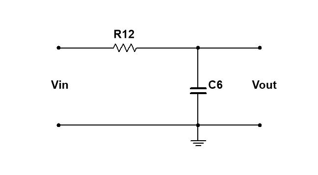
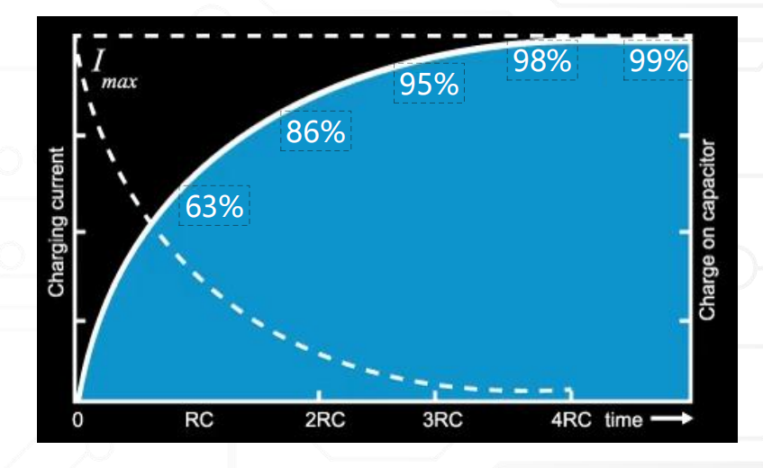
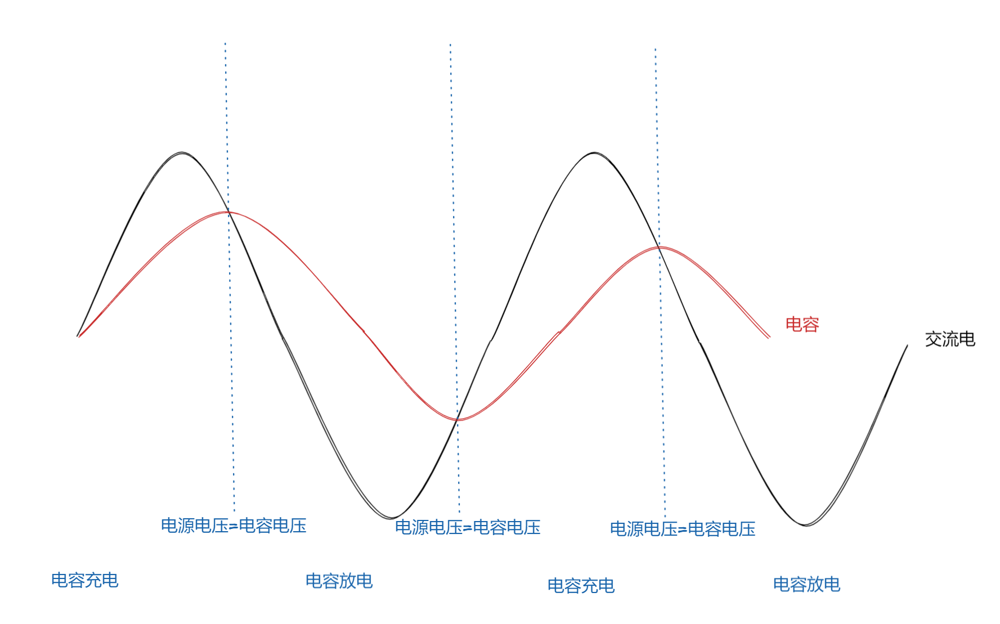
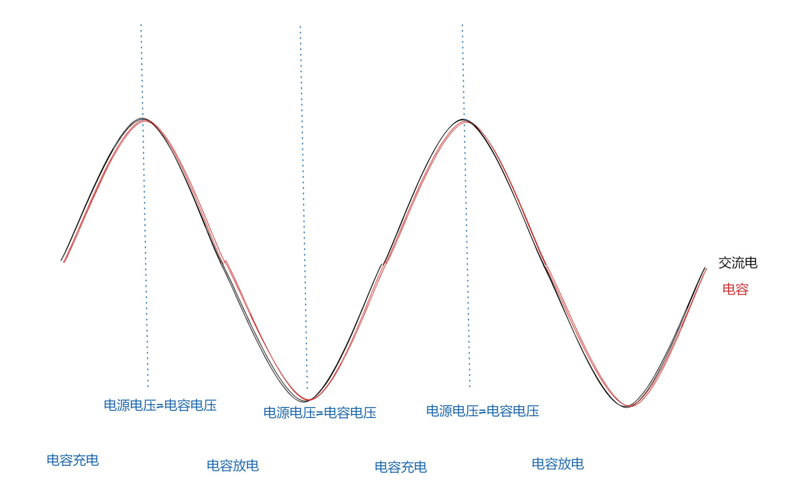
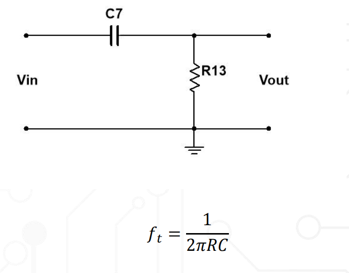

# 电容容抗与 RC 低通、高通滤波原理

本文由原“容抗 Xc 原理”和“RC 低通与高通滤波电路原理”合并而成：前半部分先建立电容的频率、相位与储能直觉，后半部分再把这些结论用于 RC 低通和高通分析。

RC 滤波器只需要一颗电阻和一颗电容，就能让不同频率的信号受到不同程度的衰减。它常用于传感器信号调理、ADC 输入滤波、PWM 转模拟电压、交流耦合和去除直流偏置。

理解 RC 滤波器，关键不是死记“高频走哪里”，而是同时看清三件事：

1. 电容容抗随频率变化；
2. 输出电压取在电阻还是电容两端；
3. 电阻和电容构成的是<mark>交流阻抗分压</mark>，不是普通直流电阻分压。

## 1. 电容容抗与复阻抗

理想电容的容抗大小为：

$$X_C=\frac{1}{2\pi fC}$$

其中：

- $X_C$：容抗，单位 Ω；
- $f$：信号频率，单位 Hz；
- $C$：电容量，单位 F。

由公式可以直接得到：

- 频率越高，$X_C$ 越小；
- 频率越低，$X_C$ 越大；
- 电容量越大，$X_C$ 越小；
- 直流稳态 $f=0$ 时，理想容抗趋近无穷大。

“通高频、阻低频”描述的是相对趋势，不是绝对短路或断路。实际电流还取决于信号源、负载、串并联方式以及输出取样位置。

### 1.0 容抗的直觉、数值和能量

以 $C=0.1\text{uF}$ 为例：

| 频率 | 理想容抗 $X_C$ | 直观含义 |
| ---: | ---: | --- |
| 0Hz，直流稳态 | $\infty$ | 理想电容相当于开路 |
| 1kHz | 约 $1.59\text{k}\Omega$ | 对低频仍有明显阻碍 |
| 1MHz | 约 $1.59\Omega$ | 高频电流更容易通过 |

频率提高 1000 倍，容抗减小为原来的 $1/1000$。同样地，在频率不变时，电容量提高 10 倍，容抗也会减小为原来的 $1/10$。

刚接通直流电源时，电容仍会充电；只有进入稳态、两端电压不再变化后，理想直流电流才为零。真实电容还存在漏电。

电容的基本关系为：

$$
i=C\frac{dU}{dt}
$$

所以电流取决于电压的变化速度。对于正弦稳态，电容电流超前电容电压 $90^\circ$。

理想电容储存的能量为：

$$
E=\frac{1}{2}CU^2
$$

理想电容在一个完整交流周期内吸收和释放能量，平均有功功率为零；真实电容则因 ESR、漏电和介质损耗而发热。

可以把电容类比为带弹性隔膜的小水箱：压力快速变化时，它不断吸入、释放流体；压力长期不变后，不再持续流动。这个类比只用于理解趋势，不能代替复阻抗计算。

严格来说，电容的复阻抗为：

$$Z_C=\frac{1}{j\omega C}=-jX_C$$

其中 $\omega=2\pi f$，$j$ 表示相位信息。这项中的 $-j$ 很重要：电容不只是改变幅值，还会让输出产生相位差。

> **> $f$ 是普通频率，表示每秒完成多少个周期，单位为 Hz；$\omega$ 是角频率，表示每秒变化多少弧度，单位为 rad/s。两者满足 $\omega=2\pi f$，因此代入 $Z_C=1/(j\omega C)$ 时，不能把 Hz 数值直接当作 $\omega$ 使用。例如 $1\text{kHz}$ 对应 $\omega\approx6283\text{rad/s}$。**

> **> 容抗应写成 $X_C$，不要写成 $R_C$。$R$ 通常表示消耗有功功率的电阻，而电容的阻碍作用属于电抗。**

### 1.1 什么是复阻抗

直流电路使用普通电阻描述电压与电流的关系：

$$R=\frac{U}{I}$$

对于正弦交流，电阻、电容和电感不仅会改变电流大小，还可能使电压与电流在时间上错开。为了把“阻碍大小”和“相位差”同时记录下来，需要使用**复阻抗**：

$$Z=\frac{\underline U}{\underline I}$$

其中：

- $Z$ 是复阻抗，单位仍然是 Ω；
- $\underline U$ 是包含幅值和相位的电压相量；
- $\underline I$ 是包含幅值和相位的电流相量。

复阻抗的一般形式为：

$$Z=R+jX$$

- $R$ 是实部，表示电阻性成分，通常会消耗有功功率并发热；
- $X$ 是虚部，表示电抗性成分，反映电感、电容储存和释放能量的作用；
- $j$ 是虚数单位，满足 $j^2=-1$。电路中使用 $j$，是为了避免与电流符号 $i$ 混淆。

> **> “虚部”并不是说这部分不存在。它是一种数学记号，用来保存电压和电流的相位关系。**

### 1.2 复阻抗包含大小和相位

对于：

$$Z=R+jX$$

复阻抗的大小为：

$$|Z|=\sqrt{R^2+X^2}$$

它决定交流电流的幅值：

$$|I|=\frac{|U|}{|Z|}$$

复阻抗的相位角为：

$$\angle Z=\operatorname{atan2}(X,R)$$

> **> $\operatorname{atan2}(y,x)$ 表示点 $(x,y)$ 相对于正 $x$ 轴的角度，参数顺序是“虚部、实部”。因此对 $Z=R+jX$，应使用 $\operatorname{atan2}(X,R)$；电容 $Z_C=-jX_C$ 的实际虚部为 $-X_C$，相位才能得到 $-90^\circ$。**
>
> 复阻抗可以在复平面上看成一个向量：
>
> ```text
>                  Im(Z)=X
>                     ↑
>                     │          Z=R+jX
>                     │         ↗
>                     │        /  φ=atan2(X,R)
>                     │       /
>       ────────────── O ─────/────────→ Re(Z)=R
>                     │
>                     │
>                  电容：Z_C=-jX_C
>                     ↓
>                  φ=-90°
> ```

因此也可以把复阻抗写成极坐标形式：

$$Z=|Z|\angle\varphi$$

例如：

$$Z=100+j100\ \Omega$$

其大小和相位分别为：

$$|Z|=\sqrt{100^2+100^2}=141.4\ \Omega$$

$$\angle Z=45^\circ$$

所以也可以写成：

$$Z=141.4\angle45^\circ\ \Omega$$

### 1.3 电阻、电感和电容的复阻抗

| 元件 | 完整复阻抗 | 电抗大小 | 阻抗相位 | 电压、电流关系 |
| --- | --- | --- | ---: | --- |
| 电阻 | $Z_R=R$ | 无单独电抗 | 0° | 电压与电流同相 |
| 电感 | $Z_L=j\omega L=jX_L$ | $X_L=\omega L=2\pi fL$ | +90° | 电流滞后电压 90° |
| 电容 | $Z_C=1/(j\omega C)=-jX_C$ | $X_C=1/(\omega C)=1/(2\pi fC)$ | -90° | 电流超前电压 90° |

需要特别区分：

| 符号 | 含义 | 示例 |
| --- | --- | --- |
| $R$ | 普通电阻 | $R=1\text{k}\Omega$ |
| $X_C$ | 容抗的正数大小 | $X_C=1.59\text{k}\Omega$ |
| $Z_C$ | 包含相位信息的完整电容复阻抗 | $Z_C=-j1.59\text{k}\Omega$ |

所以，容抗 $X_C$ 只回答“电容对这个频率的阻碍有多大”，复阻抗 $Z_C$ 还回答“电压与电流之间有什么相位关系”。

### 1.4 为什么电容复阻抗中有负号

电容的复阻抗为：

$$Z_C=\frac{1}{j\omega C}$$

因为：

$$\frac{1}{j}=-j$$

所以：

$$Z_C=-\frac{j}{\omega C}=-jX_C$$

$-j$ 表示电容阻抗的相位是 $-90^\circ$。阻抗相位表示“电压相对于电流”的相位，因此：

- 电容电压滞后电容电流 90°；
- 换一种常用说法，就是电容电流超前电容电压 90°。

电感则相反：$Z_L=+jX_L$，所以电感电流滞后电感电压 90°。

### 1.5 复阻抗怎样参与电路计算

使用复阻抗后，正弦交流稳态电路可以采用与电阻电路相似的计算结构，只是参与运算的是复数。

#### 串联

串联复阻抗直接相加：

$$Z_{total}=Z_1+Z_2+\cdots$$

串联 RC 电路为：

$$Z_{total}=R+Z_C=R-jX_C$$

其大小不是 $R+X_C$，而是：

$$|Z_{total}|=\sqrt{R^2+X_C^2}$$

#### 并联

并联复阻抗使用倒数相加：

$$
\frac{1}{Z_{total}}
=\frac{1}{Z_1}+\frac{1}{Z_2}+\cdots
$$

#### 交流分压

交流分压公式为：

$$
\underline V_{out}
=\underline V_{in}\frac{Z_2}{Z_1+Z_2}
$$

与普通电阻分压相比，形式没有改变，但计算结果同时包含：

- 输出幅值；
- 输出相位；
- 频率变化对输出的影响。

### 1.6 为什么截止频率处不是普通的二分之一分压

假设某个频率下：

$$R=X_C=1\text{k}\Omega$$

如果错误地把电容当作普通 1kΩ 电阻，就会认为总阻值为 2kΩ，输出等于输入的一半。

实际复阻抗是：

$$Z_R=1000$$

$$Z_C=-j1000$$

所以串联总复阻抗为：

$$Z_{total}=1000-j1000$$

其大小为：

$$
|Z_{total}|
=\sqrt{1000^2+1000^2}
=1414\ \Omega
$$

在 RC 低通中，输出取电容两端，因此幅值比为：

$$
\left|\frac{V_{out}}{V_{in}}\right|
=\frac{|Z_C|}{|R+Z_C|}
=\frac{1000}{1414}
=\frac{1}{\sqrt2}
\approx0.707
$$

这正是截止频率处输出为 -3dB，而不是普通直流分压 0.5 的根本原因。后文第 5 节会继续推导截止频率处的幅值与相位。

### 1.7 电容复阻抗计算实例

假设：

$$C=0.1\text{uF},\qquad f=1\text{kHz}$$

先算容抗大小：

$$
X_C
=\frac{1}{2\pi\times1000\times0.1\times10^{-6}}
\approx1591.5\ \Omega
$$

完整的电容复阻抗为：

$$Z_C=-j1591.5\ \Omega$$

也可以写成：

$$Z_C=1591.5\angle-90^\circ\ \Omega$$

这两个写法表达相同的信息：电容对 1kHz 信号的阻碍大小为 1591.5Ω，阻抗相位为 -90°。

> **> 本文的复阻抗方法适用于正弦交流稳态。分析刚上电、方波边沿等瞬态过程时，可使用微分方程、时间常数或拉普拉斯域模型 $Z_C=1/(sC)$；当 $s=j\omega$ 时，就回到这里的正弦稳态复阻抗。**

## 2. RC 低通滤波器

### 2.1 电路结构

低通滤波器的连接方式是：**电阻串联在信号路径中，电容从输出节点接到 GND，输出取电容两端。**



图中：

- 输入信号从 $V_{in}$ 进入；
- R12 是串联电阻 $R$；
- C6 是对地电容 $C$；
- $V_{out}$ 是电容两端的电压。

简化拓扑可以写成：

```text
Vin ─── R ───┬── Vout
             │
             C
             │
            GND
```

低通滤波器的作用是：

> **让低频信号基本通过，让高频信号逐渐衰减。**

### 2.2 用阻抗分压理解

低通输出取在电容两端，因此：

> **> 低通和高通计算中使用 $Z_C=1/(j\omega C)$，是因为这里分析的是正弦交流稳态。由电容关系 $i=C\,dv/dt$，在相量域中微分对应乘以 $j\omega$，因此 $V=I/(j\omega C)$，电容的复阻抗就是 $Z_C=V/I=1/(j\omega C)$。只使用 $X_C=1/(\omega C)$ 只能得到阻抗大小，无法保留电容电压滞后电流 $90^\circ$ 的相位信息；使用 $Z_C$ 才能通过复数分压同时算出幅值和相位。分析阶跃等瞬态时，应改用时间常数、微分方程或 $Z_C=1/(sC)$。**

$$
\frac{V_{out}}{V_{in}}
=\frac{Z_C}{R+Z_C}
=\frac{1}{1+j\omega RC}
$$

幅值比为：

$$
\left|\frac{V_{out}}{V_{in}}\right|
=\frac{1}{\sqrt{1+(\omega RC)^2}}
$$

相位为：

$$
\varphi_{LP}=-\arctan(\omega RC)
$$

#### 低频输入

低频时 $X_C$ 很大，电容两端分到大部分输入电压，因此：

$$V_{out}\approx V_{in}$$

输出幅值接近输入，相位差也很小。

#### 高频输入

高频时 $X_C$ 很小，电容两端只能分到较小电压，因此：

$$V_{out}\ll V_{in}$$

从节点角度看，高频电流通过低阻抗电容返回 GND，输出节点的高频电压被压低。

> **> “高频被电容短路到地”是一种近似说法。真实电容的阻抗不是绝对 0，高频信号也不是突然完全消失，而是随频率升高连续衰减。频率非常高时，还必须考虑电容的 ESR、ESL 和自谐振频率。**

### 2.3 不要把低通理解成“电流选择走电阻还是电容”

在这个最简单的 RC 低通回路里，R 与 C 对交流回路而言是串联关系，流过 R 和 C 的回路电流相同。并不存在一股电流在 R 和 C 之间自由二选一。

正确理解是：

- R 与 $Z_C$ 共同决定总阻抗和回路电流；
- 输出取在 $Z_C$ 两端；
- $Z_C$ 随频率改变，所以电容两端的分压随频率改变。

如果输出节点还连接了其他负载，才会出现额外的并联分流路径。

## 3. 用充放电时间理解低通

### 3.1 时间常数

RC 电路的时间常数为：

$$\tau=RC$$

$\tau$ 的单位是秒。它决定电容电压响应变化的快慢。

当输入从 0V 突然跳到 $V_{in}$ 时，低通输出也就是电容电压：

$$V_C(t)=V_{in}\left(1-e^{-t/RC}\right)$$



| 经过时间 | 电容电压约达到最终值 |
| ---: | ---: |
| $1\tau$ | 63.2% |
| $2\tau$ | 86.5% |
| $3\tau$ | 95.0% |
| $4\tau$ | 98.2% |
| $5\tau$ | 99.3% |

因此，工程上常把 $5\tau$ 看作电容基本完成一次充电或放电。

### 3.2 直流输入

刚接通直流时，电容开始充电，$V_{out}$ 按指数曲线上升。经过足够长时间后：

$$V_{out}\approx V_{in}$$

也就是说，一阶 RC 低通在**直流稳态**下允许直流电压出现在输出端。此时电容不再继续充电，理想稳态电流降为 0，串联电阻上的压降也趋近 0。

### 3.3 高频交流输入

当输入变化周期远小于 $RC$ 时，输入已经改变方向，电容电压还没有来得及变化到同样幅度，因此输出变小，并且相对输入产生明显滞后。



图中黑色曲线可视为输入，红色曲线为电容电压。红色输出幅值明显变小，并且峰值出现得更晚，说明输出既有衰减，也有相位滞后。

### 3.4 低频交流输入

输入变化较慢时，电容有足够时间跟随输入充放电，所以输出与输入基本重合。



图中红色输出与黑色输入只有很小的幅值和相位差，说明该频率位于低通滤波器的通带内。

### 3.5 两种解释其实是一回事

“阻抗分压”和“充放电速度”不是两套互相独立的原理：

- 阻抗分压适合分析正弦波的稳态幅值与相位；
- 时间常数适合分析阶跃、方波边沿和启动过程；
- 两者都由同一组 $R$、$C$ 参数决定；
- 截止频率与时间常数满足 $f_c=1/(2\pi\tau)$。

## 4. RC 高通滤波器

### 4.1 电路结构

高通滤波器的连接方式是：**电容串联在信号路径中，电阻从输出节点接到 GND，输出取电阻两端。**



简化拓扑可以写成：

```text
Vin ─── C ───┬── Vout
             │
             R
             │
            GND
```

高通滤波器的作用是：

> **让高频信号基本通过，让低频和直流逐渐衰减。**

### 4.2 用阻抗分压理解

高通输出取在电阻两端，因此：

$$
\frac{V_{out}}{V_{in}}
=\frac{R}{R+Z_C}
=\frac{j\omega RC}{1+j\omega RC}
$$

幅值比为：

$$
\left|\frac{V_{out}}{V_{in}}\right|
=\frac{\omega RC}{\sqrt{1+(\omega RC)^2}}
$$

相位为：

$$
\varphi_{HP}=90^\circ-\arctan(\omega RC)
$$

#### 低频输入

低频时 $X_C$ 很大，整个回路电流很小，因此接地电阻上的电压也很小：

$$V_{out}=IR\approx0$$

低频不是“被电阻过滤掉”，而是被串联电容的高容抗阻挡，导致电阻上几乎没有输出。

#### 高频输入

高频时 $X_C$ 很小，串联电容近似低阻抗连接，大部分输入电压出现在电阻两端：

$$V_{out}\approx V_{in}$$

### 4.3 高通对直流和边沿的响应

直流稳态 $f=0$ 时，串联电容相当于开路，因此高通输出最终回到 0。

但输入刚发生跳变时，电容两端电压不能突变，输出端会先出现一个脉冲，再按时间常数 $\tau=RC$ 衰减。高通因此还可用于：

- 去除直流偏置，只保留交流变化；
- 交流耦合；
- 检测方波上升沿和下降沿；
- 将缓慢基线与快速变化分离。

## 5. 截止频率与 -3dB

一阶 RC 低通与高通的截止频率相同：

$$f_c=\frac{1}{2\pi RC}$$

有些资料写作 $f_t$，但工程中更常用 $f_c$，其中下标 c 来自 cutoff。

### 5.1 截止频率处为什么有 $X_C=R$

当 $f=f_c$ 时：

$$
X_C=\frac{1}{2\pi f_cC}
=\frac{1}{2\pi\cdot\frac{1}{2\pi RC}\cdot C}
=R
$$

此时电阻阻值与容抗大小相等，但它们的相位不同：

- 电阻阻抗是 $R$；
- 电容阻抗是 $-jR$；
- 总阻抗的大小是 $\sqrt{R^2+R^2}=\sqrt{2}R$，不是 $2R$。

所以输出并不是普通直流分压得到的 $1/2$。

### 5.2 截止频率处的幅值

低通和高通在各自截止频率处都有：

$$
\left|\frac{V_{out}}{V_{in}}\right|
=\frac{1}{\sqrt{2}}
\approx0.707
$$

换算成分贝：

$$20\log_{10}(0.707)\approx-3.01\text{dB}$$

因此，-3dB 表示：

- 电压或电流幅值变为通带值的约 70.7%；
- 对同一负载而言，功率变为通带功率的 50%；
- 不是电压幅值变为 50%。

### 5.3 截止频率处的相位

| 滤波器 | $f=f_c$ 时的幅值 | $f=f_c$ 时的相位 |
| --- | ---: | ---: |
| RC 低通 | 0.707 | 输出滞后输入 45° |
| RC 高通 | 0.707 | 输出超前输入 45° |

### 5.4 不要把 -3dB 与正弦波有效值混在一起

正弦波本身的有效值关系是：

$$V_{RMS}=\frac{V_{peak}}{\sqrt{2}}$$

滤波器在截止频率处的增益也恰好是 $1/\sqrt{2}$。两个公式数值相同，但含义不同，不能混为一步计算。

例如，输入正弦波峰值为 1V：

1. 输入有效值是 $1/\sqrt{2}=0.707$V；
2. 截止频率处输出峰值是 $1\times0.707=0.707$V；
3. 输出有效值是 $0.707/\sqrt{2}=0.5$V。

## 6. “高频”和“低频”都是相对截止频率而言

同一个 1kHz 信号，对不同 RC 电路可能是低频、截止频率附近，也可能是高频。

| 频率范围 | RC 低通表现 | RC 高通表现 |
| --- | --- | --- |
| $f\ll f_c$ | 基本通过 | 明显衰减 |
| $f=f_c$ | 幅值 0.707，相位 -45° | 幅值 0.707，相位 +45° |
| $f\gg f_c$ | 明显衰减 | 基本通过 |

一阶 RC 滤波器在截止频率之外的渐近斜率为：

- 低通阻带：约 -20dB/十倍频程；
- 高通低频阻带：约 +20dB/十倍频程。

这意味着一阶滤波器的过渡是渐进的，不会在 $f_c$ 处像开关一样突然从“通过”变为“完全不通过”。

## 7. 数值实例：R=1kΩ，C=0.1uF

截止频率为：

$$
f_c=\frac{1}{2\pi\times1000\times0.1\times10^{-6}}
\approx1.59\text{kHz}
$$

| 输入频率 | 与 $f_c$ 的关系 | $X_C$ | 低通幅值 | 高通幅值 |
| ---: | ---: | ---: | ---: | ---: |
| 159Hz | $0.1f_c$ | 约 10kΩ | 约 0.995 | 约 0.0995 |
| 1.59kHz | $f_c$ | 约 1kΩ | 约 0.707 | 约 0.707 |
| 15.9kHz | $10f_c$ | 约 100Ω | 约 0.0995 | 约 0.995 |

这个例子说明：低通和高通在同一截止频率处交叉，幅值都为 0.707；远低于或远高于截止频率时，两者呈现互补趋势。

## 8. 低通与高通对比

| 项目 | RC 低通 | RC 高通 |
| --- | --- | --- |
| 元件位置 | R 串联，C 对地 | C 串联，R 对地 |
| 输出取样 | 电容两端 | 电阻两端 |
| 直流稳态 | 输出约等于输入 | 输出回到 0 |
| 低频 | 基本通过 | 衰减 |
| 高频 | 衰减 | 基本通过 |
| 截止频率 | $1/(2\pi RC)$ | $1/(2\pi RC)$ |
| 截止点幅值 | 0.707（-3dB） | 0.707（-3dB） |
| 截止点相位 | -45° | +45° |
| 常见用途 | 去高频噪声、抗混叠、平滑 PWM | 隔直流、交流耦合、边沿检测 |

记忆方法：

> 输出取在哪个元件两端，就重点分析那个元件分到了多少交流电压。

## 9. 工程应用

### 9.1 低通滤波器

- 传感器输出去除高频噪声；
- ADC 前端抗混叠滤波；
- PWM 经过低通后得到平均模拟电压；
- 按键和慢速数字输入的硬件消抖；
- 电源采样信号平滑；
- DAC 或模拟输出的高频镜像抑制。

### 9.2 高通滤波器

- 音频或模拟信号交流耦合；
- 去除传感器直流偏置；
- 提取快速变化、冲击和边沿；
- 衰减低频漂移；
- 在不需要低频信息时抑制 50Hz/60Hz 工频成分。

> **> 高通只能按频率衰减低频成分。如果 50Hz/60Hz 工频落在有效信号频带内，高通会同时损伤有效信号。共模干扰也不能简单依靠单端高通解决，应结合差分测量、共模抑制比、接地、屏蔽、共模扼流圈或对称 RC 网络分析。**

## 10. 真实电路中的负载效应

前面的标准公式默认：

- 信号源内阻足够小或已经计入 $R$；
- 低通输出端后级输入阻抗远大于 $R$；
- 高通的接地电阻代表有效负载；
- 电容近似理想。

真实电路中需要注意：

### 10.1 信号源内阻

信号源内阻会与外加电阻共同参与计算。低通实际等效电阻可能是：

$$R_{eq}=R_{source}+R_{external}$$

### 10.2 后级输入阻抗

低通输出接入后级时，后级输入电阻会与电容并联，并改变通带增益和截止频率。高通后级输入电阻则会与设计的接地电阻并联：

$$R_{eq}=R\parallel R_{in}$$

计算 $f_c$ 时应使用电容实际看到的等效电阻。

### 10.3 电容 ESR、ESL 与容差

真实电容存在：

- ESR：造成损耗和额外零极点；
- ESL：高频下使电容逐渐表现为电感；
- 容差和温漂：使实际截止频率偏离标称值；
- MLCC 直流偏压效应：工作电压下有效容量可能下降。

### 10.4 ADC 驱动能力

ADC 输入通常含有采样保持电容。RC 低通的串联电阻过大时，采样瞬间可能无法在规定时间内充到目标电压，造成转换误差。应同时满足滤波需求和芯片数据手册规定的源阻抗、采样时间要求。

## 11. 如何选择 R 和 C

已知目标截止频率后：

$$RC=\frac{1}{2\pi f_c}$$

R 与 C 有多种组合，但不能只让乘积相同就认为工程效果完全一样。

### R 太大可能带来

- 热噪声增大；
- 对输入偏置电流更敏感；
- ADC 采样充电时间不足；
- 更容易受到漏电和 PCB 污染影响。

### R 太小可能带来

- 加重前级信号源负担；
- 增大交流电流和功耗；
- 高通耦合时要求更大的电容。

### C 太大可能带来

- 体积和成本增加；
- 启动和充放电时间变长；
- 信号源在边沿处需要更大瞬时电流；
- 某些放大器驱动大电容时可能不稳定。

工程上通常先根据前后级允许的阻抗范围选 R，再根据目标 $f_c$ 计算 C，最后选择标准容值并重新计算实际截止频率。

## 12. 示波器实测方法

准备函数发生器、示波器以及待测 RC 电路：

1. 输入固定幅值正弦波，例如 1Vpp；
2. 示波器 CH1 测 $V_{in}$，CH2 测 $V_{out}$；
3. 两个探头使用同一电路 GND；
4. 从 $0.1f_c$、$f_c$、$10f_c$ 三个频点开始测量；
5. 记录输出幅值、输入输出时间差和相位；
6. 在 $f_c$ 附近确认输出幅值约为通带幅值的 0.707；
7. 低通应观察到输出逐渐滞后，高通应观察到输出逐渐超前。

相位可以通过时间差估算：

$$\varphi=360^\circ\frac{\Delta t}{T}$$

其中 $T$ 是信号周期，$\Delta t$ 是两个波形相同特征点之间的时间差。

> **> 台式示波器探头地夹通常与保护地相连。不要把地夹接到非地节点，否则可能直接短路电路。测量浮地或高压电路时必须使用合适的差分探头和安全方案。**

## 13. 原笔记中的关键修正

| 原有说法 | 更准确的表述 |
| --- | --- |
| 截止点“衰减一半分压” | 截止点电压幅值为 0.707，功率为一半；电压不是一半 |
| $X_C=R$，所以像两个电阻串联 | 电容阻抗带有 $-j$ 相位，总阻抗大小为 $\sqrt{2}R$ |
| 0.707 就是正弦波有效值 | 截止增益与峰值/RMS 换算是两件不同的事，只是都出现 $1/\sqrt{2}$ |
| 高频在 R 和 C 中“选择”更低阻值路径 | 简单低通回路中 R、C 流过同一回路电流，输出是电容阻抗分压 |
| 高通中低频被电阻过滤 | 低频由串联电容的高容抗阻挡，导致电阻两端输出很小 |
| 高频被电容完全短路 | 这是近似表达；真实衰减连续变化，且受 ESR、ESL 和负载影响 |
| 用单端高通处理所有共模干扰 | 共模问题需按差分/共模路径专门分析，不能只凭频率判断 |

## 14. 一句话总结

> RC 低通与高通使用相同的 R、C 和截止频率公式，区别在于元件位置与输出取样点：输出取电容两端得到低通，输出取电阻两端得到高通；截止频率处两者幅值都是 0.707，但低通相位为 -45°，高通相位为 +45°。

## 15. 相关文档

- 需要学习电感、RL 和 LC 滤波：[进阶/电感、RL与LC滤波原理详解](../../../../../../嵌入式/硬件电路/扩展资料/基础知识点/进阶/电感_rl与lc滤波原理详解/)
- 需要区分截止频率、谐振、振荡和偏置：[进阶/偏置、截止频率、谐振与振荡辨析](../../../../../../嵌入式/硬件电路/扩展资料/基础知识点/进阶/偏置_截止频率_谐振与振荡辨析/)
- 需要学习芯片附近的瞬态供电：[进阶/嵌入式去耦电容工作原理](../../../../../../嵌入式/硬件电路/扩展资料/基础知识点/进阶/嵌入式去耦电容工作原理/)
