# 电感与 RL、LC 滤波原理详解

> 本文是进阶详解版。第一次接触电感和滤波，建议先读：[零基础/电感与RL、LC滤波-零基础入门](../../../../../../嵌入式/硬件电路/扩展资料/基础知识点/零基础/电感与rl_lc滤波-零基础入门/)

本文整理并扩展原笔记中的内容，重点说明：

- 电感为什么频率越高阻碍越大；
- RL 低通和高通的电路结构、输出取样点与传递函数；
- 电感为什么可以隔离直流偏置或保留直流分量；
- RC、RL、LC 滤波器的区别；
- 谐振到底是什么、外部激励如何补能，以及自由响应、受迫谐振和振荡器的区别；
- 串联谐振与并联谐振的阻抗、电流和电压特征；
- LC 低通为什么通常比一阶 RC/RL 衰减更快，但也更容易产生谐振；
- 实际电感的损耗、饱和和自谐振为什么不能忽略。

## 1. 电感的复阻抗与感抗

### 1.1 电感的阻抗

理想电感满足：

$$
v_L(t)=L\frac{di(t)}{dt}
$$

对正弦稳态信号，在相量域中：

$$
Z_L=j\omega L
$$

其中：

- $Z_L$：电感的复阻抗，单位为 Ω；
- $j$：表示 $+90^\circ$ 的相位性质；
- $\omega=2\pi f$：角频率，单位 rad/s；
- $L$：电感量，单位 H。

感抗是复阻抗的虚部大小：

$$
X_L=\omega L=2\pi fL
$$

因此：

$$
Z_L=jX_L
$$

### 1.2 电感的频率特性

由：

$$
X_L=2\pi fL
$$

可以得到：

- 频率越高，感抗越大；
- 频率越低，感抗越小；
- 直流稳态 $f=0$ 时，理想电感的感抗为 0，等效为短路；
- 高频下，理想电感趋向于高阻抗。

> **> 原文使用 $R_L=2\pi fL$ 表示感抗。更推荐写成 $X_L=2\pi fL$ 或 $Z_L=j\omega L$。符号 $R_L$ 通常表示电感的直流电阻、绕组电阻或等效串联电阻，不宜用来表示理想感抗。**

### 1.3 电感不是绝对无损器件

理想电感只储存和释放磁场能，不消耗平均有功功率；真实电感还包含：

- 绕组直流电阻 DCR；
- 磁芯损耗；
- 集肤效应和邻近效应；
- 绕组间寄生电容；
- 磁芯饱和导致的电感量下降。

因此真实电感可以用近似模型表示为：

$$
Z_{real}\approx R_{DCR}+j\omega L
$$

在更高频率下，寄生电容会使电感出现自谐振。超过自谐振频率后，器件可能逐渐表现为电容，而不是继续表现为理想电感。

## 2. 电感为什么“阻高频、通低频”

### 2.1 阻抗角度

电感的阻抗大小为：

$$
|Z_L|=X_L=2\pi fL
$$

例如 $L=10\text{ mH}$：

| 频率 | 感抗 $X_L$ |
| ---: | ---: |
| 10 Hz | $0.628\,\Omega$ |
| 1 kHz | $62.8\,\Omega$ |
| 100 kHz | $6.28\,\text{k}\Omega$ |

如果电感与电阻串联：

- 低频时 $X_L\ll R$，电感压降较小，信号容易通过；
- 高频时 $X_L\gg R$，电感压降增大，信号被衰减或输出到电感两端。

### 2.2 电流不能突变的时域解释

由：

$$
v_L=L\frac{di}{dt}
$$

如果电感电流想要在极短时间内改变，就需要很大的电感电压：

$$
\frac{di}{dt}=\frac{v_L}{L}
$$

因此：

- 低频信号变化较慢，电感电流有时间跟随；
- 高频信号变化很快，电感电流难以快速改变；
- 这个“跟不上变化”的时域现象，在正弦稳态中就表现为感抗随频率升高而增大。

需要注意，不能把“高频电感电流跟不上”理解成电流完全停止。实际电流仍然存在，只是幅值和相位受到电感阻抗限制。

### 2.3 截止频率是什么

截止频率（Cutoff Frequency，记作 $f_c$）是用来描述滤波器频率响应边界的一个特征频率。它表示输出幅值相对于通带参考值下降到：

$$
\frac{1}{\sqrt{2}}\approx0.707
$$

时对应的频率。换算成分贝为：

$$
20\log_{10}\left(\frac{1}{\sqrt{2}}\right)
\approx-3.01\text{ dB}
$$

因此，截止频率也常被称为 **-3 dB 频率**。

> **> “截止”不表示信号在该频率处突然变为 0。滤波器的响应是连续变化的：在截止频率处，输出电压或电流的幅值仍约为通带值的 70.7%。**

对于相同且近似纯电阻的负载，由于功率与电压幅值的平方成正比：

$$
P\propto V^2
$$

所以截止频率处的功率比例为：

$$
\left(\frac{1}{\sqrt{2}}\right)^2=\frac{1}{2}
$$

也就是功率约为通带功率的 50%。因此，**-3 dB 表示功率减半，但电压幅值不是减半，而是变为约 0.707 倍。**

截止频率的作用可以概括为：

- 对低通滤波器，$f_c$ 是通带向高频阻带过渡的参考边界；
- 对高通滤波器，$f_c$ 是低频阻带向通带过渡的参考边界；
- 对带通滤波器，通常有下截止频率 $f_{c1}$ 和上截止频率 $f_{c2}$；
- 截止频率附近既有幅值变化，也通常伴随相位变化。

一阶低通和高通的典型关系如下：

| 频率范围 | 低通滤波器 | 高通滤波器 |
| --- | --- | --- |
| $f\ll f_c$ | 基本通过 | 明显衰减 |
| $f=f_c$ | 幅值约 0.707 | 幅值约 0.707 |
| $f\gg f_c$ | 明显衰减 | 基本通过 |

对于一阶 RL 滤波器，在截止频率处有：

$$
X_L=R
$$

因此：

$$
f_c=\frac{R}{2\pi L}
$$

对于一阶 RC 滤波器，在截止频率处有：

$$
X_C=R
$$

因此：

$$
f_c=\frac{1}{2\pi RC}
$$

> **> 截止频率必须针对具体传递函数和输出取样点定义。同一组元件在不同拓扑、不同负载或不同输出节点下，实际截止频率可能不同；二阶 LC 滤波器的 $-3\text{ dB}$ 截止频率也不一定等于理想固有频率 $1/(2\pi\sqrt{LC})$。**

## 3. RL 低通滤波器

### 3.1 电路结构

原文中的 RL 低通拓扑是：电感串联在输入路径中，电阻接地，输出取电阻两端。

```text
Vin ─── L ───┬── Vout
             │
             R
             │
            GND
```

原笔记中的实际电路图：

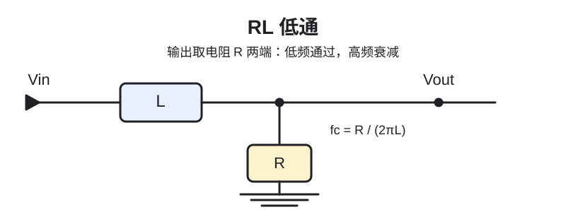

图中 L3 串联在输入路径，R19 接地，Vout 取 R19 两端，和上面的 RL 低通拓扑一致。

原始仿真截图：

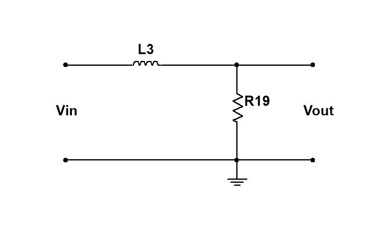

低频时电感接近短路，输出电阻上可以得到较大电压；高频时电感阻抗增大，输出电阻上的电压下降，因此这是低通滤波器。

### 3.2 阻抗分压推导

输出取在电阻两端，所以：

$$
H_{LP}(j\omega)=\frac{V_{out}}{V_{in}}
=\frac{R}{R+Z_L}
=\frac{R}{R+j\omega L}
$$

幅值为：

$$
|H_{LP}(j\omega)|
=\frac{R}{\sqrt{R^2+(\omega L)^2}}
=\frac{1}{\sqrt{1+\left(\frac{\omega L}{R}\right)^2}}
$$

相位为：

$$
\varphi_{LP}=-\arctan\left(\frac{\omega L}{R}\right)
$$

### 3.3 截止频率

在截止频率处，感抗大小等于电阻：

$$
X_L=R
$$

因此：

$$
2\pi f_cL=R
$$

得到：

$$
\boxed{f_c=\frac{R}{2\pi L}}
$$

截止点的幅值为：

$$
|H_{LP}(f_c)|=\frac{1}{\sqrt2}\approx0.707
$$

截止点相位为：

$$
\varphi_{LP}(f_c)=-45^\circ
$$

### 3.4 低频和高频极限

| 频率 | 电感状态 | 输出结果 |
| --- | --- | --- |
| $f\ll f_c$ | $X_L\ll R$，近似短路 | $V_{out}\approx V_{in}$ |
| $f=f_c$ | $X_L=R$ | $V_{out}\approx0.707V_{in}$ |
| $f\gg f_c$ | $X_L\gg R$，近似高阻 | $V_{out}\ll V_{in}$ |

> **> 原文中“输入频率越低变化越快”是方向写反了。频率越高，周期越短，波形变化越快；频率越低，变化越慢。**

## 4. RL 高通滤波器

### 4.1 电路结构

原文中的 RL 高通拓扑是：电阻串联在输入路径中，电感接地，输出取电感两端。

```text
Vin ─── R ───┬── Vout
             │
             L
             │
            GND
```

原笔记中的实际电路图：

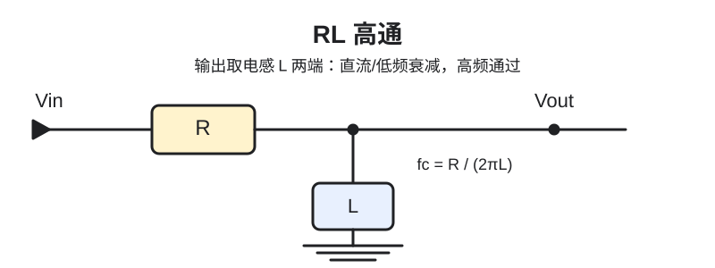

图中 R20 串联、L5 接地，Vout 取 L5 两端，因此这是 RL 高通，而不是输出取电阻的低通。

原始仿真截图：

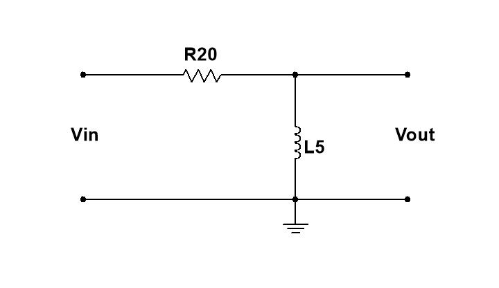

这里输出节点相对于地的电压，就是电感两端的电压。

### 4.2 阻抗分压推导

输出取在电感两端，所以：

$$
H_{HP}(j\omega)=\frac{V_{out}}{V_{in}}
=\frac{Z_L}{R+Z_L}
=\frac{j\omega L}{R+j\omega L}
$$

幅值为：

$$
|H_{HP}(j\omega)|
=\frac{\omega L}{\sqrt{R^2+(\omega L)^2}}
=\frac{\frac{\omega L}{R}}{\sqrt{1+\left(\frac{\omega L}{R}\right)^2}}
$$

相位为：

$$
\varphi_{HP}=90^\circ-\arctan\left(\frac{\omega L}{R}\right)
$$

### 4.3 高低频极限

低频时：

$$
X_L\ll R
$$

电感近似短路，输出节点被拉到地：

$$
V_{out}\approx0
$$

高频时：

$$
X_L\gg R
$$

电感阻抗很大，电流很小，电阻上的压降很小，输出节点电压接近输入：

$$
V_{out}\approx V_{in}
$$

因此输出取电感时是高通，输出取电阻时是低通。

### 4.4 截止频率和相位

同样令：

$$
X_L=R
$$

可得：

$$
\boxed{f_c=\frac{R}{2\pi L}}
$$

在截止频率处：

$$
|H_{HP}(f_c)|=0.707
$$

$$
\varphi_{HP}(f_c)=+45^\circ
$$

## 5. RL 高通与直流偏置

### 5.1 为什么 RL 高通可以去除直流

直流稳态下 (f=0)，理想电感：

$$
Z_L=j\omega L=0
$$

因此电感相当于短路，输出节点直接接近地：

$$
V_{out,DC}=0
$$

如果输入是带直流偏置的信号：

$$
V_{in}(t)=V_{bias}+v_{ac}(t)
$$

RL 高通会把直流分量 $V_{bias}$ 衰减掉，同时保留频率足够高的交流变化。

例如：

```text
输入：1 V ～ 3 V
      = 2 V 直流偏置 + 1 V 峰值交流信号

RL 高通输出：直流平均值接近 0 V，保留变化较快的交流部分
```

### 5.2 不要把偏置和噪声混为一谈

直流偏置不一定是噪声：

- 对晶体管、运放和 ADC，偏置可能是正常工作的必要条件；
- 对交流耦合或后级测量，偏置可能是不需要的直流分量；
- 滤波器只能按照频率衰减，不能判断某个直流分量“有用”还是“无用”。

如果后级仍然需要一个新的偏置电压，应在高通之后重新建立偏置，而不是简单把输出直接接入后级。

原笔记中的偏置和滤波示意图：

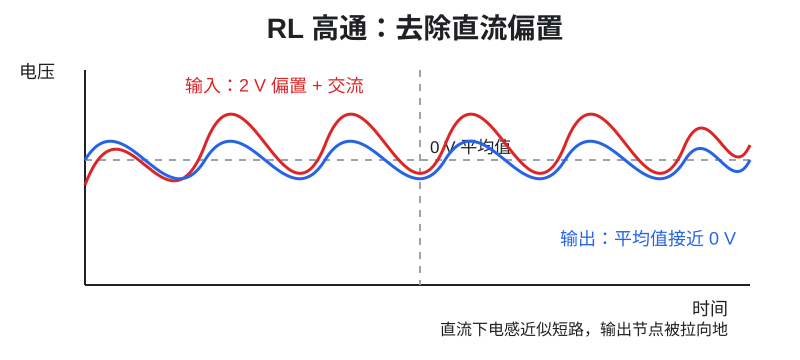

原始仿真/说明截图：

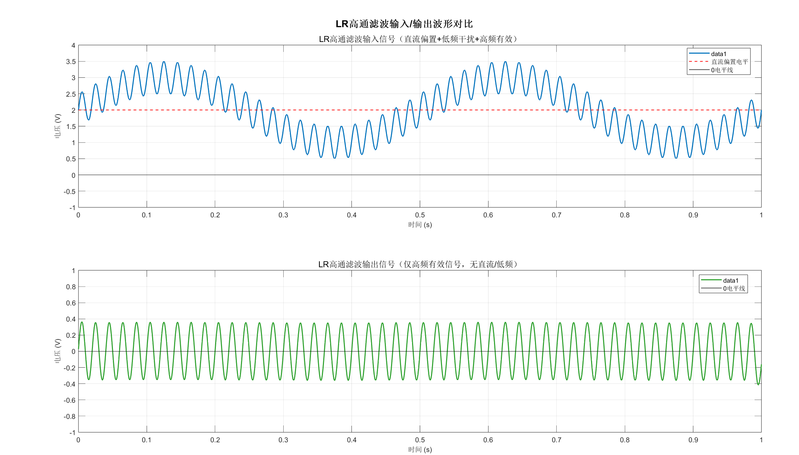

### 5.3 RL 与 RC 的高通对比

| 项目 | RC 高通 | RL 高通 |
| --- | --- | --- |
| 串联元件 | 电容 | 电阻 |
| 接地元件 | 电阻 | 电感 |
| 输出取样 | 电阻两端 | 电感两端 |
| 直流状态 | 串联电容开路 | 接地电感短路输出 |
| 适合场景 | 小信号、交流耦合 | 电流较大或需要低损耗串联路径的场景 |
| 主要限制 | 电容漏电、极性、ESR | DCR、饱和、体积和成本 |

## 6. RL 与 RC 低通对比

### 6.1 RL 低通

```text
Vin ─── L ───┬── Vout
             R
             │
            GND
```

电感串联在输入路径中，理想情况下直流压降为零，因此能够让直流和低频电流通过，同时提高高频串联阻抗。

### 6.2 RC 低通

```text
Vin ─── R ───┬── Vout
             C
             │
            GND
```

电阻串联在输入路径中，高频通过电容旁路到地，输出取电容两端。

### 6.3 “大电流用电感、小电流用电阻”只是经验

电感在理想模型中不消耗平均有功功率，但真实电感有 DCR 和磁芯损耗；电阻则一定会产生：

$$
P_R=I_{RMS}^2R
$$

因此在较大直流电流或电源线上，电感常被用作低损耗串联滤波元件。但是否选择电感，还要考虑：

- 额定电流和饱和电流；
- DCR 引起的压降和发热；
- 体积、成本和磁场辐射；
- 目标频段内的实际阻抗；
- 与电容形成的谐振和启动过冲。

同样，RC 滤波器并不只适合“电流很小”的电路；当电阻值、功耗和噪声都可接受时，RC 仍然是成本低、阻尼好、易设计的一阶滤波方案。

原笔记中的 RC 低通电路图：

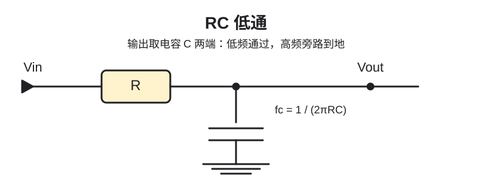

原始仿真截图：

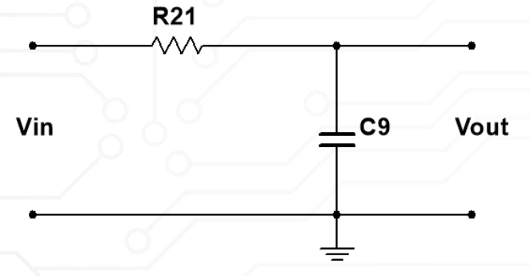

## 7. LC 二阶低通滤波器

### 7.1 电路结构

原文中的 LC 图是典型 L 型低通：电感串联，电容对地，输出取电容两端。

```text
Vin ─── L ───┬── Vout
             │
             C
             │
            GND
```

原笔记中的 LC 低通电路图：

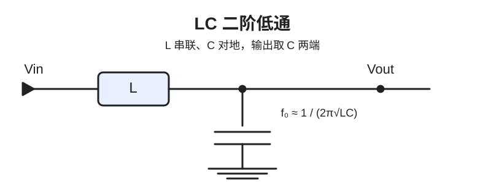

原始仿真截图：

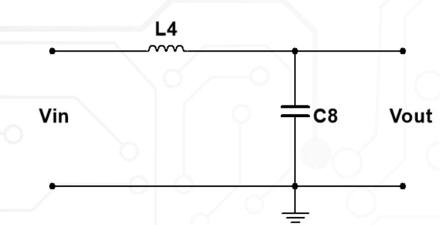

低频时：

- 电感感抗小，容易通过；
- 电容容抗大，不会明显分流；
- 输出接近输入。

高频时：

- 电感感抗增大，阻碍信号进入输出节点；
- 电容容抗减小，把高频电流旁路到地；
- 输出被更强地衰减。

### 7.2 为什么 LC 的衰减斜率更陡

一阶 RC 或 RL 只有一个储能元件，理想阻带渐近斜率约为：

$$
20\text{ dB/decade}
$$

LC 低通有两个储能元件，理想二阶阻带渐近斜率约为：

$$
40\text{ dB/decade}
$$

因此在相同目标频率附近，LC 可以提供更陡的衰减。但“衰减更陡”不等于任何情况下都更好：LC 的 Q 值较高时可能在截止附近产生峰值或振铃。

### 7.3 LC 不能简单写成两个电阻分压

原文中的：

$$
V_{out}=\frac{R_C}{R_C+R_L}V_{in}
$$

只适合非常粗略的电阻化近似，不是一般 LC 低通的完整公式。电容和电感的阻抗分别为：

$$
Z_L=j\omega L
$$

$$
Z_C=\frac{1}{j\omega C}
$$

若输出端接负载 $Z_{load}$，则电容与负载并联：

$$
Z_{shunt}=Z_C\parallel Z_{load}
$$

理想电压源、忽略源内阻时，传递函数可写成：

$$
H(j\omega)=\frac{Z_{shunt}}{Z_L+Z_{shunt}}
$$

实际分析还要加入：

- 信号源内阻；
- 电感 DCR；
- 电容 ESR；
- 负载阻抗；
- PCB 走线和器件寄生参数。

### 7.4 LC 固有频率与谐振频率

#### 7.4.1 谐振到底是什么

**谐振（resonance)**   是指：一个能够储存并交换能量的系统受到外部周期信号激励时，当激励频率接近系统的固有频率，外部信号每个周期都能在合适的相位继续补充能量，使系统的某种响应显著增强。

在电路中，这种“响应增强”不一定总是同一个量：

- 串联 RLC 谐振时，输入阻抗达到最小，回路电流达到最大；
- 并联 RLC 谐振时，输入阻抗达到最大，电源提供的线电流达到最小，但 L、C 支路内可能存在很大的循环电流；
- LC 低通滤波器阻尼较小时，输出电压的幅频响应会在固有频率附近出现峰值；
- 对带通电路，输出会在谐振附近形成一个明显的通带中心。

所以，谐振不能简单定义为“电压最大”或“电流最大”。更准确的共同特征是：

> **电感和电容的无功效应在某个频率附近相互抵消，能量在电场与磁场之间强烈交换，使阻抗、导纳、电压或电流出现极值。**

> **谐振不会凭空产生能量**
> 谐振处出现的大电压或大电流来自能量的逐周期积累。外部信号源持续补充电阻、ESR、DCR 和负载消耗的能量；稳定后，平均输入功率等于平均损耗功率。若假设电路完全无损，数学模型会预测在精确谐振激励下振幅无限增长，但真实器件的损耗、非线性和额定值会限制振幅。

#### 7.4.2 为什么电感和电容能在某个频率“抵消”

电感和电容的阻抗分别为：

$$
Z_L=j\omega L=jX_L
$$

$$
Z_C=\frac{1}{j\omega C}=-j\frac{1}{\omega C}=-jX_C
$$

其中电抗大小为：

$$
X_L=\omega L=2\pi fL
$$

$$
X_C=\frac{1}{\omega C}=\frac{1}{2\pi fC}
$$

两者随频率的变化方向相反：

- 频率升高时，$X_L$ 线性增大；
- 频率升高时，$X_C$ 反比例减小；
- 电感阻抗的虚部是正的 $+jX_L$，电容阻抗的虚部是负的 $-jX_C$。

因此一定存在一个交点，使二者大小相等：

$$
X_L=X_C
$$

即：

$$
\omega_0L=\frac{1}{\omega_0C}
$$

在串联回路中，此时总电抗为：

$$
X_{total}=X_L-X_C=0
$$

注意，这里的“抵消”是**复阻抗虚部的矢量抵消**，并不是电感和电容各自的电压、电流或储能都变成零。实际上，谐振时 L、C 内部的电压、电流和储能可能很大。

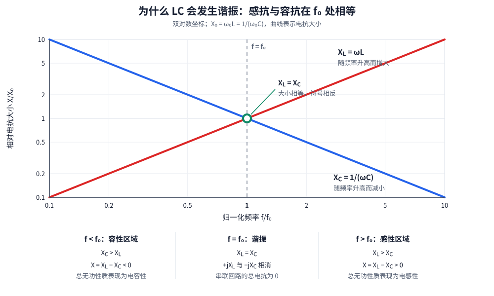

从图中可直接看出：

- $f<f_0$ 时，$X_C>X_L$，串联组合整体表现为容性；
- $f=f_0$ 时，$X_C=X_L$，总电抗为零，发生谐振；
- $f>f_0$ 时，$X_L>X_C$，串联组合整体表现为感性。

#### 7.4.3 LC 内部的能量是怎样交换的

电容储存电场能：

$$
E_C=\frac{1}{2}Cv_C^2
$$

电感储存磁场能：

$$
E_L=\frac{1}{2}Li^2
$$

理想 LC 中没有电阻损耗，因此总能量保持不变：

$$
E_{total}=E_C+E_L=\text{constant}
$$

假设电容一开始已经充电，一个完整周期可以分成四个四分之一周期：

| 时刻 | 电容电压 | 回路电流 | 主要能量位置 | 正在发生什么 |
| --- | --- | --- | --- | --- |
| $t=0$ | 正向最大 | 0 | 电容电场能最大 | 电容准备开始放电 |
| $t=T/4$ | 0 | 正向最大 | 电感磁场能最大 | 电容能量已经转移给电感 |
| $t=T/2$ | 反向最大 | 0 | 电容电场能最大 | 电感已把电容反向充满 |
| $t=3T/4$ | 0 | 反向最大 | 电感磁场能最大 | 能量再次转移到电感 |
| $t=T$ | 正向最大 | 0 | 回到初始状态 | 开始下一个周期 |

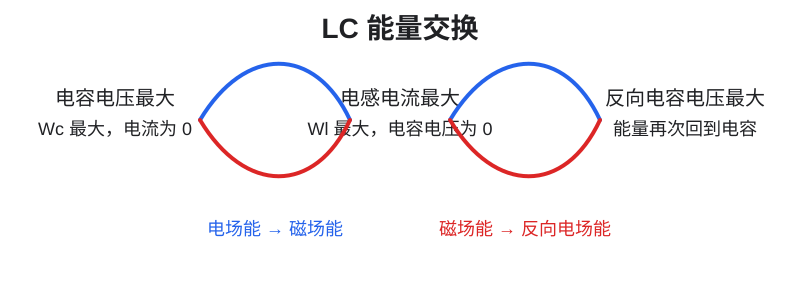

这里最容易误解的是：

- 电容电压为零时，电流通常恰好最大，而不是也为零；
- 电感电流最大时，$\mathrm di/\mathrm dt=0$，所以该瞬间电感电压为零，但电感中仍储存着最大的磁场能；
- 电容电压和回路电流相差四分之一周期，也就是 $90^\circ$；
- 真实电路每次交换都会损失一部分能量，所以不补充能量时，振幅会逐渐衰减。

#### 7.4.4 固有频率从哪里来

对于没有外部激励的理想 LC 回路，KVL 与元件关系可以写成：

$$
v_L+v_C=0
$$

$$
L\frac{\mathrm di}{\mathrm dt}+v_C=0,
\qquad i=C\frac{\mathrm dv_C}{\mathrm dt}
$$

代入后得到自由响应微分方程：

$$
LC\frac{\mathrm d^2v_C}{\mathrm dt^2}+v_C=0
$$

它的解是正弦或余弦形式，例如：

$$
v_C(t)=V_m\cos(\omega_0t+\varphi)
$$

要满足微分方程，必须有：

$$
\boxed{\omega_0=\frac{1}{\sqrt{LC}}}
$$

角频率与普通频率的关系是 $\omega=2\pi f$，因此：

$$
\boxed{f_0=\frac{1}{2\pi\sqrt{LC}}}
$$

其中：

- $L$ 的单位为 H；
- $C$ 的单位为 F；
- $\omega_0$ 的单位为 rad/s；
- $f_0$ 的单位为 Hz；
- 周期为 $T_0=1/f_0=2\pi\sqrt{LC}$。

增大 $L$ 会让电流更难改变，增大 $C$ 会让电压更难改变，因此二者都会让能量交换变慢，使 $f_0$ 降低。例如把 $L$ 增大 4 倍而保持 $C$ 不变，$f_0$ 会变为原来的 $1/2$。

#### 7.4.5 固有振荡、受迫谐振和振荡器不是同一件事

| 概念 | 是否需要持续外部激励 | 能量来源 | 典型表现 |
| --- | --- | --- | --- |
| 自由响应或固有振荡 | 不需要持续激励，但需要初始储能 | 预先充电的电容或预先建立电流的电感 | 理想 LC 等幅振荡；实际 RLC 逐渐衰减 |
| 受迫响应与谐振 | 需要周期性外部激励 | 外部正弦源持续供能 | 激励频率接近固有频率时响应显著增强 |
| 振荡器 | 需要直流电源和有源反馈 | 电源经放大器补偿损耗 | 在没有外部周期输入的情况下产生持续周期信号 |

因此，“给一个充电电容接上电感后出现衰减振荡”属于**自由响应**；“用正弦源扫频，在某个频率看到电流或电压峰值”才是严格意义上的**受迫谐振**；而实际振荡器还需要有源器件和正反馈不断补充能量。

对于含损耗的欠阻尼二阶系统，自由响应的衰减振荡频率为：

$$
\omega_d=\omega_0\sqrt{1-\zeta^2}
$$

它通常略低于无阻尼固有频率 $\omega_0$，也不一定等于受迫响应峰值所在的 $\omega_r$。这就是为什么工程上需要区分 $f_0$、$f_d$、$f_r$ 和 $f_c$。

#### 7.4.6 串联谐振与并联谐振

##### 串联 RLC 谐振

```text
Vin ─── R ─── L ─── C ─── GND
                 串联电流相同
```

串联 RLC 的输入阻抗为：

$$
Z_{series}=R+j\left(\omega L-\frac{1}{\omega C}\right)
$$

理想谐振条件 $X_L=X_C$ 成立时：

$$
Z_{series}(\omega_0)=R
$$

此时：

- 输入阻抗达到最小值；
- 电源电压与回路电流同相，功率因数为 1；
- 回路电流达到最大值 $I=V_{in}/R$；
- 电感电压 $V_L$ 与电容电压 $V_C$ 大小相等、相位相反，在总电压中相互抵消；
- 当 Q 很高时，$|V_L|$ 和 $|V_C|$ 都可能达到输入电压的 Q 倍，这叫作**电压放大或电压谐振**。

所以即使电源只有几伏，电感或电容两端也可能出现高得多的交流电压，选型时必须检查器件耐压和电感饱和。

##### 并联 RLC 谐振

```text
              ┌── R ──┐
Vin ──────────┼── L ──┼── GND
              └── C ──┘
```

理想并联 RLC 的输入导纳为：

$$
Y_{parallel}=\frac{1}{R}
+j\left(\omega C-\frac{1}{\omega L}\right)
$$

谐振时，电感支路和电容支路的无功电流大小相等、方向相反，虚部导纳相互抵消：

$$
Y_{parallel}(\omega_0)=\frac{1}{R}
$$

此时：

- 输入导纳达到最小、输入阻抗达到最大；
- 电源提供的线电流较小；
- L、C 两个支路中仍可能存在很大的反向循环电流；
- 常用于选频网络、振荡器谐振槽路和阻抗变换。

> **串联与并联谐振的快速记忆**
> **串联谐振看“阻抗谷、电流峰”**；**并联谐振看“阻抗峰、线电流谷”**。但两者内部都可能存在很大的 L、C 电压或支路电流。

#### 7.4.7 本章 LC 低通中的谐振怎样表现

本章使用的不是孤立的串联 RLC，而是串联电感、并联电容和负载的二阶低通：

```text
Vin ─── L ───┬── Vout
             │
             ├── C ── GND
             │
             └── R ── GND
```

在“理想电压源、理想 L 和 C、负载为纯电阻 $R$”的限定下，传递函数为：

$$
H(s)=\frac{V_{out}(s)}{V_{in}(s)}
=\frac{1}{LCs^2+\dfrac{L}{R}s+1}
$$

整理成标准二阶低通形式：

$$
H(s)=\frac{\omega_0^2}
{s^2+\dfrac{\omega_0}{Q}s+\omega_0^2}
$$

可得到：

$$
\omega_0=\frac{1}{\sqrt{LC}}
$$

$$
\boxed{Q=\frac{R}{\omega_0L}=R\sqrt{\frac{C}{L}}}
$$

这个 $Q$ 公式**只适用于上述串联 L、并联 $(C\parallel R)$ 的理想化低通拓扑**，不是所有 LC 或 RLC 电路的通用公式。

在这个低通中，谐振的可见表现主要是**输出电压在 $f_0$ 附近隆起或形成峰值**：

- $R$ 小，负载重，能量被负载快速消耗，阻尼大，Q 低，峰值不明显；
- $R$ 大，负载轻，能量不容易被消耗，阻尼小，Q 高，峰值明显；
- 完全理想且空载时，模型得到 $Q\rightarrow\infty$，在 $f_0$ 处出现不现实的无限增益；
- 真实电路会被电感 DCR、电容 ESR、源阻抗、负载和寄生参数限制，因此峰值总是有限的。

这也说明：LC 低通在低频时是滤波器，在固有频率附近同时又是一个可能发生谐振的二阶系统。设计时不能只看远端的 $-40\text{ dB/decade}$ 衰减，还必须检查转折附近是否出现峰值和振铃。

#### 7.4.8 数值例子：为什么谐振时元件电压可能大于输入电压

以一个**串联 RLC** 为例：

$$
L=10\text{ mH},\qquad C=1\,\mu\text{F},\qquad R=10\,\Omega
$$

固有频率为：

$$
f_0=\frac{1}{2\pi\sqrt{10\times10^{-3}\times1\times10^{-6}}}
\approx1.59\text{ kHz}
$$

在这个频率处：

$$
X_L=2\pi f_0L\approx100\,\Omega
$$

$$
X_C=\frac{1}{2\pi f_0C}\approx100\,\Omega
$$

如果输入为 $1\text{ V}_{\mathrm{RMS}}$，谐振时总阻抗约为 $R=10\,\Omega$，所以：

$$
I\approx\frac{1}{10}=0.1\text{ A}_{\mathrm{RMS}}
$$

电感和电容两端电压分别约为：

$$
|V_L|=IX_L\approx10\text{ V}_{\mathrm{RMS}}
$$

$$
|V_C|=IX_C\approx10\text{ V}_{\mathrm{RMS}}
$$

虽然两个元件上各有约 $10\text{ V}$，但它们相位相反，在 KVL 的矢量和中相互抵消，电源仍只需要提供电阻上的约 $1\text{ V}$。这个例子说明，所谓“抵消”不代表元件应力消失，反而可能伴随很大的内部电压或电流。

#### 7.4.9 为什么实际谐振点会偏离公式

$f_0=1/(2\pi\sqrt{LC})$ 使用的是理想、固定的 L 和 C。真实谐振频率和峰值还会受下列因素影响：

- 电感 DCR、磁芯损耗和频率相关损耗；
- 电感的寄生电容及自谐振频率 SRF；
- 电容 ESR、ESL 和 MLCC 的直流偏压降容；
- 信号源输出阻抗和负载阻抗；
- PCB 走线、过孔、器件封装带来的寄生 L 和 C；
- 电感饱和导致有效电感量随电流下降；
- 温度、器件容差和工作频率造成的参数变化。

因此，标称公式适合确定设计起点，但最终应使用包含 DCR、ESR、ESL、负载和源阻抗的完整模型进行 AC 扫频，并在最轻负载、最重负载、最大电流和温度极限下实测确认。

### 7.5 Q 值、谐振峰与截止频率

#### 7.5.1 Q 值和阻尼表示什么

$Q$ 是 **Quality Factor（品质因数）** 的缩写，是一个**没有单位的无量纲参数**。它描述系统储存能量与损耗能量之间的关系，也就是 LC 中的振荡能量能够维持多久。

在谐振系统中，Q 的能量定义为：

$$
\boxed{
Q=2\pi\frac{E_{stored}}{\Delta E_{cycle}}
}
$$

其中：

- $E_{stored}$ 是系统储存的最大能量；
- $\Delta E_{cycle}$ 是一个振荡周期内损耗的能量；
- 分子和分母的单位都是 J，所以 Q 没有单位。

这个公式可以这样理解：如果系统储存了很多能量，但每个周期只损失很少一部分，那么能量可以在电感和电容之间交换很多次，Q 就很高；如果每个周期都有大量能量被电阻、负载和器件损耗转化为热量，Q 就很低。

```text
电容的电场能 ──→ 电感的磁场能 ──→ 电容的电场能 ──→ ……
      │                   │                   │
      └──── ESR、DCR、负载和源阻抗不断消耗能量 ────┘
```

- **低 Q**：损耗大，能量很快被消耗；频域响应比较平滑，谐振峰不明显，时域响应较快停止振荡；
- **高 Q**：损耗小，能量在 L 和 C 之间往返很多次才衰减；频域中容易产生尖锐峰值，时域中容易出现过冲和持续时间较长的振铃；
- **理想 LC**：没有任何电阻损耗，每周期损失的能量为零，因此理想模型中 $Q\rightarrow\infty$；真实电路的 DCR、ESR、磁芯损耗、负载和源阻抗会把 Q 限制在有限值。

> **Q 高不等于滤波器一定更好**
> 高 Q 表示损耗小、选频性强，但也意味着截止附近可能放大某一段频率，并在上电或负载突变时产生明显过冲和振铃。低 Q 可以抑制峰值，却会使转折区域更加平缓。设计时需要在滤波衰减、通带平坦度和瞬态稳定性之间折中。

##### Q 的计算公式取决于电路拓扑

Q 不是仅由电感或电容单独决定的参数，它由 $L$、$C$、电阻损耗以及它们的连接方式共同决定。几种典型理想电路的 Q 为：

| 电路拓扑 | Q 值 | 电阻增大后的结果 |
| --- | --- | --- |
| 串联 RLC | $Q=\dfrac{\omega_0L}{R}=\dfrac{1}{\omega_0CR}=\dfrac{1}{R}\sqrt{\dfrac{L}{C}}$ | Q 降低，因为串联损耗增大 |
| 并联 RLC | $Q=\dfrac{R}{\omega_0L}=\omega_0CR=R\sqrt{\dfrac{C}{L}}$ | Q 升高，因为并联漏能减小 |
| 本节的串联 L、并联 $(C\parallel R)$ 低通 | $Q=R\sqrt{\dfrac{C}{L}}$ | 负载变轻，Q 升高 |

由此可见，不能脱离拓扑直接说“电阻越大，Q 越高”或“电阻越大，Q 越低”：

- 对串联损耗电阻，$R$ 越大，损耗越大，Q 越低；
- 对并联负载电阻，$R$ 越大，负载越轻，损耗越小，Q 越高。

> **一句话记忆 Q**
> **Q 衡量的是能量能在 LC 中“来回交换多少次”才明显衰减。**Q 越高，损耗越小、峰值越尖、振铃越久；Q 越低，损耗越大、响应越平滑、振铃越快消失。

标准二阶系统也常用阻尼比 $\zeta$ 表示阻尼：

$$
\boxed{\zeta=\frac{1}{2Q}}
$$

因此，$Q$ 越高，$\zeta$ 越低。需要注意两个不同的边界：

- $Q<0.5$ 对应过阻尼，没有振荡，但响应可能较慢；
- $Q=0.5$ 对应 $\zeta=1$，是临界阻尼，也是理想二阶系统中不发生振铃时的最快响应；
- $Q>0.5$ 对应欠阻尼，系统的自然响应中会出现逐渐衰减的振荡；
- 只有 $Q>1/\sqrt{2}\approx0.707$ 时，幅频曲线才会出现高于直流增益的谐振峰。

所以“会不会振铃”和“幅频曲线有没有峰值”不是完全相同的问题。

#### 7.5.2 不同 Q 值的幅频曲线

令归一化频率为：

$$
r=\frac{\omega}{\omega_0}=\frac{f}{f_0}
$$

上述理想化 LC 低通的幅值为：

$$
\boxed{
|H(j\omega)|=
\frac{1}{\sqrt{(1-r^2)^2+\left(\dfrac{r}{Q}\right)^2}}
}
$$

下图按这个公式绘制。纵轴是相对于直流增益的 dB 值，横轴是 $f/f_0$：

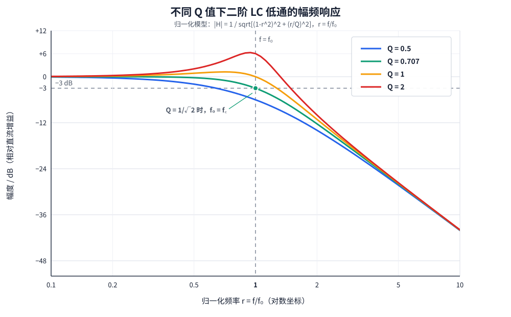

从图中可以读出：

- **$Q=0.5$**：阻尼较强，没有谐振峰；在 $f_0$ 处已经降到约 $-6.02\text{ dB}$，曲线的转折区域较宽；
- **$Q=0.707$**：即 $Q=1/\sqrt{2}$，对应二阶 Butterworth（巴特沃斯）响应；通带最大平坦，并且恰好在 $f_0$ 处为 $-3.01\text{ dB}$；
- **$Q=1$**：在 $f_0$ 以前出现轻微峰值，$f_0$ 处的增益回到 $0\text{ dB}$，真正的 $-3\text{ dB}$ 截止点位于 $f_0$ 之后；
- **$Q=2$**：截止附近有明显谐振峰；虽然最终仍以约 $-40\text{ dB/decade}$ 的二阶斜率下降，但峰值附近可能放大噪声或激励振铃。

> **高 Q 不会改变最终的二阶渐近斜率**
> 对这些同阶低通而言，远高于 $f_0$ 后都趋近于 $-40\text{ dB/decade}$。高 Q 主要改变转折附近的形状：它会造成峰化，而不是简单地让整个阻带“衰减更强”。

#### 7.5.3 $f_0$、$f_r$ 和 $f_c$ 的区别

这三个频率描述的是三件不同的事：

| 符号 | 名称 | 含义 | 是否一定存在 |
| --- | --- | --- | --- |
| $f_0$ | 固有频率 | 由二阶系统分母中的 $L$、$C$ 决定的自然频率参数 | 是 |
| $f_r$ | 谐振峰频率 | 幅频曲线取得最大值的位置 | 只有存在峰值时才有明确意义 |
| $f_c$ | $-3\text{ dB}$ 截止频率 | 幅值降到直流幅值的 $1/\sqrt{2}$，功率降为一半的位置 | 对正常低通响应通常存在 |

在本节的理想化拓扑中，把 $r=1$ 代入幅值公式可得：

$$
\boxed{|H(j\omega_0)|=Q}
$$

这条式子非常关键。它说明在 $f_0$ 处的增益由 $Q$ 决定，不一定是 $-3\text{ dB}$：

- $Q=0.5$ 时，$20\log_{10}(0.5)\approx-6.02\text{ dB}$；
- $Q=1/\sqrt{2}$ 时，$20\log_{10}(1/\sqrt{2})\approx-3.01\text{ dB}$；
- $Q=1$ 时为 $0\text{ dB}$；
- $Q=2$ 时为 $+6.02\text{ dB}$。

当 $Q>1/\sqrt{2}$ 时，谐振峰频率为：

$$
\boxed{
f_r=f_0\sqrt{1-\frac{1}{2Q^2}}
}
$$

可见 $f_r$ 略低于 $f_0$，并且 $Q$ 越高，两者越接近。若 $Q\le1/\sqrt{2}$，响应单调下降，不存在高于直流增益的谐振峰，因此不应硬套这个公式去寻找峰值。

实际 $-3\text{ dB}$ 截止频率要令 $|H|=1/\sqrt{2}$ 后求解。设 $r_c=f_c/f_0$，则：

$$
(1-r_c^2)^2+\left(\frac{r_c}{Q}\right)^2=2
$$

取正频率解：

$$
r_c^2=
1-\frac{1}{2Q^2}
+\sqrt{\left(1-\frac{1}{2Q^2}\right)^2+1}
$$

$$
\boxed{f_c=r_cf_0}
$$

因此：

- $Q<1/\sqrt{2}$ 时，$f_c<f_0$；
- $Q=1/\sqrt{2}$ 时，$f_c=f_0$；
- $Q>1/\sqrt{2}$ 时，$f_c>f_0$，而谐振峰频率 $f_r<f_0$。

> **什么时候可以直接用 $f_c=1/(2\pi\sqrt{LC})$？**
> 只有在电路确实能近似为标准二阶低通，并且阻尼被设计成 $Q\approx1/\sqrt{2}$（Butterworth）时，才可以把 $f_0$ 直接当作 $-3\text{ dB}$ 截止频率。否则，$1/(2\pi\sqrt{LC})$ 给出的是固有频率，真正的 $f_c$ 应由完整传递函数、仿真或实测曲线确定。

#### 7.5.4 实际元件为什么会改变 Q 和曲线

真实电路不是理想 LC。下列参数都会改变阻尼、峰值位置和截止频率：

| 实际因素 | 主要影响 |
| --- | --- |
| 电感 DCR | 消耗磁场能量并产生直流压降，通常降低 Q、减小峰值 |
| 电容 ESR | 引入损耗和额外零点，通常提供阻尼，但也会削弱高频旁路能力 |
| 信号源或电源输出阻抗 | 与电感串联参与阻尼，使实际传递函数偏离理想模型 |
| 负载电阻 | 在本节拓扑中，负载越重（$R$ 越小），并联阻尼越强、Q 越低 |
| PCB 走线和封装寄生参数 | 在高频处增加额外的 L、C、R，可能产生新的谐振点 |
| 电感磁芯损耗与饱和 | Q 随频率和电流变化；饱和后电感量下降，$f_0$ 会升高 |
| 电容的直流偏压效应 | MLCC 在直流偏压下有效电容量可能下降，使 $f_0$ 升高 |

这也解释了为什么只把标称 $L$、$C$ 代入公式还不够。例如空载时曲线可能有明显峰值，接入负载后峰值却消失；或者用示波器探头、电子负载测量时，测量设备本身也改变了等效负载和 Q。

#### 7.5.5 频域峰值和时域过冲是同一阻尼问题的两种表现

高 Q 系统在谐振附近容易积累能量，所以它不仅会在扫频曲线上形成峰值，还会在上电、阶跃输入或负载突变时出现：

- 输出过冲或下冲；
- 按接近 $f_0$ 的频率振铃；
- 较长的稳定时间；
- 对周期性开关纹波或窄带噪声的意外放大。

因此，滤波器“对某个高频衰减很多”并不代表系统整体一定更好。若高 Q 峰值正好落在开关频率、控制环路交越频率或其谐波附近，反而可能恶化噪声与稳定性。

#### 7.5.6 实际设计检查清单

设计 LC 低通时，至少应同时检查：

- **通带**：直流压降、通带增益和允许纹波；
- **截止附近**：实际 $f_c$、谐振峰值及峰值对应频率；
- **阻带**：目标干扰频率处的衰减，而不只是理想渐近斜率；
- **负载范围**：空载、轻载、额定负载和瞬态负载下的曲线变化；
- **时域响应**：上电、输入阶跃和负载突变时的过冲、振铃与稳定时间；
- **器件非理想性**：DCR、ESR、容差、温漂、直流偏压降容和电感饱和；
- **系统稳定性**：LC 是否与 DC-DC 控制环路、电源模块输出阻抗或后级输入滤波器发生相互作用。

常见的抑制高 Q 方法包括利用合适的负载阻尼、增加串联或并联阻尼网络、选择具有合适 ESR 的电容，或采用专门设计的 RC 阻尼支路。阻尼元件会带来功耗或降低滤波效果，因此应根据完整工作范围仿真并实测，而不是只追求某一个理论 Q 值。

## 8. RC、RL、LC 的综合比较

| 项目 | RC 一阶滤波 | RL 一阶滤波 | LC 二阶滤波 |
| --- | --- | --- | --- |
| 储能元件数量 | 1 个电容 | 1 个电感 | 1 个电感 + 1 个电容 |
| 理想阻带斜率 | 20 dB/decade | 20 dB/decade | 40 dB/decade |
| 直流串联压降 | 由电阻和电流决定 | 理想电感为 0 | 由电感 DCR 决定 |
| 主要损耗 | 电阻发热 | DCR、磁芯损耗 | 电感损耗、电容 ESR |
| 谐振风险 | 通常较低 | 通常较低 | 需要重点关注 |
| 典型优点 | 便宜、阻尼自然、体积小 | 大电流低损耗串联滤波 | 衰减陡、适合电源和功率滤波 |
| 典型限制 | 电阻功耗、源负载影响 | 体积、饱和、DCR | Q 值、谐振、启动过冲 |

## 9. 数值示例：RL 低通和高通

设：

$$
L=10\text{ mH},\qquad R=100\,\Omega
$$

截止频率为：

$$
f_c=\frac{100}{2\pi\times10\times10^{-3}}
\approx1.59\text{ kHz}
$$

令 $r=f/f_c$，则 RL 低通幅值为：

$$
|H_{LP}|=\frac{1}{\sqrt{1+r^2}}
$$

RL 高通幅值为：

$$
|H_{HP}|=\frac{r}{\sqrt{1+r^2}}
$$

| 输入频率 | $r=f/f_c$ | RL 低通 | RL 高通 |
| ---: | ---: | ---: | ---: |
| 159 Hz | 0.1 | 0.995 | 0.0995 |
| 1.59 kHz | 1 | 0.707 | 0.707 |
| 15.9 kHz | 10 | 0.0995 | 0.995 |

这说明 RL 低通和高通在同一截止频率处幅值互补，但输出取样点不同：

- 输出取电阻：低通；
- 输出取电感：高通。

## 10. 设计与测量注意事项

### 10.1 电感选型

- 额定电流必须高于实际 RMS 电流；
- 饱和电流必须覆盖启动、短时峰值和负载突变；
- DCR 过大将产生额外压降和发热；
- 查看目标频率范围内的阻抗曲线，而不只看标称电感量；
- 注意自谐振频率，超过后不能继续按理想电感计算。

### 10.2 负载和源内阻

截止频率中的 (R) 不是永远等于电路图中某一个电阻。应使用电感实际看到的等效电阻，并考虑：

- 信号源输出电阻；
- 外部串联电阻；
- 后级输入电阻；
- 负载的频率相关阻抗。

### 10.3 LC 的阻尼

如果 LC 滤波器在截止附近出现峰值或振铃，可以考虑：

- 增加串联电阻或阻尼网络；
- 使用电容 ESR 提供适量损耗；
- 调整 L/C 比值和负载阻抗；
- 通过仿真检查启动和负载突变；
- 使用实际器件模型而不是只使用理想 L、C。

### 10.4 示波器测量

测量输入输出时：

1. CH1 测 $V_{in}$，CH2 测 $V_{out}$；
2. 两个探头使用共同且正确的电路地；
3. 在 $0.1f_c$、$f_c$、$10f_c$ 附近测量幅值；
4. 观察 RL 低通的输出滞后和 RL 高通的输出超前；
5. 对功率电路使用短地弹簧、差分探头或合适的电流探头；
6. 台式示波器地夹通常连接保护地，不要夹到非地节点。

## 11. 常见错误说法修正

| 容易混淆的说法 | 更准确的说法 |
| --- | --- |
| 电感的阻抗写成 $R_L=2\pi fL$ | 理想感抗写成 $X_L=2\pi fL$，复阻抗写成 $Z_L=j\omega L$ |
| 电感完全不损耗能量 | 理想电感不消耗平均有功功率，真实电感有 DCR 和磁芯损耗 |
| 高频时电感电流完全停止 | 高频时电感阻抗增大，电流幅值受到抑制且产生相位滞后 |
| RL 低通输出取电感 | 该拓扑输出取电阻；输出取电感时是 RL 高通 |
| 输入频率越低变化越快 | 频率越高，周期越短，变化越快 |
| LC 低通截止频率一定等于 $1/(2\pi\sqrt{LC})$ | 该公式是理想 LC 固有频率；实际 -3 dB 截止频率取决于拓扑、负载和阻尼 |
| LC 比 RC 好，所以可以直接替换 | LC 衰减更陡，但可能有谐振峰、振铃、过冲和启动问题 |
| 电感接地就一定能去掉所有直流偏置 | 只有在输出取电感且直流下电感形成低阻接地路径时，输出直流才被拉低 |

## 12. 一句话总结

> 电感的感抗 $X_L=2\pi fL$ 随频率升高而增大；在 RL 电路中，输出取电阻得到低通，输出取电感得到高通；LC 低通利用串联电感和对地电容共同抑制高频，理想阻带斜率更陡，但必须同时控制实际损耗、负载和谐振。
