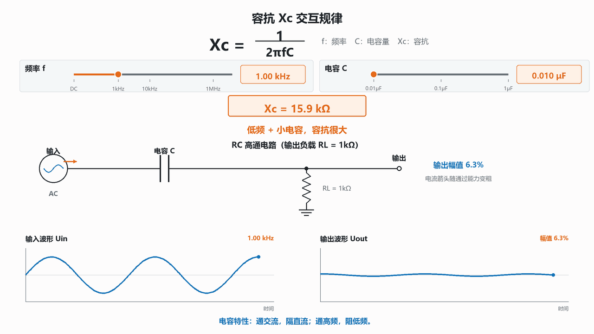

# 容抗 Xc 原理

电阻会阻碍电流，电容也会对交流电流表现出一种“阻碍”。电容对交流电流的这种阻碍程度叫作**容抗**，用 $X_C$ 表示，单位同样是欧姆（Ω）。

容抗不是一个固定值。它会随信号频率和电容量改变，这正是电容能够用于滤波、耦合和电源去耦的基础。

## 1. 容抗公式

理想电容的容抗大小为：

$$X_C=\frac{1}{2\pi fC}$$

各变量的含义如下：

| 符号    | 含义               | 单位  | 使用时注意                             |
| ----- | ---------------- | --- | --------------------------------- |
| $X_C$ | 电容对交流电流的阻碍程度，即容抗 | Ω   | 数值越小，交流越容易通过                      |
| $f$   | 交流信号频率           | Hz  | 1kHz = 1000Hz，1MHz = 1,000,000Hz  |
| $C$   | 电容量              | F   | 1uF = $10^{-6}$F，1nF = $10^{-9}$F |
| $\pi$ | 圆周率              | 无单位 | 计算时通常取 3.1416                     |

> **> 代入公式前必须把频率换算成 Hz，把电容量换算成 F。初学者最常见的错误，就是直接把“0.1uF”中的 0.1 代入公式，导致结果相差一百万倍。**

## 2. 公式揭示的三个核心规律

### 2.1 频率越高，容抗越小

当电容量 $C$ 不变时，频率 $f$ 位于分母：

- $f$ 增大，$X_C$ 减小，交流电流更容易通过；
- $f$ 减小，$X_C$ 增大，交流电流更难通过。

因此常说电容具有“**通高频、阻低频**”的特点。这里的“通”和“阻”不是绝对短路或绝对断路，而是相对容易或相对困难。实际通过多少，还要看电路中的电阻、电感和信号源阻抗。

### 2.2 电容量越大，容抗越小

当频率 $f$ 不变时，电容量 $C$ 也位于分母：

- $C$ 增大，$X_C$ 减小；
- $C$ 减小，$X_C$ 增大。

容量更大的电容，每变化一点电压就能转移更多电荷，因此在相同频率下能够通过更大的交流电流。

### 2.3 直流稳态下，容抗趋近无穷大

直流信号的频率为 $f=0$。代入公式可知：

$$X_C=\frac{1}{2\pi\times0\times C}\rightarrow\infty$$

理想电容在直流稳态下相当于开路，因此有“**隔直流、通交流**”的说法。

需要注意，刚接通直流电源时，电容会经历充电过程，短时间内仍有电流。只有充电完成、两端电压不再变化后，理想电容中的直流电流才降为零。真实电容还存在很小的漏电流。

## 3. 用 0.1uF 电容实际计算

先换算单位：

$$0.1\text{uF}=0.1\times10^{-6}\text{F}=1\times10^{-7}\text{F}$$

### 3.1 直流：$f=0$Hz

$$X_C\rightarrow\infty$$

结论：直流稳态无法通过理想电容。

### 3.2 交流：$f=1$kHz

$$
\begin{aligned}
X_C&=\frac{1}{2\pi\times1000\times0.1\times10^{-6}}\\
&\approx1591.5\Omega\\
&\approx1.59\text{k}\Omega
\end{aligned}
$$

结论：0.1uF 电容对 1kHz 信号仍表现出约 1.59kΩ 的阻碍。

### 3.3 高频：$f=1$MHz

$$
\begin{aligned}
X_C&=\frac{1}{2\pi\times1{,}000{,}000\times0.1\times10^{-6}}\\
&\approx1.59\Omega
\end{aligned}
$$

结论：同一颗 0.1uF 电容面对 1MHz 信号时，理想容抗只有约 1.59Ω，高频电流更容易通过。

### 3.4 计算结果汇总

| 电容量 | 频率 | 理想容抗 $X_C$ | 直观含义 |
| --- | ---: | ---: | --- |
| 0.1uF | 0Hz（直流） | $\infty$ | 稳态直流被阻断 |
| 0.1uF | 1kHz | 约 1.59kΩ | 对低频仍有明显阻碍 |
| 0.1uF | 1MHz | 约 1.59Ω | 高频电流容易通过 |

频率从 1kHz 提高到 1MHz，增大了 1000 倍；容抗正好减小为原来的 1/1000。这就是反比例关系。

## 4. $f$、$C$ 改变时，$X_C$ 怎样变化

| 改变条件 | 公式中的变化 | $X_C$ 的变化 | 电流通过趋势 |
| --- | --- | --- | --- |
| $f$ 增大，$C$ 不变 | 分母增大 | 减小 | 更容易通过 |
| $f$ 减小，$C$ 不变 | 分母减小 | 增大 | 更难通过 |
| $C$ 增大，$f$ 不变 | 分母增大 | 减小 | 更容易通过 |
| $C$ 减小，$f$ 不变 | 分母减小 | 增大 | 更难通过 |
| $f=0$，任意有限 $C$ | 分母为 0 | 趋近无穷大 | 直流稳态被阻断 |

可以记成一句话：

> $f$ 和 $C$ 都在分母中，任何一个变大，容抗都会变小。

## 5. 电阻与容抗有什么不同

电阻和容抗的单位都是 Ω，也都能限制电流，但它们背后的物理过程不同。

### 5.1 电阻把电能变成热

电阻两端的电压与电流同相。理想电阻消耗有功功率：

$$P=UI=I^2R=\frac{U^2}{R}$$

电能最终主要转化为热量，所以大电流通过电阻时会发热。

### 5.2 理想电容只往返储存能量

电容储存的能量为：

$$E=\frac{1}{2}CU^2$$

交流电压上升时，电容从电源吸收能量；电压下降时，电容再把能量释放回电路。理想电容一个完整周期内吸收和释放的能量相互抵消，平均有功功率为 0。

因此，“容抗为 100Ω”不等于它像 100Ω 电阻那样持续发热。容抗描述的是正弦稳态下电压与电流幅值的比值，但电容中的电压和电流存在相位差。

> **> 真实电容并非完全不发热。它有等效串联电阻 ESR、漏电和介质损耗，因此在较大纹波电流或高频下仍会产生损耗。这里所说“不消耗有功功率”指理想电容模型。**

## 6. 为什么电容电流超前电压 90°

电容的电流关系式为：

$$i=C\frac{dU}{dt}$$

它说明电流由电压的**变化速度**决定，而不是只由电压大小决定：

- 电压上升最快时，$dU/dt$ 最大，充电电流最大；
- 电压到达正峰值时，波形暂时变平，$dU/dt=0$，电流为 0；
- 电压下降最快时，$dU/dt$ 为负且绝对值最大，放电电流反向达到最大；
- 电压到达负峰值时，变化速度再次为 0，电流再次为 0。

对于正弦交流，电流波形比电压波形提前四分之一个周期，也就是：

> **电容电流超前电容电压 90°。**

可以把它理解成：电容关注的不是“现在电压有多高”，而是“电压此刻变化得有多快”。电压还在快速爬升时，电流已经很大；等电压真正到达峰顶，电流反而已经回到零。

## 7. 用蓄水池理解容抗

把电压想象成水压，把电流想象成水流，把电容想象成带弹性隔膜的蓄水池：

- 水压升高时，水被压入蓄水池，相当于电容充电；
- 水压降低时，蓄水池把水推回管路，相当于电容放电；
- 水压长时间保持不变后，蓄水池不再继续进水，相当于电容阻断直流稳态；
- 水压快速来回变化时，蓄水池频繁吸水、放水，交流流动明显；
- 蓄水池越大，同样的水压变化能吞吐越多的水，相当于电容量越大、容抗越小。

因此，缓慢变化的低频水压下，蓄水池每次充放水的间隔很长，单位时间内流量较小；快速变化的高频水压下，它不断吸水和放水，表现为更容易让交流成分通过。

这个类比适合理解趋势，但真实电路还会受到 ESR、ESL、走线和负载阻抗影响。

## 8. 工程实战：为什么 0.1uF 去耦电容能处理高频跌落

芯片内部大量晶体管同时翻转时，会产生纳秒到微秒量级的快速电流变化。这个变化包含大量高频成分。

在芯片 VCC 与 GND 引脚旁放置 0.1uF 去耦电容后：

1. 高频扰动对应很高的 $f$；
2. 根据 $X_C=1/(2\pi fC)$，0.1uF 电容在高频下呈现较小容抗；
3. 芯片需要瞬时电流时，电容通过很短的本地回路放电；
4. 高频电流不必全部经过远处电源和较长 PCB 走线；
5. 芯片 VCC 引脚处的电压下冲因此减小。

这就是“去耦”或“旁路”的含义：把高频扰动通过低阻抗路径旁路到本地 GND，同时为芯片补偿快速变化的瞬时电流。

### 8.1 为什么电容必须靠近芯片

公式中的 $X_C$ 只是理想电容的容抗。实际连接还存在走线和过孔的寄生电感，其感抗为：

$$X_L=2\pi fL$$

频率越高，寄生电感的阻碍越大。若 0.1uF 电容离芯片很远，连接路径的寄生感抗可能抵消电容低容抗的优势。因此电容必须靠近芯片电源引脚，VCC—电容—GND 回路应尽可能短。

### 8.2 为什么不能只放一颗大电容

仅从理想公式看，容量越大，容抗越小，好像一颗 100uF 电容可以代替所有小电容。但真实大容量电容通常存在以下限制：

- 封装更大，电流回路更长，等效串联电感 ESL 较大；
- 电解电容等器件的 ESR 通常高于小型 MLCC；
- 超过自谐振频率后，电容会逐渐表现出电感特性；
- 大电容一般放在电源入口或稳压器附近，距离芯片较远；
- 大容量器件适合支撑时间较长、频率较低的负载变化，但不一定能响应最快的边沿。

工程上常采用分工组合：

| 器件 | 常见位置 | 主要处理范围 | 作用 |
| --- | --- | --- | --- |
| 0.1uF 小型 MLCC | 紧贴芯片 VCC/GND | 高频、极短瞬态 | 就地补偿最快的电流变化 |
| 1uF～10uF MLCC | 芯片或一组负载附近 | 中等频率与持续时间 | 本地区域储能 |
| 10uF～数百 uF 大电容 | 电源入口、稳压器附近 | 低频、较长负载变化 | 平滑电源并提供较多储能 |

最终容值、数量和布局应优先遵循芯片及稳压器数据手册。

## 9. $R$、$X_C$ 与 $X_L$ 对比

| 项目 | 电阻 $R$ | 容抗 $X_C$ | 感抗 $X_L$ |
| --- | --- | --- | --- |
| 基本公式 | $R=U/I$ | $X_C=1/(2\pi fC)$ | $X_L=2\pi fL$ |
| 与频率的关系 | 理想情况下不随频率改变 | 频率越高，容抗越小 | 频率越高，感抗越大 |
| 直流稳态 | 可以通过直流，大小由 $R$ 限制 | 理想状态相当于开路 | 理想状态相当于短路 |
| 能量特点 | 消耗有功功率并发热 | 储存在电场中，再释放 | 储存在磁场中，再释放 |
| 相位关系 | 电压、电流同相 | 电流超前电压 90° | 电流滞后电压 90° |
| 常见用途 | 限流、分压、负载 | 耦合、滤波、去耦、储能 | 滤波、储能、扼流 |

可以用一句口诀帮助记忆：

> 电容“高频容易过”，电感“高频不容易过”，电阻则主要按阻值限制电流。

## 10. 常见误区

### 误区一：容抗越小，输出电压一定越大

输出电压还取决于电容与哪个负载组成电路。例如串联电容、输出取在接地电阻上的 RC 高通电路，其幅频关系为：

$$
\left|\frac{U_{out}}{U_{in}}\right|
=\frac{R}{\sqrt{R^2+X_C^2}}
$$

此时 $X_C$ 越小，输出越接近输入。但如果输出取在电容两端，结果会相反。因此分析滤波电路时必须先看清输出取样位置。

### 误区二：大电容在所有频率下都更好

理想公式没有包含 ESR、ESL 和自谐振频率。真实电容超过某一频率后，不再像理想电容。工程设计要同时看容量、封装、布局和阻抗频率曲线。

### 误区三：电容完全不发热

只有理想电容平均不消耗有功功率。真实电容的 ESR 和介质损耗会产生热量，纹波电流过大时仍可能过热或失效。

## 11. 学习检查

看到 $X_C=1/(2\pi fC)$ 时，应能立即判断：

- 频率提高 10 倍，容抗变为原来的 1/10；
- 电容量提高 10 倍，容抗变为原来的 1/10；
- 直流稳态下，理想电容相当于开路；
- 0.1uF 电容在 1kHz 时约为 1.59kΩ，在 1MHz 时约为 1.59Ω；
- 去耦电容处理高频瞬态，不仅依靠小容抗，还依靠靠近芯片形成的短回路；
- 理想电容储能再释放，真实电容则存在 ESR、ESL 和损耗。

## 12. 一句话总结

> 容抗是电容对交流电流的频率相关阻碍：频率越高或电容量越大，$X_C$ 越小；直流稳态下 $X_C$ 趋近无穷大，这正是电容隔直、通交、滤波和高频去耦的共同物理基础。

## 交互式演示

使用浏览器直接打开同目录下的 [容抗Xc交互式仿真.html](容抗Xc交互式仿真.html)，可以拖动频率和电容量滑杆，实时观察容抗、输出增益、电路电流方向与波形振幅的变化。
