# 1.1.1 操作系统的概念、功能和目标

> **核心结论**
> 操作系统（Operating System，OS）是控制和管理整个计算机系统的硬件与软件资源、合理组织计算机工作流程，并为用户和应用程序提供接口的系统软件。
>
> 从不同角度看，操作系统有三种核心角色：**系统资源的管理者、用户与硬件之间的接口、对硬件机器的扩充**。

## 熟悉的操作系统举例
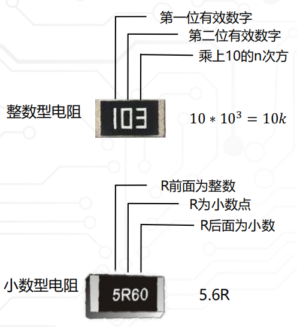

## 操作系统的层次结构

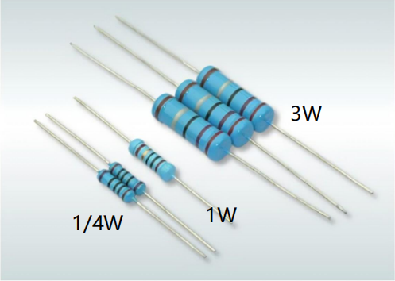

> **tips**
> 1. 操作系统位于计算机硬件与应用程序、用户之间，是最接近硬件的一层系统软件。
> 2. 操作系统通过管理底层资源并封装复杂的硬件操作，为上层软件提供统一、易用的运行环境。

## 操作系统的概念

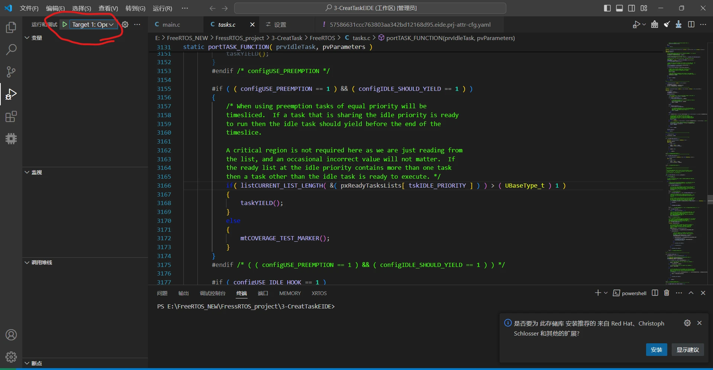

## 操作系统的目标

- **方便性**：隐藏硬件细节，为用户和程序提供易用的接口。
- **有效性**：合理分配处理器、内存和 I/O 设备，提高资源利用率与系统吞吐量。
- **可扩充性**：采用便于增加新功能和适配新硬件的结构。
- **开放性**：遵循标准，使不同软硬件能够兼容和协同工作。

## 操作系统的功能

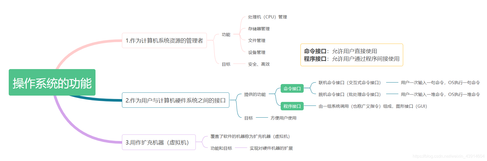

> **引例**
>  - 我们假设：用户是雇主，操作系统是工人（用来操作机器），计算机是机器（由处理机(CPU)、存储器、设备、文件几个部件构成）
>  - 工人有熟练的技能去控制和协调各个部件的工作，这就是`操作系统对资源的管理`
>  - 同时，工人必须接受雇主的命令，这就是`"接口"`
>  - 有了工人，机器就能发挥更大的作用，因此工人就成了`"扩充机器"`
> - 工人操作机器、机器有了更大的作用比如GUI界面，于是工人便成了`扩充机器`，去扩充GUI界面等功能

### 1. 作为计算机系统资源的管理者

操作系统负责管理计算机中的软硬件资源，并协调多个程序对资源的使用

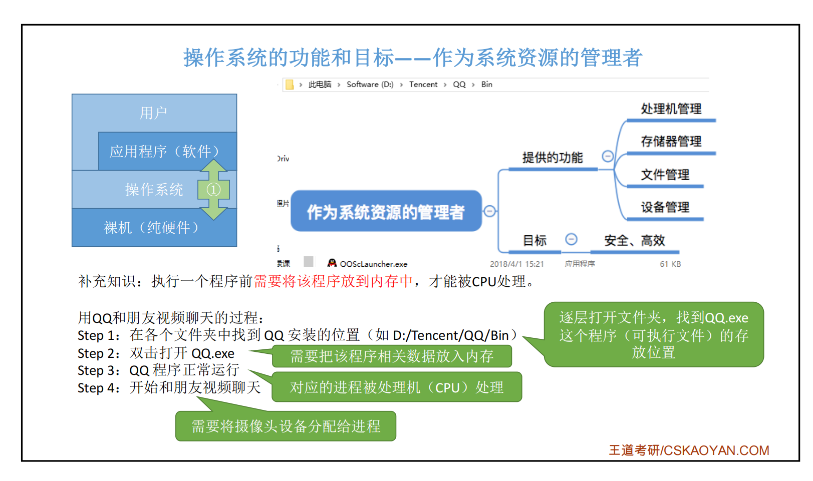

| 管理对象  | 主要任务                      |
| ----- | ------------------------- |
| 处理器管理 | 进程控制、进程同步、进程通信、死锁处理、处理机调度 |
| 存储器管理 | 内存分配与回收、地址转换、内存保护与共享、内存扩充 |
| 文件管理  | 文件存储空间管理、目录管理、文件读写与访问保护   |
| 设备管理  | 缓冲管理、设备分配、设备处理、虚拟设备管理     |

####  处理器（CPU）管理

在多道程序环境下，CPU的分配和运行都以<mark>进程（或线程）</mark>为基本单位，因此对CPU的管理可理解为对进程的管理。进程管理的主要功能包括`进程控制、进程同步、进程通信、死锁处理、处理机调度`等

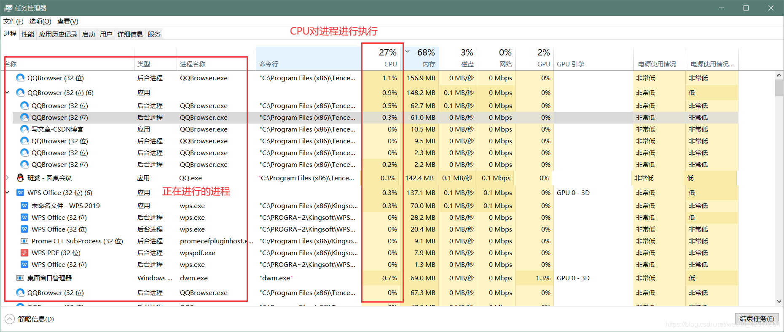

#### 存储器管理

为多道程序的运行提供良好的环境，方便用户使用及提高内存的利用率，主要包括`内存分配与回收、地址映射、内存保护与共享和内存扩充`等功能

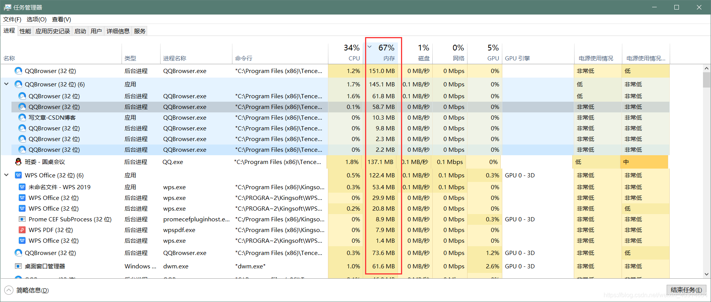

####  文件管理

计算机中所有的信息都是以文件的形式存在的，操作系统中负责文件的管理的部分称为文件系统，文件管理包括`文件存储空间的管理、目录管理及文件读写管理和保护`等

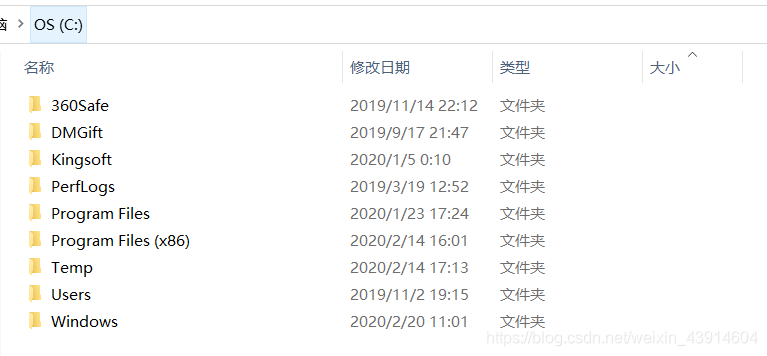

#### 设备管理

设备管理的主要任务是完成<mark>用户的I/O请求</mark>，方便用户使用各种设备，并提高设备的利用率，主要`包括缓存管理、设备分配、设备处理和虚拟设备`等功能

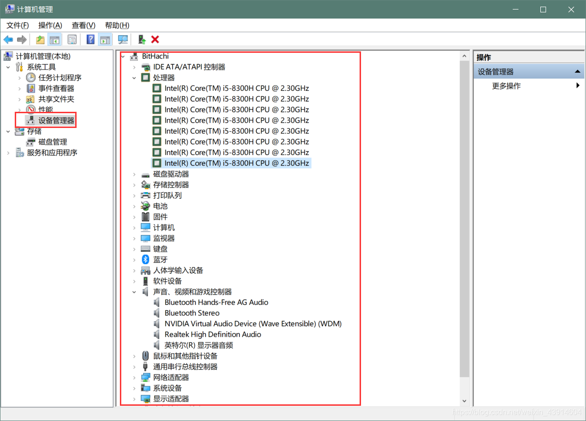

### 2. 作为用户与计算机硬件之间的接口

操作系统封装了复杂的硬件功能，使用户和应用程序无须直接操作底层硬件。

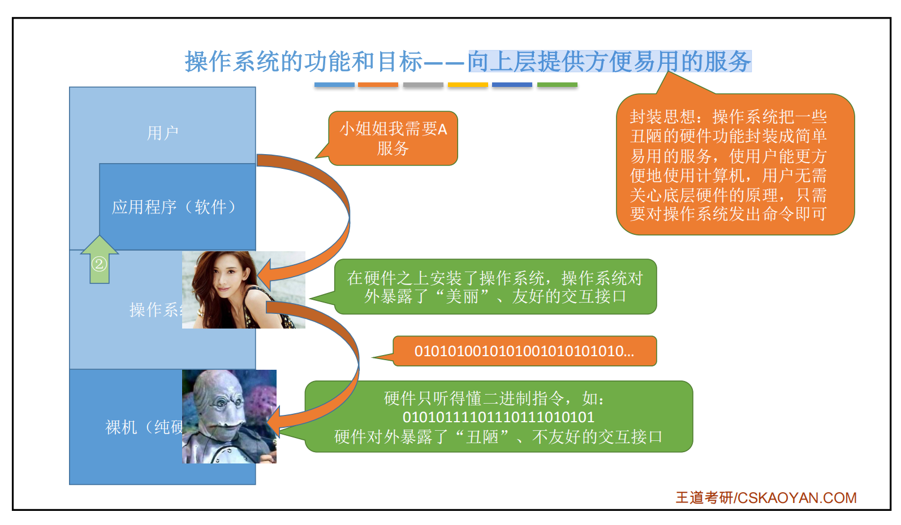

#### 命令接口

命令接口供用户**直接使用**，可分为以下两类：

##### 联机命令接口

| 类型     | 别名      | 特点                  | 典型场景   |
| ------ | ------- | ------------------- | ------ |
| 联机命令接口 | 交互式命令接口 | 用户输入一条命令，系统立即执行一条命令 | 终端、命令行 |

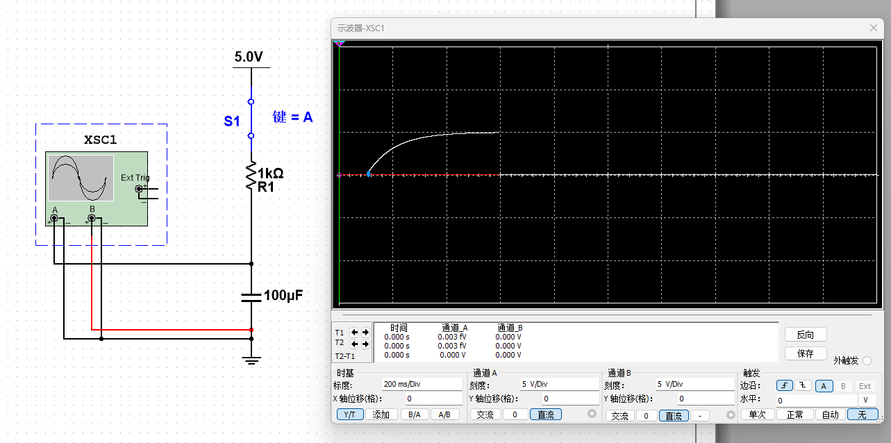

##### 脱机命令接口

| 类型     | 别名    | 特点                             | 典型场景     |
| ------ | ----- | ------------------------------ | -------- |
| 脱机命令接口 | 批处理接口 | 用户预先提交一组命令，系统依次执行，执行期间通常无须人工干预 | 批处理作业、脚本 |

> 批处理(Batch)，也称为批处理脚本。顾名思义，批处理就是对某对象进行批量的处理，通常被认为是一种简化的脚本语言，它应用于DOS和Windows系统中。批处理文件的扩展名为bat

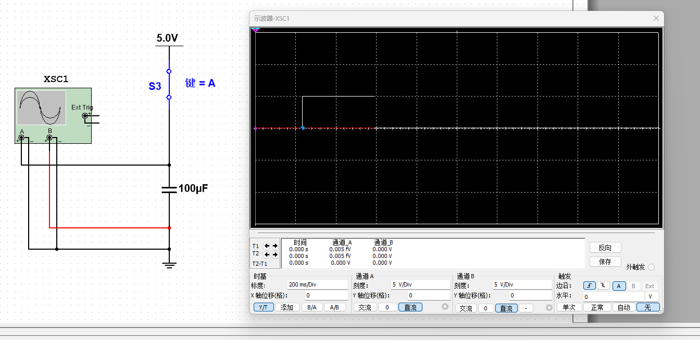

#### 程序接口

程序接口由一组**系统调用**组成，也称广义指令。应用程序通过系统调用请求操作系统提供服务，例如：

- 创建或终止进程；
- 申请或释放内存；
- 读写文件；
- 使用外部设备。

用户不能直接执行系统调用，而是通过应用程序**间接使用**程序接口。

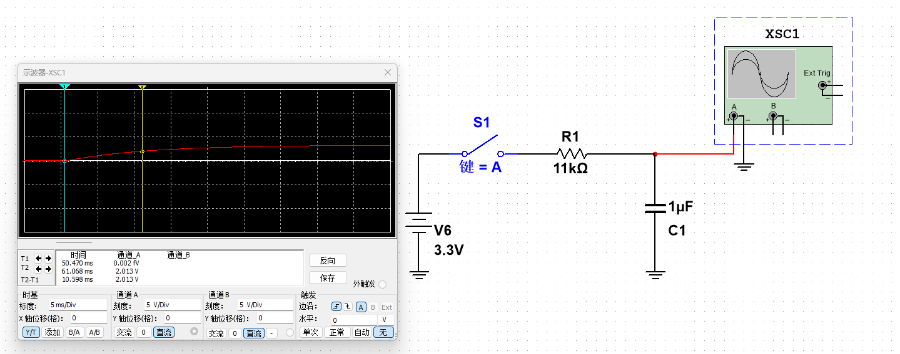

#### 图形用户界面

图形用户界面（GUI）通过窗口、图标、菜单等元素让用户操作计算机，是面向用户的交互方式。GUI 的底层实现仍会调用操作系统提供的服务，但 **GUI 本身不等同于由系统调用组成的程序接口**。

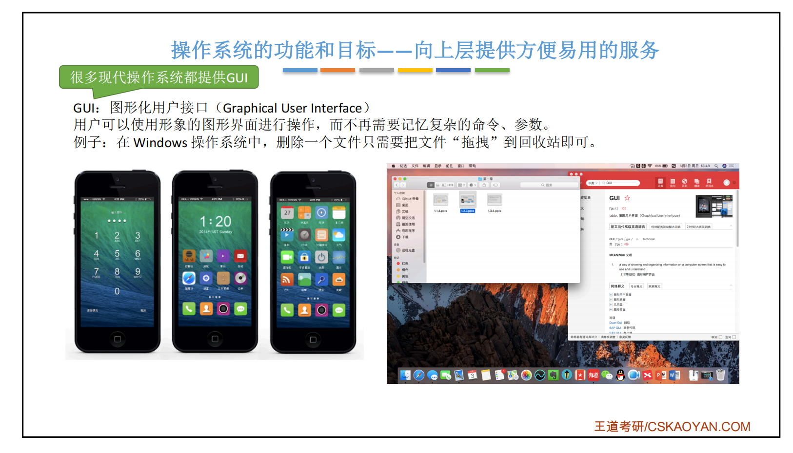

> **区分“直接”和“间接”**
> - 用户通过命令接口或 GUI 直接与操作系统交互。
> - 应用程序通过系统调用间接请求操作系统服务。

### 3. 作为扩充机器（虚拟机）

- **裸机**：没有配置任何软件、只包含物理硬件的计算机。
- **扩充机器（虚拟机）**：硬件经过操作系统封装后，呈现出功能更强、使用更方便的逻辑机器。

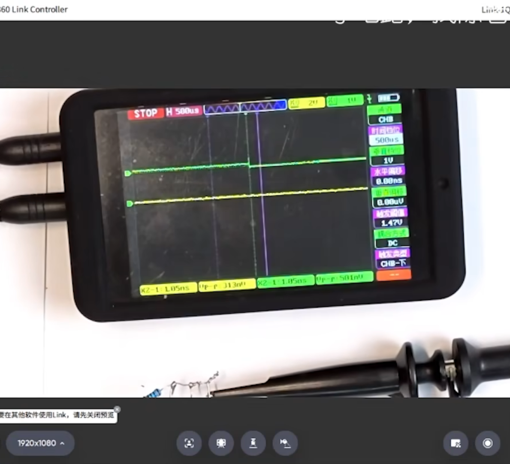

这里的“虚拟机”强调操作系统对裸机功能的抽象和扩充，不特指 VMware、VirtualBox 等由虚拟化平台创建的虚拟计算机。

## 知识点回顾
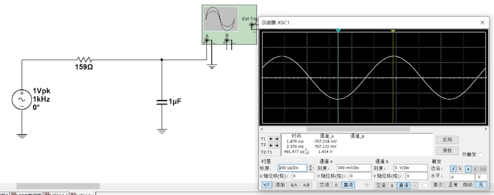

## 易错点

> **常见混淆**
> 1. 操作系统是**系统软件**，不是硬件，也不是普通应用软件。
> 2. 命令接口供用户直接使用；程序接口供应用程序通过系统调用间接使用。
> 3. 系统调用是程序接口的组成部分，库函数不一定会触发系统调用。
> 4. “扩充机器”强调对裸机功能的封装和扩展，不是简单地在硬件上安装任意软件。

## 参考资料

- 《2021 王道考研操作系统》
- [操作系统的概念、功能和目标（CSDN）](https://blog.csdn.net/weixin_43914604/article/details/104408571)
- [配套视频（哔哩哔哩）](https://www.bilibili.com/video/av70156862)
