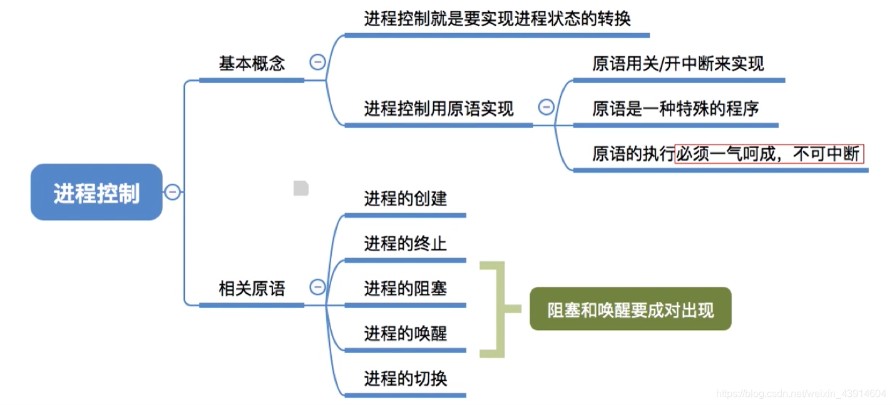
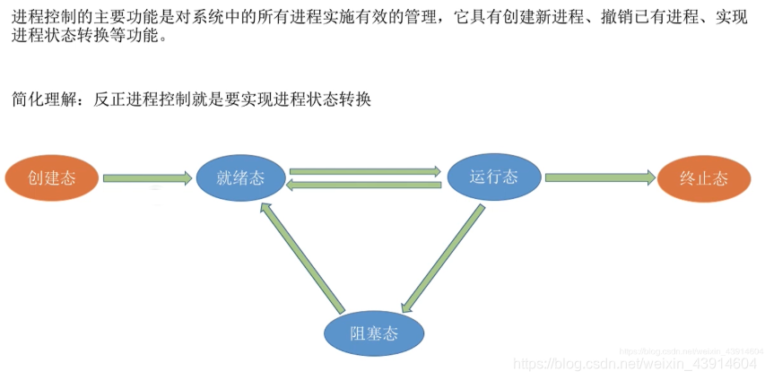
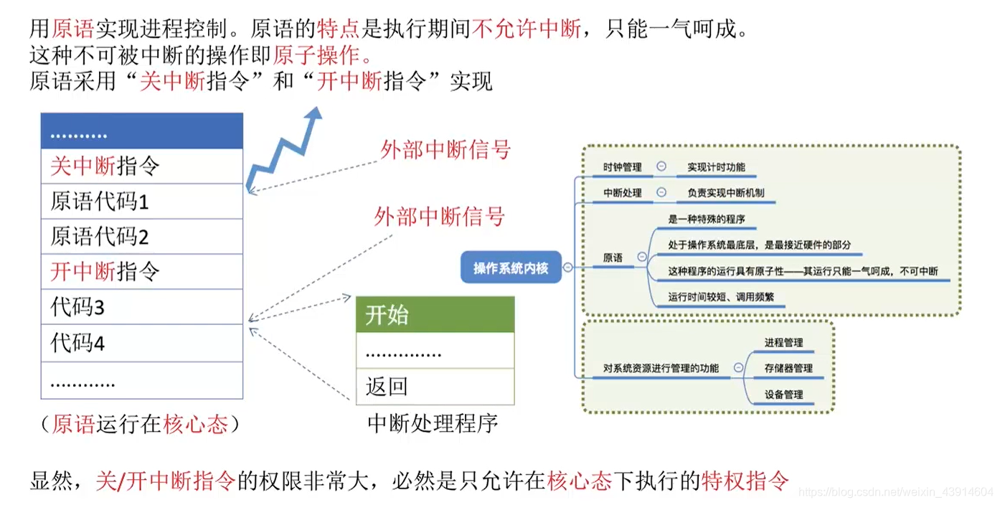
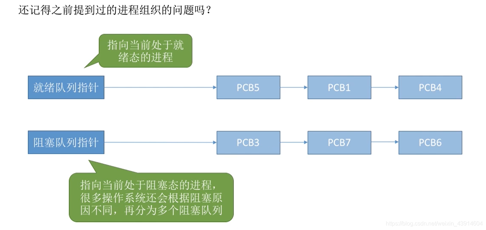
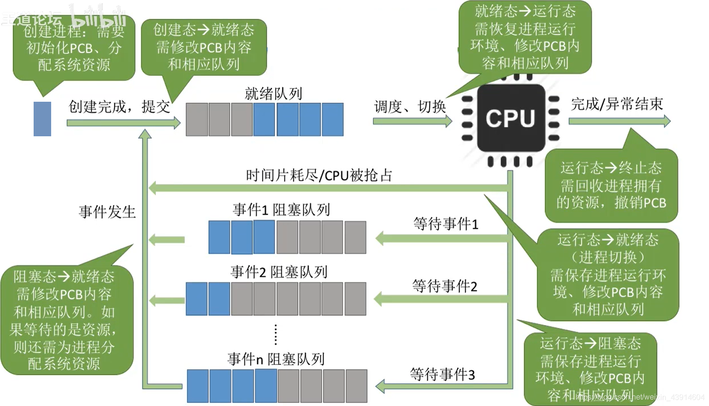
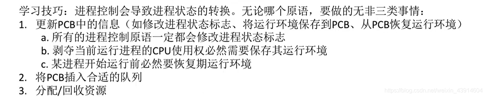
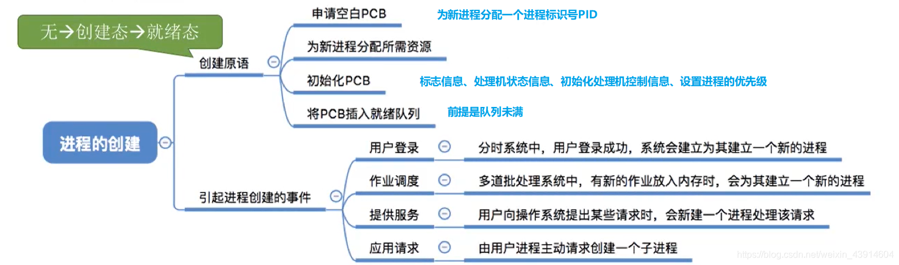
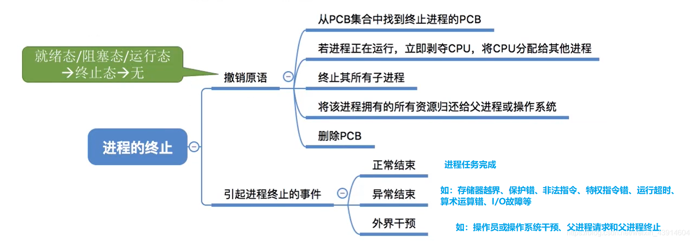
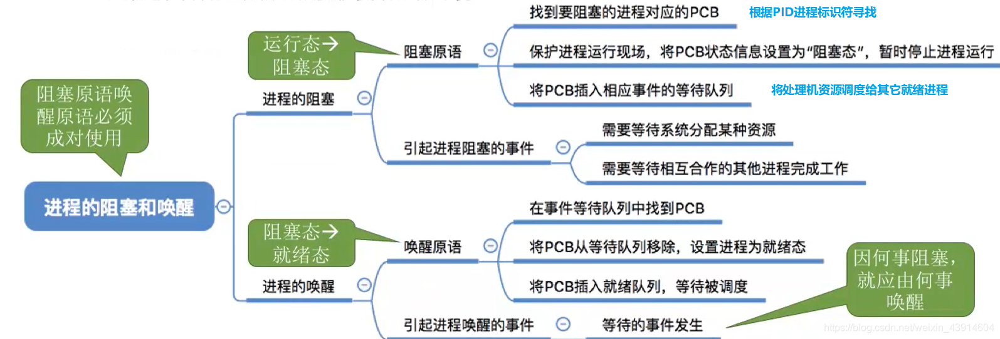
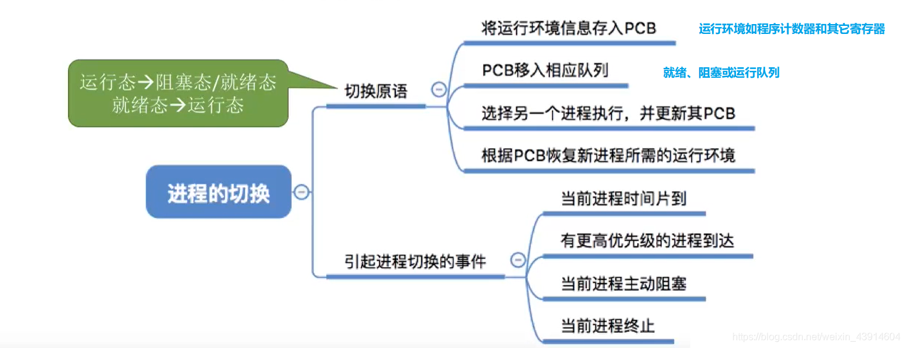

---

#### 0.思维导图

#### 1.什么是进程控制？

#### 2.原语实现对进程的控制

- 关于原语的作用和处在操作系统内核的重要地位可参考： [https://blog.csdn.net/weixin\_43914604/article/details/104452762](https://blog.csdn.net/weixin_43914604/article/details/104452762)  
	

#### 3.回忆进程的组织

- 进程在操作系统中的组织使各个进程能够有序的进行切换和运行  
	

#### 4.进程控制大致图解

> 这里说明一下调度和切换的区别：  
> `调度` 是指决定资源分配给哪个进程的行为，是一种决策行为  
> `切换` 是指实际分配的行为，是执行行为  
> 一般来说现有资源调度，后有进程切换

#### 5.进程控制原语的相同点

- 接下来我们就具体学习一下关于进程控制的五种原语， `进程的创建、终止、唤醒、阻塞、切换；`

#### 6.进程控制的五种原语

##### （1）进程的创建原语

##### （2）进程的终止原语

##### （3）进程的唤醒和阻塞原语

- 进程的阻塞和唤醒原语是 `成对存在` 的，必须 `成对使用` 。
- `阻塞原语` 是由被阻塞进程自我调用实现的
- `唤醒原语` 是由一个被唤醒进程合作或被其他相关的进程调用实现的  
	

##### （4）进程的切换原语

参考： [https://www.bilibili.com/video/av70156862?p=9](https://www.bilibili.com/video/av70156862?p=9)