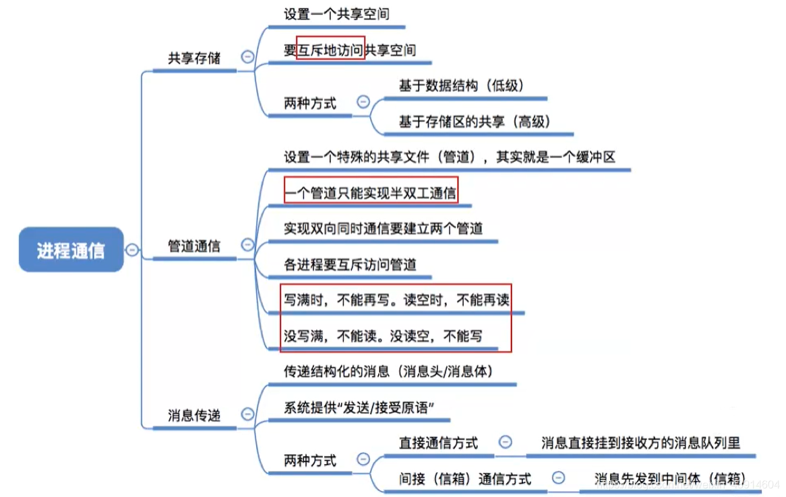
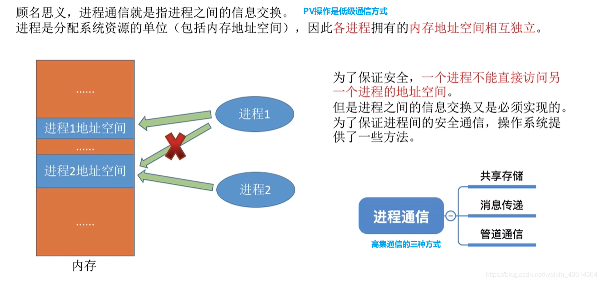
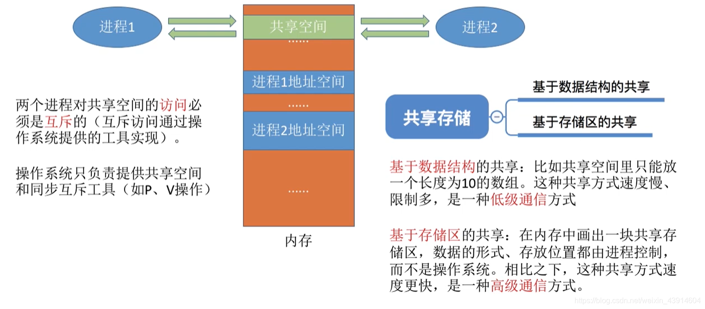
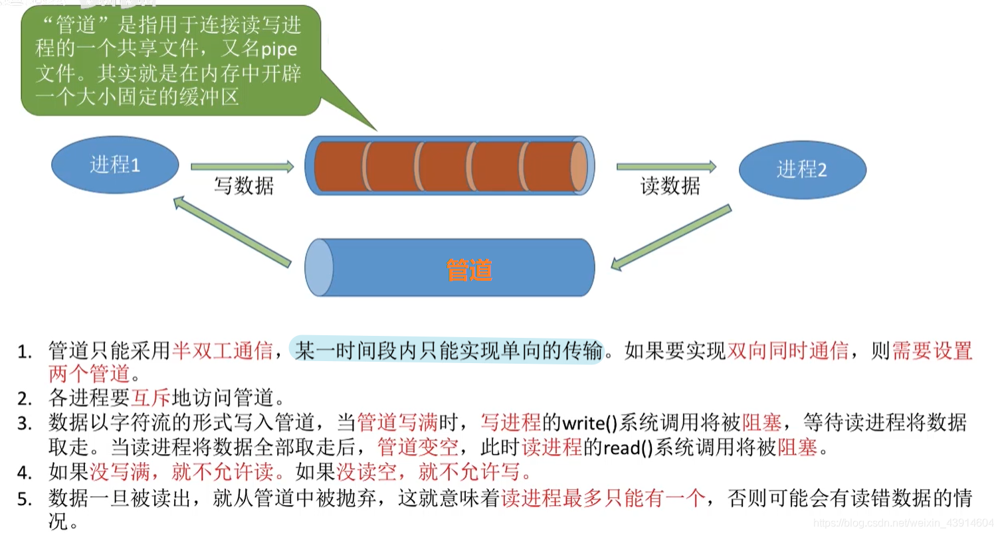
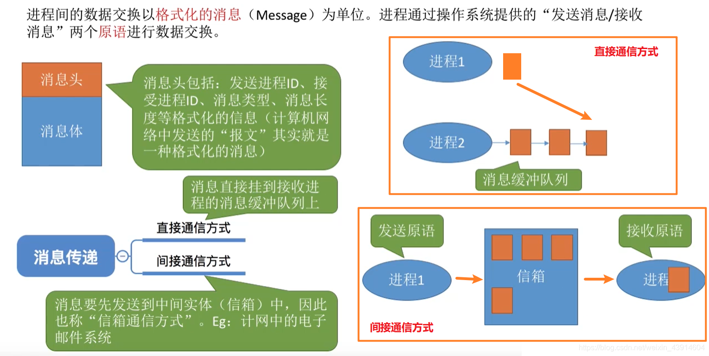

---

#### 0.思维导图

#### 1.什么是进程通信？

- 图中我们可以知道什么是进程通信，以及进程通信的低级和高级方式；
- 我们还可以知道为什么要引入进程通信方式，以及它的意义  
	

#### 2.共享存储

- 共享一块大家都可以访问的空间，一次只能有一个进程进行读或写操作  
	

#### 3.管道通信

#### 4.消息传递

- 发送信息的进程将消息头写好，接受信息进程根据消息头读取信息或寻找信封是哪一个  
	  
	参考： [https://www.bilibili.com/video/av70156862?p=10](https://www.bilibili.com/video/av70156862?p=10)