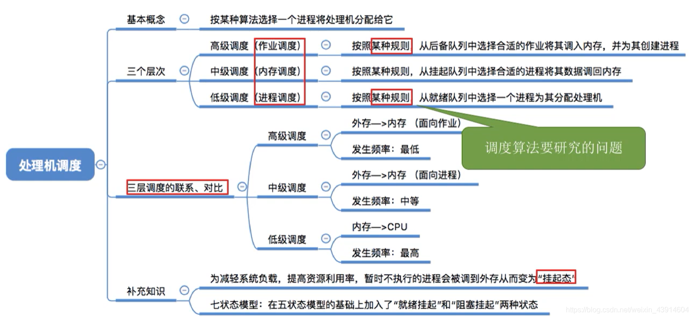
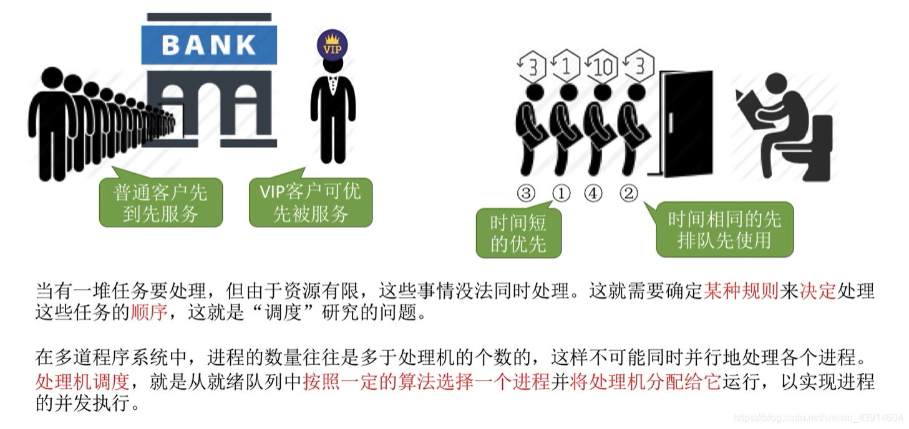
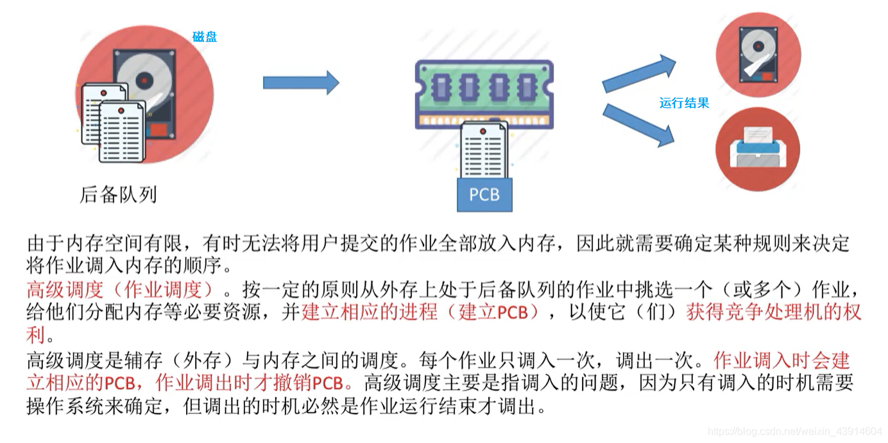
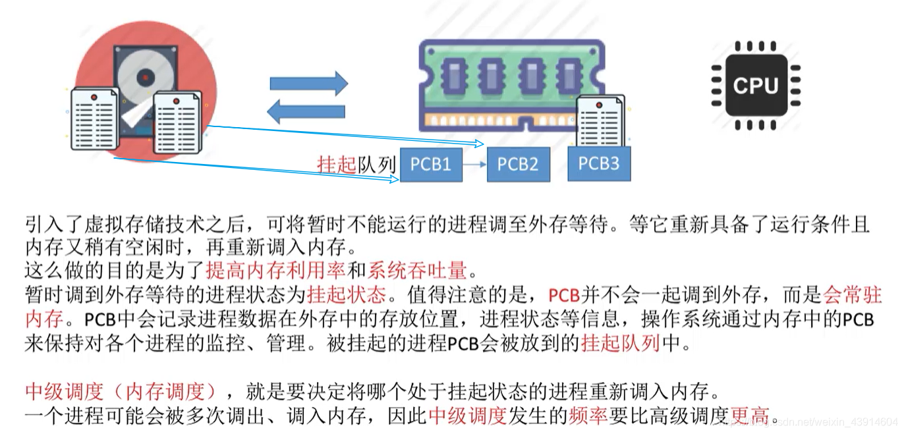
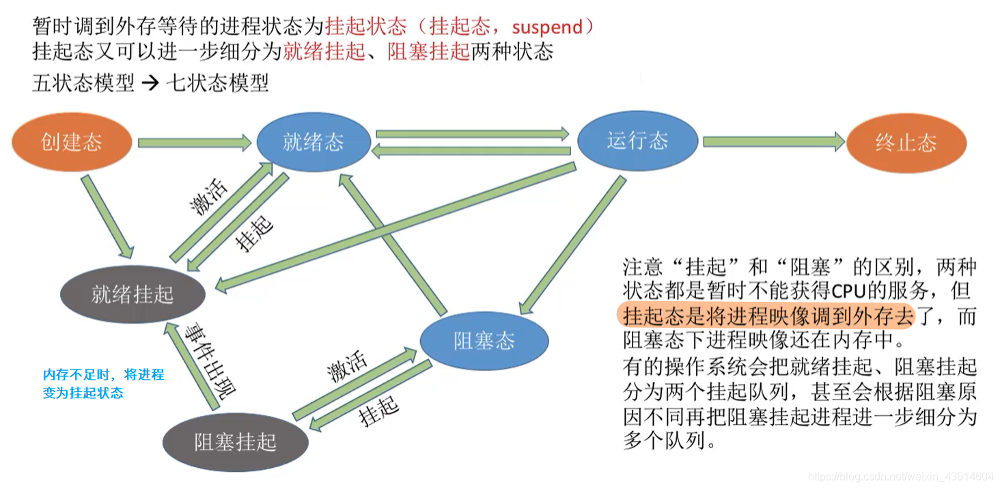
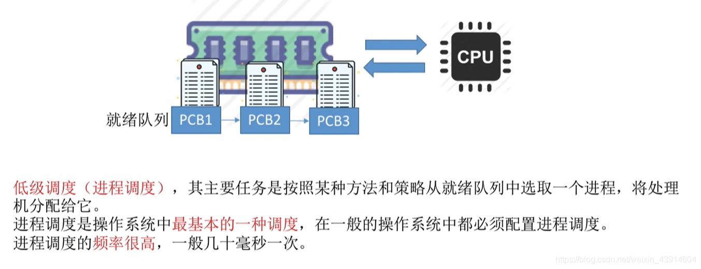
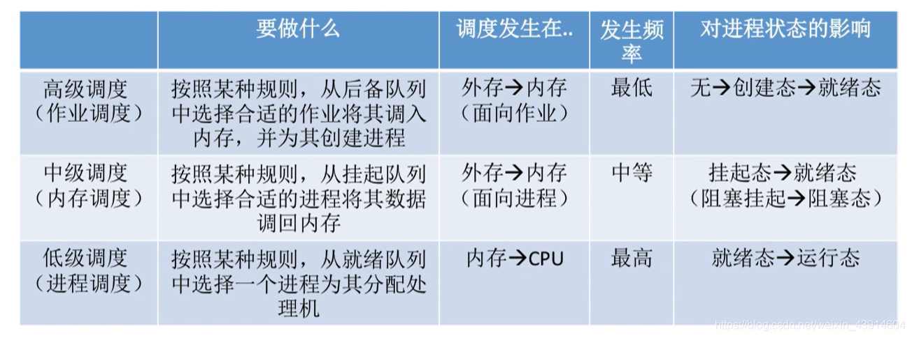

##### 0.思维导图

##### 1.调度的基本概念

##### 2.调度的三个层次

###### （1）高级调度（ 作业调度）

###### （2）中级调度（内存调度）

###### （3）进程的挂起状态与七状态模型

###### （4）低级调度（进程调度）

###### （5）三层调度的联系和对比

  
参考： [https://www.bilibili.com/video/BV1YE411D7nH?p=12](https://www.bilibili.com/video/BV1YE411D7nH?p=12)