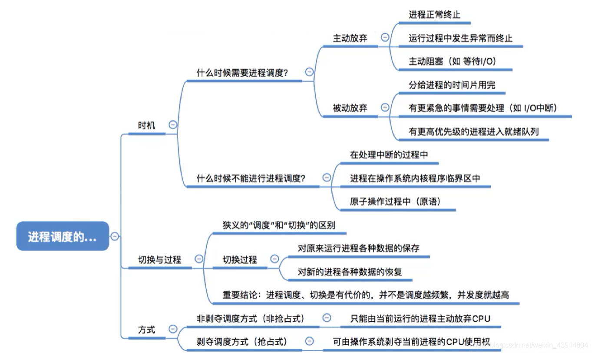
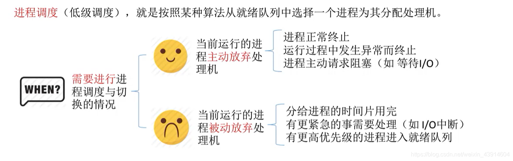
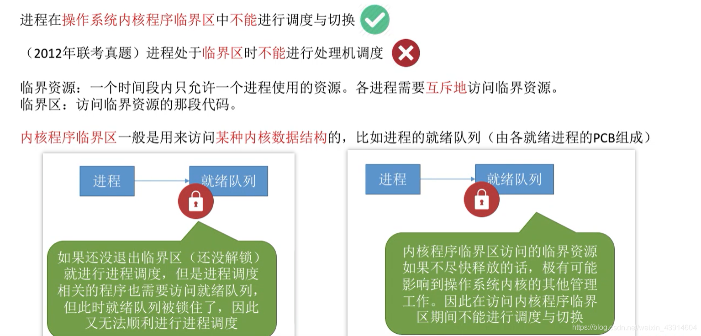
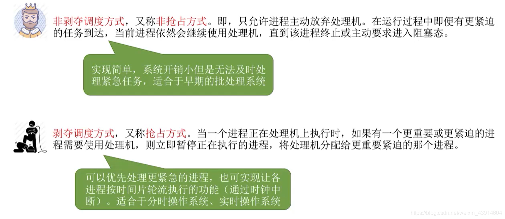

---

##### 0.思维导图

##### 1.时机

###### （1）什么时候进行进程调度？

###### （2）什么时候不能进行进程调度？

###### （3）OS内核程序临界区与普通临界区的进程调度情况

  

##### 2.进程调度的方式

- 所谓进程调度方式，是指当某个进程正在处理机上执行时，若有某个更为重要或紧迫的进程需要处理，即有优先权更高的进程进入就绪队列，此时应如何分配处理机。  
	