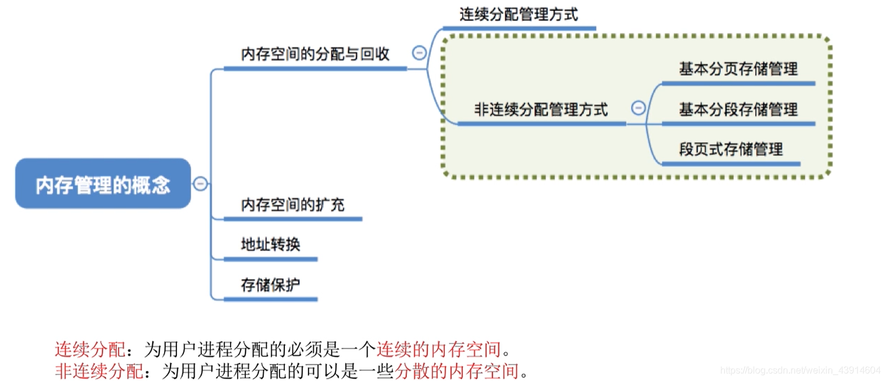
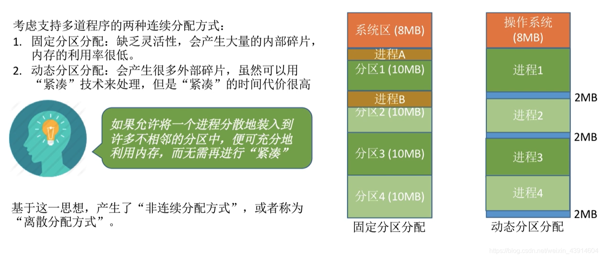
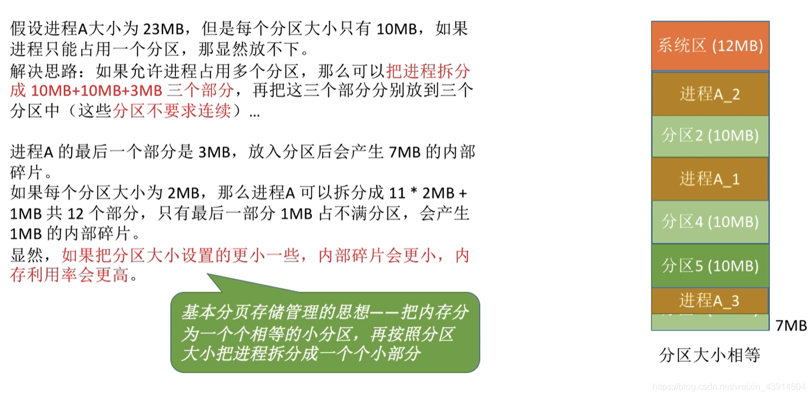
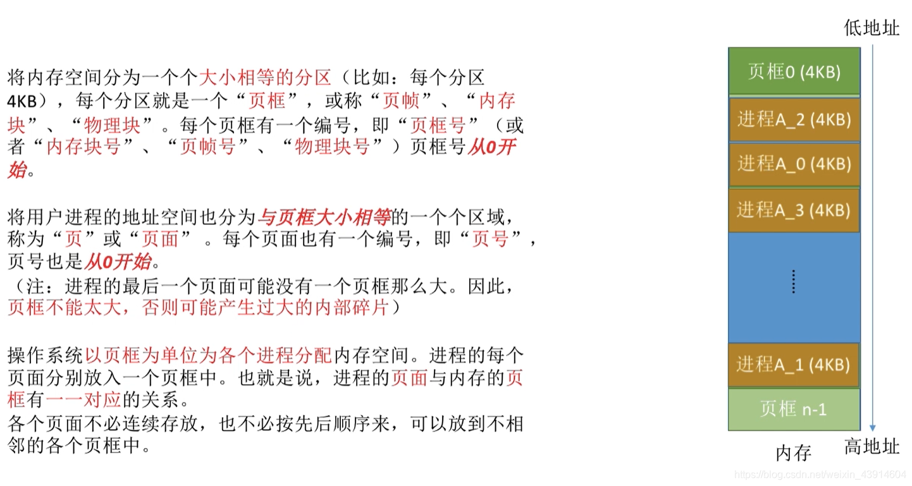
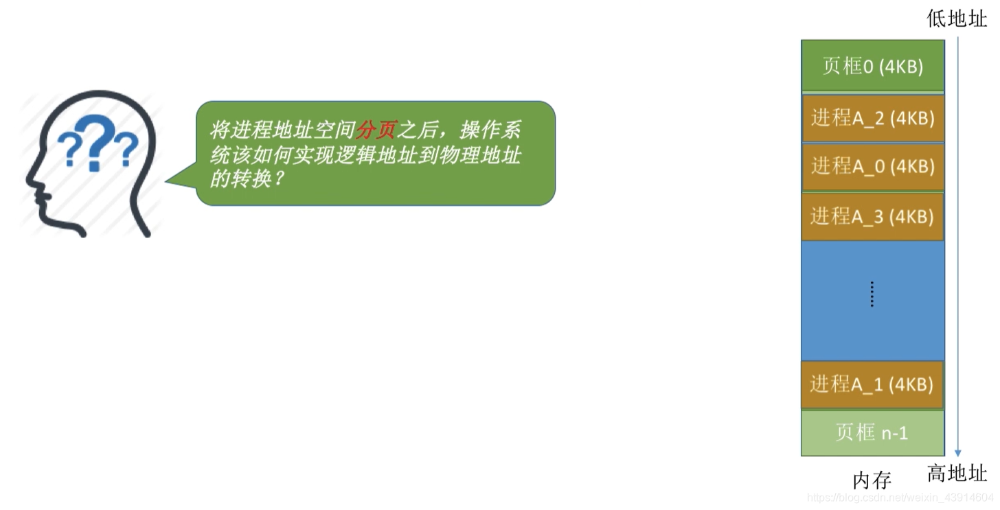
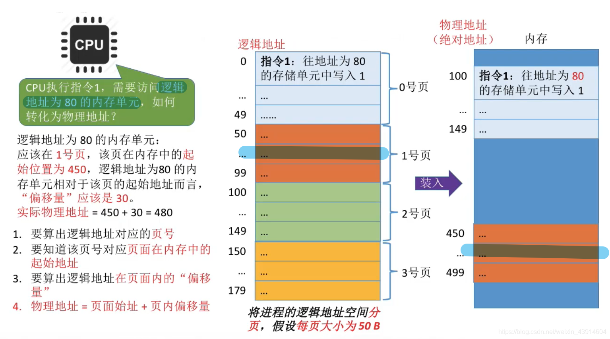
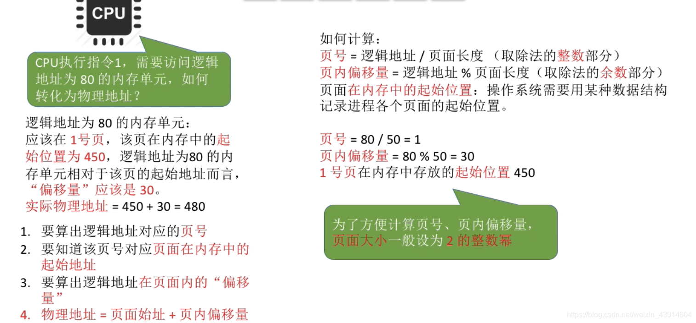
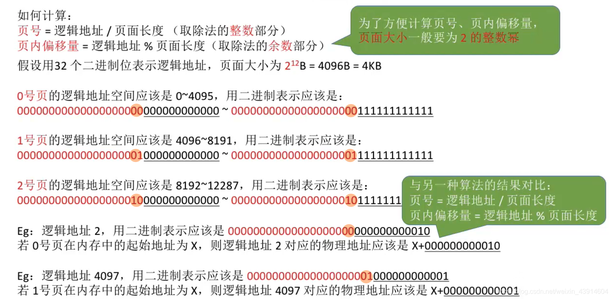
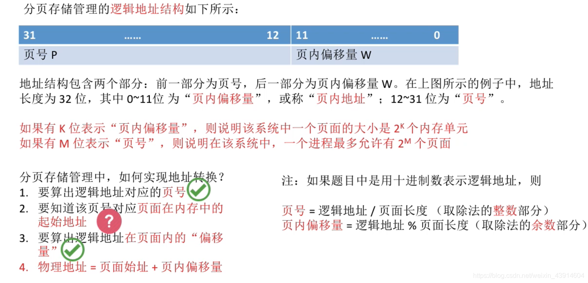
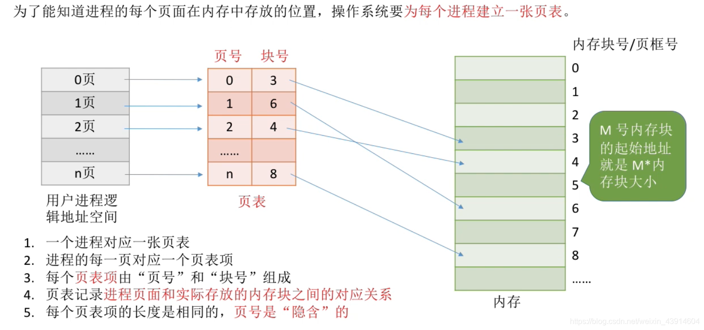

---

## 0.思维导图

## 1.为什么学习分页存储？

## 2.基本分页存储管理的思想

## 3.分页存储管理的重要概念

## 4.如何实现地址的转换

  

### 如何计算页号和页偏移量

  
**为什么页面大小一般设为2的整数次幂？**  
  

### 分页存储的逻辑结构

### 如何知道页面在内存中的起始地址？

- 这里引入一个新的概念： `页表`  
	

参考：《王道操作系统》