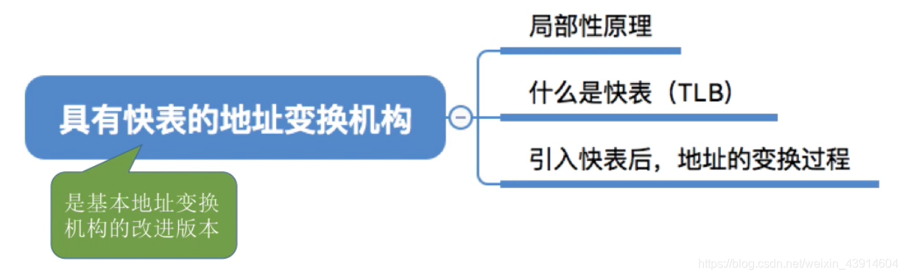
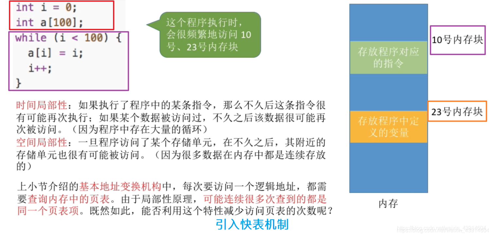
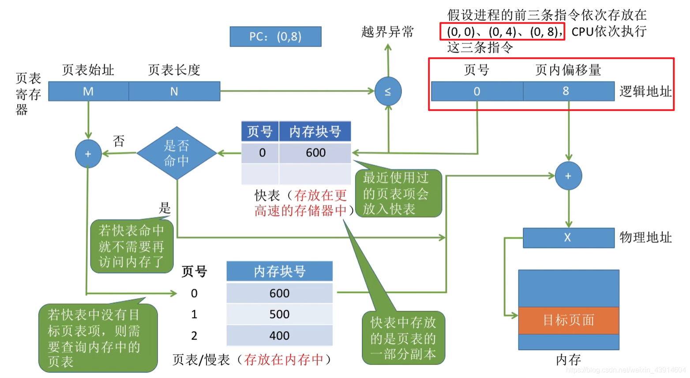
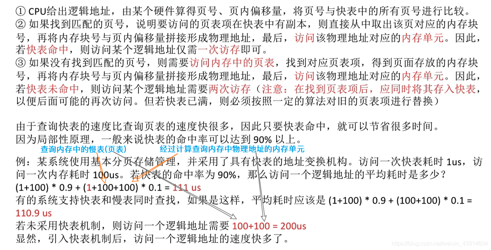
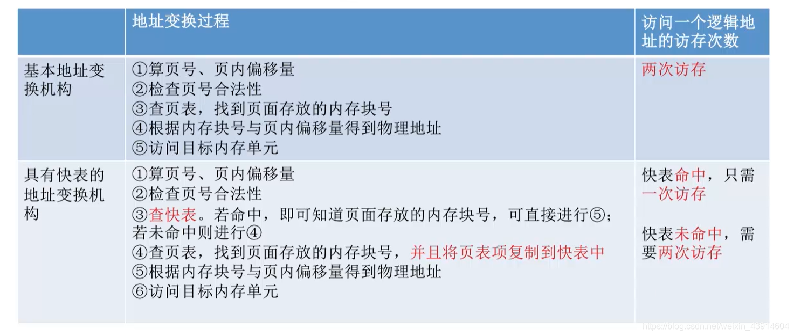

---

## 0.思维导图

- 上一篇文章学习了 [分页存储管理的基本地址变换结构](https://blog.csdn.net/weixin_43914604/article/details/105909842),这一篇文章是对基本地址变换结构的改进版。  
	

## 1.局部性原理引入快表机制

## 2.快表（TLB）

### 一个例图了解基于快表的地址变换结构

  
**引入快表后，地址变换的过程的文字描述：**  

## 3.基本地址变换与快表地址变换的比较

参考：《王道操作系统》